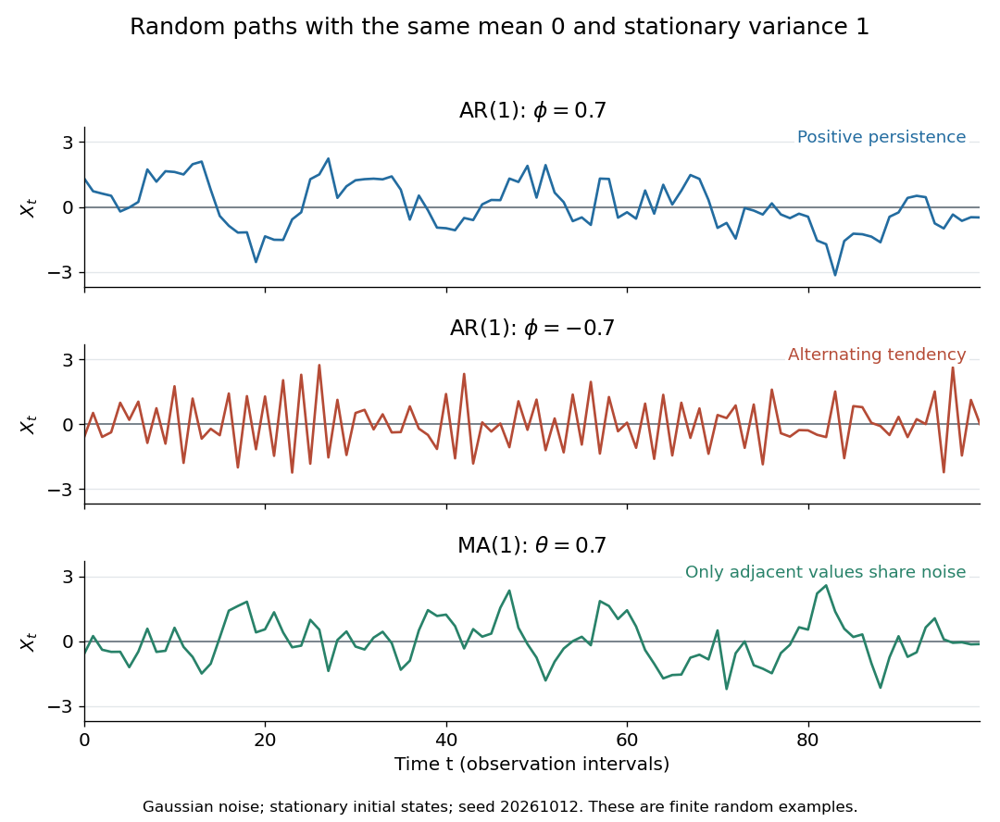

# Time series

↑ **Parent:** [Probability and statistics](probability-and-statistics.md)  
ⓦ [Wiki](https://en.wikipedia.org/wiki/Time_series)

A [time series](time-series.md) is a sequence of observations indexed by time: hourly temperatures, daily sales, or successive measurements of a fluctuating signal. A probabilistic model treats these observations as one [sample path](stochastic-process.md#sample-path) of a [stochastic process](stochastic-process.md) $(X_t)$. For equally spaced observations, take $t\in\mathbb Z$ and measure a [lag of a time series](#lag-of-a-time-series) in observation intervals. The order matters: shuffling a record preserves its observed values but destroys information about how one value follows another.

Two basic ways to model temporal dependence are an [autoregressive model](#autoregressive-model), which feeds past observations into the next value, and a [moving-average model](#moving-average-model), which combines present and past [white noise](#white-noise). An [AR(1)](#autoregressive-process-of-order-one) carries a disturbance forward with diminishing weights; an [MA(1)](#moving-average-process-of-order-one) carries it into just two observations. Their [autocorrelation functions](#autocorrelation) make this difference visible. A [weakly stationary process](#weakly-stationary-process) supplies a common [mean](expected-value.md) and a lag-dependent [autocovariance](#autocovariance) with which to describe that dependence.

These models help forecast future observations and quantify the uncertainty of averages. Successive measurements need not provide as much information as the same number of [independent random variables](random-variable.md#independent-random-variables): the [long-run variance of a stationary process](#long-run-variance-of-a-stationary-process) accounts for their accumulated [covariances](variance.md#covariance). Trend and [seasonality](#seasonality) require attention before fitting a stationary model; [differencing](#differencing) and a [seasonal difference operator](#seasonal-difference-operator) can help, but do not automatically make every process stationary. See [Peter Bartlett, Introduction to Time Series Analysis, lecture 1: objectives and models](https://www.stat.berkeley.edu/~bartlett/courses/153-fall2010/lectures/1.pdf).

**[Figure 1](#image-stationary-gaussian-examples-positive-ar-1-persistence-negative-ar-1-alternation-and-ma-1-short-memory). Stationary Gaussian examples: positive AR(1) persistence, negative AR(1) alternation, and MA(1) short memory**.

The three illustrated [sample paths](stochastic-process.md#sample-path) have zero [mean](expected-value.md) and unit [variance](variance.md), so the visual comparison concerns dependence rather than scale. The [AR(1)](#autoregressive-process-of-order-one) paths start from their stationary [normal distribution](probability-distribution.md#normal-distribution), independently of future [discrete Gaussian white noise](#discrete-gaussian-white-noise); the [MA(1)](#moving-average-process-of-order-one) path includes the noise preceding its first observation. These are finite random examples, not exact pictures of an [ACF](#autocorrelation). Compare their theoretical [autocorrelation functions](#autocorrelation) in [autocorrelation](#autocorrelation).

Historically, Yule's 1927 study investigated disturbed periodicities in sunspot observations; it should not be read as the discovery of the particular [AR(1)](#autoregressive-process-of-order-one) examples here. Slutsky studied how summing random inputs could produce wave-like records, a warning against inferring a periodic cause from appearance alone. The editorial note to his 1937 English paper identifies the 1927 Russian original. See [G. Udny Yule, On a method of investigating periodicities in disturbed series, with special reference to Wolfer's sunspot numbers (1927)](https://doi.org/10.1098/rsta.1927.0007) and [Eugen Slutsky, The Summation of Random Causes as the Source of Cyclic Processes (1937), including the editorial note on the 1927 original](https://www.e-m-h.org/Slutzky1937.pdf).

**Table of contents**

- [Lag of a time series](#lag-of-a-time-series)
- [Three-point quadratic reproduction forces the identity filter](#three-point-quadratic-reproduction-forces-the-identity-filter)
- [Five-point symmetric quadratic trend smoother](#five-point-symmetric-quadratic-trend-smoother)
- [Turning point test of randomness](#turning-point-test-of-randomness)
- [Exponential smoothing](#exponential-smoothing)
  - [Double exponential smoothing](#double-exponential-smoothing)
    - [Brown's double exponential smoothing](#brown-s-double-exponential-smoothing)
    - [Holt's linear trend method](#holt-s-linear-trend-method)
  - [Simple exponential smoothing](#simple-exponential-smoothing)
- [Wold decomposition](#wold-decomposition)
- [Best linear prediction from a finite past](#best-linear-prediction-from-a-finite-past)
  - [Recursive forecasts of an autoregressive process](#recursive-forecasts-of-an-autoregressive-process)
    - [Forecasts of an integrated AR(1) process](#forecasts-of-an-integrated-ar-1-process)
  - [Finite-past innovation](#finite-past-innovation)
  - [Two-step prediction for an MA(1) process](#two-step-prediction-for-an-ma-1-process)
  - [Finite-sample innovations of an MA(1) process](#finite-sample-innovations-of-an-ma-1-process)
    - [Limiting MA(1) innovations coefficient](#limiting-ma-1-innovations-coefficient)
- [Best linear prediction from an infinite past](#best-linear-prediction-from-an-infinite-past)
- [State-space model (time series)](#state-space-model-time-series)
  - [Three-coordinate state realization of an ARMA(1,1) process](#three-coordinate-state-realization-of-an-arma-1-1-process)
    - [Stationary initialization of an ARMA(1,1) state](#stationary-initialization-of-an-arma-1-1-state)
  - [Local-level state-space model](#local-level-state-space-model)
  - [Gaussian innovation likelihood](#gaussian-innovation-likelihood)
  - [Stationary initialization of a scalar linear state-space model](#stationary-initialization-of-a-scalar-linear-state-space-model)
- [Anticausal time series](#anticausal-time-series)
- [Linear process (time series)](#linear-process-time-series)
  - [Two-geometric-coefficient expansion of a causal ARMA(2,1) process](#two-geometric-coefficient-expansion-of-a-causal-arma-2-1-process)
- [Autoregressive conditional heteroscedasticity](#autoregressive-conditional-heteroscedasticity)
  - [Sign symmetry of an ARCH process](#sign-symmetry-of-an-arch-process)
  - [Lag-two ARCH process](#lag-two-arch-process)
    - [Parity decomposition of a lag-two ARCH process](#parity-decomposition-of-a-lag-two-arch-process)
  - [Volatility clustering](#volatility-clustering)
- [Seasonality](#seasonality)
  - [Seasonal extraction by a centred moving average](#seasonal-extraction-by-a-centred-moving-average)
- [Long-memory time series](#long-memory-time-series)
- [Short-memory time series](#short-memory-time-series)
- [Periodically correlated process](#periodically-correlated-process)
- [Differencing](#differencing)
  - [Seasonal difference operator](#seasonal-difference-operator)
    - [Seasonal differencing does not remove periodic variance](#seasonal-differencing-does-not-remove-periodic-variance)
- [Innovation process](#innovation-process)
  - [Gaussian Brownian drift filter](#gaussian-brownian-drift-filter)
    - [Innovation exponential for Gaussian drift filtering](#innovation-exponential-for-gaussian-drift-filtering)
      - [Finite-horizon pricing density for Gaussian drift learning](#finite-horizon-pricing-density-for-gaussian-drift-learning)
    - [Brownian endpoint sufficiency for a constant drift](#brownian-endpoint-sufficiency-for-a-constant-drift)
  - [Binary Brownian drift filter](#binary-brownian-drift-filter)
  - [Linear innovation process](#linear-innovation-process)
- [Naive time-series forecast](#naive-time-series-forecast)
- [Causal time series](#causal-time-series)
  - [Causal time-series representation](#causal-time-series-representation)
- [Stationary process](#stationary-process)
  - [Strictly stationary process](#strictly-stationary-process)
    - [Strong mixing of a stationary process](#strong-mixing-of-a-stationary-process)
    - [Ergodic stationary process](#ergodic-stationary-process)
  - [Nonstationary process](#nonstationary-process)
  - [Weakly stationary process](#weakly-stationary-process)
    - [Linear filter of a stationary time series](#linear-filter-of-a-stationary-time-series)
      - [Filter generating function](#filter-generating-function)
        - [Filter transfer function](#filter-transfer-function)
      - [Composition of absolutely summable time-series filters](#composition-of-absolutely-summable-time-series-filters)
      - [Filter gain](#filter-gain)
      - [Spectral density transformation under a linear filter](#spectral-density-transformation-under-a-linear-filter)
        - [Repeated symmetric filtering can amplify an oscillation](#repeated-symmetric-filtering-can-amplify-an-oscillation)
    - [Spectral measure of a stationary time series](#spectral-measure-of-a-stationary-time-series)
      - [Spectral measure of a random harmonic oscillation](#spectral-measure-of-a-random-harmonic-oscillation)
      - [Spectral distribution function of a stationary time series](#spectral-distribution-function-of-a-stationary-time-series)
    - [Spectral measure of a stationary random field](#spectral-measure-of-a-stationary-random-field)
      - [Infinite-aperture spectral normalization](#infinite-aperture-spectral-normalization)
    - [Long-run variance of a stationary process](#long-run-variance-of-a-stationary-process)
      - [Effective sample size of a stationary sample](#effective-sample-size-of-a-stationary-sample)
    - [Spectral density of a stationary process](#spectral-density-of-a-stationary-process)
      - [Triangular spectral density of a stationary time series](#triangular-spectral-density-of-a-stationary-time-series)
      - [Cross-spectrum of two stationary time series](#cross-spectrum-of-two-stationary-time-series)
      - [One-sided spectral density of a real stationary time series](#one-sided-spectral-density-of-a-real-stationary-time-series)
      - [Positive-frequency spectral normalization](#positive-frequency-spectral-normalization)
      - [Existence of a time-series spectral density](#existence-of-a-time-series-spectral-density)
      - [Cycles-per-time spectral density](#cycles-per-time-spectral-density)
      - [Spectral representation theorem for a stationary time series](#spectral-representation-theorem-for-a-stationary-time-series)
      - [Periodogram](#periodogram)
        - [Exponential limit of a one-sided periodogram](#exponential-limit-of-a-one-sided-periodogram)
        - [Finite-record Fourier covariance bound](#finite-record-fourier-covariance-bound)
        - [Local periodogram smoothing](#local-periodogram-smoothing)
    - [Autocovariance](#autocovariance)
      - [Sample autocovariance function](#sample-autocovariance-function)
      - [Autocorrelation](#autocorrelation)
        - [Correlation time](#correlation-time)
        - [Partial autocorrelation function](#partial-autocorrelation-function)
          - [Sample partial autocorrelation function](#sample-partial-autocorrelation-function)
        - [Sample autocorrelation function](#sample-autocorrelation-function)
          - [Correlogram](#correlogram)
    - [White noise](#white-noise)
      - [Discrete Gaussian white noise](#discrete-gaussian-white-noise)
      - [Continuous-time Gaussian white noise](#continuous-time-gaussian-white-noise)
      - [Strong white noise](#strong-white-noise)
      - [Weak white noise](#weak-white-noise)
- [Autoregressive moving-average model](#autoregressive-moving-average-model)
  - [Autocovariance tail recurrence of a causal ARMA process](#autocovariance-tail-recurrence-of-a-causal-arma-process)
  - [Canonical identifiability of Gaussian ARMA models](#canonical-identifiability-of-gaussian-arma-models)
  - [Autoregressive integrated moving average](#autoregressive-integrated-moving-average)
  - [ARMA coefficient recursions](#arma-coefficient-recursions)
    - [ARMA(1,1) causal and inverse coefficients](#arma-1-1-causal-and-inverse-coefficients)
  - [Innovation coefficients of an ARMA(1,q) process](#innovation-coefficients-of-an-arma-1-q-process)
  - [Common factor cancellation in an ARMA model](#common-factor-cancellation-in-an-arma-model)
  - [Autocovariance of a causal ARMA(1,1) process](#autocovariance-of-a-causal-arma-1-1-process)
  - [Spectral density of an ARMA process](#spectral-density-of-an-arma-process)
  - [White-noise addition to an ARMA(1,1) process](#white-noise-addition-to-an-arma-1-1-process)
  - [Root reflection of an ARMA representation](#root-reflection-of-an-arma-representation)
  - [Causality and invertibility root criteria for an ARMA model](#causality-and-invertibility-root-criteria-for-an-arma-model)
  - [Invertible time-series representation](#invertible-time-series-representation)
  - [Order identification by autocorrelation cutoffs](#order-identification-by-autocorrelation-cutoffs)
  - [Backshift operator](#backshift-operator)
  - [Autoregressive model](#autoregressive-model)
    - [Fibonacci-coefficient autoregression](#fibonacci-coefficient-autoregression)
    - [Yule-Walker equations](#yule-walker-equations)
    - [Explosive affine recursion with symmetric bounded noise](#explosive-affine-recursion-with-symmetric-bounded-noise)
    - [Conditional likelihood of an initialized Gaussian AR(2) process](#conditional-likelihood-of-an-initialized-gaussian-ar-2-process)
    - [Autoregressive polynomial](#autoregressive-polynomial)
      - [Autoregressive operator](#autoregressive-operator)
      - [Unit root](#unit-root)
        - [Oscillatory unit-root diagnosis from an undamped sample autocorrelation](#oscillatory-unit-root-diagnosis-from-an-undamped-sample-autocorrelation)
    - [Causality root criterion for an autoregressive model](#causality-root-criterion-for-an-autoregressive-model)
      - [Exponential autocovariance decay of a causal autoregression](#exponential-autocovariance-decay-of-a-causal-autoregression)
    - [Noncausal stationary autoregression](#noncausal-stationary-autoregression)
      - [Two-sided stationary inverse of an autoregressive polynomial](#two-sided-stationary-inverse-of-an-autoregressive-polynomial)
    - [Unit-root autoregressive process](#unit-root-autoregressive-process)
      - [Dickey–Fuller test](#dickey-fuller-test)
    - [Periodic autoregressive model of order one](#periodic-autoregressive-model-of-order-one)
      - [Periodic Yule-Walker equations](#periodic-yule-walker-equations)
    - [Autoregressive process of order one](#autoregressive-process-of-order-one)
      - [Autocovariance of an AR(1) process](#autocovariance-of-an-ar-1-process)
      - [Finite initialization of an AR(1) process](#finite-initialization-of-an-ar-1-process)
      - [Poisson-kernel expansion of an AR(1) spectrum](#poisson-kernel-expansion-of-an-ar-1-spectrum)
      - [Autocovariance of an AR(1) process observed with white noise](#autocovariance-of-an-ar-1-process-observed-with-white-noise)
        - [Invertible ARMA factorization of an AR(1)-plus-noise process](#invertible-arma-factorization-of-an-ar-1-plus-noise-process)
      - [Stationary versus causal solution of a two-sided AR(1) equation](#stationary-versus-causal-solution-of-a-two-sided-ar-1-equation)
      - [Gaussian AR1 bridge](#gaussian-ar1-bridge)
      - [Stationary Gaussian AR1 likelihood](#stationary-gaussian-ar1-likelihood)
        - [Conditional and stationary AR1 likelihood estimators](#conditional-and-stationary-ar1-likelihood-estimators)
      - [Yule–Walker estimator for an autoregressive process of order one](#yule-walker-estimator-for-an-autoregressive-process-of-order-one)
      - [Gaussian autoregressive conditional precision](#gaussian-autoregressive-conditional-precision)
  - [Moving-average model](#moving-average-model)
    - [Multivariate moving-average model](#multivariate-moving-average-model)
      - [Covariance and cross-spectrum of a vector MA(1)](#covariance-and-cross-spectrum-of-a-vector-ma-1)
    - [Moving-average polynomial](#moving-average-polynomial)
      - [Moving-average operator](#moving-average-operator)
    - [Odd-subsample long-run variance of a moving average](#odd-subsample-long-run-variance-of-a-moving-average)
    - [Infinite moving-average representation](#infinite-moving-average-representation)
      - [Covariance of quadratic transforms of a linear process](#covariance-of-quadratic-transforms-of-a-linear-process)
    - [Invertibility of a moving-average model](#invertibility-of-a-moving-average-model)
      - [Moving-average root reflection](#moving-average-root-reflection)
    - [Moving-average process of order one](#moving-average-process-of-order-one)
      - [Autocovariance of an MA(1) process](#autocovariance-of-an-ma-1-process)
- [Bispectrum](#bispectrum)
  - [Trispectrum](#trispectrum)

## Lag of a time series

↑ **Parent:** [Time series](time-series.md)

A [lag of a time series](#lag-of-a-time-series) is a separation between observation indices. In an equally spaced [time series](time-series.md), lag $h=3$ compares observations three intervals apart: for hourly readings this is three hours, while for daily readings it is three days. Positive and negative lags describe the same separation in opposite directions. The [autocovariance](#autocovariance) and [autocorrelation](#autocorrelation) of a real [weakly stationary process](#weakly-stationary-process) are even functions of lag.

## Three-point quadratic reproduction forces the identity filter

↑ **Parent:** [Time series](time-series.md)

A symmetric three-point smoother with weights $(a,b,a)$ reproduces constants only if $2a+b=1$. Reproducing quadratic trends also requires $2a=0$, so $a=0$ and $b=1$. Thus the identity [estimator](statistical-modelling.md#estimator) $X_t$ is unbiased, but there is no nontrivial three-point linear smoother reproducing every quadratic. An assertion excluding even the identity [estimator](statistical-modelling.md#estimator) is false. This clarifies why the [five-point symmetric quadratic trend smoother](#five-point-symmetric-quadratic-trend-smoother) is the first symmetric nontrivial example.

## Five-point symmetric quadratic trend smoother

↑ **Parent:** [Time series](time-series.md)

For observations $X_t=T_t+\varepsilon_t$ with a quadratic trend and uncorrelated equal-variance errors, a symmetric five-point [linear filter of a stationary time series](#linear-filter-of-a-stationary-time-series) has weights $(a,b,c,b,a)$. Reproducing every quadratic requires $2a+2b+c=1$ and $8a+2b=0$. Substitution gives $b=-4a$, $c=1+6a$ and error [variance](variance.md) $\sigma^2(70a^2+12a+1)$. Its unique minimum occurs at $a=-3/35$, producing the displayed weights and [variance](variance.md) $17\sigma^2/35$. Negative weights are allowed: this is a linear weighted smoother, not a convex average. Applying a linear filter to a deterministic trend plus stationary errors does not assert that the complete observation process is stationary.

## Turning point test of randomness

↑ **Parent:** [Time series](time-series.md)

For independent identically distributed continuous observations, count strict local maxima and minima at interior positions. Each turning indicator has probability $2/3$, adjacent indicators have joint probability $5/12$, indicators two positions apart have joint probability $9/20$, and more distant indicators are independent. Summing these covariances gives the displayed variance for $T\ge4$. The indicators form a bounded 2-dependent sequence, giving an asymptotically normal standardized count. Too few turns suggests persistent trends; too many suggests alternation. Ties and dependent observations require a different calibration.

## Exponential smoothing

↑ **Parent:** [Time series](time-series.md)  
ⓦ [Wiki](https://en.wikipedia.org/wiki/Exponential_smoothing)

With a fixed gain $0<K<1$, exponential smoothing recursively combines the newest observation with the preceding estimate. Iteration assigns geometric weights $K(1-K)^j$ to older observations, together with a diminishing weight on the initial estimate. The [steady-state local-level Kalman gain](control-theory.md#steady-state-local-level-kalman-gain) gives a probabilistic interpretation of this recursion.

### Double exponential smoothing

↑ **Parent:** [Exponential smoothing](#exponential-smoothing)

Double exponential smoothing supplements a smoothed level with a smoothed slope so that forecasts can extrapolate a local linear trend. Two common versions are [Holt's linear trend method](#holt-s-linear-trend-method), with separate level and slope gains, and [Brown's double exponential smoothing](#brown-s-double-exponential-smoothing), which applies the same smoothing gain twice. They are different algorithms, not two names for one recursion. Neither version by itself models seasonal variation.

<h4 id="brown-s-double-exponential-smoothing">Brown's double exponential smoothing</h4>

↑ **Parent:** [Double exponential smoothing](#double-exponential-smoothing)

For $0<\alpha<1$, set $s_t^{(1)}=\alpha X_t+(1-\alpha)s_{t-1}^{(1)}$ and $s_t^{(2)}=\alpha s_t^{(1)}+(1-\alpha)s_{t-1}^{(2)}$. Use the displayed corrected level and slope, then forecast $a_t+hb_t$. For an exact linear trend after initialization transients, the first and second smooths have lags $(1-\alpha)/\alpha$ and twice that lag; their difference recovers the slope and the corrected level removes the lag. This is distinct from [Holt's linear trend method](#holt-s-linear-trend-method).

<h4 id="holt-s-linear-trend-method">Holt's linear trend method</h4>

↑ **Parent:** [Double exponential smoothing](#double-exponential-smoothing)

Update the level and slope by $\ell_t=\alpha X_t+(1-\alpha)(\ell_{t-1}+b_{t-1})$ and $b_t=\beta(\ell_t-\ell_{t-1})+(1-\beta)b_{t-1}$, with gains in $(0,1)$. The first update compares the new observation with the previous level extrapolated one step; the second smooths the latest level increment. The displayed forecast extrapolates that local slope. This is a [double exponential smoothing](#double-exponential-smoothing) method for a nonseasonal trending [time series](time-series.md).

### Simple exponential smoothing

↑ **Parent:** [Exponential smoothing](#exponential-smoothing)

For $0<\alpha<1$, update a local level by the displayed recursion and forecast every future horizon by $\ell_t$. Iteration gives geometrically decreasing weights $\alpha(1-\alpha)^j$ on past observations and a vanishing contribution from the initial level. It is useful for a locally stable level without a persistent trend or seasonality. A trend causes lag, motivating [double exponential smoothing](#double-exponential-smoothing).

## Wold decomposition

↑ **Parent:** [Time series](time-series.md)

A second-order stationary [time series](time-series.md) decomposes into a deterministic component and a one-sided square-summable [linear filter of a stationary time series](#linear-filter-of-a-stationary-time-series) of its mutually orthogonal [linear innovations](#linear-innovation-process). Normalize $c_0=1$. For a causal invertible [ARMA](#autoregressive-moving-average-model) process with no deterministic component, the driving [white noise](#white-noise) is this innovation process: observations and innovations span the same closed past subspace, while the next innovation is orthogonal to it.

## Best linear prediction from a finite past

↑ **Parent:** [Time series](time-series.md)

The best mean-square [linear predictor](generalized-linear-model.md#linear-predictor) is [orthogonal projection](hilbert-space.md#orthogonal-projection) onto the span of the available centered observations, plus the known mean. Orthogonal innovations give a convenient basis of that span. Prediction at a future horizon must use only actually observed variables; it need not be a one-step predictor.

### Recursive forecasts of an autoregressive process

↑ **Parent:** [Best linear prediction from a finite past](#best-linear-prediction-from-a-finite-past)

For a causal [autoregressive process](#autoregressive-model) with mean $m$ and innovations orthogonal to the observed past, define $\widehat X_{T,h}=X_{T+h}$ for $h\le0$ and replace future innovations by zero. The displayed recursion is its [best linear prediction from a finite past](#best-linear-prediction-from-a-finite-past) when at least the last $p$ observations are available. Future innovation sums are orthogonal to those observations, which proves the projection property. Mere [white noise](#white-noise) does not guarantee that a linear forecast equals a conditional mean: that stronger interpretation requires martingale-difference or independent innovations.

<h4 id="forecasts-of-an-integrated-ar-1-process">Forecasts of an integrated AR(1) process</h4>

↑ **Parent:** [Recursive forecasts of an autoregressive process](#recursive-forecasts-of-an-autoregressive-process)

If the increments of $W$ have mean $\mu$ and centered increments satisfy a causal [autoregressive process](#autoregressive-model) of order one with $|\phi|<1$, sum their recursive forecasts to obtain the displayed expression. For fixed forecast origin, $\widehat W_{T,k}/k\to\mu$. One must observe the last increment, requiring $T\ge2$ or a known initial level $W_0$; a single observed level without an initial-level model does not identify that increment.

### Finite-past innovation

↑ **Parent:** [Best linear prediction from a finite past](#best-linear-prediction-from-a-finite-past)

Starting observations at a finite time, subtract the best linear predictor based on the available earlier observations. The resulting residual is orthogonal to their linear span. The unit-triangular relation between observations and residuals makes the residuals an [orthogonal basis](inner-product.md#orthogonal-basis) of the same finite observation space. These differ from infinite-past innovations until the initialization effect disappears.

<h3 id="two-step-prediction-for-an-ma-1-process">Two-step prediction for an MA(1) process</h3>

↑ **Parent:** [Best linear prediction from a finite past](#best-linear-prediction-from-a-finite-past)

In a centered MA(1) process, $X_{T+2}$ is uncorrelated with every observation through time $T$. Its best [linear predictor](generalized-linear-model.md#linear-predictor) from that information is therefore zero, with error [variance](variance.md) $\sigma^2(1+\theta^2)$. One-step innovation formulas using $X_{T+1}$ cannot be substituted when that observation is unavailable.

<h3 id="finite-sample-innovations-of-an-ma-1-process">Finite-sample innovations of an MA(1) process</h3>

↑ **Parent:** [Best linear prediction from a finite past](#best-linear-prediction-from-a-finite-past)

Starting at time one, the orthogonal residuals satisfy $U_t=X_t-\lambda_tU_{t-1}$, with $\lambda_t=\gamma_1/\varphi_{t-1}$ and $\varphi_t=\gamma_0-\gamma_1\lambda_t$. Earlier innovation directions have zero [covariance](variance.md#covariance) with the new observation. Explicitly, with $S_m=\sum_{j=0}^m\theta^{2j}$, $\varphi_t=\sigma^2S_t/S_{t-1}$ and $\lambda_t=\theta S_{t-2}/S_{t-1}$ for $t\ge2$. These formulas follow by induction from $S_t=(1+\theta^2)S_{t-1}-\theta^2S_{t-2}$, with $S_0=1$ and $S_1=1+\theta^2$. This includes $\theta=\pm1$, where $\varphi_t=\sigma^2(t+1)/t$.

<h4 id="limiting-ma-1-innovations-coefficient">Limiting MA(1) innovations coefficient</h4>

↑ **Parent:** [Finite-sample innovations of an MA(1) process](#finite-sample-innovations-of-an-ma-1-process)

For an [MA(1)](#moving-average-process-of-order-one) process, the recursion $\lambda_t=\theta/(1+\theta^2-\theta\lambda_{t-1})$ has candidate limits $\theta$ and $1/\theta$. The limit in $[-1,1]$ is $\theta$ when $|\theta|\le1$ and $1/\theta$ otherwise. The limiting innovation [variance](variance.md) is $\sigma^2\max(1,\theta^2)$, expressing the same [covariance](variance.md#covariance) law through an invertible reciprocal representation.

## Best linear prediction from an infinite past

↑ **Parent:** [Time series](time-series.md)

The best mean-square linear predictor from a semi-infinite past is the [orthogonal projection](hilbert-space.md#orthogonal-projection) onto the closed linear span of past observations in the random-variable [Hilbert space](hilbert-space.md). For a causal invertible [ARMA](#autoregressive-moving-average-model) representation, past observations and past innovations generate the same closed span. The next [linear innovation](#linear-innovation-process) is orthogonal to it and is therefore the prediction error.

## State-space model (time series)

↑ **Parent:** [Time series](time-series.md)

A state-space model separates a latent transition equation $S_t=FS_{t-1}+Z_t$ from an observation equation $Y_t=HS_t+W_t$. A complete specification includes the initial-state law and its relation to the noise sequences, not just the two equations. Linear second-order models specify covariance structure; Gaussian versions additionally prescribe joint Gaussian laws.

<h3 id="three-coordinate-state-realization-of-an-arma-1-1-process">Three-coordinate state realization of an ARMA(1,1) process</h3>

↑ **Parent:** [State-space model (time series)](#state-space-model-time-series)

For an [autoregressive moving-average model](#autoregressive-moving-average-model) of order $(1,1)$, this state has observation row $F=(\phi,1,\theta)$ and transition [matrix](vector-space.md#matrix)

$$
G=\begin{pmatrix}\phi&1&\theta\\0&0&0\\0&1&0\end{pmatrix}.
$$

The state noise is $(0,\varepsilon_t,0)^\top$. Its first transition row reconstructs $X_{t-1}$ and its third row shifts the previous [white noise](#white-noise) value.

<h4 id="stationary-initialization-of-an-arma-1-1-state">Stationary initialization of an ARMA(1,1) state</h4>

↑ **Parent:** [Three-coordinate state realization of an ARMA(1,1) process](#three-coordinate-state-realization-of-an-arma-1-1-process)

For $|\phi|<1$ and centered [independent](random-variable.md#independent-random-variables) [white noise](#white-noise) values, the state above has [expected value](expected-value.md) zero and this stationary [covariance matrix](variance.md#covariance-matrix), where $\gamma_0=\sigma^2(1+\theta^2+2\phi\theta)/(1-\phi^2)$. The cross-covariance with the future [white noise](#white-noise) value is zero and that with the contemporaneous [white noise](#white-noise) value is $\sigma^2$. Direct multiplication verifies $P=GPG^\top+Q$.

### Local-level state-space model

↑ **Parent:** [State-space model (time series)](#state-space-model-time-series)

The latent state follows a [random walk](random-walk.md), while observations add [independent](random-variable.md#independent-random-variables) measurement noise. If the two noises have [variances](variance.md) $W,V$, the differences have [autocovariances](#autocovariance) $W+2V$ at lag zero, $-V$ at lag one, and zero at larger lags. For $V,W>0$, write $q=(W+2V+\sqrt{W^2+4WV})/2$ and $\vartheta=-V/q$. The differenced process is an invertible [moving-average model](#moving-average-model) with coefficient $\vartheta$ and innovation [variance](variance.md) $q$. Its level has a unit root.

### Gaussian innovation likelihood

↑ **Parent:** [State-space model (time series)](#state-space-model-time-series)

In a linear [Gaussian](probability-distribution.md#normal-distribution) [state-space model](#state-space-model-time-series), let the predicted state mean and [covariance](variance.md#covariance) be $m_t^-,P_t^-$. The observation [innovation process](#innovation-process) has conditional mean zero and [covariance](variance.md#covariance) $\Sigma_t=AP_t^-A^\top+R$, with innovation $\epsilon_t=y_t-Am_t^-$. The [conditional multivariate normal distribution](probability-and-statistics.md#conditional-multivariate-normal-distribution) gives the predictive observation density. Multiplying these conditional densities by the chain rule gives the displayed [likelihood function](maximum-likelihood-estimation.md#likelihood-function); equivalently the innovations are independent [Gaussian](probability-distribution.md#normal-distribution) vectors. The [Kalman filter](control-theory.md#kalman-filter) supplies $m_t^-,P_t^-$ recursively, so one evaluates the exact observed-data [likelihood function](maximum-likelihood-estimation.md#likelihood-function) without integrating all latent states jointly.

### Stationary initialization of a scalar linear state-space model

↑ **Parent:** [State-space model (time series)](#state-space-model-time-series)

For $|\phi|<1$, initialize the state by $S_0=\sum_{j\geq0}\phi^jZ_{-j}$, with variance $\sigma_z^2/(1-\phi^2)$. It is orthogonal to future state noise and to observation noise orthogonal to all state noise. Under a Gaussian specification, take the initial state Gaussian with this variance and independent of future noises. Starting at zero instead gives a transient model.

## Anticausal time series

↑ **Parent:** [Time series](time-series.md)

An anticausal noise representation uses future rather than present and past innovations. For a two-sided AR(1) equation with $|\phi|>1$, the stationary solution is $X_t=-\sum_{j\geq1}\phi^{-j}Z_{t+j}$. Thus stationary existence alone does not require causality.

## Linear process (time series)

↑ **Parent:** [Time series](time-series.md)

A linear process is an L2-convergent white-noise filter $X_t=\mu+\sum_{j\in\mathbb Z}\psi_j\varepsilon_{t-j}$, with square-summable coefficients. It is weakly stationary, and its autocovariance is $\sigma_\varepsilon^2\sum_j\psi_j\psi_{j+h}$. A causal representation restricts the coefficients to $j\geq0$; it is then an [infinite moving-average representation](#infinite-moving-average-representation).

<h3 id="two-geometric-coefficient-expansion-of-a-causal-arma-2-1-process">Two-geometric-coefficient expansion of a causal ARMA(2,1) process</h3>

↑ **Parent:** [Linear process (time series)](#linear-process-time-series)

When the transfer function is $(1+\theta z)/((1-rz)(1-sz))$ with distinct $r,s$ of modulus less than one, partial fractions give coefficients $\psi_j=ar^j+ds^j$, where $a+d=1$ and $-as-dr=\theta$. White-noise orthogonality gives covariance at lag $h\geq0$ as $\sigma^2[a^2r^h/(1-r^2)+d^2s^h/(1-s^2)+ad(r^h+s^h)/(1-rs)]$. This combines stable recursion with a closed geometric-sum covariance.

## Autoregressive conditional heteroscedasticity

↑ **Parent:** [Time series](time-series.md)

An ARCH model writes $X_t=\sigma_t\varepsilon_t$ with standardized independent driving noise and a [conditional variance](variance.md#conditional-variance) $\sigma_t^2=\alpha_0+\sum_{j=1}^p\alpha_jX_{t-j}^2$. Typically $\alpha_0>0$ and $\alpha_j\geq0$ ensure a positive conditional [variance](variance.md). It allows a changing conditional scale even when $X$ is a [stationary process](#stationary-process).

### Sign symmetry of an ARCH process

↑ **Parent:** [Autoregressive conditional heteroscedasticity](#autoregressive-conditional-heteroscedasticity)

With symmetric driving noise whose sign is independent of its magnitude, changing the sign of one driving variable changes the corresponding $X_t$ but leaves future conditional scales unchanged. Consequently $\operatorname{Cov}(X_t,f(X_{t+h}))=0$ for $h>0$ and square-integrable $f(X_{t+h})$. This conclusion uses symmetry, beyond the [martingale difference sequence](martingale.md#martingale-difference-sequence) property.

### Lag-two ARCH process

↑ **Parent:** [Autoregressive conditional heteroscedasticity](#autoregressive-conditional-heteroscedasticity)

For $\alpha_0>0$ and $0<\alpha_2<1$, the model $X_t=\sqrt{\alpha_0+\alpha_2X_{t-2}^2}\,\varepsilon_t$ splits into independent even-time and odd-time chains in its stationary causal solution. With standard normal noise, $\mathbb EX_t^2=\alpha_0/(1-\alpha_2)$, and its [fourth moment](expected-value.md#fourth-moment) is finite exactly when $3\alpha_2^2<1$.

#### Parity decomposition of a lag-two ARCH process

↑ **Parent:** [Lag-two ARCH process](#lag-two-arch-process)

The stationary squared process has the positive series $X_t^2=\alpha_0\sum_{k\geq0}\alpha_2^k\prod_{j=0}^k\varepsilon_{t-2j}^2$. Even and odd observations therefore use disjoint families of [independent random variables](random-variable.md#independent-random-variables). This explains zero lag-one [covariance](variance.md#covariance) of the squares despite dependence at lag two.

### Volatility clustering

↑ **Parent:** [Autoregressive conditional heteroscedasticity](#autoregressive-conditional-heteroscedasticity)

Volatility clustering means that large absolute observations tend to be followed by further large absolute observations, and small ones by small ones. In an [ARCH process](#autoregressive-conditional-heteroscedasticity), persistence is in the [conditional variance](variance.md#conditional-variance) rather than necessarily in the signed observations.

## Seasonality

↑ **Parent:** [Time series](time-series.md)

Seasonality is systematic repetition at a calendar period. It can appear in a deterministic mean, in a periodic variance, or in dependence across seasons. A [seasonal difference operator](#seasonal-difference-operator) removes a fixed periodic mean but [seasonal differencing does not remove periodic variance](#seasonal-differencing-does-not-remove-periodic-variance). A periodic-looking path alone does not prove a [nonstationary process](#nonstationary-process).

### Seasonal extraction by a centred moving average

↑ **Parent:** [Seasonality](#seasonality)

For an additive [time series](time-series.md) $X_t=T_t+S_t+\varepsilon_t$ with period-$m$ seasonal component and $\sum_{j=1}^mS_j=0$, a centred average spanning one complete period removes the seasonal component while estimating the slowly varying trend. When $m$ is even, average two adjacent length-$m$ averages to centre the filter on an observation; the endpoints receive half the usual weights. Estimate each seasonal phase by averaging the corresponding detrended residuals across cycles, then subtract the mean of those phase averages to enforce the zero-sum convention. Multiplicative seasonality instead uses ratios and a mean-one convention. Repeated averaging is filter composition and induces serial dependence even from [white noise](#white-noise).

## Long-memory time series

↑ **Parent:** [Time series](time-series.md)

A [weakly stationary process](#weakly-stationary-process) can have very slowly decaying [autocovariance](#autocovariance), for example $\gamma(h)\sim Ch^{-\beta}$ with $C>0$ and $0<\beta<1$. Its sample mean can require a normalization different from $\sqrt T$. Long memory is dependence over long lags, rather than a changing marginal distribution.

## Short-memory time series

↑ **Parent:** [Time series](time-series.md)

In a second-order sense a [weakly stationary process](#weakly-stationary-process) has short memory when its [autocovariance](#autocovariance) is absolutely summable. Then its [spectral density of a stationary process](#spectral-density-of-a-stationary-process) is continuous and its sample-mean variance has the usual finite [long-run variance of a stationary process](#long-run-variance-of-a-stationary-process). A [central limit theorem](convergence-of-random-variables.md#central-limit-theorem) still needs additional conditions.

## Periodically correlated process

↑ **Parent:** [Time series](time-series.md)

A process has period-$S$ second-order statistics when $EX_{t+S}=EX_t$ and $\operatorname{Cov}(X_{t+S},X_{s+S})=\operatorname{Cov}(X_t,X_s)$ for all times. Its variance can vary by season, so it need not be a [weakly stationary process](#weakly-stationary-process). A periodic covariance period need not be the fundamental period.

## Differencing

↑ **Parent:** [Time series](time-series.md)

The difference $\Delta X_t=X_t-X_{t-1}$ can remove a unit-root stochastic trend. A [seasonal difference operator](#seasonal-difference-operator) instead subtracts an observation a full seasonal period earlier. Neither operation automatically removes a changing variance.

### Seasonal difference operator

↑ **Parent:** [Differencing](#differencing)

For an integer period $S$, $\Delta_SX_t=X_t-X_{t-S}$ uses the [backshift operator](#backshift-operator) as $1-B^S$. It annihilates a deterministic period-$S$ mean. If $X_t=m_t+\varepsilon_t$ with $m_{t+S}=m_t$ and [strong white noise](#strong-white-noise), the result is the stationary moving average $\varepsilon_t-\varepsilon_{t-S}$.

#### Seasonal differencing does not remove periodic variance

↑ **Parent:** [Seasonal difference operator](#seasonal-difference-operator)

If $X_t=c_t\varepsilon_t$ with a deterministic periodic scale $c_t=c_{t-S}$ and [strong white noise](#strong-white-noise) of variance $\sigma^2$, then $\Delta_SX_t=c_t(\varepsilon_t-\varepsilon_{t-S})$. Its variance is $2\sigma^2c_t^2$, still seasonal when $c_t^2$ varies. A periodic scale model or variance standardization is more appropriate than blindly applying [differencing](#differencing).

## Innovation process

↑ **Parent:** [Time series](time-series.md)

An innovation measures the part of the current observation not predicted from past observations. The [linear innovation process](#linear-innovation-process) uses [orthogonal projection](hilbert-space.md#orthogonal-projection) onto the past linear span. A [conditional expectation](measure-theory.md#conditional-expectation) predictor can use nonlinear information; the two predictors agree for a [Gaussian process](gaussian-process.md).

### Gaussian Brownian drift filter

↑ **Parent:** [Innovation process](#innovation-process)

Observe $Y_t=\lambda t+W_t$, with an independent [Gaussian random vector](probability-and-statistics.md#gaussian-random-vector) $\lambda$ of mean $m_0$ and [covariance matrix](variance.md#covariance-matrix) $V_0$. Its posterior is [Gaussian](probability-distribution.md#normal-distribution) with mean $m_t=(I+tV_0)^{-1}(m_0+V_0Y_t)$ and [covariance matrix](variance.md#covariance-matrix) $V_t=V_0(I+tV_0)^{-1}$. These formulas also hold for a singular [positive semidefinite matrix](quadratic-form.md#positive-semidefinite-matrix) $V_0$. When $V_0$ is invertible, completing the square in the [Bayes' theorem](probability-theory.md#bayes-theorem) gives $V_t^{-1}=V_0^{-1}+tI$ and $m_t=V_t(V_0^{-1}m_0+Y_t)$. The observed [innovation process](#innovation-process) $\widehat W_t=Y_t-\int_0^t m_sds$ is a [Brownian motion](brownian-motion.md) in the observation [filtration](stochastic-process.md#filtration-probability-theory), and $dm_t=V_t\,d\widehat W_t$.

#### Innovation exponential for Gaussian drift filtering

↑ **Parent:** [Gaussian Brownian drift filter](#gaussian-brownian-drift-filter)

For the [Gaussian Brownian drift filter](#gaussian-brownian-drift-filter) with positive definite $V_0$, define $Z_t=\det(I+tV_0)^{1/2}\exp[-m_t^TV_t^{-1}m_t/2+m_0^TV_0^{-1}m_0/2]$. Because $V_t'=-V_t^2$ and $dm_t=V_t\,d\widehat W_t$, the [Itô formula](stochastic-calculus.md#ito-s-lemma) gives $d\log Z_t=-m_t^T\,d\widehat W_t-|m_t|^2dt/2$. Thus $Z$ is a positive [stochastic exponential](stochastic-calculus.md#doleans-dade-exponential), hence a [nonnegative local martingale](martingale.md#nonnegative-local-martingale) and a [supermartingale](martingale.md#supermartingale). For a singular prior, the inverse-matrix expression is undefined; the same process can instead be defined by $Z_t=(\mathbb E_{\lambda\sim N(m_0,V_0)}\exp[\lambda^TY_t-t|\lambda|^2/2])^{-1}$, with $Y_t$ treated as fixed inside this Gaussian integral.

##### Finite-horizon pricing density for Gaussian drift learning

↑ **Parent:** [Innovation exponential for Gaussian drift filtering](#innovation-exponential-for-gaussian-drift-filtering)

For the [Gaussian Brownian drift filter](#gaussian-brownian-drift-filter) $Y_t=\alpha t+W_t$, with independent prior $\alpha\sim N(m_0,\tau_0^{-1})$, the observation law has density

$$
L_t(y)=\sqrt{\frac{\tau_0}{\tau_0+t}}\exp\left(\frac{(\tau_0m_0+y)^2}{2(\tau_0+t)}-\frac{\tau_0m_0^2}{2}\right)
$$

relative to driftless [Wiener measure](brownian-motion.md#wiener-measure). The law having fixed observation drift $k$ has density $e^{kY_t-k^2t/2}$ relative to the same reference. Their ratio is therefore a positive mean-one density on every finite horizon. In the observation [filtration](stochastic-process.md#filtration-probability-theory) it satisfies $dD_t=-D_t(m_t-k)d\widehat W_t$, where $m_t$ is the posterior mean and $\widehat W$ the [innovation process](#innovation-process). This density-ratio argument establishes a true [martingale](martingale.md) without an unsupported global [Novikov condition](stochastic-calculus.md#novikov-s-condition) for the unbounded posterior mean.

#### Brownian endpoint sufficiency for a constant drift

↑ **Parent:** [Gaussian Brownian drift filter](#gaussian-brownian-drift-filter)

For $Y_s=\lambda s+W_s$ and fixed $t>0$, subtracting $(s/t)Y_t$ leaves the [Brownian bridge](brownian-motion.md#brownian-bridge) $W_s-(s/t)W_t$. It is independent of $(\lambda,Y_t)$, since it is independent of $\lambda$ and has zero [covariance](variance.md#covariance) with $W_t$ in their jointly [Gaussian](probability-distribution.md#normal-distribution) law. The observed path is determined by this bridge and its endpoint, so the bridge gives no further information about $\lambda$. Hence conditioning on the full observation [filtration](stochastic-process.md#filtration-probability-theory) at $t$ gives the same posterior as conditioning on $Y_t$ alone.

### Binary Brownian drift filter

↑ **Parent:** [Innovation process](#innovation-process)

For $X_t=W_t+\alpha t$ with an independent equiprobable drift $\alpha\in\{-a,a\}$, the [likelihood ratio](statistical-hypothesis-test.md#likelihood-ratio) between the two drifts is $e^{2aX_t}$. Multiplying the [normal distribution](probability-distribution.md#normal-distribution) densities of successive increments proves this ratio for every observation partition; continuity then gives the full observed-path posterior. The [Bayes' theorem](probability-theory.md#bayes-theorem) gives $q_t=\mathbb P(\alpha=a\mid\mathcal F_t^X)=(1+e^{-2aX_t})^{-1}$. Thus the observed drift is $a(2q_t-1)=a\tanh(aX_t)$. The process $\widehat W_t=X_t-\int_0^t a\tanh(aX_s)ds$ is an observed-filtration [martingale](martingale.md) with [quadratic variation](stochastic-calculus.md#quadratic-variation) $t$, so the [Lévy characterization of Brownian motion](brownian-motion.md#levy-characterization-of-brownian-motion) makes it a [Brownian motion](brownian-motion.md). The observed state is a scaled [diffusion with hyperbolic tangent drift](stochastic-calculus.md#diffusion-with-hyperbolic-tangent-drift).

### Linear innovation process

↑ **Parent:** [Innovation process](#innovation-process)

For a square-integrable [time series](time-series.md), let $\mathcal H_{t-1}$ be the closed linear span of its past. The innovation $\varepsilon_t=X_t-\operatorname{proj}_{\mathcal H_{t-1}}X_t$ is orthogonal to every past linear observation. A causal invertible [autoregressive moving-average model](#autoregressive-moving-average-model) is driven by these innovations, which are [weak white noise](#weak-white-noise) for a [weakly stationary process](#weakly-stationary-process).

## Naive time-series forecast

↑ **Parent:** [Time series](time-series.md)

A naive forecast repeats the latest observation at every future horizon. For a stationary mean-$\mu$ process its horizon-$h$ [mean squared prediction error](statistical-learning.md#mean-squared-prediction-error) is $2[\gamma(0)-\gamma(h)]$. A forecast of the known mean has risk $\gamma(0)$, so persistence is not automatically better when lagged dependence is weak.

## Causal time series

↑ **Parent:** [Time series](time-series.md)

A causal time series can be expressed using present and past innovations, without future innovations. The [autoregressive process of order one](#autoregressive-process-of-order-one) with $|\alpha|<1$ has the mean-square convergent causal representation $Y_t=\sum_{j\ge0}\alpha^j\varepsilon_{t-j}$.

### Causal time-series representation

↑ **Parent:** [Causal time series](#causal-time-series)

A [causal time-series representation](#causal-time-series-representation) expresses a [time series](time-series.md) using present and past driving [white noise](#white-noise). Its coefficients vanish at negative lags. Square summability ensures [mean-square convergence](convergence-of-random-variables.md#convergence-in-l2) for a white-noise input; absolute summability is the stronger stable-filter convention. Causality refers to the particular driving sequence, not merely to stationary existence.

## Stationary process

↑ **Parent:** [Time series](time-series.md)  
ⓦ [Wiki](https://en.wikipedia.org/wiki/Stationary_process)

A [stationary process](#stationary-process), in the strict sense, has the same [joint probability distribution](probability-distribution.md#joint-probability-distribution) after every common shift of its time indices. More precisely, for every positive integer $n$, every choice of times $t_1,\ldots,t_n$, and every integer shift $k$,

$$
(X_{t_1},\ldots,X_{t_n})\overset{d}{=}(X_{t_1+k},\ldots,X_{t_n+k}).
$$

Here equality means equality of [probability distributions](probability-distribution.md), not equality of realized observations. A [sample path](stochastic-process.md#sample-path) can fluctuate, stay positive for a while, or show accidental runs while its generating law remains stationary. [Strong white noise](#strong-white-noise) is a basic example: shifting time preserves every joint law of its [independent and identically distributed random variables](random-variable.md#independent-and-identically-distributed-random-variables).

The distinction between [strict stationarity](#strictly-stationary-process) and [weak stationarity](#weakly-stationary-process) is useful. The former preserves all finite joint laws; the latter preserves only the finite [mean](expected-value.md) and [covariance](variance.md#covariance) structure. [Strict stationarity](#strictly-stationary-process) with finite [second moments](expected-value.md#second-moment) implies [weak stationarity](#weakly-stationary-process), but strict stationarity itself does not require finite [variance](variance.md). A [Gaussian process](gaussian-process.md) with [weak stationarity](#weakly-stationary-process) is also strictly stationary, because each of its [finite-dimensional distributions](stochastic-process.md#finite-dimensional-distribution), a joint [normal distribution](probability-distribution.md#normal-distribution), is determined by its [mean](expected-value.md) vector and [covariance matrix](variance.md#covariance-matrix).

### Strictly stationary process

↑ **Parent:** [Stationary process](#stationary-process)

Every finite-dimensional distribution of a strictly stationary process is invariant under a common shift of its time indices. If second moments are finite, strict stationarity implies a [weakly stationary process](#weakly-stationary-process). A constant mean and lag-dependent covariance alone do not imply strict stationarity.

#### Strong mixing of a stationary process

↑ **Parent:** [Strictly stationary process](#strictly-stationary-process)

Let $\mathcal F_{-\infty}^0$ and $\mathcal F_n^\infty$ be the sigma-algebras generated by the past and future observations. The mixing coefficient is $\alpha(n)=\sup_{A\in\mathcal F_{-\infty}^0,B\in\mathcal F_n^\infty}|P(A\cap B)-P(A)P(B)|$. Strong mixing means $\alpha(n)\to0$. Appropriate quantitative mixing and moment conditions can imply a [central limit theorem](convergence-of-random-variables.md#central-limit-theorem); absolute summability of [autocovariance](#autocovariance) alone does not.

#### Ergodic stationary process

↑ **Parent:** [Strictly stationary process](#strictly-stationary-process)

A stationary path law is ergodic when every time-shift-invariant event has probability zero or one. The [Birkhoff ergodic theorem](ergodic-theory.md#birkhoff-ergodic-theorem) then identifies integrable time averages with deterministic ensemble expectations. A shared random scale multiplying iid noise gives a stationary counterexample: it is uncorrelated across distinct times, but the path retains information about the random scale.

### Nonstationary process

↑ **Parent:** [Stationary process](#stationary-process)

A process is nonstationary if some finite-dimensional distribution changes under a common time shift. With finite second moments, failure of a constant mean or variance, or failure of lag-only covariance, already rules out a [weakly stationary process](#weakly-stationary-process). A periodic mean or periodic variance can instead give a [periodically correlated process](#periodically-correlated-process).

### Weakly stationary process

↑ **Parent:** [Stationary process](#stationary-process)

A real [stochastic process](stochastic-process.md) $(X_t)_{t\in\mathbb Z}$ is a [weakly stationary process](#weakly-stationary-process) if it has finite [second moments](expected-value.md#second-moment), a constant [expected value](expected-value.md) $\mu$, and an [autocovariance](#autocovariance) depending only on the [lag of a time series](#lag-of-a-time-series):

$$
\mathbb E[X_t]=\mu,\qquad \mathbb E[X_t^2]<\infty,\qquad
\operatorname{Cov}(X_{t+h},X_t)=\gamma(h)\quad\text{for all }t,h\in\mathbb Z.
$$

In particular its [variance](variance.md) is the same at every time, $\operatorname{Var}(X_t)=\gamma(0)$. This is often called second-order stationarity. It makes observations from different parts of a record comparable through the same [autocorrelation function](#autocorrelation). Bartlett uses this second-order meaning of stationarity in [Introduction to Time Series Analysis, lecture 2: mean, covariance, and stationarity](https://www.stat.berkeley.edu/~bartlett/courses/153-fall2010/lectures/2.pdf).

For a worked contrast, let $\varepsilon_t$ be centered [white noise](#white-noise) of [variance](variance.md) $\sigma^2>0$. The process $X_t=5+\varepsilon_t$ has [mean](expected-value.md) $5$, [variance](variance.md) $\sigma^2$, and zero [autocovariance](#autocovariance) at nonzero lags, so it is weakly stationary. The process $Y_t=t+\varepsilon_t$ has exactly the same [covariance](variance.md#covariance) structure, but its [mean](expected-value.md) is $t$, so it is not weakly stationary. Constant [variance](variance.md) alone is insufficient.

Weak stationarity need not imply [strict stationarity](#strictly-stationary-process). For example, choose [independent random variables](random-variable.md#independent-random-variables) at all integer times, using a standard [normal distribution](probability-distribution.md#normal-distribution) at even times and a [Rademacher distribution](probability-distribution.md#rademacher-distribution) at odd times. Every coordinate has zero [mean](expected-value.md) and unit [variance](variance.md), and distinct coordinates have zero [covariance](variance.md#covariance). Nevertheless a shift by one changes the marginal [probability distribution](probability-distribution.md) from continuous to two-point. This also illustrates why [weak white noise](#weak-white-noise) need not be identically distributed.

#### Linear filter of a stationary time series

↑ **Parent:** [Weakly stationary process](#weakly-stationary-process)

An absolutely summable sequence of coefficients defines $Y_t=\sum_s a_sX_{t-s}$ in mean square. It remains weakly stationary and has [covariance](variance.md#covariance) $\gamma_k^Y=\sum_{s,u}a_sa_u\gamma_{k-s+u}$. Its frequency response is $\alpha(\omega)=\sum_sa_se^{is\omega}$.

##### Filter generating function

↑ **Parent:** [Linear filter of a stationary time series](#linear-filter-of-a-stationary-time-series)

For absolutely summable linear-filter coefficients, the generating function is the displayed [Laurent series](analysis.md#laurent-series), absolutely convergent on the [unit circle](complex-analysis.md#complex-unit-circle). If the filter is one-sided, it is a [power series](sequence-and-series.md#power-series) analytic inside the [unit disk](euclidean-geometry.md#unit-disk). A two-sided filter need not have a nonempty larger annulus of convergence. Substituting the [backshift operator](#backshift-operator) gives the formal notation $Y=A(B)X$.

###### Filter transfer function

↑ **Parent:** [Filter generating function](#filter-generating-function)

The transfer function is the [filter generating function](#filter-generating-function) evaluated on the [unit circle](complex-analysis.md#complex-unit-circle), with a sign convention matching the Fourier representation. Filtering a sinusoid of angular frequency $\lambda$ multiplies its complex amplitude by $H_A(\lambda)$. Its modulus is the [filter gain](#filter-gain); filtering a [weakly stationary process](#weakly-stationary-process) multiplies its [time-series spectral density](#spectral-density-of-a-stationary-process) by $|H_A(\lambda)|^2$. Using the opposite Fourier sign conjugates the response for real coefficients and leaves that squared modulus unchanged.

##### Composition of absolutely summable time-series filters

↑ **Parent:** [Linear filter of a stationary time series](#linear-filter-of-a-stationary-time-series)

Two absolutely summable [linear filters of a stationary time series](#linear-filter-of-a-stationary-time-series) compose by [convolution](fourier-analysis.md#convolution): $c_r=\sum_jb_ja_{r-j}$ and $\sum_r|c_r|\leq(\sum_r|a_r|)(\sum_j|b_j|)$. Absolute convergence in the space of square-integrable [random variables](random-variable.md) justifies exchanging the sums. The frequency responses multiply, giving the [spectral density transformation under a linear filter](#spectral-density-transformation-under-a-linear-filter) twice.

##### Filter gain

↑ **Parent:** [Linear filter of a stationary time series](#linear-filter-of-a-stationary-time-series)

For an absolutely summable [linear filter of a stationary time series](#linear-filter-of-a-stationary-time-series), the [filter gain](#filter-gain) is the modulus of its frequency response $a(\lambda)=\sum_r a_re^{ir\lambda}$. It multiplies a sinusoidal amplitude, while its square multiplies the [spectral density of a stationary process](#spectral-density-of-a-stationary-process). A zero removes the corresponding frequency; the [filter gain](#filter-gain) of a composition is the product of the two [filter gains](#filter-gain).

##### Spectral density transformation under a linear filter

↑ **Parent:** [Linear filter of a stationary time series](#linear-filter-of-a-stationary-time-series)

Filtering multiplies the [time-series spectral density](#spectral-density-of-a-stationary-process) by the squared modulus of the frequency response. Insert the spectral integral into the [covariance](variance.md#covariance) double sum and interchange sums using absolute summability of the filter. This holds even when the input [covariances](variance.md#covariance) are not absolutely summable, provided the spectral measure has a density.

###### Repeated symmetric filtering can amplify an oscillation

↑ **Parent:** [Spectral density transformation under a linear filter](#spectral-density-transformation-under-a-linear-filter)

The symmetric filter with weights $(-1,2,4,2,-1)/6$ has unit gain at zero frequency, but its largest gain is $7/6$ at signed frequencies $\pm\pi/3$. Applied $k$ times, it multiplies a [spectral density](#spectral-density-of-a-stationary-process) by $|H|^{2k}$. Thus repetition amplifies and selects a period-six oscillation instead of merely suppressing short-scale noise. On a two-sided frequency domain both peaks must be retained.

#### Spectral measure of a stationary time series

↑ **Parent:** [Weakly stationary process](#weakly-stationary-process)

The spectral measure of a [weakly stationary process](#weakly-stationary-process) is the finite nonnegative measure whose Fourier coefficients are its [autocovariances](#autocovariance). Its total mass is the process variance. A [time-series spectral density](#spectral-density-of-a-stationary-process) exists exactly when this measure is [absolutely continuous with respect to](measure-theory.md#absolute-continuity-of-measures) [Lebesgue measure](measure-theory.md#lebesgue-measure).

##### Spectral measure of a random harmonic oscillation

↑ **Parent:** [Spectral measure of a stationary time series](#spectral-measure-of-a-stationary-time-series)

For uncorrelated zero-mean unit-variance amplitudes $A,B$, the process $A\cos(\omega_0t)+B\sin(\omega_0t)$ has covariance $\cos(\omega_0k)$ and hence the displayed two-atom [spectral measure of a stationary time series](#spectral-measure-of-a-stationary-time-series). Independence or Gaussian amplitudes are unnecessary for [weak stationarity](#weakly-stationary-process). A phase shift need not preserve the whole joint amplitude distribution, so strict stationarity cannot be inferred from these second moments alone.

##### Spectral distribution function of a stationary time series

↑ **Parent:** [Spectral measure of a stationary time series](#spectral-measure-of-a-stationary-time-series)

The cumulative function of the finite positive [spectral measure of a stationary time series](#spectral-measure-of-a-stationary-time-series) is nondecreasing and right-continuous, with total mass equal to the variance. For an absolutely continuous measure, $F(\lambda)=\int_{-\pi}^{\lambda}f(u)du$, where $f$ is the [time-series spectral density](#spectral-density-of-a-stationary-process). Under angular-frequency normalization, $\gamma_k=\int_{-\pi}^{\pi}e^{ik\lambda}dF(\lambda)$ and, when the covariance series is absolutely summable, $f(\lambda)=(2\pi)^{-1}\sum_{k\in\mathbb Z}\gamma_k e^{-ik\lambda}$. Atoms describe persistent periodic components and cannot be represented by an ordinary density.

#### Spectral measure of a stationary random field

↑ **Parent:** [Weakly stationary process](#weakly-stationary-process)

A second-order stationary complex random field on the line has uncentered correlation $C(\zeta)=\mathbb E[E(z+\zeta)\overline{E(z)}]$. When this correlation is continuous, its [Fourier transform](fourier-transform.md) is a finite positive measure $F$ characterized by $C(\zeta)=\int e^{i\nu\zeta}F(d\nu)$. Its total mass is $\mathbb E|E(z)|^2$. If it has a density, $S(\nu)=(2\pi)^{-1}\int C(\zeta)e^{-i\nu\zeta}d\zeta$. A constant mean $m$ contributes $|m|^2\delta_0$; the remaining measure is the covariance spectrum. This uncentered convention is useful for [coherent and diffuse wave fields](partial-differential-equation.md#coherent-and-diffuse-wave-fields).

##### Infinite-aperture spectral normalization

↑ **Parent:** [Spectral measure of a stationary random field](#spectral-measure-of-a-stationary-random-field)

For the [Fourier transform](fourier-transform.md) $\widehat E_L(\nu)=(2\pi)^{-1}\int_{-L/2}^{L/2}E(z)e^{-i\nu z}dz$ of a stationary random field, the periodogram measure $(2\pi/L)\mathbb E|\widehat E_L(\nu)|^2d\nu$ converges weakly to the [spectral measure of a stationary random field](#spectral-measure-of-a-stationary-random-field). The expected squared modulus is $(4\pi^2)^{-1}\int_{-L}^L(L-|\zeta|)C(\zeta)e^{-i\nu\zeta}d\zeta$. The factor $2\pi/L$ follows from [Parseval identity](fourier-analysis.md#parseval-identity), and preserves the total power per unit length. It also avoids meaningless squares of [Dirac delta distributions](distribution-theory.md#dirac-delta-function) for coherent plane-wave components.

#### Long-run variance of a stationary process

↑ **Parent:** [Weakly stationary process](#weakly-stationary-process)

With absolutely summable [autocovariance](#autocovariance), the asymptotic variance of the sample mean satisfies

$$
T\operatorname{Var}(\overline X_T)\longrightarrow\sum_{h\in\mathbb Z}\gamma(h)=2\pi f(0).
$$

The sum is signed, rather than a sum of absolute values. It can be zero: the first difference of [strong white noise](#strong-white-noise) has telescoping partial sums. A [central limit theorem](convergence-of-random-variables.md#central-limit-theorem) needs further dependence assumptions.

##### Effective sample size of a stationary sample

↑ **Parent:** [Long-run variance of a stationary process](#long-run-variance-of-a-stationary-process)

When the [long-run variance of a stationary process](#long-run-variance-of-a-stationary-process) is positive, matching the variance of its average to an average of independent observations gives $T_{\rm eff}\simeq T\gamma(0)/\sum_h\gamma(h)$. Positive aggregate correlation reduces this size; negative aggregate correlation can increase it beyond the observation count. This extends the variance interpretation of [effective sample size of a Markov chain](bayesian-statistics.md#effective-sample-size-of-a-markov-chain).

#### Spectral density of a stationary process

↑ **Parent:** [Weakly stationary process](#weakly-stationary-process)

When its [autocovariance](#autocovariance) is absolutely summable, a [weakly stationary process](#weakly-stationary-process) has spectral density $f(\lambda)=(2\pi)^{-1}\sum_h\gamma(h)e^{-ih\lambda}$. The inverse relation is $\gamma(h)=\int_{-\pi}^{\pi}e^{ih\lambda}f(\lambda)\,d\lambda$. A linear filter multiplies this density by the squared modulus of its frequency response.

##### Triangular spectral density of a stationary time series

↑ **Parent:** [Spectral density of a stationary process](#spectral-density-of-a-stationary-process)

Under angular-frequency normalization, the displayed [time-series spectral density](#spectral-density-of-a-stationary-process) gives $\gamma_0=\pi^2$ and $\gamma_k=2(1-(-1)^k)/k^2$ for nonzero integer $k$. This follows from the even integral $2\int_0^\pi(\pi-\lambda)\cos(k\lambda)d\lambda$. All nonzero even-lag covariances vanish while the odd-lag covariances are positive.

##### Cross-spectrum of two stationary time series

↑ **Parent:** [Spectral density of a stationary process](#spectral-density-of-a-stationary-process)

For zero-mean real [weakly stationary processes](#weakly-stationary-process) whose cross-covariances are summable, the cross-spectrum is the [Fourier series](fourier-series.md) of their lagged [covariance](variance.md#covariance), with the displayed convention. Reality gives $f_{XY}(-\lambda)=\overline{f_{XY}(\lambda)}$, but the cross-spectrum need not be real or even. Exchanging the two series gives $f_{YX}(\lambda)=\overline{f_{XY}(\lambda)}$. The entries form a Hermitian [spectral density of a stationary process](#spectral-density-of-a-stationary-process) matrix.

##### One-sided spectral density of a real stationary time series

↑ **Parent:** [Spectral density of a stationary process](#spectral-density-of-a-stationary-process)

For real stationary processes, the one-sided density on $[0,\pi]$ is twice the usual two-sided density. Its integral is the [variance](variance.md) and $\gamma_k=\int_0^\pi f(\omega)\cos(k\omega)\,d\omega$. When [covariances](variance.md#covariance) are absolutely summable, $f(\omega)=\pi^{-1}(\gamma_0+2\sum_{k\ge1}\gamma_k\cos(k\omega))$.

##### Positive-frequency spectral normalization

↑ **Parent:** [Spectral density of a stationary process](#spectral-density-of-a-stationary-process)

For a real [weakly stationary process](#weakly-stationary-process), restricting its even angular-frequency density $f$ to $[0,\pi]$ gives $\gamma(k)=2\int_0^\pi f(\omega)\cos(k\omega)\,d\omega$. Folding both frequency halves into one density gives $g=2f$ and removes that factor two. Consequently [white noise](#white-noise) of variance $v$ has restricted density $v/(2\pi)$ and folded density $v/\pi$.

##### Existence of a time-series spectral density

↑ **Parent:** [Spectral density of a stationary process](#spectral-density-of-a-stationary-process)

A [weakly stationary process](#weakly-stationary-process) has a [time-series spectral density](#spectral-density-of-a-stationary-process) precisely when its [spectral measure of a stationary time series](#spectral-measure-of-a-stationary-time-series) is [absolutely continuous with respect to](measure-theory.md#absolute-continuity-of-measures) [Lebesgue measure](measure-theory.md#lebesgue-measure). Absolute summability of its [autocovariances](#autocovariance) is sufficient and yields a continuous Fourier-series density. It is not necessary for existence; for a general integrable density, [Fejér sums](fourier-series.md#fejer-sum) give an $L^1$ recovery formula.

##### Cycles-per-time spectral density

↑ **Parent:** [Spectral density of a stationary process](#spectral-density-of-a-stationary-process)

In cycles per observation, frequency lies in $[-1/2,1/2]$ and $\gamma(h)=\int e^{2\pi ih\omega}f_c(\omega)\,d\omega$. Compared with angular-frequency density $f_a$, one has $f_c(\omega)=2\pi f_a(2\pi\omega)$. In particular, [white noise](#white-noise) of [variance](variance.md) $\sigma^2$ has $f_c=\sigma^2$.

##### Spectral representation theorem for a stationary time series

↑ **Parent:** [Spectral density of a stationary process](#spectral-density-of-a-stationary-process)

A centered [weakly stationary process](#weakly-stationary-process) has a representation $X_t=\int_{-1/2}^{1/2}e^{2\pi it\omega}\,dZ(\omega)$ with orthogonal random increments. Their [variance](variance.md) measure is the spectral measure. When it has density $f$, the [autocovariance](#autocovariance) is $\gamma(h)=\int e^{2\pi ih\omega}f(\omega)\,d\omega$.

##### Periodogram

↑ **Parent:** [Spectral density of a stationary process](#spectral-density-of-a-stationary-process)

For a centered record of length $T$, the periodogram is the squared modulus of its [discrete Fourier transform](discrete-fourier-transform.md), with normalization

$$
I_T(\lambda)=\frac1{2\pi T}\left|\sum_{t=1}^TX_te^{-it\lambda}\right|^2.
$$

Under suitable short-memory assumptions its expectation approaches the [spectral density of a stationary process](#spectral-density-of-a-stationary-process), but its variance generally does not vanish. Smoothing nearby frequencies can provide an estimate with [statistical consistency](statistical-inference.md#consistency-statistics).

###### Exponential limit of a one-sided periodogram

↑ **Parent:** [Periodogram](#periodogram)

At an interior frequency, the real and imaginary Fourier coefficients of a short-memory [Gaussian](probability-distribution.md#normal-distribution) time series converge jointly to [independent](random-variable.md#independent-random-variables) centered normal variables, each with [variance](variance.md) $s(\omega)/2$, where $s$ is the [one-sided spectral density](#one-sided-spectral-density-of-a-real-stationary-time-series). Their squared sum therefore converges to $s(\omega)\chi_2^2/2$. Its [variance](variance.md) tends to $s(\omega)^2$, so an unsmoothed [periodogram](#periodogram) is not [consistent](statistical-inference.md#consistency-statistics) when $s(\omega)>0$. Averaging nearby ordinates can reduce this persistent [variance](variance.md).

###### Finite-record Fourier covariance bound

↑ **Parent:** [Periodogram](#periodogram)

For a centered stationary real [Gaussian](probability-distribution.md#normal-distribution) sequence, let $A_T$ and $B_T$ be its cosine and sine coefficients with normalization $1/\sqrt{\pi T}$ at a nonzero Fourier frequency. Grouping the double [covariance](variance.md#covariance) sum by lag and extending each lag sum to a whole record leaves at most $2k$ omitted bounded products. The full cosine-sine sum is zero, giving the bound. If $\sum k|\gamma_k|<\infty$, the two coefficients become asymptotically uncorrelated, and their limiting joint [normal distribution](probability-distribution.md#normal-distribution) consequently has [independent](random-variable.md#independent-random-variables) components.

###### Local periodogram smoothing

↑ **Parent:** [Periodogram](#periodogram)

Average neighboring [periodogram](#periodogram) ordinates with nonnegative weights summing to one. Let the number $L_T$ of averaged ordinates tend to infinity while their frequency span, of order $L_T/T$, tends to zero. For a smooth [spectral density](#spectral-density-of-a-stationary-process) and suitable short-memory or fourth-order dependence conditions, the bias tends to zero and variance is of order $1/L_T$. Smooth second-order spectral density alone does not ensure this: a time-constant random scale multiplying independent [white noise](#white-noise) has a smooth unconditional spectrum but a nonergodic random limiting local power.

#### Autocovariance

↑ **Parent:** [Weakly stationary process](#weakly-stationary-process)  
ⓦ [Wiki](https://en.wikipedia.org/wiki/Autocovariance)

The [autocovariance](#autocovariance) measures how two observations of the same [stochastic process](stochastic-process.md) vary together. For a real [weakly stationary process](#weakly-stationary-process) of [mean](expected-value.md) $\mu$, it is

$$
\gamma(h)=\operatorname{Cov}(X_{t+h},X_t)
=\mathbb E[(X_{t+h}-\mu)(X_t-\mu)].
$$

Weak stationarity removes dependence on the absolute time $t$. Without it, the [covariance function](stochastic-process.md#covariance-function) generally needs two time arguments. Lag zero is the [variance](variance.md), $\gamma(0)=\operatorname{Var}(X_t)$; symmetry of real [covariance](variance.md#covariance) gives $\gamma(-h)=\gamma(h)$. Positive values favor deviations from the [mean](expected-value.md) in the same direction; negative values favor opposite directions. The units are the square of the observation units. See [Bartlett, lecture 2: autocovariance examples](https://www.stat.berkeley.edu/~bartlett/courses/153-fall2010/lectures/2.pdf).

For example, if $X_t=\varepsilon_t+\tfrac12\varepsilon_{t-1}$ with centered unit-[variance](variance.md) [white noise](#white-noise), expanding the product leaves only matching noise times. Thus $\gamma(0)=1+1/4=5/4$, $\gamma(1)=1/2$, and $\gamma(h)=0$ for $|h|\ge2$. This [MA(1)](#moving-average-process-of-order-one) has a positive lag-one [autocovariance](#autocovariance) because adjacent observations share one disturbance. Rescaling every observation by $10$ multiplies every [autocovariance](#autocovariance) by $100$, while leaving [autocorrelation](#autocorrelation) unchanged.

The [autocovariance](#autocovariance) is useful beyond comparing pairs: it determines the [variance](variance.md) of any finite linear combination of observations. For the [sample mean](variance.md#sample-mean) $\overline X_n$,

$$
\operatorname{Var}(\overline X_n)=\frac{1}{n^2}\left[n\gamma(0)+2\sum_{h=1}^{n-1}(n-h)\gamma(h)\right].
$$

Each separation $h$ occurs in $n-h$ pairs. For the preceding [MA(1)](#moving-average-process-of-order-one) and $n=4$, this is $[4(5/4)+2(3)(1/2)]/16=1/2$, compared with $5/16$ for four [uncorrelated random variables](variance.md#uncorrelated-random-variables) of the same [variance](variance.md). This is the finite-record counterpart of the [long-run variance of a stationary process](#long-run-variance-of-a-stationary-process).

##### Sample autocovariance function

↑ **Parent:** [Autocovariance](#autocovariance)

For a known zero mean, $\widehat\gamma_n(h)=n^{-1}\sum_{t=1}^{n-h}Y_tY_{t+h}$ for $0\le h<n$. [Weakly stationary process](#weakly-stationary-process) assumptions give [expectation](expected-value.md) $(1-h/n)\gamma(h)$. Dividing by $n-h$ instead gives an unbiased estimate at each individual lag, although the resulting collection need not form a positive semidefinite [covariance](variance.md#covariance) sequence.

##### Autocorrelation

↑ **Parent:** [Autocovariance](#autocovariance)  
ⓦ [Wiki](https://en.wikipedia.org/wiki/Autocorrelation)

The [autocorrelation function](#autocorrelation) of a real [weakly stationary process](#weakly-stationary-process) with positive [variance](variance.md) is its normalized [autocovariance](#autocovariance):

$$
\rho(h)=\frac{\gamma(h)}{\gamma(0)}=\operatorname{Corr}(X_{t+h},X_t).
$$

It is dimensionless, with $\rho(0)=1$, $\rho(-h)=\rho(h)$, and $|\rho(h)|\le1$ by the [Cauchy-Schwarz inequality](probability-and-statistics.md#cauchy-schwarz-inequality). It is unchanged by replacing $X_t$ with $aX_t+b$ for fixed $a\ne0$. This makes [autocorrelation](#autocorrelation) useful when comparing records measured on different scales. The [ACF](#autocorrelation) is a property of the model; the [sample autocorrelation function](#sample-autocorrelation-function) estimates it and will generally not reproduce theoretical zeros exactly.

An [AR(1)](#autoregressive-process-of-order-one) with coefficient $\phi=0.7$ has [autocorrelations](#autocorrelation) $0.7,0.49,0.343$ at lags one through three. With $\phi=-0.7$ these become $-0.7,0.49,-0.343$: the same diminishing magnitude, alternating in sign. An [MA(1)](#moving-average-process-of-order-one) with $\theta=0.7$ instead has lag-one [autocorrelation](#autocorrelation) $0.7/1.49=70/149\simeq0.4698$ and zero at every higher lag. Equal numerical coefficients in an [autoregressive model](#autoregressive-model) and a [moving-average model](#moving-average-model) do not mean equal dependence. See [Bartlett, lecture 3: theoretical ACFs and prediction](https://www.stat.berkeley.edu/~bartlett/courses/153-fall2010/lectures/3.pdf).

**[Figure 2](#image-theoretical-autocorrelation-ar-1-with-coefficients-0-7-and-0-7-compared-with-ma-1-with-coefficient-0-7). Theoretical autocorrelation: AR(1) with coefficients 0.7 and -0.7, compared with MA(1) with coefficient 0.7**.

The bars show exact model [autocorrelations](#autocorrelation), not estimates from the illustrated [sample paths](stochastic-process.md#sample-path) in [time series](time-series.md). The [AR(1)](#autoregressive-process-of-order-one) retains a diminishing trace of a disturbance at arbitrarily large lags; the [MA(1)](#moving-average-process-of-order-one) stops sharing driving noise after lag one. A zero [autocorrelation](#autocorrelation) means [uncorrelated random variables](variance.md#uncorrelated-random-variables), and does not generally imply [independent random variables](random-variable.md#independent-random-variables). For a [Gaussian process](gaussian-process.md) it does imply independence of the two coordinates.

There is a direct prediction interpretation. Among affine predictions based on just $X_t$, the best [linear predictor](generalized-linear-model.md#linear-predictor) of $X_{t+h}$ is $\mu+\rho(h)(X_t-\mu)$, with [mean squared prediction error](statistical-learning.md#mean-squared-prediction-error) $\gamma(0)[1-\rho(h)^2]$. Thus negative [autocorrelation](#autocorrelation) is also useful predictive information. A prediction using the whole observed past can do better; [best linear prediction from a finite past](#best-linear-prediction-from-a-finite-past) describes that problem. Interpreting the affine prediction as a [conditional expectation](measure-theory.md#conditional-expectation) requires additional assumptions, such as a joint [normal distribution](probability-distribution.md#normal-distribution).

###### Correlation time

↑ **Parent:** [Autocorrelation](#autocorrelation)

A correlation time measures how rapidly a stationary [stochastic process](stochastic-process.md) loses temporal dependence. Specify whether it means an exponential decay time, an integral of the normalized [autocorrelation](#autocorrelation), or another width. For $R(t)=R(0)e^{-|t|/\tau}$, the exponential time and the one-sided integral $\int_0^\infty R(t)dt/R(0)$ both equal $\tau$.

###### Partial autocorrelation function

↑ **Parent:** [Autocorrelation](#autocorrelation)

The partial [autocorrelation](#autocorrelation) at lag $k$ is the correlation of $X_t$ and $X_{t-k}$ after their linear projections onto the intervening observations are removed. A causal [autoregressive model](#autoregressive-model) of order $p$ has zero partial correlations after lag $p$. This complements the finite cutoff of the [autocorrelation function](#autocorrelation) for a [moving-average model](#moving-average-model).

###### Sample partial autocorrelation function

↑ **Parent:** [Partial autocorrelation function](#partial-autocorrelation-function)

Replace the [autocovariance](#autocovariance) in the finite-lag linear prediction equations by the [sample autocovariance function](#sample-autocovariance-function). The last regression coefficient at order $k$ estimates the lag-$k$ [partial autocorrelation function](#partial-autocorrelation-function).

###### Sample autocorrelation function

↑ **Parent:** [Autocorrelation](#autocorrelation)

The sample autocorrelation function replaces the mean and lagged covariance in $\rho(h)$ by their empirical counterparts.

###### Correlogram

↑ **Parent:** [Sample autocorrelation function](#sample-autocorrelation-function)  
ⓦ [Wiki](https://en.wikipedia.org/wiki/Correlogram)

A correlogram plots the estimated [autocorrelation function](#autocorrelation) against lag. The plot helps distinguish the finite [autocorrelation](#autocorrelation) cutoff of a [moving-average model](#moving-average-model) from the decaying dependence of a causal [autoregressive model](#autoregressive-model). Estimated cutoffs are diagnostics, not exact finite-sample identities.

#### White noise

↑ **Parent:** [Weakly stationary process](#weakly-stationary-process)  
ⓦ [Wiki](https://en.wikipedia.org/wiki/White_noise)

For the [AR(1)](#autoregressive-process-of-order-one) and [MA(1)](#moving-average-process-of-order-one) formulas here, [white noise](#white-noise) means a real sequence indexed by all integer times with

$$
\mathbb E[\varepsilon_t]=0,\qquad
\operatorname{Cov}(\varepsilon_s,\varepsilon_t)=\sigma^2\mathbf1_{\{s=t\}},\qquad 0<\sigma^2<\infty.
$$

These are the [weak white noise](#weak-white-noise) assumptions: zero [mean](expected-value.md), a common finite positive [variance](variance.md), and [uncorrelated random variables](variance.md#uncorrelated-random-variables) at distinct times. Independence and a [normal distribution](probability-distribution.md#normal-distribution) are additional assumptions. [Strong white noise](#strong-white-noise) requires [independent and identically distributed random variables](random-variable.md#independent-and-identically-distributed-random-variables); [discrete Gaussian white noise](#discrete-gaussian-white-noise) is the jointly [Gaussian](probability-distribution.md#normal-distribution) special case. Some definitions allow a constant nonzero [mean](expected-value.md); subtract it before using the centered formulas here.

For a concrete dependent example, let $A$ equal $1$ or $2$ with equal probabilities, independently of a sequence of [independent](random-variable.md#independent-random-variables) [Rademacher random variables](probability-distribution.md#rademacher-distribution) $Z_t$, and put $\varepsilon_t=AZ_t$. Its [mean](expected-value.md) is zero, its [variance](variance.md) is $\mathbb E[A^2]=5/2$, and its nonzero-lag [autocovariances](#autocovariance) vanish. Nevertheless every $|\varepsilon_t|$ equals the same $A$: seeing one magnitude determines all the others. This is [white noise](#white-noise) with dependence invisible to its [ACF](#autocorrelation), and is also an example of the issue discussed in [ergodic stationary process](#ergodic-stationary-process).

##### Discrete Gaussian white noise

↑ **Parent:** [White noise](#white-noise)

Discrete [Gaussian](probability-distribution.md#normal-distribution) [white noise](#white-noise) is a jointly [Gaussian](probability-distribution.md#normal-distribution) sequence with [expected value](expected-value.md) zero and [covariance](variance.md#covariance) $\sigma^2$ at lag zero and zero at other lags. Joint normality makes the components [independent](random-variable.md#independent-random-variables). This is a sequence of ordinary [random variables](random-variable.md), unlike the generalized continuous-time white-noise process.

##### Continuous-time Gaussian white noise

↑ **Parent:** [White noise](#white-noise)

Continuous-time [Gaussian white noise](gaussian-process.md#gaussian-white-noise) is a random distribution rather than an ordinary finite-variance function at every time. Integrating it against deterministic kernels gives [Gaussian random variables](probability-distribution.md#gaussian-random-variable) with covariance $q\int f(s)g(s)ds$. For independent isotropic components, a three-dimensional dot covariance has amplitude $3q$. An ordinary rapidly decaying force covariance approximates this model only above its correlation time.

##### Strong white noise

↑ **Parent:** [White noise](#white-noise)

A sequence of [independent and identically distributed random variables](random-variable.md#independent-and-identically-distributed-random-variables) with zero mean and finite variance is strong [white noise](#white-noise). It is [weak white noise](#weak-white-noise), but need not have a [normal distribution](probability-distribution.md#normal-distribution).

##### Weak white noise

↑ **Parent:** [White noise](#white-noise)

A [white noise](#white-noise) sequence has zero mean, a common finite variance and zero [autocovariance](#autocovariance) at every nonzero lag. This requires [uncorrelated random variables](variance.md#uncorrelated-random-variables), rather than [independent random variables](random-variable.md#independent-random-variables).

## Autoregressive moving-average model

↑ **Parent:** [Time series](time-series.md)  
ⓦ [Wiki](https://en.wikipedia.org/wiki/Autoregressive_moving-average_model)

An autoregressive–moving-average model satisfies

$$
\phi(B)X_t=\theta(B)\varepsilon_t,
$$

where $B$ is the backshift operator, $\phi$ and $\theta$ are finite polynomials, and $\varepsilon$ is white noise.

### Autocovariance tail recurrence of a causal ARMA process

↑ **Parent:** [Autoregressive moving-average model](#autoregressive-moving-average-model)

For a causal [autoregressive moving-average model](#autoregressive-moving-average-model) driven by [independent](random-variable.md#independent-random-variables) [white noise](#white-noise), multiply its recursion by $X_{t-k}$ and take [covariance](variance.md#covariance). When $k>q$, all driving [white noise](#white-noise) values in its moving-average term occur strictly after $t-k$, so their [covariances](variance.md#covariance) with $X_{t-k}$ vanish. The resulting homogeneous tail recurrence has the same characteristic roots as the [autoregressive model](#autoregressive-model) recursion. Distinct roots of modulus below one give exponential [autocovariance](#autocovariance) decay.

### Canonical identifiability of Gaussian ARMA models

↑ **Parent:** [Autoregressive moving-average model](#autoregressive-moving-average-model)

Normalize the autoregressive and moving-average polynomials to have constant coefficient one, cancel common factors, and require all their zeros to lie outside the closed [unit disk](euclidean-geometry.md#unit-disk). With positive innovation [variance](variance.md) these conditions give a causal, invertible, minimal [Gaussian process](gaussian-process.md) representation. To prove identifiability, compare two such models with the same [time-series spectral density](#spectral-density-of-a-stationary-process). The ratio of their scaled rational transfer functions and its reciprocal are analytic on a neighbourhood of the closed [unit disk](euclidean-geometry.md#unit-disk) and have modulus one on its boundary. The [maximum modulus principle](complex-analysis.md#maximum-modulus-principle) makes the ratio constant; its positive value at zero forces equality of the innovation [variances](variance.md) and equality of the rational functions. Coprimality and the constant-coefficient normalization then force equality of both polynomials. Without the root restrictions, reciprocal [root reflection of an ARMA representation](#root-reflection-of-an-arma-representation) and a rescaling of the innovation [variance](variance.md) can preserve the spectrum, so the unrestricted parameters are not identifiable.

### Autoregressive integrated moving average

↑ **Parent:** [Autoregressive moving-average model](#autoregressive-moving-average-model)  
ⓦ [Wiki](https://en.wikipedia.org/wiki/Autoregressive_integrated_moving_average)

An [ARIMA](#autoregressive-integrated-moving-average) model applies an [autoregressive moving-average model](#autoregressive-moving-average-model) to the differenced process $(1-B)^dX_t$, where $B$ is the [backshift operator](#backshift-operator). Differencing permits stochastic trends whose levels are not [weakly stationary processes](#weakly-stationary-process). A local random-walk level observed with [independent](random-variable.md#independent-random-variables) measurement [white noise](#white-noise) has an ARIMA(0,1,1) representation, or a formal [ARMA](#autoregressive-moving-average-model)(1,1) equation with autoregressive coefficient one.

### ARMA coefficient recursions

↑ **Parent:** [Autoregressive moving-average model](#autoregressive-moving-average-model)

For an [autoregressive moving-average model](#autoregressive-moving-average-model), set $\Phi(z)=1-\sum_{k=1}^p\phi_kz^k$ and $\Theta(z)=1+\sum_{k=1}^q\theta_kz^k$. If both have no zeros on the closed unit disc, the causal and inverse filters have absolutely summable coefficients $C(z)=\Theta(z)/\Phi(z)=\sum_{j\geq0}c_jz^j$ and $D(z)=\Phi(z)/\Theta(z)=\sum_{j\geq0}d_jz^j$. Comparing [power series](sequence-and-series.md#power-series) coefficients gives $c_j=\theta_j+\sum_{k=1}^p\phi_kc_{j-k}$ and $d_j=a_j-\sum_{k=1}^q\theta_kd_{j-k}$, where $a_0=\theta_0=1$, $a_j=-\phi_j$ for $1\leq j\leq p$, and all out-of-range coefficients vanish. The [backshift operator](#backshift-operator) then gives the corresponding time-series filters.

<h4 id="arma-1-1-causal-and-inverse-coefficients">ARMA(1,1) causal and inverse coefficients</h4>

↑ **Parent:** [ARMA coefficient recursions](#arma-coefficient-recursions)

For $|\phi|<1$ and $|\theta|<1$, the [autoregressive moving-average model](#autoregressive-moving-average-model) $(1-\phi B)X_t=(1+\theta B)\epsilon_t$ has $c_0=d_0=1$ and the displayed coefficients for $j\geq1$. These follow by multiplying the two geometric [power series](sequence-and-series.md#power-series). If $\phi+\theta=0$, all later coefficients vanish and the filtered process is [white noise](#white-noise). Thus root restrictions on an uncancelled nonminimal representation are sufficient but need not be necessary for the process after [common factor cancellation in an ARMA model](#common-factor-cancellation-in-an-arma-model).

<h3 id="innovation-coefficients-of-an-arma-1-q-process">Innovation coefficients of an ARMA(1,q) process</h3>

↑ **Parent:** [Autoregressive moving-average model](#autoregressive-moving-average-model)

With $\theta_0=1$ and $|\phi|<1$, expand the transfer function $\Theta(z)/(1-\phi z)$ by its geometric series. Its coefficient of $z^j$ is the displayed expression; after $j=q$ the coefficients follow a geometric tail. Causality gives $\operatorname{Cov}(\epsilon_{t-i},X_{t-k})=\sigma^2c_{i-k}$ for $i\ge k$, and zero otherwise. Hence $\gamma_k-\phi\gamma_{k-1}=\sigma^2\sum_{i=k}^q\theta_i c_{i-k}$ for $0\le k\le q$, with $\gamma_{-1}=\gamma_1$ in the zero-lag equation.

### Common factor cancellation in an ARMA model

↑ **Parent:** [Autoregressive moving-average model](#autoregressive-moving-average-model)

An [ARMA](#autoregressive-moving-average-model) equation need not be a minimal-order representation when its [autoregressive polynomial](#autoregressive-polynomial) and [moving-average polynomial](#moving-average-polynomial) have a common factor. For a stationary causal solution, a common stable factor can be cancelled using its convergent inverse filter. For example, $(1-0.5B)X=(1-0.5B)(1-0.9B)W$ reduces to $X=(1-0.9B)W$, an MA(1). Its [autocorrelation function](#autocorrelation) vanishes beyond lag one, despite the displayed ARMA(1,2) equation. Root conditions should be applied to a reduced representation when asserting necessary and sufficient [causality and invertibility root criteria for an ARMA model](#causality-and-invertibility-root-criteria-for-an-arma-model).

<h3 id="autocovariance-of-a-causal-arma-1-1-process">Autocovariance of a causal ARMA(1,1) process</h3>

↑ **Parent:** [Autoregressive moving-average model](#autoregressive-moving-average-model)

With positive moving-average sign and $|\phi|<1$, the noise coefficients are $\psi_0=1$ and $\psi_j=(\phi+\theta)\phi^{j-1}$ for $j\ge1$. Summing their overlap gives $\gamma_0=\sigma^2(1+\theta^2+2\phi\theta)/(1-\phi^2)$ and $\gamma_k=\sigma^2(\phi+\theta)(1+\phi\theta)\phi^{k-1}/(1-\phi^2)$ for $k\ge1$. Negative lags follow by symmetry.

### Spectral density of an ARMA process

↑ **Parent:** [Autoregressive moving-average model](#autoregressive-moving-average-model)

With the convention $\Phi(B)X_t=\Theta(B)\varepsilon_t$, the [one-sided spectral density](#one-sided-spectral-density-of-a-real-stationary-time-series) is $\sigma^2|\Theta(e^{i\omega})|^2/(\pi|\Phi(e^{i\omega})|^2)$ whenever the stationary filter is well defined. Stable autoregressive roots give the causal representation; moving-average invertibility is a separate property.

<h3 id="white-noise-addition-to-an-arma-1-1-process">White-noise addition to an ARMA(1,1) process</h3>

↑ **Parent:** [Autoregressive moving-average model](#autoregressive-moving-average-model)

Adding [independent](random-variable.md#independent-random-variables) [white noise](#white-noise) of variance $w$ to a process with transfer function $(1+\theta z)/(1-\phi z)$ and driving variance $v$ gives numerator $A+2C\cos\omega$ in its rational [time-series spectral density](#spectral-density-of-a-stationary-process). Put $P=A+2C$ and $Q=A-2C$. If both are positive, the invertible moving-average factor has coefficient $\alpha=(\sqrt P-\sqrt Q)/(\sqrt P+\sqrt Q)$ and driving variance $\lambda=(\sqrt P+\sqrt Q)^2/4$. Filtering the actual sum by $(1+\alpha B)^{-1}(1-\phi B)$ produces its [weak white noise](#weak-white-noise) driver.

### Root reflection of an ARMA representation

↑ **Parent:** [Autoregressive moving-average model](#autoregressive-moving-average-model)

Reflecting zeros across the unit circle can convert a noncausal or noninvertible [ARMA](#autoregressive-moving-average-model) representation to a causal invertible one with the same [time-series spectral density](#spectral-density-of-a-stationary-process). Scale the driving [white noise](#white-noise) variance according to the modulus factors. Define the new noise as a filter of the actual process; equality of two spectra alone proves equality of second-order structure, not equality of non-Gaussian laws. The resulting noise is [weak white noise](#weak-white-noise) and need not be [independent](random-variable.md#independent-random-variables) across time.

### Causality and invertibility root criteria for an ARMA model

↑ **Parent:** [Autoregressive moving-average model](#autoregressive-moving-average-model)

For a minimal [ARMA](#autoregressive-moving-average-model) representation $\phi(B)X=\theta(B)\epsilon$, causality requires every zero of $\phi$ to lie strictly outside the unit disk, and invertibility requires the same of $\theta$. This makes the transfer function and its reciprocal analytic on a disk larger than the unit disk, giving geometrically decreasing one-sided filter coefficients. Cancel common factors before applying the criterion to the noise-driven representation.

### Invertible time-series representation

↑ **Parent:** [Autoregressive moving-average model](#autoregressive-moving-average-model)

An [invertible time-series representation](#invertible-time-series-representation) reconstructs the driving [white noise](#white-noise) from present and past observations. The stable convention requires absolute summability of the inverse coefficients. A convergent bilateral inverse using future observations does not establish this one-sided property.

### Order identification by autocorrelation cutoffs

↑ **Parent:** [Autoregressive moving-average model](#autoregressive-moving-average-model)

For minimal causal and invertible models, the [partial autocorrelation function](#partial-autocorrelation-function) cuts off after the order of a pure [autoregressive model](#autoregressive-model), whereas the [autocorrelation function](#autocorrelation) cuts off after the order of a pure [moving-average model](#moving-average-model). Estimated cutoffs suggest candidate orders; finite-sample noise and residual diagnostics still matter.

### Backshift operator

↑ **Parent:** [Autoregressive moving-average model](#autoregressive-moving-average-model)

The backshift operator acts on a time series by $BX_t=X_{t-1}$ and hence $B^jX_t=X_{t-j}$.

### Autoregressive model

↑ **Parent:** [Autoregressive moving-average model](#autoregressive-moving-average-model)  
ⓦ [Wiki](https://en.wikipedia.org/wiki/Autoregressive_model)

An autoregressive model expresses the current value as a linear combination of finitely many past values plus white noise.

#### Fibonacci-coefficient autoregression

↑ **Parent:** [Autoregressive model](#autoregressive-model)

For $X_t=\alpha X_{t-1}+\alpha^2X_{t-2}+\varepsilon_t$, let $\varphi=(1+\sqrt5)/2$. The autoregressive [polynomial](polynomial.md) factors as $(1-\alpha\varphi z)(1+\alpha z/\varphi)$. Its roots lie outside the closed [unit disk](euclidean-geometry.md#unit-disk) exactly when $|\alpha|<1/\varphi$. In that causal region,

$$
X_t=\sum_{j\geq0}F_{j+1}\alpha^j\varepsilon_{t-j},\qquad
F_{j+1}=\frac{\varphi^{j+1}-(-1/\varphi)^{j+1}}{\sqrt5}.
$$

The coefficients follow from $\psi_0=1,\psi_1=\alpha$ and $\psi_j=\alpha\psi_{j-1}+\alpha^2\psi_{j-2}$. They are absolutely summable in the stated region. Causality makes future [white noise](#white-noise) orthogonal to the observation past, giving forecasts $\alpha X_T+\alpha^2X_{T-1}$ and $2\alpha^2X_T+\alpha^3X_{T-1}$ at horizons one and two.

#### Yule-Walker equations

↑ **Parent:** [Autoregressive model](#autoregressive-model)

For a causal [autoregressive model](#autoregressive-model) $X_t=\sum_{j=1}^p\phi_jX_{t-j}+\epsilon_t$ with centered [white noise](#white-noise) of [variance](variance.md) $\sigma^2$, multiplying by past values and taking [expectations](expected-value.md) yields $\gamma(h)=\sum_j\phi_j\gamma(h-j)$ for $h\geq1$, and $\gamma(0)=\sum_j\phi_j\gamma(j)+\sigma^2$. These [Yule-Walker equations](#yule-walker-equations) determine the [autocovariance](#autocovariance) from the coefficients and noise [variance](variance.md), or estimate coefficients from observed [autocovariances](#autocovariance). Causality supplies the needed orthogonality of the current noise to past observations.

#### Explosive affine recursion with symmetric bounded noise

↑ **Parent:** [Autoregressive model](#autoregressive-model)

For [independent](random-variable.md#independent-random-variables) fair signs, $|X_n|\to\infty$ [almost surely](convergence-of-random-variables.md#almost-sure-convergence) from every deterministic initial value. Outside $[-L,L]$ with $L>1/(a-1)$, the sign is preserved and $|X_{n+k}|\geq a^k(|X_n|-1/(a-1))+1/(a-1)$. To reach that region, choose $m$ so $(a^m-1)/(a-1)>L$. At the beginning of each $m$-step block, choose the sign of the current value; a block of that sign pushes the absolute value past $L$ and has conditional probability $2^{-m}$. The chance of remaining inside after $k$ blocks is at most $(1-2^{-m})^k$. This proof avoids any assumption about a density of the limiting random series.

<h4 id="conditional-likelihood-of-an-initialized-gaussian-ar-2-process">Conditional likelihood of an initialized Gaussian AR(2) process</h4>

↑ **Parent:** [Autoregressive model](#autoregressive-model)

With two fixed initial states and iid N(0,1) errors, the parameter likelihood is the product of conditional transition densities. For $X_0=X_1=0$, it is proportional to $\exp[-\tfrac12\sum_{t=0}^{n-2}(x_{t+2}-ax_{t+1}-bx_t)^2]$. The initial observation is a point mass and the first nonzero observation has a parameter-independent likelihood term.

#### Autoregressive polynomial

↑ **Parent:** [Autoregressive model](#autoregressive-model)

The autoregressive polynomial is $\Phi(z)=1-\sum_{j=1}^p\phi_jz^j$. Substituting the [backshift operator](#backshift-operator) gives the autoregressive filter. Zeros outside the unit disk give the [causality root criterion for an autoregressive model](#causality-root-criterion-for-an-autoregressive-model); zeros on the unit circle obstruct a nondegenerate stationary innovation-driven solution.

##### Autoregressive operator

↑ **Parent:** [Autoregressive polynomial](#autoregressive-polynomial)

The autoregressive operator acts as $\Phi(B)X_t=X_t-\sum_{j=1}^pa_jX_{t-j}$. Its coefficients are encoded by the [autoregressive polynomial](#autoregressive-polynomial). An [ARMA](#autoregressive-moving-average-model) equation equates this filtered observation to the noise filtered by the [moving-average operator](#moving-average-operator).

##### Unit root

↑ **Parent:** [Autoregressive polynomial](#autoregressive-polynomial)  
ⓦ [Wiki](https://en.wikipedia.org/wiki/Unit_root)

A unit root is a zero of an [autoregressive polynomial](#autoregressive-polynomial) on the unit circle. A zero at $1$ is removed by first [differencing](#differencing). A conjugate pair $e^{\pm i\omega}$ corresponds to the real factor $1-2\cos\omega\,B+B^2$. Nonzero white-noise excitation at an uncancelled unit root prevents a finite-variance stationary solution.

###### Oscillatory unit-root diagnosis from an undamped sample autocorrelation

↑ **Parent:** [Unit root](#unit-root)

A large, slowly damping oscillatory [sample autocorrelation function](#sample-autocorrelation-function) suggests autoregressive zeros near a conjugate pair on the unit circle. For period $s$, the pair is near $e^{\pm2\pi i/s}$, with minimal real filter $1-2\cos(2\pi/s)B+B^2$. Such a plot is evidence, not proof: a finite sample cannot distinguish a near-unit stationary model or a random sinusoid solely from the shape.

#### Causality root criterion for an autoregressive model

↑ **Parent:** [Autoregressive model](#autoregressive-model)

A [causal time series](#causal-time-series) satisfying $\Phi(B)X_t=\varepsilon_t$ with nondegenerate [white noise](#white-noise) has a square-summable present-and-past filter. The identity $\Phi(z)\Psi(z)=1$ excludes roots inside the unit disk; a pole of $1/\Phi$ on its boundary also prevents square summability. Thus all roots of $\Phi$ lie strictly outside the [unit circle](complex-analysis.md#complex-unit-circle).

##### Exponential autocovariance decay of a causal autoregression

↑ **Parent:** [Causality root criterion for an autoregressive model](#causality-root-criterion-for-an-autoregressive-model)

The inverse autoregressive polynomial is an [analytic function](holomorphic-function.md) on a disk larger than the unit disk. The [Cauchy estimate](analysis.md#cauchy-estimate) gives exponentially decaying coefficients of its [infinite moving-average representation](#infinite-moving-average-representation). Summing their products gives $|\gamma(h)|\leq Cs^{|h|}$ for some $s\in(0,1)$.

#### Noncausal stationary autoregression

↑ **Parent:** [Autoregressive model](#autoregressive-model)

A [weakly stationary process](#weakly-stationary-process) satisfying an [autoregressive model](#autoregressive-model) can depend on future driving [white noise](#white-noise). For $X_t=\phi X_{t-1}+\varepsilon_t$ with $|\phi|>1$, the convergent in the sense of [mean-square convergence](convergence-of-random-variables.md#convergence-in-l2) solution is $X_t=-\sum_{j\geq1}\phi^{-j}\varepsilon_{t+j}$. Its [autocovariance](#autocovariance) is $\sigma^2\phi^{-|h|}/(\phi^2-1)$. This is different from a [causal time series](#causal-time-series).

##### Two-sided stationary inverse of an autoregressive polynomial

↑ **Parent:** [Noncausal stationary autoregression](#noncausal-stationary-autoregression)

If an [autoregressive model](#autoregressive-model) has [white noise](#white-noise) of positive [variance](variance.md), a unique [weakly stationary process](#weakly-stationary-process) solving its equation on all integer times exists precisely when its [autoregressive polynomial](#autoregressive-polynomial) has no root on the [unit circle](complex-analysis.md#complex-unit-circle). In that case $1/A(z)$ has an absolutely summable [Laurent series](analysis.md#laurent-series) on an annulus containing the [unit circle](complex-analysis.md#complex-unit-circle); its coefficients define a bilateral [linear filter of a stationary time series](#linear-filter-of-a-stationary-time-series). Applying that inverse also proves uniqueness among bounded second-moment solutions. A root on the [unit circle](complex-analysis.md#complex-unit-circle) forces the candidate [spectral density of a stationary process](#spectral-density-of-a-stationary-process) to have a nonintegrable singularity. The stronger [causality root criterion for an autoregressive model](#causality-root-criterion-for-an-autoregressive-model) requires every root outside the closed [unit disk](euclidean-geometry.md#unit-disk).

#### Unit-root autoregressive process

↑ **Parent:** [Autoregressive model](#autoregressive-model)

An autoregressive polynomial with a root at one gives a unit-root model. The basic example $X_t=X_{t-1}+\varepsilon_t$ is a [random walk](random-walk.md), whose variance grows with time when the increments have positive variance. [Differencing](#differencing) removes this root and recovers its [white noise](#white-noise) increments.

<h5 id="dickey-fuller-test">Dickey–Fuller test</h5>

↑ **Parent:** [Unit-root autoregressive process](#unit-root-autoregressive-process)

The Dickey–Fuller test detects a [unit-root autoregressive process](#unit-root-autoregressive-process) against a stationary causal alternative. Regress $\Delta X_t$ on $X_{t-1}$, with deterministic terms appropriate to the model. Under the null, the usual regression statistic has a nonnormal [Brownian motion](brownian-motion.md) functional limit, so ordinary normal critical values are inappropriate.

#### Periodic autoregressive model of order one

↑ **Parent:** [Autoregressive model](#autoregressive-model)

A centered model $X_t=\phi_\nu X_{t-1}+\sigma_\nu\varepsilon_t$, with $\nu=t\bmod S$, has season-dependent coefficients and [white noise](#white-noise) innovations. In the nondegenerate case, the causal stability condition is $|\prod_{\nu=1}^S\phi_\nu|<1$. Individual coefficients can exceed one in modulus while the product remains stable. Its second-order law is a [periodically correlated process](#periodically-correlated-process).

##### Periodic Yule-Walker equations

↑ **Parent:** [Periodic autoregressive model of order one](#periodic-autoregressive-model-of-order-one)

For unit-variance innovations, orthogonality to the past gives

$$
\gamma_\nu(h)=\phi_\nu\gamma_{\nu-1}(h-1)\quad(h\geq1),\qquad V_\nu=\phi_\nu^2V_{\nu-1}+\sigma_\nu^2.
$$

Consequently $\phi_\nu=\gamma_\nu(1)/V_{\nu-1}$ and $\sigma_\nu^2=V_\nu-\gamma_\nu(1)^2/V_{\nu-1}$. Replacing [autocovariance](#autocovariance) by matched sample estimates yields seasonal regression estimators. The unit innovation variance is necessary to identify the noise scale separately.

#### Autoregressive process of order one

↑ **Parent:** [Autoregressive model](#autoregressive-model)

An [autoregressive process of order one](#autoregressive-process-of-order-one) obeys

$$
X_t-\mu=\phi(X_{t-1}-\mu)+\varepsilon_t,
$$

where $\phi$ is real and $\varepsilon_t$ is centered [white noise](#white-noise) of [variance](variance.md) $\sigma^2>0$. The zero-[mean](expected-value.md) version is $X_t=\phi X_{t-1}+\varepsilon_t$; in the affine form $X_t=c+\phi X_{t-1}+\varepsilon_t$, the stationary [mean](expected-value.md) satisfies $c=(1-\phi)\mu$.

For $|\phi|<1$, its unique [weakly stationary process](#weakly-stationary-process) solution on all integer times is the [causal time-series representation](#causal-time-series-representation)

$$
X_t=\mu+\sum_{j=0}^{\infty}\phi^j\varepsilon_{t-j}.
$$

The sum converges in the sense of [mean-square convergence](convergence-of-random-variables.md#convergence-in-l2) because $\sum_{j\ge0}\phi^{2j}=1/(1-\phi^2)<\infty$. It is an [infinite moving-average representation](#infinite-moving-average-representation) using only present and past driving noise. [Weak white noise](#weak-white-noise) suffices for this second-order conclusion; [strong white noise](#strong-white-noise) also gives [strict stationarity](#strictly-stationary-process). The [autocovariance of an AR(1) process](#autocovariance-of-an-ar-1-process) is $\sigma^2\phi^{|h|}/(1-\phi^2)$, so its [variance](variance.md) is $\sigma^2/(1-\phi^2)$ and its [ACF](#autocorrelation) is $\phi^{|h|}$. See [Bartlett, lecture 5: AR(1) representation and causality](https://www.stat.berkeley.edu/~bartlett/courses/153-fall2010/lectures/5.pdf).

The appeal of an [AR(1)](#autoregressive-process-of-order-one) is that one coefficient expresses how a deviation persists. For $0<\phi<1$, disturbances propagate with weights $1,\phi,\phi^2,\ldots$. For $-1<\phi<0$, these weights alternate sign. With $\mu=10$, $\phi=0.7$, and $X_t=12$, the [recursive forecasts of an autoregressive process](#recursive-forecasts-of-an-autoregressive-process) give $11.4$ and $10.98$ one and two steps ahead. If $\sigma^2=1$, the stationary [variance](variance.md) is $100/51\simeq1.9608$, while the one-step forecast error [variance](variance.md) is only $1$. Under [weak white noise](#weak-white-noise) these are best linear forecasts; independent driving noise also makes them [conditional expectations](measure-theory.md#conditional-expectation) given the observed past.

The condition $|\phi|<1$ describes a stationary causal solution, not every finite recursion with those coefficients. Starting from a prescribed value gives the transient in [finite initialization of an AR(1) process](#finite-initialization-of-an-ar-1-process). Nor is it a condition for all possible two-sided stationary solutions: when $|\phi|>1$, [noncausal stationary autoregression](#noncausal-stationary-autoregression) uses future driving noise. See [stationary versus causal solution of a two-sided AR(1) equation](#stationary-versus-causal-solution-of-a-two-sided-ar-1-equation) for the boundary cases.

<h5 id="autocovariance-of-an-ar-1-process">Autocovariance of an AR(1) process</h5>

↑ **Parent:** [Autoregressive process of order one](#autoregressive-process-of-order-one)

For the stationary causal [AR(1)](#autoregressive-process-of-order-one) with $|\phi|<1$, matching terms in its [infinite moving-average representation](#infinite-moving-average-representation) gives, for $h\ge0$,

$$
\gamma(h)=\sigma^2\sum_{j=0}^{\infty}\phi^j\phi^{j+h}
=\frac{\sigma^2\phi^h}{1-\phi^2}.
$$

Symmetry of the [autocovariance](#autocovariance) extends this to negative lags. Dividing by $\gamma(0)$ gives the [autocorrelation](#autocorrelation) $\rho(h)=\phi^{|h|}$. The [geometric series](sequence-and-series.md#geometric-series) explains both the enlarged stationary [variance](variance.md) and the diminishing memory: all past disturbances contribute to the present, but their squared weights have a finite sum. At $\phi=0$, the process reduces to shifted [white noise](#white-noise) and all nonzero-lag [autocorrelations](#autocorrelation) vanish. See [Bartlett, lecture 4: AR(1) representation and mean-square convergence](https://www.stat.berkeley.edu/~bartlett/courses/153-fall2010/lectures/4.pdf).

<h5 id="finite-initialization-of-an-ar-1-process">Finite initialization of an AR(1) process</h5>

↑ **Parent:** [Autoregressive process of order one](#autoregressive-process-of-order-one)

For $t\ge1$, iterating an [AR(1)](#autoregressive-process-of-order-one) from a fixed value $X_0=x_0$ gives the displayed finite sum. With centered [white noise](#white-noise) of [variance](variance.md) $\sigma^2$ and $|\phi|<1$,

$$
\mathbb E[X_t]=\mu+\phi^t(x_0-\mu),\qquad
\operatorname{Var}(X_t)=\frac{\sigma^2(1-\phi^{2t})}{1-\phi^2}.
$$

For $h\ge0$, its [covariance](variance.md#covariance) is $\operatorname{Cov}(X_{t+h},X_t)=\phi^h\operatorname{Var}(X_t)$, which depends on $t$. Even setting $x_0=\mu$ leaves a changing [variance](variance.md). At $\phi=0.7$, $\sigma^2=1$, and $x_0=\mu$, the [variances](variance.md) at times zero through three are $0,1,1.49,1.7301$, approaching $100/51$; this finite initialized record is not weakly stationary.

To initialize in [weak stationarity](#weakly-stationary-process), give $X_0$ [mean](expected-value.md) $\mu$, [variance](variance.md) $\sigma^2/(1-\phi^2)$, and zero [covariance](variance.md#covariance) with every future driving noise value. The full stationary construction sets $X_0-\mu=\sum_{j\ge0}\phi^j\varepsilon_{-j}$. For [discrete Gaussian white noise](#discrete-gaussian-white-noise), equivalently draw $X_0$ from $N(\mu,\sigma^2/(1-\phi^2))$ independently of future noise. This gives exact [strict stationarity](#strictly-stationary-process) from the first plotted point; it is the initialization used in the figure in [time series](time-series.md). Matching these first two moments alone does not guarantee [strict stationarity](#strictly-stationary-process) for non-Gaussian inputs. See also [stationary initialization of a scalar linear state-space model](#stationary-initialization-of-a-scalar-linear-state-space-model).

<h5 id="poisson-kernel-expansion-of-an-ar-1-spectrum">Poisson-kernel expansion of an AR(1) spectrum</h5>

↑ **Parent:** [Autoregressive process of order one](#autoregressive-process-of-order-one)

For $|\phi|<1$, the bilateral sum $\sum_{k\in\mathbb Z}\phi^{|k|}z^k$ equals $(1-\phi^2)/((1-\phi z)(1-\phi z^{-1}))$ on the unit circle. Multiplying by $\sigma^2/(\pi(1-\phi^2))$ gives the one-sided autoregressive spectrum and reads off its [covariance](variance.md#covariance) coefficients.

<h5 id="autocovariance-of-an-ar-1-process-observed-with-white-noise">Autocovariance of an AR(1) process observed with white noise</h5>

↑ **Parent:** [Autoregressive process of order one](#autoregressive-process-of-order-one)

For a causal AR(1) plus uncorrelated observation white noise, cross covariances vanish by L2 convergence of the autoregressive noise expansion. Its covariance is $\sigma_z^2\phi^{|h|}/(1-\phi^2)+\sigma_w^2\mathbf1_{\{h=0\}}$. The additional noise changes only lag zero, attenuating the normalized positive-lag correlations.

<h6 id="invertible-arma-factorization-of-an-ar-1-plus-noise-process">Invertible ARMA factorization of an AR(1)-plus-noise process</h6>

↑ **Parent:** [Autocovariance of an AR(1) process observed with white noise](#autocovariance-of-an-ar-1-process-observed-with-white-noise)

Filtering the observations by $1-\phi B$ gives covariance $A=\sigma_z^2+(1+\phi^2)\sigma_w^2$ at zero, $C=-\phi\sigma_w^2$ at lag one and zero elsewhere. Set $\nu=(A+\sqrt{A^2-4C^2})/2$ and $\vartheta=C/\nu$. Then $\nu(1+\vartheta^2)=A$, $\nu\vartheta=C$ and $|\vartheta|<1$. Applying $(1+\vartheta B)^{-1}$ defines actual white-noise innovations with variance $\nu$, proving an at-most-(1,1) ARMA representation without assuming Gaussianity.

<h5 id="stationary-versus-causal-solution-of-a-two-sided-ar-1-equation">Stationary versus causal solution of a two-sided AR(1) equation</h5>

↑ **Parent:** [Autoregressive process of order one](#autoregressive-process-of-order-one)

With nondegenerate white noise, a two-sided AR(1) equation has a unique weakly stationary solution exactly when $|\phi|\ne1$. The solution is causal for $|\phi|<1$ and [anticausal](#anticausal-time-series) for $|\phi|>1$. At $\phi=\pm1$, an n-term noise sum has variance $n\sigma^2$, while its difference-of-stationary-values representation has variance at most four times the stationary variance, a contradiction.

##### Gaussian AR1 bridge

↑ **Parent:** [Autoregressive process of order one](#autoregressive-process-of-order-one)

For a stationary [autoregressive process of order one](#autoregressive-process-of-order-one) with mean $\mu$, autoregressive coefficient $\phi$ and innovation [variance](variance.md) $\sigma^2$, an interior observation conditional on its neighbors has

$$
X_t\mid X_{t-1},X_{t+1}\sim N\left(\mu+\frac{\phi\{X_{t-1}+X_{t+1}-2\mu\}}{1+\phi^2},\frac{\sigma^2}{1+\phi^2}\right).
$$

The [Markov property](markov-chain.md#markov-property) makes the same law valid when all other observations are also conditioned on.

##### Stationary Gaussian AR1 likelihood

↑ **Parent:** [Autoregressive process of order one](#autoregressive-process-of-order-one)

For $|\phi|<1$, independent $N(0,\sigma^2)$ innovations and stationary initial variance $\sigma^2/(1-\phi^2)$, the full [likelihood function](maximum-likelihood-estimation.md#likelihood-function) is

$$
L=(2\pi\sigma^2)^{-n/2}\sqrt{1-\phi^2}\exp\left[-\frac{(1-\phi^2)(x_1-\mu)^2+\sum_{t=2}^n\{(x_t-\mu)-\phi(x_{t-1}-\mu)\}^2}{2\sigma^2}\right].
$$

Conditioning on $X_1$ gives a different likelihood.

###### Conditional and stationary AR1 likelihood estimators

↑ **Parent:** [Stationary Gaussian AR1 likelihood](#stationary-gaussian-ar1-likelihood)

Conditioning on the first observation of a centered [autoregressive process of order one](#autoregressive-process-of-order-one) makes the [maximum-likelihood estimator](maximum-likelihood-estimation.md#maximum-likelihood-estimator) of its coefficient the least-squares ratio above, when the optimum is interior. The stationary initial [normal distribution](probability-distribution.md#normal-distribution) contributes an additional factor $\sqrt{1-\phi^2}$ and quadratic term $(1-\phi^2)X_1^2$. These change the exact maximizer, but for a fixed interior stationary parameter their score is order one while the conditional score has order $T$, giving the same leading estimator.

<h5 id="yule-walker-estimator-for-an-autoregressive-process-of-order-one">Yule–Walker estimator for an autoregressive process of order one</h5>

↑ **Parent:** [Autoregressive process of order one](#autoregressive-process-of-order-one)

For $X_t-\mu=\phi(X_{t-1}-\mu)+\varepsilon_t$, the [autocovariance](#autocovariance) equation is $\gamma(1)=\phi\gamma(0)$. Replacing both autocovariances by sample sums divided by the same $n$ yields $\widehat\phi_{YW}=\widehat\gamma(1)/\widehat\gamma(0)$, the lag-one [sample autocorrelation function](#sample-autocorrelation-function).

##### Gaussian autoregressive conditional precision

↑ **Parent:** [Autoregressive process of order one](#autoregressive-process-of-order-one)

For a stationary unit-variance [normal distribution](probability-distribution.md#normal-distribution) autoregression with coefficient $a\in(-1,1)$, its vector of length $T\geq2$ has [precision matrix](variance.md#precision-matrix) $J$ that is tridiagonal: the two endpoint diagonal entries are $1/(1-a^2)$, interior entries are $(1+a^2)/(1-a^2)$, and adjacent off-diagonal entries are $-a/(1-a^2)$. An independent observation $r=\lambda Z+\eta$, with covariance $vI$, updates precision and information vector to

$$
Q=J+\lambda^2v^{-1}I,\qquad h=\lambda v^{-1}r.
$$

The conditional law is [multivariate normal distribution](probability-and-statistics.md#multivariate-normal-distribution) $N(Q^{-1}h,Q^{-1})$.

### Moving-average model

↑ **Parent:** [Autoregressive moving-average model](#autoregressive-moving-average-model)  
ⓦ [Wiki](https://en.wikipedia.org/wiki/Moving-average_model)

A moving-average model expresses the current value as a finite linear combination of present and past white-noise innovations.

#### Multivariate moving-average model

↑ **Parent:** [Moving-average model](#moving-average-model)

A multivariate [moving-average model](#moving-average-model) filters vector [white noise](#white-noise) through fixed matrix coefficients. If the noise has zero [mean](expected-value.md) and lag-zero [covariance matrix](variance.md#covariance-matrix) $D$, with all nonzero-lag cross-covariances zero, then the filtered process is a [weakly stationary process](#weakly-stationary-process). With the convention $\Gamma(h)=\mathbb E[Z_tZ_{t+h}^T]$, its [covariance matrix](variance.md#covariance-matrix) is $\Gamma(h)=\sum_j\Theta_jD\Theta_{j+h}^T$, omitting terms outside the filter range. Positive and negative lags satisfy $\Gamma(-h)=\Gamma(h)^T$.

<h5 id="covariance-and-cross-spectrum-of-a-vector-ma-1">Covariance and cross-spectrum of a vector MA(1)</h5>

↑ **Parent:** [Multivariate moving-average model](#multivariate-moving-average-model)

For $Z_t=W_t+\Theta W_{t-1}$ and vector [white noise](#white-noise) of [covariance matrix](variance.md#covariance-matrix) $D$, the only nonzero covariance lags are $\Gamma(0)=D+\Theta D\Theta^T$, $\Gamma(1)=D\Theta^T$ and $\Gamma(-1)=\Theta D$. This follows by retaining only matching noise times in $\mathbb E[Z_tZ_{t+h}^T]$. Its spectral matrix, with this lag convention, is $(I+\Theta e^{i\lambda})D(I+\Theta^Te^{-i\lambda})/(2\pi)$. In two dimensions, with $D=\operatorname{diag}(a,b)$, its cross-spectrum is $[a\theta_{11}\theta_{21}+b\theta_{12}\theta_{22}+a\theta_{21}e^{-i\lambda}+b\theta_{12}e^{i\lambda}]/(2\pi)$.

#### Moving-average polynomial

↑ **Parent:** [Moving-average model](#moving-average-model)

The [moving-average polynomial](#moving-average-polynomial) records the coefficients of the finite noise filter. Evaluating it at the [backshift operator](#backshift-operator) gives $\Theta(B)w_t=w_t+\sum_{j=1}^q b_jw_{t-j}$. In a reduced [ARMA](#autoregressive-moving-average-model) representation, invertibility is equivalent to having no roots in the closed unit disc.

##### Moving-average operator

↑ **Parent:** [Moving-average polynomial](#moving-average-polynomial)

The moving-average operator is the finite filter obtained by substituting the [backshift operator](#backshift-operator) into the [moving-average polynomial](#moving-average-polynomial). It maps a [white noise](#white-noise) sequence to its weighted finite sum of present and past values.

#### Odd-subsample long-run variance of a moving average

↑ **Parent:** [Moving-average model](#moving-average-model)

For coefficients $\theta_0=1,\theta_1,\ldots,\theta_q$, the [long-run variance of a stationary process](#long-run-variance-of-a-stationary-process) sampled every second time is $\sigma^2[(\sum_{j\text{ even}}\theta_j)^2+(\sum_{j\text{ odd}}\theta_j)^2]$. It equals $\sigma^2[\Theta(1)^2+\Theta(-1)^2]/2$.

#### Infinite moving-average representation

↑ **Parent:** [Moving-average model](#moving-average-model)

A causal square-integrable linear [time series](time-series.md) can be written $X_t=\mu+\sum_{j\geq0}\psi_j\varepsilon_{t-j}$. Square summability of the coefficients ensures mean-square convergence for [white noise](#white-noise). An innovation representation additionally identifies its driving noise as the [innovation process](#innovation-process).

##### Covariance of quadratic transforms of a linear process

↑ **Parent:** [Infinite moving-average representation](#infinite-moving-average-representation)

For $X_t=\sum_{j\geq0}\psi_j\eta_{t-j}$ driven by centered unit-variance iid noise with a finite fourth moment, put $\kappa_4=E\eta^4-3$ and $m_3=E\eta^3$. Independence gives

$$
\operatorname{Cov}(X_t^2,X_{t-h}^2)=2\gamma(h)^2+\kappa_4\sum_{j\geq0}\psi_j^2\psi_{j+|h|}^2.
$$

The sum of the two linear-quadratic cross covariances is $m_3\sum_{j\geq0}(\psi_j^2\psi_{j+|h|}+\psi_j\psi_{j+|h|}^2)$. The [cumulant](probability-distribution.md#cumulant) term disappears for Gaussian noise. Merely assuming [strong white noise](#strong-white-noise) does not justify the Gaussian formula; a fourth moment is needed for the variance of the quadratic transform.

#### Invertibility of a moving-average model

↑ **Parent:** [Moving-average model](#moving-average-model)

Invertibility permits reconstruction of innovations from present and past observations by a stable filter. For $Y_t-\mu=\varepsilon_t+\theta\varepsilon_{t-1}$, $|\theta|<1$ gives $\varepsilon_t=\sum_{j\ge0}(-\theta)^j(Y_{t-j}-\mu)$. This is a different property from stationarity: a finite moving-average model is stationary for every finite coefficient.

##### Moving-average root reflection

↑ **Parent:** [Invertibility of a moving-average model](#invertibility-of-a-moving-average-model)

Reflecting an inside-unit-circle zero across the unit circle produces an invertible [moving-average model](#moving-average-model) with the same [spectral density of a stationary process](#spectral-density-of-a-stationary-process), after rescaling the driving [white noise](#white-noise) variance. For real $|\theta|>1$, $|1-\theta e^{-i\lambda}|^2=\theta^2|1-\theta^{-1}e^{-i\lambda}|^2$. The transformed driving sequence is a [linear innovation process](#linear-innovation-process); without Gaussianity it need not be [strong white noise](#strong-white-noise).

#### Moving-average process of order one

↑ **Parent:** [Moving-average model](#moving-average-model)

A [moving-average process of order one](#moving-average-process-of-order-one) has the form

$$
X_t=\mu+\varepsilon_t+\theta\varepsilon_{t-1},\qquad \theta\in\mathbb R,
$$

with centered [white noise](#white-noise) of finite positive [variance](variance.md) $\sigma^2$. Each disturbance enters the current observation with weight $1$ and the next observation with weight $\theta$, then leaves the filter. It is a [weakly stationary process](#weakly-stationary-process) for every real $\theta$: the [mean](expected-value.md) is $\mu$ and the [autocovariance of an MA(1) process](#autocovariance-of-an-ma-1-process) depends only on lag. [Strong white noise](#strong-white-noise) additionally makes it a [strictly stationary process](#strictly-stationary-process). No $|\theta|<1$ restriction is needed for stationarity.

For a worked observation calculation, take $\mu=10$, $\theta=0.7$, and consecutive noise values $\varepsilon_{t-1}=-1$, $\varepsilon_t=2$, $\varepsilon_{t+1}=0$. Then $X_t=11.3$ and $X_{t+1}=11.4$; the same disturbance $2$ appears in both. If $\sigma^2=1$, the [variance](variance.md) is $1.49$, the lag-one [autocovariance](#autocovariance) is $0.7$, and the lag-one [autocorrelation](#autocorrelation) is $70/149\simeq0.4698$. All higher-lag [autocorrelations](#autocorrelation) vanish, as shown in [autocorrelation](#autocorrelation).

An [MA(1)](#moving-average-process-of-order-one) is useful for brief dependence caused by overlapping disturbances or measurements. Its name refers to a weighted moving sum of noise; its weights need not be positive or sum to one, and it differs from the data smoother in [seasonal extraction by a centred moving average](#seasonal-extraction-by-a-centred-moving-average). Under [strong white noise](#strong-white-noise), observations more than one interval apart depend on disjoint independent noise families and are [independent](random-variable.md#independent-random-variables). Under [weak white noise](#weak-white-noise), the same cutoff establishes only [uncorrelated random variables](variance.md#uncorrelated-random-variables).

[Invertibility of a moving-average model](#invertibility-of-a-moving-average-model) is a separate question: can the specified driving noise be recovered by a stable linear filter of present and past observations? For an [MA(1)](#moving-average-process-of-order-one) the answer, with the absolutely summable filter convention, is exactly $|\theta|<1$:

$$
\varepsilon_t=\sum_{j=0}^{\infty}(-\theta)^j(X_{t-j}-\mu).
$$

Thus $\theta=2$ gives a stationary [MA(1)](#moving-average-process-of-order-one) that is not invertible in this sense. At $\theta=\pm1$ it is still stationary, but the inverse coefficients are not absolutely summable. The case $\theta=0$ is simply shifted [white noise](#white-noise). See [Bartlett, lecture 5: MA(1) and stable invertibility](https://www.stat.berkeley.edu/~bartlett/courses/153-fall2010/lectures/5.pdf).

<h5 id="autocovariance-of-an-ma-1-process">Autocovariance of an MA(1) process</h5>

↑ **Parent:** [Moving-average process of order one](#moving-average-process-of-order-one)

For the [MA(1)](#moving-average-process-of-order-one) $X_t=\mu+\varepsilon_t+\theta\varepsilon_{t-1}$, centered [white noise](#white-noise) gives

$$
\gamma(h)=\begin{cases}
\sigma^2(1+\theta^2),&h=0,\\
\sigma^2\theta,&|h|=1,\\
0,&|h|\ge2,
\end{cases}
\qquad
\rho(h)=\begin{cases}
1,&h=0,\\
\theta/(1+\theta^2),&|h|=1,\\
0,&|h|\ge2.
\end{cases}
$$

Only products of noise values with matching time indices have nonzero [expectation](expected-value.md). At lag zero there are two squared weights, $1$ and $\theta^2$; at lag one there is one shared noise term with weight product $\theta$; at higher lags there are none. The calculation needs zero [covariance](variance.md#covariance) between distinct noise values, not independence. This tridiagonal finite [covariance](variance.md#covariance) structure makes the [finite-sample innovations of an MA(1) process](#finite-sample-innovations-of-an-ma-1-process) particularly simple.

The lag-one [autocorrelation](#autocorrelation) can never exceed $1/2$ in magnitude, since $1+\theta^2\ge2|\theta|$. For $\theta\ne0$, replacing $\theta$ by $1/\theta$ leaves the entire [ACF](#autocorrelation) unchanged. For example $\theta=2$ and $\theta=1/2$ both give $\rho(1)=2/5$; rescaling the latter noise [variance](variance.md) by $4$ also matches every [autocovariance](#autocovariance). [Moving-average root reflection](#moving-average-root-reflection) explains this ambiguity and why a stable invertibility convention helps identify a representation. Equality of second-order laws need not imply equality of all joint [probability distributions](probability-distribution.md) unless the processes are [Gaussian processes](gaussian-process.md). See [Bartlett, lecture 6: equivalent representations and covariance of ARMA processes](https://www.stat.berkeley.edu/~bartlett/courses/153-fall2010/lectures/6.pdf).

## Bispectrum

↑ **Parent:** [Time series](time-series.md)  
ⓦ [Wiki](https://en.wikipedia.org/wiki/Bispectrum)

The [bispectrum](#bispectrum) is the [Fourier transform](fourier-transform.md) of a third-order [cumulant](probability-distribution.md#cumulant) or correlation function, with the convention specified for the process or field. It measures third-order dependence among frequency triples; the [primordial bispectrum](cosmology.md#primordial-bispectrum) is a cosmological random-field application.

### Trispectrum

↑ **Parent:** [Bispectrum](#bispectrum)

The [trispectrum](#trispectrum) is the [Fourier transform](fourier-transform.md) of a fourth-order [cumulant](probability-distribution.md#cumulant), a fourth-order counterpart of the [bispectrum](#bispectrum). It describes connected four-point correlations; the [primordial trispectrum](cosmology.md#primordial-trispectrum) applies it to cosmological random fields.

## ↑ Ancestors (4)

1. [Probability and statistics](probability-and-statistics.md)
2. [Area of mathematics](mathematics.md#area-of-mathematics)
3. [Mathematics](mathematics.md)
4. [Codex Wiki](README.md)

## ← Incoming links (13)

- [Autocorrelation](#autocorrelation)
- [Causal time-series representation](#causal-time-series-representation)
- [Cross-validation](statistical-learning.md#cross-validation)
- [Equipartition theorem](canonical-ensemble.md#equipartition-theorem)
- [Finite initialization of an AR(1) process](#finite-initialization-of-an-ar-1-process)
- [Holt's linear trend method](#holt-s-linear-trend-method)
- [Infinite moving-average representation](#infinite-moving-average-representation)
- [Lag of a time series](#lag-of-a-time-series)
- [Light curve](astrophysics.md#light-curve)
- [Linear innovation process](#linear-innovation-process)
- [Seasonal extraction by a centred moving average](#seasonal-extraction-by-a-centred-moving-average)
- [Time series](time-series.md)
- [Wold decomposition](#wold-decomposition)
