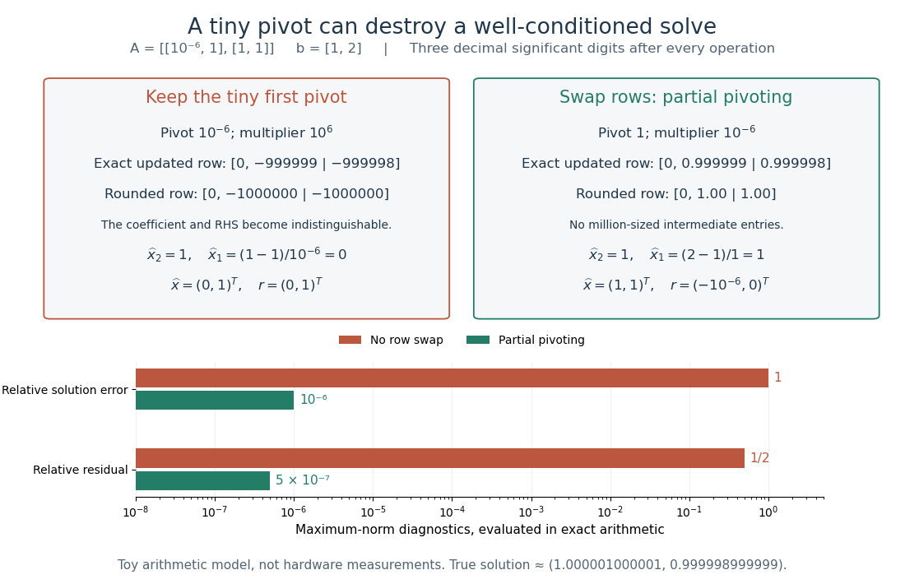

# Tiny-pivot roundoff in Gaussian elimination

↑ **Parent:** [Columnwise partial pivoting](columnwise-partial-pivoting.md)

A nonzero [pivot element](pivot-element.md) can still be a poor numerical choice. [Partial pivoting](columnwise-partial-pivoting.md) bounds the [absolute values](absolute-value.md) of the [elimination multipliers](elimination-multiplier.md) by one in exact arithmetic, because each numerator is no larger than the selected denominator. This usually improves [numerical stability](stability-of-a-numerical-method.md), but does not prevent every possible growth of intermediate entries or guarantee accurate answers for every [linear system](system-of-linear-equations.md).[Fundamentals of Numerical Computation by Tobin A. Driscoll and others; §2.6.4, Example 2.6.6, equation (2.6.3) and concluding discussion: small-pivot instability and the limits of pivoting](fundamentals-of-numerical-computation-by-tobin-a-driscoll-and-others/2-6-row-pivoting.md)

To see the mechanism without depending on hardware, define a toy [floating-point arithmetic](floating-point-arithmetic-split.md) model. The operator $\operatorname{fl}_3(z)$ rounds an exact [real number](real-number.md) to the nearest value with three significant decimal digits; halfway cases choose the even final digit, and $\operatorname{fl}_3(0)=0$. Allow an unbounded exponent range. Round the inputs and the result of every [addition](addition.md), [subtraction](subtraction.md), [multiplication](multiplication.md) and [division](division-mathematics.md) separately; a product followed by a [subtraction](subtraction.md) rounds twice. This is a prescribed arithmetic model, not a measurement of a physical computer. All inputs in the following original example are represented exactly:

$$
\varepsilon=10^{-6},\qquad A=\begin{pmatrix}\varepsilon&1\\1&1\end{pmatrix},\qquad b=\begin{pmatrix}1\\2\end{pmatrix}.
$$

Without a row interchange, the [elimination multiplier](elimination-multiplier.md) is $m=\operatorname{fl}_3(1/\varepsilon)=10^6$. The last coefficient and right-hand side become

$$
\widehat u_{22}=\operatorname{fl}_3\bigl(1-\operatorname{fl}_3(m\cdot1)\bigr)=\operatorname{fl}_3(-999999)=-10^6,
$$

$$
\widehat c_2=\operatorname{fl}_3\bigl(2-\operatorname{fl}_3(m\cdot1)\bigr)=\operatorname{fl}_3(-999998)=-10^6.
$$

Two distinct exact values now have the same rounded representation. [Back substitution](back-substitution.md) therefore returns

$$
\widehat x_2=\operatorname{fl}_3(\widehat c_2/\widehat u_{22})=1,\qquad \widehat x_1=\operatorname{fl}_3\left(\frac{\operatorname{fl}_3(1-\operatorname{fl}_3(1\cdot\widehat x_2))}{\varepsilon}\right)=0.
$$

The small difference carrying information about $x_1$ was lost during elimination; the final [subtraction](subtraction.md) only exposes that loss. Dividing by the tiny [pivot element](pivot-element.md) amplifies sensitivity to the lost information.

With [partial pivoting](columnwise-partial-pivoting.md), interchange the two rows, including their right-hand sides, to start from $\left[\begin{smallmatrix}1&1&2\\\varepsilon&1&1\end{smallmatrix}\right]$. Now $m=\operatorname{fl}_3(\varepsilon/1)=\varepsilon$, and the rounded updates are

$$
\widehat u_{22}=\operatorname{fl}_3\bigl(1-\operatorname{fl}_3(\varepsilon\cdot1)\bigr)=\operatorname{fl}_3(0.999999)=1,
$$

$$
\widehat c_2=\operatorname{fl}_3\bigl(1-\operatorname{fl}_3(\varepsilon\cdot2)\bigr)=\operatorname{fl}_3(0.999998)=1.
$$

[Back substitution](back-substitution.md) gives $\widehat x_2=\operatorname{fl}_3(1/1)=1$ and $\widehat x_1=\operatorname{fl}_3(\operatorname{fl}_3(2-\operatorname{fl}_3(1\cdot1))/1)=1$. Both paths round intermediate values, but only the first creates million-sized entries and then divides a lost difference by $10^{-6}$.

The true solution follows from the original second equation $x_2=2-x_1$:

$$
x_* =\begin{pmatrix}\dfrac{1}{1-\varepsilon}\\[2pt]\dfrac{1-2\varepsilon}{1-\varepsilon}\end{pmatrix}=\begin{pmatrix}1.000001000001\ldots\\0.999998999999\ldots\end{pmatrix}.
$$

Evaluate the [linear-system residual](linear-system-residual.md) $r=b-A\widehat x$ against the original data in exact arithmetic, separately from the three-digit solve. With $\|v\|_\infty=\max_i|v_i|$, the [maximum norm](supremum-norm.md), the results are

$$
\begin{array}{c|c|c|c}
\text{procedure}&\widehat x&r&\|\widehat x-x_*\|_\infty/\|x_*\|_\infty\\\hline
\text{no row interchange}&(0,1)^T&(0,1)^T&1\\
\text{partial pivoting}&(1,1)^T&(-10^{-6},0)^T&10^{-6}
\end{array}
$$

The respective relative [linear-system residuals](linear-system-residual.md) $\|r\|_\infty/\|b\|_\infty$ are $1/2$ and $5\times10^{-7}$. Computing the diagnostic in higher precision matters: a check made only against the rounded reduced equations would miss the original error.

**[Figure 8](#image-the-same-three-digit-floating-point-arithmetic-model-gives-0-1-t-without-a-row-interchange-and-1-1-t-with-partial-pivoting-exact-linear-system-residuals-expose-the-difference). The same three-digit floating-point arithmetic model gives $(0,1)^T$ without a row interchange and $(1,1)^T$ with partial pivoting; exact linear-system residuals expose the difference**.

This [matrix](matrix.md) is well conditioned in the [maximum norm](supremum-norm.md): its induced [matrix norm](matrix-norm.md) is $\|A\|_\infty=2$, while

$$
A^{-1}=\frac{1}{1-\varepsilon}\begin{pmatrix}-1&1\\1&-\varepsilon\end{pmatrix},\qquad \kappa_\infty(A)=\|A\|_\infty\|A^{-1}\|_\infty=\frac{4}{1-\varepsilon}\approx4.000004.
$$

The failure therefore belongs to this unpivoted [algorithm](algorithm-split.md), rather than a large [condition number](condition-number.md). In general, however, [partial pivoting](columnwise-partial-pivoting.md) cannot remove sensitivity inherent in the data. For any approximate solution of an [invertible matrix](invertible-matrix.md) system, $\widehat x-x_*=-A^{-1}r$; the induced [matrix norm](matrix-norm.md) inequality and $\|b\|\leq\|A\|\|x_*\|$ give

$$
\frac{\|\widehat x-x_*\|}{\|x_*\|}\leq\kappa(A)\frac{\|r\|}{\|b\|}.
$$

A small [linear-system residual](linear-system-residual.md) controls solution error only in conjunction with the [condition number](condition-number.md); [numerical stability](stability-of-a-numerical-method.md) and sensitivity are different questions.[Fundamentals of Numerical Computation by Tobin A. Driscoll and others; Definition 2.8.1, equation (2.8.5); §2.8.1, Theorem 2.8.1, equation (2.8.6): condition number and right-hand-side sensitivity; the residual identity above applies that bound](fundamentals-of-numerical-computation-by-tobin-a-driscoll-and-others/2-8-conditioning-of-linear-systems.md)

## ↑ Ancestors (8)

1. [Columnwise partial pivoting](columnwise-partial-pivoting.md)
2. [Gaussian elimination](gaussian-elimination.md)
3. [Numerical linear algebra](numerical-linear-algebra-split.md)
4. [Numerical analysis](numerical-analysis-split.md)
5. [Analysis](analysis-split.md)
6. [Area of mathematics](area-of-mathematics.md)
7. [Mathematics](mathematics-split.md)
8. [Codex Wiki](split.md)

## ← Incoming links (2)

- [Gaussian elimination](gaussian-elimination.md)
- [Row echelon form](row-echelon-form.md)
