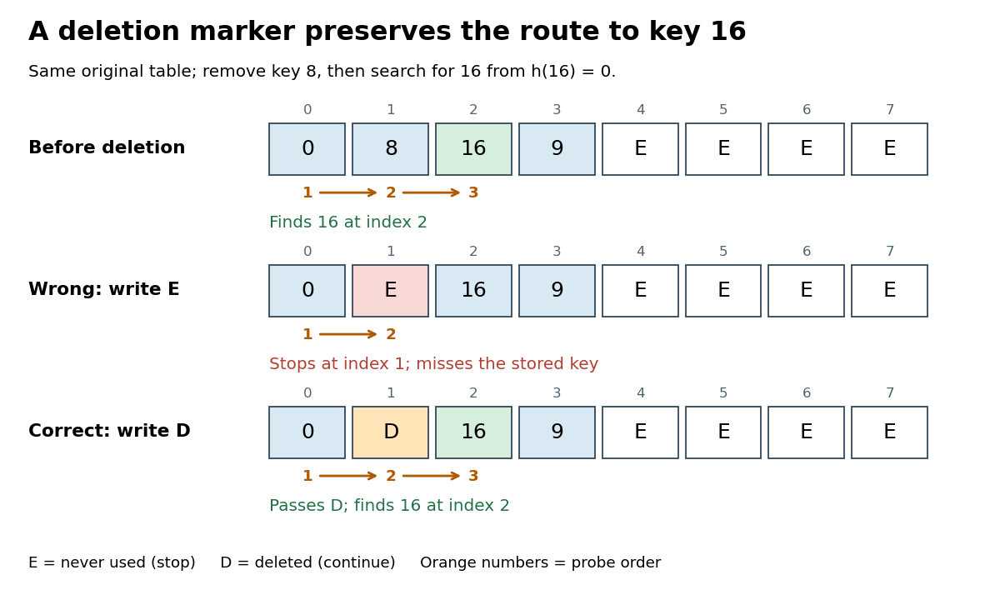

# Tombstone in open addressing

↑ **Parent:** [Open addressing](open-addressing.md)

A deleted-slot marker in [open addressing](open-addressing.md). Lookup continues past it because a [hash collision](hash-collision.md) may have displaced a match further along. [Linear probing](linear-probing.md) can reuse the slot for insertion after checking for an existing equal key. A genuinely empty slot can terminate lookup; this marker cannot.[Open Data Structures: An Introduction by Pat Morin; section 5.2, find, add, remove, and correctness paragraph distinguishing del from nil](open-data-structures-an-introduction-by-pat-morin/5-2-linearhashtable-linear-probing.md)

Delete [hash table key](hash-table-key.md) $8$ from the original eight-slot example. Writing `E` into [array index](array-index.md) $1$ makes lookup of $16$ inspect $0,1$ and incorrectly report absence, although its [hash table record](hash-table-record.md) remains at $2$. Writing `D` instead makes lookup pass $1$ and reach $2$, returning $C$ after three [hash table probes](hash-table-probe.md). The deleted slot must remember that the search route once continued through it.

**[Figure 8](#linear-probing-deletion-search-paths). Deleting to an empty slot breaks lookup; a tombstone in open addressing preserves the search route**. Original deterministic comparison: the middle and lower rows are alternative deletions from the top row. `E` means never used and stops lookup; `D` means deleted and lets lookup continue. Orange numbers give the [hash table probe](hash-table-probe.md) order for [hash table key](hash-table-key.md) $16$.

A short [algorithm correctness](algorithm-correctness.md) proof uses this invariant: no never-used slot precedes a stored [hash table key](hash-table-key.md) along its [linear probing](linear-probing.md) route. Initially the claim is vacuous. Insertion places a new [hash table record](hash-table-record.md) no later than the first `E`, possibly at an earlier `D`, and cannot create an `E` before another stored [hash table record](hash-table-record.md). Replacing a value leaves all slots occupied as before. Deletion to `D` also creates no `E`. By [mathematical induction](mathematical-induction.md) over operations, the invariant persists, so stopping lookup at `E` is sound. Deletion directly to `E` invalidates that argument, as the diagram shows.

To implement the [hash table](hash-table.md) map operation `put(k,v)` in one bounded scan, remember the first `D` encountered, but keep checking occupied [hash table keys](hash-table-key.md). A later [key equality](key-equality.md) match means replace that [hash table record](hash-table-record.md)'s value and stop. Only after reaching `E`, or completing $m$ [hash table probes](hash-table-probe.md), is absence established. Then insert at the remembered `D`, if any; otherwise use the stopping `E`. If all $m$ slots are occupied and no match exists, report full or rebuild before trying again. Merely finding `D` is not permission to create a second equal [hash table key](hash-table-key.md).[Open Data Structures: An Introduction by Pat Morin; Section 5.2, add: test for an existing element before reusing del; the book uses a find pass followed by a placement pass](open-data-structures-an-introduction-by-pat-morin/5-2-linearhashtable-linear-probing.md)

Continue from the correctly deleted example, with [hash table keys](hash-table-key.md) $0,16,9$ at [array indices](array-index.md) $0,2,3$ and `D` at $1$. `put(16,Z)` examines $0,1,2$ and updates the value at $2$, leaving $1$ deleted and retaining three live [hash table records](hash-table-record.md). Inserting immediately at $1$ would instead create two copies of $16$. Now `put(24,W)` examines $0,1,2,3,4$, proves absence at `E`, and places the new [hash table record](hash-table-record.md) at the remembered [array index](array-index.md) $1$. The [hash table load factor](load-factor-of-a-hash-table.md) rises from $3/8$ to $4/8$; reusing `D` avoids extending the [linear probing cluster](linear-probing-cluster.md) to $4$.

For a boundary case, fill all eight slots with [hash table keys](hash-table-key.md) $0,1,\ldots,7$ and then delete all eight to `D`. The live [hash table load factor](load-factor-of-a-hash-table.md) is zero, but absent lookup of $16$ still needs eight [hash table probes](hash-table-probe.md). `put(16,C)` also checks eight slots before reusing the first `D`, at [array index](array-index.md) $0$. A loop that waits indefinitely for `E` would never finish in this state. Rebuilding from the live [hash table records](hash-table-record.md) into a fresh [array](array-data-structure.md) removes each [tombstone in open addressing](tombstone-in-open-addressing.md) and restores never-used stopping slots.[Open Data Structures: An Introduction by Pat Morin; Section 5.2, resize: reinsert live elements and reset the non-nil count to the live count](open-data-structures-an-introduction-by-pat-morin/5-2-linearhashtable-linear-probing.md)

## ↑ Ancestors (5)

1. [Open addressing](open-addressing.md)
2. [Hash table](hash-table.md)
3. [Data structure](data-structure-split.md)
4. [Computer science](computer-science-split.md)
5. [Codex Wiki](split.md)

## ← Incoming links (3)

- [Linear probing](linear-probing.md)
- [Load factor of a hash table](load-factor-of-a-hash-table.md)
- [Tombstone in open addressing](tombstone-in-open-addressing.md)
