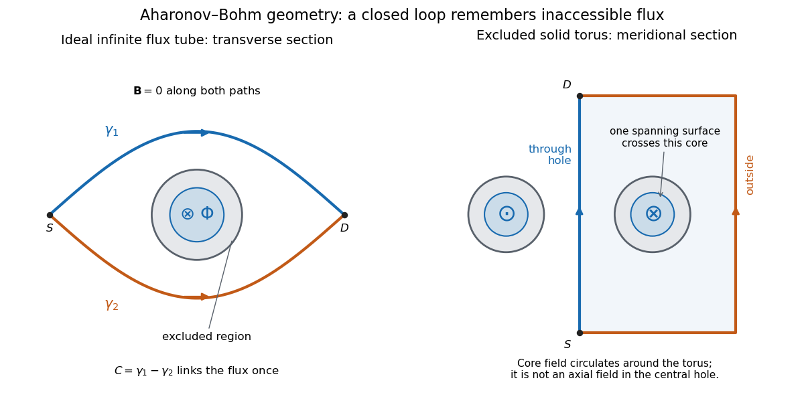
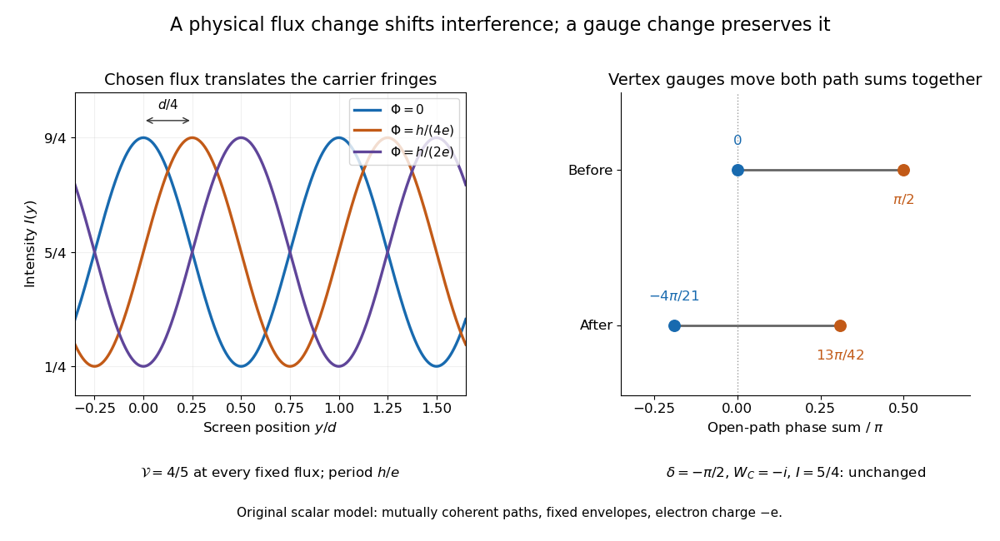
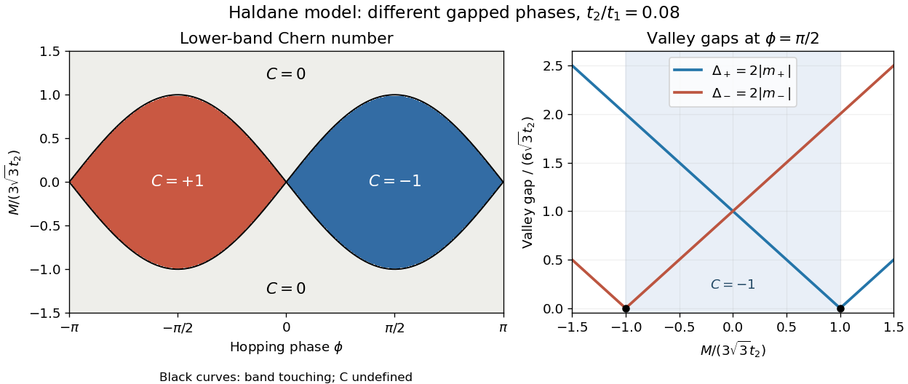

# Topological quantum matter

↑ **Parent:** [Quantum theory](quantum-theory.md)  
ⓦ [Wiki](https://en.wikipedia.org/wiki/Topological_quantum_matter)

Topological quantum matter has robust low-energy properties controlled by global topology rather than local order parameters.

The central question is which [quantum states](quantum-system.md#quantum-state) can be joined by a smooth change of a local [Hamiltonian](hamiltonian-mechanics.md#hamiltonian) while keeping a nonzero bulk [spectral gap](linear-operator-theory.md#spectral-gap). A [Chern insulator](#chern-insulator) makes this question concrete: two [band insulators](bloch-s-theorem.md#band-insulator) can have different integer [Chern numbers](algebraic-geometry.md#chern-number), forcing a gap closure between them. The [Haldane phase](#haldane-phase) supplies a one-dimensional example in which a protecting symmetry matters. These are distinct from [intrinsic topological order](#intrinsic-topological-order), with its [anyons](#anyon) and topology-dependent ground-state degeneracy. The [Berezinskii–Kosterlitz–Thouless transition](critical-phenomenon.md#berezinskii-kosterlitz-thouless-transition) concerns a separate mechanism involving [vortices](critical-phenomenon.md#phase-vortex); topology organizes more than one kind of physical phenomenon.

**Table of contents**

- [Topological insulator](#topological-insulator)
- [Topological quantum order](#topological-quantum-order)
  - [Backward preservation of local indistinguishability](#backward-preservation-of-local-indistinguishability)
- [Local indistinguishability](#local-indistinguishability)
- [Abelian Chern--Simons theory](#abelian-chern-simons-theory)
  - [Chern-Simons source stress convention](#chern-simons-source-stress-convention)
  - [K-matrix](#k-matrix)
    - [Anyon lattice of an Abelian Chern--Simons theory](#anyon-lattice-of-an-abelian-chern-simons-theory)
    - [Chern--Simons flux attachment](#chern-simons-flux-attachment)
    - [Lagrangian subgroup of Abelian anyons](#lagrangian-subgroup-of-abelian-anyons)
  - [Torus ground-state degeneracy of an Abelian Chern--Simons theory](#torus-ground-state-degeneracy-of-an-abelian-chern-simons-theory)
    - [Wilson-loop algebra of an Abelian Chern--Simons theory](#wilson-loop-algebra-of-an-abelian-chern-simons-theory)
- [Anyon](#anyon)
  - [Topological spin](#topological-spin)
  - [Charge-flux composite](#charge-flux-composite)
    - [Aharonov-Bohm effect](#aharonov-bohm-effect)
      - [Magnetic flux spectrum of a quantum ring](#magnetic-flux-spectrum-of-a-quantum-ring)
        - [Cosine-potential gap in a quantum ring](#cosine-potential-gap-in-a-quantum-ring)
      - [Shielded toroidal-flux electron interference](#shielded-toroidal-flux-electron-interference)
      - [Discrete gauge cancellation in two-path interference](#discrete-gauge-cancellation-in-two-path-interference)
    - [Aharonov-Casher effect](#aharonov-casher-effect)
  - [Mutual semion](#mutual-semion)
  - [Anyon condensation at a boundary](#anyon-condensation-at-a-boundary)
    - [Electric and magnetic boundaries of the surface code](#electric-and-magnetic-boundaries-of-the-surface-code)
- [Topological superconductor](#topological-superconductor)
  - [Quadratic fermion Hamiltonian](#quadratic-fermion-hamiltonian)
    - [Bogoliubov--de Gennes Hamiltonian](#bogoliubov-de-gennes-hamiltonian)
      - [Particle-hole symmetry of a Bogoliubov--de Gennes Hamiltonian](#particle-hole-symmetry-of-a-bogoliubov-de-gennes-hamiltonian)
    - [Majorana fermion operator](#majorana-fermion-operator)
      - [Pairing Majorana operators into a fermionic mode](#pairing-majorana-operators-into-a-fermionic-mode)
      - [Majorana zero mode](#majorana-zero-mode)
        - [Majorana zero mode at a mass domain wall](#majorana-zero-mode-at-a-mass-domain-wall)
          - [Continuum p-wave Majorana interface mode](#continuum-p-wave-majorana-interface-mode)
        - [Dense encoding with Majorana zero modes](#dense-encoding-with-majorana-zero-modes)
        - [Local indistinguishability of separated Majorana zero modes](#local-indistinguishability-of-separated-majorana-zero-modes)
        - [Majorana braiding operator](#majorana-braiding-operator)
          - [Measurement-only Majorana braiding](#measurement-only-majorana-braiding)
            - [Forced Majorana parity measurement](#forced-majorana-parity-measurement)
    - [Fermion parity](#fermion-parity)
      - [Parity-consistent filling of a free-fermion band](#parity-consistent-filling-of-a-free-fermion-band)
      - [Fermion-parity measurement](#fermion-parity-measurement)
  - [Chiral Majorana edge mode](#chiral-majorana-edge-mode)
    - [Boundary condition of a chiral Majorana edge mode](#boundary-condition-of-a-chiral-majorana-edge-mode)
  - [Kitaev chain](#kitaev-chain)
- [Topological equivalence of gapped Hamiltonians](#topological-equivalence-of-gapped-hamiltonians)
  - [Quasi-adiabatic continuation](#quasi-adiabatic-continuation)
  - [Winding number of a one-dimensional Bogoliubov--de Gennes Hamiltonian](#winding-number-of-a-one-dimensional-bogoliubov-de-gennes-hamiltonian)
- [Symmetry-protected topological phase](#symmetry-protected-topological-phase)
  - [Haldane phase](#haldane-phase)
  - [Projective virtual symmetry of a matrix product state](#projective-virtual-symmetry-of-a-matrix-product-state)
    - [Protected edge state of a symmetry-protected topological phase](#protected-edge-state-of-a-symmetry-protected-topological-phase)
  - [Cluster state](#cluster-state)
- [Intrinsic topological order](#intrinsic-topological-order)
- [Kramers--Wannier duality](#kramers-wannier-duality)
  - [Kramers--Wannier intertwiner](#kramers-wannier-intertwiner)
  - [Kramers--Wannier projected entangled pair operator](#kramers-wannier-projected-entangled-pair-operator)
- [One-form symmetry](#one-form-symmetry)
- [Chern insulator](#chern-insulator)
  - [Haldane model](#haldane-model)
    - [Valley masses of the Haldane model](#valley-masses-of-the-haldane-model)
    - [Chern number of the Haldane model](#chern-number-of-the-haldane-model)
    - [Cold-atom realization of the Haldane model](#cold-atom-realization-of-the-haldane-model)
- [Haldane conjecture](#haldane-conjecture)

## Topological insulator

↑ **Parent:** [Topological quantum matter](topological-quantum-matter.md)  
ⓦ [Wiki](https://en.wikipedia.org/wiki/Topological_insulator)

A [topological insulator](#topological-insulator) has an insulating bulk electronic spectrum and boundary electronic behavior constrained by a nontrivial bulk band topology and the relevant protecting symmetries. In common three-dimensional time-reversal-invariant examples, the conducting surface can be approximated at low [energy](energy.md) by a [Dirac cone](bloch-s-theorem.md#dirac-cone). The number of surface cones and the range of the linear approximation depend on the material; boundary conduction and thermal bulk [phonons](quantum-ideal-gas-statistics.md#phonon) therefore need separate state counts.

## Topological quantum order

↑ **Parent:** [Topological quantum matter](topological-quantum-matter.md)

The local-pair condition for [topological quantum order](#topological-quantum-order) asks for an orthogonal partner state with [local indistinguishability](#local-indistinguishability) on supports of diameter at most a fixed fraction of the system diameter, with a fixed error smaller than one. This criterion captures a form of macroscopic information hidden from local observables; it is not a complete definition of every topological phase.

### Backward preservation of local indistinguishability

↑ **Parent:** [Topological quantum order](#topological-quantum-order)

Undo a short evolution of two orthogonal locally indistinguishable states. Orthogonality is preserved exactly. A [Lieb-Robinson bound](quantum-theory.md#lieb-robinson-bound) localizes every backward-evolved observable within an expanded region and bounds its norm error. After normalizing the approximate observable, the initial expectation difference is at most $\varepsilon(1+\delta)+2\delta$. Polynomial volume growth in the system diameter controls the localization prefactor and yields preservation for sufficiently small linear-time coefficient.

## Local indistinguishability

↑ **Parent:** [Topological quantum matter](topological-quantum-matter.md)

Two [quantum states](quantum-system.md#quantum-state) are [locally indistinguishable](#local-indistinguishability) at a prescribed scale if all operators of norm at most one supported below that scale have nearly equal expectation values. This is a statement about restricted observables, not equality of the global states. An orthogonal pair can be locally indistinguishable on macroscopically large regions.

<h2 id="abelian-chern-simons-theory">Abelian Chern--Simons theory</h2>

↑ **Parent:** [Topological quantum matter](topological-quantum-matter.md)  
ⓦ [Wiki](https://en.wikipedia.org/wiki/Abelian_Chern--Simons_theory)

An Abelian Chern--Simons theory with integer symmetric invertible matrix $K$ describes Abelian anyons whose braiding phases are determined by $K^{-1}$.

### Chern-Simons source stress convention

↑ **Parent:** [Abelian Chern--Simons theory](#abelian-chern-simons-theory)

The pure [Abelian Chern--Simons theory](#abelian-chern-simons-theory) has zero metric stress. For a source written as $-c\int\star J\wedge A$, holding the covariant components of the [one-forms](differential-form.md#one-form) $J,A$ fixed makes the source equal to $-c\int\sqrt{-g}\,g^{\mu\nu}J_\mu A_\nu\,d^3x$. Variation using $\delta\sqrt{-g}=-\sqrt{-g}g_{\mu\nu}\delta g^{\mu\nu}/2$ gives the displayed [stress-energy tensor](stress-energy-tensor.md). If the independent source is instead the fixed [two-form](differential-form.md#2-form) $\mathcal J=\star J$, the source action is metric-independent and its stress vanishes. The variational data must therefore be stated.

### K-matrix

↑ **Parent:** [Abelian Chern--Simons theory](#abelian-chern-simons-theory)  
ⓦ [Wiki](https://en.wikipedia.org/wiki/K-matrix)

The K-matrix is the integral bilinear form multiplying the Abelian Chern--Simons gauge fields. Integer unimodular basis changes send $K$ to $WKW^T$ without changing the phase.

<h4 id="anyon-lattice-of-an-abelian-chern-simons-theory">Anyon lattice of an Abelian Chern--Simons theory</h4>

↑ **Parent:** [K-matrix](#k-matrix)

For an invertible integer $K$-matrix, Abelian anyons are integer vectors $q$ modulo local particles $K\mathbb Z^N$. Their mutual full-braiding phase is $\exp(2\pi i q^TK^{-1}q')$.

<h4 id="chern-simons-flux-attachment">Chern--Simons flux attachment</h4>

↑ **Parent:** [K-matrix](#k-matrix)

In an Abelian Chern--Simons theory, the equation of motion ties a quasiparticle's gauge charge $q$ to gauge flux $\Phi=2\pi\hbar K^{-1}q$. A quasiparticle of charge $q'$ encircling it therefore acquires the [Aharonov--Bohm phase](#aharonov-bohm-effect) $2\pi q'^TK^{-1}q$.

#### Lagrangian subgroup of Abelian anyons

↑ **Parent:** [K-matrix](#k-matrix)

A Lagrangian subgroup is a maximal set of mutually bosonic anyons that can consistently condense at a gapped boundary. An anyon can join the condensate only if it braids trivially with every already-condensed anyon.

<h3 id="torus-ground-state-degeneracy-of-an-abelian-chern-simons-theory">Torus ground-state degeneracy of an Abelian Chern--Simons theory</h3>

↑ **Parent:** [Abelian Chern--Simons theory](#abelian-chern-simons-theory)

An Abelian K-matrix Chern--Simons theory has $|\det K|$ topologically distinct ground states on a torus.

<h4 id="wilson-loop-algebra-of-an-abelian-chern-simons-theory">Wilson-loop algebra of an Abelian Chern--Simons theory</h4>

↑ **Parent:** [Torus ground-state degeneracy of an Abelian Chern--Simons theory](#torus-ground-state-degeneracy-of-an-abelian-chern-simons-theory)

Quasiparticle transport around the two fundamental cycles of a torus gives loop operators obeying

$$
T_x(q')T_y(q)=e^{2\pi i q'^TK^{-1}q}T_y(q)T_x(q').
$$

The induced pairing on $\mathbb Z^n/K\mathbb Z^n$ is nondegenerate, so this algebra has a representation of dimension at least $|\det K|$.

## Anyon

↑ **Parent:** [Topological quantum matter](topological-quantum-matter.md)  
ⓦ [Wiki](https://en.wikipedia.org/wiki/Anyon)

An anyon is a two-dimensional quasiparticle whose exchange or braiding statistics can differ from bosonic and fermionic statistics.

### Topological spin

↑ **Parent:** [Anyon](#anyon)  
ⓦ [Wiki](https://en.wikipedia.org/wiki/Topological_spin)

The topological spin $\theta_a$ is the phase produced by a $2\pi$ rotation of anyon $a$, equivalently its self-exchange phase in an Abelian anyon theory. The two-dimensional spin-statistics relation is $\theta_a=e^{2\pi i s_a}$.

### Charge-flux composite

↑ **Parent:** [Anyon](#anyon)

A charge-flux composite carries electric charge $q$ and localized magnetic flux $\Phi$. Mutual encircling of $(q_1,\Phi_1)$ and $(q_2,\Phi_2)$ produces the phase $\exp[i(q_1\Phi_2+q_2\Phi_1)/\hbar]$ from the Aharonov-Bohm and Aharonov-Casher effects.

#### Aharonov-Bohm effect

↑ **Parent:** [Charge-flux composite](#charge-flux-composite)  
ⓦ [Wiki](https://en.wikipedia.org/wiki/Aharonov-Bohm_effect)

The Aharonov-Bohm effect is the phase $q\Phi/\hbar$ acquired when a charge $q$ encircles magnetic flux $\Phi$, even when the magnetic field vanishes along the charge's path.

In the magnetic [Aharonov-Bohm effect](#aharonov-bohm-effect), a coherent [electron](physics.md#electron) wave takes two routes around inaccessible [magnetic flux](magnetic-field.md#magnetic-flux). Recombination converts their relative [wave phase](wave.md#phase-waves) into displaced [interference fringes](physical-optics.md#interference-fringe). In 1959, [Yakir Aharonov](physicist.md#yakir-aharonov) and [David Bohm](physicist.md#david-joseph-bohm) proposed a shielded [solenoid](magnetic-field.md#solenoid) geometry and identified the obstruction to removing the [magnetic vector potential](electromagnetism.md#magnetic-vector-potential) throughout the accessible region.[1959, §2, pp. 486–487, Fig. 2 and reflecting-barrier discussion](physics-bibliography.md#significance-of-electromagnetic-potentials-in-the-quantum-theory-by-yakir-aharonov-and-david-bohm)

Use [International System of Units](physics.md#international-system-of-units), [electric charge](electric-charge.md) $q$, and [magnetic minimal coupling](quantum-theory.md#magnetic-minimal-coupling) $H=(-i\hbar\nabla-q\mathbf A)^2/(2m)$. Let $\gamma_1,\gamma_2$ run from the same source $S$ to the same detector point $D$. The oriented closed curve $C$ follows $\gamma_1$ and then $\gamma_2$ backwards. For a static [magnetic vector potential](electromagnetism.md#magnetic-vector-potential), the magnetic contribution to the relative [wave phase](wave.md#phase-waves) is

$$
\delta=\frac q\hbar\left(\int_{\gamma_1}\mathbf A\cdot d\mathbf l-\int_{\gamma_2}\mathbf A\cdot d\mathbf l\right)
=\frac q\hbar\oint_C\mathbf A\cdot d\mathbf l
=\frac{q\Phi_C}{\hbar}\pmod{2\pi}.
$$

Here $\Phi_C=\int_\Sigma\mathbf B\cdot d\mathbf S$ is the oriented [magnetic flux](magnetic-field.md#magnetic-flux) through a spanning surface. Equal or calibrated nonmagnetic propagation phases are assumed. For an [electron](physics.md#electron), $q=-e$, where $e>0$ is the [elementary charge](electric-charge.md#elementary-charge); reversing $C$ reverses the sign. The observable is the [gauge-invariant](relativistic-quantum-field.md#gauge-invariance) [holonomy](fiber-bundle.md#holonomy) $e^{i\delta}$, rather than a unique local value of the [magnetic vector potential](electromagnetism.md#magnetic-vector-potential).

The accessible region is a [multiply connected region](geometry-and-topology.md#multiply-connected-region): $C$ cannot contract to a point without entering the excluded flux region. [Stokes theorem](multivariable-calculus.md#stokes-theorem) does not set the [line integral](multivariable-calculus.md#line-integral) to zero, because a spanning surface must cross that excluded region, where the [magnetic field](magnetic-field.md) need not vanish. There is real [magnetic flux](magnetic-field.md#magnetic-flux) in the apparatus; only the accessible paths are idealized as free of the [magnetic field](magnetic-field.md). The exterior of a finite straight [solenoid](magnetic-field.md#solenoid) also permits routes around its ends, so its exact topology and leakage differ from those of an infinite [solenoid](magnetic-field.md#solenoid) or an excluded solid [torus](topological-surface.md#torus).

An explicit model makes the obstruction visible. Outside an infinite flux tube of radius $a$, choose [cylindrical coordinates](multivariable-calculus.md#cylindrical-coordinate-system) $(r,\theta,z)$ and

$$
\mathbf A=\frac{\Phi}{2\pi r}\,\widehat{\boldsymbol\theta},\qquad r>a.
$$

Its [curl](multivariable-calculus.md#curl) vanishes there, but a loop with [winding number](complex-analysis.md#winding-number) $n$ has $\oint_C\mathbf A\cdot d\mathbf l=n\Phi$. Locally $\mathbf A=\nabla(\Phi\theta/(2\pi))$; the angular coordinate changes by $2\pi$ on a circuit. For generic $q\Phi/\hbar$, that candidate gauge removal changes the [wave function](wave-function.md)'s single-valued boundary condition. On a [simply connected](algebraic-topology.md#simply-connected-space) region, a smooth static [magnetic vector potential](electromagnetism.md#magnetic-vector-potential) with zero [curl](multivariable-calculus.md#curl) instead has a globally defined scalar primitive and is a [pure gauge potential](relativistic-quantum-field.md#pure-gauge-potential). Thus local zero [magnetic field](magnetic-field.md) and globally removable [magnetic vector potential](electromagnetism.md#magnetic-vector-potential) are different conditions.

**[Figure 1](#image-two-accessible-paths-can-link-inaccessible-magnetic-flux). Two accessible paths can link inaccessible magnetic flux**. [Source](aharonov-bohm-two-path-flux-geometry.py). Original functional geometry. Left: a cross-section of an ideal infinite flux tube; $C$ traverses the blue route forwards and the orange route backwards. Right: a meridional section of an excluded solid [torus](topological-surface.md#torus); the [magnetic field](magnetic-field.md) circulates inside its core, with opposite signs through the section. One route passes through the central hole and the other outside the [torus](topological-surface.md#torus). The drawn linking surface intersects one core section. Paths denote coherent alternatives, not measured trajectories; shielding thicknesses and beam optics are schematic.

For an original [interference](physical-optics.md#interference-wave-propagation) example, take mutually coherent scalar amplitudes with constant individual intensities $I_1,I_2$ and an imposed carrier phase $ky$, as in [off-axis holography](physical-optics.md#off-axis-holography). Then

$$
I(y)=I_1+I_2+2\sqrt{I_1I_2}\cos(ky+\delta),\qquad
\Delta y=-\frac\delta k\pmod{2\pi/k}.
$$

The [interference fringe spacing](physical-optics.md#interference-fringe-spacing) is $d=2\pi/k$. An [electron](physics.md#electron) enclosing $\Phi=h/(4e)$ has $\delta=-\pi/2$, shifting maxima by $d/4$ for this orientation. Increasing the [magnetic flux](magnetic-field.md#magnetic-flux) by $h/e$ changes $\delta$ by $-2\pi$ and restores the same pattern: the [electron](physics.md#electron) [Aharonov-Bohm effect](#aharonov-bohm-effect) has [magnetic flux quantum](quantum-theory.md#magnetic-flux-quantum) $h/e$. This uses $h=2\pi\hbar$, the [Planck constant](quantum-mechanics.md#planck-constant). It does not require the source's [magnetic flux](magnetic-field.md#magnetic-flux) to vary continuously during a single exposure.

For $I_1=1$, $I_2=1/4$, the extrema are $I_{\max}=9/4$, $I_{\min}=1/4$, and the [interferometric visibility](physical-optics.md#interferometric-visibility) is $4/5$. A fixed [Aharonov-Bohm phase](#aharonov-bohm-effect) translates these fringes without changing their contrast. Averaging unresolved fluctuating phases can reduce the contrast; a darkened pattern alone cannot identify enclosed [magnetic flux](magnetic-field.md#magnetic-flux). These formulas assume coherence, indistinguishable alternatives and stable beam envelopes.

The appeal of the [Aharonov-Bohm effect](#aharonov-bohm-effect) is that a local [Lorentz force](relativistic-electromagnetism.md#lorentz-force) calculation along either ideal path misses information carried by their global arrangement. It gives a physical example of [holonomy](fiber-bundle.md#holonomy) and supplies the encircling phase used in [Chern--Simons flux attachment](#chern-simons-flux-attachment). This alone does not establish [intrinsic topological order](#intrinsic-topological-order). The static comparison also matters: changing [magnetic flux](magnetic-field.md#magnetic-flux) can induce an [electric field](electric-field.md), so a time-dependent experiment requires the scalar-potential contribution as well as the displayed spatial [line integral](multivariable-calculus.md#line-integral).

##### Magnetic flux spectrum of a quantum ring

↑ **Parent:** [Aharonov-Bohm effect](#aharonov-bohm-effect)

For circumference $L$ and [Hamiltonian operator](quantum-system.md#hamiltonian-quantum-mechanics) $(p-a)^2/(2m)$ with a [periodic boundary condition](differential-equation.md#periodic-boundary-conditions), the [plane waves](wave-function.md#plane-wave) $L^{-1/2}e^{2\pi inx/L}$ have energies $E_n=E_L(n-\alpha)^2$, where $E_L=2\pi^2\hbar^2/(mL^2)$ and $\alpha=aL/(2\pi\hbar)$. [Minimal coupling](quantum-theory.md#minimal-coupling) gives $aL=q\Phi_C$, where $\Phi_C$ is the [magnetic flux](magnetic-field.md#magnetic-flux) oriented consistently with increasing position around the ring. The ordered spectrum is periodic in $\alpha$ with period one, corresponding to [magnetic flux quantum](quantum-theory.md#magnetic-flux-quantum) $h/|q|$.

On $|\alpha|\leq1/2$, its lowest two energies are $E_L\alpha^2$ and $E_L(1-|\alpha|)^2$. Their crossings at half-integer $\alpha$ can be opened by a potential that couples the relevant momentum states.

###### Cosine-potential gap in a quantum ring

↑ **Parent:** [Magnetic flux spectrum of a quantum ring](#magnetic-flux-spectrum-of-a-quantum-ring)

In the [plane wave](wave-function.md#plane-wave) basis of a ring, $V(x)=-\lambda\cos(2\pi x/L)$ has [matrix elements](vector-space.md#matrix-element) $V_{mn}=-(\lambda/2)(\delta_{m,n+1}+\delta_{m,n-1})$. Near $\alpha=1/2$, [degenerate perturbation theory](quantum-mechanics.md#degenerate-perturbation-theory) on $n=0,1$ gives

$$
E_\pm=E_L[(\alpha-1/2)^2+1/4]\pm\sqrt{E_L^2(\alpha-1/2)^2+\lambda^2/4},
$$

up to corrections from remote states. Thus the [avoided crossing](bloch-s-theorem.md#avoided-crossing) gap is $|\lambda|$ to first order when $|\lambda|\ll E_L$.

For $|\lambda|\gg E_L$, a [parabolic approximation](calculus.md#parabolic-approximation) about a potential minimum instead gives a local [quantum harmonic oscillator](quantum-harmonic-oscillator.md) spacing $\sqrt{2|\lambda|E_L}$. A local [gauge transformation](electromagnetism.md#gauge-transformation) removes the flux from this approximation. Actual ring levels retain exponentially small flux dependence through [quantum tunnelling](quantum-mechanics.md#quantum-tunnelling), while nonquadratic corrections to their mean energies are algebraic in $\sqrt{E_L/|\lambda|}$.

##### Shielded toroidal-flux electron interference

↑ **Parent:** [Aharonov-Bohm effect](#aharonov-bohm-effect)

In 1986, [Akira Tonomura](physicist.md#akira-tonomura) and collaborators coated a [ferromagnet](electromagnetism.md#ferromagnet) shaped as a [torus](topological-surface.md#torus) with superconducting [niobium](chemical-substance.md#niobium) and [copper](chemical-substance.md#copper). A cooled stage held it in a 150 kV field-emission [electron microscope](optics.md#electron-microscope). An [electron biprism](optics.md#electron-biprism) overlapped object and reference waves; film [holograms](physical-optics.md#hologram) were reconstructed optically. Room-temperature leakage screening selected samples; varying [copper](chemical-substance.md#copper) thickness tested electron penetration.[pp. 792–794, Figs. 1–4](physics-bibliography.md#evidence-for-aharonov-bohm-effect-with-magnetic-field-completely-shielded-from-electron-wave-by-akira-tonomura-and-others)

Below the superconducting transition, through-hole and outside [electron](physics.md#electron) waves differed in [wave phase](wave.md#phase-waves) by zero or $\pi$ modulo $2\pi$. Warming through it changed the [interference](physical-optics.md#interference-wave-propagation) reversibly. Leakage and coherent-penetration bounds do not prove zero [magnetic field](magnetic-field.md).[p. 794, Figs. 6–7: experimental limits](physics-bibliography.md#evidence-for-aharonov-bohm-effect-with-magnetic-field-completely-shielded-from-electron-wave-by-akira-tonomura-and-others)

Why these two phases? The shield's [superconducting flux quantum](quantum-theory.md#superconducting-flux-quantum) is $h/(2e)$, whereas the probing [electron](physics.md#electron) has [electric charge](electric-charge.md) $-e$. Substituting $\Phi=Nh/(2e)$ gives

$$
e^{i\delta}=e^{-iN\pi}=(-1)^N.
$$

An odd $N$ therefore moves a carrier fringe by half its spacing; an even $N$ leaves it unchanged modulo a full spacing. The phase quantization provides an internal check on the superconducting enclosure. It does not mean that zero [wave phase](wave.md#phase-waves) proves zero trapped [magnetic flux](magnetic-field.md#magnetic-flux).[2006, p. 49, Confirmation experiments on the AB effect; Fig. 2 on p. 48](physics-bibliography.md#the-aharonov-bohm-effect-and-its-applications-to-electron-phase-microscopy-by-akira-tonomura)

The readout is [electron holography](physical-optics.md#electron-holography) in the [off-axis holography](physical-optics.md#off-axis-holography) geometry: a known tilted reference converts an unknown relative [wave phase](wave.md#phase-waves) into a spatial carrier displacement. Reconstructing a magnetic [wave phase](wave.md#phase-waves) assumes stable reference phase, adequate coherence and a calibrated carrier; electrostatic charging and material traversal can also shift [wave phase](wave.md#phase-waves). Optical [wave phase](wave.md#phase-waves) amplification rescales the displayed fringe displacement. The experiment's shielding and comparison tests support the magnetic inference; an interferogram by itself measures the total relative [wave phase](wave.md#phase-waves), rather than separately certifying every contribution. The ideal field-free model describes the limiting geometry, while finite leakage and penetration remain questions of experimental bounds.

##### Discrete gauge cancellation in two-path interference

↑ **Parent:** [Aharonov-Bohm effect](#aharonov-bohm-effect)

A four-vertex model proves the essential [gauge invariance](relativistic-quantum-field.md#gauge-invariance) without solving an [electron](physics.md#electron) scattering problem. Use two directed paths $S\to U\to D$ and $S\to L\to D$. Assign an edge phase $a_{ij}$ and a complex unit link $U_{ij}=e^{ia_{ij}}$ to each directed edge, with $U_{ji}=U_{ij}^{-1}$. These links represent discretized magnetic [line integrals](multivariable-calculus.md#line-integral) multiplied by $q/\hbar$. Under a [gauge transformation](electromagnetism.md#gauge-transformation) with arbitrary vertex phases $\chi_i$,

$$
a'_{ij}=a_{ij}+\chi_j-\chi_i,\qquad
P_1=U_{SU}U_{UD},\qquad P_2=U_{SL}U_{LD}.
$$

Both path products acquire the same factor $e^{i(\chi_D-\chi_S)}$. Their [gauge-invariant](relativistic-quantum-field.md#gauge-invariance) ratio is the closed-loop [holonomy](fiber-bundle.md#holonomy)

$$
W_C=P_1P_2^*=\exp\!\left(i[a_{SU}+a_{UD}-a_{SL}-a_{LD}]\right)=e^{i\delta}.
$$

Every intermediate vertex phase cancels. For any fixed nonnegative real amplitudes $a,b$, the [interference](physical-optics.md#interference-wave-propagation) quantity $|aP_1+bP_2|^2$ is unchanged too. A gauge-dependent open-path phase consequently cannot be interpreted as an observable by itself.

For an exact example, measure phases in units of $\pi$ and order edges as $(SU,UD,SL,LD)$. Choose edge phases $(0,0,0,1/2)$ and vertex phases $(\chi_S,\chi_U,\chi_L,\chi_D)=(1/3,-1/4,2/5,1/7)\pi$. The transformed edge phases are

$$
(a'_{SU},a'_{UD},a'_{SL},a'_{LD})
=\left(-\frac7{12},\frac{11}{28},\frac1{15},\frac{17}{70}\right)\pi.
$$

The upper and lower sums become $-4\pi/21$ and $13\pi/42$; their difference remains $-\pi/2$. With amplitudes $a=1$, $b=1/2$, the intensity remains $5/4$. Sweeping one physical loop phase through $2\pi$ instead produces extrema $9/4$ and $1/4$, agreeing with the [interferometric visibility](physical-optics.md#interferometric-visibility) example above.

**[Figure 2](#image-flux-moves-fringes-while-vertex-gauge-phases-cancel). Flux moves fringes while vertex gauge phases cancel**. [Source](aharonov-bohm-flux-fringes-and-gauge-cancellation.py). Original scalar two-path calculation with $I_1=1$ and $I_2=1/4$. Left: carrier fringes at three chosen enclosed fluxes, in units of the [electron](physics.md#electron) period $h/e$. Right: the exact four-edge example before and after a vertex [gauge transformation](electromagnetism.md#gauge-transformation); open-path phase sums change together and their difference is fixed. Curves are illustrative model intensities, not an experimental interferogram.

#### Aharonov-Casher effect

↑ **Parent:** [Charge-flux composite](#charge-flux-composite)  
ⓦ [Wiki](https://en.wikipedia.org/wiki/Aharonov-Casher_effect)

The Aharonov-Casher effect is the electromagnetic dual in which a magnetic moment or flux acquires a phase by encircling electric charge.

### Mutual semion

↑ **Parent:** [Anyon](#anyon)  
ⓦ [Wiki](https://en.wikipedia.org/wiki/Mutual_semion)

Two particle types are mutual semions when taking either once around the other multiplies the state by $-1$.

### Anyon condensation at a boundary

↑ **Parent:** [Anyon](#anyon)

An anyon condenses at a boundary when its string operator may terminate there without leaving an excitation, so the boundary can absorb or emit that anyon.

#### Electric and magnetic boundaries of the surface code

↑ **Parent:** [Anyon condensation at a boundary](#anyon-condensation-at-a-boundary)

An electric boundary of the [surface code](quantum-error-correction.md#surface-code) condenses electric anyons, while a magnetic boundary condenses magnetic anyons. A local boundary Pauli can create a single condensed excitation because its string may end at that boundary.

## Topological superconductor

↑ **Parent:** [Topological quantum matter](topological-quantum-matter.md)  
ⓦ [Wiki](https://en.wikipedia.org/wiki/Topological_superconductor)

A topological superconductor is a gapped paired-fermion phase supporting protected boundary Majorana modes.

### Quadratic fermion Hamiltonian

↑ **Parent:** [Topological superconductor](#topological-superconductor)

A quadratic fermion Hamiltonian is bilinear in creation and annihilation operators. In a Majorana basis it is determined, up to a constant, by a real antisymmetric matrix.

<h4 id="bogoliubov-de-gennes-hamiltonian">Bogoliubov--de Gennes Hamiltonian</h4>

↑ **Parent:** [Quadratic fermion Hamiltonian](#quadratic-fermion-hamiltonian)  
ⓦ [Wiki](https://en.wikipedia.org/wiki/Bogoliubov--de_Gennes_Hamiltonian)

A Bogoliubov--de Gennes Hamiltonian acts on a Nambu particle-hole spinor and describes quadratic fermion hopping and pairing.

<h5 id="particle-hole-symmetry-of-a-bogoliubov-de-gennes-hamiltonian">Particle-hole symmetry of a Bogoliubov--de Gennes Hamiltonian</h5>

↑ **Parent:** [Bogoliubov--de Gennes Hamiltonian](#bogoliubov-de-gennes-hamiltonian)

Particle-hole symmetry relates $H_{\rm BdG}(k)$ to $-H_{\rm BdG}^*(-k)$. Consequently every energy $E$ at momentum $k$ is paired with energy $-E$ at momentum $-k$.

#### Majorana fermion operator

↑ **Parent:** [Quadratic fermion Hamiltonian](#quadratic-fermion-hamiltonian)  
ⓦ [Wiki](https://en.wikipedia.org/wiki/Majorana_fermion_operator)

A Majorana fermion operator is self-adjoint and obeys $\{c_j,c_k\}=2\delta_{jk}$.

##### Pairing Majorana operators into a fermionic mode

↑ **Parent:** [Majorana fermion operator](#majorana-fermion-operator)

Two distinct [Majorana fermion operators](#majorana-fermion-operator) with $\{\gamma_i,\gamma_j\}=2\delta_{ij}$ define the displayed [fermionic annihilation operator](relativistic-quantum-field.md#fermionic-annihilation-operator). Direct multiplication gives $f^2=0$ and $\{f,f^\dagger\}=1$. Its [number operator](quantum-harmonic-oscillator.md#number-operator) is a [projection operator](vector-space.md#projection-linear-algebra) with [eigenvalues](linear-operator-theory.md#eigenvalue) zero and one. An individual Hermitian Majorana operator has $\gamma_i^\dagger\gamma_i=\gamma_i^2=1$, so that expression is not a nontrivial occupation observable. The occupation belongs to a chosen pair. A quadratic coupling $iJ\gamma_a\gamma_b=J(2f^\dagger f-1)$ splits the pair's two occupations by $2|J|$.

##### Majorana zero mode

↑ **Parent:** [Majorana fermion operator](#majorana-fermion-operator)  
ⓦ [Wiki](https://en.wikipedia.org/wiki/Majorana_zero_mode)

A Majorana zero mode is a spatially localized Majorana operator that commutes with a gapped quadratic Hamiltonian, exactly or up to exponentially small finite-size corrections.

###### Majorana zero mode at a mass domain wall

↑ **Parent:** [Majorana zero mode](#majorana-zero-mode)

Two counterpropagating Majorana fields coupled by a real mass $m(x)$ bind a Majorana zero mode when $m$ changes sign. Its envelope is proportional to $\exp[-\int^x m(s)ds/(\hbar v)]$ up to orientation conventions, so a constant asymptotic mass gives localization length $\hbar v/|m|$.

###### Continuum p-wave Majorana interface mode

↑ **Parent:** [Majorana zero mode at a mass domain wall](#majorana-zero-mode-at-a-mass-domain-wall)

For the long-wavelength Bogoliubov--de Gennes Hamiltonian $H=-\mu(x)\tau_z-i\hbar\Delta\tau_x\partial_x$, a sign change from $\mu>0$ in a one-dimensional p-wave superconductor to $\mu<0$ in the vacuum binds a zero mode of width $\xi=\hbar\Delta/|\mu|$. Neglecting the quadratic kinetic term is valid when $|\mu|\ll m\Delta^2$ up to an inessential numerical factor.

###### Dense encoding with Majorana zero modes

↑ **Parent:** [Majorana zero mode](#majorana-zero-mode)

$2M$ Majorana zero modes define $M$ complex fermionic modes. Fixing total [fermion parity](#fermion-parity) leaves a $2^{M-1}$-dimensional ground space, encoding $M-1$ qubits.

###### Local indistinguishability of separated Majorana zero modes

↑ **Parent:** [Majorana zero mode](#majorana-zero-mode)

When Majorana zero modes have disjoint exponentially localized supports, every local parity-even observable acts as a scalar on the fixed-parity ground space. Finite overlap changes this by terms exponentially small in separation divided by localization length.

###### Majorana braiding operator

↑ **Parent:** [Majorana zero mode](#majorana-zero-mode)

The unitary $R_{ab}=\exp(\pi\gamma_a\gamma_b/4)$ exchanges two Majorana operators by conjugation, sending one to the other and the other to its negative, with signs fixed by braid orientation.

###### Measurement-only Majorana braiding

↑ **Parent:** [Majorana braiding operator](#majorana-braiding-operator)

Pairwise [fermion-parity measurements](#fermion-parity-measurement) involving an ancillary Majorana mode can reproduce a [Majorana braiding operator](#majorana-braiding-operator) without physically moving the zero modes. Projecting the ancilla back to its initial parity sector turns the product of projectors into the braid unitary up to normalization and known outcome-dependent signs.

###### Forced Majorana parity measurement

↑ **Parent:** [Measurement-only Majorana braiding](#measurement-only-majorana-braiding)

A forced Majorana parity measurement alternates an undesired pairwise measurement with a reference parity measurement until the desired outcome occurs. Anticommuting parity observables give either result with probability one half, so the protocol terminates almost surely with a geometric waiting time.

#### Fermion parity

↑ **Parent:** [Quadratic fermion Hamiltonian](#quadratic-fermion-hamiltonian)  
ⓦ [Wiki](https://en.wikipedia.org/wiki/Fermion_parity)

Fermion parity is $(-1)^F$. It acts as plus one on bosonic states and minus one on fermionic states. Even operators commute with it and odd operators, including supersymmetry generators, anticommute with it. Local observables are parity even because observable algebras of spacelike separated regions must commute.

##### Parity-consistent filling of a free-fermion band

↑ **Parent:** [Fermion parity](#fermion-parity)

When a quadratic [fermion](tensor-product-of-quantum-systems.md#fermion) spectrum was derived in a fixed [fermion parity](#fermion-parity) sector, filling all negative-energy modes is permitted only if the resulting particle number has that parity. If it does not, toggle the occupation of a mode with smallest absolute [energy](energy.md). Compare the minimum energies of the physical sectors. Zero-energy modes can create degeneracy without [energy](energy.md) cost.

##### Fermion-parity measurement

↑ **Parent:** [Fermion parity](#fermion-parity)

A fermion-parity measurement projects onto an eigenspace of the parity of a chosen collection of fermionic modes. For two [Majorana fermion operators](#majorana-fermion-operator) $\gamma_a$ and $\gamma_b$, the projectors are $(1\pm i\gamma_a\gamma_b)/2$.

### Chiral Majorana edge mode

↑ **Parent:** [Topological superconductor](#topological-superconductor)

A chiral Majorana edge mode is a self-adjoint one-way boundary field with Hamiltonian proportional to $-i\int c\,\partial_xc\,dx$. Its group velocity has one sign throughout the low-energy branch.

#### Boundary condition of a chiral Majorana edge mode

↑ **Parent:** [Chiral Majorana edge mode](#chiral-majorana-edge-mode)

On a closed boundary, a chiral Majorana field is antiperiodic in the sector with even enclosed vortex parity and periodic in the sector with odd enclosed vortex parity. Only the periodic sector contains a zero-momentum Majorana mode.

### Kitaev chain

↑ **Parent:** [Topological superconductor](#topological-superconductor)  
ⓦ [Wiki](https://en.wikipedia.org/wiki/Kitaev_chain)

The Kitaev chain is a one-dimensional spinless p-wave superconductor. Its topological phase has a Majorana zero mode at each end of an open chain.

## Topological equivalence of gapped Hamiltonians

↑ **Parent:** [Topological quantum matter](topological-quantum-matter.md)

Two local gapped Hamiltonians are topologically equivalent when they are connected by a continuous path of local Hamiltonians with a nonzero bulk gap, equivalently when their ground spaces are related by quasi-local evolution.

### Quasi-adiabatic continuation

↑ **Parent:** [Topological equivalence of gapped Hamiltonians](#topological-equivalence-of-gapped-hamiltonians)  
ⓦ [Wiki](https://en.wikipedia.org/wiki/Quasi-adiabatic_continuation)

Quasi-adiabatic continuation implements a gapped path of local Hamiltonians by a quasi-local unitary. It dresses local operators with exponentially decaying tails while preserving their action within the corresponding low-energy spaces.

<h3 id="winding-number-of-a-one-dimensional-bogoliubov-de-gennes-hamiltonian">Winding number of a one-dimensional Bogoliubov--de Gennes Hamiltonian</h3>

↑ **Parent:** [Topological equivalence of gapped Hamiltonians](#topological-equivalence-of-gapped-hamiltonians)

For a two-component gapped BdG Hamiltonian constrained to a plane, the winding number counts how many times its coefficient vector encircles the origin as crystal momentum traverses the Brillouin zone.

## Symmetry-protected topological phase

↑ **Parent:** [Topological quantum matter](topological-quantum-matter.md)  
ⓦ [Wiki](https://en.wikipedia.org/wiki/Symmetry-protected_topological_phase)

A symmetry-protected topological phase is short-range entangled but cannot be deformed to a product state without breaking a protecting symmetry or closing the gap.

### Haldane phase

↑ **Parent:** [Symmetry-protected topological phase](#symmetry-protected-topological-phase)  
ⓦ [Wiki](https://en.wikipedia.org/wiki/Haldane_phase)

The $S=1$ [Heisenberg antiferromagnet](angular-momentum-operator.md#heisenberg-antiferromagnet) chain realizes the [Haldane phase](#haldane-phase): a gapped [symmetry-protected topological phase](#symmetry-protected-topological-phase) with effective [spin one-half](angular-momentum-operator.md#spin-one-half) degrees of freedom at open ends. [Time-reversal symmetry](quantum-field-theory.md#t-symmetry) is one possible protecting symmetry. Integer [spin](angular-momentum-operator.md#spin) alone does not imply the same protected class: odd- and even-integer chains differ. The broader gap distinction is the [Haldane conjecture](#haldane-conjecture).[Haldane, individual Nobel lecture, p. 040502-9, Fig. 8 and odd-integer versus even-integer distinction](physics-bibliography.md#nobel-lecture-topological-quantum-matter-by-f-duncan-m-haldane)

### Projective virtual symmetry of a matrix product state

↑ **Parent:** [Symmetry-protected topological phase](#symmetry-protected-topological-phase)

An on-site symmetry of an injective MPS acts on virtual indices by matrices defined up to phase. Their projective cohomology class is the one-dimensional SPT invariant.

#### Protected edge state of a symmetry-protected topological phase

↑ **Parent:** [Projective virtual symmetry of a matrix product state](#projective-virtual-symmetry-of-a-matrix-product-state)

On an open chain, a nontrivial virtual projective representation appears as edge degrees of freedom. Symmetry-preserving local perturbations cannot remove their projective class without a bulk phase transition or symmetry breaking.

### Cluster state

↑ **Parent:** [Symmetry-protected topological phase](#symmetry-protected-topological-phase)  
ⓦ [Wiki](https://en.wikipedia.org/wiki/Cluster_state)

The one-dimensional cluster state is the common positive eigenstate of commuting stabilizers $Z_{j-1}X_jZ_{j+1}$ and realizes a nontrivial $\mathbb Z_2\times\mathbb Z_2$ SPT phase.

## Intrinsic topological order

↑ **Parent:** [Topological quantum matter](topological-quantum-matter.md)

Intrinsic topological order survives without a protecting symmetry and is characterized by features such as topology-dependent ground-state degeneracy and anyonic excitations. One-dimensional bosonic gapped systems have no intrinsic topological order, although they can have [symmetry-protected topological order](#symmetry-protected-topological-phase).

<h2 id="kramers-wannier-duality">Kramers--Wannier duality</h2>

↑ **Parent:** [Topological quantum matter](topological-quantum-matter.md)  
ⓦ [Wiki](https://en.wikipedia.org/wiki/Kramers--Wannier_duality)

Kramers--Wannier duality exchanges order variables with domain-wall or disorder variables. In multiple dimensions it naturally appears as a tensor-network map with a nontrivial symmetry-sector kernel.

<h3 id="kramers-wannier-intertwiner">Kramers--Wannier intertwiner</h3>

↑ **Parent:** [Kramers--Wannier duality](#kramers-wannier-duality)

For a one-dimensional periodic spin chain, a Kramers--Wannier intertwiner maps vertex spins in the $X$ basis to edge domain walls. It obeys $D(X_iX_{i+1})=\widetilde Z_{i+1/2}D$ and $DZ_i=(\widetilde X_{i-1/2}\widetilde X_{i+1/2})D$ and identifies spin configurations related by the global $\mathbb Z_2$ symmetry.

<h3 id="kramers-wannier-projected-entangled-pair-operator">Kramers--Wannier projected entangled pair operator</h3>

↑ **Parent:** [Kramers--Wannier duality](#kramers-wannier-duality)

In two dimensions, vertex COPY tensors and edge XOR tensors form a PEPO that maps vertex spins to edge domain walls. Its image obeys a zero-flux constraint around every plaquette.

## One-form symmetry

↑ **Parent:** [Topological quantum matter](topological-quantum-matter.md)  
ⓦ [Wiki](https://en.wikipedia.org/wiki/One-form_symmetry)

A one-form symmetry is generated on closed codimension-one manifolds and acts on line operators rather than local point operators.

## Chern insulator

↑ **Parent:** [Topological quantum matter](topological-quantum-matter.md)  
ⓦ [Wiki](https://en.wikipedia.org/wiki/Chern_insulator)

A [Chern insulator](#chern-insulator) is a two-dimensional [band insulator](bloch-s-theorem.md#band-insulator) whose occupied [energy bands](bloch-s-theorem.md#energy-band) have a nonzero total [Chern number](algebraic-geometry.md#chern-number). It has a bulk [band gap](bloch-s-theorem.md#band-gap), yet an interface with a topologically trivial [band insulator](bloch-s-theorem.md#band-insulator) carries a net excess of [quantum Hall edge states](relativistic-electromagnetism.md#quantum-hall-edge-state) propagating in one direction. [Time-reversal symmetry](quantum-field-theory.md#t-symmetry) must be broken. The [Haldane model](#haldane-model) shows that a nonzero average [magnetic flux](magnetic-field.md#magnetic-flux) is unnecessary.

Why distinguish two solids that both have a [band gap](bloch-s-theorem.md#band-gap)? The [energy eigenvalues](energy-eigenvalue.md) tell us whether an excitation costs [energy](energy.md); the [energy eigenstates](energy-eigenvalue.md#energy-eigenstate) also describe how the state changes around the [Brillouin zone](bloch-s-theorem.md#brillouin-zone). Their [Berry curvature](quantum-mechanics.md#berry-curvature) can integrate to a nonzero integer. A small deformation changes the [Berry curvature](quantum-mechanics.md#berry-curvature) continuously, but cannot continuously change an integer. A [Chern insulator](#chern-insulator) and a trivial [band insulator](bloch-s-theorem.md#band-insulator) therefore cannot be connected through a path of isolated occupied [energy bands](bloch-s-theorem.md#energy-band) with a common bulk [band gap](bloch-s-theorem.md#band-gap). The distinction survives sufficiently weak local perturbations. It does not make every microscopic quantity or every boundary state immune to every disturbance.

For a single filled [energy band](bloch-s-theorem.md#energy-band), set the [Berry connection](quantum-mechanics.md#berry-connection) to $\mathcal A_j=i\langle u_-|\partial_{k_j}u_-\rangle$, and orient the momentum plane by $(k_x,k_y)$. Then

$$
\Omega_-=\partial_{k_x}\mathcal A_y-\partial_{k_y}\mathcal A_x,
\qquad C=\frac{1}{2\pi}\int_{\mathrm{BZ}}\Omega_-\,d^2k.
$$

This is the [First Chern class](complex-geometry.md#first-chern-class) evaluated on the [Brillouin zone](bloch-s-theorem.md#brillouin-zone), a [torus](topological-surface.md#torus). Smooth [eigenvectors](linear-operator-theory.md#eigenvector) may require multiple patches; their transition phases have integer [winding numbers](complex-analysis.md#winding-number). For charge $-e$ and conventional [electric current](electric-charge.md#electric-current) $j_i=\sigma_{ij}E_j$, these conventions give $\sigma_{yx}=Ce^2/h$ and $\sigma_{xy}=-Ce^2/h$. The measurable magnitude agrees with [Chern number and integer Hall conductivity](relativistic-electromagnetism.md#chern-number-and-integer-hall-conductivity). Reversing the momentum orientation or the sign of the [Berry connection](quantum-mechanics.md#berry-connection) reverses the displayed $C$.

### Haldane model

↑ **Parent:** [Chern insulator](#chern-insulator)  
ⓦ [Wiki](https://en.wikipedia.org/wiki/Haldane_model)

[F. Duncan M. Haldane](physicist.md#f-duncan-m-haldane)'s 1988 [tight-binding model](bloch-s-theorem.md#tight-binding) adds complex second-neighbour hopping and opposite sublattice offsets to a [honeycomb lattice](planar-graph.md#honeycomb-lattice). Directed phases break [time-reversal symmetry](quantum-field-theory.md#t-symmetry) while each primitive cell has zero net [magnetic flux](magnetic-field.md#magnetic-flux). Smaller loops can enclose [magnetic flux](magnetic-field.md#magnetic-flux); ordinary [Bloch states](bloch-s-theorem.md#bloch-state) remain available.[Haldane (1988), pp. 2015–2016, Fig. 1 and Eq. (1)](physics-bibliography.md#model-for-a-quantum-hall-effect-without-landau-levels-condensed-matter-realization-of-the-parity-anomaly-by-f-duncan-m-haldane)

Extend the [nearest-neighbour model of graphene](chemical-substance.md#nearest-neighbour-model-of-graphene), ignoring physical [spin](angular-momentum-operator.md#spin) and interactions. With bond length $a$, $t_1>0$, $t_2\geq0$ and ordered sublattice basis $(A,B)$, choose

$$
\begin{aligned}
\boldsymbol\delta_1&=a(0,1),&
\boldsymbol\delta_2&=a(\sqrt3/2,-1/2),&
\boldsymbol\delta_3&=a(-\sqrt3/2,-1/2),\\
\mathbf b_1&=\boldsymbol\delta_3-\boldsymbol\delta_2,&
\mathbf b_2&=\boldsymbol\delta_1-\boldsymbol\delta_3,&
\mathbf b_3&=\boldsymbol\delta_2-\boldsymbol\delta_1,\\
f(\mathbf k)&=\sum_{j=1}^3e^{i\mathbf k\cdot\boldsymbol\delta_j}.&&&&
\end{aligned}
$$

The following [Bloch Hamiltonian](bloch-s-theorem.md#bloch-hamiltonian) defines $\phi$; reversing directed second-neighbour hopping sends $\phi\mapsto-\phi$:

$$
\begin{aligned}
d_0&=2t_2\cos\phi\sum_j\cos(\mathbf k\cdot\mathbf b_j),\\
d_x&=-t_1\operatorname{Re}f,&d_y&=t_1\operatorname{Im}f,\\
d_z&=M-2t_2\sin\phi\sum_j\sin(\mathbf k\cdot\mathbf b_j),\\
H&=\begin{pmatrix}d_0+d_z&-t_1f\\-t_1f^*&d_0-d_z\end{pmatrix},&
E_\pm&=d_0\pm\sqrt{t_1^2|f|^2+d_z^2}.
\end{aligned}
$$

The [Pauli matrices](algebra.md#pauli-matrices) act on sublattice amplitudes, as in [sublattice pseudospin in graphene](chemical-substance.md#sublattice-pseudospin-in-graphene). The [identity matrix](vector-space.md#identity-matrix) term $d_0I$ shifts both [energy eigenvalues](energy-eigenvalue.md) equally at each momentum; it changes neither the [eigenvectors](linear-operator-theory.md#eigenvector) nor the direct separation $E_+-E_-$. A genuine [band insulator](bloch-s-theorem.md#band-insulator) additionally needs $\min_{\mathbf k}E_+>\max_{\mathbf k}E_-$. We use $t_2/t_1=0.08$ in the figures, within the original paper's sufficient nonoverlap restriction $|t_2/t_1|<1/3$.[Haldane (1988), p. 2016, immediately after Eq. (1): nonoverlapping bands](physics-bibliography.md#model-for-a-quantum-hall-effect-without-landau-levels-condensed-matter-realization-of-the-parity-anomaly-by-f-duncan-m-haldane)

#### Valley masses of the Haldane model

↑ **Parent:** [Haldane model](#haldane-model)

The only zeros of $f$, modulo the [reciprocal lattice](quantum-scattering.md#reciprocal-lattice), are the two [Dirac valleys in graphene](chemical-substance.md#dirac-valleys-in-graphene),

$$
\mathbf K_\tau=\left(\tau\frac{4\pi}{3\sqrt3a},0\right),\qquad \tau=\pm1.
$$

At these momenta $\sum_j\sin(\mathbf K_\tau\cdot\mathbf b_j)=\tau3\sqrt3/2$. Thus the two [Dirac mass](relativistic-quantum-field.md#dirac-mass-term) coefficients, measured in [energy](energy.md) units, are $m_\tau=M-\tau\mu$, with $\mu=3\sqrt3t_2\sin\phi$. For $\mathbf k=\mathbf K_\tau+\mathbf q$,

$$
H_\tau-d_0(\mathbf K_\tau)I=\hbar v(\tau q_x\sigma_x+q_y\sigma_y)+m_\tau\sigma_z+O(|\mathbf q|^2),
\qquad v=\frac{3t_1a}{2\hbar}.
$$

The two [Dirac cones](bloch-s-theorem.md#dirac-cone) have opposite orientation, encoded by $\tau$. A scalar sublattice offset $M$ gives equal-sign [Dirac masses](relativistic-quantum-field.md#dirac-mass-term); imaginary second-neighbour hopping at $M=0$ gives opposite-sign [Dirac masses](relativistic-quantum-field.md#dirac-mass-term). Both mechanisms open valley gaps

$$
\Delta_\tau=E_+(\mathbf K_\tau)-E_-(\mathbf K_\tau)=2|m_\tau|.
$$

An observed [band gap](bloch-s-theorem.md#band-gap) alone therefore cannot establish a [Chern insulator](#chern-insulator). In particular, the gapless [nearest-neighbour model of graphene](chemical-substance.md#nearest-neighbour-model-of-graphene) and its sublattice-mass deformation should not be confused with the topologically nontrivial [Haldane model](#haldane-model).

A [band gap](bloch-s-theorem.md#band-gap) closes when all three components of $\mathbf d$ vanish. Since $d_x=d_y=0$ only at the two valleys, the phase boundaries are exactly $M=\pm3\sqrt3t_2\sin\phi$. Usually one valley becomes massless; at $M=0$, $\sin\phi=0$, both do. The occupied-band [Chern number](algebraic-geometry.md#chern-number) is undefined at every such touching, even if a numerical momentum grid misses its location.

**[Figure 3](#image-haldane-phases-meet-where-a-valley-gap-closes). Haldane phases meet where a valley gap closes**. [Source](haldane-chern-phase-and-valley-gaps.py). Original model calculation with the stated lower-band Berry-connection convention and $t_2/t_1=0.08$. Left: integer Chern numbers; black curves denote singular parameters, where no Chern number is assigned. Right: the two valley gaps along $\phi=\pi/2$; the vertical axis shows valley gaps, rather than an assumption about global band extrema. No experimental data are plotted.

#### Chern number of the Haldane model

↑ **Parent:** [Haldane model](#haldane-model)

For $\mathbf d\ne0$, put $\widehat{\mathbf d}=\mathbf d/|\mathbf d|$. The lower-band [orthogonal projector](hilbert-space.md#orthogonal-projection) is $P_-=(I-\widehat{\mathbf d}\cdot\boldsymbol\sigma)/2$. Applying the [Pauli matrix multiplication law](algebra.md#pauli-matrix-multiplication-law) to $i\operatorname{Tr}(P_-[\partial_{k_x}P_-,\partial_{k_y}P_-])$ gives

$$
\Omega_-=\frac12\widehat{\mathbf d}\cdot(\partial_{k_x}\widehat{\mathbf d}\times\partial_{k_y}\widehat{\mathbf d})
=\frac{\mathbf d\cdot(\partial_{k_x}\mathbf d\times\partial_{k_y}\mathbf d)}{2|\mathbf d|^3}.
$$

Thus the [Chern number](algebraic-geometry.md#chern-number) is the signed number of times the [Brillouin zone](bloch-s-theorem.md#brillouin-zone) covers a [two-sphere](euclidean-geometry.md#two-sphere) under $\widehat{\mathbf d}$. The lower [energy eigenstate](energy-eigenvalue.md#energy-eigenstate)'s actual [Bloch vector](density-matrix.md#bloch-vector) is $-\widehat{\mathbf d}$. The [Berry curvature](quantum-mechanics.md#berry-curvature) has the displayed positive sign for this lower band and the stated [Berry connection](quantum-mechanics.md#berry-connection); switching to the upper band changes its sign.

A useful local calculation exposes what each valley contributes. Write $p=\hbar v|\mathbf q|$. The linear [Dirac Hamiltonian](relativistic-quantum-field.md#dirac-hamiltonian) gives

$$
\Omega_{-,\tau}(\mathbf q)=\frac{\tau m_\tau(\hbar v)^2}{2[(\hbar v|\mathbf q|)^2+m_\tau^2]^{3/2}},
\qquad
\frac1{2\pi}\int_{\mathbb R^2}\Omega_{-,\tau}\,d^2q
=\frac\tau2\int_0^\infty\frac{m_\tau p\,dp}{(p^2+m_\tau^2)^{3/2}}
=\frac\tau2\operatorname{sgn}m_\tau.
$$

Each unbounded continuum cone gives a half-integer in this calculation. It is not a separately realizable half-integer [Chern number](algebraic-geometry.md#chern-number) of an isolated lattice [energy band](bloch-s-theorem.md#energy-band). The full [honeycomb lattice](planar-graph.md#honeycomb-lattice) supplies both valleys and the large-momentum completion. Starting with a trivial large-$|M|$ state, each single-valley mass crossing changes the lattice integer by the corresponding unit. There are no other band touchings. This establishes the exact lattice result

$$
C=\frac12\left[\operatorname{sgn}(M-\mu)-\operatorname{sgn}(M+\mu)\right]
=\begin{cases}-\operatorname{sgn}(\sin\phi),&|M|<3\sqrt3t_2|\sin\phi|,\\0,&|M|>3\sqrt3t_2|\sin\phi|,\end{cases}
$$

for $t_2>0$, excluding the boundaries. This sign belongs to our explicit bond vectors, orientation and occupied-band convention.

For an original worked example, choose $t_1=1$, $t_2=0.08$, $\phi=\pi/2$ and $M=0$. Then $\mu\simeq0.415692$, $(m_+,m_-)=(-\mu,+\mu)$, both valley gaps are $2\mu\simeq0.831384$, and $C=-1$. Choosing instead $t_2=0$, $M=\mu$ gives exactly the same valley-gap magnitudes but $C=0$. The first state's two valley contributions reinforce; the second state's cancel.

**[Figure 4](#image-equal-valley-gaps-can-conceal-different-berry-curvature-topology). Equal valley gaps can conceal different Berry-curvature topology**. [Source](haldane-valley-berry-curvature.py). Original calculation of the lower-band Berry curvature of the two explicitly defined lattice Hamiltonians, using the same colour scale. One reciprocal primitive cell is shown in fractional coordinates, with $mathbf g_icdotmathbf a_j=2\pi\delta_{ij}$, $mathbf a_1=\boldsymbol\delta_3-\boldsymbol\delta_1$, and $mathbf a_2=\boldsymbol\delta_2-\boldsymbol\delta_1$. The bond length is $a=1$. The coloured surfaces are model results, not measured curvature or a reconstruction of experimental data.

An independent eigenvector-overlap calculation on periodic $31\times31$, $61\times61$ and $121\times121$ momentum grids gives $C=-1$ for the first example and $C=0$ for the second. Reversing $\phi$ in the first example gives $C=+1$. Direct integration of the analytic lattice [Berry curvature](quantum-mechanics.md#berry-curvature) agrees. For the overlap calculation one can remove the embedding phase from $f$, replacing it by $1+e^{i\mathbf k\cdot\mathbf a_1}+e^{i\mathbf k\cdot\mathbf a_2}$; this makes the cell-basis [Hamiltonian](hamiltonian-mechanics.md#hamiltonian) periodic and prevents a false boundary-seam contribution. The local [Berry curvature](quantum-mechanics.md#berry-curvature) can depend on this basis convention; the integrated [Chern number](algebraic-geometry.md#chern-number) agrees. All mass-zero parameters are excluded before evaluating any integer.

#### Cold-atom realization of the Haldane model

↑ **Parent:** [Haldane model](#haldane-model)

[Gregor Jotzu](physicist.md#gregor-jotzu) and collaborators realized an artificial [Haldane model](#haldane-model) in 2014. They loaded spin-polarized potassium-40 [fermions](tensor-product-of-quantum-systems.md#fermion) into a laser-made [honeycomb lattice](planar-graph.md#honeycomb-lattice). Piezoelectric mirrors shook the [optical lattice](optics.md#optical-lattice) along two axes; their relative phase controlled [time-reversal symmetry](quantum-field-theory.md#t-symmetry) breaking. Optical phase control adjusted the sublattice offset.[Jotzu et al., pp. 1–2, Fig. 1; Methods A–C](physics-bibliography.md#experimental-realisation-of-the-topological-haldane-model-by-gregor-jotzu-and-others)

A [magnetic field gradient](magnetic-field.md#magnetic-field-gradient) drove [Bloch oscillations](bloch-s-theorem.md#bloch-oscillation). Band mapping measured interband transfer to locate valley-gap closures. Opposite-force drift measurements distinguished cancelling from reinforcing [Berry curvature](quantum-mechanics.md#berry-curvature) contributions; reversing shaking handedness reversed the drift. Interband transfer and harmonic confinement affected this readout, including drift beyond ideal transition lines. This neutral-atom [Floquet Hamiltonian](quantum-theory.md#floquet-hamiltonian) realization did not measure electrical [sheet conductivity](electric-charge.md#surface-conductivity). Magnetic fields were used for preparation and forcing.[Jotzu et al., pp. 2–4, Figs. 2–4; Methods A–C; inspected v2 revision 2018, original publication 2014](physics-bibliography.md#experimental-realisation-of-the-topological-haldane-model-by-gregor-jotzu-and-others)

## Haldane conjecture

↑ **Parent:** [Topological quantum matter](topological-quantum-matter.md)  
ⓦ [Wiki](https://en.wikipedia.org/wiki/Haldane_conjecture)

For the uniform, nearest-neighbour, isotropic [Heisenberg antiferromagnet](angular-momentum-operator.md#heisenberg-antiferromagnet) chain, the [Haldane conjecture](#haldane-conjecture) distinguishes integer [spin](angular-momentum-operator.md#spin) $S$, with a nonzero bulk excitation [spectral gap](linear-operator-theory.md#spectral-gap), from half-odd-integer $S$, with gapless excitations in the thermodynamic limit. The continuum [nonlinear sigma model](quantum-field-theory.md#nonlinear-sigma-model) contains a topological angle $\theta=2\pi S$: integer and half-odd-integer [spins](angular-momentum-operator.md#spin) give $0$ and $\pi$ modulo $2\pi$. This is a different use of topology from the two-dimensional occupied-band [Chern number](algebraic-geometry.md#chern-number). The $S=1$ chain belongs to the [Haldane phase](#haldane-phase).[Haldane, individual Nobel lecture delivered 8 December 2016, published 2017, pp. 040502-8–9: integer versus half-odd-integer chains and topological angle](physics-bibliography.md#nobel-lecture-topological-quantum-matter-by-f-duncan-m-haldane)

## ↑ Ancestors (4)

1. [Quantum theory](quantum-theory.md)
2. [Branches of physics](physics.md#branches-of-physics)
3. [Physics](physics.md)
4. [Codex Wiki](README.md)

## ← Incoming links (1)

- [Nobel Prize in Physics in 2016](nobel-prize-in-physics.md#nobel-prize-in-physics-in-2016)
