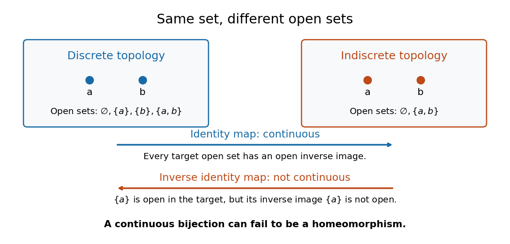

# Topological space

↑ **Parent:** [Topology](topology-split.md)  
ⓦ [Wiki](https://en.wikipedia.org/wiki/Topological_space)

A topological space is a [set](set-split.md) $X$ together with a [topology](topology-split.md) $\tau\subseteq\mathcal P(X)$, a family of [subsets](subset.md) satisfying

$$
\varnothing,X\in\tau,\qquad
\bigcup_{i\in I}U_i\in\tau\quad(U_i\in\tau),\qquad
\bigcap_{j=1}^nU_j\in\tau\quad(U_j\in\tau).
$$

Here $\mathcal P(X)$ is the [power set](power-set.md); the [union](set-union.md) may have arbitrarily many members, while the [intersection](set-intersection.md) must be finite. The members of $\tau$ are the [open sets](open-set.md). These are axioms about [subsets](subset.md), with no assumed [metric](metric.md) or surrounding [Euclidean space](euclidean-norm.md). [Richard Haydon, Oxford topology preliminaries, Definition 0.1](https://www.maths.ox.ac.uk/system/files/attachments/Preliminary%20Reading%20%281%29.pdf)

**[Figure 6](#image-two-topologies-on-the-same-two-point-set-and-continuity-of-the-identity-map). Two topologies on the same two-point set and continuity of the identity map**.

For $X=\{a,b\}$, the [discrete topology](discrete-space.md) is $\tau_d=\{\varnothing,\{a\},\{b\},X\}$, while the [indiscrete topology](indiscrete-topology.md) is $\tau_i=\{\varnothing,X\}$. Both satisfy the axioms. They describe different [topological spaces](topological-space.md) on the same [set](set-split.md): the first is [Hausdorff](hausdorff-space.md) and disconnected, while the second is [connected](connected-space.md) and not [Hausdorff](hausdorff-space.md). Each is [compact](compact-space.md) because $X$ is a [finite set](finite-set.md).

The [identity function](identity-function.md) $i:(X,\tau_d)\to(X,\tau_i)$ is a [continuous map](continuous-map.md): the only target [open sets](open-set.md) have [inverse images](preimage.md) $\varnothing$ and $X$. Its inverse is not a [continuous map](continuous-map.md), since the target [open set](open-set.md) $\{a\}$ has [inverse image](preimage.md) $\{a\}$, which is not an [open set](open-set.md) in $\tau_i$. Thus even a [continuous](continuous-function.md) [bijection](bijection.md) need not be a [homeomorphism](homeomorphism.md).

**Table of contents**

- [Lindelöf space](lindelof-space.md)
- [Fortissimo space](fortissimo-space.md)
- [First-countable space](first-countable-space.md)
- [Warsaw circle](warsaw-circle.md)
- [Convergence of a sequence in a topological space](convergence-of-a-sequence-in-a-topological-space.md)
- [Open and closed maps](open-and-closed-maps.md)
- [Stratified space](stratified-space.md)
  - [Stratum of a stratified space](stratum-of-a-stratified-space.md)
  - [Stratified pseudomanifold](stratified-pseudomanifold.md)
    - [Normalization of a two-dimensional pseudomanifold](normalization-of-a-two-dimensional-pseudomanifold.md)
    - [Witt space](witt-space.md)
      - [Witt space with collared boundary](witt-space-with-collared-boundary.md)
    - [Link of a stratum](link-of-a-stratum.md)
- [Continuous real maps from the initial-segment topology](continuous-real-maps-from-the-initial-segment-topology.md)
- [Sigma-compact space](sigma-compact-space.md)
- [Sober space](sober-space.md)
  - [Sobrification](sobrification.md)
- [Separable topological space](separable-topological-space.md)
- [G-delta set](g-delta-set.md)
- [Net (mathematics)](net-mathematics.md)
  - [Subnet of a net](subnet-of-a-net.md)
- [Separation axiom](separation-axiom.md)
  - [Regular topological space](regular-topological-space.md)
    - [T3 space](t3-space.md)
  - [Totally separated space](totally-separated-space.md)
  - [T1 space](t1-space.md)
- [Closed point](closed-point.md)
- [Locally connected space](locally-connected-space.md)
- [Boundary of a set](boundary-of-a-set.md)
  - [Boundary point](boundary-point.md)
  - [Boundary component](boundary-component.md)
  - [Boundary of a domain](boundary-of-a-domain.md)
- [Basis of a topology](basis-of-a-topology.md)
  - [Subbasis of a topology](subbasis-of-a-topology.md)
- [Second-countable space](second-countable-space.md)
- [Paracompact space](paracompact-space.md)
- [Kolmogorov space](kolmogorov-space.md)
  - [Sierpiński space](sierpinski-space.md)
    - [Embedding of a T0 space into a power of the Sierpiński space](embedding-of-a-t0-space-into-a-power-of-the-sierpinski-space.md)
- [Continuous map](continuous-map.md)
  - [Boundedness extends across closure under a continuous map](boundedness-extends-across-closure-under-a-continuous-map.md)
  - [Separate continuity](separate-continuity.md)
    - [Rectangular bumps detecting nonconvergence](rectangular-bumps-detecting-nonconvergence.md)
  - [Closure characterization of continuity](closure-characterization-of-continuity.md)
  - [Closed-set criterion for continuity](closed-set-criterion-for-continuity.md)
  - [Continuous injection](continuous-injection.md)
  - [Continuous bijection](continuous-bijection.md)
  - [Continuous lift](continuous-lift.md)
  - [Scalar clipping](scalar-clipping.md)
  - [Topological embedding](topological-embedding.md)
    - [Evaluation embedding of a normal Hausdorff space](evaluation-embedding-of-a-normal-hausdorff-space.md)
    - [C-embedded subset](c-embedded-subset.md)
      - [Cb-embedded subset](cb-embedded-subset.md)
    - [Diagonal evaluation map](diagonal-evaluation-map.md)
    - [Universal three-point space for product embeddings](universal-three-point-space-for-product-embeddings.md)
- [Retraction](retraction.md)
  - [Retraction of a Hilbert ball onto its sphere](retraction-of-a-hilbert-ball-onto-its-sphere.md)
  - [Radial retraction of a punctured ball](radial-retraction-of-a-punctured-ball.md)
  - [Retraction onto a punctured oriented surface](retraction-onto-a-punctured-oriented-surface.md)
- [Subspace topology](subspace-topology.md)
  - [Locally closed subset](locally-closed-subset.md)
  - [Topological subspace](topological-subspace.md)
    - [Closed subspace](closed-subspace.md)
- [Alexandroff extension](alexandroff-extension.md)
  - [Proper maps extend to one-point compactifications](proper-maps-extend-to-one-point-compactifications.md)
  - [Uncountable discrete one-point compactification counterexample](uncountable-discrete-one-point-compactification-counterexample.md)
  - [Hawaiian earring](hawaiian-earring.md)
    - [Rational summand in Hawaiian earring homology](rational-summand-in-hawaiian-earring-homology.md)
- [Circle](circle.md)
  - [Injective self-map of a circle](injective-self-map-of-a-circle.md)
  - [Classification of a real complex-circle equation](classification-of-a-real-complex-circle-equation.md)
  - [Sagitta](sagitta.md)
  - [Soddy circle](soddy-circle.md)
    - [Inner Soddy circle](inner-soddy-circle.md)
  - [Power of a point](power-of-a-point.md)
  - [Tangent circles](tangent-circles.md)
    - [Four contact points of a circle chain](four-contact-points-of-a-circle-chain.md)
    - [Collinearity for tangent circles between parallel lines](collinearity-for-tangent-circles-between-parallel-lines.md)
    - [Internal tangency](internal-tangency.md)
    - [External tangency](external-tangency.md)
  - [Tangent to a circle](tangent-to-a-circle.md)
  - [Circular segment](circular-segment.md)
    - [Area enclosed by two chords and a circular arc](area-enclosed-by-two-chords-and-a-circular-arc.md)
  - [Circular arc](circular-arc.md)
  - [Circular sector](circular-sector.md)
  - [Semicircle](semicircle.md)
  - [Chord of a circle](chord-of-a-circle.md)
  - [Reflection symmetry of a complex circle equation](reflection-symmetry-of-a-complex-circle-equation.md)
  - [Maximum separation of two circles](maximum-separation-of-two-circles.md)
  - [Steiner chain](steiner-chain.md)
    - [Steiner porism](steiner-porism.md)
    - [Tangency locus of a Steiner chain](tangency-locus-of-a-steiner-chain.md)
  - [Circle from an affine complex-modulus equation](circle-from-an-affine-complex-modulus-equation.md)
  - [Radius](radius.md)
  - [Pi](pi.md)
    - [Chudnovsky algorithm](chudnovsky-algorithm.md)
      - [Chudnovsky series](chudnovsky-series.md)
    - [Wallis product](wallis-product.md)
    - [Proof that π is irrational](proof-that-pi-is-irrational.md)
  - [Circumference](circumference.md)
- [Wedge sum](wedge-sum.md)
  - [Pinch map](pinch-map.md)
  - [Wedge of two circles](wedge-of-two-circles.md)
- [Inclusion map](inclusion-map.md)
- [Topology axiom](topology-axiom.md)
- [Open cover](open-cover.md)
  - [Subcover](subcover.md)
    - [Finite subcover](finite-subcover.md)
  - [Affine open cover](affine-open-cover.md)
  - [Acyclic cover](acyclic-cover.md)

## ↑ Ancestors (5)

1. [Topology](topology-split.md)
2. [Geometry and topology](geometry-and-topology-split.md)
3. [Area of mathematics](area-of-mathematics.md)
4. [Mathematics](mathematics-split.md)
5. [Codex Wiki](split.md)

## ← Incoming links (198)

- [Adjoints to constant presheaves on open sets](adjoints-to-constant-presheaves-on-open-sets.md)
- [Affineness is invariant under nilpotent thickening](affineness-is-invariant-under-nilpotent-thickening.md)
- [Algebraic topology](algebraic-topology-split.md)
- [Automorphism](automorphism.md)
- [Base point](base-point.md)
- [Based space](based-space.md)
- [Borel measurable function](borel-measurable-function.md)
- [Borel measure](borel-measure.md)
- [Borel set](borel-set.md)
- [Borel sigma-algebra](borel-sigma-algebra.md)
- [Boundary of a set](boundary-of-a-set.md)
- [Bounded continuous witness with neither extremum attained](bounded-continuous-witness-with-neither-extremum-attained.md)
- [Category theory](category-theory-split.md)
- [Clopen evaluation embedding](clopen-evaluation-embedding.md)
- [Closed cover](closed-cover.md)
- [Closed discrete subset](closed-discrete-subset.md)
- [Closed point](closed-point.md)
- [Closed set](closed-set.md)
- [Closed-set criterion for continuity](closed-set-criterion-for-continuity.md)
- [Closed subspace](closed-subspace.md)
- [Closedness](closedness.md)
- [Closure characterization of continuity](closure-characterization-of-continuity.md)
- [Closure of a point is irreducible](closure-of-a-point-is-irreducible.md)
- [Closure (topology)](closure-topology.md)
- [Cofinite topology](cofinite-topology.md)
- [Collapsing a subset to a point](collapsing-a-subset-to-a-point.md)
- [Compact group](compact-group.md)
- [Compact Hausdorff reflection](compact-hausdorff-reflection.md)
- [Compact manifold](compact-manifold.md)
- [Compact space](compact-space.md)
- [Compact subset of a Hausdorff space](compact-subset-of-a-hausdorff-space.md)
- [Compatible metric](compatible-metric.md)
- [Cone (topology)](cone-topology.md)
- [Connected component](connected-component.md)
- [Connected components of a product space](connected-components-of-a-product-space.md)
- [Connected set](connected-set.md)
- [Connected space](connected-space.md)
- [Connected subset](connected-subset.md)
- [Connected subset of the real line](connected-subset-of-the-real-line.md)
- [Connectedness from global regular functions](connectedness-from-global-regular-functions.md)
- [Continuity into a product space](continuity-into-a-product-space.md)
- [Continuous functions preserve convergent sequences](continuous-functions-preserve-convergent-sequences.md)
- [Continuous image of a compact space](continuous-image-of-a-compact-space.md)
- [Continuous map](continuous-map.md)
- [Continuous maps from an infinite cofinite space to a Hausdorff space are constant](continuous-maps-from-an-infinite-cofinite-space-to-a-hausdorff-space-are-constant.md)
- [Continuous real maps from the initial-segment topology](continuous-real-maps-from-the-initial-segment-topology.md)
- [Convergence in a product space](convergence-in-a-product-space.md)
- [Convergence of a sequence in a topological space](convergence-of-a-sequence-in-a-topological-space.md)
- [Curve](curve.md)
- [Diagonal map](diagonal-map.md)
- [Disconnected space](disconnected-space.md)
- [Discrete subset](discrete-subset.md)
- [End (topology)](end-topology.md)
- [Endomorphism](endomorphism.md)
- [Epsilon-delta definition of continuity](epsilon-delta-definition-of-continuity.md)
- [Euclidean topology](euclidean-topology.md)
- [Every subset of a cofinite space is compact](every-subset-of-a-cofinite-space-is-compact.md)
- [Extremally disconnected space](extremally-disconnected-space.md)
- [Finite intersection characterization of compactness](finite-intersection-characterization-of-compactness.md)
- [Finite intersection property](finite-intersection-property.md)
- [First-countable space](first-countable-space.md)
- [Five adjoints for constant presheaves on open sets](five-adjoints-for-constant-presheaves-on-open-sets.md)
- [Fundamental group](fundamental-group.md)
- [Group isomorphism](group-isomorphism.md)
- [H-space](h-space.md)
- [Hausdorff factorization through a cofinite product factor](hausdorff-factorization-through-a-cofinite-product-factor.md)
- [Hausdorff property of a nonempty product](hausdorff-property-of-a-nonempty-product.md)
- [Hausdorff reflection by continuous maps](hausdorff-reflection-by-continuous-maps.md)
- [Hawaiian earring](hawaiian-earring.md)
- [Homeomorphism](homeomorphism.md)
- [Hyperconnected space](hyperconnected-space.md)
- [Initial topology](initial-topology.md)
- [Interior (topology)](interior-topology.md)
- [Irreducible scheme](irreducible-scheme.md)
- [Irreducible variety](irreducible-variety.md)
- [Isomorphism](isomorphism.md)
- [Limit point](limit-point.md)
- [Lindelöf space](lindelof-space.md)
- [Locally closed subset](locally-closed-subset.md)
- [Locally connected space](locally-connected-space.md)
- [Locally finite family of subsets](locally-finite-family-of-subsets.md)
- [Loop (topology)](loop-topology.md)
- [Lower limit topology](lower-limit-topology.md)
- [Manifold boundary](manifold-boundary.md)
- [Net (mathematics)](net-mathematics.md)
- [Non-Hausdorff manifold](non-hausdorff-manifold.md)
- [Non-isolated point](non-isolated-point.md)
- [Open arc](open-arc.md)
- [Open neighbourhood](open-neighbourhood.md)
- [Open set](open-set.md)
- [Open-set frame](open-set-frame.md)
- [Solution](past-exam-of-the-algebra-analysis-and-differential-equations-1-course-of-the-university-of-oxford/2011/4/ii/solution.md)
- [Solution](past-exam-of-the-analytic-topology-and-axiomatic-set-theory-course-of-the-university-of-oxford/2008/a/1/a/i/solution.md)
- [Solution](past-exam-of-the-analytic-topology-and-axiomatic-set-theory-course-of-the-university-of-oxford/2008/a/1/a/ii/solution.md)
- [Solution](past-exam-of-the-analytic-topology-and-axiomatic-set-theory-course-of-the-university-of-oxford/2008/a/1/b/solution.md)
- [Solution](past-exam-of-the-analytic-topology-and-axiomatic-set-theory-course-of-the-university-of-oxford/2008/a/2/c/solution.md)
- [Solution](past-exam-of-the-analytic-topology-and-axiomatic-set-theory-course-of-the-university-of-oxford/2008/a/3/a/solution.md)
- [Solution](past-exam-of-the-analytic-topology-and-axiomatic-set-theory-course-of-the-university-of-oxford/2008/a/4/a/solution.md)
- [Solution](past-exam-of-the-analytic-topology-and-axiomatic-set-theory-course-of-the-university-of-oxford/2008/a/4/c/solution.md)
- [Solution](past-exam-of-the-fixed-point-methods-for-nonlinear-partial-differential-equations-course-of-the-university-of-oxford/2023/1/b/i/solution.md)
- [Solution](past-exam-of-the-introduction-to-schemes-course-of-the-university-of-oxford/2017/2/b/i/solution.md)
- [Solution](past-exam-of-the-introduction-to-schemes-course-of-the-university-of-oxford/2021/1/c/solution.md)
- [Solution](past-exam-of-the-introduction-to-schemes-course-of-the-university-of-oxford/2023/1/a/ii/solution.md)
- [Solution](past-exam-of-the-introduction-to-schemes-course-of-the-university-of-oxford/2023/3/f/ii/solution.md)
- [Solution](past-exam-of-the-mathematics-course-of-the-university-of-cambridge/2004/iii/paper-4/1/solution.md)
- [Solution](past-exam-of-the-mathematics-course-of-the-university-of-cambridge/2005/iii/paper-26/2/solution.md)
- [Solution](past-exam-of-the-mathematics-course-of-the-university-of-cambridge/2006/ib/paper-3/4f/ii/solution.md)
- [Solution](past-exam-of-the-mathematics-course-of-the-university-of-cambridge/2006/iii/paper-17/3/solution.md)
- [Solution](past-exam-of-the-mathematics-course-of-the-university-of-cambridge/2006/iii/paper-24/1/iii/solution.md)
- [Solution](past-exam-of-the-mathematics-course-of-the-university-of-cambridge/2007/iii/paper-89/2/solution.md)
- [Solution](past-exam-of-the-mathematics-course-of-the-university-of-cambridge/2008/ib/paper-3/4f/solution.md)
- [Solution](past-exam-of-the-mathematics-course-of-the-university-of-cambridge/2008/iii/paper-11/1/solution.md)
- [Solution](past-exam-of-the-mathematics-course-of-the-university-of-cambridge/2009/ib/paper-2/4f/solution.md)
- [Solution](past-exam-of-the-mathematics-course-of-the-university-of-cambridge/2009/iii/paper-5/1/solution.md)
- [Solution](past-exam-of-the-mathematics-course-of-the-university-of-cambridge/2010/iii/paper-16/1/solution.md)
- [Solution](past-exam-of-the-mathematics-course-of-the-university-of-cambridge/2010/iii/paper-16/2/solution.md)
- [Solution](past-exam-of-the-mathematics-course-of-the-university-of-cambridge/2010/iii/paper-16/4/ii/solution.md)
- [Solution](past-exam-of-the-mathematics-course-of-the-university-of-cambridge/2010/iii/paper-21/1/solution.md)
- [Solution](past-exam-of-the-mathematics-course-of-the-university-of-cambridge/2012/iii/paper-23/5/b/solution.md)
- [Solution](past-exam-of-the-mathematics-course-of-the-university-of-cambridge/2013/iii/paper-13/2/solution.md)
- [4E](past-exam-of-the-mathematics-course-of-the-university-of-cambridge/2014/ib/paper-2/4e.md)
- [Solution](past-exam-of-the-mathematics-course-of-the-university-of-cambridge/2014/iii/paper-4/1/solution.md)
- [Solution](past-exam-of-the-mathematics-course-of-the-university-of-cambridge/2016/ib/paper-4/13e/a/solution.md)
- [Solution](past-exam-of-the-mathematics-course-of-the-university-of-cambridge/2016/iii/paper-113/4/iii/solution.md)
- [Solution](past-exam-of-the-mathematics-course-of-the-university-of-cambridge/2016/iii/paper-118/4/c/solution.md)
- [Solution](past-exam-of-the-mathematics-course-of-the-university-of-cambridge/2017/ib/paper-4/13e/a/solution.md)
- [Solution](past-exam-of-the-mathematics-course-of-the-university-of-cambridge/2018/ib/paper-3/3e/solution.md)
- [Solution](past-exam-of-the-mathematics-course-of-the-university-of-cambridge/2021/ib/paper-3/11f/solution.md)
- [Solution](past-exam-of-the-mathematics-course-of-the-university-of-cambridge/2023/ib/paper-4/10g/i/solution.md)
- [Solution](past-exam-of-the-mathematics-course-of-the-university-of-cambridge/2023/iii/paper-120/3/e/solution.md)
- [Solution](past-exam-of-the-mathematics-course-of-the-university-of-cambridge/2025/iii/paper-119/6/solution.md)
- [Solution](past-exam-of-the-metric-spaces-and-complex-analysis-course-of-the-university-of-oxford/2017/2/a/i/solution.md)
- [Solution](past-exam-of-the-options-i-course-of-the-university-of-oxford/2006/e/e2/solution.md)
- [Solution](past-exam-of-the-options-i-course-of-the-university-of-oxford/2008/e/e1/a/i/solution.md)
- [Solution](past-exam-of-the-options-i-course-of-the-university-of-oxford/2011/e/1/solution.md)
- [Solution](past-exam-of-the-options-ii-course-of-the-university-of-oxford/2010/e/e4/a/i/solution.md)
- [Solution](past-exam-of-the-options-ii-course-of-the-university-of-oxford/2010/e/e4/a/iii/solution.md)
- [Solution](past-exam-of-the-options-ii-course-of-the-university-of-oxford/2012/e/e3/b/i/solution.md)
- [Solution](past-exam-of-the-options-ii-course-of-the-university-of-oxford/2013/e4/a/i/solution.md)
- [Solution](past-exam-of-the-options-ii-course-of-the-university-of-oxford/2013/e4/c/i/solution.md)
- [Solution](past-exam-of-the-options-ii-for-mathematics-and-philosophy-course-of-the-university-of-oxford/2013/e4/a/i/solution.md)
- [Solution](past-exam-of-the-options-ii-for-mathematics-and-philosophy-course-of-the-university-of-oxford/2013/e4/c/i/solution.md)
- [Solution](past-exam-of-the-probability-statistics-and-options-i-course-of-the-university-of-oxford/2011/e/1/solution.md)
- [Solution](past-exam-of-the-probability-statistics-and-options-ii-course-of-the-university-of-oxford/2007/e/3/solution.md)
- [Solution](past-exam-of-the-probability-statistics-and-options-ii-course-of-the-university-of-oxford/2009/e/e4/c/solution.md)
- [Solution](past-exam-of-the-probability-statistics-and-options-ii-course-of-the-university-of-oxford/2010/e/e4/a/iii/solution.md)
- [Solution](past-exam-of-the-topology-and-groups-course-of-the-university-of-oxford/2023/1/a/i/solution.md)
- [Solution](past-exam-of-the-topology-and-groups-course-of-the-university-of-oxford/2023/2/b/i/solution.md)
- [Solution](past-exam-of-the-topology-and-groups-course-of-the-university-of-oxford/2023/3/a/ii/solution.md)
- [Solution](past-exam-of-the-topology-course-of-the-university-of-oxford/2015/1/a/i/solution.md)
- [Solution](past-exam-of-the-topology-course-of-the-university-of-oxford/2015/2/a/i/solution.md)
- [Solution](past-exam-of-the-topology-course-of-the-university-of-oxford/2017/2/a/i/solution.md)
- [Solution](past-exam-of-the-topology-course-of-the-university-of-oxford/2017/2/c/i/solution.md)
- [Solution](past-exam-of-the-topology-course-of-the-university-of-oxford/2021/1/d/solution.md)
- [Solution](past-exam-of-the-topology-course-of-the-university-of-oxford/2021/2/b/ii/solution.md)
- [Solution](past-exam-of-the-topology-course-of-the-university-of-oxford/2021/2/c/solution.md)
- [Solution](past-exam-of-the-topology-course-of-the-university-of-oxford/2023/2/a/i/solution.md)
- [Pasting lemma for closed subspaces](pasting-lemma-for-closed-subspaces.md)
- [Path component](path-component.md)
- [Path-connected space](path-connected-space.md)
- [Point transitivity](point-transitivity.md)
- [Polish space](polish-space.md)
- [Presheaf (category theory)](presheaf-category-theory.md)
- [Presheaf of sets on a topological space](presheaf-of-sets-on-a-topological-space.md)
- [Product topology](product-topology.md)
- [Quasi-compact scheme](quasi-compact-scheme.md)
- [Quotient topology](quotient-topology.md)
- [Rectangularity of every product-open set](rectangularity-of-every-product-open-set.md)
- [Regular topological space](regular-topological-space.md)
- [Relative cup product](relative-cup-product.md)
- [Retraction](retraction.md)
- [Ringed space](ringed-space-split.md)
- [Schemes are Kolmogorov spaces](schemes-are-kolmogorov-spaces.md)
- [Second-countable space](second-countable-space.md)
- [Semilocally simply connected space](semilocally-simply-connected-space.md)
- [Separable topological space](separable-topological-space.md)
- [Separation axiom](separation-axiom.md)
- [Sequentially closed set](sequentially-closed-set.md)
- [Simple closed curve](simple-closed-curve.md)
- [Singular cohomology](singular-cohomology.md)
- [Singular homology](singular-homology.md)
- [Sober space](sober-space.md)
- [Support of a probability distribution](support-of-a-probability-distribution.md)
- [T1 space](t1-space.md)
- [Topological disjoint union](topological-disjoint-union.md)
- [Topological dynamics](topological-dynamics.md)
- [Topological invariant](topological-invariant.md)
- [Topological manifold](topological-manifold-split.md)
- [Topological semigroup](topological-semigroup.md)
- [Topological space](topological-space.md)
- [Topological subspace](topological-subspace.md)
- [Topology](topology-split.md)
- [Totally separated space](totally-separated-space.md)
- [Triangulation](triangulation.md)
- [Ultrafilter characterization of compact Hausdorff spaces](ultrafilter-characterization-of-compact-hausdorff-spaces.md)
- [Ultrafilter characterization of compactness](ultrafilter-characterization-of-compactness.md)
- [Universal three-point space for product embeddings](universal-three-point-space-for-product-embeddings.md)
- [Zariski cover](zariski-cover.md)
