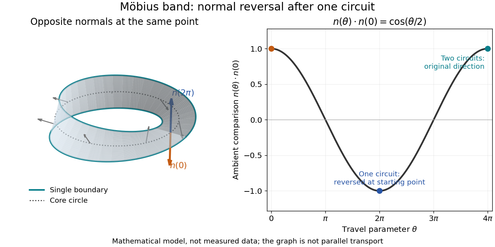

# Topological surface

↑ **Parent:** [Topology](topology.md)  
ⓦ [Wiki](https://en.wikipedia.org/wiki/Topological_surface)

A topological surface is a [Hausdorff space](topology.md#hausdorff-space) with a countable basis in which every point has a neighborhood homeomorphic to an open subset of $\mathbb R^2$.

**Table of contents**

- [Classification of compact surfaces](#classification-of-compact-surfaces)
- [Thrice-punctured sphere](#thrice-punctured-sphere)
- [Integral top homology of a compact connected surface](#integral-top-homology-of-a-compact-connected-surface)
- [Surface with boundary](#surface-with-boundary)
  - [Topology of disk tiles glued along disjoint boundary arcs](#topology-of-disk-tiles-glued-along-disjoint-boundary-arcs)
  - [Pair of pants (mathematics)](#pair-of-pants-mathematics)
    - [Hyperbolic Y-piece](#hyperbolic-y-piece)
      - [Hyperbolic X-piece](#hyperbolic-x-piece)
    - [Homology action of a pair-of-pants homeomorphism](#homology-action-of-a-pair-of-pants-homeomorphism)
- [Genus of a surface](#genus-of-a-surface)
  - [Genus monotonicity under nonzero-degree surface maps](#genus-monotonicity-under-nonzero-degree-surface-maps)
- [Closed orientable surface](#closed-orientable-surface)
  - [Genus of a finite cover of a closed orientable surface](#genus-of-a-finite-cover-of-a-closed-orientable-surface)
- [Non-orientable surface](#non-orientable-surface)
  - [Closed nonorientable surface](#closed-nonorientable-surface)
- [Surface quotient by a free finite action](#surface-quotient-by-a-free-finite-action)
- [Jordan curve theorem](#jordan-curve-theorem)
  - [Jordan separation from the exponential quotient](#jordan-separation-from-the-exponential-quotient)
  - [Jordan domain](#jordan-domain)
  - [Schoenflies theorem](#schoenflies-theorem)
  - [Outer boundary of a planar compact set](#outer-boundary-of-a-planar-compact-set)
- [Moore triod theorem](#moore-triod-theorem)
- [Polygonal schema](#polygonal-schema)
  - [Polygonal-schema Euler count](#polygonal-schema-euler-count)
  - [Regular hyperbolic octagon fundamental polygon](#regular-hyperbolic-octagon-fundamental-polygon)
- [Mapping class group](#mapping-class-group)
  - [Mapping class](#mapping-class)
  - [Injection of a finite hyperbolic isometry group into a mapping class group](#injection-of-a-finite-hyperbolic-isometry-group-into-a-mapping-class-group)
  - [Realization of a finite group as a surface deck group](#realization-of-a-finite-group-as-a-surface-deck-group)
  - [Dehn twist](#dehn-twist)
    - [Lickorish-Dehn theorem](#lickorish-dehn-theorem)
    - [Homology action of a Dehn twist](#homology-action-of-a-dehn-twist)
    - [Right-handed Dehn twist](#right-handed-dehn-twist)
  - [Essential proper arc on a punctured surface](#essential-proper-arc-on-a-punctured-surface)
    - [Bigon formed by two arcs](#bigon-formed-by-two-arcs)
    - [Minimal position of curves or arcs](#minimal-position-of-curves-or-arcs)
      - [Bigon criterion](#bigon-criterion)
  - [Geometric intersection number](#geometric-intersection-number)
    - [Algebraic intersection number of curves on an oriented surface](#algebraic-intersection-number-of-curves-on-an-oriented-surface)
      - [Isotopy invariance of algebraic intersection number](#isotopy-invariance-of-algebraic-intersection-number)
  - [Arc complex](#arc-complex)
    - [Arc complex of the three-punctured sphere](#arc-complex-of-the-three-punctured-sphere)
    - [Arc-complex vertex orbits of the four-punctured sphere](#arc-complex-vertex-orbits-of-the-four-punctured-sphere)
  - [Alexander system](#alexander-system)
    - [Structure graph of an Alexander system](#structure-graph-of-an-alexander-system)
    - [Alexander method](#alexander-method)
      - [Alexander trick](#alexander-trick)
      - [Center of the mapping class group of the torus](#center-of-the-mapping-class-group-of-the-torus)
  - [Mapping-class action on the outer automorphism group of the fundamental group](#mapping-class-action-on-the-outer-automorphism-group-of-the-fundamental-group)
  - [Pure mapping class group](#pure-mapping-class-group)
    - [Point-pushing map](#point-pushing-map)
      - [Birman exact sequence](#birman-exact-sequence)
    - [Pure mapping class group of the three-punctured sphere](#pure-mapping-class-group-of-the-three-punctured-sphere)
    - [Pure mapping class group of the four-punctured sphere](#pure-mapping-class-group-of-the-four-punctured-sphere)
    - [Semidirect-product decomposition of the pure mapping class group of the five-punctured sphere](#semidirect-product-decomposition-of-the-pure-mapping-class-group-of-the-five-punctured-sphere)
  - [Curve complex](#curve-complex)
    - [Connectedness of the curve complex](#connectedness-of-the-curve-complex)
    - [Filling set of curves](#filling-set-of-curves)
      - [Filling pair on a closed genus-two surface](#filling-pair-on-a-closed-genus-two-surface)
- [Torus](#torus)
  - [Three-critical-point function on a torus](#three-critical-point-function-on-a-torus)
  - [Pinched torus](#pinched-torus)
  - [Three-dimensional torus](#three-dimensional-torus)
  - [Cohomology ring of a torus](#cohomology-ring-of-a-torus)
  - [Homology of an integer torus endomorphism](#homology-of-an-integer-torus-endomorphism)
  - [Solid torus](#solid-torus)
    - [Solid-torus recognition by a compression disk](#solid-torus-recognition-by-a-compression-disk)
    - [Meridian of a solid torus](#meridian-of-a-solid-torus)
  - [Embedding of the n-dimensional torus in codimension one](#embedding-of-the-n-dimensional-torus-in-codimension-one)
  - [Embedded torus of revolution](#embedded-torus-of-revolution)
  - [Fundamental group of the torus](#fundamental-group-of-the-torus)
    - [Lift-endpoint description of the fundamental group of the torus](#lift-endpoint-description-of-the-fundamental-group-of-the-torus)
  - [Integral linear automorphism of the torus](#integral-linear-automorphism-of-the-torus)
    - [Equivalence of connected double covers of the torus](#equivalence-of-connected-double-covers-of-the-torus)
- [Möbius band](#mobius-band)
  - [Core circle of a Möbius band](#core-circle-of-a-mobius-band)
  - [Normal reversal around the Möbius core](#normal-reversal-around-the-mobius-core)
  - [Boundary of a Möbius band winds twice around its core](#boundary-of-a-mobius-band-winds-twice-around-its-core)
- [Untwisted band](#untwisted-band)
- [Klein bottle](#klein-bottle)
  - [Mod-two intersection pairing of the Klein bottle](#mod-two-intersection-pairing-of-the-klein-bottle)
  - [Integral cohomology ring of the Klein bottle](#integral-cohomology-ring-of-the-klein-bottle)
    - [Integral cohomology ring of the wedge of the real projective plane and a circle](#integral-cohomology-ring-of-the-wedge-of-the-real-projective-plane-and-a-circle)
  - [Orientation double cover of the Klein bottle](#orientation-double-cover-of-the-klein-bottle)
    - [Klein-bottle mapping-cylinder obstruction to simple connectivity](#klein-bottle-mapping-cylinder-obstruction-to-simple-connectivity)
  - [Flat Klein-bottle geodesic model](#flat-klein-bottle-geodesic-model)
- [Double cone singularity](#double-cone-singularity)

## Classification of compact surfaces

↑ **Parent:** [Topological surface](topological-surface.md)

A [connected](geometry-and-topology.md#connected-space) [compact](topology.md#compact-space) [surface](topological-surface.md) is determined by its [orientability](topology.md#orientability), number $b$ of [boundary](topology.md#boundary-of-a-set) circles and [genus](#genus-of-a-surface). An [orientable](differential-geometry.md#orientable-surface) [surface](topological-surface.md) of [genus](#genus-of-a-surface) $g$ has [Euler characteristic](homology.md#euler-characteristic) $2-2g-b$; a [surface](topological-surface.md) which is not [orientable](differential-geometry.md#orientable-surface) with $r$ crosscaps has [Euler characteristic](homology.md#euler-characteristic) $2-r-b$. In particular, a closed [connected](geometry-and-topology.md#connected-space) [surface](topological-surface.md) with vanishing first mod-two [homology](homology.md) is a [sphere](euclidean-geometry.md#sphere), and a [connected](geometry-and-topology.md#connected-space) closed [orientable](differential-geometry.md#orientable-surface) [surface](topological-surface.md) of [Euler characteristic](homology.md#euler-characteristic) zero is a [torus](#torus).

## Thrice-punctured sphere

↑ **Parent:** [Topological surface](topological-surface.md)

The sphere with three points removed is an orientable noncompact surface of genus zero with three ends. It can be realized by pairing the two sides at each of two opposite ideal vertices of an [ideal hyperbolic quadrilateral](hyperbolic-geometry.md#ideal-hyperbolic-quadrilateral) in the [hyperbolic disk](hyperbolic-geometry.md#hyperbolic-disc). The four ideal vertices fall into three equivalence classes; after adding these three points the cell structure has one face, two edges and three vertices, hence [Euler characteristic](homology.md#euler-characteristic) two. Removing these added vertices recovers the original quotient.

## Integral top homology of a compact connected surface

↑ **Parent:** [Topological surface](topological-surface.md)

For a compact connected surface $S$,

$$
H_2(S;\mathbb Z)\cong
\begin{cases}
\mathbb Z,&S\text{ is closed and orientable},\\
0,&S\text{ is nonorientable or has nonempty boundary}.
\end{cases}
$$

In particular, its second integral homology has rank at most one.

## Surface with boundary

↑ **Parent:** [Topological surface](topological-surface.md)

A surface with boundary is a two-dimensional [manifold with boundary](smooth-manifold.md#manifold-with-boundary): it is locally homeomorphic to the plane or to the closed upper half-plane. Points represented on the edge of a half-plane chart form its one-dimensional boundary.

### Topology of disk tiles glued along disjoint boundary arcs

↑ **Parent:** [Surface with boundary](#surface-with-boundary)

Consider a connected assembly of $n$ [closed discs](topology.md#closed-disc) formed by identifying $e$ pairs of boundary arcs, each arc used once and all arcs in a given tile having disjoint endpoints. Its gluing [graph](graph.md) has one vertex per tile and one edge per paired arc. A [spanning tree](tree-graph-theory.md#spanning-tree) joins the initial discs into a single [closed disc](topology.md#closed-disc); each of the remaining $e-n+1$ pairings attaches a band. This is a thickening of the gluing [graph](graph.md), so it is [homotopy equivalent](homotopy.md#homotopy-inverse) to that [graph](graph.md). Thus its [Euler characteristic](homology.md#euler-characteristic) is $n-e$ and its [fundamental group](algebraic-topology.md#fundamental-group) is the [free group](geometric-group-theory.md#free-group) $F_{e-n+1}$. If the gluing [graph](graph.md) is a tree, the assembled surface is itself a [closed disc](topology.md#closed-disc).

Suppose each pairing preserves the positive boundary parameter of the reference discs. A global [orientation](algebraic-topology.md#orientation-of-a-simplex) must then assign opposite orientation signs to adjacent tiles, because their induced [boundary orientations](differential-geometry.md#boundary-orientation) on an interior seam must oppose one another. Such signs exist exactly when the gluing [graph](graph.md) is [bipartite](bipartite-graph.md). An odd gluing cycle therefore proves that the assembly is a [nonorientable surface](#non-orientable-surface). A [Dirichlet boundary condition](differential-equation.md#dirichlet-boundary-condition) or a [Neumann boundary condition](differential-equation.md#neumann-boundary-condition) on an unpaired arc has no effect on this topological calculation.

### Pair of pants (mathematics)

↑ **Parent:** [Surface with boundary](#surface-with-boundary)  
ⓦ [Wiki](https://en.wikipedia.org/wiki/Pair_of_pants_(mathematics))

The pair of pants is the compact genus-zero [surface with boundary](#surface-with-boundary) having three boundary components. It is obtained from the sphere by deleting the interiors of three disjoint discs and is homotopy equivalent to a wedge of two circles.

#### Hyperbolic Y-piece

↑ **Parent:** [Pair of pants (mathematics)](#pair-of-pants-mathematics)

A [Y-piece](#hyperbolic-y-piece) is a compact curvature-$-1$ [hyperbolic surface](hyperbolic-geometry.md#hyperbolic-surface) homeomorphic to a [pair of pants](#pair-of-pants-mathematics), with three geodesic boundary curves. Its labelled boundary lengths $\ell_1,\ell_2,\ell_3>0$ determine it up to [isometry](riemannian-geometry.md#isometry). Cutting along the three mutually perpendicular seams produces two congruent [right-angled hyperbolic hexagons](hyperbolic-geometry.md#right-angled-hyperbolic-hexagon) with alternating sides $\ell_i/2$. Conversely, doubling the hexagon along its other three sides constructs the [Y-piece](#hyperbolic-y-piece) for arbitrary positive lengths.

##### Hyperbolic X-piece

↑ **Parent:** [Hyperbolic Y-piece](#hyperbolic-y-piece)

An [X-piece](#hyperbolic-x-piece) is a curvature-$-1$ four-holed sphere with geodesic boundary, formed by gluing two [Y-pieces](#hyperbolic-y-piece) along equal-length cuffs. For a specified separating cuff and labelled outer boundaries, four outer lengths, the internal cuff length $s>0$, and a twist $\tau$ determine the metric. The gluing is orientation-reversing on boundary circles, with relative arclength displacement $\tau$ measured from chosen seam endpoints. Without markings, the gluing displacement is taken modulo $s$; with a marking, $\tau\in\mathbb R$ records [Dehn twists](#dehn-twist) as well. Changing the chosen separating curve can give different parameter descriptions of the same unmarked surface.

#### Homology action of a pair-of-pants homeomorphism

↑ **Parent:** [Pair of pants (mathematics)](#pair-of-pants-mathematics)

Orient the three boundary classes $c_1,c_2,c_3$ so that $c_1+c_2+c_3=0$ in $H_1(N;\mathbb Z)$. A homeomorphism with orientation sign $\epsilon$ and boundary permutation $\sigma$ sends $c_i$ to $\epsilon c_{\sigma(i)}$. Its trace on the rank-two quotient of $\mathbb Z^3$ by $c_1+c_2+c_3$ is therefore $\epsilon(\#\operatorname{Fix}\sigma-1)$.

## Genus of a surface

↑ **Parent:** [Topological surface](topological-surface.md)

The genus counts the handles of a connected closed orientable surface. Such a surface has [Euler characteristic](homology.md#euler-characteristic) $2-2g$.

### Genus monotonicity under nonzero-degree surface maps

↑ **Parent:** [Genus of a surface](#genus-of-a-surface)

For a [continuous map](topology.md#continuous-map) of nonzero [mapping degree](homology.md#degree-of-a-continuous-mapping) between closed connected oriented surfaces, [rational cohomology injectivity of a nonzero-degree map](cohomology.md#rational-cohomology-injectivity-of-a-nonzero-degree-map) gives an injection on $H^1$. Since the first [Betti number](homology.md#betti-number) of an oriented surface of genus $g$ is $2g$, the source genus is at least the target genus.

## Closed orientable surface

↑ **Parent:** [Topological surface](topological-surface.md)  
ⓦ [Wiki](https://en.wikipedia.org/wiki/Closed_orientable_surface)

A closed orientable surface of genus $g$ is homeomorphic to a sphere with $g$ handles. Its Euler characteristic is $2-2g$.

### Genus of a finite cover of a closed orientable surface

↑ **Parent:** [Closed orientable surface](#closed-orientable-surface)

A connected $n$-sheeted [covering space](algebraic-topology.md#covering-space) of a [closed orientable surface](#closed-orientable-surface) of genus $g$ has genus $1+n(g-1)$. Lifting a finite cell decomposition gives $n$ cells above every base cell, so its [Euler characteristic](homology.md#euler-characteristic) is $n(2-2g)$. Equating this with $2-2g'$ gives the formula. For $g\ge1$, every positive $n$ occurs: send one handle generator of the [fundamental group](algebraic-topology.md#fundamental-group) to $1$ in $\mathbb Z/n$ and all remaining generators to zero, then use the [classification of connected covering spaces](algebraic-topology.md#classification-of-connected-covering-spaces) for the kernel of that surjection.

## Non-orientable surface

↑ **Parent:** [Topological surface](topological-surface.md)  
ⓦ [Wiki](https://en.wikipedia.org/wiki/Non-orientable_surface)

A non-orientable surface has no consistent choice of local orientation.

### Closed nonorientable surface

↑ **Parent:** [Non-orientable surface](#non-orientable-surface)

A connected closed nonorientable surface of crosscap genus $k$ is the connected sum of $k$ real projective planes and has Euler characteristic $2-k$.

## Surface quotient by a free finite action

↑ **Parent:** [Topological surface](topological-surface.md)

A free action of a finite group on a topological surface has a surface quotient: sufficiently small coordinate discs have disjoint translates and descend homeomorphically to quotient neighbourhoods.

## Jordan curve theorem

↑ **Parent:** [Topological surface](topological-surface.md)  
ⓦ [Wiki](https://en.wikipedia.org/wiki/Jordan_curve_theorem)

Every simple closed curve on the sphere separates it into two connected components, each having the curve as its boundary.

### Jordan separation from the exponential quotient

↑ **Parent:** [Jordan curve theorem](#jordan-curve-theorem)

For a [compact](topology.md#compact-space) set $J$ homeomorphic to a circle, lifting an argument along its parametrization identifies the quotient by continuous exponentials with $\mathbb Z$. By [planar logarithm factorization](functional-analysis.md#planar-logarithm-factorization) it is also free abelian on the bounded complementary components, so exactly one exists. A proper [closed](topology.md#closed-set) arc has trivial exponential quotient, and therefore connected complement. Given a small [open](topology.md#open-set) arc of $J$ inside any neighborhood of a point, join points from the two complementary regions by a path avoiding the remaining [closed](topology.md#closed-set) arc. The first and last intersections with $J$ occur in the small arc, proving that the neighborhood meets both regions. Thus $J$ is the common [boundary](topology.md#boundary-of-a-set) of its unique bounded and unbounded regions.

### Jordan domain

↑ **Parent:** [Jordan curve theorem](#jordan-curve-theorem)

A Jordan domain is the bounded complementary component of a closed [simple curve](topology.md#simple-curve) in the plane. The [Jordan curve theorem](#jordan-curve-theorem) separates the plane into this inside component and one unbounded outside component. A [conformal bijection](riemann-surfaces.md#biholomorphism) from the disc or [complex upper half-plane](complex-analysis.md#upper-half-plane-complex-analysis) to this [simply connected](algebraic-topology.md#simply-connected-space) domain extends to a homeomorphism of their closed conformal boundaries by the [Caratheodory boundary extension theorem](riemann-surfaces.md#caratheodory-boundary-extension-theorem).

### Schoenflies theorem

↑ **Parent:** [Jordan curve theorem](#jordan-curve-theorem)  
ⓦ [Wiki](https://en.wikipedia.org/wiki/Schoenflies_theorem)

A Jordan curve in the two-sphere is carried to an equator by a homeomorphism of the sphere; equivalently, the closures of its two complementary regions are discs. This strengthens the separation assertion of the [Jordan curve theorem](#jordan-curve-theorem) and controls the boundary degrees of characteristic maps for cell decompositions of a surface.

### Outer boundary of a planar compact set

↑ **Parent:** [Jordan curve theorem](#jordan-curve-theorem)

The outer boundary of a compact planar set $K$ is the boundary of the unbounded component $C_\infty(K)$ of its complement. Its filled hull is $\mathbb C\setminus C_\infty(K)$. When the outer boundary is a [simple closed curve](geometry-and-topology.md#simple-closed-curve), the hull is its closed interior. For a simply connected open domain $U$, containment of a compact trace and of its filled hull are equivalent. This lets outer-boundary pushforwards retain simply connected domain-containment information.

## Moore triod theorem

↑ **Parent:** [Topological surface](topological-surface.md)

A simple triod is the union of three arcs that share one endpoint and are otherwise disjoint. The Moore triod theorem states that every pairwise disjoint family of simple triods in the plane is countable. One proof chooses data from a countable basis of open disks around each branch point; the [Jordan curve theorem](#jordan-curve-theorem) shows that two disjoint triods cannot determine the same finite basis data, giving an injection into a countable set of finite tuples.

## Polygonal schema

↑ **Parent:** [Topological surface](topological-surface.md)  
ⓦ [Wiki](https://en.wikipedia.org/wiki/Polygonal_schema)

A polygonal schema constructs a surface by identifying paired polygon edges.

### Polygonal-schema Euler count

↑ **Parent:** [Polygonal schema](#polygonal-schema)

Identifying the $2n$ sides of one polygon in pairs gives a cell structure with one face, $n$ edges and some number $V$ of vertex classes. For a closed orientable surface of genus $g$,

$$
V-n+1=2-2g.
$$

Since $V\geq1$, every such schema satisfies $n\geq2g$.

### Regular hyperbolic octagon fundamental polygon

↑ **Parent:** [Polygonal schema](#polygonal-schema)

A regular hyperbolic octagon with opposite sides paired gives a genus-two surface when each angle is $\pi/4$. The eight vertices then form one smooth quotient point because their angles sum to $2\pi$.

## Mapping class group

↑ **Parent:** [Topological surface](topological-surface.md)  
ⓦ [Wiki](https://en.wikipedia.org/wiki/Mapping_class_group)

The mapping class group $\operatorname{Mod}(S)$ of an oriented surface $S$ is the group of orientation-preserving self-homeomorphisms of $S$ modulo [isotopy](smooth-manifold.md#isotopy). It acts on isotopy classes of curves and arcs.

### Mapping class

↑ **Parent:** [Mapping class group](#mapping-class-group)

A mapping class is an [isotopy](smooth-manifold.md#isotopy) class of self-homeomorphisms of a surface. Orientation-preserving classes form the [mapping class group](#mapping-class-group). Acting on markings changes a point of [Teichmüller space](riemann-surfaces.md#teichmuller-space) while preserving the underlying unmarked [Riemann surface](riemann-surfaces.md).

### Injection of a finite hyperbolic isometry group into a mapping class group

↑ **Parent:** [Mapping class group](#mapping-class-group)

If a finite group $G$ acts faithfully by orientation-preserving isometries on a closed hyperbolic surface $S$ of genus at least two, then $G\hookrightarrow\operatorname{Mod}(S)$. An isometry isotopic to the identity induces an inner automorphism of the surface group; its suitable lift commutes with every deck transformation and fixes their limit set, forcing the lift and the original isometry to be the identity.

### Realization of a finite group as a surface deck group

↑ **Parent:** [Mapping class group](#mapping-class-group)

Every finite group $G$ is the deck group of a connected finite regular covering of some closed orientable surface of genus at least two. Choose a surface group that surjects onto $G$ and take the covering corresponding to the kernel. The resulting free action embeds $G$ into the mapping class group of the covering surface.

### Dehn twist

↑ **Parent:** [Mapping class group](#mapping-class-group)  
ⓦ [Wiki](https://en.wikipedia.org/wiki/Dehn_twist)

A Dehn twist $T_\gamma$ cuts an oriented surface along a simple closed curve $\gamma$, rotates one side once, and glues it back. If a curve or arc $\alpha$ has nonzero geometric intersection with $\gamma$, the iterates $T_\gamma^n(\alpha)$ usually represent distinct isotopy classes, with intersection numbers growing linearly in $|n|$.

#### Lickorish-Dehn theorem

↑ **Parent:** [Dehn twist](#dehn-twist)

The [mapping class group](#mapping-class-group) of a compact connected oriented [topological surface](topological-surface.md), for orientation-preserving maps fixing its boundary pointwise and isotopies relative to that boundary, is generated by [Dehn twists](#dehn-twist) about simple closed curves. Boundary-parallel twists are allowed. For a closed surface of positive genus a finite generating collection exists. Permuting boundary components requires additional generators if that larger group is used.

#### Homology action of a Dehn twist

↑ **Parent:** [Dehn twist](#dehn-twist)

If $\gamma\cdot u$ uses the ordered-tangent orientation convention for [algebraic intersection number of curves on an oriented surface](#algebraic-intersection-number-of-curves-on-an-oriented-surface), a [right-handed Dehn twist](#right-handed-dehn-twist) takes $u$ to $u+([\gamma]\cdot u)[\gamma]$ on [first homology](homology.md#first-homology). In particular a separating-curve twist acts trivially there.

#### Right-handed Dehn twist

↑ **Parent:** [Dehn twist](#dehn-twist)

In orientation-preserving annular coordinates $(\theta,r)$ with orientation $d\theta\wedge dr$, the twist is $(\theta,r)\mapsto(\theta+2\pi f(r),r)$, where $f$ increases from zero to one. The map is the identity outside this [annulus](topology.md#annulus-mathematics) and near its boundary. The orientation of the ambient [topological surface](topological-surface.md), rather than the orientation assigned to the curve, fixes the handedness.

### Essential proper arc on a punctured surface

↑ **Parent:** [Mapping class group](#mapping-class-group)

A proper arc on a punctured surface approaches punctures at both ends. It is simple when its interior is embedded, and essential when it cannot be isotoped, relative to its ends, into a puncture.

#### Bigon formed by two arcs

↑ **Parent:** [Essential proper arc on a punctured surface](#essential-proper-arc-on-a-punctured-surface)

Two transverse arcs form a bigon when subarcs between two consecutive intersection points together bound an embedded disc whose interior is disjoint from both arcs. Pushing one side across the disc removes the two corner intersections.

#### Minimal position of curves or arcs

↑ **Parent:** [Essential proper arc on a punctured surface](#essential-proper-arc-on-a-punctured-surface)

Two curves or proper arcs are in minimal position when their number of transverse intersection points is the least possible among representatives of their isotopy classes.

##### Bigon criterion

↑ **Parent:** [Minimal position of curves or arcs](#minimal-position-of-curves-or-arcs)  
ⓦ [Wiki](https://en.wikipedia.org/wiki/Bigon_criterion)

Two transverse essential simple curves or proper arcs on a surface are in [minimal position](#minimal-position-of-curves-or-arcs) exactly when they form no [bigon](#bigon-formed-by-two-arcs). For proper arcs, the proof uses the compactification of the universal cover to control their ends at punctures.

### Geometric intersection number

↑ **Parent:** [Mapping class group](#mapping-class-group)

The geometric intersection number $i(\alpha,\beta)$ is the minimum number of transverse intersection points among representatives of the isotopy classes of $\alpha$ and $\beta$. Representatives in [minimal position](#minimal-position-of-curves-or-arcs) realize it.

#### Algebraic intersection number of curves on an oriented surface

↑ **Parent:** [Geometric intersection number](#geometric-intersection-number)

This is the surface curve-pair version of an [intersection number](algebraic-geometry.md#intersection-number-of-a-cartier-divisor-with-a-curve).

For transverse oriented curves on an oriented surface, the algebraic intersection number is the sum of the local signs of their crossings. It depends only on their oriented homology classes and is antisymmetric:

$$
\langle\alpha,\beta\rangle=-\langle\beta,\alpha\rangle.
$$

Its absolute value is at most the [geometric intersection number](#geometric-intersection-number).

##### Isotopy invariance of algebraic intersection number

↑ **Parent:** [Algebraic intersection number of curves on an oriented surface](#algebraic-intersection-number-of-curves-on-an-oriented-surface)

During a generic isotopy of one transverse curve, crossings with a fixed curve can only be created or removed in pairs of opposite local sign. Their signed sum, and hence the algebraic intersection number, is therefore invariant.

### Arc complex

↑ **Parent:** [Mapping class group](#mapping-class-group)  
ⓦ [Wiki](https://en.wikipedia.org/wiki/Arc_complex)

The vertices of the arc complex of a punctured surface $S$ are isotopy classes of unoriented essential simple proper arcs. A finite set spans a simplex when its classes have representatives with pairwise disjoint interiors. The [mapping class group](#mapping-class-group) acts on the complex by simplicial automorphisms.

#### Arc complex of the three-punctured sphere

↑ **Parent:** [Arc complex](#arc-complex)

The three-punctured sphere has six arc classes: one joining each unordered pair of distinct punctures and one returning to each puncture. The three joining arcs span one triangle; for each puncture, its returning arc and the two joining arcs incident to it span another triangle. Its mapping class group is the symmetric group on the three punctures and has two vertex orbits, distinguished by whether the endpoints agree.

#### Arc-complex vertex orbits of the four-punctured sphere

↑ **Parent:** [Arc complex](#arc-complex)

The mapping class group of the four-punctured sphere has two orbits on vertices of its arc complex: arcs whose endpoints are distinct and arcs whose endpoints coincide. Each orbit is infinite, and [Dehn twists](#dehn-twist) exhibit infinitely many classes of the second type based at any fixed puncture.

### Alexander system

↑ **Parent:** [Mapping class group](#mapping-class-group)

An Alexander system is a finite collection of pairwise nonisotopic essential simple curves and proper arcs in pairwise minimal position, arranged without triple intersections and with no three members intersecting pairwise. Pairwise isotopic Alexander systems can be carried to one another simultaneously by an ambient isotopy.

#### Structure graph of an Alexander system

↑ **Parent:** [Alexander system](#alexander-system)

For a filling [Alexander system](#alexander-system) $\{\alpha_i\}$, the structure graph is the embedded graph

$$
\Gamma=\bigcup_i\alpha_i\cup\partial S,
$$

with vertices at all curve intersections, arc endpoints, and punctures. Its edges are the curve, arc, and boundary segments between consecutive vertices. A homeomorphism preserving the system induces a graph automorphism.

#### Alexander method

↑ **Parent:** [Alexander system](#alexander-system)  
ⓦ [Wiki](https://en.wikipedia.org/wiki/Alexander_method)

If an Alexander system fills a surface, a homeomorphism preserving every member up to isotopy is determined up to isotopy by its induced automorphism of the structure graph. A trivial graph action makes it isotopic to the identity; the finite graph automorphism group shows that the pointwise curve-class stabilizer is finite.

##### Alexander trick

↑ **Parent:** [Alexander method](#alexander-method)  
ⓦ [Wiki](https://en.wikipedia.org/wiki/Alexander_trick)

A homeomorphism of a closed disc that fixes its boundary pointwise is isotopic relative to the boundary to the identity. Radially interpolate the action toward the center after identifying the disc with the unit ball.

##### Center of the mapping class group of the torus

↑ **Parent:** [Alexander method](#alexander-method)

The center of $\operatorname{Mod}(T^2)$ has order two. A central class commutes with twists about two curves intersecting once, hence preserves both curve classes. The [Alexander method](#alexander-method) reduces it to the identity or the elliptic involution $\iota:x\mapsto-x$, and both are central.

### Mapping-class action on the outer automorphism group of the fundamental group

↑ **Parent:** [Mapping class group](#mapping-class-group)

A self-homeomorphism of a connected surface induces an automorphism of its fundamental group after a path from the old basepoint to its image is chosen. Changing that path changes the automorphism by an inner automorphism, so isotopy classes define a homomorphism

$$
\operatorname{Mod}(S)\longrightarrow\operatorname{Out}(\pi_1(S)).
$$

### Pure mapping class group

↑ **Parent:** [Mapping class group](#mapping-class-group)  
ⓦ [Wiki](https://en.wikipedia.org/wiki/Pure_mapping_class_group)

The pure mapping class group consists of mapping classes that fix every puncture individually.

#### Point-pushing map

↑ **Parent:** [Pure mapping class group](#pure-mapping-class-group)

Pushing a distinguished puncture once around a loop $\gamma$ defines a mapping class. For a simple loop, the push is the product of opposite Dehn twists about the two boundary components of a thin annular neighborhood of $\gamma$.

##### Birman exact sequence

↑ **Parent:** [Point-pushing map](#point-pushing-map)  
ⓦ [Wiki](https://en.wikipedia.org/wiki/Birman_exact_sequence)

For a finite-type surface $S$ of negative Euler characteristic and the surface $S^*$ obtained by adding a puncture, forgetting that puncture gives

$$
1\longrightarrow\pi_1(S)\xrightarrow{\operatorname{Push}}
\operatorname{PMod}(S^*)\longrightarrow\operatorname{PMod}(S)\longrightarrow1.
$$

#### Pure mapping class group of the three-punctured sphere

↑ **Parent:** [Pure mapping class group](#pure-mapping-class-group)

The pure mapping class group of the three-punctured sphere is trivial. The three simple arcs joining distinct puncture pairs form an ideal triangulation; a pure homeomorphism can be isotoped to fix these arcs, and the [Alexander trick](#alexander-trick) on the two complementary discs finishes the isotopy to the identity.

#### Pure mapping class group of the four-punctured sphere

↑ **Parent:** [Pure mapping class group](#pure-mapping-class-group)

The [Birman exact sequence](#birman-exact-sequence) and $\operatorname{PMod}(S_{0,3})=1$ identify $\operatorname{PMod}(S_{0,4})$ with $\pi_1(S_{0,3})$, the free group of rank two.

#### Semidirect-product decomposition of the pure mapping class group of the five-punctured sphere

↑ **Parent:** [Pure mapping class group](#pure-mapping-class-group)

Forgetting the fifth puncture gives a split [Birman exact sequence](#birman-exact-sequence)

$$
1\to F_3\to\operatorname{PMod}(S_{0,5})\to F_2\to1.
$$

Lifts of two free generators generate a copy of $F_2$ meeting the point-pushing kernel $F_3$ trivially.

### Curve complex

↑ **Parent:** [Mapping class group](#mapping-class-group)  
ⓦ [Wiki](https://en.wikipedia.org/wiki/Curve_complex)

The vertices of the curve complex are isotopy classes of essential simple closed curves. Distinct vertices span a simplex when they have pairwise disjoint representatives.

#### Connectedness of the curve complex

↑ **Parent:** [Curve complex](#curve-complex)

For every connected orientable surface of complexity above one, the one-skeleton of the curve complex is connected. Surgery replaces one curve by an essential curve disjoint from it while reducing intersection with a fixed target; induction on geometric intersection number gives a path.

#### Filling set of curves

↑ **Parent:** [Curve complex](#curve-complex)

A collection of curves fills a surface when every essential simple closed curve intersects at least one member. For curves in minimal position on a closed surface, this is equivalent to every complementary component being a disc.

##### Filling pair on a closed genus-two surface

↑ **Parent:** [Filling set of curves](#filling-set-of-curves)

Split a closed genus-two surface along a separating curve $\alpha$ into two one-holed tori. In each torus choose two disjoint proper arcs that cut it into a disc, and match their four endpoints across $\alpha$ so that the four arcs join into one simple closed curve $\beta$. Then $i(\alpha,\beta)=4$ and the complement of $\alpha\cup\beta$ is two discs, so the pair fills.

## Torus

↑ **Parent:** [Topological surface](topological-surface.md)  
ⓦ [Wiki](https://en.wikipedia.org/wiki/Torus)

The torus is the product of two circles and can be formed by identifying opposite sides of a square.

### Three-critical-point function on a torus

↑ **Parent:** [Torus](#torus)

Take $u,v$ modulo $\pi$; shifting either coordinate by $\pi$ leaves $h$ unchanged. Its partial derivatives are $h_u=\sin v\sin(2u-v)$ and $h_v=\sin u\sin(u-2v)$. The only [critical points](analysis.md#critical-point) are $(0,0)$, $(\pi/3,2\pi/3)$ and $(2\pi/3,\pi/3)$. The latter are a nondegenerate minimum and maximum, with values $\mp3\sqrt3/8$. At the origin the leading cubic is $uv(u-v)$, linearly equivalent to a [monkey saddle](analysis.md#monkey-saddle); its [critical point](analysis.md#critical-point) is isolated but degenerate. Thus three smooth [critical points](analysis.md#critical-point) coexist with the Morse lower bound of four for the [torus](#torus).

### Pinched torus

↑ **Parent:** [Torus](#torus)

Collapsing an essential meridian circle of a [torus](#torus) to one point gives the [pinched torus](#pinched-torus). In the [torus](#torus)'s CW structure, the two-cell attaches to two circles by the [commutator](lie-algebra.md#commutator). Collapsing one circle leaves one one-cell and a two-cell attached by a [null-homotopic](homotopy.md#null-homotopic-map) word. Thus the quotient is homotopy equivalent to $S^1\vee S^2$. Its cellular chain groups are $\mathbb Z$ in degrees zero, one and two, with zero differentials, so its integral [homology groups](homology.md#homology-group) are $H_0=H_1=H_2=\mathbb Z$ and vanish in all higher degrees. This illustrates that collapsing a circle can preserve a top-dimensional homology class even while reducing the first homology rank.

### Three-dimensional torus

↑ **Parent:** [Torus](#torus)

The product of three circles is a compact smooth three-manifold. Quotient coordinates allow constant commuting [vector fields](multivariable-calculus.md#vector-field). A rank-two plane field can have dense immersed leaves, as in a [dense immersed cylinder in a three-dimensional torus](differential-geometry.md#dense-immersed-cylinder-in-a-three-dimensional-torus).

### Cohomology ring of a torus

↑ **Parent:** [Torus](#torus)

Since $T^r$ is a product of circles, the [Künneth theorem](cohomology.md#kunneth-theorem) identifies its [cohomology ring](cohomology.md#cohomology-ring) with the [exterior algebra](multilinear-algebra.md#exterior-algebra) on the coordinate degree-one classes. Inversion negates each integral degree-one class, so it acts as $(-1)^q$ in degree $q$. Even in characteristic two, each degree-one class has square zero.

### Homology of an integer torus endomorphism

↑ **Parent:** [Torus](#torus)

On the [torus](#torus) $\mathbb R^d/\mathbb Z^d$, an integer [matrix](vector-space.md#matrix) $A$ defines an [endomorphism](algebra.md#endomorphism). The coordinate circles give a basis of the [first homology group](homology.md#first-homology), and the induced map on that group is $A$. The [Künneth theorem](cohomology.md#kunneth-theorem) identifies higher [integral homology](homology.md#integral-homology) with the [exterior powers](multilinear-algebra.md#exterior-power) of $\mathbb Z^d$, so the degree-$q$ map is $\bigwedge^q A$. In top degree it is multiplication by $\det A$. The map is a [homeomorphism](topology.md#homeomorphism) precisely when $A$ is a [unimodular matrix](linear-algebra.md#unimodular-matrix); a merely nonsingular integer [matrix](vector-space.md#matrix) need not have an integer inverse.

### Solid torus

↑ **Parent:** [Torus](#torus)  
ⓦ [Wiki](https://en.wikipedia.org/wiki/Solid_torus)

A solid torus is the product of a circle with a closed disk. Its boundary is the [torus](#torus) $S^1\times S^1$. It deformation retracts onto its central circle, so its degree-one [de Rham cohomology](differential-form.md#de-rham-cohomology) is one dimensional and injects into that of its boundary.

#### Solid-torus recognition by a compression disk

↑ **Parent:** [Solid torus](#solid-torus)

A compact orientable [irreducible three-manifold](topological-manifold.md#irreducible-three-manifold) with connected torus boundary which is compressible is a [solid torus](#solid-torus). Compressing along a [compression disk](topological-manifold.md#compression-disk) gives an embedded sphere. The compressed component has one sphere boundary and irreducibility makes it a ball; undoing compression attaches one one-handle, giving $D^2\times S^1$.

#### Meridian of a solid torus

↑ **Parent:** [Solid torus](#solid-torus)

A meridian of a [solid torus](#solid-torus) is a primitive curve on its boundary that bounds an embedded disk in the [solid torus](#solid-torus).

### Embedding of the n-dimensional torus in codimension one

↑ **Parent:** [Torus](#torus)

Suppose a compact $m$-manifold $N$ is embedded in the half-space $x_{m+1}>0$ of $\mathbb R^{m+1}$. Spinning it around the boundary hyperplane gives the embedding

$$
N\times S^1\longrightarrow\mathbb R^{m+2},
\qquad
(x,e^{i\theta})\longmapsto
(x_1,\ldots,x_m,x_{m+1}\cos\theta,x_{m+1}\sin\theta).
$$

Starting with a circle and iterating proves that $T^n=(S^1)^n$ embeds in $\mathbb R^{n+1}$.

### Embedded torus of revolution

↑ **Parent:** [Torus](#torus)

For major radius $R$ and minor radius $r$ with $R>r>0$, the standard embedded torus of revolution in $\mathbb R^3$ is

$$
(\sqrt{x^2+y^2}-R)^2+z^2=r^2.
$$

It is parametrized by

$$
(s,t)\longmapsto
\bigl((R+r\cos 2\pi t)\cos2\pi s,
(R+r\cos2\pi t)\sin2\pi s,
r\sin2\pi t\bigr),
$$

which identifies the opposite sides of the unit square.

### Fundamental group of the torus

↑ **Parent:** [Torus](#torus)

For the standard longitude $a$ and meridian $b$,

$$
\pi_1(T^2)\cong\langle a,b\mid[a,b]=1\rangle\cong\mathbb Z^2.
$$

#### Lift-endpoint description of the fundamental group of the torus

↑ **Parent:** [Fundamental group of the torus](#fundamental-group-of-the-torus)

For the universal covering

$$
p:\mathbb R^2\to S^1\times S^1,
\qquad
p(r_1,r_2)=(e^{2\pi i r_1},e^{2\pi i r_2}),
$$

lift a based loop from the origin. Its endpoint lies in the fibre $\mathbb Z^2$, depends only on its based homotopy class, and turns concatenation into addition. This gives a natural isomorphism $\pi_1(T^2)\simeq\mathbb Z^2$.

### Integral linear automorphism of the torus

↑ **Parent:** [Torus](#torus)

Every $A\in GL_2(\mathbb Z)$ induces a based homeomorphism

$$
f_A:\mathbb R^2/\mathbb Z^2\to\mathbb R^2/\mathbb Z^2,
\qquad
f_A([r])=[Ar].
$$

Its inverse is $f_{A^{-1}}$, and under the [lift-endpoint description of the fundamental group of the torus](#lift-endpoint-description-of-the-fundamental-group-of-the-torus), its induced map on $\pi_1(T^2)$ is multiplication by $A$.

#### Equivalence of connected double covers of the torus

↑ **Parent:** [Integral linear automorphism of the torus](#integral-linear-automorphism-of-the-torus)

Any two connected degree-two coverings of the torus fit into a commuting square with homeomorphisms of their total and base spaces. They correspond to index-two subgroups of $\mathbb Z^2$, which are kernels of the three nonzero maps $\mathbb Z^2\to\mathbb Z/2\mathbb Z$. Reduction modulo two shows that $GL_2(\mathbb Z)$ acts transitively on these subgroups; the [classification of connected covering spaces](algebraic-topology.md#classification-of-connected-covering-spaces) and the [lifting criterion for a covering space](algebraic-topology.md#lifting-criterion-for-a-covering-space) then supply the homeomorphism of total spaces.

<h2 id="mobius-band">Möbius band</h2>

↑ **Parent:** [Topological surface](topological-surface.md)  
ⓦ [Wiki](https://en.wikipedia.org/wiki/Möbius_band)

The Möbius band is the [topological surface](topological-surface.md) obtained by gluing the ends of a rectangle with a half-turn. Precisely, it is the [quotient space](topology.md#quotient-topological-space)

$$
M=([0,1]\times[-1,1])/\bigl((0,v)\sim(1,-v)\bigr).
$$

The twist identifies the two apparent long edges into one [boundary](topology.md#boundary-of-a-set) circle. Following the [core circle of a Möbius band](#core-circle-of-a-mobius-band) reverses local handedness, so this surface is not [orientable](differential-geometry.md#orientable-surface). An untwisted [untwisted band](#untwisted-band) has two [boundary](topology.md#boundary-of-a-set) circles and is [orientable](differential-geometry.md#orientable-surface): the distinction survives stretching and bending because [orientability](topology.md#orientability) is a [topological invariant](topology.md#topological-invariant).

To explore the construction with paper, mark the two long edges in different colours, join the short ends after a half-turn, and trace an edge. The trace passes from one marked edge to the other without ever leaving the [boundary](topology.md#boundary-of-a-set). Separately, trace the centre line and track a local transverse arrow: it comes back reversed after one circuit. The [boundary](topology.md#boundary-of-a-set) closes after twice the travel around the centre, while the transverse arrow needs two circuits to return to its original direction.

**[Figure 1](#image-one-boundary-and-reversal-of-a-continuously-followed-normal-on-a-mobius-band). One boundary and reversal of a continuously followed normal on a Möbius band**.

This original mathematical model has central radius $R=2$ and half-width $a=0.55$:

$$
F(\theta,w)=\bigl((R+w\cos(\theta/2))\cos\theta,\ (R+w\cos(\theta/2))\sin\theta,\ w\sin(\theta/2)\bigr),\qquad 0\le\theta\le2\pi,\quad -a\le w\le a.
$$

Its seam obeys $F(2\pi,w)=F(0,-w)$. The dotted [circle](topology.md#circle) is the [core circle of a Möbius band](#core-circle-of-a-mobius-band); the teal curve follows the single [boundary](topology.md#boundary-of-a-set) through $0\le\theta\le4\pi$. At the same point on the core, the arrows for $\theta=0$ and $\theta=2\pi$ are opposite. The graph compares a continuously followed [unit normal](differential-geometry.md#unit-normal) with its starting value in the ambient space; the endpoint reversal, rather than any intermediate zero of the graph, establishes the obstruction. It is not a statement about [parallel transport](vector-bundle.md#parallel-transport).

The [Möbius band](#mobius-band) has the [homotopy type](homotopy.md#homotopy-type) of a [circle](topology.md#circle): a [deformation retraction](homotopy.md#deformation-retraction) shrinks each width coordinate to zero. Nevertheless its [boundary](topology.md#boundary-of-a-set) represents twice a generator of its [fundamental group](algebraic-topology.md#fundamental-group). The [boundary of a Möbius band winds twice around its core](#boundary-of-a-mobius-band-winds-twice-around-its-core), so with compatible generator choices the boundary generator maps to $c^2$ in $\pi_1(M)\cong\mathbb Z$.

The historical account by Julyan H. E. Cartwright and Diego L. González places the mathematical discovery by August Möbius and Johann Listing in 1858, while investigating representations of twisted bands predating that work. A familiar-looking picture and a recognition of the underlying [topological invariant](topology.md#topological-invariant) are different kinds of evidence. [Cartwright and González, Möbius strips before Möbius, 2016](https://arxiv.org/abs/1609.07779)

<h3 id="core-circle-of-a-mobius-band">Core circle of a Möbius band</h3>

↑ **Parent:** [Möbius band](#mobius-band)

The core circle is the image of the centre line in the rectangle defining a [Möbius band](#mobius-band). Its endpoints are identified, so it is a [circle](topology.md#circle). The formula

$$
H_t([u,v])=[u,(1-t)v],\qquad 0\le t\le1,
$$

defines a [deformation retraction](homotopy.md#deformation-retraction) onto that [circle](topology.md#circle): it respects $(0,v)\sim(1,-v)$, starts at the [identity map](function.md#identity-function), and fixes the core throughout. Consequently the [Möbius band](#mobius-band) has [fundamental group](algebraic-topology.md#fundamental-group) isomorphic to $\mathbb Z$, just like a [circle](topology.md#circle); this alone cannot distinguish it from an [annulus](topology.md#annulus-mathematics).

<h3 id="normal-reversal-around-the-mobius-core">Normal reversal around the Möbius core</h3>

↑ **Parent:** [Möbius band](#mobius-band)

For the model $F$ of the [Möbius band](#mobius-band), the [tangent vectors](tangent-vector.md) along its [core circle of a Möbius band](#core-circle-of-a-mobius-band) are

$$
F_\theta(\theta,0)=(-R\sin\theta,R\cos\theta,0),\qquad F_w(\theta,0)=(\cos(\theta/2)\cos\theta,\cos(\theta/2)\sin\theta,\sin(\theta/2)).
$$

Their [cross product](vector-space.md#cross-product), divided by its [norm](normed-vector-space.md#norm) $R$, gives the continuous [unit normal](differential-geometry.md#unit-normal)

$$
n(\theta)=\bigl(\cos\theta\sin(\theta/2),\ \sin\theta\sin(\theta/2),\ -\cos(\theta/2)\bigr).
$$

Although $F(2\pi,0)=F(0,0)$, we have $n(2\pi)=-n(0)$. Any other continuous choice of [unit normal](differential-geometry.md#unit-normal) along this parametrized interval is either $n$ everywhere or $-n$ everywhere: its relative sign is a continuous map into the [discrete space](topology.md#discrete-space) $\{+1,-1\}$, and the interval is [connected](geometry-and-topology.md#connected-space). Thus no choice can agree at the identified endpoints. This short calculation proves that the [Möbius band](#mobius-band) has no global continuous [unit normal](differential-geometry.md#unit-normal) and is not an [orientable surface](differential-geometry.md#orientable-surface).

The plotted quantity is $n(\theta)\cdot n(0)=\cos(\theta/2)$. It compares ambient [vectors](vector-space.md#vector) at generally different points; after one circuit it is $-1$ at the starting point, and after two circuits it is $+1$ there. Only these endpoint comparisons are needed for the [orientability](topology.md#orientability) argument.

<h3 id="boundary-of-a-mobius-band-winds-twice-around-its-core">Boundary of a Möbius band winds twice around its core</h3>

↑ **Parent:** [Möbius band](#mobius-band)

In the [quotient space](topology.md#quotient-topological-space) description of the [Möbius band](#mobius-band), follow $v=+1$ once along the rectangle. The seam sends its endpoint to the start of $v=-1$, which must also be traversed before returning to the original point. Under the [deformation retraction](homotopy.md#deformation-retraction) onto the [core circle of a Möbius band](#core-circle-of-a-mobius-band), these two stretches each travel once around the same [circle](topology.md#circle). Orienting both circles by increasing longitudinal parameter gives a map of [topological degree](geometry-and-topology.md#topological-degree) two. Equivalently, the [group homomorphism](group-theory.md#group-homomorphism) on [fundamental groups](algebraic-topology.md#fundamental-group) induced by inclusion of the [boundary](topology.md#boundary-of-a-set) sends a chosen generator to twice the core generator, or to $c^2$ in multiplicative notation. Reversing the chosen boundary generator changes the sign, not the fact that it winds twice.

## Untwisted band

↑ **Parent:** [Topological surface](topological-surface.md)

An untwisted band is the [topological surface](topological-surface.md) obtained from a rectangle by identifying $(0,v)$ with $(1,v)$. It is the [Cartesian product](set-theory.md#cartesian-product) of a [circle](topology.md#circle) and a [closed interval](real-analysis.md#closed-real-interval), and is [homeomorphic](topology.md#homeomorphism) to a closed [annulus](topology.md#annulus-mathematics). A finite portion of the lateral surface of a [circular cylinder](differential-geometry.md#circular-cylinder) realizes it in three-dimensional space. Its two [boundary](topology.md#boundary-of-a-set) circles are $S^1\times\{-1\}$ and $S^1\times\{1\}$, and the matching seam directions make it an [orientable surface](differential-geometry.md#orientable-surface). The [Möbius band](#mobius-band) changes just one identification sign and loses both this two-component boundary and its [orientability](topology.md#orientability).

## Klein bottle

↑ **Parent:** [Topological surface](topological-surface.md)  
ⓦ [Wiki](https://en.wikipedia.org/wiki/Klein_bottle)

The Klein bottle is obtained from a square by identifying one pair of opposite sides with matching direction and the other pair with reversed direction.

### Mod-two intersection pairing of the Klein bottle

↑ **Parent:** [Klein bottle](#klein-bottle)

A one-sided section loop and a two-sided fiber loop in the reflection [mapping torus](algebraic-topology.md#mapping-torus) have mod-two self-intersections one and zero and meet once. Their [intersection form](homology.md#intersection-form) is $Q$. In the evaluation-dual [cohomology](cohomology.md) basis, the [Poincare duality pairing](cohomology.md#poincare-duality-pairing) has matrix $Q^{-1}$, giving $t^2=0$ and $x^2=tx\ne0$.

### Integral cohomology ring of the Klein bottle

↑ **Parent:** [Klein bottle](#klein-bottle)

The integral cohomology groups of the Klein bottle are $H^0(K;\mathbb Z)=\mathbb Z$, $H^1(K;\mathbb Z)=\mathbb Z$, $H^2(K;\mathbb Z)=\mathbb Z/2$, and zero in higher degrees. The degree-one generator is pulled back from the base circle of the circle-bundle presentation, so its square is zero; hence every product of positive-degree classes vanishes.

#### Integral cohomology ring of the wedge of the real projective plane and a circle

↑ **Parent:** [Integral cohomology ring of the Klein bottle](#integral-cohomology-ring-of-the-klein-bottle)

The wedge $\mathbb{RP}^2\vee S^1$ has the same additive integral cohomology as the [Klein bottle](#klein-bottle): $\mathbb Z$ in degree zero, $\mathbb Z$ in degree one, and $\mathbb Z/2$ in degree two. Products of positive-degree classes vanish because the degree-one class comes from the circle summand, so its [cohomology ring](cohomology.md#cohomology-ring) is isomorphic to that of the Klein bottle.

### Orientation double cover of the Klein bottle

↑ **Parent:** [Klein bottle](#klein-bottle)

For

$$
(x,y)\simeq(x+c,(-1)^cy+d),
$$

the transformations with even $c$ form an index-two translation subgroup. Its quotient is a torus, giving the orientation double cover $T^2\to K$.

#### Klein-bottle mapping-cylinder obstruction to simple connectivity

↑ **Parent:** [Orientation double cover of the Klein bottle](#orientation-double-cover-of-the-klein-bottle)

Let $Y$ be the mapping cylinder of the orientation double cover $T^2\to K$ with its free end omitted. If a Hausdorff space contains $Y$ as an open subset, van Kampen extends the orientation quotient of $\pi_1(K)$ to a surjection of the ambient fundamental group onto $C_2$. The ambient space is therefore not simply connected.

### Flat Klein-bottle geodesic model

↑ **Parent:** [Klein bottle](#klein-bottle)

In a flat fundamental square, straight horizontal, vertical and rational-slope lines project to closed geodesics. The central horizontal glide axis is one-sided, a vertical line is two-sided, and the line $(2t,t)$ closes with one transverse self-intersection.

## Double cone singularity

↑ **Parent:** [Topological surface](topological-surface.md)  
ⓦ [Wiki](https://en.wikipedia.org/wiki/Double_cone_singularity)

The vertex of a double cone is not a surface point because its punctured neighborhood disconnects into two pieces.

## ↑ Ancestors (5)

1. [Topology](topology.md)
2. [Geometry and topology](geometry-and-topology.md)
3. [Area of mathematics](mathematics.md#area-of-mathematics)
4. [Mathematics](mathematics.md)
5. [Codex Wiki](README.md)

## ← Incoming links (31)

- [Boundary-incompressible surface](topological-manifold.md#boundary-incompressible-surface)
- [Boundary-parallel surface](topological-manifold.md#boundary-parallel-surface)
- [Branched surface action from two generators](algebraic-topology.md#branched-surface-action-from-two-generators)
- [Classification of two-dimensional Poincare duality groups](group-cohomology.md#classification-of-two-dimensional-poincare-duality-groups)
- [Dehn-Nielsen-Baer theorem for closed orientable surfaces](algebraic-topology.md#dehn-nielsen-baer-theorem-for-closed-orientable-surfaces)
- [Fiber-curve surgery](knot-theory.md#fiber-curve-surgery)
- [Fixed-point-free perturbation of a doubled-surface reflection](algebraic-topology.md#fixed-point-free-perturbation-of-a-doubled-surface-reflection)
- [Handlebody](topological-manifold.md#handlebody)
- [Horizontal surface in a Seifert fibered space](knot-theory.md#horizontal-surface-in-a-seifert-fibered-space)
- [Incompressible surface](topological-manifold.md#incompressible-surface)
- [Intersection pairing on an oriented surface](cohomology.md#intersection-pairing-on-an-oriented-surface)
- [Irreducible three-manifold](topological-manifold.md#irreducible-three-manifold)
- [Lickorish-Dehn theorem](#lickorish-dehn-theorem)
- [Möbius band](#mobius-band)
- [Orbifold Euler characteristic](geometry-and-topology.md#orbifold-euler-characteristic)
- [Orientability](topology.md#orientability)
- [Solution](past-exam-of-the-mathematics-course-of-the-university-of-cambridge/2007/iii/paper-24.md#4/a/solution)
- [Solution](past-exam-of-the-mathematics-course-of-the-university-of-cambridge/2009/iii/paper-22.md#5/solution)
- [Solution](past-exam-of-the-mathematics-course-of-the-university-of-cambridge/2014/iii/paper-14.md#2/2/solution)
- [Solution](past-exam-of-the-mathematics-course-of-the-university-of-cambridge/2014/iii/paper-14.md#4/solution)
- [Solution](past-exam-of-the-mathematics-course-of-the-university-of-cambridge/2018/iii/paper-141.md#4/c/solution)
- [Solution](past-exam-of-the-mathematics-course-of-the-university-of-cambridge/2018/iii/paper-141.md#4/d/solution)
- [Solution](past-exam-of-the-mathematics-course-of-the-university-of-cambridge/2022/ib/paper-3.md#12f/a/solution)
- [Solution](past-exam-of-the-mathematics-course-of-the-university-of-cambridge/2023/ib/paper-1.md#2f/solution)
- [Solution](past-exam-of-the-mathematics-course-of-the-university-of-cambridge/2025/ib/paper-2.md#11f/a/solution)
- [Relative homology of a surface modulo disjoint circles](homology.md#relative-homology-of-a-surface-modulo-disjoint-circles)
- [Right-handed Dehn twist](#right-handed-dehn-twist)
- [Smooth surface](differential-geometry.md#smooth-surface)
- [Surface framing](knot-theory.md#surface-framing)
- [Thurston norm](topological-manifold.md#thurston-norm)
- [Untwisted band](#untwisted-band)
