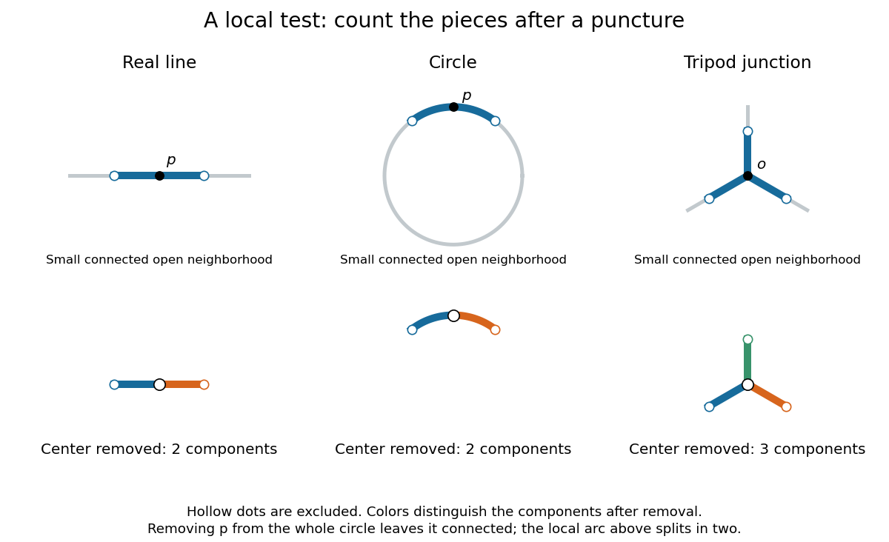

# Topological tripod

↑ **Parent:** [Topological manifold](topological-manifold-split.md)

A topological tripod is three copies of the [closed interval](closed-real-interval.md) $[0,1]$ with their zero endpoints identified to a single junction $o$. Equivalently, embed three line segments with distinct directions in the [Euclidean plane](euclidean-plane.md) and use the [subspace topology](subspace-topology.md). It is a [compact](compact-space.md), [connected](connected-space.md) [metric space](metric-space.md), and is [Hausdorff](hausdorff-space.md), [second countable](second-countable-space.md), and [paracompact](paracompact-space.md). Every interior arm point has a [coordinate chart](manifold-chart.md) to an [open interval](open-interval.md), and each outer endpoint has a half-interval chart as in a [topological manifold with boundary](topological-manifold-with-boundary.md). The junction has neither kind of chart.

**[Figure 2](#image-removing-the-center-of-a-small-neighborhood-leaves-two-pieces-on-a-line-or-circle-but-three-at-a-tripod-junction). Removing the center of a small neighborhood leaves two pieces on a line or circle, but three at a tripod junction**.

Here is a precise local obstruction. Let $S$ be a small [open](open-set.md) [neighbourhood](neighbourhood-mathematics.md) of $o$ consisting of initial segments of the three arms, excluding their outer endpoints. Every [connected](connected-space.md) [open](open-set.md) [neighbourhood](neighbourhood-mathematics.md) $N$ of $o$ contained in $S$ contains an initial segment on every arm, because $N$ is open at $o$. Its intersection with each arm has no gaps: if a point between $o$ and a point of $N$ were missing, cutting there would separate the part beyond it from the rest of $N$, contradicting [connectedness](connected-space.md). Thus $N\setminus\{o\}$ has exactly three [connected components](connected-component.md), one [interval](interval-mathematics.md) per arm.

Suppose a [coordinate chart](manifold-chart.md) $h$ to the [real line](real-line.md) existed at $o$. Choose a small [open interval](open-interval.md) $I$ about $h(o)$ lying inside $h(S\cap\operatorname{domain}(h))$, and restrict the chart to $N=h^{-1}(I)$. This is a [connected](connected-space.md) [open](open-set.md) [neighbourhood](neighbourhood-mathematics.md) of $o$ contained in $S$. Removing $o$ leaves three [connected components](connected-component.md) in $N$, while removing $h(o)$ leaves two in $I$. A [homeomorphism](homeomorphism.md) preserves [connected components](connected-component.md), so this is impossible. This restriction step is essential: the count is proved for any sufficiently small connected chart neighborhood, not merely one chosen drawing.

A higher [dimension of a manifold](dimension-of-a-manifold.md) cannot repair the junction. For $n\geq2$, repeat the argument with an [open ball](open-ball.md) about $h(o)$: a punctured [open ball](open-ball.md) in $\mathbb R^n$ is [path-connected](path-connected-space.md), whereas $N\setminus\{o\}$ still has three [connected components](connected-component.md). A zero-dimensional chart would make $o$ an [isolated point](isolated-point.md), which it is not. A chart at a boundary point of a [topological manifold with boundary](topological-manifold-with-boundary.md) similarly gives a punctured relative half-ball: one [connected component](connected-component.md) when $n=1$, and a [path-connected](path-connected-space.md) space when $n\geq2$. Consequently the [topological tripod](topological-tripod.md) fails the local definition even when intrinsic boundary is allowed.

The [circle](circle.md) provides a useful warning about scale: deleting a point from the whole [circle](circle.md) leaves a [connected space](connected-space.md), but deleting it from a sufficiently small connected arc leaves two [connected components](connected-component.md). Local chart tests use the latter. The [circle and interval are not homeomorphic](circle-and-interval-are-not-homeomorphic.md) article uses deletion from the whole spaces for a different, global obstruction.

## ↑ Ancestors (6)

1. [Topological manifold](topological-manifold-split.md)
2. [Topology](topology-split.md)
3. [Geometry and topology](geometry-and-topology-split.md)
4. [Area of mathematics](area-of-mathematics.md)
5. [Mathematics](mathematics-split.md)
6. [Codex Wiki](split.md)

## ← Incoming links (3)

- [Solution](past-exam-of-the-mathematics-course-of-the-university-of-cambridge/2013/iii/paper-15/1/solution.md)
- [Topological manifold](topological-manifold-split.md)
- [Topological tripod](topological-tripod.md)
