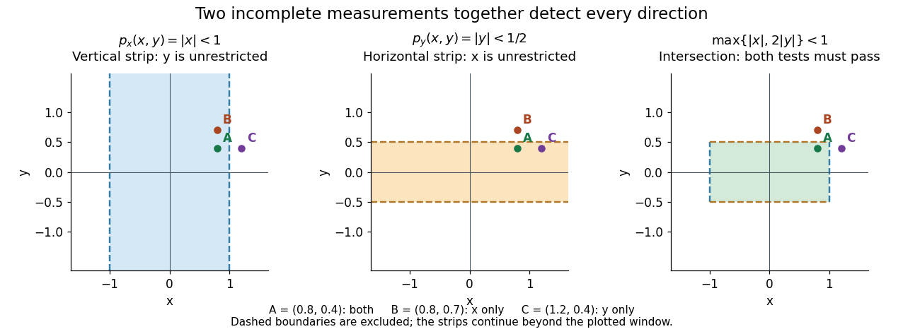

# Topological vector space

↑ **Parent:** [Functional analysis](functional-analysis.md)  
ⓦ [Wiki](https://en.wikipedia.org/wiki/Topological_vector_space)

A topological vector space is a [vector space](vector-space.md) $E$ over $\mathbb K=\mathbb R$ or $\mathbb C$, equipped with a [topology](topology.md) such that [vector addition](vector-space.md#vector-addition) and [scalar multiplication](vector-space.md#scalar-multiplication) are jointly [continuous](calculus.md#continuous-function):

$$
E\times E\longrightarrow E,\quad (x,y)\longmapsto x+y,
\qquad
\mathbb K\times E\longrightarrow E,\quad (\lambda,x)\longmapsto\lambda x.
$$

The domains carry the [product topology](geometry-and-topology.md#product-topology), and the [scalar](vector-space.md#scalar) field carries its usual [topology](topology.md). Joint [continuity](calculus.md#continuous-function) permits both inputs to vary at once. Here the definition does not impose the [Hausdorff](topology.md#hausdorff-space) condition; we state it separately when needed. [Peter Philip, Functional Analysis, Definition 1.1 and Example 1.2](https://www.math.lmu.de/~philip/publications/lectureNotes/philipPeter_FunctionalAnalysis.pdf).

Every [normed vector space](normed-vector-space.md) is a [topological vector space](topological-vector-space.md): the [triangle inequality](topological-analysis.md#triangle-inequality) gives $\|x+y\|\leq\|x\|+\|y\|$, while

$$
\|\lambda x-\lambda_0x_0\|\leq |\lambda|\,\|x-x_0\|+|\lambda-\lambda_0|\,\|x_0\|
$$

controls [scalar multiplication](vector-space.md#scalar-multiplication) near any $(\lambda_0,x_0)$. More generally, a [seminorm topology](#seminorm-topology) supplies many measurements of smallness, rather than one [norm](normed-vector-space.md#norm). Translation by any [vector](vector-space.md#vector) is a [homeomorphism](topology.md#homeomorphism), so a [neighbourhood basis](topology.md#neighbourhood-basis) at zero determines all [neighbourhoods](topology.md#neighbourhood-mathematics) by translation.

The compatibility matters: on a nonzero real [vector space](vector-space.md), the [discrete topology](topology.md#discrete-space) makes [vector addition](vector-space.md#vector-addition) [continuous](calculus.md#continuous-function), but not [scalar multiplication](vector-space.md#scalar-multiplication). For $x\ne0$, the [sequence](sequence-and-series.md#sequence) of scalars $1/n$ tends to zero, whereas the [sequence](sequence-and-series.md#sequence) $x/n$ never enters the [open set](topology.md#open-set) $\{0\}$. Thus choosing a [topology](topology.md) arbitrarily need not respect the [linear algebra](linear-algebra.md).

This framework lets [functional analysis](functional-analysis.md) choose the appropriate notion of [limit of a sequence](sequence-and-series.md#limit-of-a-sequence). [Norm topology](normed-vector-space.md#norm-topology) measures one global error, [weak topology](weak-topology.md) tests [linear functionals](dual-space.md#linear-functional), and the [Fréchet space](#frechet-space) of [smooth functions](analysis.md#smooth-function) controls every order of [derivative](calculus.md#derivative). In each case the operations forming [linear combinations](vector-space.md#linear-combination) are [continuous](calculus.md#continuous-function), making approximation compatible with the underlying equations.

**Table of contents**

- [Dense subspace](#dense-subspace)
- [Sequential continuity criterion in a metrizable vector space](#sequential-continuity-criterion-in-a-metrizable-vector-space)
- [Bounded set in a topological vector space](#bounded-set-in-a-topological-vector-space)
- [Strict inductive limit topology](#strict-inductive-limit-topology)
- [Metrizable topological vector space](#metrizable-topological-vector-space)
- [Finite-dimensional vector-space topology](#finite-dimensional-vector-space-topology)
  - [Equivalence of norms in finite dimensions](#equivalence-of-norms-in-finite-dimensions)
    - [Sharp comparison of l1 and l2 norms](#sharp-comparison-of-l1-and-l2-norms)
- [Locally convex space](#locally-convex-space)
  - [Seminorm topology](#seminorm-topology)
    - [Separating family of seminorms](#separating-family-of-seminorms)
  - [Compact metrizable convex set](#compact-metrizable-convex-set)
    - [Choquet theorem](#choquet-theorem)
      - [Threshold Choquet representation in L-infinity](#threshold-choquet-representation-in-l-infinity)
      - [Choquet's theorem by strict convexity](#choquet-s-theorem-by-strict-convexity)
    - [Affine upper envelope](#affine-upper-envelope)
      - [Supporting measure lemma for affine upper envelopes](#supporting-measure-lemma-for-affine-upper-envelopes)
    - [Barycenter](#barycenter)
  - [Seminorm](#seminorm)
    - [Kernel of a seminorm](#kernel-of-a-seminorm)
    - [Coordinate seminorms](#coordinate-seminorms)
    - [Dual seminorm](#dual-seminorm)
  - [Fréchet space](#frechet-space)
    - [Derivative seminorms on a compact interval](#derivative-seminorms-on-a-compact-interval)
      - [Smooth convergence on a compact interval](#smooth-convergence-on-a-compact-interval)
  - [Minkowski functional](#minkowski-functional)
    - [Norm from a bounded symmetric convex neighbourhood](#norm-from-a-bounded-symmetric-convex-neighbourhood)
  - [Separation of a point and an open convex set](#separation-of-a-point-and-an-open-convex-set)
    - [Hahn-Banach separation theorem for two convex sets](#hahn-banach-separation-theorem-for-two-convex-sets)
    - [Finite-dimensional separation of open convex sets](#finite-dimensional-separation-of-open-convex-sets)
  - [Dual pair](#dual-pair)
    - [Continuous dual of a weak topology](#continuous-dual-of-a-weak-topology)
    - [Compact norming dual-pair criterion](#compact-norming-dual-pair-criterion)
    - [Bipolar theorem for a dual pair](#bipolar-theorem-for-a-dual-pair)
  - [Product of locally convex spaces](#product-of-locally-convex-spaces)
- [Continuous linear operator](#continuous-linear-operator)
  - [Completely continuous operator](#completely-continuous-operator)
  - [Approximate surjectivity with geometric correction](#approximate-surjectivity-with-geometric-correction)
  - [Absolutely p-summing operator](#absolutely-p-summing-operator)
    - [2-summing operator](#2-summing-operator)
      - [2-summing norm of a finite-dimensional identity](#2-summing-norm-of-a-finite-dimensional-identity)
    - [Pietsch factorization theorem](#pietsch-factorization-theorem)
    - [Absolutely summing operator](#absolutely-summing-operator)
  - [Strictly singular operator](#strictly-singular-operator)
  - [Positivity-preserving linear operator on L1](#positivity-preserving-linear-operator-on-l1)
    - [Mean control for positive imaging operators](#mean-control-for-positive-imaging-operators)
  - [Schur test](#schur-test)
  - [Bounded inverse](#bounded-inverse)
  - [Positive linear operator on continuous functions](#positive-linear-operator-on-continuous-functions)
    - [Zero-preserving linear operator on continuous functions](#zero-preserving-linear-operator-on-continuous-functions)
  - [Contractive linear operator](#contractive-linear-operator)
  - [Range of a bounded linear operator](#range-of-a-bounded-linear-operator)
  - [Extension of a bounded linear operator from a dense subspace](#extension-of-a-bounded-linear-operator-from-a-dense-subspace)
    - [Failure of dense-subspace extension into an incomplete codomain](#failure-of-dense-subspace-extension-into-an-incomplete-codomain)
  - [Banach space of bounded linear operators](#banach-space-of-bounded-linear-operators)
  - [Continuous linear functional](#continuous-linear-functional)
    - [Linear functional with closed kernel](#linear-functional-with-closed-kernel)
    - [Point evaluation functional](#point-evaluation-functional)
  - [Sequential continuity criterion for a linear map on a metrizable topological vector space](#sequential-continuity-criterion-for-a-linear-map-on-a-metrizable-topological-vector-space)
  - [Isomorphism of Banach spaces](#isomorphism-of-banach-spaces)

## Dense subspace

↑ **Parent:** [Topological vector space](topological-vector-space.md)

A dense subspace of a [topological vector space](topological-vector-space.md) $X$ is a [linear subspace](vector-space.md#vector-subspace) $D$ whose closure is all of $X$. It permits continuous operators to be determined or extended from values on $D$. For a normed space, every vector in $X$ is a limit of vectors from $D$.

## Sequential continuity criterion in a metrizable vector space

↑ **Parent:** [Topological vector space](topological-vector-space.md)

A linear map from a [metrizable space](mathematics.md#metrizable-space) carrying a vector-space topology is continuous if it takes every null sequence to a null sequence. If continuity fails, choose a point in each shrinking basic neighborhood whose image stays outside a fixed neighborhood of zero. These points converge to zero but their images do not. For a [Fréchet space](#frechet-space) described by increasing [seminorms](#seminorm) $p_j$, a discontinuous functional admits $p_j(f_j)\leq1/j$ and $|u(f_j)|\geq1$.

## Bounded set in a topological vector space

↑ **Parent:** [Topological vector space](topological-vector-space.md)

A subset $B$ of a [topological vector space](topological-vector-space.md) is bounded when every neighborhood $U$ of zero absorbs it: $B\subseteq tU$ for all sufficiently large positive $t$. In a [locally convex space](#locally-convex-space) defined by [seminorms](#seminorm) $p_\lambda$, this is equivalent to $\sup_{x\in B}p_\lambda(x)<\infty$ for every $\lambda$. In particular, a bounded subset of the [Schwartz space](fourier-analysis.md#schwartz-space) has a uniform bound for every Schwartz seminorm; it need not have uniformly bounded supports.

## Strict inductive limit topology

↑ **Parent:** [Topological vector space](topological-vector-space.md)

A strict inductive limit topology on an increasing union $E=\bigcup_nE_n$ is the finest locally convex topology compatible with the inclusions of the stages $E_n$. A linear map from $E$ is continuous exactly when each restriction to $E_n$ is continuous.

## Metrizable topological vector space

↑ **Parent:** [Topological vector space](topological-vector-space.md)

A topological vector space is metrizable when its topology is induced by a [metric](topological-analysis.md#metric). At the origin it then has a countable neighborhood basis, so continuity of a [linear map](vector-space.md#linear-map) can be tested on sequences.

## Finite-dimensional vector-space topology

↑ **Parent:** [Topological vector space](topological-vector-space.md)

Every finite-dimensional real vector space has a unique Hausdorff topology making it a topological vector space. Choosing a basis identifies it with ordinary Euclidean space; every linear map between such spaces is continuous.

### Equivalence of norms in finite dimensions

↑ **Parent:** [Finite-dimensional vector-space topology](#finite-dimensional-vector-space-topology)

On a finite-dimensional vector space over a complete valued field, any two norms induce the same topology. Choosing a basis reduces the claim to comparison with the maximum of the absolute values of the coordinates.

#### Sharp comparison of l1 and l2 norms

↑ **Parent:** [Equivalence of norms in finite dimensions](#equivalence-of-norms-in-finite-dimensions)

For $x\in\mathbb R^n$, [Cauchy-Schwarz inequality](probability-and-statistics.md#cauchy-schwarz-inequality) applied to $(|x_i|)$ and $(1)$ gives the upper bound. Equal absolute coordinate values attain its factor $\sqrt n$. Expanding $(\sum_i|x_i|)^2$ gives the lower bound, and a vector with only one nonzero coordinate attains its factor one. Thus both constants are optimal. These [Lp norms](real-analysis.md#lp-norm) define the same finite-dimensional topology despite having different unit balls.

## Locally convex space

↑ **Parent:** [Topological vector space](topological-vector-space.md)  
ⓦ [Wiki](https://en.wikipedia.org/wiki/Locally_convex_space)

A locally convex space is a [topological vector space](topological-vector-space.md) with a [neighbourhood basis](topology.md#neighbourhood-basis) at zero consisting of [convex sets](convex-set.md). Equivalently, its [topology](topology.md) is a [seminorm topology](#seminorm-topology) generated by some family $\mathcal P$ of [seminorms](#seminorm). We allow non-[Hausdorff](topology.md#hausdorff-space) spaces here; a [separating family of seminorms](#separating-family-of-seminorms) gives precisely the [Hausdorff](topology.md#hausdorff-space) case. Every [normed vector space](normed-vector-space.md) is locally convex, but [smooth convergence](#smooth-convergence-on-a-compact-interval) generally requires a whole family of measurements.

The geometric and measurement descriptions fit together: [seminorm](#seminorm) sublevel sets are [convex](real-analysis.md#convex-function), while the [Minkowski functional](#minkowski-functional) of an open, convex zero [neighbourhood](topology.md#neighbourhood-mathematics) invariant under all [scalar multiplications](vector-space.md#scalar-multiplication) with $|\lambda|\leq1$ is a [continuous](calculus.md#continuous-function) [seminorm](#seminorm). Such [neighbourhoods](topology.md#neighbourhood-mathematics) can be chosen as a [neighbourhood basis](topology.md#neighbourhood-basis). [Peter Philip, Functional Analysis, Theorem 1.40, equivalence of local convexity and seminorm topologies](https://www.math.lmu.de/~philip/publications/lectureNotes/philipPeter_FunctionalAnalysis.pdf).

Local convexity makes [Hahn-Banach theorem](functional-analysis.md#hahn-banach-theorem) and [separation of a point and an open convex set](#separation-of-a-point-and-an-open-convex-set) available. It turns geometric distinctions into [continuous linear functionals](#continuous-linear-functional), connecting [convex sets](convex-set.md) to the [continuous dual space](continuous-dual-space.md). For a [seminorm topology](#seminorm-topology) generated by $\mathcal P$, a [linear functional](dual-space.md#linear-functional) $\ell$ is [continuous](calculus.md#continuous-function) exactly when there are $p_1,\ldots,p_m\in\mathcal P$ and $C>0$ with

$$
|\ell(x)|\leq C\max_{1\leq i\leq m}p_i(x)\qquad(x\in E).
$$

Thus one [continuous linear functional](#continuous-linear-functional) needs only finitely many of the available measurements. For example, [point evaluation](#point-evaluation-functional) of a [derivative](calculus.md#derivative) on the [space of smooth functions on a compact interval](topological-analysis.md#space-of-smooth-functions-on-a-compact-interval) is controlled by a suitable [derivative seminorm](#derivative-seminorms-on-a-compact-interval).

### Seminorm topology

↑ **Parent:** [Locally convex space](#locally-convex-space)

Given a nonempty family $\mathcal P$ of finite-valued [seminorms](#seminorm) on a real or complex [vector space](vector-space.md) $E$, its seminorm topology has basic open zero [neighbourhoods](topology.md#neighbourhood-mathematics)

$$
U(p_1,\ldots,p_m;\varepsilon_1,\ldots,\varepsilon_m)
=\bigcap_{i=1}^m\{x\in E:p_i(x)<\varepsilon_i\},
\qquad p_i\in\mathcal P,\quad\varepsilon_i>0.
$$

Their translates form a [basis of a topology](topology.md#basis-of-a-topology). Only finite [intersections](set.md#set-intersection) are required: an infinite [intersection](set.md#set-intersection) might impose a stronger [topology](topology.md). Equivalently, put $q(x)=\max_i p_i(x)/\varepsilon_i$; then $q$ is a [seminorm](#seminorm) and $U=\{q<1\}$. See [Günther Hörmann, Advanced Functional Analysis, section 4, neighbourhood systems from seminorms](https://www.mat.univie.ac.at/~gue/lehre/25AFA/AFA.pdf) for the general construction.

Each defining [seminorm](#seminorm) is [continuous](calculus.md#continuous-function), since $|p(x)-p(y)|\leq p(x-y)$. A [sequence](sequence-and-series.md#sequence) satisfies $x_n\to x$ precisely when $p(x_n-x)\to0$ for every $p\in\mathcal P$; the same criterion holds for [nets](topology.md#net-mathematics). Finitely many measurements can each meet a prescribed tolerance after a common index.

The [seminorm](#seminorm) axioms also establish the required joint [continuity](calculus.md#continuous-function) of [vector addition](vector-space.md#vector-addition) and [scalar multiplication](vector-space.md#scalar-multiplication):

$$
p\bigl((x+y)-(x_0+y_0)\bigr)\leq p(x-x_0)+p(y-y_0),
\qquad
p(\lambda x-\lambda_0x_0)\leq |\lambda|p(x-x_0)+|\lambda-\lambda_0|p(x_0).
$$

For a basic [neighbourhood](topology.md#neighbourhood-mathematics), apply these estimates to its finitely many [seminorms](#seminorm); near $\lambda_0$ the [absolute value](real-analysis.md#absolute-value) $|\lambda|$ is bounded. This gives a [locally convex space](#locally-convex-space) even when some directions are invisible to every measurement.

#### Separating family of seminorms

↑ **Parent:** [Seminorm topology](#seminorm-topology)

A family of [seminorms](#seminorm) separates points when every nonzero [vector](vector-space.md#vector) $z$ has $p(z)>0$ for some member $p$. Equivalently, its [kernels of seminorms](#kernel-of-a-seminorm) have intersection $\{0\}$, or any two distinct [vectors](vector-space.md#vector) $x,y$ have $p(x-y)>0$ for some $p$. Individual [seminorms](#seminorm) can have large [kernels of seminorms](#kernel-of-a-seminorm); the whole family must have no common invisible direction.

The associated [seminorm topology](#seminorm-topology) is [Hausdorff](topology.md#hausdorff-space) if and only if the family separates points. Indeed, if $p(x-y)=a>0$, the [neighbourhoods](topology.md#neighbourhood-mathematics) $\{u:p(u-x)<a/3\}$ and $\{v:p(v-y)<a/3\}$ are disjoint by the [triangle inequality](topological-analysis.md#triangle-inequality). Conversely, if every $p$ vanishes on a nonzero $z$, then zero and $z$ belong to exactly the same open [sets](set.md) and cannot be separated. This criterion keeps separation distinct from [completeness](topological-analysis.md#completeness): detecting all directions does not guarantee that all [Cauchy sequences](sequence-and-series.md#cauchy-sequence) have limits.

### Compact metrizable convex set

↑ **Parent:** [Locally convex space](#locally-convex-space)

Here the set is a nonempty compact metrizable convex subset of a Hausdorff locally convex space. The ambient space can be infinite-dimensional. Continuous affine [functions](function.md) separate its points, and weak-star compact dual balls with separable preduals provide examples. This general setting is needed for [Choquet theorem](#choquet-theorem).

#### Choquet theorem

↑ **Parent:** [Compact metrizable convex set](#compact-metrizable-convex-set)

Every point of a compact metrizable convex subset of a Hausdorff locally convex space is the [barycenter](#barycenter) of a [Borel probability measure](measure.md#borel-probability-measure) concentrated on its [extreme points](convex-set.md#extreme-point). The theorem is an existence assertion; uniqueness requires additional hypotheses such as a simplex structure.

##### Threshold Choquet representation in L-infinity

↑ **Parent:** [Choquet theorem](#choquet-theorem)

For a real [function](function.md) in the $L^\infty$ unit ball, push uniform [measure](measure.md) on $t\in[0,1]$ forward by the displayed sign-valued [functions](function.md). In the [weak-star topology](weak-topology.md#weak-star-topology) this is a Borel probability concentrated on the [extreme points](convex-set.md#extreme-point), and [Fubini's theorem](measure-theory.md#fubini-s-theorem) shows that its [barycenter](#barycenter) is $f$. Weak-star compactness and separability of the predual $L^1$ place the example within [Choquet theorem](#choquet-theorem).

<h5 id="choquet-s-theorem-by-strict-convexity">Choquet's theorem by strict convexity</h5>

↑ **Parent:** [Choquet theorem](#choquet-theorem)

Maximize the integral of a continuous strictly convex [function](function.md) among [probability measures](probability-space.md#probability-measure) with a fixed [barycenter](#barycenter). The [supporting measure lemma for affine upper envelopes](#supporting-measure-lemma-for-affine-upper-envelopes) implies that the maximizing [measure](measure.md) has zero integral of the nonnegative envelope gap. Strict convexity makes this gap positive at every nonextreme point, so the [measure](measure.md) is concentrated on the extreme boundary. Metrizability makes that boundary Borel and supplies the continuous strictly convex [function](function.md).

#### Affine upper envelope

↑ **Parent:** [Compact metrizable convex set](#compact-metrizable-convex-set)

For a bounded real [function](function.md) on a compact convex set, this envelope is the infimum of its continuous affine majorants. It is finite, concave and [upper semicontinuous](calculus.md#upper-semicontinuity), and dominates the [function](function.md). For continuous [functions](function.md) it describes the maximal integral among [probability measures](probability-space.md#probability-measure) with a specified [barycenter](#barycenter). Its homogeneity, subadditivity and affine-translation identities give the [supporting measure lemma for affine upper envelopes](#supporting-measure-lemma-for-affine-upper-envelopes).

##### Supporting measure lemma for affine upper envelopes

↑ **Parent:** [Affine upper envelope](#affine-upper-envelope)

The sublinear functional $p(g)=\mu(\overline g)$ has a linear supporting functional taking the value $p(f)$ at a specified continuous $f$, by the [Hahn-Banach theorem](functional-analysis.md#hahn-banach-theorem). It is positive and normalized because $p$ has these values on constants. The [Riesz-Markov-Kakutani representation theorem](functional-analysis.md#riesz-markov-kakutani-representation-theorem) gives the probability $\nu$. Testing affine [functions](function.md) and their negatives shows that $\mu$ and $\nu$ have the same [barycenter](#barycenter).

#### Barycenter

↑ **Parent:** [Compact metrizable convex set](#compact-metrizable-convex-set)

The [barycenter](#barycenter) of a [probability measure](probability-space.md#probability-measure) on a compact convex set is the point satisfying the displayed affine integral identities. It exists by approximating the [measure](measure.md) by finitely supported [measures](measure.md) and using compactness of their finite convex combinations. It is unique because continuous affine [functions](function.md) separate points. In a Banach-space setting it agrees with the appropriate vector integral when that integral is defined.

### Seminorm

↑ **Parent:** [Locally convex space](#locally-convex-space)  
ⓦ [Wiki](https://en.wikipedia.org/wiki/Seminorm)

A seminorm on a real or complex [vector space](vector-space.md) $E$ is a finite-valued [function](function.md) $p:E\to[0,\infty)$ satisfying absolute homogeneity and the [triangle inequality](topological-analysis.md#triangle-inequality):

$$
p(\lambda x)=|\lambda|p(x),\qquad p(x+y)\leq p(x)+p(y)
\qquad(x,y\in E,\ \lambda\in\mathbb K).
$$

In particular $p(0)=0$ and $p(-x)=p(x)$. A [seminorm](#seminorm) is a [norm](normed-vector-space.md#norm) exactly when $p(x)=0$ implies $x=0$: this is the extra [definiteness of a norm](normed-vector-space.md#definiteness-of-a-norm) axiom. The zero [function](function.md) is a valid [seminorm](#seminorm). The missing definiteness is useful when a measurement deliberately ignores some directions, such as an individual coordinate or the constant term of a [function](function.md) whose [derivative](calculus.md#derivative) is measured.

For example, on $C^1([0,1])$ the [function](function.md) $p(f)=\sup_{t\in[0,1]}|f'(t)|$ is a [seminorm](#seminorm) that vanishes on every constant [function](function.md). Adding the value measurement gives the [norm](normed-vector-space.md#norm) $q(f)=|f(0)|+p(f)$: if $q(f)=0$, the [fundamental theorem of calculus](calculus.md#fundamental-theorem-of-calculus) gives $f(t)=f(0)+\int_0^t f'(s)\,ds=0$. A family of such partial measurements defines a [seminorm topology](#seminorm-topology).

#### Kernel of a seminorm

↑ **Parent:** [Seminorm](#seminorm)

The kernel of a [seminorm](#seminorm) is its zero set, a [linear subspace](vector-space.md#vector-subspace) by absolute homogeneity and the [triangle inequality](topological-analysis.md#triangle-inequality). The estimate $|p(x)-p(y)|\leq p(x-y)$ shows that adding an element of $\ker p$ does not change $p$. Hence $\|x+\ker p\|=p(x)$ defines a [norm](normed-vector-space.md#norm) on the [quotient vector space](vector-space.md#quotient-vector-space) $E/\ker p$.

On $E$ itself, $d_p(x,y)=p(x-y)$ is a [pseudometric](topological-analysis.md#pseudometric); it is a [metric](topological-analysis.md#metric) exactly when $p$ is a [norm](normed-vector-space.md#norm). In particular, zero distance in one [pseudometric](topological-analysis.md#pseudometric) need not mean equality of [vectors](vector-space.md#vector). A [separating family of seminorms](#separating-family-of-seminorms) removes the common zero-distance ambiguity.

#### Coordinate seminorms

↑ **Parent:** [Seminorm](#seminorm)

On $\mathbb R^2$, the [coordinate seminorms](#coordinate-seminorms) $p_x$ and $p_y$ measure horizontal and vertical components separately. Their [kernels of seminorms](#kernel-of-a-seminorm) are the vertical and horizontal axes. Neither is a [norm](normed-vector-space.md#norm), but together they form a [separating family of seminorms](#separating-family-of-seminorms). A basic zero [neighbourhood](topology.md#neighbourhood-mathematics) is

$$
\{p_x<a\}\cap\{p_y<b\}=(-a,a)\times(-b,b)\qquad(a,b>0).
$$

Each condition alone is an unbounded strip; their intersection is an open rectangle. For $a=b=1$, this is the unit [open ball](topology.md#open-ball) of the [maximum norm](normed-vector-space.md#supremum-norm) $\|(x,y)\|_\infty=\max\{|x|,|y|\}$. For unequal tolerances it is the unit [open ball](topology.md#open-ball) of the weighted [norm](normed-vector-space.md#norm) $\max\{|x|/a,|y|/b\}$. Thus the two coordinate measurements generate the usual [topology](topology.md) of the plane.

For a numerical check, take $a=1$, $b=1/2$: $(0.8,0.4)$ passes both tests, $(0.8,0.7)$ passes only the horizontal test, and $(1.2,0.4)$ passes only the vertical test. A direction missed by one [seminorm](#seminorm) is detected by the other.

**[Figure 1](#image-two-coordinate-seminorm-strips-intersect-in-a-basic-open-rectangle). Two coordinate seminorm strips intersect in a basic open rectangle**.

#### Dual seminorm

↑ **Parent:** [Seminorm](#seminorm)

Given a bilinear pairing $\langle\cdot,\cdot\rangle$ and a [seminorm](#seminorm) $p$, its dual seminorm is

$$
p^*(y)=\sup_{p(x)\leq1}|\langle x,y\rangle|.
$$

It may be infinite when $y$ does not annihilate the kernel of $p$. Whenever it is finite, the defining inequality gives $|\langle x,y\rangle|\leq p(x)p^*(y)$.

<h3 id="frechet-space">Fréchet space</h3>

↑ **Parent:** [Locally convex space](#locally-convex-space)  
ⓦ [Wiki](https://en.wikipedia.org/wiki/Fréchet_space)

A Fréchet space is a [Hausdorff](topology.md#hausdorff-space) [locally convex space](#locally-convex-space) whose [topology](topology.md) is induced by a complete translation-invariant [metric](topological-analysis.md#metric). Translation invariance means $d(x+z,y+z)=d(x,y)$; [completeness](topological-analysis.md#completeness) means every [Cauchy sequence](sequence-and-series.md#cauchy-sequence) converges in the space. Use a translation-invariant [metric](topological-analysis.md#metric) for this condition: an arbitrary compatible [metric](topological-analysis.md#metric) can change which [sequences](sequence-and-series.md#sequence) are [Cauchy sequences](sequence-and-series.md#cauchy-sequence). [Peter Philip, Functional Analysis, Definition 1.22 and Remark 1.23](https://www.math.lmu.de/~philip/publications/lectureNotes/philipPeter_FunctionalAnalysis.pdf).

Equivalently, the [topology](topology.md) comes from a countable [separating family of seminorms](#separating-family-of-seminorms) $(p_k)_{k\geq0}$ and is complete in their common sense: if $p_k(x_n-x_m)\to0$ as $n,m\to\infty$ for every fixed $k$, then some $x\in E$ satisfies $p_k(x_n-x)\to0$ for every $k$. A useful compatible translation-invariant [metric](topological-analysis.md#metric) is

$$
d(x,y)=\sum_{k=0}^{\infty}2^{-(k+1)}\min\{1,p_k(x-y)\}.
$$

It is finite because the weights sum to one. The separating condition makes it a [metric](topological-analysis.md#metric); without that condition the formula gives only a [pseudometric](topological-analysis.md#pseudometric). Its [convergence in a metric space](topological-analysis.md#convergence-in-a-metric-space) and [Cauchy sequence](sequence-and-series.md#cauchy-sequence) conditions are exactly the conditions for all the $p_k$ separately: control finitely many terms, then bound the remaining tail by $2^{-(K+1)}$. Replacing $p_k$ by $\max_{0\leq j\leq k}p_j$ gives an increasing family with the same [topology](topology.md).

Every [Banach space](banach-space.md) is a [Fréchet space](#frechet-space), using its [norm](normed-vector-space.md#norm) as the single measurement. The [space of smooth functions on a compact interval](topological-analysis.md#space-of-smooth-functions-on-a-compact-interval) is a [Fréchet space](#frechet-space) with [derivative seminorms](#derivative-seminorms-on-a-compact-interval) but with no single [norm](normed-vector-space.md#norm) inducing its smooth [topology](topology.md). This is why [Fréchet spaces](#frechet-space) are useful in [differential equations](differential-equation.md): one can require accuracy in every order of [derivative](calculus.md#derivative), while each particular estimate uses only finitely many orders.

The name honors [Maurice Fréchet](mathematics.md#maurice-frechet). His doctoral thesis was published as [Sur quelques points du calcul fonctionnel, Rendiconti del Circolo Matematico di Palermo 22, pages 1–72 (1906)](https://link.springer.com/article/10.1007/BF03018603); an [open scan of Fréchet's original paper](https://zenodo.org/records/1428464) is available. This identifies a historical source without attributing the modern locally convex definition to that paper.

#### Derivative seminorms on a compact interval

↑ **Parent:** [Fréchet space](#frechet-space)

Here $C^\infty([0,1])$ means the real- or complex-valued [functions](function.md) [continuous](calculus.md#continuous-function) on $[0,1]$, [smooth](analysis.md#smooth-function) on $(0,1)$, with every interior [derivative](calculus.md#derivative) having a [continuous](calculus.md#continuous-function) extension to the endpoints; endpoint values of [derivatives](calculus.md#derivative) are these extensions. On this [space of smooth functions on a compact interval](topological-analysis.md#space-of-smooth-functions-on-a-compact-interval), define

$$
p_k(f)=\max_{0\leq j\leq k}\sup_{t\in[0,1]}|f^{(j)}(t)|,
\qquad k=0,1,2,\ldots,\qquad f^{(0)}=f.
$$

These finite-valued [seminorms](#seminorm) increase with $k$ and separate points. In fact every $p_k$ is a [norm](normed-vector-space.md#norm), since it includes $p_0(f)=\|f\|_\infty$. The terminology [seminorm](#seminorm) includes [norms](normed-vector-space.md#norm); it does not assert that every measurement has a nontrivial [kernel of a seminorm](#kernel-of-a-seminorm). [Smooth convergence](#smooth-convergence-on-a-compact-interval) means $p_k(f_n-f)\to0$ for every fixed $k$, equivalently [uniform convergence](sequence-and-series.md#uniform-convergence) of every [derivative](calculus.md#derivative) separately. It does not demand one tolerance or one convergence index that works for all orders simultaneously. The maximum convention is equivalent to the [derivative supremum norm](normed-vector-space.md#derivative-supremum-norm) convention using a finite sum, since $p_k(f)\leq\sum_{j=0}^k\|f^{(j)}\|_\infty\leq(k+1)p_k(f)$.

For a worked example, $f(t)=t^3$ gives $p_0(f)=1$, $p_1(f)=3$, $p_2(f)=6$, and $p_k(f)=6$ for $k\geq3$. The [linear functional](dual-space.md#linear-functional) $\ell(f)=f''(1/2)$ obeys $|\ell(f)|\leq p_2(f)$ and is [continuous](calculus.md#continuous-function). Similarly, [differentiation](calculus.md#differentiation) is a [continuous linear operator](#continuous-linear-operator) $D:f\mapsto f'$ for [smooth convergence](#smooth-convergence-on-a-compact-interval), because $p_k(Df)\leq p_{k+1}(f)$.

The [space of smooth functions on a compact interval](topological-analysis.md#space-of-smooth-functions-on-a-compact-interval) is complete for this [seminorm topology](#seminorm-topology). A [Cauchy sequence](sequence-and-series.md#cauchy-sequence) has [uniform limits](sequence-and-series.md#uniform-limit) $g_j$ for its [derivatives](calculus.md#derivative) of each order. Passing to the limit in the [fundamental theorem of calculus](calculus.md#fundamental-theorem-of-calculus) identity

$$
f_n^{(j)}(t)-f_n^{(j)}(0)=\int_0^t f_n^{(j+1)}(s)\,ds
$$

gives $g_j(t)-g_j(0)=\int_0^t g_{j+1}(s)\,ds$, so $g_j'=g_{j+1}$ and $g_0$ belongs to the same space. This is the [completeness of the smooth-function metric](topological-analysis.md#completeness-of-the-smooth-function-metric) argument; the [metric](topological-analysis.md#metric) there and the increasing-$p_k$ [metric](topological-analysis.md#metric) above induce the same smooth [topology](topology.md) and the same [Cauchy sequences](sequence-and-series.md#cauchy-sequence).

##### Smooth convergence on a compact interval

↑ **Parent:** [Derivative seminorms on a compact interval](#derivative-seminorms-on-a-compact-interval)

Smooth convergence on a compact [interval](real-analysis.md#interval-mathematics) requires [uniform convergence](sequence-and-series.md#uniform-convergence) of the [functions](function.md) and of their [derivatives](calculus.md#derivative) of every order separately, as measured by the [derivative seminorms](#derivative-seminorms-on-a-compact-interval). The need for several scales is visible in

$$
f_n(t)=\frac{\sin(nt)}n,\qquad p_0(f_n)\leq\frac1n\longrightarrow0,
\qquad f_n'(t)=\cos(nt),\qquad p_1(f_n)=1.
$$

For $n\geq2$, $p_0(f_n)=1/n$ because $t=\pi/(2n)$ lies in $[0,1]$. The [derivative](calculus.md#derivative) has [supremum norm](normed-vector-space.md#supremum-norm) one for every $n$, already at $t=0$. Thus $f_n$ [converges uniformly](sequence-and-series.md#uniform-convergence) to zero, but fails the test for [smooth convergence](#smooth-convergence-on-a-compact-interval) to zero. [Andreas Buttenschoen, Applied Functional Analysis, spaces of continuous and differentiable functions](https://www.buttenschoen.ca/MATH725/introduction/ck-spaces/) discusses this example and the family of smoothness measurements.

**[Figure 2](#image-shrinking-function-values-coexist-with-derivative-errors-of-size-one). Shrinking function values coexist with derivative errors of size one**.

More generally, for any fixed $K\geq0$, $h_n(t)=\sin(nt)/n^{K+1}$ has $p_K(h_n)\leq1/n$ but $p_{K+1}(h_n)=1$ for $n\geq2$. If a [norm](normed-vector-space.md#norm) $N$ induced the smooth [topology](topology.md), its [continuity](calculus.md#continuous-function) would give $N(f)\leq C p_K(f)$ for some finite $K$, while [continuity](calculus.md#continuous-function) of $p_{K+1}$ for $N$ would give $p_{K+1}(f)\leq C'N(f)$. Substituting $h_n$ contradicts these two bounds. [Smooth convergence](#smooth-convergence-on-a-compact-interval) therefore cannot be reduced to one [norm](normed-vector-space.md#norm). Its beauty is that every finite order can be controlled without fixing a final order in advance.

### Minkowski functional

↑ **Parent:** [Locally convex space](#locally-convex-space)  
ⓦ [Wiki](https://en.wikipedia.org/wiki/Minkowski_functional)

For an absorbing convex set $U$ containing zero, its Minkowski functional is $p_U(x)=\inf\{t>0:x\in tU\}$. If $U$ is open and convex, then $p_U$ is sublinear and $U=\{x:p_U(x)<1\}$.

#### Norm from a bounded symmetric convex neighbourhood

↑ **Parent:** [Minkowski functional](#minkowski-functional)

For a bounded convex open set $U$ containing zero and invariant under $x\mapsto-x$, its [Minkowski functional](#minkowski-functional) is a [norm](normed-vector-space.md#norm). Inner and outer Euclidean balls give positive finite bounds; symmetry and scaling give absolute homogeneity; convexity gives the [triangle inequality](topological-analysis.md#triangle-inequality). Openness makes $U=\{p_U<1\}$, while boundedness prevents nonzero vectors from having zero gauge.

### Separation of a point and an open convex set

↑ **Parent:** [Locally convex space](#locally-convex-space)

If $C$ is a nonempty open convex subset of a real locally convex space and $x_0\notin C$, a continuous linear functional strictly separates them: after choosing a sign, $f(c)<f(x_0)$ for every $c\in C$. Apply the [Hahn-Banach theorem](functional-analysis.md#hahn-banach-theorem) to the [Minkowski functional](#minkowski-functional) of a translate of $C$.

#### Hahn-Banach separation theorem for two convex sets

↑ **Parent:** [Separation of a point and an open convex set](#separation-of-a-point-and-an-open-convex-set)

If $A$ and $B$ are disjoint nonempty convex subsets of a real locally convex space and $A$ is open, then some continuous linear functional $f$ satisfies

$$
f(a)<f(b)
$$

for all $a\in A$ and $b\in B$.

#### Finite-dimensional separation of open convex sets

↑ **Parent:** [Separation of a point and an open convex set](#separation-of-a-point-and-an-open-convex-set)

If finitely many open convex subsets $K_1,\ldots,K_n$ of a locally convex space have empty intersection, some continuous linear map $T:X\to\mathbb R^{n-1}$ preserves that fact: $\bigcap_iT(K_i)=\varnothing$.

### Dual pair

↑ **Parent:** [Locally convex space](#locally-convex-space)  
ⓦ [Wiki](https://en.wikipedia.org/wiki/Dual_pair)

A dual pair $(E,F)$ consists of a real vector space $E$ and a vector space $F$ of linear functionals that separates the points of $E$. Its weak topology $\sigma(E,F)$ is the coarsest topology making every $f\in F$ continuous, and its continuous dual is exactly $F$.

#### Continuous dual of a weak topology

↑ **Parent:** [Dual pair](#dual-pair)

For a [separated dual pair](#dual-pair), the continuous linear functionals for its [weak topology](weak-topology.md) are exactly evaluations by members of the paired space. Continuity bounds a functional on a neighbourhood defined by finitely many evaluations; scalar rescaling makes it vanish on their common kernel. It then factors through their finite-dimensional evaluation map and is a finite linear combination of them.

#### Compact norming dual-pair criterion

↑ **Parent:** [Dual pair](#dual-pair)

Let $Z\subseteq X^*$ separate points of a Banach space $X$. If the closed unit ball of $X$ is compact for $\sigma(X,Z)$ and $Z$ has the norm inherited from $X^*$, then the evaluation map $X\to Z^*$ is an isometric isomorphism. [Goldstine theorem](functional-analysis.md#goldstine-theorem) makes its unit-ball image weak-star dense, while the assumed compactness makes that image closed.

#### Bipolar theorem for a dual pair

↑ **Parent:** [Dual pair](#dual-pair)

For $A\subseteq E$ in a [dual pair](#dual-pair) $(E,F)$, define $A^\circ=\{f\in F:f(a)\leq1\text{ for all }a\in A\}$. Then

$$
A^{\circ\circ}=\overline{\operatorname{conv}}^{\sigma(E,F)}(A\cup\{0\}).
$$

### Product of locally convex spaces

↑ **Parent:** [Locally convex space](#locally-convex-space)

The product topology on $X\times Y$ is generated by the seminorms $(x,y)\mapsto p(x)$ and $(x,y)\mapsto q(y)$. Its continuous dual is canonically $X^*\oplus Y^*$.

## Continuous linear operator

↑ **Parent:** [Topological vector space](topological-vector-space.md)  
ⓦ [Wiki](https://en.wikipedia.org/wiki/Continuous_linear_operator)

A continuous linear map is a [linear map](vector-space.md#linear-map) that is continuous for the topologies on its domain and codomain. Between [normed vector spaces](normed-vector-space.md), continuity is equivalent to boundedness.

### Completely continuous operator

↑ **Parent:** [Continuous linear operator](#continuous-linear-operator)

A [bounded linear operator](#continuous-linear-operator) between [Banach spaces](banach-space.md) is completely continuous when it maps weakly convergent sequences to norm-convergent sequences. Equivalently, it maps weakly compact sets to norm-compact sets: the [Eberlein-Šmulian theorem](weak-topology.md#eberlein-smulian-theorem) gives the forward direction, while a weakly convergent sequence together with its limit is weakly compact and gives the reverse direction. The inclusion $C(\mathbb T)\to L^2(\mathbb T)$ for finite [Lebesgue measure](measure-theory.md#lebesgue-measure) is completely continuous by pointwise convergence, the [Uniform boundedness principle](banach-space.md#uniform-boundedness-principle) and the [dominated convergence theorem](measure-theory.md#dominated-convergence-theorem), but is not a [compact operator](compact-operator.md) because of the orthogonal Fourier modes.

### Approximate surjectivity with geometric correction

↑ **Parent:** [Continuous linear operator](#continuous-linear-operator)

Let $T:V\to W$ be a [bounded linear operator](#continuous-linear-operator) with $V$ a [Banach space](banach-space.md). If every $y\in W$ has an approximate preimage $x$ with $\|x\|\le R\|y\|$ and $\|Tx-y\|\le k\|y\|$, where $k<1$, then every $y$ has an exact preimage with the displayed norm bound. Repeatedly correct the residual: the corrections have norms at most $Rk^j\|y\|$ and form an absolutely convergent series; its image under $T$ equals $y$. This proves surjectivity but does not provide a bounded linear right inverse.

### Absolutely p-summing operator

↑ **Parent:** [Continuous linear operator](#continuous-linear-operator)

For $1\le p<\infty$, a [bounded linear operator](#continuous-linear-operator) $T:E\to F$ between [Banach spaces](banach-space.md) is absolutely p-summing if $(\sum_j\|Tx_j\|^p)^{1/p}\le C\sup_{\phi\in B_{E^*}}(\sum_j|\phi(x_j)|^p)^{1/p}$ for every finite family. The least $C$ is its p-summing norm $\pi_p(T)$. Direct substitution gives the ideal inequality $\pi_p(BTA)\le\|B\|\pi_p(T)\|A\|$ for compatible [bounded linear operators](#continuous-linear-operator).

#### 2-summing operator

↑ **Parent:** [Absolutely p-summing operator](#absolutely-p-summing-operator)

A [bounded linear operator](#continuous-linear-operator) $T:E\to F$ is 2-summing if $\sum_j\|Tx_j\|^2\le C^2\sup_{\phi\in B_{E^*}}\sum_j|\phi(x_j)|^2$ for every finite family; $\pi_2(T)$ is the least $C$. For operators between [Hilbert spaces](hilbert-space.md), this is equivalent to being a [Hilbert-Schmidt operator](compact-operator.md#hilbert-schmidt-operator), with $\pi_2(T)=\|T\|_{\mathrm{HS}}$. The upper bound follows by applying the [Hilbert-Schmidt norm](compact-operator.md#hilbert-schmidt-norm) ideal inequality to the column operator of the family; testing finite orthonormal families gives the reverse bound.

##### 2-summing norm of a finite-dimensional identity

↑ **Parent:** [2-summing operator](#2-summing-operator)

For a finite-dimensional [normed vector space](normed-vector-space.md) $E$, represent a finite family by its column operator $A:\ell_2^m\to E$. Its operator norm is the family's weak square norm. Since $A=AQ$ for the [orthogonal projection](hilbert-space.md#orthogonal-projection) onto $(\ker A)^\perp$, summing $\|Ae_j\|^2\le\|A\|^2\|Qe_j\|_2^2$ proves the upper bound $\sqrt{\dim E}$. In coordinates adapted to a maximal inscribed Euclidean or Hermitian [ellipsoid](euclidean-geometry.md#ellipsoid), the [John contact decomposition](euclidean-geometry.md#john-contact-decomposition) gives $\sum_r c_ru_ru_r^*=I$ and $\sum_rc_r=\dim E$. The vectors $\sqrt{c_r}u_r$ have total squared norm $\dim E$ and weak square norm one, giving equality. This holds over both real and complex scalars.

#### Pietsch factorization theorem

↑ **Parent:** [Absolutely p-summing operator](#absolutely-p-summing-operator)

For an [absolutely p-summing operator](#absolutely-p-summing-operator) $T:E\to F$, there is a [probability measure](probability-space.md#probability-measure) $\mu$ on the dual unit ball with its [weak-star topology](weak-topology.md#weak-star-topology) such that $\|Tx\|\le\pi_p(T)(\int|\phi(x)|^p\,d\mu(\phi))^{1/p}$. Thus $T$ factors through the closed span of the evaluation functions in $L^p(\mu)$, with the final operator having norm at most $\pi_p(T)$. Conversely this factorization implies the summing inequality by summing under the integral. Existence of $\mu$ follows from finite-dimensional [Hahn-Banach separation theorem](functional-analysis.md#hahn-banach-separation-theorem): failure for finitely many vectors would contradict the summing inequality for a nonnegative weighted family. Compactness of probability measures then combines the finite constraints. The final operator need only be defined on the indicated closed subspace, not on all of $L^p(\mu)$.

#### Absolutely summing operator

↑ **Parent:** [Absolutely p-summing operator](#absolutely-p-summing-operator)

An absolutely summing operator is an [absolutely p-summing operator](#absolutely-p-summing-operator) with $p=1$. The identity on the infinite-dimensional [l2 sequence space](banach-space.md#l2-sequence-space) is not absolutely summing: the first $n$ coordinate vectors have sum of norms $n$, while their weak 1-norm is $\sqrt n$.

### Strictly singular operator

↑ **Parent:** [Continuous linear operator](#continuous-linear-operator)

A bounded linear operator is strictly singular if it is bounded below on no infinite-dimensional subspace. Equivalently, every infinite-dimensional subspace contains unit vectors with arbitrarily small images. On a [hereditarily indecomposable Banach space](banach-space.md#hereditarily-indecomposable-banach-space), an operator which is arbitrarily small on unit vectors in every finite-codimensional subspace is strictly singular: construct an infinite basic span on which its operator norm is small, then use the zero-angle property of hereditary indecomposability.

### Positivity-preserving linear operator on L1

↑ **Parent:** [Continuous linear operator](#continuous-linear-operator)

A bounded [linear operator](vector-space.md#linear-operator) $T:L^1(\Omega)\to L^1(\Omega)$ preserves positivity when it takes nonnegative functions to nonnegative functions. By linearity it also preserves the pointwise order: $u\le v$ implies $Tu\le Tv$. For example, integration against a nonnegative kernel preserves positivity, as does the identity operator. This is order positivity, which differs from a positive quadratic form on a [Hilbert space](hilbert-space.md).

#### Mean control for positive imaging operators

↑ **Parent:** [Positivity-preserving linear operator on L1](#positivity-preserving-linear-operator-on-l1)

On a bounded connected [Lipschitz domain](real-analysis.md#lipschitz-domain), let $u\ge0$ belong to the [BV space](inverse-problem.md#function-of-bounded-variation-on-a-domain), and let $T$ be a [positivity-preserving operator](#positivity-preserving-linear-operator-on-l1) with $T1\ne0$. Writing $u=c1+(u-c1)$, $c=u_\Omega\ge0$, the [triangle inequality](topological-analysis.md#triangle-inequality) and [Poincaré inequality for total variation](inverse-problem.md#poincare-inequality-for-total-variation) give $c\|T1\|_1\le\|Tu\|_1+\|T\|\|u-c\|_1\le\|Tu\|_1+C_\Omega\|T\|\operatorname{TV}(u)$. Thus forward-image and variation bounds control the missing constant mode, and hence the full $BV$ [norm](normed-vector-space.md#norm).

### Schur test

↑ **Parent:** [Continuous linear operator](#continuous-linear-operator)  
ⓦ [Wiki](https://en.wikipedia.org/wiki/Schur_test)

For a matrix with nonnegative entries, row sums at most $R$ and column sums at most $C$ imply an $\ell^2$ operator [norm](normed-vector-space.md#norm) at most $\sqrt{RC}$. Indeed the [Cauchy-Schwarz inequality](probability-and-statistics.md#cauchy-schwarz-inequality) gives $|\sum_j A_{ij}x_j|^2\le(\sum_jA_{ij})\sum_jA_{ij}|x_j|^2$. Summing over $i$ bounds the result by $RC\sum_j|x_j|^2$. Integral kernels and positive weight functions give analogous forms. The symmetric case has equal row and column bounds.

### Bounded inverse

↑ **Parent:** [Continuous linear operator](#continuous-linear-operator)

An invertible [bounded linear operator](#continuous-linear-operator) has a [bounded inverse](#bounded-inverse) when $\|u\|\le C\|Ku\|$ for all $u$.

### Positive linear operator on continuous functions

↑ **Parent:** [Continuous linear operator](#continuous-linear-operator)

A linear map $U:C(K,\mathbb R)\to C(K,\mathbb R)$ is positive when $f\geq0$ implies $Uf\geq0$. This is positivity for the pointwise order, not positivity of a quadratic form. On a compact space, $|Uf|\leq U|f|\leq\|f\|_\infty U1$, so $\|U\|=\|U1\|_\infty$. This makes positive maps especially useful for [uniform approximation](uniform-approximation.md).

#### Zero-preserving linear operator on continuous functions

↑ **Parent:** [Positive linear operator on continuous functions](#positive-linear-operator-on-continuous-functions)

If a linear operator on real continuous functions preserves every zero, evaluate $f-f(x)1$ at $x$. The zero-preserving hypothesis forces $Lf(x)=f(x)L1(x)$, so the operator is multiplication by the continuous function $L1$. Positivity further makes that multiplier nonnegative; linearity and zero preservation alone already give the multiplication representation.

### Contractive linear operator

↑ **Parent:** [Continuous linear operator](#continuous-linear-operator)

A bounded [linear operator](vector-space.md#linear-operator) between normed spaces is contractive if its operator norm is at most one. This norm property is distinct from a strict [contraction mapping](analysis.md#contraction-mapping), whose Lipschitz constant must be less than one.

### Range of a bounded linear operator

↑ **Parent:** [Continuous linear operator](#continuous-linear-operator)

The [operator range](#range-of-a-bounded-linear-operator) is the [image of a linear map](vector-space.md#image-of-a-linear-map) $K$. It need not be closed in an infinite-dimensional [Hilbert space](hilbert-space.md); that failure makes the [Moore–Penrose inverse of an operator](inverse-problem.md#moore-penrose-inverse-of-an-operator) unbounded on its domain.

### Extension of a bounded linear operator from a dense subspace

↑ **Parent:** [Continuous linear operator](#continuous-linear-operator)

Let $D$ be a [dense linear subspace](topology.md#dense-set) of a normed space $X$, let $Y$ be a [Banach space](banach-space.md), and let $T:D\to Y$ be linear with $\lVert Tx\rVert\leq C\lVert x\rVert$. Then $T$ has a unique bounded extension $\widetilde T:X\to Y$, defined by $\widetilde Tx=\lim_nTx_n$ for any sequence $x_n\in D$ converging to $x$, and $\lVert\widetilde T\rVert\leq C$.

#### Failure of dense-subspace extension into an incomplete codomain

↑ **Parent:** [Extension of a bounded linear operator from a dense subspace](#extension-of-a-bounded-linear-operator-from-a-dense-subspace)

Let $c_{00}$ have the $\ell^2$ norm, take $D=c_{00}\subset X=\ell^2$, and let $T:D\to c_{00}$ be the identity. It is bounded but has no continuous extension $\ell^2\to c_{00}$, because continuity and density would force the extension to be the identity on every element of $\ell^2$.

### Banach space of bounded linear operators

↑ **Parent:** [Continuous linear operator](#continuous-linear-operator)

If $X$ is a normed vector space and $Y$ is a [Banach space](banach-space.md), then the bounded linear maps $\mathcal B(X,Y)$ form a Banach space under the [operator norm](continuous-dual-space.md#operator-norm). Completeness of the domain is unnecessary.

### Continuous linear functional

↑ **Parent:** [Continuous linear operator](#continuous-linear-operator)

A continuous linear functional is a continuous linear map from a [topological vector space](topological-vector-space.md) to its scalar field. The collection of all such functionals is the [continuous dual space](continuous-dual-space.md).

#### Linear functional with closed kernel

↑ **Parent:** [Continuous linear functional](#continuous-linear-functional)

A [linear functional](dual-space.md#linear-functional) on a [normed vector space](normed-vector-space.md) is continuous exactly when its kernel is closed. The forward direction follows because zero is closed in the scalar field. Conversely, if $l\ne0$, choose $v$ with $l(v)=1$ and write $M=\ker l$. Closedness gives $d=\operatorname{dist}(v,M)>0$. Since $x/l(x)-v\in M$ when $l(x)\ne0$, $|l(x)|\leq\|x\|/d$. The zero functional is continuous separately. Thus the criterion does not require completeness or the [closed graph theorem](functional-analysis.md#closed-graph-theorem).

#### Point evaluation functional

↑ **Parent:** [Continuous linear functional](#continuous-linear-functional)

For a function space on a set $X$ and a point $x\in X$, the point evaluation functional is $\delta_x(f)=f(x)$. It is bounded on $C(X)$ with the [supremum norm](normed-vector-space.md#supremum-norm).

### Sequential continuity criterion for a linear map on a metrizable topological vector space

↑ **Parent:** [Continuous linear operator](#continuous-linear-operator)

A [linear map](vector-space.md#linear-map) from a [metrizable topological vector space](#metrizable-topological-vector-space) is continuous exactly when it maps every sequence converging to zero to a sequence converging to zero. If continuity fails, a decreasing countable neighborhood basis supplies a null sequence whose images stay outside one fixed neighborhood of zero.

### Isomorphism of Banach spaces

↑ **Parent:** [Continuous linear operator](#continuous-linear-operator)

An isomorphism of Banach spaces is a bijective bounded [linear map](vector-space.md#linear-map) whose inverse is bounded. The [bounded inverse theorem](functional-analysis.md#bounded-inverse-theorem) makes boundedness of the inverse automatic.

## ↑ Ancestors (5)

1. [Functional analysis](functional-analysis.md)
2. [Analysis](analysis.md)
3. [Area of mathematics](mathematics.md#area-of-mathematics)
4. [Mathematics](mathematics.md)
5. [Codex Wiki](README.md)

## ← Incoming links (9)

- [Bounded set in a topological vector space](#bounded-set-in-a-topological-vector-space)
- [Closed vector subspace](vector-space.md#closed-vector-subspace)
- [Continuous dual space](continuous-dual-space.md)
- [Continuous linear functional](#continuous-linear-functional)
- [Dense subspace](#dense-subspace)
- [Dual space](dual-space.md)
- [Locally convex space](#locally-convex-space)
- [Reflexive space](functional-analysis.md#reflexive-space)
- [Topological vector space](topological-vector-space.md)
