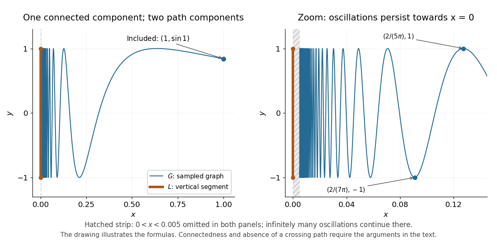

<h1 id="topologist-s-sine-curve">Topologist's sine curve</h1>

↑ **Parent:** [Connected space](connected-space.md)  
ⓦ [Wiki](https://en.wikipedia.org/wiki/Topologist's_sine_curve)

Consider the [graph of a function](graph-of-a-function.md) $x\mapsto\sin(1/x)$, using the [sine](sine.md) of the [multiplicative inverse](multiplicative-inverse.md) of $x$, together with a vertical [closed interval](closed-real-interval.md):

$$
G=\{(x,\sin(1/x)):0<x\le1\},\qquad L=\{0\}\times[-1,1],\qquad T=G\cup L.
$$

Give $T$ the [subspace topology](subspace-topology.md) from the [Euclidean plane](euclidean-plane.md). The symbol $\times$ denotes a [Cartesian product](cartesian-product.md). The right endpoint $(1,\sin1)\approx(1,0.841471)$ belongs to $G$. The [continuous map](continuous-map.md) $x\mapsto(x,\sin(1/x))$ sends the [connected](connected-space.md) [real interval](interval-mathematics.md) $(0,1]$ onto $G$. Hence $G$ is [connected](connected-space.md), and its [closure](closure-topology.md) $\overline G=T$ is [connected](connected-space.md) by [closure of a connected set](closure-of-a-connected-set.md). Every height in $[-1,1]$ is approached as $x$ tends to zero; for example,

$$
p_n=\frac1{\pi/2+2\pi n},\qquad q_n=\frac1{3\pi/2+2\pi n},\qquad \sin(1/p_n)=1,\qquad\sin(1/q_n)=-1\quad(n=0,1,\ldots).
$$

For $n=1$, these inputs are $p_1=2/(5\pi)\approx0.127324$ and $q_1=2/(7\pi)\approx0.090946$. For any other height $y\in[-1,1]$, choose $\theta\ge1$ with $\sin\theta=y$; then the [sequence](sequence.md) $(1/(\theta+2\pi n),y)$ lies in $G$ and has [limit of a sequence](limit-of-a-sequence.md) $(0,y)$.

Nevertheless, $T$ has exactly two [path components](path-component.md), $G$ and $L$. Within $G$, join inputs $a,b\in(0,1]$ by the [continuous path](continuous-path.md) $t\mapsto((1-t)a+tb,\sin(1/((1-t)a+tb)))$. Within $L$, use $t\mapsto(0,(1-t)c+td)$ for heights $c,d\in[-1,1]$.

The obstruction to a [continuous path](continuous-path.md) between $L$ and $G$ is persistent oscillation, not a visible gap. Proof outline: suppose such a [path](continuous-path.md) exists, directed from $L$ to $G$, and take its last time in $L$. Immediately afterwards its first coordinate $x(t)>0$ approaches zero and its second coordinate is $\sin(1/x(t))$. The [intermediate value theorem](intermediate-value-theorem.md) forces the first coordinate to pass through inputs of both displayed types arbitrarily close to that departure time. The second coordinate therefore takes both values $1$ and $-1$ arbitrarily close to that time, contradicting [continuity](continuous-function.md). [Munkres, Topology: A First Course, section 3-2, example 7 on p. 158](https://math.mit.edu/~hrm/palestine/munkres-topology.pdf)

**[Figure 7](#image-the-topologist-s-sine-curve-has-one-connected-component-and-two-path-components-the-graph-of-a-function-is-drawn-only-for-x-ge0-005-with-further-oscillations-omitted-near-the-vertical-closed-interval). The topologist's sine curve has one connected component and two path components; the graph of a function is drawn only for $x\ge0.005$, with further oscillations omitted near the vertical closed interval**.

The sampled [graph of a function](graph-of-a-function.md) illustrates the formulas; it does not prove [connectedness](connected-space.md) or the failure of [path connectedness](path-connected-space.md). Taking a [closure](closure-topology.md) preserves [connectedness](connected-space.md), but this example shows that it can destroy [path connectedness](path-connected-space.md).

## ↑ Ancestors (5)

1. [Connected space](connected-space.md)
2. [Geometry and topology](geometry-and-topology-split.md)
3. [Area of mathematics](area-of-mathematics.md)
4. [Mathematics](mathematics-split.md)
5. [Codex Wiki](split.md)

## ← Incoming links (4)

- [Connected space](connected-space.md)
- [Path component](path-component.md)
- [Path-connected space](path-connected-space.md)
- [Topologist's sine curve](topologist-s-sine-curve.md)
