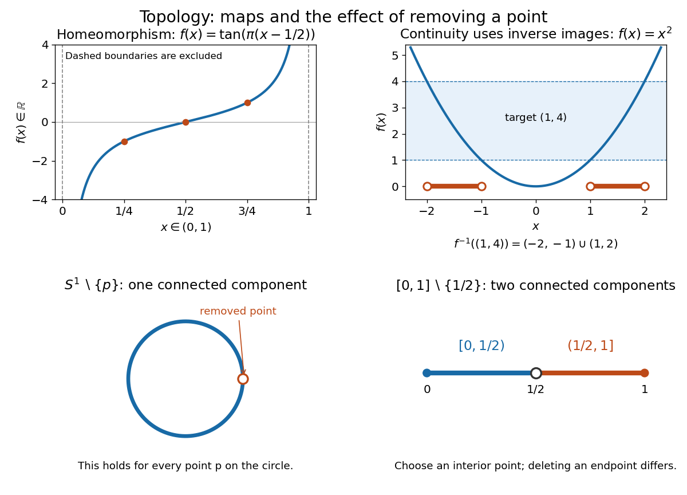

# Topology

↑ **Parent:** [Geometry and topology](geometry-and-topology-split.md)  
ⓦ [Wiki](https://en.wikipedia.org/wiki/Topology)

Topology studies [topological spaces](topological-space.md) through [open sets](open-set.md) and [continuous maps](continuous-map.md). Its central equivalence is a [homeomorphism](homeomorphism.md): a [bijection](bijection.md) that preserves [continuity](continuous-function.md) in both directions. This lets us distinguish spaces by [connectedness](connected-space.md) or [compactness](compact-space.md) even when numerical [metric](metric.md) values are irrelevant. The [open interval](open-interval.md) $(0,1)$ and the [real line](real-line.md) have the same [topology](topology-split.md) in this sense, although only the former is a [bounded set](bounded-set.md) with its usual [metric](metric.md).

**[Figure 1](#image-homeomorphisms-inverse-images-and-the-effect-of-removing-a-point). Homeomorphisms, inverse images, and the effect of removing a point**.

The upper panels show an explicit [homeomorphism](homeomorphism.md) and the [inverse image](preimage.md) test for a [continuous map](continuous-map.md). The lower panels exhibit an obstruction to a [homeomorphism](homeomorphism.md): removing any point from a [circle](circle.md) leaves a [connected space](connected-space.md), whereas removing an interior point from a [closed interval](closed-real-interval.md) gives two [connected components](connected-component.md).

[Homotopy](homotopy-split.md) is a different notion: it varies a [continuous map](continuous-map.md) continuously with a parameter and may collapse points. For example, $H(x,t)=(1-t)x$ contracts $[0,1]$ to zero. Thus this [closed interval](closed-real-interval.md) and a [singleton](singleton-mathematics.md) have the same [homotopy type](homotopy-type.md), but there is no [homeomorphism](homeomorphism.md) between them because there is no [bijection](bijection.md). [Homotopy equivalence](homotopy-equivalence.md) need not preserve [compactness](compact-space.md). [MIT Algebraic Topology I, Lecture 5](https://ocw.mit.edu/courses/18-905-algebraic-topology-i-fall-2016/2dad3dd8354992d877fbeca4049817ee_MIT18_905F16_lecture_notes.pdf)

The abstract viewpoint already appears explicitly in Tietze's 1923 paper: he describes [topology](topology-split.md) as the study of properties invariant under invertible [continuous maps](continuous-map.md) with [continuous](continuous-function.md) inverses, and discusses axioms for [neighbourhoods](neighbourhood-mathematics.md), citing Hausdorff's 1914 book, page 213. [Tietze, Beiträge zur allgemeinen Topologie I, page 290](https://gdz.sub.uni-goettingen.de/fulltext/PPN235181684_0088/00000294?_format=xml)

**Table of contents**

- [Initial topology](initial-topology.md)
  - [Initial topology of separately continuous functions](initial-topology-of-separately-continuous-functions.md)
- [Topology with countable closed sets away from one point](topology-with-countable-closed-sets-away-from-one-point.md)
- [Zero-dimensional space](zero-dimensional-space.md)
  - [Clopen evaluation embedding](clopen-evaluation-embedding.md)
  - [Strong zero-dimensionality](strong-zero-dimensionality.md)
    - [Strong zero-dimensionality and Stone-Čech compactification](strong-zero-dimensionality-and-stone-cech-compactification.md)
- [Hausdorff compactification](hausdorff-compactification.md)
  - [Locally compact subspaces are open in Hausdorff compactifications](locally-compact-subspaces-are-open-in-hausdorff-compactifications.md)
  - [Two ends of a real-line compactification](two-ends-of-a-real-line-compactification.md)
  - [Čech-complete space](cech-complete-space.md)
    - [Čech-complete spaces are Baire spaces](cech-complete-spaces-are-baire-spaces.md)
    - [G-delta compactification invariance](g-delta-compactification-invariance.md)
  - [Fibers of compactification comparison maps](fibers-of-compactification-comparison-maps.md)
- [Finer topology](finer-topology.md)
- [Topological disjoint union](topological-disjoint-union.md)
- [Topological invariant](topological-invariant.md)
- [End (topology)](end-topology.md)
- [Orientability](orientability.md)
- [Non-Hausdorff manifold](non-hausdorff-manifold.md)
  - [Line with two origins](line-with-two-origins.md)
- [Stone space](stone-space.md)
- [Tail topology on the natural numbers](tail-topology-on-the-natural-numbers.md)
  - [Continuous maps between cofinite and tail topologies](continuous-maps-between-cofinite-and-tail-topologies.md)
- [Fell topology](fell-topology.md)
- [Upper-ray topology on the real line](upper-ray-topology-on-the-real-line.md)
  - [Compact subsets of the upper-ray topology](compact-subsets-of-the-upper-ray-topology.md)
- [Hyperconnected space](hyperconnected-space.md)
- [Closed cover](closed-cover.md)
- [Partition topology](partition-topology.md)
- [Finite subsets do not define a topology on an infinite set](finite-subsets-do-not-define-a-topology-on-an-infinite-set.md)
- [Lower limit topology](lower-limit-topology.md)
  - [Sorgenfrey plane](sorgenfrey-plane.md)
- [Symmetric product](symmetric-product.md)
- [Extremally disconnected space](extremally-disconnected-space.md)
- [Countable complement topology](countable-complement-topology.md)
  - [Compact subsets of a cocountable space](compact-subsets-of-a-cocountable-space.md)
- [Locally finite family of subsets](locally-finite-family-of-subsets.md)
- [Indiscrete topology](indiscrete-topology.md)
- [Triangulation of a surface](triangulation-of-a-surface.md)
- [Pasting lemma for closed subspaces](pasting-lemma-for-closed-subspaces.md)
- [Cofinite topology](cofinite-topology.md)
  - [Diagonal in a product with cofinite and Euclidean topologies](diagonal-in-a-product-with-cofinite-and-euclidean-topologies.md)
  - [Connected subsets of a cofinite space](connected-subsets-of-a-cofinite-space.md)
    - [Infinite disconnected subspace of a cofinite product](infinite-disconnected-subspace-of-a-cofinite-product.md)
  - [Sequence convergence in the cofinite topology](sequence-convergence-in-the-cofinite-topology.md)
  - [Every subset of a cofinite space is compact](every-subset-of-a-cofinite-space-is-compact.md)
  - [Continuous maps from an infinite cofinite space to a Hausdorff space are constant](continuous-maps-from-an-infinite-cofinite-space-to-a-hausdorff-space-are-constant.md)
    - [Hausdorff factorization through a cofinite product factor](hausdorff-factorization-through-a-cofinite-product-factor.md)
    - [Continuous maps from products of cofinite spaces to Hausdorff spaces are constant](continuous-maps-from-products-of-cofinite-spaces-to-hausdorff-spaces-are-constant.md)
- [Hahn-Mazurkiewicz theorem](hahn-mazurkiewicz-theorem.md)
  - [Peano continuum](peano-continuum.md)
- [Topological manifold](topological-manifold.md)
  - [Orientation of a topological manifold](topological-manifold.md#orientation-of-a-topological-manifold)
  - [Topological atlas](topological-manifold.md#topological-atlas)
    - [Topological transition map](topological-manifold.md#topological-transition-map)
  - [Two stereographic charts on the circle](topological-manifold.md#two-stereographic-charts-on-the-circle)
  - [Topological manifold with boundary](topological-manifold.md#topological-manifold-with-boundary)
    - [Manifold boundary](topological-manifold.md#manifold-boundary)
  - [Category of topological manifolds](topological-manifold.md#category-of-topological-manifolds)
  - [Piecewise linear ball](topological-manifold.md#piecewise-linear-ball)
    - [Gluing three-balls along a boundary disk](topological-manifold.md#gluing-three-balls-along-a-boundary-disk)
  - [4-manifold](topological-manifold.md#4-manifold)
    - [Smooth four-manifold](topological-manifold.md#smooth-four-manifold)
      - [Fiber sum of four-manifolds](topological-manifold.md#fiber-sum-of-four-manifolds)
        - [Smooth fiber sum along unknotted null-homologous spheres](topological-manifold.md#smooth-fiber-sum-along-unknotted-null-homologous-spheres)
      - [Seiberg–Witten invariant of a four-manifold](topological-manifold.md#seiberg-witten-invariant-of-a-four-manifold)
        - [Connected-sum vanishing of the Seiberg–Witten invariant](topological-manifold.md#connected-sum-vanishing-of-the-seiberg-witten-invariant)
        - [Taubes nonvanishing theorem](topological-manifold.md#taubes-nonvanishing-theorem)
          - [Symplectic connected-sum obstruction](topological-manifold.md#symplectic-connected-sum-obstruction)
  - [Double of a manifold](topological-manifold.md#double-of-a-manifold)
  - [Topological tripod](topological-manifold.md#topological-tripod)
  - [Invariance of domain](topological-manifold.md#invariance-of-domain)
  - [Lorentzian manifold](topological-manifold.md#lorentzian-manifold)
    - [Metric signature](topological-manifold.md#metric-signature)
    - [Spacelike submanifold](topological-manifold.md#spacelike-submanifold)
  - [Dimension of a manifold](topological-manifold.md#dimension-of-a-manifold)
    - [Codimension of a submanifold](topological-manifold.md#codimension-of-a-submanifold)
  - [Handle attachment](topological-manifold.md#handle-attachment)
    - [Four-handle](topological-manifold.md#four-handle)
    - [Handle](topological-manifold.md#handle)
    - [Surgery on a smooth manifold](topological-manifold.md#surgery-on-a-smooth-manifold)
    - [Zero-handle](topological-manifold.md#zero-handle)
    - [Core disk of a handle](topological-manifold.md#core-disk-of-a-handle)
    - [Handle decomposition](topological-manifold.md#handle-decomposition)
      - [Critical level handle embedding](topological-manifold.md#critical-level-handle-embedding)
      - [Zero-framed Hopf-link handle decomposition of the sphere product](topological-manifold.md#zero-framed-hopf-link-handle-decomposition-of-the-sphere-product)
      - [Commutator handlebody of the torus](topological-manifold.md#commutator-handlebody-of-the-torus)
      - [Handle slide](topological-manifold.md#handle-slide)
        - [Handle-slide isolation of a cancelling pair](topological-manifold.md#handle-slide-isolation-of-a-cancelling-pair)
      - [Belt sphere](topological-manifold.md#belt-sphere)
      - [Attaching sphere](topological-manifold.md#attaching-sphere)
    - [Three-handle](topological-manifold.md#three-handle)
    - [Two-handle](topological-manifold.md#two-handle)
    - [One-handle](topological-manifold.md#one-handle)
  - [3-manifold](topological-manifold.md#3-manifold)
    - [Normal surface](topological-manifold.md#normal-surface)
      - [Normal surface coordinates](topological-manifold.md#normal-surface-coordinates)
        - [Normal surface weight](topological-manifold.md#normal-surface-weight)
        - [Haken sum](topological-manifold.md#haken-sum)
        - [Fundamental normal surface](topological-manifold.md#fundamental-normal-surface)
    - [Punctured three-sphere](topological-manifold.md#punctured-three-sphere)
      - [Sphere surgery preserving nontrivial complementary pieces](topological-manifold.md#sphere-surgery-preserving-nontrivial-complementary-pieces)
    - [Three-ball](topological-manifold.md#three-ball)
    - [Poincaré conjecture](topological-manifold.md#poincare-conjecture)
    - [Loop theorem](topological-manifold.md#loop-theorem)
      - [Tower proof of the loop theorem](topological-manifold.md#tower-proof-of-the-loop-theorem)
      - [Dehn's lemma](topological-manifold.md#dehn-s-lemma)
    - [Sphere theorem for three-manifolds](topological-manifold.md#sphere-theorem-for-three-manifolds)
    - [Hyperbolic three-manifold](topological-manifold.md#hyperbolic-three-manifold)
      - [Mostow rigidity theorem](topological-manifold.md#mostow-rigidity-theorem)
    - [Three-dimensional Schoenflies theorem](topological-manifold.md#three-dimensional-schoenflies-theorem)
    - [Geometrizable three-manifold](topological-manifold.md#geometrizable-three-manifold)
      - [Geometrization conjecture](topological-manifold.md#geometrization-conjecture)
      - [Thurston geometry](topological-manifold.md#thurston-geometry)
    - [Prime three-manifold](topological-manifold.md#prime-three-manifold)
      - [Prime decomposition of a closed orientable three-manifold](topological-manifold.md#prime-decomposition-of-a-closed-orientable-three-manifold)
      - [Nonseparating sphere gives a sphere-circle summand](topological-manifold.md#nonseparating-sphere-gives-a-sphere-circle-summand)
    - [Boundary-irreducible three-manifold](topological-manifold.md#boundary-irreducible-three-manifold)
    - [Irreducible three-manifold](topological-manifold.md#irreducible-three-manifold)
    - [Excellent three-manifold](topological-manifold.md#excellent-three-manifold)
      - [Excellent knot representative theorem](topological-manifold.md#excellent-knot-representative-theorem)
    - [Thurston norm](topological-manifold.md#thurston-norm)
      - [Thurston norm of a pair-of-pants product](topological-manifold.md#thurston-norm-of-a-pair-of-pants-product)
      - [Thurston norm gluing along an incompressible torus](topological-manifold.md#thurston-norm-gluing-along-an-incompressible-torus)
      - [Dual Thurston polytope](topological-manifold.md#dual-thurston-polytope)
    - [Incompressible surface](topological-manifold.md#incompressible-surface)
      - [Three-manifold hierarchy](topological-manifold.md#three-manifold-hierarchy)
        - [Relative boundary rigidity from a hierarchy](topological-manifold.md#relative-boundary-rigidity-from-a-hierarchy)
        - [Asphericity from a three-manifold hierarchy](topological-manifold.md#asphericity-from-a-three-manifold-hierarchy)
        - [Self-reproducing incompressible annulus cut](topological-manifold.md#self-reproducing-incompressible-annulus-cut)
      - [Compression disk](topological-manifold.md#compression-disk)
      - [Boundary-parallel surface](topological-manifold.md#boundary-parallel-surface)
      - [Classification of incompressible surfaces in Seifert fibered spaces](topological-manifold.md#classification-of-incompressible-surfaces-in-seifert-fibered-spaces)
      - [Boundary-incompressible surface](topological-manifold.md#boundary-incompressible-surface)
    - [Heegaard splitting](topological-manifold.md#heegaard-splitting)
      - [Common nonseparating disks in a Heegaard splitting](topological-manifold.md#common-nonseparating-disks-in-a-heegaard-splitting)
      - [Heegaard genus](topological-manifold.md#heegaard-genus)
      - [Heegaard Floer homology](topological-manifold.md#heegaard-floer-homology)
        - [Mixed Heegaard Floer invariant](topological-manifold.md#mixed-heegaard-floer-invariant)
          - [Adjunction inequality for the mixed Heegaard Floer invariant](topological-manifold.md#adjunction-inequality-for-the-mixed-heegaard-floer-invariant)
          - [Blowup formula for the mixed Heegaard Floer invariant](topological-manifold.md#blowup-formula-for-the-mixed-heegaard-floer-invariant)
        - [Integer-surgery exact triangle in Heegaard Floer homology](topological-manifold.md#integer-surgery-exact-triangle-in-heegaard-floer-homology)
        - [Heegaard Floer cobordism map](topological-manifold.md#heegaard-floer-cobordism-map)
          - [Admissible cut for a Heegaard Floer mixed map](topological-manifold.md#admissible-cut-for-a-heegaard-floer-mixed-map)
        - [Variants of Heegaard Floer homology](topological-manifold.md#variants-of-heegaard-floer-homology)
          - [Non-torsion Heegaard Floer homology of the sphere-circle product](topological-manifold.md#non-torsion-heegaard-floer-homology-of-the-sphere-circle-product)
          - [Reduced Heegaard Floer homology](topological-manifold.md#reduced-heegaard-floer-homology)
          - [U-adic completion of Heegaard Floer homology](topological-manifold.md#u-adic-completion-of-heegaard-floer-homology)
        - [Heegaard Floer chain complex](topological-manifold.md#heegaard-floer-chain-complex)
          - [Coherent orientations in Heegaard Floer homology](topological-manifold.md#coherent-orientations-in-heegaard-floer-homology)
          - [Empty bigon and rectangle counts in Heegaard Floer homology](topological-manifold.md#empty-bigon-and-rectangle-counts-in-heegaard-floer-homology)
          - [Relative grading in Heegaard Floer homology](topological-manifold.md#relative-grading-in-heegaard-floer-homology)
            - [Absolute grading in Heegaard Floer homology](topological-manifold.md#absolute-grading-in-heegaard-floer-homology)
          - [Whitney disk class](topological-manifold.md#whitney-disk-class)
      - [Compression body](topological-manifold.md#compression-body)
      - [Heegaard surface](topological-manifold.md#heegaard-surface)
        - [Heegaard diagram](topological-manifold.md#heegaard-diagram)
          - [Generalized Heegaard diagram](topological-manifold.md#generalized-heegaard-diagram)
          - [Dehn presentation Heegaard diagram](topological-manifold.md#dehn-presentation-heegaard-diagram)
    - [Handlebody](topological-manifold.md#handlebody)
    - [Thurston elliptization conjecture](topological-manifold.md#thurston-elliptization-conjecture)
  - [Homology above the dimension of a manifold](topological-manifold.md#homology-above-the-dimension-of-a-manifold)
- [Closed set](closed-set.md)
  - [Closedness](closedness.md)
  - [Sequentially closed set](sequentially-closed-set.md)
  - [Limit point](limit-point.md)
    - [Three-stage accumulation tower](three-stage-accumulation-tower.md)
- [Closure (topology)](closure-topology.md)
  - [Adherent point](adherent-point.md)
- [Interior (topology)](interior-topology.md)
- [Topological space](topological-space.md)
  - [Lindelöf space](lindelof-space.md)
  - [Fortissimo space](fortissimo-space.md)
  - [First-countable space](first-countable-space.md)
  - [Warsaw circle](warsaw-circle.md)
  - [Convergence of a sequence in a topological space](convergence-of-a-sequence-in-a-topological-space.md)
  - [Open and closed maps](open-and-closed-maps.md)
  - [Stratified space](stratified-space.md)
    - [Stratum of a stratified space](stratum-of-a-stratified-space.md)
    - [Stratified pseudomanifold](stratified-pseudomanifold.md)
      - [Normalization of a two-dimensional pseudomanifold](normalization-of-a-two-dimensional-pseudomanifold.md)
      - [Witt space](witt-space.md)
        - [Witt space with collared boundary](witt-space-with-collared-boundary.md)
      - [Link of a stratum](link-of-a-stratum.md)
  - [Continuous real maps from the initial-segment topology](continuous-real-maps-from-the-initial-segment-topology.md)
  - [Sigma-compact space](sigma-compact-space.md)
  - [Sober space](sober-space.md)
    - [Sobrification](sobrification.md)
  - [Separable topological space](separable-topological-space.md)
  - [G-delta set](g-delta-set.md)
  - [Net (mathematics)](net-mathematics.md)
    - [Subnet of a net](subnet-of-a-net.md)
  - [Separation axiom](separation-axiom.md)
    - [Regular topological space](regular-topological-space.md)
      - [T3 space](t3-space.md)
    - [Totally separated space](totally-separated-space.md)
    - [T1 space](t1-space.md)
  - [Closed point](closed-point.md)
  - [Locally connected space](locally-connected-space.md)
  - [Boundary of a set](boundary-of-a-set.md)
    - [Boundary point](boundary-point.md)
    - [Boundary component](boundary-component.md)
    - [Boundary of a domain](boundary-of-a-domain.md)
  - [Basis of a topology](basis-of-a-topology.md)
    - [Subbasis of a topology](subbasis-of-a-topology.md)
  - [Second-countable space](second-countable-space.md)
  - [Paracompact space](paracompact-space.md)
  - [Kolmogorov space](kolmogorov-space.md)
    - [Sierpiński space](sierpinski-space.md)
      - [Embedding of a T0 space into a power of the Sierpiński space](embedding-of-a-t0-space-into-a-power-of-the-sierpinski-space.md)
  - [Continuous map](continuous-map.md)
    - [Boundedness extends across closure under a continuous map](boundedness-extends-across-closure-under-a-continuous-map.md)
    - [Separate continuity](separate-continuity.md)
      - [Rectangular bumps detecting nonconvergence](rectangular-bumps-detecting-nonconvergence.md)
    - [Closure characterization of continuity](closure-characterization-of-continuity.md)
    - [Closed-set criterion for continuity](closed-set-criterion-for-continuity.md)
    - [Continuous injection](continuous-injection.md)
    - [Continuous bijection](continuous-bijection.md)
    - [Continuous lift](continuous-lift.md)
    - [Scalar clipping](scalar-clipping.md)
    - [Topological embedding](topological-embedding.md)
      - [Evaluation embedding of a normal Hausdorff space](evaluation-embedding-of-a-normal-hausdorff-space.md)
      - [C-embedded subset](c-embedded-subset.md)
        - [Cb-embedded subset](cb-embedded-subset.md)
      - [Diagonal evaluation map](diagonal-evaluation-map.md)
      - [Universal three-point space for product embeddings](universal-three-point-space-for-product-embeddings.md)
  - [Retraction](retraction.md)
    - [Retraction of a Hilbert ball onto its sphere](retraction-of-a-hilbert-ball-onto-its-sphere.md)
    - [Radial retraction of a punctured ball](radial-retraction-of-a-punctured-ball.md)
    - [Retraction onto a punctured oriented surface](retraction-onto-a-punctured-oriented-surface.md)
  - [Subspace topology](subspace-topology.md)
    - [Locally closed subset](locally-closed-subset.md)
    - [Topological subspace](topological-subspace.md)
      - [Closed subspace](closed-subspace.md)
  - [Alexandroff extension](alexandroff-extension.md)
    - [Proper maps extend to one-point compactifications](proper-maps-extend-to-one-point-compactifications.md)
    - [Uncountable discrete one-point compactification counterexample](uncountable-discrete-one-point-compactification-counterexample.md)
    - [Hawaiian earring](hawaiian-earring.md)
      - [Rational summand in Hawaiian earring homology](rational-summand-in-hawaiian-earring-homology.md)
  - [Circle](circle.md)
    - [Injective self-map of a circle](injective-self-map-of-a-circle.md)
    - [Classification of a real complex-circle equation](classification-of-a-real-complex-circle-equation.md)
    - [Sagitta](sagitta.md)
    - [Soddy circle](soddy-circle.md)
      - [Inner Soddy circle](inner-soddy-circle.md)
    - [Power of a point](power-of-a-point.md)
    - [Tangent circles](tangent-circles.md)
      - [Four contact points of a circle chain](four-contact-points-of-a-circle-chain.md)
      - [Collinearity for tangent circles between parallel lines](collinearity-for-tangent-circles-between-parallel-lines.md)
      - [Internal tangency](internal-tangency.md)
      - [External tangency](external-tangency.md)
    - [Tangent to a circle](tangent-to-a-circle.md)
    - [Circular segment](circular-segment.md)
      - [Area enclosed by two chords and a circular arc](area-enclosed-by-two-chords-and-a-circular-arc.md)
    - [Circular arc](circular-arc.md)
    - [Circular sector](circular-sector.md)
    - [Semicircle](semicircle.md)
    - [Chord of a circle](chord-of-a-circle.md)
    - [Reflection symmetry of a complex circle equation](reflection-symmetry-of-a-complex-circle-equation.md)
    - [Maximum separation of two circles](maximum-separation-of-two-circles.md)
    - [Steiner chain](steiner-chain.md)
      - [Steiner porism](steiner-porism.md)
      - [Tangency locus of a Steiner chain](tangency-locus-of-a-steiner-chain.md)
    - [Circle from an affine complex-modulus equation](circle-from-an-affine-complex-modulus-equation.md)
    - [Radius](radius.md)
    - [Pi](pi.md)
      - [Chudnovsky algorithm](chudnovsky-algorithm.md)
        - [Chudnovsky series](chudnovsky-series.md)
      - [Wallis product](wallis-product.md)
      - [Proof that π is irrational](proof-that-pi-is-irrational.md)
    - [Circumference](circumference.md)
  - [Wedge sum](wedge-sum.md)
    - [Pinch map](pinch-map.md)
    - [Wedge of two circles](wedge-of-two-circles.md)
  - [Inclusion map](inclusion-map.md)
  - [Topology axiom](topology-axiom.md)
  - [Open cover](open-cover.md)
    - [Subcover](subcover.md)
      - [Finite subcover](finite-subcover.md)
    - [Affine open cover](affine-open-cover.md)
    - [Acyclic cover](acyclic-cover.md)
- [Quotient topology](quotient-topology.md)
  - [Closed equivalence relation with an open quotient map](closed-equivalence-relation-with-an-open-quotient-map.md)
  - [Hausdorff reflection by continuous maps](hausdorff-reflection-by-continuous-maps.md)
  - [Positive orbit separation implies a Hausdorff quotient](positive-orbit-separation-implies-a-hausdorff-quotient.md)
  - [Quotient topology of a cofinite space](quotient-topology-of-a-cofinite-space.md)
  - [Circle modulo reflection](circle-modulo-reflection.md)
  - [Collapsing a subset to a point](collapsing-a-subset-to-a-point.md)
    - [Noncompactness after collapsing a countable real subset](noncompactness-after-collapsing-a-countable-real-subset.md)
  - [Saturation of a subset](saturation-of-a-subset.md)
  - [Quotient topological space](quotient-topological-space.md)
    - [Sphere with its equator collapsed](sphere-with-its-equator-collapsed.md)
    - [Compact Hausdorff quotient by a closed equivalence relation](compact-hausdorff-quotient-by-a-closed-equivalence-relation.md)
  - [Quotient map](quotient-map.md)
    - [Product of a quotient map with the unit interval](product-of-a-quotient-map-with-the-unit-interval.md)
  - [Universal property of the quotient topology](universal-property-of-the-quotient-topology.md)
  - [Non-Hausdorff quotient of the real line by rational translation](non-hausdorff-quotient-of-the-real-line-by-rational-translation.md)
  - [Square quotient model of the two-sphere](square-quotient-model-of-the-two-sphere.md)
- [Open set](open-set.md)
  - [Domain (mathematical analysis)](domain-mathematical-analysis.md)
  - [Clopen set](clopen-set.md)
  - [Open interval](open-interval.md)
    - [Nondegenerate interval](nondegenerate-interval.md)
  - [Neighbourhood (mathematics)](neighbourhood-mathematics.md)
    - [Open neighbourhood](open-neighbourhood.md)
    - [Neighbourhood system](neighbourhood-system.md)
      - [Neighbourhood basis](neighbourhood-basis.md)
  - [Open ball](open-ball.md)
    - [Punctured ball](punctured-ball.md)
  - [Annulus (mathematics)](annulus-mathematics.md)
    - [Fixed-point-free rotation of an annulus](fixed-point-free-rotation-of-an-annulus.md)
- [Disk (mathematics)](disk-mathematics.md)
  - [Semicircular disk](semicircular-disk.md)
  - [Open disk](open-disk.md)
  - [Lens-shaped intersection of two disks](lens-shaped-intersection-of-two-disks.md)
  - [Open disc](open-disc.md)
    - [Unit disc](unit-disc.md)
      - [Automorphism of the unit disk](automorphism-of-the-unit-disk.md)
        - [Boundary-angle derivative of a disk automorphism](boundary-angle-derivative-of-a-disk-automorphism.md)
- [Topological disc](topological-disc.md)
  - [Closed disc](closed-disc.md)
- [Level set](level-set.md)
  - [Level surface](level-surface.md)
  - [Level sets of a linear numerator over a radial quadratic](level-sets-of-a-linear-numerator-over-a-radial-quadratic.md)
  - [Level curve](level-curve.md)
    - [Contour plot](contour-plot.md)
  - [Regular level set](regular-level-set.md)
  - [Superlevel set](superlevel-set.md)
- [Dense set](dense-set.md)
  - [Cardinality of the family of dense subsets of the reals](cardinality-of-the-family-of-dense-subsets-of-the-reals.md)
- [Discrete space](discrete-space.md)
  - [Discrete subset](discrete-subset.md)
    - [Closed discrete subset](closed-discrete-subset.md)
      - [Closed discrete subsets of compact spaces are finite](closed-discrete-subsets-of-compact-spaces-are-finite.md)
    - [Discrete subsets of the real line are countable](discrete-subsets-of-the-real-line-are-countable.md)
- [Connected-space zero-product dichotomy](connected-space-zero-product-dichotomy.md)
- [Normal space](normal-space.md)
  - [Hereditarily normal space](hereditarily-normal-space.md)
  - [Perfectly normal space](perfectly-normal-space.md)
    - [Perfect normality implies hereditary normality](perfect-normality-implies-hereditary-normality.md)
  - [Closed-neighborhood shrinking in a normal space](closed-neighborhood-shrinking-in-a-normal-space.md)
  - [Urysohn's lemma](urysohn-s-lemma.md)
    - [Urysohn function from closure-nested open sets](urysohn-function-from-closure-nested-open-sets.md)
    - [Tietze extension theorem](tietze-extension-theorem.md)
      - [Strict-range modification of a continuous extension](strict-range-modification-of-a-continuous-extension.md)
      - [Compact subsets of Tychonoff spaces are C-embedded](compact-subsets-of-tychonoff-spaces-are-c-embedded.md)
      - [Urysohn two-thirds approximation](urysohn-two-thirds-approximation.md)
      - [Metric Tietze two-thirds approximation](metric-tietze-two-thirds-approximation.md)
  - [Closed G-delta set as a zero set](closed-g-delta-set-as-a-zero-set.md)
- [Compact space](compact-space.md)
  - [Rectangular neighborhood of a product of compact sets](rectangular-neighborhood-of-a-product-of-compact-sets.md)
  - [Continuous images of nested compact intersections](continuous-images-of-nested-compact-intersections.md)
    - [Failure of nested compact image intersection without closed fibers](failure-of-nested-compact-image-intersection-without-closed-fibers.md)
  - [Closed subset of a compact space](closed-subset-of-a-compact-space.md)
  - [Finite intersection characterization of compactness](finite-intersection-characterization-of-compactness.md)
  - [Ultrafilter characterization of compactness](ultrafilter-characterization-of-compactness.md)
  - [Compact exhaustion](compact-exhaustion.md)
  - [Compact Hausdorff space](compact-hausdorff-space.md)
    - [Connected intersection of a closed filter base](connected-intersection-of-a-closed-filter-base.md)
    - [Supremum convergence for decreasing continuous functions](supremum-convergence-for-decreasing-continuous-functions.md)
    - [Closed relation generated by a set-split pair of compact Hausdorff maps](closed-relation-generated-by-a-set-split-pair-of-compact-hausdorff-maps.md)
    - [Separable compactification need not be metrizable](separable-compactification-need-not-be-metrizable.md)
  - [Heine-Borel theorem](heine-borel-theorem.md)
    - [Unbounded continuous witnesses to noncompactness of a real subspace](unbounded-continuous-witnesses-to-noncompactness-of-a-real-subspace.md)
  - [Finite intersection property](finite-intersection-property.md)
  - [Continuous image of a compact space](continuous-image-of-a-compact-space.md)
  - [Quotient of a compact space](quotient-of-a-compact-space.md)
  - [Lebesgue number lemma](lebesgue-number-lemma.md)
  - [Normality of a compact Hausdorff space](normality-of-a-compact-hausdorff-space.md)
  - [Alexander's subbase lemma](alexander-s-subbase-lemma.md)
  - [Locally compact space](locally-compact-space.md)
    - [Compactly detected closed-set theorem in a locally compact Hausdorff space](compactly-detected-closed-set-theorem-in-a-locally-compact-hausdorff-space.md)
- [Hausdorff space](hausdorff-space.md)
  - [Completely regular Hausdorff space](completely-regular-hausdorff-space.md)
  - [Compact subset of a Hausdorff space](compact-subset-of-a-hausdorff-space.md)
    - [Separation of a point and a compact set](separation-of-a-point-and-a-compact-set.md)
      - [Separation of disjoint compact subsets](separation-of-disjoint-compact-subsets.md)
  - [Compact-to-Hausdorff continuous bijection theorem](compact-to-hausdorff-continuous-bijection-theorem.md)
  - [Closed diagonal theorem](closed-diagonal-theorem.md)
- [Homeomorphism](homeomorphism.md)
  - [Radial extension of a square boundary homeomorphism](radial-extension-of-a-square-boundary-homeomorphism.md)
  - [Circle and interval are not homeomorphic](circle-and-interval-are-not-homeomorphic.md)
  - [Inverse continuity from an open bijection](inverse-continuity-from-an-open-bijection.md)
  - [Local homeomorphism](local-homeomorphism.md)
  - [Closed map](closed-map.md)
    - [Perfect map](perfect-map.md)
      - [Perfect-map characterization by Stone-Čech remainders](perfect-map-characterization-by-stone-cech-remainders.md)
    - [Projection with a compact factor is closed](projection-with-a-compact-factor-is-closed.md)
    - [Compact-preimage theorem for closed maps](compact-preimage-theorem-for-closed-maps.md)
- [Unit sphere](unit-sphere.md)
- [Closed graph theorem for compact spaces](closed-graph-theorem-for-compact-spaces.md)
  - [Closed-graph criterion with compact codomain](closed-graph-criterion-with-compact-codomain.md)
- [Curve](curve.md)
  - [Intersection curve](intersection-curve.md)
  - [Plane curve](plane-curve.md)
    - [Tractrix](tractrix.md)
    - [Trochoid](trochoid.md)
      - [Vertical upward velocity of a rolling-point trochoid](vertical-upward-velocity-of-a-rolling-point-trochoid.md)
    - [Hyperbolic spiral](hyperbolic-spiral.md)
    - [Involute](involute.md)
      - [Winding time around a circular pole](winding-time-around-a-circular-pole.md)
    - [Lemniscate of Bernoulli](lemniscate-of-bernoulli.md)
    - [Astroid](astroid.md)
    - [Plane cusp of type (2,5)](plane-cusp-of-type-2-5.md)
      - [Resolution of the (2,5) cusp by two blowups](resolution-of-the-2-5-cusp-by-two-blowups.md)
    - [Archimedean spiral](archimedean-spiral.md)
      - [Scaled length of an Archimedean spiral](scaled-length-of-an-archimedean-spiral.md)
    - [Superelliptic curve](superelliptic-curve.md)
    - [Canonical map of a smooth plane curve](canonical-map-of-a-smooth-plane-curve.md)
    - [Semicubical parabola](semicubical-parabola.md)
      - [Coordinate ring and singularity of the semicubical parabola](coordinate-ring-and-singularity-of-the-semicubical-parabola.md)
  - [Euler spiral](euler-spiral.md)
  - [Closed curve](closed-curve.md)
  - [Asymptote](asymptote.md)
  - [Parametric curve](parametric-curve.md)
    - [Lissajous curve](lissajous-curve.md)
    - [Parametric plane curve](parametric-plane-curve.md)
    - [Parametric curve interrogation](parametric-curve-interrogation.md)
      - [Certified curve-plane intersection](certified-curve-plane-intersection.md)
    - [Cycloid](cycloid.md)
      - [Area and length of a cycloid arch](area-and-length-of-a-cycloid-arch.md)
  - [Space curve](space-curve.md)
    - [Helix](helix.md)
      - [Logarithmic conical helix](logarithmic-conical-helix.md)
      - [Pitch of a helix](pitch-of-a-helix.md)
  - [Inflection point](inflection-point.md)
    - [Stationary inflection point](stationary-inflection-point.md)
  - [Logarithmic spiral](logarithmic-spiral.md)
    - [Logarithmic spiral as an embedded real line](logarithmic-spiral-as-an-embedded-real-line.md)
  - [Simple curve](simple-curve.md)
  - [Space-filling curve](space-filling-curve.md)
- [Topological surface](topological-surface.md)
  - [Connected sum of surfaces](topological-surface.md#connected-sum-of-surfaces)
    - [Failure of cancellation for connected sums of surfaces](topological-surface.md#failure-of-cancellation-for-connected-sums-of-surfaces)
  - [Closed combinatorial surface](topological-surface.md#closed-combinatorial-surface)
  - [Classification of compact surfaces](topological-surface.md#classification-of-compact-surfaces)
    - [Classification theorem for closed combinatorial surfaces](topological-surface.md#classification-theorem-for-closed-combinatorial-surfaces)
  - [Thrice-punctured sphere](topological-surface.md#thrice-punctured-sphere)
  - [Integral top homology of a compact connected surface](topological-surface.md#integral-top-homology-of-a-compact-connected-surface)
  - [Surface with boundary](topological-surface.md#surface-with-boundary)
    - [Boundary component of a surface](topological-surface.md#boundary-component-of-a-surface)
    - [Topology of disk tiles glued along disjoint boundary arcs](topological-surface.md#topology-of-disk-tiles-glued-along-disjoint-boundary-arcs)
    - [Pair of pants (mathematics)](topological-surface.md#pair-of-pants-mathematics)
      - [Hyperbolic Y-piece](topological-surface.md#hyperbolic-y-piece)
        - [Hyperbolic X-piece](topological-surface.md#hyperbolic-x-piece)
      - [Homology action of a pair-of-pants homeomorphism](topological-surface.md#homology-action-of-a-pair-of-pants-homeomorphism)
  - [Genus of a surface](topological-surface.md#genus-of-a-surface)
    - [Genus monotonicity under nonzero-degree surface maps](topological-surface.md#genus-monotonicity-under-nonzero-degree-surface-maps)
  - [Closed orientable surface](topological-surface.md#closed-orientable-surface)
    - [Genus of a finite cover of a closed orientable surface](topological-surface.md#genus-of-a-finite-cover-of-a-closed-orientable-surface)
  - [Non-orientable surface](topological-surface.md#non-orientable-surface)
    - [Nonorientable genus](topological-surface.md#nonorientable-genus)
    - [Closed nonorientable surface](topological-surface.md#closed-nonorientable-surface)
  - [Surface quotient by a free finite action](topological-surface.md#surface-quotient-by-a-free-finite-action)
  - [Jordan curve theorem](topological-surface.md#jordan-curve-theorem)
    - [Jordan separation from the exponential quotient](topological-surface.md#jordan-separation-from-the-exponential-quotient)
    - [Jordan domain](topological-surface.md#jordan-domain)
    - [Schoenflies theorem](topological-surface.md#schoenflies-theorem)
    - [Outer boundary of a planar compact set](topological-surface.md#outer-boundary-of-a-planar-compact-set)
  - [Moore triod theorem](topological-surface.md#moore-triod-theorem)
  - [Polygonal schema](topological-surface.md#polygonal-schema)
    - [Crosscap extraction move for a polygonal word](topological-surface.md#crosscap-extraction-move-for-a-polygonal-word)
    - [Polygon with a complete set of side-identifications](topological-surface.md#polygon-with-a-complete-set-of-side-identifications)
    - [Standard polygon words for closed surfaces](topological-surface.md#standard-polygon-words-for-closed-surfaces)
    - [Triangulation of a polygon with paired sides](topological-surface.md#triangulation-of-a-polygon-with-paired-sides)
    - [Vertex link in a polygonal schema](topological-surface.md#vertex-link-in-a-polygonal-schema)
    - [Polygonal presentation of a punctured surface](topological-surface.md#polygonal-presentation-of-a-punctured-surface)
    - [Polygonal-schema Euler count](topological-surface.md#polygonal-schema-euler-count)
    - [Regular hyperbolic octagon fundamental polygon](topological-surface.md#regular-hyperbolic-octagon-fundamental-polygon)
  - [Mapping class group](topological-surface.md#mapping-class-group)
    - [Mapping class](topological-surface.md#mapping-class)
    - [Injection of a finite hyperbolic isometry group into a mapping class group](topological-surface.md#injection-of-a-finite-hyperbolic-isometry-group-into-a-mapping-class-group)
    - [Realization of a finite group as a surface deck group](topological-surface.md#realization-of-a-finite-group-as-a-surface-deck-group)
    - [Dehn twist](topological-surface.md#dehn-twist)
      - [Lickorish-Dehn theorem](topological-surface.md#lickorish-dehn-theorem)
      - [Homology action of a Dehn twist](topological-surface.md#homology-action-of-a-dehn-twist)
      - [Right-handed Dehn twist](topological-surface.md#right-handed-dehn-twist)
    - [Essential proper arc on a punctured surface](topological-surface.md#essential-proper-arc-on-a-punctured-surface)
      - [Bigon formed by two arcs](topological-surface.md#bigon-formed-by-two-arcs)
      - [Minimal position of curves or arcs](topological-surface.md#minimal-position-of-curves-or-arcs)
        - [Bigon criterion](topological-surface.md#bigon-criterion)
    - [Geometric intersection number](topological-surface.md#geometric-intersection-number)
      - [Algebraic intersection number of curves on an oriented surface](topological-surface.md#algebraic-intersection-number-of-curves-on-an-oriented-surface)
        - [Isotopy invariance of algebraic intersection number](topological-surface.md#isotopy-invariance-of-algebraic-intersection-number)
    - [Arc complex](topological-surface.md#arc-complex)
      - [Arc complex of the three-punctured sphere](topological-surface.md#arc-complex-of-the-three-punctured-sphere)
      - [Arc-complex vertex orbits of the four-punctured sphere](topological-surface.md#arc-complex-vertex-orbits-of-the-four-punctured-sphere)
    - [Alexander system](topological-surface.md#alexander-system)
      - [Structure graph of an Alexander system](topological-surface.md#structure-graph-of-an-alexander-system)
      - [Alexander method](topological-surface.md#alexander-method)
        - [Alexander trick](topological-surface.md#alexander-trick)
        - [Center of the mapping class group of the torus](topological-surface.md#center-of-the-mapping-class-group-of-the-torus)
    - [Mapping-class action on the outer automorphism group of the fundamental group](topological-surface.md#mapping-class-action-on-the-outer-automorphism-group-of-the-fundamental-group)
    - [Pure mapping class group](topological-surface.md#pure-mapping-class-group)
      - [Point-pushing map](topological-surface.md#point-pushing-map)
        - [Birman exact sequence](topological-surface.md#birman-exact-sequence)
      - [Pure mapping class group of the three-punctured sphere](topological-surface.md#pure-mapping-class-group-of-the-three-punctured-sphere)
      - [Pure mapping class group of the four-punctured sphere](topological-surface.md#pure-mapping-class-group-of-the-four-punctured-sphere)
      - [Semidirect-product decomposition of the pure mapping class group of the five-punctured sphere](topological-surface.md#semidirect-product-decomposition-of-the-pure-mapping-class-group-of-the-five-punctured-sphere)
    - [Curve complex](topological-surface.md#curve-complex)
      - [Connectedness of the curve complex](topological-surface.md#connectedness-of-the-curve-complex)
      - [Filling set of curves](topological-surface.md#filling-set-of-curves)
        - [Filling pair on a closed genus-two surface](topological-surface.md#filling-pair-on-a-closed-genus-two-surface)
  - [Torus](topological-surface.md#torus)
    - [Normals through a point on a ring torus](topological-surface.md#normals-through-a-point-on-a-ring-torus)
    - [Three-critical-point function on a torus](topological-surface.md#three-critical-point-function-on-a-torus)
    - [Pinched torus](topological-surface.md#pinched-torus)
    - [Three-dimensional torus](topological-surface.md#three-dimensional-torus)
    - [Cohomology ring of a torus](topological-surface.md#cohomology-ring-of-a-torus)
    - [Homology of an integer torus endomorphism](topological-surface.md#homology-of-an-integer-torus-endomorphism)
    - [Solid torus](topological-surface.md#solid-torus)
      - [Solid-torus recognition by a compression disk](topological-surface.md#solid-torus-recognition-by-a-compression-disk)
      - [Meridian of a solid torus](topological-surface.md#meridian-of-a-solid-torus)
    - [Embedding of the n-dimensional torus in codimension one](topological-surface.md#embedding-of-the-n-dimensional-torus-in-codimension-one)
    - [Embedded torus of revolution](topological-surface.md#embedded-torus-of-revolution)
    - [Fundamental group of the torus](topological-surface.md#fundamental-group-of-the-torus)
      - [Lift-endpoint description of the fundamental group of the torus](topological-surface.md#lift-endpoint-description-of-the-fundamental-group-of-the-torus)
    - [Integral linear automorphism of the torus](topological-surface.md#integral-linear-automorphism-of-the-torus)
      - [Equivalence of connected double covers of the torus](topological-surface.md#equivalence-of-connected-double-covers-of-the-torus)
  - [Möbius band](topological-surface.md#mobius-band)
    - [Core circle of a Möbius band](topological-surface.md#core-circle-of-a-mobius-band)
    - [Normal reversal around the Möbius core](topological-surface.md#normal-reversal-around-the-mobius-core)
    - [Boundary of a Möbius band winds twice around its core](topological-surface.md#boundary-of-a-mobius-band-winds-twice-around-its-core)
  - [Untwisted band](topological-surface.md#untwisted-band)
  - [Klein bottle](topological-surface.md#klein-bottle)
    - [Gluing annuli with one reflected boundary](topological-surface.md#gluing-annuli-with-one-reflected-boundary)
    - [Mod-two intersection pairing of the Klein bottle](topological-surface.md#mod-two-intersection-pairing-of-the-klein-bottle)
    - [Integral cohomology ring of the Klein bottle](topological-surface.md#integral-cohomology-ring-of-the-klein-bottle)
      - [Integral cohomology ring of the wedge of the real projective plane and a circle](topological-surface.md#integral-cohomology-ring-of-the-wedge-of-the-real-projective-plane-and-a-circle)
    - [Orientation double cover of the Klein bottle](topological-surface.md#orientation-double-cover-of-the-klein-bottle)
      - [Klein-bottle mapping-cylinder obstruction to simple connectivity](topological-surface.md#klein-bottle-mapping-cylinder-obstruction-to-simple-connectivity)
    - [Flat Klein-bottle geodesic model](topological-surface.md#flat-klein-bottle-geodesic-model)
  - [Double cone singularity](topological-surface.md#double-cone-singularity)
- [Knaster-Kuratowski-Mazurkiewicz lemma](knaster-kuratowski-mazurkiewicz-lemma.md)
  - [Triangle KKM lemma](triangle-kkm-lemma.md)
    - [Distance-function barycentric map](distance-function-barycentric-map.md)
    - [No-retraction covering principle](no-retraction-covering-principle.md)

## ↑ Ancestors (4)

1. [Geometry and topology](geometry-and-topology-split.md)
2. [Area of mathematics](area-of-mathematics.md)
3. [Mathematics](mathematics-split.md)
4. [Codex Wiki](split.md)

## ← Incoming links (197)

- [Cantor space](cantor-space.md)
- [Closed convex hull](closed-convex-hull.md)
- [Closed set](closed-set.md)
- [Closed subgroup](closed-subgroup.md)
- [Closure under a binary operation](closure-under-a-binary-operation.md)
- [Compact space](compact-space.md)
- [Completely regular Hausdorff space](completely-regular-hausdorff-space.md)
- [Cone on an infinite coinfinite ground set](cone-on-an-infinite-coinfinite-ground-set.md)
- [Connected subset](connected-subset.md)
- [Continuous extension](continuous-extension.md)
- [Continuous image of a compact space](continuous-image-of-a-compact-space.md)
- [Continuous real maps from the initial-segment topology](continuous-real-maps-from-the-initial-segment-topology.md)
- [Convergence in a product space](convergence-in-a-product-space.md)
- [Convergence of a filter](convergence-of-a-filter.md)
- [Coordinate seminorms](coordinate-seminorms.md)
- [Countable product compactness implies countable choice](countable-product-compactness-implies-countable-choice.md)
- [Derivative seminorms on a compact interval](derivative-seminorms-on-a-compact-interval.md)
- [Dirac measure](dirac-measure.md)
- [Discrete subgroup](discrete-subgroup.md)
- [Edge path](edge-path.md)
- [Embedding](embedding.md)
- [Equivalent absolute values](equivalent-absolute-values.md)
- [Euler characteristic of a cube boundary and its interior](euler-characteristic-of-a-cube-boundary-and-its-interior.md)
- [Evaluation embedding of a normal Hausdorff space](evaluation-embedding-of-a-normal-hausdorff-space.md)
- [Every subset of a cofinite space is compact](every-subset-of-a-cofinite-space-is-compact.md)
- [Exclusive supersymmetry search](exclusive-supersymmetry-search.md)
- [Extreme point](extreme-point.md)
- [Finer topology](finer-topology.md)
- [Finite-coordinate basis for the product topology](finite-coordinate-basis-for-the-product-topology.md)
- [Finite subsets do not define a topology on an infinite set](finite-subsets-do-not-define-a-topology-on-an-infinite-set.md)
- [Flat linearized metric perturbations are locally pure gauge](flat-linearized-metric-perturbations-are-locally-pure-gauge.md)
- [Fortissimo space](fortissimo-space.md)
- [Fréchet space](frechet-space.md)
- [Function space](function-space.md)
- [Functional analysis](functional-analysis-split.md)
- [Gamma-convergence](gamma-convergence.md)
- [Gel sieving of synthetic polymers](gel-sieving-of-synthetic-polymers.md)
- [Geometry and topology](geometry-and-topology-split.md)
- [Graph structure lifted through a covering map](graph-structure-lifted-through-a-covering-map.md)
- [Heine-Borel theorem](heine-borel-theorem.md)
- [Homeomorphism](homeomorphism.md)
- [Homotopy classification of cosmological defects](homotopy-classification-of-cosmological-defects.md)
- [Initial topology](initial-topology.md)
- [Initial topology of separately continuous functions](initial-topology-of-separately-continuous-functions.md)
- [Irreducible closed subset](irreducible-closed-subset.md)
- [Lexicographic order topology on the real plane](lexicographic-order-topology-on-the-real-plane.md)
- [Locally convex space](locally-convex-space.md)
- [Monodromy theorem](monodromy-theorem.md)
- [MSc in mathematics and foundations of computer science course of the University of Oxford](msc-in-mathematics-and-foundations-of-computer-science-course-of-the-university-of-oxford.md)
- [Nottingham group](nottingham-group.md)
- [Open normal subgroup](open-normal-subgroup.md)
- [Open rectangles in a finite product](open-rectangles-in-a-finite-product.md)
- [Open set](open-set.md)
- [Original and weak continuity of linear maps between Fréchet spaces](original-and-weak-continuity-of-linear-maps-between-frechet-spaces.md)
- [Parameter continuity of variational regularization](parameter-continuity-of-variational-regularization.md)
- [Partition topology](partition-topology.md)
- [2008](past-exam-of-the-analytic-topology-and-axiomatic-set-theory-course-of-the-university-of-oxford/2008-split.md)
- [Solution](past-exam-of-the-analytic-topology-and-axiomatic-set-theory-course-of-the-university-of-oxford/2008/a/2/a/solution.md)
- [Solution](past-exam-of-the-analytic-topology-and-axiomatic-set-theory-course-of-the-university-of-oxford/2008/a/2/b/solution.md)
- [Solution](past-exam-of-the-analytic-topology-and-axiomatic-set-theory-course-of-the-university-of-oxford/2008/a/2/c/solution.md)
- [Solution](past-exam-of-the-analytic-topology-and-axiomatic-set-theory-course-of-the-university-of-oxford/2008/a/3/a/solution.md)
- [Solution](past-exam-of-the-analytic-topology-and-axiomatic-set-theory-course-of-the-university-of-oxford/2008/a/4/c/solution.md)
- [2009](past-exam-of-the-analytic-topology-and-axiomatic-set-theory-course-of-the-university-of-oxford/2009-split.md)
- [Solution](past-exam-of-the-analytic-topology-and-axiomatic-set-theory-course-of-the-university-of-oxford/2009/a/1/i/solution.md)
- [Solution](past-exam-of-the-analytic-topology-and-axiomatic-set-theory-course-of-the-university-of-oxford/2009/a/1/ii/solution.md)
- [Solution](past-exam-of-the-analytic-topology-and-axiomatic-set-theory-course-of-the-university-of-oxford/2009/a/1/iii/solution.md)
- [2010](past-exam-of-the-analytic-topology-and-axiomatic-set-theory-course-of-the-university-of-oxford/2010-split.md)
- [Solution](past-exam-of-the-analytic-topology-and-axiomatic-set-theory-course-of-the-university-of-oxford/2010/a/1/solution.md)
- [Solution](past-exam-of-the-functional-analysis-and-banach-and-c-algebras-course-of-the-university-of-oxford/2010/a/3/solution.md)
- [Solution](past-exam-of-the-general-relativity-ii-course-of-the-university-of-oxford/2015/3/a/solution.md)
- [Solution](past-exam-of-the-lie-groups-and-differentiable-manifolds-course-of-the-university-of-oxford/2008/b/5/solution.md)
- [Solution](past-exam-of-the-mathematics-course-of-the-university-of-cambridge/2001/ib/paper-3/1a/a/solution.md)
- [Solution](past-exam-of-the-mathematics-course-of-the-university-of-cambridge/2001/iii/paper-68/2/solution.md)
- [Solution](past-exam-of-the-mathematics-course-of-the-university-of-cambridge/2002/ib/paper-2/13g/a/i/solution.md)
- [Solution](past-exam-of-the-mathematics-course-of-the-university-of-cambridge/2002/ib/paper-2/13g/a/ii/solution.md)
- [Solution](past-exam-of-the-mathematics-course-of-the-university-of-cambridge/2002/ib/paper-2/13g/a/solution.md)
- [Solution](past-exam-of-the-mathematics-course-of-the-university-of-cambridge/2002/iii/paper-10/3/solution.md)
- [Solution](past-exam-of-the-mathematics-course-of-the-university-of-cambridge/2003/ib/paper-2/4e/i/solution.md)
- [Solution](past-exam-of-the-mathematics-course-of-the-university-of-cambridge/2003/ib/paper-2/4e/solution.md)
- [Solution](past-exam-of-the-mathematics-course-of-the-university-of-cambridge/2003/iii/paper-11/1/solution.md)
- [Solution](past-exam-of-the-mathematics-course-of-the-university-of-cambridge/2003/iii/paper-11/2/solution.md)
- [Solution](past-exam-of-the-mathematics-course-of-the-university-of-cambridge/2003/iii/paper-20/3/solution.md)
- [Solution](past-exam-of-the-mathematics-course-of-the-university-of-cambridge/2004/ib/paper-2/15e/i/solution.md)
- [Solution](past-exam-of-the-mathematics-course-of-the-university-of-cambridge/2004/ib/paper-2/4e/ii/solution.md)
- [Solution](past-exam-of-the-mathematics-course-of-the-university-of-cambridge/2004/iii/paper-12/4/solution.md)
- [Solution](past-exam-of-the-mathematics-course-of-the-university-of-cambridge/2004/iii/paper-6/2/ii/solution.md)
- [Solution](past-exam-of-the-mathematics-course-of-the-university-of-cambridge/2005/ib/paper-3/4a/solution.md)
- [Solution](past-exam-of-the-mathematics-course-of-the-university-of-cambridge/2005/iii/paper-16/3/a/solution.md)
- [Solution](past-exam-of-the-mathematics-course-of-the-university-of-cambridge/2005/iii/paper-26/1/solution.md)
- [Solution](past-exam-of-the-mathematics-course-of-the-university-of-cambridge/2005/iii/paper-26/4/solution.md)
- [Solution](past-exam-of-the-mathematics-course-of-the-university-of-cambridge/2006/ib/paper-3/4f/i/solution.md)
- [Solution](past-exam-of-the-mathematics-course-of-the-university-of-cambridge/2007/ib/paper-2/4a/ii/solution.md)
- [Solution](past-exam-of-the-mathematics-course-of-the-university-of-cambridge/2007/ib/paper-2/4a/iii/solution.md)
- [Solution](past-exam-of-the-mathematics-course-of-the-university-of-cambridge/2007/ib/paper-3/4a/b/solution.md)
- [Solution](past-exam-of-the-mathematics-course-of-the-university-of-cambridge/2007/iii/paper-5/1/solution.md)
- [Solution](past-exam-of-the-mathematics-course-of-the-university-of-cambridge/2007/iii/paper-5/3/solution.md)
- [Solution](past-exam-of-the-mathematics-course-of-the-university-of-cambridge/2007/iii/paper-5/5/solution.md)
- [Solution](past-exam-of-the-mathematics-course-of-the-university-of-cambridge/2008/ib/paper-1/12f/a/solution.md)
- [Solution](past-exam-of-the-mathematics-course-of-the-university-of-cambridge/2008/ib/paper-1/12f/b/solution.md)
- [Solution](past-exam-of-the-mathematics-course-of-the-university-of-cambridge/2008/ib/paper-1/12f/c/solution.md)
- [Solution](past-exam-of-the-mathematics-course-of-the-university-of-cambridge/2008/ib/paper-1/12f/d/solution.md)
- [Solution](past-exam-of-the-mathematics-course-of-the-university-of-cambridge/2008/ib/paper-1/12f/solution.md)
- [Solution](past-exam-of-the-mathematics-course-of-the-university-of-cambridge/2009/iii/paper-3/1/solution.md)
- [Solution](past-exam-of-the-mathematics-course-of-the-university-of-cambridge/2009/iii/paper-5/1/solution.md)
- [Solution](past-exam-of-the-mathematics-course-of-the-university-of-cambridge/2009/iii/paper-5/4/solution.md)
- [Solution](past-exam-of-the-mathematics-course-of-the-university-of-cambridge/2009/iii/paper-5/5/solution.md)
- [Solution](past-exam-of-the-mathematics-course-of-the-university-of-cambridge/2010/iii/paper-24/1/a/solution.md)
- [Solution](past-exam-of-the-mathematics-course-of-the-university-of-cambridge/2012/iii/paper-5/1/solution.md)
- [Solution](past-exam-of-the-mathematics-course-of-the-university-of-cambridge/2013/ia/paper-3/4c/solution.md)
- [Solution](past-exam-of-the-mathematics-course-of-the-university-of-cambridge/2014/iii/paper-24/1/solution.md)
- [Solution](past-exam-of-the-mathematics-course-of-the-university-of-cambridge/2014/iii/paper-24/4/solution.md)
- [Solution](past-exam-of-the-mathematics-course-of-the-university-of-cambridge/2015/iii/paper-6/2/solution.md)
- [Solution](past-exam-of-the-mathematics-course-of-the-university-of-cambridge/2017/ib/paper-4/10f/solution.md)
- [Solution](past-exam-of-the-mathematics-course-of-the-university-of-cambridge/2018/ib/paper-4/13e/i/solution.md)
- [Solution](past-exam-of-the-mathematics-course-of-the-university-of-cambridge/2018/iii/paper-326/1/1/2/b/solution.md)
- [Solution](past-exam-of-the-mathematics-course-of-the-university-of-cambridge/2018/iii/paper-326/1/1/2/c/solution.md)
- [Solution](past-exam-of-the-mathematics-course-of-the-university-of-cambridge/2020/ib/paper-2/2e/solution.md)
- [Solution](past-exam-of-the-options-i-course-of-the-university-of-oxford/2005/e/1/solution.md)
- [Solution](past-exam-of-the-options-i-course-of-the-university-of-oxford/2009/e/e1/a/i/solution.md)
- [Solution](past-exam-of-the-options-i-course-of-the-university-of-oxford/2009/e/e1/b/i/solution.md)
- [Solution](past-exam-of-the-options-i-course-of-the-university-of-oxford/2009/e/e1/b/iii/solution.md)
- [Solution](past-exam-of-the-options-i-course-of-the-university-of-oxford/2009/e/e2/b/i/solution.md)
- [Solution](past-exam-of-the-options-i-course-of-the-university-of-oxford/2010/e/e1/a/i/solution.md)
- [Solution](past-exam-of-the-options-i-course-of-the-university-of-oxford/2010/e/e2/a/iii/solution.md)
- [Solution](past-exam-of-the-options-i-course-of-the-university-of-oxford/2012/e/e2/b/solution.md)
- [Solution](past-exam-of-the-options-i-course-of-the-university-of-oxford/2012/e/e2/c/solution.md)
- [Solution](past-exam-of-the-options-i-course-of-the-university-of-oxford/2013/e/1/b/iii/solution.md)
- [Solution](past-exam-of-the-options-i-course-of-the-university-of-oxford/2013/e/2/a/i/solution.md)
- [Solution](past-exam-of-the-options-i-for-mathematics-and-philosophy-course-of-the-university-of-oxford/2013/e/1/b/iii/solution.md)
- [Solution](past-exam-of-the-options-i-for-mathematics-and-philosophy-course-of-the-university-of-oxford/2013/e/2/a/i/solution.md)
- [Solution](past-exam-of-the-options-ii-course-of-the-university-of-oxford/2009/e/e4/a/iii/solution.md)
- [Solution](past-exam-of-the-options-ii-course-of-the-university-of-oxford/2009/e/e4/c/solution.md)
- [Solution](past-exam-of-the-options-ii-course-of-the-university-of-oxford/2012/e/e4/a/i/solution.md)
- [Solution](past-exam-of-the-particle-astrophysics-course-of-the-university-of-cambridge/2016/paper-1/1/solution.md)
- [Solution](past-exam-of-the-particle-astrophysics-course-of-the-university-of-cambridge/2016/paper-1/3/c/solution.md)
- [Solution](past-exam-of-the-probability-statistics-and-options-i-course-of-the-university-of-oxford/2007/e/2/ii/solution.md)
- [Solution](past-exam-of-the-probability-statistics-and-options-i-course-of-the-university-of-oxford/2008/e/1/a/i/solution.md)
- [Solution](past-exam-of-the-probability-statistics-and-options-i-course-of-the-university-of-oxford/2009/e/1/a/i/solution.md)
- [Solution](past-exam-of-the-probability-statistics-and-options-i-course-of-the-university-of-oxford/2009/e/1/b/i/solution.md)
- [Solution](past-exam-of-the-probability-statistics-and-options-i-course-of-the-university-of-oxford/2009/e/2/a/i/solution.md)
- [Solution](past-exam-of-the-probability-statistics-and-options-i-course-of-the-university-of-oxford/2009/e/2/b/i/solution.md)
- [Solution](past-exam-of-the-probability-statistics-and-options-i-course-of-the-university-of-oxford/2009/e/2/b/ii/solution.md)
- [Solution](past-exam-of-the-probability-statistics-and-options-i-course-of-the-university-of-oxford/2010/e/1/a/i/solution.md)
- [Solution](past-exam-of-the-probability-statistics-and-options-ii-course-of-the-university-of-oxford/2007/e/4/a/solution.md)
- [Solution](past-exam-of-the-relativity-course-of-the-university-of-cambridge/2018/section-a/1/c/solution.md)
- [Solution](past-exam-of-the-soft-condensed-matter-course-of-the-university-of-cambridge/2013/paper-1/4/solution.md)
- [Solution](past-exam-of-the-soft-matter-and-biological-physics-course-of-the-university-of-cambridge/2013/paper-1/3/a/solution.md)
- [2023](past-exam-of-the-topology-and-groups-course-of-the-university-of-oxford/2023-split.md)
- [Solution](past-exam-of-the-topology-and-groups-course-of-the-university-of-oxford/2023/3/b/iii/solution.md)
- [2014](past-exam-of-the-topology-course-of-the-university-of-oxford/2014-split.md)
- [Solution](past-exam-of-the-topology-course-of-the-university-of-oxford/2014/1/b/i/solution.md)
- [Solution](past-exam-of-the-topology-course-of-the-university-of-oxford/2014/1/c/i/solution.md)
- [Solution](past-exam-of-the-topology-course-of-the-university-of-oxford/2014/2/a/i/solution.md)
- [Solution](past-exam-of-the-topology-course-of-the-university-of-oxford/2014/3/a/i/solution.md)
- [Solution](past-exam-of-the-topology-course-of-the-university-of-oxford/2015/1/b/i/solution.md)
- [Solution](past-exam-of-the-topology-course-of-the-university-of-oxford/2017/2/b/i/solution.md)
- [Solution](past-exam-of-the-topology-course-of-the-university-of-oxford/2017/2/b/ii/solution.md)
- [Solution](past-exam-of-the-topology-course-of-the-university-of-oxford/2017/2/c/i/solution.md)
- [2021](past-exam-of-the-topology-course-of-the-university-of-oxford/2021-split.md)
- [Solution](past-exam-of-the-topology-course-of-the-university-of-oxford/2021/1/a/solution.md)
- [Solution](past-exam-of-the-topology-course-of-the-university-of-oxford/2021/1/d/solution.md)
- [Solution](past-exam-of-the-topology-course-of-the-university-of-oxford/2021/2/b/ii/solution.md)
- [2023](past-exam-of-the-topology-course-of-the-university-of-oxford/2023-split.md)
- [Solution](past-exam-of-the-topology-course-of-the-university-of-oxford/2023/1/a/iv/solution.md)
- [Solution](past-exam-of-the-topology-course-of-the-university-of-oxford/2023/2/a/i/solution.md)
- [Solution](past-exam-of-the-topology-course-of-the-university-of-oxford/2023/2/b/ii/solution.md)
- [Solution](past-exam-of-the-topology-course-of-the-university-of-oxford/2023/3/a/i/solution.md)
- [Solution](past-exam-of-the-topology-course-of-the-university-of-oxford/2023/3/a/ii/solution.md)
- [Point of a frame](point-of-a-frame.md)
- [Preimage](preimage.md)
- [Pro-p ring](pro-p-ring.md)
- [Product topology](product-topology.md)
- [Profinite topology on the integers is not compact](profinite-topology-on-the-integers-is-not-compact.md)
- [Quotient topological space](quotient-topological-space.md)
- [Quotient topology](quotient-topology.md)
- [Quotient topology of a cofinite space](quotient-topology-of-a-cofinite-space.md)
- [Rectangular bumps detecting nonconvergence](rectangular-bumps-detecting-nonconvergence.md)
- [Seminorm topology](seminorm-topology.md)
- [Separate continuity](separate-continuity.md)
- [Simplicial homeomorphism](simplicial-homeomorphism.md)
- [Smooth convergence on a compact interval](smooth-convergence-on-a-compact-interval.md)
- [Spherical-particle wrapping by a fluid membrane](spherical-particle-wrapping-by-a-fluid-membrane.md)
- [Stable minimal surface](stable-minimal-surface.md)
- [Standard unit sequences in the real countable product](standard-unit-sequences-in-the-real-countable-product.md)
- [Sublevel set](sublevel-set.md)
- [Tail topology on the natural numbers](tail-topology-on-the-natural-numbers.md)
- [Topological group](topological-group-split.md)
- [Topological manifold](topological-manifold-split.md)
- [Topological ring](topological-ring.md)
- [Topological space](topological-space.md)
- [Topological vector space](topological-vector-space-split.md)
- [Topologies on integral formal power series](topologies-on-integral-formal-power-series.md)
- [Topology](topology-split.md)
- [Topology determines norm equivalence](topology-determines-norm-equivalence.md)
- [Trivial absolute value](trivial-absolute-value.md)
- [Universal three-point space for product embeddings](universal-three-point-space-for-product-embeddings.md)
- [Upper-ray topology on the real line](upper-ray-topology-on-the-real-line.md)
