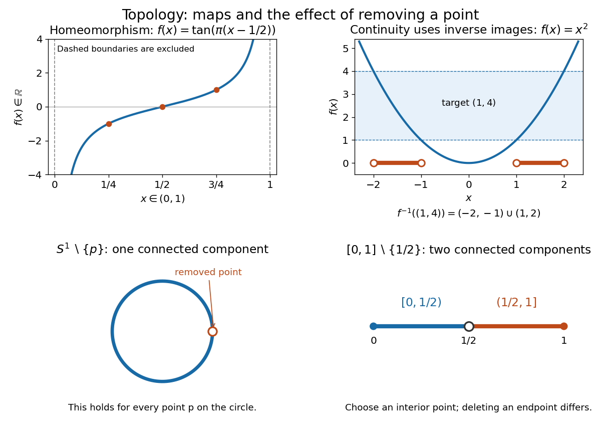
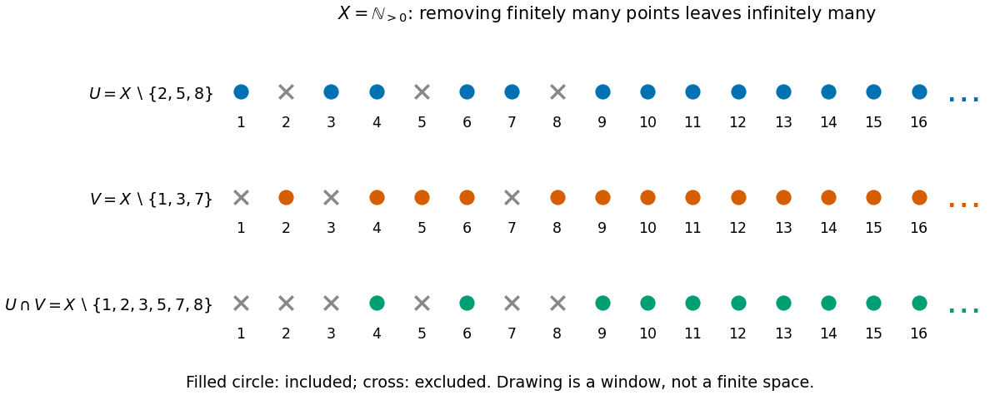
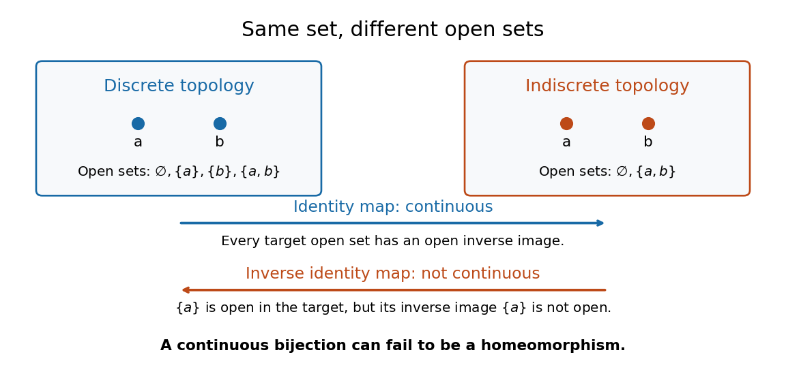
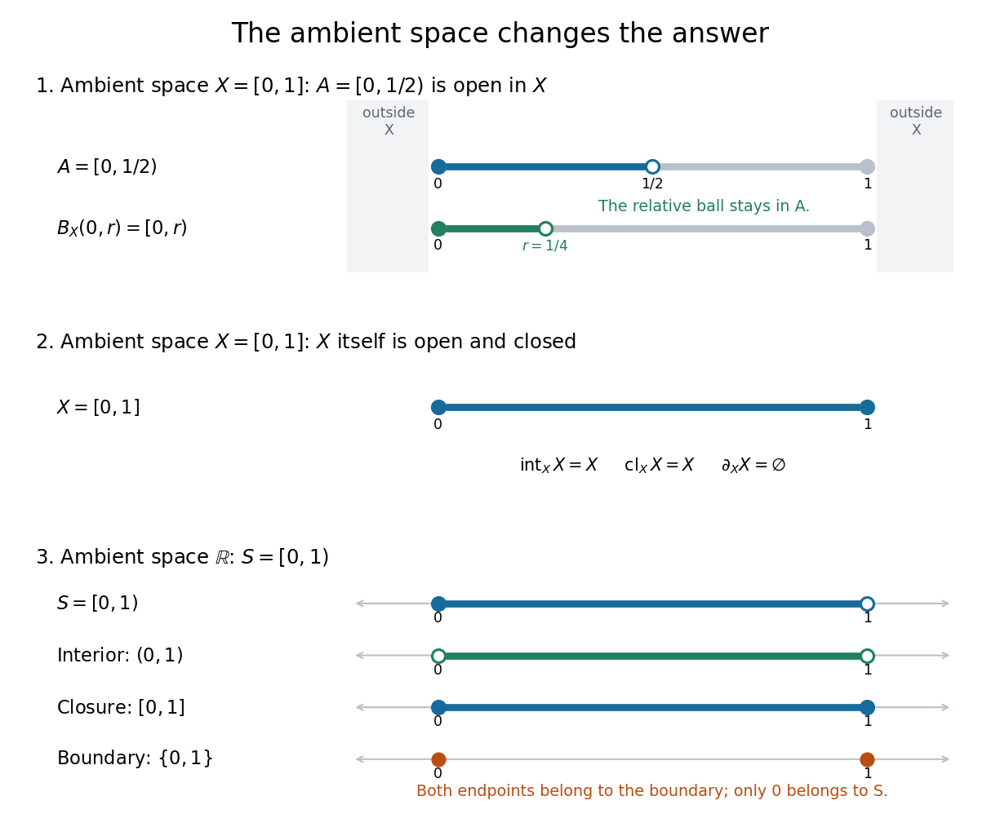
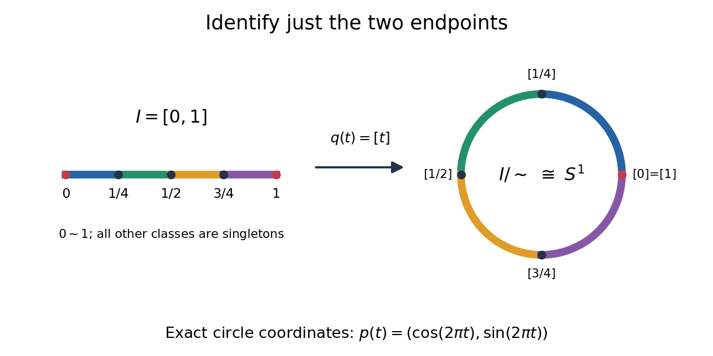
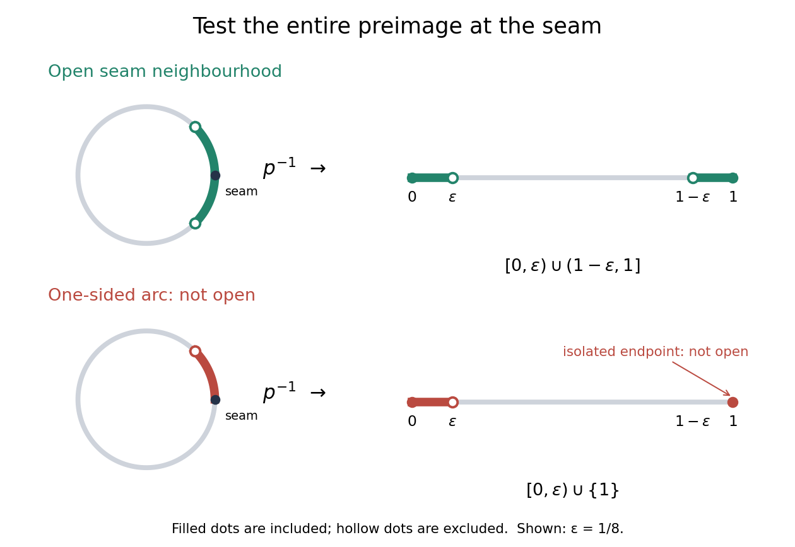
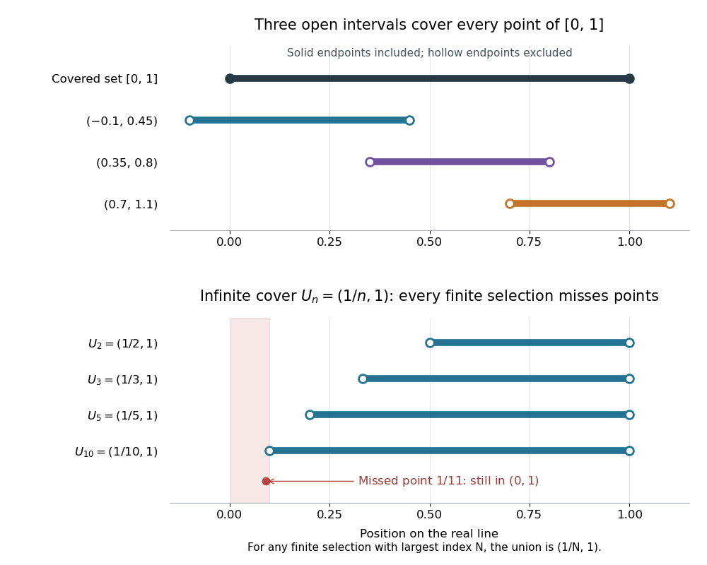
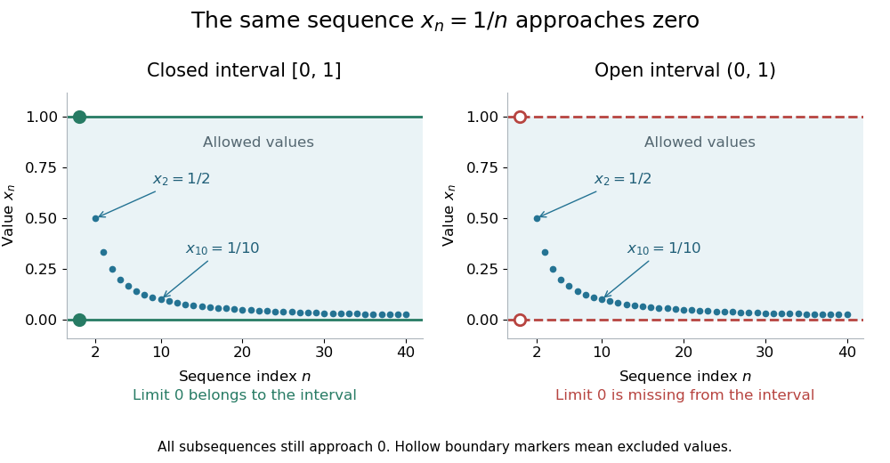

# Topology

↑ **Parent:** [Geometry and topology](geometry-and-topology.md)  
ⓦ [Wiki](https://en.wikipedia.org/wiki/Topology)

Topology studies [topological spaces](#topological-space) through [open sets](#open-set) and [continuous maps](#continuous-map). Its central equivalence is a [homeomorphism](#homeomorphism): a [bijection](function.md#bijection) that preserves [continuity](calculus.md#continuous-function) in both directions. This lets us distinguish spaces by [connectedness](geometry-and-topology.md#connected-space) or [compactness](#compact-space) even when numerical [metric](topological-analysis.md#metric) values are irrelevant. The [open interval](#open-interval) $(0,1)$ and the [real line](real-analysis.md#real-line) have the same [topology](topology.md) in this sense, although only the former is a [bounded set](topological-analysis.md#bounded-set) with its usual [metric](topological-analysis.md#metric).

**[Figure 1](#image-homeomorphisms-inverse-images-and-the-effect-of-removing-a-point). Homeomorphisms, inverse images, and the effect of removing a point**.

The upper panels show an explicit [homeomorphism](#homeomorphism) and the [inverse image](set-theory.md#preimage) test for a [continuous map](#continuous-map). The lower panels exhibit an obstruction to a [homeomorphism](#homeomorphism): removing any point from a [circle](#circle) leaves a [connected space](geometry-and-topology.md#connected-space), whereas removing an interior point from a [closed interval](real-analysis.md#closed-real-interval) gives two [connected components](geometry-and-topology.md#connected-component).

[Homotopy](homotopy.md) is a different notion: it varies a [continuous map](#continuous-map) continuously with a parameter and may collapse points. For example, $H(x,t)=(1-t)x$ contracts $[0,1]$ to zero. Thus this [closed interval](real-analysis.md#closed-real-interval) and a [singleton](set.md#singleton-mathematics) have the same [homotopy type](homotopy.md#homotopy-type), but there is no [homeomorphism](#homeomorphism) between them because there is no [bijection](function.md#bijection). [Homotopy equivalence](homotopy.md#homotopy-equivalence) need not preserve [compactness](#compact-space). [MIT Algebraic Topology I, Lecture 5](https://ocw.mit.edu/courses/18-905-algebraic-topology-i-fall-2016/2dad3dd8354992d877fbeca4049817ee_MIT18_905F16_lecture_notes.pdf)

The abstract viewpoint already appears explicitly in Tietze's 1923 paper: he describes [topology](topology.md) as the study of properties invariant under invertible [continuous maps](#continuous-map) with [continuous](calculus.md#continuous-function) inverses, and discusses axioms for [neighbourhoods](#neighbourhood-mathematics), citing Hausdorff's 1914 book, page 213. [Tietze, Beiträge zur allgemeinen Topologie I, page 290](https://gdz.sub.uni-goettingen.de/fulltext/PPN235181684_0088/00000294?_format=xml)

**Table of contents**

- [Topological invariant](#topological-invariant)
- [End (topology)](#end-topology)
- [Orientability](#orientability)
- [Non-Hausdorff manifold](#non-hausdorff-manifold)
- [Stone space](#stone-space)
- [Tail topology on the natural numbers](#tail-topology-on-the-natural-numbers)
  - [Continuous maps between cofinite and tail topologies](#continuous-maps-between-cofinite-and-tail-topologies)
- [Fell topology](#fell-topology)
- [Upper-ray topology on the real line](#upper-ray-topology-on-the-real-line)
- [Hyperconnected space](#hyperconnected-space)
- [Closed cover](#closed-cover)
- [Partition topology](#partition-topology)
- [Finite subsets do not define a topology on an infinite set](#finite-subsets-do-not-define-a-topology-on-an-infinite-set)
- [Lower limit topology](#lower-limit-topology)
  - [Sorgenfrey plane](#sorgenfrey-plane)
- [Symmetric product](#symmetric-product)
- [Extremally disconnected space](#extremally-disconnected-space)
- [Countable complement topology](#countable-complement-topology)
  - [Compact subsets of a cocountable space](#compact-subsets-of-a-cocountable-space)
- [Locally finite family of subsets](#locally-finite-family-of-subsets)
- [Indiscrete topology](#indiscrete-topology)
- [Triangulation of a surface](#triangulation-of-a-surface)
- [Pasting lemma for closed subspaces](#pasting-lemma-for-closed-subspaces)
- [Cofinite topology](#cofinite-topology)
  - [Sequence convergence in the cofinite topology](#sequence-convergence-in-the-cofinite-topology)
  - [Every subset of a cofinite space is compact](#every-subset-of-a-cofinite-space-is-compact)
  - [Continuous maps from an infinite cofinite space to a Hausdorff space are constant](#continuous-maps-from-an-infinite-cofinite-space-to-a-hausdorff-space-are-constant)
- [Hahn-Mazurkiewicz theorem](#hahn-mazurkiewicz-theorem)
  - [Peano continuum](#peano-continuum)
- [Topological manifold](topological-manifold.md)
  - [Topological atlas](topological-manifold.md#topological-atlas)
    - [Topological transition map](topological-manifold.md#topological-transition-map)
  - [Two stereographic charts on the circle](topological-manifold.md#two-stereographic-charts-on-the-circle)
  - [Topological manifold with boundary](topological-manifold.md#topological-manifold-with-boundary)
  - [Category of topological manifolds](topological-manifold.md#category-of-topological-manifolds)
  - [Piecewise linear ball](topological-manifold.md#piecewise-linear-ball)
    - [Gluing three-balls along a boundary disk](topological-manifold.md#gluing-three-balls-along-a-boundary-disk)
  - [4-manifold](topological-manifold.md#4-manifold)
    - [Smooth four-manifold](topological-manifold.md#smooth-four-manifold)
      - [Fiber sum of four-manifolds](topological-manifold.md#fiber-sum-of-four-manifolds)
        - [Smooth fiber sum along unknotted null-homologous spheres](topological-manifold.md#smooth-fiber-sum-along-unknotted-null-homologous-spheres)
      - [Seiberg–Witten invariant of a four-manifold](topological-manifold.md#seiberg-witten-invariant-of-a-four-manifold)
        - [Connected-sum vanishing of the Seiberg–Witten invariant](topological-manifold.md#connected-sum-vanishing-of-the-seiberg-witten-invariant)
        - [Taubes nonvanishing theorem](topological-manifold.md#taubes-nonvanishing-theorem)
          - [Symplectic connected-sum obstruction](topological-manifold.md#symplectic-connected-sum-obstruction)
  - [Double of a manifold](topological-manifold.md#double-of-a-manifold)
  - [Topological tripod](topological-manifold.md#topological-tripod)
  - [Invariance of domain](topological-manifold.md#invariance-of-domain)
  - [Lorentzian manifold](topological-manifold.md#lorentzian-manifold)
    - [Metric signature](topological-manifold.md#metric-signature)
    - [Spacelike submanifold](topological-manifold.md#spacelike-submanifold)
  - [Dimension of a manifold](topological-manifold.md#dimension-of-a-manifold)
    - [Codimension of a submanifold](topological-manifold.md#codimension-of-a-submanifold)
  - [Handle attachment](topological-manifold.md#handle-attachment)
    - [Four-handle](topological-manifold.md#four-handle)
    - [Handle](topological-manifold.md#handle)
    - [Surgery on a smooth manifold](topological-manifold.md#surgery-on-a-smooth-manifold)
    - [Zero-handle](topological-manifold.md#zero-handle)
    - [Core disk of a handle](topological-manifold.md#core-disk-of-a-handle)
    - [Handle decomposition](topological-manifold.md#handle-decomposition)
      - [Critical level handle embedding](topological-manifold.md#critical-level-handle-embedding)
      - [Zero-framed Hopf-link handle decomposition of the sphere product](topological-manifold.md#zero-framed-hopf-link-handle-decomposition-of-the-sphere-product)
      - [Commutator handlebody of the torus](topological-manifold.md#commutator-handlebody-of-the-torus)
      - [Handle slide](topological-manifold.md#handle-slide)
        - [Handle-slide isolation of a cancelling pair](topological-manifold.md#handle-slide-isolation-of-a-cancelling-pair)
      - [Belt sphere](topological-manifold.md#belt-sphere)
      - [Attaching sphere](topological-manifold.md#attaching-sphere)
    - [Three-handle](topological-manifold.md#three-handle)
    - [Two-handle](topological-manifold.md#two-handle)
    - [One-handle](topological-manifold.md#one-handle)
  - [3-manifold](topological-manifold.md#3-manifold)
    - [Normal surface](topological-manifold.md#normal-surface)
      - [Normal surface coordinates](topological-manifold.md#normal-surface-coordinates)
        - [Normal surface weight](topological-manifold.md#normal-surface-weight)
        - [Haken sum](topological-manifold.md#haken-sum)
        - [Fundamental normal surface](topological-manifold.md#fundamental-normal-surface)
    - [Punctured three-sphere](topological-manifold.md#punctured-three-sphere)
      - [Sphere surgery preserving nontrivial complementary pieces](topological-manifold.md#sphere-surgery-preserving-nontrivial-complementary-pieces)
    - [Three-ball](topological-manifold.md#three-ball)
    - [Poincaré conjecture](topological-manifold.md#poincare-conjecture)
    - [Loop theorem](topological-manifold.md#loop-theorem)
      - [Tower proof of the loop theorem](topological-manifold.md#tower-proof-of-the-loop-theorem)
      - [Dehn's lemma](topological-manifold.md#dehn-s-lemma)
    - [Sphere theorem for three-manifolds](topological-manifold.md#sphere-theorem-for-three-manifolds)
    - [Hyperbolic three-manifold](topological-manifold.md#hyperbolic-three-manifold)
      - [Mostow rigidity theorem](topological-manifold.md#mostow-rigidity-theorem)
    - [Three-dimensional Schoenflies theorem](topological-manifold.md#three-dimensional-schoenflies-theorem)
    - [Geometrizable three-manifold](topological-manifold.md#geometrizable-three-manifold)
      - [Geometrization conjecture](topological-manifold.md#geometrization-conjecture)
      - [Thurston geometry](topological-manifold.md#thurston-geometry)
    - [Prime three-manifold](topological-manifold.md#prime-three-manifold)
      - [Prime decomposition of a closed orientable three-manifold](topological-manifold.md#prime-decomposition-of-a-closed-orientable-three-manifold)
      - [Nonseparating sphere gives a sphere-circle summand](topological-manifold.md#nonseparating-sphere-gives-a-sphere-circle-summand)
    - [Boundary-irreducible three-manifold](topological-manifold.md#boundary-irreducible-three-manifold)
    - [Irreducible three-manifold](topological-manifold.md#irreducible-three-manifold)
    - [Excellent three-manifold](topological-manifold.md#excellent-three-manifold)
      - [Excellent knot representative theorem](topological-manifold.md#excellent-knot-representative-theorem)
    - [Thurston norm](topological-manifold.md#thurston-norm)
      - [Thurston norm of a pair-of-pants product](topological-manifold.md#thurston-norm-of-a-pair-of-pants-product)
      - [Thurston norm gluing along an incompressible torus](topological-manifold.md#thurston-norm-gluing-along-an-incompressible-torus)
      - [Dual Thurston polytope](topological-manifold.md#dual-thurston-polytope)
    - [Incompressible surface](topological-manifold.md#incompressible-surface)
      - [Three-manifold hierarchy](topological-manifold.md#three-manifold-hierarchy)
        - [Relative boundary rigidity from a hierarchy](topological-manifold.md#relative-boundary-rigidity-from-a-hierarchy)
        - [Asphericity from a three-manifold hierarchy](topological-manifold.md#asphericity-from-a-three-manifold-hierarchy)
        - [Self-reproducing incompressible annulus cut](topological-manifold.md#self-reproducing-incompressible-annulus-cut)
      - [Compression disk](topological-manifold.md#compression-disk)
      - [Boundary-parallel surface](topological-manifold.md#boundary-parallel-surface)
      - [Classification of incompressible surfaces in Seifert fibered spaces](topological-manifold.md#classification-of-incompressible-surfaces-in-seifert-fibered-spaces)
      - [Boundary-incompressible surface](topological-manifold.md#boundary-incompressible-surface)
    - [Heegaard splitting](topological-manifold.md#heegaard-splitting)
      - [Common nonseparating disks in a Heegaard splitting](topological-manifold.md#common-nonseparating-disks-in-a-heegaard-splitting)
      - [Heegaard genus](topological-manifold.md#heegaard-genus)
      - [Heegaard Floer homology](topological-manifold.md#heegaard-floer-homology)
        - [Mixed Heegaard Floer invariant](topological-manifold.md#mixed-heegaard-floer-invariant)
          - [Adjunction inequality for the mixed Heegaard Floer invariant](topological-manifold.md#adjunction-inequality-for-the-mixed-heegaard-floer-invariant)
          - [Blowup formula for the mixed Heegaard Floer invariant](topological-manifold.md#blowup-formula-for-the-mixed-heegaard-floer-invariant)
        - [Integer-surgery exact triangle in Heegaard Floer homology](topological-manifold.md#integer-surgery-exact-triangle-in-heegaard-floer-homology)
        - [Heegaard Floer cobordism map](topological-manifold.md#heegaard-floer-cobordism-map)
          - [Admissible cut for a Heegaard Floer mixed map](topological-manifold.md#admissible-cut-for-a-heegaard-floer-mixed-map)
        - [Variants of Heegaard Floer homology](topological-manifold.md#variants-of-heegaard-floer-homology)
          - [Non-torsion Heegaard Floer homology of the sphere-circle product](topological-manifold.md#non-torsion-heegaard-floer-homology-of-the-sphere-circle-product)
          - [Reduced Heegaard Floer homology](topological-manifold.md#reduced-heegaard-floer-homology)
          - [U-adic completion of Heegaard Floer homology](topological-manifold.md#u-adic-completion-of-heegaard-floer-homology)
        - [Heegaard Floer chain complex](topological-manifold.md#heegaard-floer-chain-complex)
          - [Coherent orientations in Heegaard Floer homology](topological-manifold.md#coherent-orientations-in-heegaard-floer-homology)
          - [Empty bigon and rectangle counts in Heegaard Floer homology](topological-manifold.md#empty-bigon-and-rectangle-counts-in-heegaard-floer-homology)
          - [Relative grading in Heegaard Floer homology](topological-manifold.md#relative-grading-in-heegaard-floer-homology)
            - [Absolute grading in Heegaard Floer homology](topological-manifold.md#absolute-grading-in-heegaard-floer-homology)
          - [Whitney disk class](topological-manifold.md#whitney-disk-class)
      - [Compression body](topological-manifold.md#compression-body)
      - [Heegaard surface](topological-manifold.md#heegaard-surface)
        - [Heegaard diagram](topological-manifold.md#heegaard-diagram)
          - [Generalized Heegaard diagram](topological-manifold.md#generalized-heegaard-diagram)
          - [Dehn presentation Heegaard diagram](topological-manifold.md#dehn-presentation-heegaard-diagram)
    - [Handlebody](topological-manifold.md#handlebody)
    - [Thurston elliptization conjecture](topological-manifold.md#thurston-elliptization-conjecture)
  - [Homology above the dimension of a manifold](topological-manifold.md#homology-above-the-dimension-of-a-manifold)
- [Closed set](#closed-set)
  - [Sequentially closed set](#sequentially-closed-set)
  - [Limit point](#limit-point)
- [Closure (topology)](#closure-topology)
  - [Adherent point](#adherent-point)
- [Interior (topology)](#interior-topology)
- [Topological space](#topological-space)
  - [Convergence of a sequence in a topological space](#convergence-of-a-sequence-in-a-topological-space)
  - [Open and closed maps](#open-and-closed-maps)
  - [Stratified space](#stratified-space)
    - [Stratum of a stratified space](#stratum-of-a-stratified-space)
    - [Stratified pseudomanifold](#stratified-pseudomanifold)
      - [Normalization of a two-dimensional pseudomanifold](#normalization-of-a-two-dimensional-pseudomanifold)
      - [Witt space](#witt-space)
        - [Witt space with collared boundary](#witt-space-with-collared-boundary)
      - [Link of a stratum](#link-of-a-stratum)
  - [Continuous real maps from the initial-segment topology](#continuous-real-maps-from-the-initial-segment-topology)
  - [Sigma-compact space](#sigma-compact-space)
  - [Sober space](#sober-space)
    - [Sobrification](#sobrification)
  - [Separable topological space](#separable-topological-space)
  - [G-delta set](#g-delta-set)
  - [Net (mathematics)](#net-mathematics)
    - [Subnet of a net](#subnet-of-a-net)
  - [Separation axiom](#separation-axiom)
    - [T1 space](#t1-space)
  - [Closed point](#closed-point)
  - [Locally connected space](#locally-connected-space)
  - [Boundary of a set](#boundary-of-a-set)
    - [Boundary of a domain](#boundary-of-a-domain)
  - [Basis of a topology](#basis-of-a-topology)
  - [Second-countable space](#second-countable-space)
  - [Paracompact space](#paracompact-space)
  - [Kolmogorov space](#kolmogorov-space)
    - [Sierpiński space](#sierpinski-space)
      - [Embedding of a T0 space into a power of the Sierpiński space](#embedding-of-a-t0-space-into-a-power-of-the-sierpinski-space)
  - [Continuous map](#continuous-map)
    - [Scalar clipping](#scalar-clipping)
    - [Topological embedding](#topological-embedding)
  - [Retraction](#retraction)
    - [Retraction onto a punctured oriented surface](#retraction-onto-a-punctured-oriented-surface)
  - [Subspace topology](#subspace-topology)
  - [Alexandroff extension](#alexandroff-extension)
    - [Hawaiian earring](#hawaiian-earring)
      - [Rational summand in Hawaiian earring homology](#rational-summand-in-hawaiian-earring-homology)
  - [Circle](#circle)
    - [Soddy circle](#soddy-circle)
      - [Inner Soddy circle](#inner-soddy-circle)
    - [Power of a point](#power-of-a-point)
    - [Tangent circles](#tangent-circles)
    - [Tangent to a circle](#tangent-to-a-circle)
    - [Circular segment](#circular-segment)
      - [Area enclosed by two chords and a circular arc](#area-enclosed-by-two-chords-and-a-circular-arc)
    - [Circular arc](#circular-arc)
    - [Circular sector](#circular-sector)
    - [Semicircle](#semicircle)
    - [Chord of a circle](#chord-of-a-circle)
    - [Reflection symmetry of a complex circle equation](#reflection-symmetry-of-a-complex-circle-equation)
    - [Maximum separation of two circles](#maximum-separation-of-two-circles)
    - [Steiner chain](#steiner-chain)
      - [Steiner porism](#steiner-porism)
      - [Tangency locus of a Steiner chain](#tangency-locus-of-a-steiner-chain)
    - [Circle from an affine complex-modulus equation](#circle-from-an-affine-complex-modulus-equation)
    - [Radius](#radius)
    - [Pi](#pi)
      - [Chudnovsky algorithm](#chudnovsky-algorithm)
        - [Chudnovsky series](#chudnovsky-series)
      - [Wallis product](#wallis-product)
      - [Proof that π is irrational](#proof-that-pi-is-irrational)
    - [Circumference](#circumference)
  - [Wedge sum](#wedge-sum)
    - [Pinch map](#pinch-map)
    - [Wedge of two circles](#wedge-of-two-circles)
  - [Inclusion map](#inclusion-map)
  - [Topology axiom](#topology-axiom)
  - [Open cover](#open-cover)
    - [Subcover](#subcover)
      - [Finite subcover](#finite-subcover)
    - [Affine open cover](#affine-open-cover)
    - [Acyclic cover](#acyclic-cover)
- [Quotient topology](#quotient-topology)
  - [Quotient topological space](#quotient-topological-space)
  - [Quotient map](#quotient-map)
  - [Universal property of the quotient topology](#universal-property-of-the-quotient-topology)
  - [Non-Hausdorff quotient of the real line by rational translation](#non-hausdorff-quotient-of-the-real-line-by-rational-translation)
  - [Square quotient model of the two-sphere](#square-quotient-model-of-the-two-sphere)
- [Open set](#open-set)
  - [Domain (mathematical analysis)](#domain-mathematical-analysis)
  - [Clopen set](#clopen-set)
  - [Open interval](#open-interval)
    - [Nondegenerate interval](#nondegenerate-interval)
  - [Neighbourhood (mathematics)](#neighbourhood-mathematics)
    - [Neighbourhood system](#neighbourhood-system)
      - [Neighbourhood basis](#neighbourhood-basis)
  - [Open ball](#open-ball)
  - [Annulus (mathematics)](#annulus-mathematics)
    - [Fixed-point-free rotation of an annulus](#fixed-point-free-rotation-of-an-annulus)
- [Disk (mathematics)](#disk-mathematics)
  - [Lens-shaped intersection of two disks](#lens-shaped-intersection-of-two-disks)
  - [Open disc](#open-disc)
    - [Unit disc](#unit-disc)
      - [Automorphism of the unit disk](#automorphism-of-the-unit-disk)
- [Topological disc](#topological-disc)
  - [Closed disc](#closed-disc)
- [Level set](#level-set)
  - [Level sets of a linear numerator over a radial quadratic](#level-sets-of-a-linear-numerator-over-a-radial-quadratic)
  - [Level curve](#level-curve)
    - [Contour plot](#contour-plot)
  - [Regular level set](#regular-level-set)
  - [Superlevel set](#superlevel-set)
- [Dense set](#dense-set)
- [Discrete space](#discrete-space)
  - [Discrete subset](#discrete-subset)
    - [Closed discrete subset](#closed-discrete-subset)
    - [Discrete subsets of the real line are countable](#discrete-subsets-of-the-real-line-are-countable)
- [Connected-space zero-product dichotomy](#connected-space-zero-product-dichotomy)
- [Normal space](#normal-space)
  - [Closed-neighborhood shrinking in a normal space](#closed-neighborhood-shrinking-in-a-normal-space)
  - [Urysohn's lemma](#urysohn-s-lemma)
    - [Tietze extension theorem](#tietze-extension-theorem)
      - [Metric Tietze two-thirds approximation](#metric-tietze-two-thirds-approximation)
  - [Closed G-delta set as a zero set](#closed-g-delta-set-as-a-zero-set)
- [Compact space](#compact-space)
  - [Ultrafilter characterization of compactness](#ultrafilter-characterization-of-compactness)
  - [Compact exhaustion](#compact-exhaustion)
  - [Compact Hausdorff space](#compact-hausdorff-space)
    - [Supremum convergence for decreasing continuous functions](#supremum-convergence-for-decreasing-continuous-functions)
    - [Closed relation generated by a set-split pair of compact Hausdorff maps](#closed-relation-generated-by-a-set-split-pair-of-compact-hausdorff-maps)
    - [Separable compactification need not be metrizable](#separable-compactification-need-not-be-metrizable)
  - [Heine-Borel theorem](#heine-borel-theorem)
  - [Finite intersection property](#finite-intersection-property)
  - [Continuous image of a compact space](#continuous-image-of-a-compact-space)
  - [Quotient of a compact space](#quotient-of-a-compact-space)
  - [Lebesgue number lemma](#lebesgue-number-lemma)
  - [Normality of a compact Hausdorff space](#normality-of-a-compact-hausdorff-space)
  - [Alexander's subbase lemma](#alexander-s-subbase-lemma)
  - [Locally compact space](#locally-compact-space)
    - [Compactly detected closed-set theorem in a locally compact Hausdorff space](#compactly-detected-closed-set-theorem-in-a-locally-compact-hausdorff-space)
- [Hausdorff space](#hausdorff-space)
  - [Completely regular Hausdorff space](#completely-regular-hausdorff-space)
  - [Compact subset of a Hausdorff space](#compact-subset-of-a-hausdorff-space)
  - [Compact-to-Hausdorff continuous bijection theorem](#compact-to-hausdorff-continuous-bijection-theorem)
  - [Closed diagonal theorem](#closed-diagonal-theorem)
- [Homeomorphism](#homeomorphism)
  - [Circle and interval are not homeomorphic](#circle-and-interval-are-not-homeomorphic)
  - [Inverse continuity from an open bijection](#inverse-continuity-from-an-open-bijection)
  - [Local homeomorphism](#local-homeomorphism)
  - [Closed map](#closed-map)
    - [Projection with a compact factor is closed](#projection-with-a-compact-factor-is-closed)
    - [Compact-preimage theorem for closed maps](#compact-preimage-theorem-for-closed-maps)
- [Unit sphere](#unit-sphere)
- [Closed graph theorem for compact spaces](#closed-graph-theorem-for-compact-spaces)
  - [Closed-graph criterion with compact codomain](#closed-graph-criterion-with-compact-codomain)
- [Curve](#curve)
  - [Euler spiral](#euler-spiral)
  - [Closed curve](#closed-curve)
  - [Asymptote](#asymptote)
  - [Parametric curve](#parametric-curve)
    - [Lissajous curve](#lissajous-curve)
    - [Parametric plane curve](#parametric-plane-curve)
    - [Parametric curve interrogation](#parametric-curve-interrogation)
      - [Certified curve-plane intersection](#certified-curve-plane-intersection)
    - [Cycloid](#cycloid)
      - [Area and length of a cycloid arch](#area-and-length-of-a-cycloid-arch)
  - [Space curve](#space-curve)
    - [Helix](#helix)
      - [Logarithmic conical helix](#logarithmic-conical-helix)
      - [Pitch of a helix](#pitch-of-a-helix)
  - [Inflection point](#inflection-point)
  - [Logarithmic spiral](#logarithmic-spiral)
    - [Logarithmic spiral as an embedded real line](#logarithmic-spiral-as-an-embedded-real-line)
  - [Simple curve](#simple-curve)
  - [Space-filling curve](#space-filling-curve)
- [Topological surface](topological-surface.md)
  - [Classification of compact surfaces](topological-surface.md#classification-of-compact-surfaces)
  - [Thrice-punctured sphere](topological-surface.md#thrice-punctured-sphere)
  - [Integral top homology of a compact connected surface](topological-surface.md#integral-top-homology-of-a-compact-connected-surface)
  - [Surface with boundary](topological-surface.md#surface-with-boundary)
    - [Topology of disk tiles glued along disjoint boundary arcs](topological-surface.md#topology-of-disk-tiles-glued-along-disjoint-boundary-arcs)
    - [Pair of pants (mathematics)](topological-surface.md#pair-of-pants-mathematics)
      - [Hyperbolic Y-piece](topological-surface.md#hyperbolic-y-piece)
        - [Hyperbolic X-piece](topological-surface.md#hyperbolic-x-piece)
      - [Homology action of a pair-of-pants homeomorphism](topological-surface.md#homology-action-of-a-pair-of-pants-homeomorphism)
  - [Genus of a surface](topological-surface.md#genus-of-a-surface)
    - [Genus monotonicity under nonzero-degree surface maps](topological-surface.md#genus-monotonicity-under-nonzero-degree-surface-maps)
  - [Closed orientable surface](topological-surface.md#closed-orientable-surface)
    - [Genus of a finite cover of a closed orientable surface](topological-surface.md#genus-of-a-finite-cover-of-a-closed-orientable-surface)
  - [Non-orientable surface](topological-surface.md#non-orientable-surface)
    - [Closed nonorientable surface](topological-surface.md#closed-nonorientable-surface)
  - [Surface quotient by a free finite action](topological-surface.md#surface-quotient-by-a-free-finite-action)
  - [Jordan curve theorem](topological-surface.md#jordan-curve-theorem)
    - [Jordan separation from the exponential quotient](topological-surface.md#jordan-separation-from-the-exponential-quotient)
    - [Jordan domain](topological-surface.md#jordan-domain)
    - [Schoenflies theorem](topological-surface.md#schoenflies-theorem)
    - [Outer boundary of a planar compact set](topological-surface.md#outer-boundary-of-a-planar-compact-set)
  - [Moore triod theorem](topological-surface.md#moore-triod-theorem)
  - [Polygonal schema](topological-surface.md#polygonal-schema)
    - [Polygonal-schema Euler count](topological-surface.md#polygonal-schema-euler-count)
    - [Regular hyperbolic octagon fundamental polygon](topological-surface.md#regular-hyperbolic-octagon-fundamental-polygon)
  - [Mapping class group](topological-surface.md#mapping-class-group)
    - [Mapping class](topological-surface.md#mapping-class)
    - [Injection of a finite hyperbolic isometry group into a mapping class group](topological-surface.md#injection-of-a-finite-hyperbolic-isometry-group-into-a-mapping-class-group)
    - [Realization of a finite group as a surface deck group](topological-surface.md#realization-of-a-finite-group-as-a-surface-deck-group)
    - [Dehn twist](topological-surface.md#dehn-twist)
      - [Lickorish-Dehn theorem](topological-surface.md#lickorish-dehn-theorem)
      - [Homology action of a Dehn twist](topological-surface.md#homology-action-of-a-dehn-twist)
      - [Right-handed Dehn twist](topological-surface.md#right-handed-dehn-twist)
    - [Essential proper arc on a punctured surface](topological-surface.md#essential-proper-arc-on-a-punctured-surface)
      - [Bigon formed by two arcs](topological-surface.md#bigon-formed-by-two-arcs)
      - [Minimal position of curves or arcs](topological-surface.md#minimal-position-of-curves-or-arcs)
        - [Bigon criterion](topological-surface.md#bigon-criterion)
    - [Geometric intersection number](topological-surface.md#geometric-intersection-number)
      - [Algebraic intersection number of curves on an oriented surface](topological-surface.md#algebraic-intersection-number-of-curves-on-an-oriented-surface)
        - [Isotopy invariance of algebraic intersection number](topological-surface.md#isotopy-invariance-of-algebraic-intersection-number)
    - [Arc complex](topological-surface.md#arc-complex)
      - [Arc complex of the three-punctured sphere](topological-surface.md#arc-complex-of-the-three-punctured-sphere)
      - [Arc-complex vertex orbits of the four-punctured sphere](topological-surface.md#arc-complex-vertex-orbits-of-the-four-punctured-sphere)
    - [Alexander system](topological-surface.md#alexander-system)
      - [Structure graph of an Alexander system](topological-surface.md#structure-graph-of-an-alexander-system)
      - [Alexander method](topological-surface.md#alexander-method)
        - [Alexander trick](topological-surface.md#alexander-trick)
        - [Center of the mapping class group of the torus](topological-surface.md#center-of-the-mapping-class-group-of-the-torus)
    - [Mapping-class action on the outer automorphism group of the fundamental group](topological-surface.md#mapping-class-action-on-the-outer-automorphism-group-of-the-fundamental-group)
    - [Pure mapping class group](topological-surface.md#pure-mapping-class-group)
      - [Point-pushing map](topological-surface.md#point-pushing-map)
        - [Birman exact sequence](topological-surface.md#birman-exact-sequence)
      - [Pure mapping class group of the three-punctured sphere](topological-surface.md#pure-mapping-class-group-of-the-three-punctured-sphere)
      - [Pure mapping class group of the four-punctured sphere](topological-surface.md#pure-mapping-class-group-of-the-four-punctured-sphere)
      - [Semidirect-product decomposition of the pure mapping class group of the five-punctured sphere](topological-surface.md#semidirect-product-decomposition-of-the-pure-mapping-class-group-of-the-five-punctured-sphere)
    - [Curve complex](topological-surface.md#curve-complex)
      - [Connectedness of the curve complex](topological-surface.md#connectedness-of-the-curve-complex)
      - [Filling set of curves](topological-surface.md#filling-set-of-curves)
        - [Filling pair on a closed genus-two surface](topological-surface.md#filling-pair-on-a-closed-genus-two-surface)
  - [Torus](topological-surface.md#torus)
    - [Three-critical-point function on a torus](topological-surface.md#three-critical-point-function-on-a-torus)
    - [Pinched torus](topological-surface.md#pinched-torus)
    - [Three-dimensional torus](topological-surface.md#three-dimensional-torus)
    - [Cohomology ring of a torus](topological-surface.md#cohomology-ring-of-a-torus)
    - [Homology of an integer torus endomorphism](topological-surface.md#homology-of-an-integer-torus-endomorphism)
    - [Solid torus](topological-surface.md#solid-torus)
      - [Solid-torus recognition by a compression disk](topological-surface.md#solid-torus-recognition-by-a-compression-disk)
      - [Meridian of a solid torus](topological-surface.md#meridian-of-a-solid-torus)
    - [Embedding of the n-dimensional torus in codimension one](topological-surface.md#embedding-of-the-n-dimensional-torus-in-codimension-one)
    - [Embedded torus of revolution](topological-surface.md#embedded-torus-of-revolution)
    - [Fundamental group of the torus](topological-surface.md#fundamental-group-of-the-torus)
      - [Lift-endpoint description of the fundamental group of the torus](topological-surface.md#lift-endpoint-description-of-the-fundamental-group-of-the-torus)
    - [Integral linear automorphism of the torus](topological-surface.md#integral-linear-automorphism-of-the-torus)
      - [Equivalence of connected double covers of the torus](topological-surface.md#equivalence-of-connected-double-covers-of-the-torus)
  - [Möbius band](topological-surface.md#mobius-band)
    - [Core circle of a Möbius band](topological-surface.md#core-circle-of-a-mobius-band)
    - [Normal reversal around the Möbius core](topological-surface.md#normal-reversal-around-the-mobius-core)
    - [Boundary of a Möbius band winds twice around its core](topological-surface.md#boundary-of-a-mobius-band-winds-twice-around-its-core)
  - [Untwisted band](topological-surface.md#untwisted-band)
  - [Klein bottle](topological-surface.md#klein-bottle)
    - [Mod-two intersection pairing of the Klein bottle](topological-surface.md#mod-two-intersection-pairing-of-the-klein-bottle)
    - [Integral cohomology ring of the Klein bottle](topological-surface.md#integral-cohomology-ring-of-the-klein-bottle)
      - [Integral cohomology ring of the wedge of the real projective plane and a circle](topological-surface.md#integral-cohomology-ring-of-the-wedge-of-the-real-projective-plane-and-a-circle)
    - [Orientation double cover of the Klein bottle](topological-surface.md#orientation-double-cover-of-the-klein-bottle)
      - [Klein-bottle mapping-cylinder obstruction to simple connectivity](topological-surface.md#klein-bottle-mapping-cylinder-obstruction-to-simple-connectivity)
    - [Flat Klein-bottle geodesic model](topological-surface.md#flat-klein-bottle-geodesic-model)
  - [Double cone singularity](topological-surface.md#double-cone-singularity)
- [Knaster-Kuratowski-Mazurkiewicz lemma](#knaster-kuratowski-mazurkiewicz-lemma)
  - [Triangle KKM lemma](#triangle-kkm-lemma)
    - [Distance-function barycentric map](#distance-function-barycentric-map)
    - [No-retraction covering principle](#no-retraction-covering-principle)

## Topological invariant

↑ **Parent:** [Topology](topology.md)

A topological invariant is a property or mathematical object preserved by [homeomorphisms](#homeomorphism) of [topological spaces](#topological-space). [Connectedness](geometry-and-topology.md#connected-space) and [compactness](#compact-space) are examples. The [fundamental group](algebraic-topology.md#fundamental-group) is an invariant up to [group isomorphism](algebra.md#group-isomorphism); it is also preserved up to [isomorphism](algebra.md#isomorphism) by [homotopy equivalence](homotopy.md#homotopy-equivalence), a stronger invariance property which does not hold for every topological invariant.

## End (topology)

↑ **Parent:** [Topology](topology.md)  
ⓦ [Wiki](https://en.wikipedia.org/wiki/End_(topology))

An end of a noncompact [topological space](#topological-space) describes a coherent way to escape every compact subset. For a cofinal compact exhaustion, when one exists, $K_1\subseteq K_2\subseteq\cdots$, it is represented by nested connected components of the complements. A connected noncompact manifold is [disconnected at infinity](riemannian-geometry.md#disconnected-at-infinity) when it has more than one end.

## Orientability

↑ **Parent:** [Topology](topology.md)  
ⓦ [Wiki](https://en.wikipedia.org/wiki/Orientability)

Orientability asks whether local choices of handedness can agree everywhere on a [manifold](topological-manifold.md). On a [smooth manifold](smooth-manifold.md), an [orientation of a smooth manifold](smooth-manifold.md#orientation-of-a-smooth-manifold) chooses an [orientation of a vector space](multilinear-algebra.md#orientation-of-a-vector-space) for each [tangent space](tangent-vector.md#tangent-space), continuously with position. An [ordered basis](vector-space.md#ordered-basis) describes the same handedness as another one when the change-of-basis [determinant](multilinear-algebra.md#determinant) is positive. An [oriented atlas](smooth-manifold.md#oriented-atlas) implements this condition through positive [Jacobian determinants](multivariable-calculus.md#jacobian-determinant) of the [smooth transition maps](differential-geometry.md#smooth-transition-map).

A paper strip makes the obstruction visible. Join its short ends without twisting: the resulting [untwisted band](topological-surface.md#untwisted-band) admits a consistent choice of [unit normal](differential-geometry.md#unit-normal). Add a half-turn before joining: on the [Möbius band](topological-surface.md#mobius-band), following the [core circle of a Möbius band](topological-surface.md#core-circle-of-a-mobius-band) reverses that choice when you first return to the same point. A local decision about handedness has encountered a global contradiction. The [normal reversal around the Möbius core](topological-surface.md#normal-reversal-around-the-mobius-core) makes this precise for an explicit model.

**[Figure 2](#image-matching-and-reversed-edge-identifications-on-a-cylinder-and-a-mobius-band). Matching and reversed edge identifications on a cylinder and a Möbius band**.

Both rectangles have coordinates $(u,v)\in[0,1]\times[-1,1]$. The [untwisted band](topological-surface.md#untwisted-band) identifies $(0,v)$ with $(1,v)$; the [Möbius band](topological-surface.md#mobius-band) identifies $(0,v)$ with $(1,-v)$. Across a seam the corresponding local coordinate changes preserve or reverse $v$, giving [determinants](multilinear-algebra.md#determinant) $+1$ and $-1$. This sign explains the handedness change; the drawing also tracks the two [boundary](#boundary-of-a-set) circles of the [untwisted band](topological-surface.md#untwisted-band) and the single [boundary](#boundary-of-a-set) circle of the [Möbius band](topological-surface.md#mobius-band).

For a [smooth](analysis.md#smooth-function) [topological surface](topological-surface.md) embedded in $\mathbb R^3$, choosing an [orientation of a surface](differential-geometry.md#orientation-of-a-surface) is equivalent to choosing a continuous [unit normal](differential-geometry.md#unit-normal). This picture is specific to surfaces in three-dimensional space: the general definition uses compatible local orientations, without requiring an [embedding](geometry-and-topology.md#embedding). [Orientability](#orientability) is a [topological invariant](#topological-invariant), so a [homeomorphism](#homeomorphism) cannot turn a [Möbius band](topological-surface.md#mobius-band) into a [untwisted band](topological-surface.md#untwisted-band). The [sphere](euclidean-geometry.md#sphere) and [torus](topological-surface.md#torus) are [orientable surfaces](differential-geometry.md#orientable-surface); the [Klein bottle](topological-surface.md#klein-bottle) is not. [Open University, Surfaces, §3.2: orientability](https://www.open.edu/openlearn/science-maths-technology/mathematics-statistics/surfaces/content-section-3.2)

The distinction matters when a sign has geometric meaning. A signed [flux](mathematical-physics.md#flux) [surface integral](multivariable-calculus.md#surface-integral) needs an [orientation of a surface](differential-geometry.md#orientation-of-a-surface), and [Stokes theorem](multivariable-calculus.md#stokes-theorem) relates that choice to the [outward-normal-first boundary orientation](smooth-manifold.md#outward-normal-first-boundary-orientation). Ordinary unsigned [surface area](differential-geometry.md#surface-area) does not require [orientability](#orientability). Thus a [Möbius band](topological-surface.md#mobius-band) still has a perfectly meaningful area even though it has no continuous global [unit normal](differential-geometry.md#unit-normal).

A [connected](geometry-and-topology.md#connected-space) orientable [manifold](topological-manifold.md) of positive dimension has two possible orientations: reversing every local choice gives the other one. If a [manifold](topological-manifold.md) has several [connected components](geometry-and-topology.md#connected-component), each component can be oriented independently when it is orientable. For [topological surfaces](topological-surface.md), a useful obstruction criterion is the presence of a [Möbius band](topological-surface.md#mobius-band): a surface is nonorientable exactly when it contains such a band. [Cornell Mathematical Explorers' Club, Orientable and Nonorientable Surfaces](https://pi.math.cornell.edu/~mec/Winter2009/Victor/part3.htm)

## Non-Hausdorff manifold

↑ **Parent:** [Topology](topology.md)  
ⓦ [Wiki](https://en.wikipedia.org/wiki/Non-Hausdorff_manifold)

A [non-Hausdorff manifold](#non-hausdorff-manifold) is a locally Euclidean [topological space](#topological-space) for which distinct points need not have disjoint neighborhoods. The real line with two origins is a basic example. Nonseparated algebraic schemes exhibit analogous gluing phenomena, but are not generally topological manifolds.

## Stone space

↑ **Parent:** [Topology](topology.md)  
ⓦ [Wiki](https://en.wikipedia.org/wiki/Stone_space)

A [Stone space](#stone-space) is a [compact](#compact-space) [Hausdorff space](#hausdorff-space) that is [totally disconnected](non-archimedean-analysis.md#totally-disconnected-space), equivalently a compact Hausdorff space with a basis of clopen sets. The topology on a [type space](model-theory.md#type-space) gives an important example.

## Tail topology on the natural numbers

↑ **Parent:** [Topology](topology.md)

The nonempty open sets are the upper tails of the [natural numbers](arithmetic.md#natural-number). Arbitrary nonempty unions select the smallest starting index, and finite intersections select the largest, so these sets form a [topology](topology.md). A map into this space is [continuous](calculus.md#continuous-function) exactly when the inverse image of every upper tail is open.

### Continuous maps between cofinite and tail topologies

↑ **Parent:** [Tail topology on the natural numbers](#tail-topology-on-the-natural-numbers)

For a map $f:\mathbb N\to\mathbb N$ from the [cofinite topology](#cofinite-topology) to the [tail topology on the natural numbers](#tail-topology-on-the-natural-numbers), [continuity](calculus.md#continuous-function) is equivalent to every set $\{n:f(n)\ge k\}$ being empty or cofinite. If the image is unbounded, every such set is nonempty and cofinite, so $f(n)\to\infty$. If it is bounded, its maximum $M$ exists, and the inverse image of the tail at $M$ forces $f(n)=M$ eventually, with $f(n)\le M$ always. Conversely either condition makes every tail preimage empty or cofinite.

## Fell topology

↑ **Parent:** [Topology](topology.md)

The [Fell topology](#fell-topology) on the closed subsets of a [locally compact space](#locally-compact-space) has subbasic open sets requiring intersection with an open set or avoidance of a [compact set](#compact-space). On a locally compact separable metric space, its sequential convergence says that every convergent subsequence of points from the varying sets has its limit in the limiting set, and every point of the limiting set is approximated by points from the varying sets.

## Upper-ray topology on the real line

↑ **Parent:** [Topology](topology.md)

These sets form a [topology](topology.md): a nonempty union of upper rays is another upper ray, or all of $\mathbb R$ when their endpoints have no lower bound; a finite intersection of rays has endpoint the maximum of their endpoints. The whole line must be included. The [continuous map](#continuous-map) $n\mapsto n$ from $\mathbb N$ with the [cofinite topology](#cofinite-topology) to this space is nonconstant, because each upper ray has cofinite inverse image.

## Hyperconnected space

↑ **Parent:** [Topology](topology.md)

A [topological space](#topological-space) is hyperconnected if any two nonempty [open sets](#open-set) intersect. Every [continuous map](#continuous-map) from a nonempty hyperconnected space to a [Hausdorff space](#hausdorff-space) is constant: two distinct image points would have disjoint open neighbourhoods whose nonempty inverse images contradict hyperconnectedness. Every infinite set with the [cofinite topology](#cofinite-topology) is hyperconnected.

## Closed cover

↑ **Parent:** [Topology](topology.md)

A closed cover of a [topological space](#topological-space) is a family of [closed sets](#closed-set) whose union is the whole space. A finite closed cover can be used in separation and antipodal arguments: in a [metric space](topological-analysis.md#metric-space), vanishing distance to a closed member means actual membership. Unlike an [open cover](#open-cover), a closed cover does not automatically have a partition of unity subordinate to its members.

## Partition topology

↑ **Parent:** [Topology](topology.md)

Given a partition of a [set](set.md), declare a subset open precisely when it is a union of partition blocks. Arbitrary unions and finite intersections of such unions are again unions of blocks, giving a [topology](topology.md). The quotient map to the block set with its [discrete topology](#discrete-space) pulls that topology back to the original set. For the partition of $\mathbb Z$ into its two parity classes, the only open sets are the empty set, those two classes, and all of $\mathbb Z$.

## Finite subsets do not define a topology on an infinite set

↑ **Parent:** [Topology](topology.md)

On an infinite [set](set.md), the family consisting of all finite subsets and the whole set need not be closed under arbitrary unions. On $\mathbb Z$, the union of the singleton subsets of $2\mathbb Z$ is infinite and proper, so this family is not a [topology](topology.md). It must not be confused with the [cofinite topology](#cofinite-topology), whose proper open sets have finite complements.

## Lower limit topology

↑ **Parent:** [Topology](topology.md)  
ⓦ [Wiki](https://en.wikipedia.org/wiki/Lower_limit_topology)

The lower limit topology on $\mathbb R$ has [basis of a topology](#basis-of-a-topology) $\{[a,b):a<b\}$. Every such nonempty interval contains a rational, so this [topological space](#topological-space) is separable. Its topology is finer than the usual Euclidean topology; the one-sided basic neighbourhoods allow its square to have an uncountable discrete antidiagonal.

### Sorgenfrey plane

↑ **Parent:** [Lower limit topology](#lower-limit-topology)  
ⓦ [Wiki](https://en.wikipedia.org/wiki/Sorgenfrey_plane)

The Sorgenfrey plane is the [product topology](geometry-and-topology.md#product-topology) on two copies of the [Sorgenfrey line](#lower-limit-topology). It is separable because $\mathbb Q^2$ meets every nonempty basic rectangle $[a,b)\times[c,d)$. Its antidiagonal $\{(x,-x):x\in\mathbb R\}$ is an uncountable discrete subspace: $[x,x+\epsilon)\times[-x,-x+\epsilon)$ meets it only at $(x,-x)$. In a discrete space every dense subset is the whole space, so this subspace is not separable. Thus separability need not pass to subspaces of nonmetrizable spaces.

// Target: analysis.bigb

## Symmetric product

↑ **Parent:** [Topology](topology.md)

The $g$th symmetric product of a space $X$ is $\operatorname{Sym}^g(X)=X^g/S_g$, where the [symmetric group](finite-group-theory.md#symmetric-group) permutes the factors. Its points are unordered $g$-tuples, with repetitions allowed. If $X$ is a [Riemann surface](riemann-surfaces.md), elementary symmetric functions in local complex coordinates make its symmetric product a smooth complex manifold, including along the locus of repeated points. A collection of disjoint circles in $X$ gives a product torus in this symmetric product.

## Extremally disconnected space

↑ **Parent:** [Topology](topology.md)

A [topological space](#topological-space) is extremally disconnected when the closure of every [open set](#open-set) is open. This concerns open sets, not arbitrary subsets. In particular, a nonisolated singleton in a [Hausdorff space](#hausdorff-space) is closed but not open, so its closure gives a counterexample to that stronger condition.

## Countable complement topology

↑ **Parent:** [Topology](topology.md)  
ⓦ [Wiki](https://en.wikipedia.org/wiki/Countable_complement_topology)

The open sets are the empty set and subsets whose complement is countable. On an uncountable set, any two nonempty open sets intersect, so the space is not [Hausdorff](#hausdorff-space). On a countable underlying set this topology is discrete. The [compact subsets of a cocountable space](#compact-subsets-of-a-cocountable-space) are finite, regardless of the cardinality of the underlying set.

### Compact subsets of a cocountable space

↑ **Parent:** [Countable complement topology](#countable-complement-topology)

Only finite subsets are compact in the [cocountable topology](#countable-complement-topology). An infinite subset contains distinct $c_1,c_2,\ldots$. The open sets obtained by removing the tails $\{c_j:j\geq n\}$ form an increasing [open cover](#open-cover), but every finite selection misses a tail point. Finite sets are compact in every topology.

## Locally finite family of subsets

↑ **Parent:** [Topology](topology.md)

A family $(A_i)$ of subsets of a [topological space](#topological-space) is locally finite if every point has a neighbourhood meeting only finitely many of its members. On a compact space such a family has only finitely many nonempty members. For singleton subsets of a [Riemann surface](riemann-surfaces.md), this is the condition permitting prescribed poles of a [meromorphic function](isolated-singularity.md#meromorphic-function) without accumulation inside the surface.

## Indiscrete topology

↑ **Parent:** [Topology](topology.md)

The indiscrete topology on a set $X$ has only the empty set and the whole set as [open sets](#open-set). When $X$ has more than one point it is not a [Hausdorff space](#hausdorff-space). For example the [quotient topology](#quotient-topology) on $\mathbb R/\mathbb Q$ is indiscrete: a nonempty open saturated subset contains an interval and all its rational translates, which cover $\mathbb R$.

## Triangulation of a surface

↑ **Parent:** [Topology](topology.md)

A triangulation of a surface decomposes it into triangles meeting along full edges or vertices. On a closed surface, each edge is incident with two triangle faces, so $3F=2E$. [Euler characteristic](homology.md#euler-characteristic) connects this local counting relation with the surface's topology.

## Pasting lemma for closed subspaces

↑ **Parent:** [Topology](topology.md)

If a space is the union of finitely many closed subspaces and continuous maps on those subspaces agree on every overlap, they combine into a continuous map on the whole space. For a closed target set, its preimage is a finite union of closed sets.

## Cofinite topology

↑ **Parent:** [Topology](topology.md)  
ⓦ [Wiki](https://en.wikipedia.org/wiki/Cofinite_topology)

The [cofinite topology](#cofinite-topology) on a [set](set.md) $X$ declares the [empty set](set.md#empty-set) and all [cofinite](set-theory.md#cofinite-set) [subsets](set.md#subset) to be [open sets](#open-set): a nonempty [open set](#open-set) may exclude only a [finite set](set.md#finite-set) of points. There is no assumed [metric](topological-analysis.md#metric). On an [infinite set](set.md#infinite-set), this gives a particularly small collection of [open sets](#open-set) while still making every [singleton](set.md#singleton-mathematics) a [closed set](#closed-set). On a [finite set](set.md#finite-set), every [subset](set.md#subset) has finite [complement](set.md#complement-of-a-set), so the [cofinite topology](#cofinite-topology) is the [discrete topology](#discrete-space).[Definition 1.1.9: finite complement topology](mathematics-bibliography.md#point-set-topology-by-romyar-sharifi/chapter-1-topological-spaces)

For an original example, use $X=\mathbb N_{>0}$ and choose

$$
U=X\setminus\{2,5,8\},\qquad V=X\setminus\{1,3,7\}.
$$

Both are [open sets](#open-set), and their [intersection](set.md#set-intersection) is $U\cap V=X\setminus\{1,2,3,5,7,8\}$. Thus $4,6,9,10,\ldots$ are in both. Their finite exclusions cannot separate the infinite remainder. The [finite intersection](set.md#finite-intersection) of any finite collection of nonempty [open sets](#open-set) is again a nonempty [open set](#open-set), since its [complement](set.md#complement-of-a-set) is a [finite union](set.md#finite-union) of [finite sets](set.md#finite-set). An arbitrary nonempty [union](set.md#set-union) is [open](#open-set) because its [complement](set.md#complement-of-a-set) is contained in the finite [complement](set.md#complement-of-a-set) of any one nonempty member.

**[Figure 3](#image-two-open-sets-with-finite-exclusions-still-overlap-in-an-infinite-cofinite-topology). Two open sets with finite exclusions still overlap in an infinite cofinite topology**. Original sets on $\mathbb N_{>0}$. Only the first sixteen labels are drawn; the dots continue indefinitely and are all included after the last excluded label. Spacing is for readability and defines no [metric](topological-analysis.md#metric). Filled circles belong to the displayed [set](set.md); crosses are excluded.

The [cofinite topology](#cofinite-topology) is useful for separating hypotheses that familiar [metric spaces](topological-analysis.md#metric-space) package together. An infinite cofinite [topological space](#topological-space) is a [T1 space](#t1-space), because its [singletons](set.md#singleton-mathematics) are [closed](#closed-set), but is not a [Hausdorff space](#hausdorff-space), because two nonempty [open sets](#open-set) cannot be [disjoint sets](set.md#disjoint-sets). It is a [hyperconnected space](#hyperconnected-space) and hence a [connected space](geometry-and-topology.md#connected-space). Moreover, [every subset of a cofinite space is compact](#every-subset-of-a-cofinite-space-is-compact), and [sequence convergence in the cofinite topology](#sequence-convergence-in-the-cofinite-topology) can have many limits. These are compatible properties, rather than contradictions: the usual uniqueness and closedness results use the [Hausdorff space](#hausdorff-space) hypothesis.[Example 1.5.10 and Proposition 1.5.11: closed points, overlapping neighbourhoods, non-repeating sequences and uniqueness in Hausdorff spaces](mathematics-bibliography.md#point-set-topology-by-romyar-sharifi/chapter-1-topological-spaces)

### Sequence convergence in the cofinite topology

↑ **Parent:** [Cofinite topology](#cofinite-topology)

By [convergence of a sequence in a topological space](#convergence-of-a-sequence-in-a-topological-space), $x_n\to a$ means that every [open](#open-set) [neighbourhood](#neighbourhood-mathematics) of $a$ contains all sufficiently late terms. In the [cofinite topology](#cofinite-topology), this is equivalent to the condition that, for every $b\ne a$, the value $b$ occurs only finitely often. Necessity uses the [open](#open-set) [neighbourhood](#neighbourhood-mathematics) $X\setminus\{b\}$; sufficiency chooses an index beyond every last occurrence of the finitely many points excluded by a given [open](#open-set) [neighbourhood](#neighbourhood-mathematics).

Consequently a [sequence](sequence-and-series.md#sequence) with distinct terms converges to every point of $X$. For the original choice $x_n=n$ on $X=\mathbb N_{>0}$, take the two [open](#open-set) [neighbourhoods](#neighbourhood-mathematics)

$$
U_1=X\setminus\{2,5,8\}\ni1,\qquad U_2=X\setminus\{1,3,7\}\ni2.
$$

All terms with $n\geq9$ lie in $U_1$ and all terms with $n\geq8$ lie in $U_2$. More generally, each finite excluded [set](set.md) has a last visit, so $x_n\to1$ and $x_n\to2$, and in fact $x_n\to a$ for every $a\in X$. No numerical distance is tending to zero here; the [open sets](#open-set) specify the meaning of convergence.

**[Figure 4](#image-the-same-sequence-eventually-stays-in-neighbourhoods-of-two-different-limits). The same sequence eventually stays in neighbourhoods of two different limits**. Original sequence $x_n=n$ in the [cofinite topology](#cofinite-topology). Two sample [neighbourhoods](#neighbourhood-mathematics) have different finite exclusions and different last-visit indices. Their memberships illustrate the general finite-exclusion argument; testing just these two neighbourhoods would not by itself prove convergence.

Distinct terms are sufficient, not necessary. The [sequence](sequence-and-series.md#sequence) $1,1,2,2,3,3,\ldots$ also converges to every point, since each value occurs only twice. By contrast, the [constant sequence](sequence-and-series.md#constant-sequence) $x_n=1$ converges only to $1$: an [open](#open-set) [neighbourhood](#neighbourhood-mathematics) of any $a\ne1$ can exclude $1$. The alternating [sequence](sequence-and-series.md#sequence) $1,2,1,2,\ldots$ converges to no point, since some value different from any proposed limit occurs infinitely often.

### Every subset of a cofinite space is compact

↑ **Parent:** [Cofinite topology](#cofinite-topology)

Every [subset](set.md#subset) $A$ of a [cofinite](set-theory.md#cofinite-set) [topological space](#topological-space) is a [compact subset](#compact-space). To see the finite reduction directly, take an [open cover](#open-cover) of a nonempty $A$ by [open sets](#open-set) of $X$ and choose one member $U$ containing a point of $A$. Since $U$ has finite [complement](set.md#complement-of-a-set), the [set](set.md) $A\setminus U$ is finite. Choose a covering member for each of those remaining points. Those members together with $U$ are a [finite subcover](#finite-subcover). The [empty set](set.md#empty-set) is already [compact](#compact-space).

Equivalently, the [subspace topology](#subspace-topology) on $A$ is itself cofinite: for finite $F\subseteq X$, the trace of $X\setminus F$ is $A\setminus(F\cap A)$. The argument applies again inside $A$. A concrete [open cover](#open-cover) $\{X\setminus\{k\}:k\in X\}$ of $X=\mathbb N_{>0}$ needs only the two members $X\setminus\{1\}$ and $X\setminus\{2\}$ when these labels are distinct: each fills the other's single gap.

On $X=\mathbb N_{>0}$, the [subset](set.md#subset) of [even integers](integer.md#even-number) is [compact](#compact-space) but not [closed](#closed-set), because it is infinite and proper. A [compact subset of a Hausdorff space](#compact-subset-of-a-hausdorff-space) is guaranteed to be [closed](#closed-set), whereas [compactness](#compact-space) without the [Hausdorff space](#hausdorff-space) assumption does not suffice. Changing the [topology](topology.md) changes [compactness](#compact-space): the same infinite [set](set.md) with its [discrete topology](#discrete-space) has the [singleton](set.md#singleton-mathematics) [open cover](#open-cover), which has no [finite subcover](#finite-subcover). The finite-exception argument is special to finite [complements](set.md#complement-of-a-set); in the [cocountable topology](#countable-complement-topology), [compact subsets of a cocountable space](#compact-subsets-of-a-cocountable-space) must instead be finite.

### Continuous maps from an infinite cofinite space to a Hausdorff space are constant

↑ **Parent:** [Cofinite topology](#cofinite-topology)

If $X$ is an [infinite set](set.md#infinite-set) with its [cofinite topology](#cofinite-topology) and $Y$ is a [Hausdorff space](#hausdorff-space), every [continuous map](#continuous-map) $f:X\to Y$ is a [constant function](function.md#constant-function). Otherwise two distinct image points would have [disjoint](set.md#disjoint-sets) [open](#open-set) [neighbourhoods](#neighbourhood-mathematics). Their [inverse images](set-theory.md#preimage) would be nonempty [disjoint](set.md#disjoint-sets) [open sets](#open-set) of $X$, contradicting its [hyperconnected space](#hyperconnected-space) property.

For example, $f(n)=n$ from $\mathbb N_{>0}$ with its [cofinite topology](#cofinite-topology) into the [real line](real-analysis.md#real-line) with its usual [Euclidean metric](riemannian-metric.md#euclidean-metric) is not [continuous](calculus.md#continuous-function): the [inverse image](set-theory.md#preimage) of the [open interval](#open-interval) $(1/2,3/2)$ is $\{1\}$, which is not [open](#open-set) in the infinite domain. A [continuous](calculus.md#continuous-function) real-valued readout on that domain can only report one value. Finite cofinite domains are different: their [discrete topology](#discrete-space) allows arbitrary [functions](function.md) into any [topological space](#topological-space).

## Hahn-Mazurkiewicz theorem

↑ **Parent:** [Topology](topology.md)  
ⓦ [Wiki](https://en.wikipedia.org/wiki/Hahn-Mazurkiewicz_theorem)

A nonempty Hausdorff space is the continuous image of $[0,1]$ exactly when it is compact, connected, locally connected, and second-countable.

### Peano continuum

↑ **Parent:** [Hahn-Mazurkiewicz theorem](#hahn-mazurkiewicz-theorem)  
ⓦ [Wiki](https://en.wikipedia.org/wiki/Peano_continuum)

A Peano continuum is a compact, connected, locally connected metric space. By the [Hahn-Mazurkiewicz theorem](#hahn-mazurkiewicz-theorem), every Peano continuum is the image of a continuous surjection from $[0,1]$.

## Topological manifold

↑ **Parent:** [Topology](topology.md)

[This section is present in another page, follow this link to view it.](topological-manifold.md)

## Closed set

↑ **Parent:** [Topology](topology.md)  
ⓦ [Wiki](https://en.wikipedia.org/wiki/Closed_set)

A [subset](set.md#subset) $F$ of a [topological space](#topological-space) $(X,\tau)$ is [closed](#closed-set) when its [complement](set.md#complement-of-a-set) in that same ambient space is [open](#open-set): $X\setminus F\in\tau$. For example, the [closed interval](real-analysis.md#closed-real-interval) $[0,1]$ is [closed](#closed-set) in the usual [real line](real-analysis.md#real-line) because its [complement](set.md#complement-of-a-set) is the [open set](#open-set) $(-\infty,0)\cup(1,\infty)$. Always specify the ambient [topological space](#topological-space): a [subset](set.md#subset) can be [closed](#closed-set) in a [subspace topology](#subspace-topology) without being [closed](#closed-set) in the surrounding space. [Richard Haydon, Oxford topology preliminaries, Section 0.1](https://www.maths.ox.ac.uk/system/files/attachments/Preliminary%20Reading%20%281%29.pdf)

Being [closed](#closed-set) is not the logical negation of being [open](#open-set). In the usual [real line](real-analysis.md#real-line), all four combinations occur: $(0,1)$ is [open](#open-set) but not [closed](#closed-set); $[0,1]$ is [closed](#closed-set) but not [open](#open-set); the half-open [interval](real-analysis.md#interval-mathematics) $[0,1)$ is neither [open](#open-set) nor [closed](#closed-set); and both the [empty set](set.md#empty-set) and the whole [real line](real-analysis.md#real-line) are [open](#open-set) and [closed](#closed-set), hence [clopen](#clopen-set). Nor does being [closed](#closed-set) imply being a [bounded set](topological-analysis.md#bounded-set): $[0,\infty)$ is [closed](#closed-set) because its [complement](set.md#complement-of-a-set) $(-\infty,0)$ is [open](#open-set), but it is not a [bounded set](topological-analysis.md#bounded-set). The symbol $\infty$ is not an extra point that this [interval](real-analysis.md#interval-mathematics) must contain.

**[Figure 5](#image-the-four-combinations-of-openness-and-closedness-in-the-real-line). The four combinations of openness and closedness in the real line**.

The coloured strokes mark membership; filled endpoint circles mean included points, and hollow endpoint circles mean excluded points. The [empty set](set.md#empty-set) has no coloured points, while arrows at both ends of the coloured [real line](real-analysis.md#real-line) indicate that membership continues indefinitely. These examples use the usual [topology](topology.md) of the [real line](real-analysis.md#real-line).

In a [metric space](topological-analysis.md#metric-space) $X$, a [subset](set.md#subset) $F$ is [closed](#closed-set) exactly when every [convergent sequence](sequence-and-series.md#convergent-sequence) $(x_n)$ in $F$ whose [limit of a sequence](sequence-and-series.md#limit-of-a-sequence) $x$ lies in $X$ has $x\in F$. For example, $x_n=1-1/n$ lies in $[0,1)$ for $n\geq1$ and has [limit of a sequence](sequence-and-series.md#limit-of-a-sequence) $1$, which is missing; thus this half-open [interval](real-analysis.md#interval-mathematics) is not [closed](#closed-set) in the [real line](real-analysis.md#real-line). This criterion is useful for keeping limiting constructions inside a prescribed [set](set.md). [MIT Real Analysis, Lecture 13, closed sets and convergent sequences](https://ocw.mit.edu/courses/18-100b-real-analysis-spring-2025/mit18_100b_s25_lec_full.pdf)

In every [topological space](#topological-space), the general criterion is $F=\overline F$, using [closure](#closure-topology); equivalently, $F$ contains all its [limit points](#limit-point). A [closed set](#closed-set) is always a [sequentially closed set](#sequentially-closed-set), but the converse can fail outside [metric spaces](topological-analysis.md#metric-space). Arbitrary [intersections](set.md#set-intersection) and finite [unions](set.md#set-union) of [closed sets](#closed-set) are [closed](#closed-set), by taking [complements](set.md#complement-of-a-set) in the [topology axioms](#topology-axiom).

### Sequentially closed set

↑ **Parent:** [Closed set](#closed-set)

A [sequentially closed set](#sequentially-closed-set) is one that contains every limit of its convergent sequences. This is weaker than being a [closed set](#closed-set) in a general [topological space](#topological-space), but the two conditions agree in [metric spaces](topological-analysis.md#metric-space).

### Limit point

↑ **Parent:** [Closed set](#closed-set)  
ⓦ [Wiki](https://en.wikipedia.org/wiki/Limit_point)

A [limit point](#limit-point) of a [subset](set.md#subset) $A$ of a [topological space](#topological-space) is a point $x$ whose every [neighbourhood](#neighbourhood-mathematics) meets $A\setminus\{x\}$. Thus $1$ is a [limit point](#limit-point) of $[0,1)$ in the [real line](real-analysis.md#real-line), even though $1\notin[0,1)$. In contrast, an [isolated point](topological-analysis.md#isolated-point) of $A$ belongs to its [closure](#closure-topology) but is not a [limit point](#limit-point) of $A$. This distinction separates [limit points](#limit-point) from the more inclusive notion of an [adherent point](#adherent-point).

## Closure (topology)

↑ **Parent:** [Topology](topology.md)  
ⓦ [Wiki](https://en.wikipedia.org/wiki/Closure_(topology))

The [closure](#closure-topology) of a [subset](set.md#subset) $A$ of a [topological space](#topological-space) $X$ is the smallest [closed set](#closed-set) containing $A$. Equivalently, it is the [intersection](set.md#set-intersection) of all [closed sets](#closed-set) containing $A$, or the [set](set.md) of points whose every [neighbourhood](#neighbourhood-mathematics) in $X$ meets $A$. The notation $\operatorname{cl}_X A$ makes the ambient [topological space](#topological-space) explicit. This definition works without a [metric](topological-analysis.md#metric) or any appeal to [sequences](sequence-and-series.md#sequence). [James Munkres, Topology, closure and interior of a set](https://math.mit.edu/~hrm/palestine/munkres-topology.pdf)

For $A=[0,1)$ in the usual [real line](real-analysis.md#real-line), $\overline A=[0,1]$: every [neighbourhood](#neighbourhood-mathematics) of $1$ meets $A$, while a point outside $[0,1]$ has an [open ball](#open-ball) disjoint from $A$. Passing to the [closure](#closure-topology) adds the missing endpoint and retains all original points, including [isolated points](topological-analysis.md#isolated-point) when present. In general, the [closure](#closure-topology) is $A$ together with its [limit points](#limit-point); its individual points are the [adherent points](#adherent-point) of $A$.

The [closure](#closure-topology) turns an arbitrary [subset](set.md#subset) into a [closed set](#closed-set) with no unnecessary added points. It satisfies $A\subseteq\overline A$ and $\overline{\overline A}=\overline A$; a [subset](set.md#subset) is [closed](#closed-set) exactly when $A=\overline A$. In a [metric space](topological-analysis.md#metric-space), $x\in\overline A$ exactly when some [sequence](sequence-and-series.md#sequence) of points of $A$ has [limit of a sequence](sequence-and-series.md#limit-of-a-sequence) $x$: choose its $n$th point in $A\cap B(x,1/n)$. For a general [topological space](#topological-space), keep the [neighbourhood](#neighbourhood-mathematics) definition; [sequences](sequence-and-series.md#sequence) need not detect every point of the [closure](#closure-topology).

### Adherent point

↑ **Parent:** [Closure (topology)](#closure-topology)  
ⓦ [Wiki](https://en.wikipedia.org/wiki/Adherent_point)

An adherent point of $A$ is a point whose every [neighbourhood](#neighbourhood-mathematics) meets $A$. The set of adherent points is the [closure](#closure-topology) of $A$. This includes all points of $A$, even isolated ones; a [limit point](#limit-point) in the accumulation-point convention instead requires each neighbourhood to meet $A\setminus\{x\}$.

## Interior (topology)

↑ **Parent:** [Topology](topology.md)  
ⓦ [Wiki](https://en.wikipedia.org/wiki/Interior_(topology))

The [interior](#interior-topology) of a [subset](set.md#subset) $A$ of a [topological space](#topological-space) $X$ is the [union](set.md#set-union) of all [open sets](#open-set) contained in $A$, equivalently the largest [open subset](#open-set) of $A$. A point lies in $A^\circ=\operatorname{int}_X A$ exactly when it has an [open](#open-set) [neighbourhood](#neighbourhood-mathematics) contained in $A$. In a [metric space](topological-analysis.md#metric-space), this says that some [open ball](#open-ball) $B(x,r)$, with $r>0$, is contained in $A$. The [interior](#interior-topology) therefore identifies the points with room to move locally while staying in $A$. [Jiří Lebl, Basic Analysis, Definition 7.2.23](https://ocw.mit.edu/courses/18-100a-real-analysis-fall-2020/mit18_100af20_basic_analysis.pdf)

For the half-open [interval](real-analysis.md#interval-mathematics) $A=[0,1)$ in the [real line](real-analysis.md#real-line), $A^\circ=(0,1)$. Every point strictly between the endpoints has a sufficiently small [open ball](#open-ball) inside $A$, but every [open ball](#open-ball) about zero also contains negative points. Although $0\in A$, it is not in the [interior](#interior-topology); it is a [boundary](#boundary-of-a-set) point instead. Together, the [interior](#interior-topology) and [closure](#closure-topology) bracket the original [subset](set.md#subset): $A^\circ\subseteq A\subseteq\overline A$.

The ambient [topological space](#topological-space) matters: for $X=[0,1]$ with its [subspace topology](#subspace-topology), $\operatorname{int}_X X=X$, whereas $\operatorname{int}_{\mathbb R}X=(0,1)$. The diagram accompanying [boundary of a set](#boundary-of-a-set) illustrates the relative [open ball](#open-ball) at zero. A [subset](set.md#subset) is [open](#open-set) exactly when $A=A^\circ$, and taking the [interior](#interior-topology) twice has the same effect as taking it once. The [complement](set.md#complement-of-a-set) identity $\operatorname{int}_X A=X\setminus\operatorname{cl}_X(X\setminus A)$ links [interior](#interior-topology) directly to [closure](#closure-topology).

## Topological space

↑ **Parent:** [Topology](topology.md)  
ⓦ [Wiki](https://en.wikipedia.org/wiki/Topological_space)

A topological space is a [set](set.md) $X$ together with a [topology](topology.md) $\tau\subseteq\mathcal P(X)$, a family of [subsets](set.md#subset) satisfying

$$
\varnothing,X\in\tau,\qquad
\bigcup_{i\in I}U_i\in\tau\quad(U_i\in\tau),\qquad
\bigcap_{j=1}^nU_j\in\tau\quad(U_j\in\tau).
$$

Here $\mathcal P(X)$ is the [power set](set.md#power-set); the [union](set.md#set-union) may have arbitrarily many members, while the [intersection](set.md#set-intersection) must be finite. The members of $\tau$ are the [open sets](#open-set). These are axioms about [subsets](set.md#subset), with no assumed [metric](topological-analysis.md#metric) or surrounding [Euclidean space](normed-vector-space.md#euclidean-norm). [Richard Haydon, Oxford topology preliminaries, Definition 0.1](https://www.maths.ox.ac.uk/system/files/attachments/Preliminary%20Reading%20%281%29.pdf)

**[Figure 6](#image-two-topologies-on-the-same-two-point-set-and-continuity-of-the-identity-map). Two topologies on the same two-point set and continuity of the identity map**.

For $X=\{a,b\}$, the [discrete topology](#discrete-space) is $\tau_d=\{\varnothing,\{a\},\{b\},X\}$, while the [indiscrete topology](#indiscrete-topology) is $\tau_i=\{\varnothing,X\}$. Both satisfy the axioms. They describe different [topological spaces](#topological-space) on the same [set](set.md): the first is [Hausdorff](#hausdorff-space) and disconnected, while the second is [connected](geometry-and-topology.md#connected-space) and not [Hausdorff](#hausdorff-space). Each is [compact](#compact-space) because $X$ is a [finite set](set.md#finite-set).

The [identity function](function.md#identity-function) $i:(X,\tau_d)\to(X,\tau_i)$ is a [continuous map](#continuous-map): the only target [open sets](#open-set) have [inverse images](set-theory.md#preimage) $\varnothing$ and $X$. Its inverse is not a [continuous map](#continuous-map), since the target [open set](#open-set) $\{a\}$ has [inverse image](set-theory.md#preimage) $\{a\}$, which is not an [open set](#open-set) in $\tau_i$. Thus even a [continuous](calculus.md#continuous-function) [bijection](function.md#bijection) need not be a [homeomorphism](#homeomorphism).

### Convergence of a sequence in a topological space

↑ **Parent:** [Topological space](#topological-space)

A [sequence](sequence-and-series.md#sequence) $(x_n)$ in a [topological space](#topological-space) converges to $x$ if every [open](#open-set) [neighbourhood](#neighbourhood-mathematics) of $x$ contains all sufficiently late terms:

$$
\forall U\text{ open with }x\in U\quad\exists N\quad\forall n\geq N:\ x_n\in U.
$$

For a [metric space](topological-analysis.md#metric-space), this is the usual [limit of a sequence](sequence-and-series.md#limit-of-a-sequence) condition expressed through [open balls](#open-ball). For a [Hausdorff space](#hausdorff-space), distinct proposed limits have [disjoint](set.md#disjoint-sets) [open](#open-set) [neighbourhoods](#neighbourhood-mathematics), so a [sequence](sequence-and-series.md#sequence) cannot eventually stay in both and the limit is unique. The [sequence convergence in the cofinite topology](#sequence-convergence-in-the-cofinite-topology) demonstrates what can change when that separation property is absent.[Definition 1.5.5, Proposition 1.5.11 and Proposition 1.6.20: neighbourhood convergence, uniqueness and the metric formulation](mathematics-bibliography.md#point-set-topology-by-romyar-sharifi/chapter-1-topological-spaces)

### Open and closed maps

↑ **Parent:** [Topological space](#topological-space)  
ⓦ [Wiki](https://en.wikipedia.org/wiki/Open_and_closed_maps)

An [open map](multivariable-calculus.md#open-map) sends each [open set](#open-set) to an [open set](#open-set); a closed map sends each [closed set](#closed-set) to a [closed set](#closed-set). These properties concern images, whereas [continuity](calculus.md#continuous-function) concerns inverse images of open sets. Neither openness nor closedness alone implies continuity.

### Stratified space

↑ **Parent:** [Topological space](#topological-space)

A space partitioned into [manifold](topological-manifold.md) strata, with a locally finite frontier-compatible partition. In the conical setting, a neighbourhood of a point in an $s$-dimensional stratum has the form $\mathbb R^s\times cL$, respecting the strata, for a compact stratified link $L$.

#### Stratum of a stratified space

↑ **Parent:** [Stratified space](#stratified-space)

A stratum is one [manifold](topological-manifold.md) piece of a stratification, with locally constant dimension and prescribed conical normal neighbourhoods. Its codimension in a pure $N$-dimensional space is $N$ minus its dimension.

#### Stratified pseudomanifold

↑ **Parent:** [Stratified space](#stratified-space)

An $N$-dimensional conically [stratified space](#stratified-space) has a closed filtration $\varnothing=X_{-1}\subseteq X_0\subseteq\cdots\subseteq X_N=X$, with each nonempty $X_j\setminus X_{j-1}$ a $j$-manifold, $X_{N-1}=X_{N-2}$, and dense top stratum. At an $s$-stratum the conical link is a compact $(N-s-1)$-dimensional [stratified pseudomanifold](#stratified-pseudomanifold). In dimension zero a compact link is a finite set. Connected links are an additional normality condition, not part of this definition.

##### Normalization of a two-dimensional pseudomanifold

↑ **Parent:** [Stratified pseudomanifold](#stratified-pseudomanifold)

The link of an isolated stratum of a closed two-dimensional pseudomanifold is a finite disjoint union of circles. Separate these branches, replacing the cone on their union by separate disks. This produces a closed [surface](topological-surface.md) and a finite surjective map to the original space, a [homeomorphism](#homeomorphism) on the regular stratum. [Orientations](algebraic-topology.md#orientation-of-a-simplex) on the regular stratum extend over the disks.

##### Witt space

↑ **Parent:** [Stratified pseudomanifold](#stratified-pseudomanifold)

A rational [Witt space](#witt-space) is a [stratified pseudomanifold](#stratified-pseudomanifold) such that the link $L$ of every stratum of odd codimension $2r+1$ satisfies $IH_r^{\bar m}(L;\mathbb Q)=0$. This removes the only difference between lower and upper middle extensions and gives rational middle-perversity [Poincare duality](cohomology.md#poincare-duality) on closed oriented [Witt spaces](#witt-space).

###### Witt space with collared boundary

↑ **Parent:** [Witt space](#witt-space)

A compact [stratified space](#stratified-space) with boundary is a [Witt space](#witt-space) with collared boundary when its interior and boundary are [Witt spaces](#witt-space) and a stratified neighbourhood of the boundary is $\partial X\times[0,\varepsilon)$, with product stratification. [Orientations](algebraic-topology.md#orientation-of-a-simplex) are carried by the regular strata and induce the usual boundary [orientation](algebraic-topology.md#orientation-of-a-simplex).

##### Link of a stratum

↑ **Parent:** [Stratified pseudomanifold](#stratified-pseudomanifold)

The compact space $L$ in a stratified neighbourhood $\mathbb R^s\times cL$ is the link of the stratum. Its dimension is one less than the codimension of that stratum. A disconnected link records distinct local branches.

### Continuous real maps from the initial-segment topology

↑ **Parent:** [Topological space](#topological-space)

Give $\mathbb N$ the [topology](topology.md) whose nonempty [open sets](#open-set) are $\mathbb N$ and the finite initial segments. Every nonempty [open set](#open-set) contains $1$, so any two nonempty [open sets](#open-set) intersect. A [continuous map](#continuous-map) from this [topological space](#topological-space) into a [Hausdorff space](#hausdorff-space) is constant: distinct image points would have disjoint [open](#open-set) [neighbourhoods](#neighbourhood-mathematics), whose inverse images would be disjoint nonempty [open sets](#open-set). This includes [continuous](calculus.md#continuous-function) real-valued maps.

### Sigma-compact space

↑ **Parent:** [Topological space](#topological-space)

A space is sigma-compact if it is a countable union of compact subsets. A locally compact, sigma-compact [metrizable space](mathematics.md#metrizable-space) is [second countable](#second-countable-space): each compact metrizable subset has a countable dense set, their union is countable and dense, and a separable metric space has a countable basis.

### Sober space

↑ **Parent:** [Topological space](#topological-space)  
ⓦ [Wiki](https://en.wikipedia.org/wiki/Sober_space)

A [topological space](#topological-space) is sober when every nonempty [irreducible closed subset](algebraic-geometry.md#irreducible-closed-subset) is the closure of a unique point. Every [Hausdorff space](#hausdorff-space) is sober. In contrast, an infinite set with the [cofinite topology](#cofinite-topology) has the whole space irreducible and closed, while every singleton is closed, so it is not sober.

#### Sobrification

↑ **Parent:** [Sober space](#sober-space)

The sobrification has one point for every nonempty [irreducible closed subset](algebraic-geometry.md#irreducible-closed-subset) $A$ of $X$, with opens $\widehat U=\{A:A\cap U\ne\varnothing\}$. Irreducibility gives $\widehat U\cap\widehat V=\widehat{U\cap V}$, and the map from original opens to these opens is bijective, detected by singleton closures. An irreducible closed subset of the new space has complement $\widehat W$; $F=X\setminus W$ is an irreducible closed subset of $X$ and uniquely generates it. Thus the new space is a [sober space](#sober-space).

### Separable topological space

↑ **Parent:** [Topological space](#topological-space)

A [topological space](#topological-space) is separable when it has a countable [dense subset](#dense-set). The topology is part of the assertion: a dual may be separable in its [weak-star topology](weak-topology.md#weak-star-topology) and not in its [norm topology](normed-vector-space.md#norm-topology). A compact [metric space](topological-analysis.md#metric-space) is separable by taking the union of finite nets at scales tending to zero.

### G-delta set

↑ **Parent:** [Topological space](#topological-space)

A G-delta set is a countable intersection of open subsets of a topological space. In a complete [metric](topological-analysis.md#metric) space these are precisely the [topologically complete](topological-analysis.md#topological-completeness) subspaces, by the [G-delta criterion for topological completeness](topological-analysis.md#g-delta-criterion-for-topological-completeness).

### Net (mathematics)

↑ **Parent:** [Topological space](#topological-space)  
ⓦ [Wiki](https://en.wikipedia.org/wiki/Net_(mathematics))

A net is a family indexed by a directed ordered set: every pair of indices has a common upper bound. It converges to $x$ when it is eventually in every neighbourhood of $x$. Unlike [sequences](sequence-and-series.md#sequence), nets characterize closure in every [topological space](#topological-space): a point is in the closure of a set precisely when some net in that set converges to it.

#### Subnet of a net

↑ **Parent:** [Net (mathematics)](#net-mathematics)

A subnet is obtained from a [net](#net-mathematics) by an order-preserving cofinal map from another directed index set. It preserves any limit of the original net, and eventual properties still hold along it. Every net in a [compact set](#compact-space) has a convergent subnet. This supplies compactness arguments when sequential compactness is unavailable.

### Separation axiom

↑ **Parent:** [Topological space](#topological-space)  
ⓦ [Wiki](https://en.wikipedia.org/wiki/Separation_axiom)

A separation axiom is a condition on a [topological space](#topological-space) expressing how points or closed subsets can be distinguished by [open sets](#open-set). The [Kolmogorov space](#kolmogorov-space) condition distinguishes distinct points by some open set; the [T1 space](#t1-space) condition makes every point closed; the stronger [Hausdorff space](#hausdorff-space) condition gives disjoint neighbourhoods to distinct points.

#### T1 space

↑ **Parent:** [Separation axiom](#separation-axiom)

A [topological space](#topological-space) is T1 when every point is a [closed point](#closed-point). Equivalently, for distinct $x,y$ there is an open set containing $x$ but not $y$, and an open set containing $y$ but not $x$. These open sets need not be disjoint. Every [Hausdorff space](#hausdorff-space) is T1, but an infinite set with its [cofinite topology](#cofinite-topology) is T1 without being Hausdorff.

### Closed point

↑ **Parent:** [Topological space](#topological-space)

A point of a [topological space](#topological-space) is closed when its singleton is a [closed set](#closed-set). In a [T1 space](#t1-space) every point is closed. The closed points of an [affine scheme](locally-ringed-space.md#affine-scheme) $\operatorname{Spec}A$ are its [maximal ideals](commutative-algebra.md#maximal-ideal); the closure of the point corresponding to $\mathfrak p$ is $V(\mathfrak p)$.

### Locally connected space

↑ **Parent:** [Topological space](#topological-space)  
ⓦ [Wiki](https://en.wikipedia.org/wiki/Locally_connected_space)

A [topological space](#topological-space) has [local connectedness](#locally-connected-space) when every point has a [neighborhood](#neighbourhood-mathematics) basis of [connected](geometry-and-topology.md#connected-space) [open sets](#open-set). In particular, a planar [domain](#domain-mathematical-analysis) has [local connectedness](#locally-connected-space), but its [domain boundary](#boundary-of-a-domain) need not be. [Local connectedness](#locally-connected-space) of the [boundary](#boundary-of-a-set) is the condition governing a continuous extension of a [conformal bijection](riemann-surfaces.md#biholomorphism) to the parametrizing circle.

### Boundary of a set

↑ **Parent:** [Topological space](#topological-space)

The [boundary](#boundary-of-a-set) of a [subset](set.md#subset) $A$ of a [topological space](#topological-space) $X$ consists of the points whose every [neighbourhood](#neighbourhood-mathematics) in $X$ meets both $A$ and its [complement](set.md#complement-of-a-set) $X\setminus A$. Equivalently,

$$
\partial_X A=\operatorname{cl}_X A\setminus\operatorname{int}_X A
=\operatorname{cl}_X A\cap\operatorname{cl}_X(X\setminus A).
$$

Here the two operations are [closure](#closure-topology) and [interior](#interior-topology). The second formula shows that the [boundary](#boundary-of-a-set) is a [closed set](#closed-set) and that $A$ and its [complement](set.md#complement-of-a-set) have the same [boundary](#boundary-of-a-set). It locates precisely the points where membership cannot be decided from a small [neighbourhood](#neighbourhood-mathematics) alone. [Jiří Lebl, Basic Analysis, Definition 7.2.23 and Propositions 7.2.26–7.2.27](https://ocw.mit.edu/courses/18-100a-real-analysis-fall-2020/mit18_100af20_basic_analysis.pdf)

For $A=[0,1)$ in the usual [real line](real-analysis.md#real-line), the [interior](#interior-topology) is $(0,1)$, the [closure](#closure-topology) is $[0,1]$, and the [boundary](#boundary-of-a-set) is $\{0,1\}$. In particular, $0$ belongs both to $A$ and to its [boundary](#boundary-of-a-set), while $1$ belongs to the [boundary](#boundary-of-a-set) but not to $A$. A [boundary](#boundary-of-a-set) point need not be excluded from the original [set](set.md): [open sets](#open-set) exclude all their [boundary](#boundary-of-a-set) points, [closed sets](#closed-set) contain all theirs, and this half-open [interval](real-analysis.md#interval-mathematics) does one of each.

**[Figure 7](#image-relative-openness-in-a-closed-interval-and-the-boundary-of-a-half-open-interval). Relative openness in a closed interval and the boundary of a half-open interval**.

The upper panel visualizes the relative example from [open set](#open-set): for $X=[0,1]$ and $A=[0,1/2)$, an [open ball](#open-ball) about zero in $X$ is $B_X(0,r)=X\cap(-r,r)=[0,r)$ when $0<r<1/2$. This [open ball](#open-ball) stays in $A$; points outside $X$ are not required. The middle panel shows that $X$ is [clopen](#clopen-set) in itself, with [interior](#interior-topology) and [closure](#closure-topology) both $X$ and empty [boundary](#boundary-of-a-set), although its [boundary](#boundary-of-a-set) in the [real line](real-analysis.md#real-line) is $\{0,1\}$. The lower panel returns to ambient space $\mathbb R$ and separates the [interior](#interior-topology), [closure](#closure-topology), and [boundary](#boundary-of-a-set) of $[0,1)$; both marked [boundary](#boundary-of-a-set) points are included in the [boundary](#boundary-of-a-set) itself.

#### Boundary of a domain

↑ **Parent:** [Boundary of a set](#boundary-of-a-set)

The [boundary](#boundary-of-a-set) of a planar [domain](#domain-mathematical-analysis) $D$ is its [boundary of a set](#boundary-of-a-set). It is distinct from the [boundary](#boundary-of-a-set) of a parametrizing interval: a curve can begin on $\partial D$ while all its positive-time points lie inside $D$.

### Basis of a topology

↑ **Parent:** [Topological space](#topological-space)

A basis of a topology is a family of open sets such that every open set is a union of members of that family. Equivalently, every point of every open set lies in a basis member contained in it. The rectangles $U\times V$ form a basis for the [product topology](geometry-and-topology.md#product-topology) of two spaces. This topological meaning differs from a linear-algebra [basis](vector-space.md#basis).

### Second-countable space

↑ **Parent:** [Topological space](#topological-space)

A second-countable [topological space](#topological-space) has a countable collection of open sets such that every open set is a union of members of that collection. A space covered by countably many open [manifold charts](differential-geometry.md#manifold-chart) is second countable because each coordinate domain has a countable basis of rational balls.

### Paracompact space

↑ **Parent:** [Topological space](#topological-space)  
ⓦ [Wiki](https://en.wikipedia.org/wiki/Paracompact_space)

A topological space is paracompact when every [open cover](#open-cover) has a locally finite open refinement. Every [metric space](topological-analysis.md#metric-space) and every second-countable [topological manifold](topological-manifold.md) is paracompact.

### Kolmogorov space

↑ **Parent:** [Topological space](#topological-space)  
ⓦ [Wiki](https://en.wikipedia.org/wiki/Kolmogorov_space)

A topological space is $T_0$ when every pair of distinct points is distinguished by an [open set](#open-set) containing exactly one of them.

<h4 id="sierpinski-space">Sierpiński space</h4>

↑ **Parent:** [Kolmogorov space](#kolmogorov-space)  
ⓦ [Wiki](https://en.wikipedia.org/wiki/Sierpiński_space)

The Sierpiński space is $\{0,1\}$ with open sets $\varnothing$, $\{1\}$, and $\{0,1\}$. Continuous maps $X\to S$ are in bijection with open subsets of $X$ through $g\mapsto g^{-1}(1)$.

<h5 id="embedding-of-a-t0-space-into-a-power-of-the-sierpinski-space">Embedding of a T0 space into a power of the Sierpiński space</h5>

↑ **Parent:** [Sierpiński space](#sierpinski-space)

For a [T0 space](#kolmogorov-space) $X$, evaluation against all continuous maps $g:X\to S$ is a [homeomorphism](#homeomorphism) onto its image under the map

$$
x\longmapsto(g(x))_g
$$

into a power of the [Sierpiński space](#sierpinski-space). The $T_0$ axiom makes it injective, and the coordinate inverse images of $\{1\}$ recover every open subset of $X$.

### Continuous map

↑ **Parent:** [Topological space](#topological-space)

A map $f:X\to Y$ between [topological spaces](#topological-space) is continuous when every [open set](#open-set) $V\subseteq Y$ has an [inverse image](set-theory.md#preimage) $f^{-1}(V)=\{x\in X:f(x)\in V\}$ that is an [open set](#open-set) in $X$. The notation denotes a [subset](set.md#subset), so $f$ need not have an inverse [function](function.md).

For the [continuous map](#continuous-map) $f:\mathbb R\to\mathbb R$, $f(x)=x^2$, with the usual [metric topology](topological-analysis.md#metric-topology),

$$
f^{-1}((1,4))=(-2,-1)\cup(1,2).
$$

The two [open intervals](#open-interval) form an [open set](#open-set); an [inverse image](set-theory.md#preimage) can split into separate pieces without violating [continuity](calculus.md#continuous-function). The defining condition concerns [inverse images](set-theory.md#preimage), rather than images: here $f((-1,1))=[0,1)$ is not an [open set](#open-set) in the [real line](real-analysis.md#real-line). Checking this one [inverse image](set-theory.md#preimage) illustrates the definition; it alone does not prove [continuity](calculus.md#continuous-function) for all target [open sets](#open-set).

#### Scalar clipping

↑ **Parent:** [Continuous map](#continuous-map)

The [continuous map](#continuous-map) projecting a real number onto the [closed interval](real-analysis.md#closed-real-interval) $[a,b]$, with $a\le b$. It equals $a$ below the interval, equals the input inside it, and equals $b$ above it. It is nondecreasing and has [Lipschitz constant](real-analysis.md#lipschitz-constant) one.

#### Topological embedding

↑ **Parent:** [Continuous map](#continuous-map)

A [continuous map](#continuous-map) [injective](algebra.md#injective-function) map $f:X\to Y$ that is a [homeomorphism](#homeomorphism) onto its image with the [subspace topology](#subspace-topology). A [continuous map](#continuous-map) [injective](algebra.md#injective-function) map from a [compact](#compact-space) space into a [Hausdorff space](#hausdorff-space) is a [topological embedding](#topological-embedding).

### Retraction

↑ **Parent:** [Topological space](#topological-space)  
ⓦ [Wiki](https://en.wikipedia.org/wiki/Retraction)

A retraction of a [topological space](#topological-space) $X$ onto a subspace $A$ is a continuous map $r:X\to A$ whose restriction to $A$ is the identity.

#### Retraction onto a punctured oriented surface

↑ **Parent:** [Retraction](#retraction)

A once-punctured genus-$h$ [closed orientable surface](topological-surface.md#closed-orientable-surface) retracts to a wedge of $2h$ circles. A [retraction](#retraction) from $\Sigma_g$ would inject its degree-one [cohomology](cohomology.md) as an [isotropic subspace of a symplectic vector space](bilinear-form.md#isotropic-subspace-of-a-symplectic-vector-space) for the [Poincare duality pairing](cohomology.md#poincare-duality-pairing), since the punctured surface has zero degree-two cohomology. The maximal isotropic dimension is $g$, giving $2h\leq g$. Equality is realized by folding the double of the punctured surface onto one copy. Additional handles in the other copy can be pinched away while fixing the joining boundary, proving sufficiency for every embedding of such a one-boundary subsurface when $g\geq2h$.

### Subspace topology

↑ **Parent:** [Topological space](#topological-space)  
ⓦ [Wiki](https://en.wikipedia.org/wiki/Subspace_topology)

For $A\subseteq X$, the subspace topology consists of the intersections $A\cap U$ with open subsets $U\subseteq X$.

### Alexandroff extension

↑ **Parent:** [Topological space](#topological-space)  
ⓦ [Wiki](https://en.wikipedia.org/wiki/Alexandroff_extension)

The one-point compactification of a locally compact noncompact Hausdorff space adjoins one point whose neighbourhoods are complements of compact subsets. The result is compact Hausdorff.

#### Hawaiian earring

↑ **Parent:** [Alexandroff extension](#alexandroff-extension)  
ⓦ [Wiki](https://en.wikipedia.org/wiki/Hawaiian_earring)

The Hawaiian earring is the union of a countable family of circles tangent at one point, with their radii tending to zero, endowed with its planar subspace topology. Equivalently it is the [one-point compactification](#alexandroff-extension) of a countable disjoint union of real lines. Every neighbourhood of the common point contains all but finitely many whole circles. This compact [topological space](#topological-space) is not locally contractible there and has different [singular homology](homology.md#singular-homology) from the infinite [CW complex](algebraic-topology.md#cw-complex) wedge of circles.

##### Rational summand in Hawaiian earring homology

↑ **Parent:** [Hawaiian earring](#hawaiian-earring)

The first integral [singular homology](homology.md#singular-homology) of the [Hawaiian earring](#hawaiian-earring) has a [direct summand](vector-space.md#direct-summand) isomorphic to $\mathbb Q$. This consequence of its structural homology theorem suffices, through the [universal coefficient theorem for cohomology](cohomology.md#universal-coefficient-theorem-for-cohomology) and [nonzero Ext of the rationals with integer coefficients](homological-algebra.md#nonzero-ext-of-the-rationals-with-integer-coefficients), to show that its integral $H^2$ is nonzero. The precise structural theorem is Theorem 3.1 of [https://www.sas.rochester.edu/mth/sites/doug-ravenel/otherpapers/eda-kawamura2.pdf.](https://www.sas.rochester.edu/mth/sites/doug-ravenel/otherpapers/eda-kawamura2.pdf.)

### Circle

↑ **Parent:** [Topological space](#topological-space)  
ⓦ [Wiki](https://en.wikipedia.org/wiki/Circle)

The circle is the subspace $S^1=\{z\in\mathbb C:|z|=1\}$, equivalently the quotient of a closed interval obtained by identifying its endpoints.

#### Soddy circle

↑ **Parent:** [Circle](#circle)

##### Inner Soddy circle

↑ **Parent:** [Soddy circle](#soddy-circle)

Given three mutually externally tangent [circles](#circle), the inner Soddy circle lies in their curvilinear triangular gap and is tangent to all three. The [Descartes' circle theorem](euclidean-geometry.md#descartes-circle-theorem) determines its radius from the three given radii.

#### Power of a point

↑ **Parent:** [Circle](#circle)

The power of a point $P$ relative to a [circle](#circle) with center $O$ and [radius](#radius) $r$ is $OP^2-r^2$. If a line through $P$ meets the [circle](#circle) at $A$ and $B$, the product of the directed distances $PA$ and $PB$ equals this quantity.

#### Tangent circles

↑ **Parent:** [Circle](#circle)

Two distinct [circles](#circle) are tangent when they meet at exactly one point. For external tangency the distance between centers is the sum of the [radii](#radius); for internal tangency it is their absolute difference. These relations turn many [circle packing](euclidean-geometry.md#circle-packing) problems into exact distance equations.

#### Tangent to a circle

↑ **Parent:** [Circle](#circle)

At a point $T$ on a [circle](#circle) with centre $O$, the [tangent line](calculus.md#tangent-line) is perpendicular to the [radius](#radius) $OT$. For example, differentiating $|\mathbf r(s)-O|^2=R^2$ along a [parametric curve](#parametric-curve) on the [circle](#circle) gives $(\mathbf r-O)\cdot\mathbf r'=0$, showing that the radial [vector](vector-space.md#vector) and tangent direction are [orthogonal vectors](inner-product.md#orthogonal-vectors). Conversely, the perpendicular [straight line](euclidean-geometry.md#straight-line) through $T$ has only that point in common with the [circle](#circle): for a nonzero displacement $v$ along it, $|T+v-O|^2=R^2+|v|^2>R^2$.

#### Circular segment

↑ **Parent:** [Circle](#circle)

A [circular segment](#circular-segment) is the part of a disk bounded by a chord and one of the two [circular arcs](#circular-arc) joining its endpoints. For [radius](#radius) $R$ and the chosen arc's central [angle](geometry-and-topology.md#angle) $0\leq\phi\leq2\pi$ in [radians](geometry-and-topology.md#radian), its [area](differential-geometry.md#surface-area) is $R^2(\phi-\sin\phi)/2$. Subtract the signed central [triangle](euclidean-geometry.md#triangle) of area $R^2\sin\phi/2$ from the [circular sector](#circular-sector) of area $R^2\phi/2$. Angles below $\pi$ give the smaller segment and angles above $\pi$ the larger one.

##### Area enclosed by two chords and a circular arc

↑ **Parent:** [Circular segment](#circular-segment)

Take a [circle](#circle) of [radius](#radius) $R$, a vertex $A$ on its circumference, and two chords from $A$ symmetric about the diameter through $A$. If their [angle](geometry-and-topology.md#angle) is $0\leq\theta\leq\pi$, choose the arc between their other endpoints that does not contain $A$. The [area](differential-geometry.md#surface-area) bounded by the two chords and that arc is $R^2(\theta+\sin\theta)$. To calculate it, set $A=(0,R)$ and the other endpoints to $(\pm R\sin\theta,-R\cos\theta)$. Their [triangle](euclidean-geometry.md#triangle) has area $R^2\sin\theta(1+\cos\theta)$, and the adjoining [circular segment](#circular-segment), of central [angle](geometry-and-topology.md#angle) $2\theta$, has area $R^2(\theta-\sin\theta\cos\theta)$. The sum gives the formula, including the limiting zero-area and full-disk cases.

#### Circular arc

↑ **Parent:** [Circle](#circle)

A [circular arc](#circular-arc) is a connected portion of a [circle](#circle). For [radius](#radius) $R>0$ and subtended central [angle](geometry-and-topology.md#angle) $0<\theta<2\pi$ measured in [radians](geometry-and-topology.md#radian), its [arc length](riemannian-geometry.md#arc-length) is $R\theta$. Two distinct endpoints determine two [circular arcs](#circular-arc): when they are not opposite, the minor arc has $\theta<\pi$ and the major arc has $\theta>\pi$. Opposite endpoints determine two [semicircles](#semicircle). The [straight line](euclidean-geometry.md#straight-line) segment joining the endpoints is a [chord](#chord-of-a-circle), rather than the curved [circular arc](#circular-arc) itself.

#### Circular sector

↑ **Parent:** [Circle](#circle)  
ⓦ [Wiki](https://en.wikipedia.org/wiki/Circular_sector)

A [circular sector](#circular-sector) is the portion of a disc between two radii and the connecting [circle](#circle) arc. If its [radius](#radius) is $R$ and its central [angle](geometry-and-topology.md#angle) is $\theta$ [radians](geometry-and-topology.md#radian), its [area](differential-geometry.md#surface-area) is

$$
\boxed{A=\frac12\theta R^2.}
$$

Indeed, [polar coordinates](multivariable-calculus.md#polar-coordinates) give $A=\int_0^\theta\int_0^Rr\,dr\,d\phi$. The full disc corresponds to $\theta=2\pi$, a [semicircle](#semicircle) to $\theta=\pi$, and a quarter-disc to $\theta=\pi/2$. In a solid with horizontal sector cross-sections, [radius](#radius) $R(z)$ and [angle](geometry-and-topology.md#angle) $\theta(z)$, its [volume](geometry-and-topology.md#volume) is $\tfrac12\int\theta(z)R(z)^2\,dz$. Holding the [angles](geometry-and-topology.md#angle) and heights fixed while scaling every [radius](#radius) by a factor $s$ scales that [volume](geometry-and-topology.md#volume) by $s^2$.

#### Semicircle

↑ **Parent:** [Circle](#circle)  
ⓦ [Wiki](https://en.wikipedia.org/wiki/Semicircle)

Half of a [circle](#circle), with endpoints at opposite ends of a diameter. For radius $R>0$, the upper semicircle in the [complex plane](complex-analysis.md#complex-plane) is parametrized by $z=Re^{it}$, $0\leq t\leq\pi$, going counterclockwise from $R$ to $-R$.

#### Chord of a circle

↑ **Parent:** [Circle](#circle)

A chord joins two points of a [circle](#circle) by a straight segment. If the circle has radius $r$ and the chord midpoint lies a distance $d$ from its center, the perpendicular bisector and [Pythagorean theorem](euclidean-geometry.md#pythagorean-theorem) give the displayed length. The length exceeds that of an inscribed [equilateral triangle](euclidean-geometry.md#equilateral-triangle) precisely when $d<r/2$.

#### Reflection symmetry of a complex circle equation

↑ **Parent:** [Circle](#circle)

For real $\alpha\ne0,\gamma$ and complex $\beta\ne0$, completing the square in $\alpha|z|^2-\beta\bar z-\bar\beta z+\gamma=0$ gives center $\beta/\alpha$ and radius $\sqrt{|\beta|^2-\alpha\gamma}/|\alpha|$, when the radicand is nonnegative. The displayed map is reflection in the line through $0$ and $\beta$: it preserves the [complex modulus](complex-analysis.md#complex-modulus), fixes the center, and squares to the identity. Hence it maps the [circle](#circle) onto itself, including a radius-zero degeneration.

#### Maximum separation of two circles

↑ **Parent:** [Circle](#circle)

For two nonempty planar [circles](#circle) with centers $c_i$ and radii $r_i\ge0$, the greatest [Euclidean distance](topological-analysis.md#euclidean-distance) between their points is the displayed expression. The [triangle inequality](topological-analysis.md#triangle-inequality) gives the upper bound. When the centers differ, choose the two boundary points outward along the line of centers to attain it; when they coincide, choose opposite radial directions. For any third nonempty [circle](#circle) and a point $u$ on it, $|z-w|\le|z-u|+|u-w|$ proves $m(C_1,C_2)\le m(C_1,C_3)+m(C_2,C_3)$. This is not a [metric](topological-analysis.md#metric), since $m(C,C)=2r$ for a positive-radius [circle](#circle).

#### Steiner chain

↑ **Parent:** [Circle](#circle)

A cyclic chain of distinct [circles](#circle) between two disjoint [circle](#circle) boundaries, each tangent to both boundaries and its two neighbours. In concentric coordinates with inner radius $\rho$ and outer radius $R$, the chain [circles](#circle) have radius $r=(R-\rho)/2$ and centre distance $d=(R+\rho)/2$. A simple disjoint chain with $n\geq3$ closes when $r/d=\sin(\pi/n)$.

##### Steiner porism

↑ **Parent:** [Steiner chain](#steiner-chain)

If a simple [Steiner chain](#steiner-chain) closes after $n\geq3$ [circles](#circle), rotating the starting [circle](#circle) between concentric boundaries gives another closed $n$-[circle](#circle) chain. Applying a [Möbius transformation](group-theory.md#mobius-transformation) proves the corresponding statement for arbitrary boundary [circles](#circle). Construction must stay in the same intervening family and proceed without reversing the chosen direction. Merely choosing arbitrary [circles](#circle) tangent to the preceding [circle](#circle) permits backtracking and does not assert closure.

##### Tangency locus of a Steiner chain

↑ **Parent:** [Steiner chain](#steiner-chain)

For a [Steiner chain](#steiner-chain) between concentric [circles](#circle), tangencies of neighbouring [circles](#circle) are midpoints of their centres and lie on the [circle](#circle) of radius $\sqrt{R\rho}$. Under a [Möbius transformation](group-theory.md#mobius-transformation), their locus is a [generalized circle](group-theory.md#generalized-circle-under-a-mobius-transformation), which may be a line. An ordinary-[circle](#circle) conclusion requires the pole of the inverse transformation to avoid the original locus.

#### Circle from an affine complex-modulus equation

↑ **Parent:** [Circle](#circle)

An equation $|az+b\overline z|=ux+v$, with $z=x+iy$ and real coefficients, becomes $(a+b)^2x^2+(a-b)^2y^2=(ux+v)^2$ after squaring. If $(a+b)^2-u^2=(a-b)^2>0$, completing the square gives a [circle](#circle). The original locus is only the part where $ux+v\geq0$. Checking this sign on the candidate [circle](#circle) prevents extraneous points introduced by squaring. This method combines the [complex modulus](complex-analysis.md#complex-modulus) with elementary conic geometry.

#### Radius

↑ **Parent:** [Circle](#circle)

The radius of a [circle](#circle) or [sphere](euclidean-geometry.md#sphere) is the [Euclidean distance](topological-analysis.md#euclidean-distance) from its centre to its boundary. The diameter is twice the radius.

#### Pi

↑ **Parent:** [Circle](#circle)  
ⓦ [Wiki](https://en.wikipedia.org/wiki/Pi)

Pi is the ratio of a Euclidean circle's circumference to its diameter.

##### Chudnovsky algorithm

↑ **Parent:** [Pi](#pi)

###### Chudnovsky series

↑ **Parent:** [Chudnovsky algorithm](#chudnovsky-algorithm)

##### Wallis product

↑ **Parent:** [Pi](#pi)  
ⓦ [Wiki](https://en.wikipedia.org/wiki/Wallis_product)

The [Wallis product](#wallis-product) is

$$
\frac\pi2=\prod_{j=1}^{\infty}\frac{(2j)^2}{(2j-1)(2j+1)}.
$$

Its finite product is $W_n=2^{4n}(n!)^4/[(2n+1)((2n)!)^2]$. The [Wallis integrals](integral.md#wallis-integrals) give $2W_n/\pi=I_{2n+1}/I_{2n}\to1$, proving both convergence of the product and its value. The strict integral bounds also give $\pi n/(2n+1)<W_n<\pi/2$.

<h5 id="proof-that-pi-is-irrational">Proof that π is irrational</h5>

↑ **Parent:** [Pi](#pi)  
ⓦ [Wiki](https://en.wikipedia.org/wiki/Proof_that_π_is_irrational)

Assuming $\pi=a/b$ and integrating a suitably normalized polynomial times $\sin x$ produces a positive integer that tends to zero as the polynomial degree grows. This contradiction proves that $\pi$ is an [irrational number](algebra.md#irrational-number).

#### Circumference

↑ **Parent:** [Circle](#circle)

The circumference of a [circle](#circle) is its boundary [arc length](riemannian-geometry.md#arc-length). For [radius](#radius) $r$, it equals $2\pi r$. This growing boundary length accounts for the radial factor in the [Rayleigh distribution](continuous-probability-distribution.md#rayleigh-distribution).

### Wedge sum

↑ **Parent:** [Topological space](#topological-space)  
ⓦ [Wiki](https://en.wikipedia.org/wiki/Wedge_sum)

The wedge sum of pointed spaces identifies all their basepoints. In particular, a wedge of $m$ circles has first homology $\mathbb Z^m$.

#### Pinch map

↑ **Parent:** [Wedge sum](#wedge-sum)

A pinch map collapses a separating subspace to a point so that the quotient splits into a [wedge sum](#wedge-sum). For a [connected sum of oriented manifolds](smooth-manifold.md#connected-sum-of-oriented-manifolds), collapsing the separating boundary sphere gives a map $M\mathbin\#N\to M\vee N$. The two wedge projections have [degree of a continuous mapping](homology.md#degree-of-a-continuous-mapping) one with compatible orientations. Consequently their pullbacks identify the two top [orientation classes](cohomology.md#fundamental-class), while positive-degree classes from different summands have zero [cup product](cohomology.md#cup-product).

#### Wedge of two circles

↑ **Parent:** [Wedge sum](#wedge-sum)

The wedge of two circles is a graph with one vertex and two loop edges. Its [fundamental group](algebraic-topology.md#fundamental-group) is the free group on the two oriented loops.

### Inclusion map

↑ **Parent:** [Topological space](#topological-space)  
ⓦ [Wiki](https://en.wikipedia.org/wiki/Inclusion_map)

For a subspace $A\subseteq X$, the inclusion map is the [injective function](algebra.md#injective-function) $i:A\to X$ given by $i(a)=a$.

### Topology axiom

↑ **Parent:** [Topological space](#topological-space)

A family $\mathcal T$ of [subsets](set.md#subset) of a [set](set.md) $X$ is a topology when $\varnothing,X\in\mathcal T$, every [union](set.md#set-union) of members of $\mathcal T$ belongs to $\mathcal T$, and every finite [intersection](set.md#set-intersection) of members of $\mathcal T$ belongs to $\mathcal T$.

### Open cover

↑ **Parent:** [Topological space](#topological-space)  
ⓦ [Wiki](https://en.wikipedia.org/wiki/Open_cover)

An open cover of a subset $A$ is a family of open sets whose union contains $A$.

#### Subcover

↑ **Parent:** [Open cover](#open-cover)

A [subcover](#subcover) of an [open cover](#open-cover) $\{U_i:i\in I\}$ of a [subset](set.md#subset) $K$ is a selection of its members whose [union](set.md#set-union) still contains $K$. The selected [open sets](#open-set) retain their original sizes; selecting a [subcover](#subcover) does not mean replacing them by smaller [open sets](#open-set).

##### Finite subcover

↑ **Parent:** [Subcover](#subcover)

A [finite subcover](#finite-subcover) is a [subcover](#subcover) with finitely many members, including possibly none when $K$ is the [empty set](set.md#empty-set). Requiring a [finite subcover](#finite-subcover) for every [open cover](#open-cover) is the definition of [compactness](#compact-space).

#### Affine open cover

↑ **Parent:** [Open cover](#open-cover)

An affine open cover of a [scheme](locally-ringed-space.md#scheme) is an [open cover](#open-cover) by [affine open subsets](locally-ringed-space.md#affine-open-subscheme). Every [scheme](locally-ringed-space.md#scheme) has such a cover by definition. A [quasi-compact scheme](locally-ringed-space.md#quasi-compact-scheme) has a finite affine open cover. Whether the intersections are affine is a further condition, supplied in particular by separatedness over an affine base.

#### Acyclic cover

↑ **Parent:** [Open cover](#open-cover)

An open cover is acyclic for a specified [sheaf](algebraic-geometry.md#sheaf-mathematics) if its restriction to every nonempty finite intersection has zero higher [sheaf cohomology](sheaf-of-modules.md#sheaf-cohomology). The [acyclic cover theorem](sheaf-of-modules.md#leray-s-theorem) then identifies the cover's [Čech cohomology](sheaf-of-modules.md#cech-cohomology) with sheaf cohomology. On a [separated scheme](locally-ringed-space.md#separated-scheme), an affine open cover is acyclic for every [quasi-coherent sheaf](sheaf-of-modules.md#quasi-coherent-sheaf).

## Quotient topology

↑ **Parent:** [Topology](topology.md)  
ⓦ [Wiki](https://en.wikipedia.org/wiki/Quotient_topology)

The [quotient topology](#quotient-topology) turns an instruction to glue points together into a precise [topological space](#topological-space). Start with a [topological space](#topological-space) $(X,\tau_X)$ and an [equivalence relation](set-theory.md#equivalence-relation) $\sim$. The [quotient set](set-theory.md#quotient-set) $X/{\sim}$ consists of [equivalence classes](set-theory.md#equivalence-class), and its [canonical projection of a quotient set](set-theory.md#canonical-projection-of-a-quotient-set) is

$$
q:X\longrightarrow X/{\sim},\qquad q(x)=[x].
$$

The [quotient topology](#quotient-topology) is defined by the rule using [preimages](set-theory.md#preimage) of [open sets](#open-set):

$$
\tau_q=\{U\subseteq X/{\sim}:q^{-1}(U)\in\tau_X\}.
$$

Thus a [subset](set.md#subset) of the [quotient space](#quotient-topological-space) is [open](#open-set) if and only if its entire [preimage](set-theory.md#preimage) is [open](#open-set) in $X$. Each [fiber](function.md#fiber-of-a-function) $q^{-1}(\{[x]\})$ is the whole [equivalence class](set-theory.md#equivalence-class) $[x]$, so the [preimage](set-theory.md#preimage) includes every point glued to any of its members.[§2.3, Definitions 2.3.1 and 2.3.7 and Lemma 2.3.6](mathematics-bibliography.md#point-set-topology-by-romyar-sharifi)

This is the finest [topology](topology.md) making $q$ a [continuous map](#continuous-map): every [topology](topology.md) with that property can contain only [subsets](set.md#subset) whose [preimages](set-theory.md#preimage) are [open](#open-set). It really is a [topology](topology.md), because [preimages](set-theory.md#preimage) preserve the [empty set](set.md#empty-set), the whole [set](set.md), arbitrary [unions](set.md#set-union), and finite [intersections](set.md#set-intersection). The gluing example below shows why checking a complete [preimage](set-theory.md#preimage) matters, especially at the seam.

The [quotient topology](#quotient-topology) also makes [continuous maps](#continuous-map) out of a glued space easy to construct. A [continuous map](#continuous-map) $f:X\to Z$ descends to a unique [continuous map](#continuous-map) $\bar f:X/{\sim}\to Z$ exactly when it is constant on every [fiber](function.md#fiber-of-a-function) of $q$, meaning $x\sim y\Rightarrow f(x)=f(y)$. Define $\bar f([x])=f(x)$; the [equivalence class representative](set-theory.md#equivalence-class-representative) cannot affect the answer. For every [open set](#open-set) $V\subseteq Z$,

$$
q^{-1}\bigl(\bar f^{-1}(V)\bigr)=f^{-1}(V).
$$

The right side is [open](#open-set), so the [quotient topology](#quotient-topology) makes $\bar f^{-1}(V)$ [open](#open-set). Conversely, if $f=\bar f\circ q$ for a [continuous map](#continuous-map) $\bar f$, then [composition of continuous functions](calculus.md#composition-of-continuous-functions) makes $f$ [continuous](calculus.md#continuous-function), and equal [equivalence classes](set-theory.md#equivalence-class) force equal values. This is the [universal property of the quotient topology](#universal-property-of-the-quotient-topology). [3.02 Quotient topology: continuous maps](mathematics-bibliography.md#topology-and-groups/3-02-quotient-topology-continuous-maps)

A [surjective](algebra.md#surjective-function) [continuous map](#continuous-map) is not automatically a [quotient map](#quotient-map). On the same two-point [set](set.md) $D=\{a,b\}$, take the [identity map](function.md#identity-function) from the [discrete topology](#discrete-space) to the [indiscrete topology](#indiscrete-topology). It is [continuous](calculus.md#continuous-function) and [surjective](algebra.md#surjective-function), but $\{a\}$ is not [open](#open-set) in the target even though its [preimage](set-theory.md#preimage) is [open](#open-set) in the domain. The [quotient topology](#quotient-topology) for this [identity map](function.md#identity-function) would be the [discrete topology](#discrete-space). Thus [continuity](calculus.md#continuous-function) supplies only one direction of the rule using [preimages](set-theory.md#preimage) of [open sets](#open-set); a [quotient map](#quotient-map) requires both.

### Quotient topological space

↑ **Parent:** [Quotient topology](#quotient-topology)

A [quotient topological space](#quotient-topological-space) is a [quotient set](set-theory.md#quotient-set) equipped with the [quotient topology](#quotient-topology). For a concrete gluing, give the [closed interval](real-analysis.md#closed-real-interval) $I=[0,1]$ its usual [subspace topology](#subspace-topology), identify $0\sim1$, and leave every interior point in its own [singleton](set.md#singleton-mathematics) [equivalence class](set-theory.md#equivalence-class). The resulting [quotient space](#quotient-topological-space) is a [circle](#circle): the two endpoints become one point, while interior points remain distinct.

**[Figure 8](#image-gluing-the-interval-endpoints-produces-a-circle-with-matching-colors-showing-the-projection). Gluing the interval endpoints produces a circle, with matching colors showing the projection**.

The exact [continuous map](#continuous-map) to the [unit circle](complex-analysis.md#complex-unit-circle) in the plane is

$$
p(t)=\bigl(\cos(2\pi t),\sin(2\pi t)\bigr),\qquad
\bar p([t])=p(t).
$$

Here [sine](geometry-and-topology.md#sine) and [cosine](geometry-and-topology.md#cosine) give $p(0)=p(1)=(1,0)$, and $p(s)=p(t)$ holds exactly when $s=t$ or $\{s,t\}=\{0,1\}$. Thus $p$ induces a [bijection](function.md#bijection) $\bar p:I/{\sim}\to S^1$. [3.01 Quotient topology](mathematics-bibliography.md#topology-and-groups/3-01-quotient-topology) The [universal property of the quotient topology](#universal-property-of-the-quotient-topology) makes $\bar p$ [continuous](calculus.md#continuous-function). The [quotient of a compact space](#quotient-of-a-compact-space) is [compact](#compact-space), and the [unit circle](complex-analysis.md#complex-unit-circle) is [Hausdorff](#hausdorff-space), so the [compact-to-Hausdorff continuous bijection theorem](#compact-to-hausdorff-continuous-bijection-theorem) makes $\bar p$ a [homeomorphism](#homeomorphism). This verifies the [topology](topology.md), not merely the point identifications.

To inspect an [open](#open-set) [neighbourhood](#neighbourhood-mathematics) of the seam, choose $0<\varepsilon<1/2$ and let $U_\varepsilon=p([0,\varepsilon)\cup(1-\varepsilon,1])$. Its full [preimage](set-theory.md#preimage) is

$$
p^{-1}(U_\varepsilon)=[0,\varepsilon)\cup(1-\varepsilon,1].
$$

Both pieces are [open](#open-set) in the [subspace topology](#subspace-topology) on $I$, so $U_\varepsilon$ is [open](#open-set) in the [circle](#circle). In contrast, $A=[0,\varepsilon)$ is [open](#open-set) in $I$, but

$$
p^{-1}\bigl(p(A)\bigr)=[0,\varepsilon)\cup\{1\}
$$

is not [open](#open-set) in $I$: it contains $1$ without any [neighbourhood](#neighbourhood-mathematics) of $1$. Hence $p(A)$ is not [open](#open-set) in the [circle](#circle). A [quotient map](#quotient-map) can therefore fail to be an [open map](multivariable-calculus.md#open-map).

**[Figure 9](#image-an-open-neighbourhood-crosses-both-sides-of-the-glued-seam-a-one-sided-arc-fails-the-full-preimage-test). An open neighbourhood crosses both sides of the glued seam; a one-sided arc fails the full-preimage test**.

For a [continuous function](calculus.md#continuous-function) $f:I\to\mathbb R$, the only gluing condition is $f(0)=f(1)$. For example, $f(t)=\cos(2\pi t)$ defines a [continuous function](calculus.md#continuous-function) on the [circle](#circle), whereas $f(t)=t$ does not. This lets us use an [interval](real-analysis.md#interval-mathematics) as a coordinate for a [periodic function](function.md#periodic-function) while making the seam invisible. More general [quotient spaces](#quotient-topological-space) encode glued geometric pieces in the same way: describe [continuous maps](#continuous-map) before gluing and check that their values agree on every [equivalence class](set-theory.md#equivalence-class).

The [Hausdorff](#hausdorff-space) property need not survive a [quotient topology](#quotient-topology). In the [non-Hausdorff quotient of the real line by rational translation](#non-hausdorff-quotient-of-the-real-line-by-rational-translation), $x\sim y$ means $x-y\in\mathbb Q$. A nonempty [open](#open-set) [preimage](set-theory.md#preimage) $W$ must contain all translates by [rational numbers](number-theory.md#rational-number) of any [open interval](#open-interval) inside it. The [density of the rational numbers](number-theory.md#density-of-the-rational-numbers) then forces $W=\mathbb R$: for any $y$, some [rational number](number-theory.md#rational-number) $r$ has $y-r$ in that [interval](real-analysis.md#interval-mathematics). Thus this [quotient space](#quotient-topological-space) has the [indiscrete topology](#indiscrete-topology). The [irrationality of the square root of two](algebra.md#irrationality-of-the-square-root-of-two) gives distinct [equivalence classes](set-theory.md#equivalence-class) for $0$ and $\sqrt2$, so this [quotient space](#quotient-topological-space) is not [Hausdorff](#hausdorff-space). Unlike the endpoint-gluing [circle](#circle), this gluing identifies a [dense subset](#dense-set) with each point.

### Quotient map

↑ **Parent:** [Quotient topology](#quotient-topology)  
ⓦ [Wiki](https://en.wikipedia.org/wiki/Quotient_map)

A quotient map is a surjective continuous map $q:X\to Y$ for which $U\subseteq Y$ is open exactly when $q^{-1}(U)$ is open.

### Universal property of the quotient topology

↑ **Parent:** [Quotient topology](#quotient-topology)

If $q:X\to X/R$ is the quotient map and a continuous map $f:X\to Y$ is constant on each equivalence class, there is a unique continuous map $F:X/R\to Y$ satisfying $Fq=f$. It is given by $F([x])=f(x)$; continuity follows because

$$
q^{-1}(F^{-1}(U))=f^{-1}(U)
$$

for every open $U\subseteq Y$.

### Non-Hausdorff quotient of the real line by rational translation

↑ **Parent:** [Quotient topology](#quotient-topology)

Identify $x,y\in\mathbb R$ when $x-y\in\mathbb Q$. Every nonempty saturated open subset of $\mathbb R$ meets every other one because rational translates of any open interval meet any prescribed nonempty open interval. The quotient $\mathbb R/\mathbb Q$ has multiple points but no two nonempty disjoint open subsets, so it is not Hausdorff.

### Square quotient model of the two-sphere

↑ **Parent:** [Quotient topology](#quotient-topology)

Identify the vertical sides of $[0,1]^2$, then collapse each horizontal side separately to a point. The resulting quotient is homeomorphic to $S^2$ through

$$
(x,y)\longmapsto
\bigl(\sin(\pi y)\cos(2\pi x),
\sin(\pi y)\sin(2\pi x),\cos(\pi y)\bigr).
$$

Equivalently, the quotient is the suspension of the circle.

## Open set

↑ **Parent:** [Topology](topology.md)  
ⓦ [Wiki](https://en.wikipedia.org/wiki/Open_set)

An open set is a member of the [topology](topology.md) on a [topological space](#topological-space). In a [metric space](topological-analysis.md#metric-space), a [subset](set.md#subset) $U$ is an [open set](#open-set) precisely when every $x\in U$ has an [open ball](#open-ball) $B(x,r)$ contained in $U$ for some $r>0$. For $U=(0,1)$, one can take $r=\tfrac12\min(x,1-x)$. At $x=0.2$, this gives $r=0.1$ and $B(x,r)=(0.1,0.3)\subset U$. The radius depends on the point; no uniform radius is required. [MIT Real Analysis, Lecture 13](https://ocw.mit.edu/courses/18-100b-real-analysis-spring-2025/resources/ocw_18100b-lec13-2025apr03_mp4/)

Openness depends on the ambient [topological space](#topological-space). In $A=[0,1]$ with its [subspace topology](#subspace-topology), $[0,1/2)=A\cap(-1,1/2)$ is an [open set](#open-set) in $A$, although it is not an [open set](#open-set) in the [real line](real-analysis.md#real-line). Similarly, the whole [closed interval](real-analysis.md#closed-real-interval) $A$ is both an [open set](#open-set) and a [closed set](#closed-set) in itself. These relative [open sets](#open-set) are what the [continuity](calculus.md#continuous-function) test uses for maps involving a [subset](set.md#subset) with its [subspace topology](#subspace-topology).

Arbitrary [intersections](set.md#set-intersection) of [open sets](#open-set) need not be [open sets](#open-set): $\bigcap_{n\geq1}(-1/n,1/n)=\{0\}$, a [singleton](set.md#singleton-mathematics) that is not an [open set](#open-set) in the usual [real line](real-analysis.md#real-line). Any point $x\ne0$ is excluded once $n>1/|x|$. This is why the [topology axiom](#topology-axiom) specifies finite [intersections](set.md#set-intersection).

### Domain (mathematical analysis)

↑ **Parent:** [Open set](#open-set)  
ⓦ [Wiki](https://en.wikipedia.org/wiki/Domain_(mathematical_analysis))

A domain is a nonempty connected [open set](#open-set) in the ambient space under discussion. In [complex analysis](complex-analysis.md) this normally means an open connected subset of $\mathbb C$. A [star-shaped set](algebra.md#star-shaped-set) that is open is a domain, but a domain need not be a [simply connected domain](complex-analysis.md#simply-connected-domain) and can have a [period obstruction to a holomorphic antiderivative](complex-analysis.md#period-obstruction-to-a-holomorphic-antiderivative).

### Clopen set

↑ **Parent:** [Open set](#open-set)  
ⓦ [Wiki](https://en.wikipedia.org/wiki/Clopen_set)

A clopen set is a subset that is both [open](#open-set) and [closed](#closed-set).

### Open interval

↑ **Parent:** [Open set](#open-set)

This is the open-boundary case of an [interval](real-analysis.md#interval-mathematics).

An open interval in the real line is a set $(a,b)=\{x:a<x<b\}$, allowing either endpoint to be infinite.

#### Nondegenerate interval

↑ **Parent:** [Open interval](#open-interval)

A nondegenerate interval contains more than one point; for an interval with finite endpoints, this means that its endpoints are distinct.

### Neighbourhood (mathematics)

↑ **Parent:** [Open set](#open-set)  
ⓦ [Wiki](https://en.wikipedia.org/wiki/Neighbourhood_(mathematics))

A neighbourhood of a point is a set containing an open set that contains that point.

#### Neighbourhood system

↑ **Parent:** [Neighbourhood (mathematics)](#neighbourhood-mathematics)  
ⓦ [Wiki](https://en.wikipedia.org/wiki/Neighbourhood_system)

The [neighbourhood system](#neighbourhood-system) at a point consists of all its [neighbourhoods](#neighbourhood-mathematics). A [neighbourhood basis](#neighbourhood-basis) is a subfamily cofinal under reverse inclusion.

##### Neighbourhood basis

↑ **Parent:** [Neighbourhood system](#neighbourhood-system)

A neighbourhood basis at a point is a family of neighbourhoods such that every neighbourhood of the point contains one of them.

### Open ball

↑ **Parent:** [Open set](#open-set)

In a [metric space](topological-analysis.md#metric-space), the [open ball](#open-ball) of radius $r>0$ about $x$ is $\{y:d(x,y)<r\}$; it is the open-boundary convention for a [ball](topological-analysis.md#ball-mathematics).

### Annulus (mathematics)

↑ **Parent:** [Open set](#open-set)  
ⓦ [Wiki](https://en.wikipedia.org/wiki/Annulus_(mathematics))

An annulus is the region between two concentric circles.

#### Fixed-point-free rotation of an annulus

↑ **Parent:** [Annulus (mathematics)](#annulus-mathematics)

Rotation through any nonzero angle defines a continuous self-map of a circular annulus with no fixed point. Hence an annulus does not have the [fixed-point property](analysis.md#fixed-point-property).

## Disk (mathematics)

↑ **Parent:** [Topology](topology.md)  
ⓦ [Wiki](https://en.wikipedia.org/wiki/Disk_(mathematics))

A planar [Euclidean disk](#disk-mathematics) consists of the points within a fixed radius of a centre, with either the open or closed boundary convention. The closed disk centered at the origin is $D_R=\{x\in\mathbb R^2:|x|\leq R\}$ and has [area](differential-geometry.md#surface-area) $\pi R^2$. It is the two-dimensional closed Euclidean ball; the general [closed disc](#closed-disc) may have any dimension.

### Lens-shaped intersection of two disks

↑ **Parent:** [Disk (mathematics)](#disk-mathematics)

For two [disks](#disk-mathematics) of equal radius $r$ whose centres are separated by $0\leq d\leq2r$, their intersection consists of two circular segments. Each segment is a sector of angle $2\theta$ minus an isosceles triangle, where $\cos\theta=d/(2r)$. Hence its total [area](differential-geometry.md#surface-area) is

$$
A=2r^2\theta-r^2\sin(2\theta)
=2r^2\arccos\frac{d}{2r}-\frac d2\sqrt{4r^2-d^2}.
$$

The limiting cases are $A=\pi r^2$ at $d=0$ and $A=0$ at $d=2r$. This geometric region is distinct from an [optical lens](geometrical-optics.md#lens-optics).

### Open disc

↑ **Parent:** [Disk (mathematics)](#disk-mathematics)

The open disc with centre $z$ and radius $r>0$ is $\{w:|w-z|<r\}$.

#### Unit disc

↑ **Parent:** [Open disc](#open-disc)

The unit disc in the [complex plane](complex-analysis.md#complex-plane) is $\mathbb D=\{z\in\mathbb C:|z|<1\}$.

##### Automorphism of the unit disk

↑ **Parent:** [Unit disc](#unit-disc)

A [biholomorphism](riemann-surfaces.md#biholomorphism) of the unit disk to itself. Every such map has the form $e^{i\theta}(z-a)/(1-\overline a z)$ with $|a|<1$. These maps normalize an extremal [univalent function](complex-analysis.md#univalent-function) in the proof of the [Riemann mapping theorem](riemann-surfaces.md#riemann-mapping-theorem).

## Topological disc

↑ **Parent:** [Topology](topology.md)

An $n$-dimensional topological disc is a space homeomorphic to a Euclidean ball in $\mathbb R^n$, with its open or closed convention specified. A [closed disc](#closed-disc) is homeomorphic to $D^n=\{x\in\mathbb R^n:|x|\leq1\}$. The planar [disk](#disk-mathematics) is the Euclidean two-dimensional instance, rather than the whole abstract topological class.

### Closed disc

↑ **Parent:** [Topological disc](#topological-disc)

A closed $n$-disc is a space homeomorphic to $D^n=\{x\in\mathbb R^n:|x|\leq1\}$; its boundary is the sphere $S^{n-1}$.

## Level set

↑ **Parent:** [Topology](topology.md)  
ⓦ [Wiki](https://en.wikipedia.org/wiki/Level_set)

A level set of a function $f$ is a set of the form $\{x:f(x)=c\}$.

### Level sets of a linear numerator over a radial quadratic

↑ **Parent:** [Level set](#level-set)

For a fixed nonzero $a\in\mathbb R^n$, a nonzero [level set](#level-set) $f(x)=h$ is the sphere

$$
\left\|x-\frac a{2h}\right\|^2=\frac{\|a\|^2}{4h^2}-1.
$$

This follows by completing the square after multiplying by the positive denominator. Nonzero levels exist only for $|h|\leq\|a\|/2$. The zero level is the [hyperplane](vector-space.md#hyperplane) $a\cdot x=0$; the extreme levels shrink to points $x=\pm a/\|a\|$. The [Cauchy-Schwarz inequality](probability-and-statistics.md#cauchy-schwarz-inequality) gives $|f(x)|\leq\|a\|\|x\|/(1+\|x\|^2)\leq\|a\|/2$, so these extrema are global. At them the [Hessian matrix](multivariable-calculus.md#hessian-matrix) is respectively $-\|a\|I/2$ and $+\|a\|I/2$. In two dimensions the spheres are circles whose centres all lie on the axis spanned by $a$.

### Level curve

↑ **Parent:** [Level set](#level-set)

A [level curve](#level-curve) is the planar [level set](#level-set) of a scalar function. Where the gradient does not vanish, the [implicit function theorem](multivariable-calculus.md#implicit-function-theorem) makes it locally a smooth curve. At a [critical point](analysis.md#critical-point), branches may cross, narrow into a cusp or shrink to a point, so a plot should be interpreted with the local critical-point analysis.

#### Contour plot

↑ **Parent:** [Level curve](#level-curve)

A [contour plot](#contour-plot) displays several [level curves](#level-curve) of a real-valued [function](function.md) of two variables, usually with labels indicating their values. It represents a surface's height on a flat page. Closely spaced [level curves](#level-curve) indicate a large change per unit distance only when the gaps between their labeled values are comparable.

### Regular level set

↑ **Parent:** [Level set](#level-set)

A [level set](#level-set) at a [regular value](differential-geometry.md#regular-value) is a smooth [submanifold](differential-geometry.md#submanifold). By the [regular level set theorem](differential-geometry.md#regular-level-set-theorem), its codimension is the dimension of the target. For determinant-one real [symmetric matrices](linear-algebra.md#symmetric-matrix), $D(\det)_B(C)=\operatorname{tr}(B^{-1}C)$ is nonzero because $C=B$ gives $n$, so the constraint has codimension one.

### Superlevel set

↑ **Parent:** [Level set](#level-set)

A superlevel set of a real-valued function $f$ is a set of the form $\{x:f(x)\geq c\}$ or $\{x:f(x)>c\}$.

## Dense set

↑ **Parent:** [Topology](topology.md)  
ⓦ [Wiki](https://en.wikipedia.org/wiki/Dense_set)

A subset is dense when every nonempty [open set](#open-set) meets it, equivalently when its closure is the whole ambient space.

## Discrete space

↑ **Parent:** [Topology](topology.md)  
ⓦ [Wiki](https://en.wikipedia.org/wiki/Discrete_space)

A topological space is discrete when every subset is an [open set](#open-set).

### Discrete subset

↑ **Parent:** [Discrete space](#discrete-space)

A subset of a [topological space](#topological-space) is discrete when its [subspace topology](#subspace-topology) is a [discrete topology](#discrete-space): every point has an ambient neighbourhood meeting the subset only in that point. A discrete subset need not be closed; for example $\{1/n:n\geq1\}$ in the real line accumulates at zero. The group structure makes a [discrete subgroup](topological-group.md#discrete-subgroup) of a Hausdorff [topological group](topological-group.md) closed, an additional property used in discontinuity arguments.

#### Closed discrete subset

↑ **Parent:** [Discrete subset](#discrete-subset)

In a plane [domain](#domain-mathematical-analysis), a closed [discrete subset](#discrete-subset) is exactly a set meeting every [compact subset](#compact-space) in finitely many points. This local finiteness is necessary for a nonzero [holomorphic function](holomorphic-function.md) to have the subset as its entire zero set. A merely isolated-point subset can have an accumulation point outside the subset but inside the domain, as $\{1/n:n\geq1\}\subset\mathbb C$ does.

// Destination: analysis.bigb

#### Discrete subsets of the real line are countable

↑ **Parent:** [Discrete subset](#discrete-subset)

Enumerate all intervals with rational endpoints, using the countability of the [rational numbers](number-theory.md#rational-number) and listing pairs of enumeration indices by increasing sum. If every point $b$ of $B$ is an [isolated point](topological-analysis.md#isolated-point), some such interval contains $b$ and no other point of $B$. Assign to $b$ the least index of such an interval. Distinct points cannot have the same index, so this gives an [injective function](algebra.md#injective-function) into $\mathbb N$ and proves that $B$ is a [countable set](cardinal-number.md#countable-set). The argument uses isolation in the [subspace topology](#subspace-topology), not closedness: the [discrete subset](#discrete-subset) $\{1/n:n\ge1\}$ illustrates that an accumulation point outside $B$ is allowed.

## Connected-space zero-product dichotomy

↑ **Parent:** [Topology](topology.md)

If continuous functions $f,g$ on a connected space satisfy $fg=0$ and never vanish simultaneously, then the disjoint open sets $\{f\ne0\}$ and $\{g\ne0\}$ cover the space. One is empty, so one function vanishes identically.

## Normal space

↑ **Parent:** [Topology](topology.md)  
ⓦ [Wiki](https://en.wikipedia.org/wiki/Normal_space)

A topological space is normal when every two disjoint closed subsets have disjoint open neighbourhoods.

### Closed-neighborhood shrinking in a normal space

↑ **Parent:** [Normal space](#normal-space)

If $F$ is closed, $U$ is open, and $F\subset U$ in a [normal topological space](#normal-space), separate $F$ from the closed complement $X\setminus U$ by disjoint open sets $W,V$. Then $\overline W\subset X\setminus V\subset U$. In particular, first separate two disjoint closed sets by disjoint open sets and then shrink each neighborhood this way: their closures are disjoint. No additional metric or compactness assumption is needed.

<h3 id="urysohn-s-lemma">Urysohn's lemma</h3>

↑ **Parent:** [Normal space](#normal-space)  
ⓦ [Wiki](https://en.wikipedia.org/wiki/Urysohn's_lemma)

If $A,B$ are disjoint closed subsets of a normal space, there is a continuous function $f:X\to[0,1]$ with $f|_A=0$ and $f|_B=1$.

#### Tietze extension theorem

↑ **Parent:** [Urysohn's lemma](#urysohn-s-lemma)  
ⓦ [Wiki](https://en.wikipedia.org/wiki/Tietze_extension_theorem)

Every continuous real-valued function on a closed subspace of a normal space extends continuously to the whole space. If its values lie in a closed interval, the extension can be kept in that interval.

##### Metric Tietze two-thirds approximation

↑ **Parent:** [Tietze extension theorem](#tietze-extension-theorem)

For a real function $g$ in the [bounded continuous functions](calculus.md#bounded-continuous-functions) of norm $M$ on a closed subset $Y$ of a [metric space](topological-analysis.md#metric-space), separate its closed level sets $A=\{g\le-M/3\}$ and $B=\{g\ge M/3\}$ by $u=(M/3)(d(\cdot,A)-d(\cdot,B))/(d(\cdot,A)+d(\cdot,B))$. The [distance to a set](topological-analysis.md#distance-to-a-set) functions make $u$ continuous with the displayed bounds. Empty level sets are handled by the constants $M/3$, $-M/3$ or $0$. Iterating on the residual yields a uniformly convergent continuous extension with no increase in the [supremum norm](normed-vector-space.md#supremum-norm).

### Closed G-delta set as a zero set

↑ **Parent:** [Normal space](#normal-space)

A closed subset $A$ of a normal space is a countable intersection of open sets exactly when it is the zero set of some continuous function $f:X\to[0,1]$.

## Compact space

↑ **Parent:** [Topology](topology.md)  
ⓦ [Wiki](https://en.wikipedia.org/wiki/Compact_space)

A [topological space](#topological-space) $X$ is [compact](#compact-space) when every [open cover](#open-cover) has a [finite subcover](#finite-subcover): whenever [open sets](#open-set) $U_i$ satisfy $X=\bigcup_{i\in I}U_i$, some finite selection satisfies $X=U_{i_1}\cup\cdots\cup U_{i_m}$. A [subset](set.md#subset) $K$ of an ambient [topological space](#topological-space) is [compact](#compact-space) when its [subspace topology](#subspace-topology) is [compact](#compact-space); equivalently, every [open cover](#open-cover) of $K$ by ambient [open sets](#open-set) has a [finite subcover](#finite-subcover). The word _every_ matters: finding one [finite subcover](#finite-subcover) of one [open cover](#open-cover) is not enough to establish [compactness](#compact-space). [MIT Analysis II, section 1.6 and Definition 1.23](https://ocw.mit.edu/courses/18-101-analysis-ii-fall-2005/babd982be745679b6d691f78b1c18f53_lectures.pdf)

The [closed interval](real-analysis.md#closed-real-interval) $[0,1]$ is [compact](#compact-space) by the [Heine-Borel theorem](#heine-borel-theorem). For a concrete [open cover](#open-cover), take the three [open intervals](#open-interval) $(-0.1,0.45)$, $(0.35,0.8)$, and $(0.7,1.1)$. Their [union](set.md#set-union) is $(-0.1,1.1)$, so they cover every point of $[0,1]$, including both endpoints. The overlaps have lengths $0.1$ and $0.1$, leaving no gaps. Each member is necessary for this particular [open cover](#open-cover): removing them respectively leaves $0$, $0.5$, or $1$ uncovered.

**[Figure 10](#image-a-finite-subcover-of-a-closed-interval-and-an-open-cover-with-no-finite-subcover). A finite subcover of a closed interval, and an open cover with no finite subcover**.

Above, hollow markers denote the excluded endpoints of the covering [open intervals](#open-interval), while the solid endpoints belong to the covered [closed interval](real-analysis.md#closed-real-interval). Below, each displayed [open interval](#open-interval) is one member of an infinite [open cover](#open-cover) of $(0,1)$; finitely many rows always leave points near zero uncovered. The rows are vertically separated for readability and all refer to the same [real line](real-analysis.md#real-line).

The [open interval](#open-interval) $(0,1)$ is a [bounded set](topological-analysis.md#bounded-set) but is not [compact](#compact-space): the [open sets](#open-set)

$$
U_n=(1/n,1),\qquad n\geq2,
$$

give an [open cover](#open-cover) of $(0,1)$, since every $0<x<1$ has $1/n<x$ for sufficiently large $n$. These are also [open sets](#open-set) for the [subspace topology](#subspace-topology) on $(0,1)$. Any nonempty finite selection has a largest index $N$, so its [union](set.md#set-union) is just $(1/N,1)$ and misses the point $1/(N+1)$, which still belongs to $(0,1)$. Thus no [finite subcover](#finite-subcover) exists, however many members we select. The same family is not an [open cover](#open-cover) of $[0,1]$, since it misses both endpoints.

In a [metric space](topological-analysis.md#metric-space), [compactness](#compact-space) is equivalent to [sequential compactness](geometry-and-topology.md#sequentially-compact-space): every [sequence](sequence-and-series.md#sequence) in the [subset](set.md#subset) has a [convergent subsequence](real-analysis.md#convergent-subsequence) whose [limit of a sequence](sequence-and-series.md#limit-of-a-sequence) belongs to that [subset](set.md#subset). This equivalence does not extend to all [topological spaces](#topological-space). For example, $x_n=1/n$ for $n\geq2$ has [limit of a sequence](sequence-and-series.md#limit-of-a-sequence) zero in $[0,1]$. The same [sequence](sequence-and-series.md#sequence) lies in $(0,1)$, but every [subsequence](sequence-and-series.md#subsequence) still has [limit of a sequence](sequence-and-series.md#limit-of-a-sequence) zero on the [real line](real-analysis.md#real-line), so no [subsequence](sequence-and-series.md#subsequence) converges to a point of $(0,1)$. Merely approaching a [boundary](#boundary-of-a-set) is harmless when the required point remains available. [MIT Analysis I, Compactness vs. Sequential Compactness, Theorem 1 and its metric-space proof](https://ocw.mit.edu/courses/18-100b-analysis-i-fall-2010/b7780b2a0629359b11c5de998c72a147_MIT18_100BF10_compactness.pdf)

**[Figure 11](#image-the-same-sequence-approaches-an-included-endpoint-in-a-closed-interval-and-a-missing-endpoint-in-an-open-interval). The same sequence approaches an included endpoint in a closed interval and a missing endpoint in an open interval**.

Both panels show the [sequence](sequence-and-series.md#sequence) $x_n=1/n$ for $n\geq2$ approaching zero. In the [closed interval](real-analysis.md#closed-real-interval), zero is an allowed [limit of a sequence](sequence-and-series.md#limit-of-a-sequence); in the [open interval](#open-interval), the hollow marker identifies the missing point. This single [sequence](sequence-and-series.md#sequence) disproves [sequential compactness](geometry-and-topology.md#sequentially-compact-space) of $(0,1)$; [compactness](#compact-space) of $[0,1]$ still requires control of every [open cover](#open-cover) or every [sequence](sequence-and-series.md#sequence), supplied by the [Heine-Borel theorem](#heine-borel-theorem).

An [infinite set](set.md#infinite-set) with the [discrete topology](#discrete-space) similarly fails [compactness](#compact-space), using the [open cover](#open-cover) by all its [singletons](set.md#singleton-mathematics). Every [finite set](set.md#finite-set) is [compact](#compact-space) in any [topology](topology.md): select one covering [open set](#open-set) for each point. The [empty set](set.md#empty-set) is [compact](#compact-space) because the empty selection is a [finite subcover](#finite-subcover). This [open cover](#open-cover) definition does not require the [topological space](#topological-space) to be [Hausdorff](#hausdorff-space); in [algebraic geometry](algebraic-geometry.md) it is often called [quasi-compactness](#compact-space).

The beauty of [compactness](#compact-space) is that information valid around each point can often be controlled using finitely many regions. A [finite subcover](#finite-subcover) lets us combine finitely many local bounds, or choose the smallest of finitely many positive tolerances, to obtain control across the whole [compact space](#compact-space). This is why [compactness](#compact-space) repeatedly turns approximation into existence and why it is so useful in [optimization](mathematical-optimization.md) through the [extreme value theorem](real-analysis.md#extreme-value-theorem).

Every [closed set](#closed-set) in a [compact space](#compact-space) is [compact](#compact-space), and a [continuous image of a compact space](#continuous-image-of-a-compact-space) is [compact](#compact-space). The latter proof pulls an [open cover](#open-cover) back by [inverse images](set-theory.md#preimage), selects a [finite subcover](#finite-subcover), and maps forward. This makes [compactness](#compact-space) useful for proving existence: the [extreme value theorem](real-analysis.md#extreme-value-theorem) guarantees that a [continuous function](calculus.md#continuous-function) from a nonempty [compact space](#compact-space) to the [real line](real-analysis.md#real-line) attains both a [minimum](set.md#minimum-of-a-subset-of-a-total-order) and a [maximum](set.md#maximum-of-a-subset-of-a-total-order). For example, $q(x)=x(1-x)=1/4-(x-1/2)^2$ on $[0,1]$ has [maximum](set.md#maximum-of-a-subset-of-a-total-order) $1/4$ at $1/2$ and [minimum](set.md#minimum-of-a-subset-of-a-total-order) zero at its endpoints. On $(0,1)$ its [infimum](real-analysis.md#infimum) is still zero but is never attained. [MIT Analysis II, Theorems 1.24-1.25](https://ocw.mit.edu/courses/18-101-analysis-ii-fall-2005/babd982be745679b6d691f78b1c18f53_lectures.pdf)

### Ultrafilter characterization of compactness

↑ **Parent:** [Compact space](#compact-space)

A [topological space](#topological-space) is [compact](#compact-space) if and only if every [ultrafilter](set-theory.md#ultrafilter) on it converges to at least one point, assuming the [ultrafilter lemma](set-theory.md#ultrafilter-lemma). No [Hausdorff](#hausdorff-space) assumption is needed. In a compact space, the closures of the filter members have the [finite intersection property](#finite-intersection-property), so choose a point in their intersection. Every open neighbourhood of that point belongs to the ultrafilter, since otherwise its closed complement would be a filter member. Conversely, extend the complements of a cover with no finite subcover to an ultrafilter; a limit point lies in a covering open set, contradicting the simultaneous membership of that set and its complement.

### Compact exhaustion

↑ **Parent:** [Compact space](#compact-space)

A compact exhaustion of an open subset $U$ of a finite-dimensional [Euclidean space](normed-vector-space.md#euclidean-norm) is an increasing sequence of compact subsets $K_n\subset U$ with $K_n\subset\operatorname{int}K_{n+1}$ and $\bigcup_nK_n=U$. For example, choose smoothed bounds or suitable nested levels of distance from the complement and distance from the origin. Exit times from these sets express the lifetime of a [maximal local solution of a stochastic differential equation](stochastic-calculus.md#maximal-local-solution-of-a-stochastic-differential-equation); every finite-time continuous path lying in $U$ has compact image and is contained in some $K_n$.

### Compact Hausdorff space

↑ **Parent:** [Compact space](#compact-space)

A compact Hausdorff space is both [compact](#compact-space) and [Hausdorff](#hausdorff-space). Such a space is [normal](#normal-space), and every real-valued [continuous function](calculus.md#continuous-function) on it is bounded.

#### Supremum convergence for decreasing continuous functions

↑ **Parent:** [Compact Hausdorff space](#compact-hausdorff-space)

On a nonempty [compact Hausdorff space](#compact-hausdorff-space), let continuous nonnegative functions decrease pointwise. Their suprema decrease to a finite number $L$. For every $t<L$, the sets $\{f_n\geq t\}$ are nonempty nested closed sets; compactness gives a common point with limit value at least $t$. Thus the supremum of the pointwise limit is $L$. The limit need not be continuous, and this conclusion does not claim uniform convergence as in the [Dini theorem](sequence-and-series.md#dini-s-theorem).

#### Closed relation generated by a set-split pair of compact Hausdorff maps

↑ **Parent:** [Compact Hausdorff space](#compact-hausdorff-space)

Let continuous maps $f,g:X\rightrightarrows Y$ between [compact Hausdorff spaces](#compact-hausdorff-space) have an underlying [split coequalizer](category.md#split-coequalizer) $q:Y\to Z$ with set maps $s,t$ satisfying $qs=1$, $ft=1$ and $gt=sq$. Its equivalence relation is the image of the closed subset $\{(x,x')\in X^2:g(x)=g(x')\}$ under $(f,f)$. One inclusion follows from $qf=qg$; for the other use $x=t(y)$ and $x'=t(y')$ whenever $q(y)=q(y')$. This image is compact and hence closed in the Hausdorff product $Y^2$. The quotient is therefore compact Hausdorff, giving the preserved [coequalizer](category.md#coequalizer) required by the [Beck monadicity theorem](category-theory.md#beck-s-monadicity-theorem).

#### Separable compactification need not be metrizable

↑ **Parent:** [Compact Hausdorff space](#compact-hausdorff-space)

Embed $\mathbb N$ into the compact product $\{0,1\}^{\mathcal P(\mathbb N)}$ by $j(n)_S=\mathbf1_S(n)$ and take its closure $X$. The [Tychonoff theorem](geometry-and-topology.md#tychonoff-s-theorem) makes $X$ a [compact Hausdorff space](#compact-hausdorff-space), while $j(\mathbb N)$ is countable, dense and discrete in its subspace topology. Yet $X$ is not metrizable. Any convergent subsequence $j(n_k)$ of distinct points would have a convergent coordinate for $S=\{n_2,n_4,\ldots\}$, whereas that coordinate alternates between zero and one. This contradicts sequential compactness of a [compact metric space](topological-analysis.md#compact-metric-space). Thus a dense metrizable subspace does not force a separable compact Hausdorff ambient space to be metrizable.

### Heine-Borel theorem

↑ **Parent:** [Compact space](#compact-space)  
ⓦ [Wiki](https://en.wikipedia.org/wiki/Heine–Borel_theorem)

For every finite $d\geq1$, a [subset](set.md#subset) $K\subseteq\mathbb R^d$ of [Euclidean space](normed-vector-space.md#euclidean-norm) is [compact](#compact-space) if and only if it is a [closed set](#closed-set) and a [bounded set](topological-analysis.md#bounded-set). Here [closed](#closed-set) means [closed](#closed-set) in the ambient [Euclidean space](normed-vector-space.md#euclidean-norm), not merely in $K$ itself, and the [bounded set](topological-analysis.md#bounded-set) condition uses the [Euclidean norm](normed-vector-space.md#euclidean-norm). The [empty set](set.md#empty-set) is included: it is a [closed set](#closed-set), a [bounded set](topological-analysis.md#bounded-set), and [compact](#compact-space). [Jiří Lebl, Basic Analysis, Theorem 7.4.14](https://www.jirka.org/ra/html/sec_metcompact.html)

This makes an apparently infinite test practical. To verify [compactness](#compact-space) of a [closed interval](real-analysis.md#closed-real-interval) $[a,b]$ with finite endpoints, we need not examine every [open cover](#open-cover): it is [closed](#closed-set) in the [real line](real-analysis.md#real-line) and a [bounded set](topological-analysis.md#bounded-set). By contrast, the [open interval](#open-interval) $(0,1)$ is a [bounded set](topological-analysis.md#bounded-set) but is not [closed](#closed-set) in the [real line](real-analysis.md#real-line), as the missing-endpoint figure in [compact space](#compact-space) illustrates. The whole [real line](real-analysis.md#real-line) is [closed](#closed-set) but is not a [bounded set](topological-analysis.md#bounded-set), so it too fails [compactness](#compact-space). These examples show why both hypotheses are needed.

The same criterion holds in any real or complex [finite-dimensional vector space](vector-space.md#finite-dimensional-vector-space) equipped with a [norm](normed-vector-space.md#norm): all [norms](normed-vector-space.md#norm) there are [equivalent norms](normed-vector-space.md#equivalent-norms), so they give the same [open sets](#open-set), [closed sets](#closed-set), and [bounded sets](topological-analysis.md#bounded-set). Since [compactness](#compact-space) depends only on the [topology](topology.md), choosing a different [norm](normed-vector-space.md#norm) does not change the conclusion. Without an appropriate [topology](topology.md), a bare [vector space](vector-space.md) alone has no notion of [compactness](#compact-space).

The restriction to a [finite-dimensional vector space](vector-space.md#finite-dimensional-vector-space) is essential. In the [l2 sequence space](banach-space.md#l2-sequence-space), an [infinite-dimensional vector space](vector-space.md#infinite-dimensional-vector-space) that is also a [Hilbert space](hilbert-space.md), let $e_n$ be the [vectors](vector-space.md#vector) of its standard [orthonormal basis](inner-product.md#orthonormal-basis). All lie in the [closed unit ball](normed-vector-space.md#closed-unit-ball) $B=\{x:\lVert x\rVert\leq1\}$, which is a [closed set](#closed-set) and a [bounded set](topological-analysis.md#bounded-set) in the [norm topology](normed-vector-space.md#norm-topology). For distinct indices, their [inner product](inner-product.md) is zero, giving

$$
\lVert e_n-e_m\rVert^2=\lVert e_n\rVert^2+\lVert e_m\rVert^2-2\operatorname{Re}\langle e_n,e_m\rangle=2.
$$

Thus distinct terms remain distance $\sqrt2$ apart. No [subsequence](sequence-and-series.md#subsequence) is a [Cauchy sequence](sequence-and-series.md#cauchy-sequence), hence none is a [convergent sequence](sequence-and-series.md#convergent-sequence). The equivalence of [compactness](#compact-space) and [sequential compactness](geometry-and-topology.md#sequentially-compact-space) in a [metric space](topological-analysis.md#metric-space) proves that this [closed unit ball](normed-vector-space.md#closed-unit-ball) is not [compact](#compact-space). The conclusion concerns the [norm topology](normed-vector-space.md#norm-topology).

A short proof outline in [Euclidean space](normed-vector-space.md#euclidean-norm) explains the role of a [finite-dimensional vector space](vector-space.md#finite-dimensional-vector-space). For a [sequence](sequence-and-series.md#sequence) in a [bounded set](topological-analysis.md#bounded-set), apply the [Bolzano-Weierstrass theorem](sequence-and-series.md#bolzano-weierstrass-theorem) to each of the [Cartesian coordinates](linear-algebra.md#cartesian-coordinate-system) in turn, retaining a [subsequence](sequence-and-series.md#subsequence) at each of the finitely many steps. The final [subsequence](sequence-and-series.md#subsequence) is a [convergent sequence](sequence-and-series.md#convergent-sequence) in all [Cartesian coordinates](linear-algebra.md#cartesian-coordinate-system), and a [closed set](#closed-set) contains its [limit of a sequence](sequence-and-series.md#limit-of-a-sequence). This yields [sequential compactness](geometry-and-topology.md#sequentially-compact-space), hence [compactness](#compact-space). Conversely, a [compact subset](#compact-space) of a [metric space](topological-analysis.md#metric-space) is a [closed set](#closed-set) and a [bounded set](topological-analysis.md#bounded-set). [Lebl, Basic Analysis, proof of Theorem 7.4.14](https://www.jirka.org/ra/html/sec_metcompact.html)

### Finite intersection property

↑ **Parent:** [Compact space](#compact-space)  
ⓦ [Wiki](https://en.wikipedia.org/wiki/Finite_intersection_property)

A family of sets has the finite intersection property when every finite subfamily has nonempty intersection. A [topological space](#topological-space) is compact exactly when every family of closed subsets with the finite intersection property has nonempty total intersection.

### Continuous image of a compact space

↑ **Parent:** [Compact space](#compact-space)

Let $X,Y$ be [topological spaces](#topological-space), let $X$ be [compact](#compact-space), and let $f:X\to Y$ be a [continuous map](#continuous-map). Then its [image](set-theory.md#image-of-a-function) $f(X)$ is [compact](#compact-space) with the [subspace topology](#subspace-topology) inherited from $Y$. More generally, a [continuous map](#continuous-map) sends every [compact subset](#compact-space) $K\subseteq X$ to a [compact subset](#compact-space) $f(K)\subseteq Y$, by applying the same statement to its restriction to $K$. Neither $X$ nor $Y$ needs to be [Hausdorff](#hausdorff-space).[Lemma 3.2.5 and Proposition 3.2.9](mathematics-bibliography.md#point-set-topology-by-romyar-sharifi/chapter-3-connected-and-compact-spaces)

For example, the [polynomial function](polynomial.md#polynomial-function) $f(x)=x^2$ sends the [compact](#compact-space) [closed interval](real-analysis.md#closed-real-interval) $[0,1]$ onto $[0,1]$. The [open intervals](#open-interval) $V_1=(-1/10,16/25)$ and $V_2=(9/25,11/10)$ give an [open cover](#open-cover) of the [image](set-theory.md#image-of-a-function). Their [inverse images](set-theory.md#preimage) in the domain are

$$
f^{-1}(V_1)=[0,4/5),\qquad f^{-1}(V_2)=(3/5,1].
$$

Both are [open sets](#open-set) in the [subspace topology](#subspace-topology) of $[0,1]$, even though neither is an [open set](#open-set) in the ambient [real line](real-analysis.md#real-line). They cover the domain, so the corresponding two target [open sets](#open-set) cover the [image](set-theory.md#image-of-a-function).

**[Figure 12](#image-an-open-cover-of-the-image-of-a-continuous-map-and-its-inverse-images-on-a-compact-closed-interval). An open cover of the image of a continuous map and its inverse images on a compact closed interval**.

Matching colors identify the target [open sets](#open-set) and their [inverse images](set-theory.md#preimage). Filled endpoints are included and hollow endpoints excluded. This particular [open cover](#open-cover) illustrates the mechanism; [compactness](#compact-space) requires a [finite subcover](#finite-subcover) for every [open cover](#open-cover).

For the general proof, write an arbitrary [open cover](#open-cover) of $f(X)$ as $\{f(X)\cap V_i:i\in I\}$ with each $V_i$ an [open set](#open-set) in $Y$. By [continuity](calculus.md#continuous-function), the [inverse images](set-theory.md#preimage) $f^{-1}(V_i)$ form an [open cover](#open-cover) of $X$. Its [compactness](#compact-space) provides indices $i_1,\ldots,i_m$ such that

$$
X=\bigcup_{j=1}^{m}f^{-1}(V_{i_j})\quad\Longrightarrow\quad f(X)\subseteq\bigcup_{j=1}^{m}V_{i_j}.
$$

This gives the required [finite subcover](#finite-subcover) of $f(X)$. The argument uses [inverse images](set-theory.md#preimage) because [continuous maps](#continuous-map) need not send [open sets](#open-set) to [open sets](#open-set). For the [empty set](set.md#empty-set), the empty selection suffices.

The [image](set-theory.md#image-of-a-function) of a [compact Hausdorff space](#compact-hausdorff-space) under a [continuous map](#continuous-map) need not itself be [Hausdorff](#hausdorff-space). Take $D=\{0,1\}$ with the [discrete topology](#discrete-space) and $S=\{0,1\}$ with the [Sierpiński space](#sierpinski-space) [topology](topology.md) $\{\varnothing,\{1\},S\}$. The [identity map](function.md#identity-function) $D\to S$ is a [continuous](calculus.md#continuous-function) [bijection](function.md#bijection), since the [inverse image](set-theory.md#preimage) of every target [open set](#open-set) is an [open set](#open-set) in $D$. Its [image](set-theory.md#image-of-a-function) is [compact](#compact-space), but the two points of $S$ have no disjoint [open](#open-set) [neighborhoods](#neighbourhood-mathematics). If the target $Y$ is [Hausdorff](#hausdorff-space), its [subspace topology](#subspace-topology) does make $f(X)$ [Hausdorff](#hausdorff-space), and the [compact subset of a Hausdorff space](#compact-subset-of-a-hausdorff-space) theorem also makes $f(X)$ [closed](#closed-set) in $Y$.

The practical payoff is existence: the [extreme value theorem](real-analysis.md#extreme-value-theorem) uses the [compact](#compact-space) [image](set-theory.md#image-of-a-function) of a nonempty [compact space](#compact-space) under a real-valued [continuous function](calculus.md#continuous-function) to obtain an attained [minimum](set.md#minimum-of-a-subset-of-a-total-order) and [maximum](set.md#maximum-of-a-subset-of-a-total-order). When $f$ is also a [bijection](function.md#bijection) onto a [Hausdorff](#hausdorff-space) target, the [compact-to-Hausdorff continuous bijection theorem](#compact-to-hausdorff-continuous-bijection-theorem) supplies [continuity](calculus.md#continuous-function) of its inverse without a separate formula.

### Quotient of a compact space

↑ **Parent:** [Compact space](#compact-space)

Every quotient of a compact space is compact because the quotient projection is continuous and surjective.

### Lebesgue number lemma

↑ **Parent:** [Compact space](#compact-space)  
ⓦ [Wiki](https://en.wikipedia.org/wiki/Lebesgue_number_lemma)

Every open cover of a compact metric space has a number $\delta>0$ such that every subset of diameter less than $\delta$ lies in one member of the cover.

### Normality of a compact Hausdorff space

↑ **Parent:** [Compact space](#compact-space)

Every compact Hausdorff space is normal: disjoint closed subsets have disjoint open neighbourhoods. Pointwise Hausdorff separation becomes uniform first over one compact closed set and then over the other by taking finite subcovers.

<h3 id="alexander-s-subbase-lemma">Alexander's subbase lemma</h3>

↑ **Parent:** [Compact space](#compact-space)  
ⓦ [Wiki](https://en.wikipedia.org/wiki/Alexander's_subbase_lemma)

A topological space is compact when every cover by members of a fixed subbase has a finite subcover. Equivalently, every family of complements of subbasic opens with the finite-intersection property has nonempty intersection.

### Locally compact space

↑ **Parent:** [Compact space](#compact-space)  
ⓦ [Wiki](https://en.wikipedia.org/wiki/Locally_compact_space)

A space is locally compact when every point has a base of neighbourhoods containing compact neighbourhoods. A compact Hausdorff space is locally compact because regular separation produces $x\in V\subseteq\overline V\subseteq U$.

#### Compactly detected closed-set theorem in a locally compact Hausdorff space

↑ **Parent:** [Locally compact space](#locally-compact-space)

If $X$ is locally compact Hausdorff and $A\cap K$ is closed in every compact subset $K$, then $A$ is closed. Around each point outside $A$, use a compact neighbourhood and the relative openness of its complement of $A\cap K$.

## Hausdorff space

↑ **Parent:** [Topology](topology.md)  
ⓦ [Wiki](https://en.wikipedia.org/wiki/Hausdorff_space)

A Hausdorff space separates any two distinct points by disjoint open neighborhoods.

### Completely regular Hausdorff space

↑ **Parent:** [Hausdorff space](#hausdorff-space)

A [Hausdorff space](#hausdorff-space) is completely regular if a point $x$ outside a [closed set](#closed-set) $F$ can be separated from $F$ by a [continuous function](calculus.md#continuous-function) $u:X\to[0,1]$ with $u(x)=1$ and $u|_F=0$. These functions determine the original [topology](topology.md): for any neighborhood $O$ of $x$, choose $F=X\setminus O$ to obtain $x\in\{u>1/2\}\subseteq O$. This is exactly the point-separation property needed for the evaluation embedding into the weak-star dual of bounded continuous functions.

### Compact subset of a Hausdorff space

↑ **Parent:** [Hausdorff space](#hausdorff-space)

Let $K\subseteq X$, where the ambient [topological space](#topological-space) $X$ is [Hausdorff](#hausdorff-space) and $K$ is [compact](#compact-space) in its [subspace topology](#subspace-topology). Then $K$ is a [closed set](#closed-set) in $X$: the [complement](set.md#complement-of-a-set) $X\setminus K$ is an [open set](#open-set) in $X$. The ambient space need not be [compact](#compact-space). For example, $[0,1]$ is a [compact](#compact-space) [closed interval](real-analysis.md#closed-real-interval) in the non-[compact](#compact-space) [Hausdorff](#hausdorff-space) [real line](real-analysis.md#real-line).[Lemma 3.2.7 and Proposition 3.2.8](mathematics-bibliography.md#point-set-topology-by-romyar-sharifi/chapter-3-connected-and-compact-spaces)

The ambient [Hausdorff](#hausdorff-space) hypothesis matters even when $K$ itself is [Hausdorff](#hausdorff-space). In the [Sierpiński space](#sierpinski-space) $S=\{0,1\}$, the [open sets](#open-set) are $\varnothing,\{1\},S$, so the [closed sets](#closed-set) are $\varnothing,\{0\},S$. Thus $K=\{1\}$ is [compact](#compact-space) and [Hausdorff](#hausdorff-space) in its one-point [subspace topology](#subspace-topology), but is not [closed](#closed-set) in $S$: its [complement](set.md#complement-of-a-set) $\{0\}$ is not an [open set](#open-set). Every [open](#open-set) [neighborhood](#neighbourhood-mathematics) of $0$ contains $1$, so separation from $K$ fails. In contrast, the [discrete topology](#discrete-space) on the same underlying [set](set.md) is [Hausdorff](#hausdorff-space) and makes both [singletons](set.md#singleton-mathematics) [closed](#closed-set).

**[Figure 13](#image-a-compact-subset-is-closed-in-the-two-point-discrete-space-but-need-not-be-closed-in-the-sierpinski-space). A compact subset is closed in the two-point discrete space but need not be closed in the Sierpiński space**.

The diagram lists every [open set](#open-set) and [closed set](#closed-set), so the distinction can be checked directly. All [subsets](set.md#subset) in both panels are [compact](#compact-space): for any [open cover](#open-cover) of a [finite set](set.md#finite-set), choose one covering [open set](#open-set) per point, obtaining a [finite subcover](#finite-subcover). [Compactness](#compact-space) alone therefore cannot distinguish the two panels.

Here is the finite-selection mechanism in the general proof. For $x\in X\setminus K$ and each $k\in K$, the [Hausdorff](#hausdorff-space) property gives disjoint [open](#open-set) [neighborhoods](#neighbourhood-mathematics) $U_k$ of $k$ and $V_k$ of $x$. The $U_k$ give an ambient [open cover](#open-cover) of $K$. Select a [finite subcover](#finite-subcover) $U_{k_1},\ldots,U_{k_m}$ and set

$$
U=\bigcup_{j=1}^{m}U_{k_j},\qquad V=\bigcap_{j=1}^{m}V_{k_j}.
$$

Then $K\subseteq U$, $x\in V$, and $U\cap V=\varnothing$. The finite [intersection](set.md#set-intersection) makes $V$ an [open set](#open-set); an infinite [intersection](set.md#set-intersection) would not guarantee this. Thus every point of $X\setminus K$ has an [open](#open-set) [neighborhood](#neighbourhood-mathematics) contained in that [complement](set.md#complement-of-a-set), proving that $K$ is [closed](#closed-set). The [empty set](set.md#empty-set) is already [closed](#closed-set).

This theorem combines with the [continuous image of a compact space](#continuous-image-of-a-compact-space) theorem to make every [continuous map](#continuous-map) from a [compact space](#compact-space) to a [Hausdorff space](#hausdorff-space) a [closed map](#closed-map): a [closed subset](#closed-set) of its domain is [compact](#compact-space), and its [image](set-theory.md#image-of-a-function) is [compact](#compact-space) and hence [closed](#closed-set) in the target. This is the reason the inverse in the [compact-to-Hausdorff continuous bijection theorem](#compact-to-hausdorff-continuous-bijection-theorem) is [continuous](calculus.md#continuous-function). The converse implication, from [closed](#closed-set) to [compact](#compact-space), needs additional hypotheses: the [real line](real-analysis.md#real-line) is [closed](#closed-set) in itself but not [compact](#compact-space); in a [compact space](#compact-space), every [closed subset](#closed-set) is [compact](#compact-space).

### Compact-to-Hausdorff continuous bijection theorem

↑ **Parent:** [Hausdorff space](#hausdorff-space)

A continuous bijection from a compact space to a Hausdorff space is a homeomorphism. It maps closed sets to compact sets, which are closed in the codomain, so it is a closed map and its inverse is continuous.

### Closed diagonal theorem

↑ **Parent:** [Hausdorff space](#hausdorff-space)  
ⓦ [Wiki](https://en.wikipedia.org/wiki/Closed_diagonal_theorem)

A space is Hausdorff exactly when its diagonal is closed in its square.

## Homeomorphism

↑ **Parent:** [Topology](topology.md)  
ⓦ [Wiki](https://en.wikipedia.org/wiki/Homeomorphism)

A homeomorphism is a [bijection](function.md#bijection) between [topological spaces](#topological-space) such that both $f$ and $f^{-1}$ are [continuous maps](#continuous-map). Equivalently, for every [subset](set.md#subset) $U\subseteq X$, $U$ is an [open set](#open-set) if and only if $f(U)$ is an [open set](#open-set) in $Y$. A [homeomorphism](#homeomorphism) therefore transports the entire [topology](topology.md), including [connectedness](geometry-and-topology.md#connected-space) and [compactness](#compact-space). It need not preserve numerical [metric](topological-analysis.md#metric) values, and a [bounded set](topological-analysis.md#bounded-set) need not map to a [bounded set](topological-analysis.md#bounded-set).

For example, an explicit [homeomorphism](#homeomorphism) between an [open interval](#open-interval) and the [real line](real-analysis.md#real-line) is

$$
f:(0,1)\to\mathbb R,\qquad f(x)=\tan\bigl(\pi(x-1/2)\bigr),\qquad
f^{-1}(y)=\frac12+\frac{\arctan y}{\pi}.
$$

The [tangent function](geometry-and-topology.md#tangent-function) on $(-\pi/2,\pi/2)$ is strictly increasing and takes every real value; the displayed [arctangent](geometry-and-topology.md#inverse-tangent) inverse verifies the [bijection](function.md#bijection). Both formulas define [continuous maps](#continuous-map) on their stated domains. Computed values are $f(1/4)=-1$, $f(1/2)=0$, and $f(3/4)=1$. Points approach infinity as $x$ approaches an excluded endpoint. Thus a [bounded set](topological-analysis.md#bounded-set) can have the same [topology](topology.md) as an unbounded one; neither of these [topological spaces](#topological-space) is [compact](#compact-space).

A useful shortcut is the [compact-to-Hausdorff continuous bijection theorem](#compact-to-hausdorff-continuous-bijection-theorem): a [continuous](calculus.md#continuous-function) [bijection](function.md#bijection) from a [compact space](#compact-space) to a [Hausdorff space](#hausdorff-space) is a [homeomorphism](#homeomorphism). Its images of [closed sets](#closed-set) are [compact sets](#compact-space), hence [closed sets](#closed-set) in the target, which proves [continuity](calculus.md#continuous-function) of the inverse. The [indiscrete topology](#indiscrete-topology) example shows why the [Hausdorff](#hausdorff-space) assumption matters. [Richard Haydon, Oxford topology preliminaries, Theorem 0.3](https://www.maths.ox.ac.uk/system/files/attachments/Preliminary%20Reading%20%281%29.pdf)

### Circle and interval are not homeomorphic

↑ **Parent:** [Homeomorphism](#homeomorphism)

The [circle](#circle) $S^1$ and the [closed interval](real-analysis.md#closed-real-interval) $[0,1]$ are both [compact](#compact-space) and [connected](geometry-and-topology.md#connected-space), so those two properties alone do not distinguish them. Instead examine [connectedness](geometry-and-topology.md#connected-space) after removing a point. Every punctured [circle](#circle) is [connected](geometry-and-topology.md#connected-space): after rotating the missing point to $(1,0)$, the [continuous map](#continuous-map) $t\mapsto(\cos t,\sin t)$ from the [connected](geometry-and-topology.md#connected-space) [open interval](#open-interval) $(0,2\pi)$ maps onto it. [Continuous maps](#continuous-map) preserve [connectedness](geometry-and-topology.md#connected-space). [MIT Analysis II, Theorem 1.29](https://ocw.mit.edu/courses/18-101-analysis-ii-fall-2005/babd982be745679b6d691f78b1c18f53_lectures.pdf)

If a [homeomorphism](#homeomorphism) $h:S^1\to[0,1]$ existed, choose $p=h^{-1}(1/2)$. Its restriction would give a [homeomorphism](#homeomorphism) between $S^1\setminus\{p\}$ and $[0,1]\setminus\{1/2\}$. But the latter splits into two nonempty disjoint [open sets](#open-set) in its [subspace topology](#subspace-topology), $[0,1/2)$ and $(1/2,1]$, contradicting [connectedness](geometry-and-topology.md#connected-space) of the punctured [circle](#circle). Removing an endpoint of $[0,1]$ leaves a [connected space](geometry-and-topology.md#connected-space); the proof deliberately chooses the preimage of an interior point. This illustrates how a simple [connectedness](geometry-and-topology.md#connected-space) test can rule out every possible [homeomorphism](#homeomorphism).

### Inverse continuity from an open bijection

↑ **Parent:** [Homeomorphism](#homeomorphism)

A continuous bijection that is an [open map](multivariable-calculus.md#open-map) is a [homeomorphism](#homeomorphism). If $g=f^{-1}$ and $U$ is open in the original domain, then $g^{-1}(U)=f(U)$ is open by the open-map property. This proves continuity of the inverse directly.

### Local homeomorphism

↑ **Parent:** [Homeomorphism](#homeomorphism)  
ⓦ [Wiki](https://en.wikipedia.org/wiki/Local_homeomorphism)

A local homeomorphism is a continuous map $f:X\to Y$ such that every point of $X$ has a neighbourhood on which $f$ restricts to a homeomorphism onto an open subset of $Y$.

### Closed map

↑ **Parent:** [Homeomorphism](#homeomorphism)  
ⓦ [Wiki](https://en.wikipedia.org/wiki/Closed_map)

A closed map sends closed subsets of its domain to closed subsets of its codomain. A bijection is a homeomorphism exactly when it is continuous and closed.

#### Projection with a compact factor is closed

↑ **Parent:** [Closed map](#closed-map)

For [metric spaces](topological-analysis.md#metric-space) $X,Y$ with $X$ [compact](#compact-space), the [projection with a compact factor is closed](#projection-with-a-compact-factor-is-closed): if $F\subset X\times Y$ is a [closed set](#closed-set) and $y_n\in\pi_Y(F)$ converges to $y$, choose $x_n$ with $(x_n,y_n)\in F$. [Sequential compactness](geometry-and-topology.md#sequentially-compact-space) supplies $x_{n_k}\to x$, so $(x_{n_k},y_{n_k})\to(x,y)\in F$, proving $y\in\pi_Y(F)$. The [projection map](function.md#projection-map) is also [continuous](calculus.md#continuous-function) for the sum [metric](topological-analysis.md#metric). Without [compactness](#compact-space), the [closed set](#closed-set) $\{(x,y)\in\mathbb R^2:xy=1\}$ projects to the nonclosed set $\mathbb R\setminus\{0\}$.

#### Compact-preimage theorem for closed maps

↑ **Parent:** [Closed map](#closed-map)

Let $f:X\to Y$ be a [continuous map](#continuous-map) that is a [closed map](#closed-map) and whose fibres are [compact](#compact-space). Then $f^{-1}(K)$ is [compact](#compact-space) for every [compact set](#compact-space) $K\subseteq Y$, without a [Hausdorff](#hausdorff-space) hypothesis. Given an [open cover](#open-cover), cover each fibre by a finite union $V_y$ of its members. The set $W_y=Y\setminus f(X\setminus V_y)$ is open, contains $y$, and has $f^{-1}(W_y)\subseteq V_y$. A finite subcover of $K$ by the $W_y$ uses only finitely many original cover members and covers $f^{-1}(K)$. Empty fibres cause no exception.

## Unit sphere

↑ **Parent:** [Topology](topology.md)  
ⓦ [Wiki](https://en.wikipedia.org/wiki/Unit_sphere)

The unit sphere in $\mathbb R^{n+1}$ is

$$
S^n=\{x\in\mathbb R^{n+1}:\|x\|=1\}.
$$

## Closed graph theorem for compact spaces

↑ **Parent:** [Topology](topology.md)  
ⓦ [Wiki](https://en.wikipedia.org/wiki/Closed_graph_theorem_for_compact_spaces)

A map between compact Hausdorff spaces is continuous exactly when its graph is closed.

### Closed-graph criterion with compact codomain

↑ **Parent:** [Closed graph theorem for compact spaces](#closed-graph-theorem-for-compact-spaces)

If $X,Y$ are metric spaces, $Y$ is compact, and the graph of $f:X\to Y$ is closed, then $f$ is continuous. Any failure of sequential continuity gives a subsequence whose images stay away from the proposed limit; compactness produces a convergent image subsequence, and closedness of the graph forces its limit to be the correct value.

## Curve

↑ **Parent:** [Topology](topology.md)  
ⓦ [Wiki](https://en.wikipedia.org/wiki/Curve)

A curve in a [topological space](#topological-space) $X$ is a [continuous function](calculus.md#continuous-function) from an interval into $X$.

### Euler spiral

↑ **Parent:** [Curve](#curve)  
ⓦ [Wiki](https://en.wikipedia.org/wiki/Euler_spiral)

The [Euler spiral](#euler-spiral) is the planar [curve](#curve) parametrized by the [Fresnel integrals](fourier-transform.md#fresnel-integral). In the optical convention,

$$
C(u)+iS(u)=\int_0^u e^{i\pi t^2/2}\,dt.
$$

The tangent has unit length and argument $\pi u^2/2$, so its signed [curvature](differential-geometry.md#curvature) is $\pi u$, proportional to signed [arc length](riemannian-geometry.md#arc-length). In [Fresnel diffraction](physical-optics.md#fresnel-diffraction), an interval integral is the directed chord joining its endpoint parameters on the [Cornu spiral](#euler-spiral). Chord length gives the interval factor's [modulus](complex-analysis.md#modulus), while chord direction gives its [complex argument](complex-analysis.md#argument-complex-analysis).

### Closed curve

↑ **Parent:** [Curve](#curve)

A [curve](#curve) $\gamma:[0,1]\to X$ whose endpoints agree, $\gamma(0)=\gamma(1)$. This is the same unbased notion as a [loop](algebraic-topology.md#loop-topology); self-intersections are allowed.

### Asymptote

↑ **Parent:** [Curve](#curve)

An asymptote of an unbounded [curve](#curve) is a straight line whose distance from the curve tends to zero along a specified end. For a graph, a sloping asymptote $y=mx+b$ satisfies $y(x)-(mx+b)\to0$ as $x$ tends to the relevant infinity. Factorization of the leading quadratic part locates the two asymptotes of a nondegenerate [hyperbola](euclidean-geometry.md#hyperbola).

### Parametric curve

↑ **Parent:** [Curve](#curve)

A [parametric curve](#parametric-curve) is described by a vector-valued map $t\mapsto Q(t)$. Its [derivative](calculus.md#derivative) gives a [tangent vector](tangent-vector.md) wherever it is nonzero.

// Target: geometry-and-topology.bigb

#### Lissajous curve

↑ **Parent:** [Parametric curve](#parametric-curve)

A Lissajous curve is a [parametric curve](#parametric-curve) with coordinates $x(t)=A\sin(at+\delta)$ and $y(t)=B\sin(bt)$. The frequency ratio and phase shift control its crossings and whether its trajectory closes.

#### Parametric plane curve

↑ **Parent:** [Parametric curve](#parametric-curve)

A [parametric curve](#parametric-curve) in the plane, given by two coordinate functions $x(t),y(t)$. Its speed is $\sqrt{x'(t)^2+y'(t)^2}$ wherever these derivatives exist, giving its [arc length](riemannian-geometry.md#arc-length) by [integration](integral.md).

#### Parametric curve interrogation

↑ **Parent:** [Parametric curve](#parametric-curve)

A [parametric curve](#parametric-curve) interface supplies its parameter domain, evaluation, and [derivatives](calculus.md#derivative) where they exist. Robust geometric algorithms also need restricted subcurves and certified range or [derivative](calculus.md#derivative) bounds on parameter intervals. Tangent, speed and [curvature](differential-geometry.md#curvature) are derived from point and [derivative](calculus.md#derivative) enquiries when the relevant [derivatives](calculus.md#derivative) are regular. Finite point samples alone cannot certify the absence of every plane intersection of an arbitrary smooth curve.

##### Certified curve-plane intersection

↑ **Parent:** [Parametric curve interrogation](#parametric-curve-interrogation)

Intersecting a [parametric curve](#parametric-curve) with a plane reduces to isolating zeros of a scalar function. A certified range for $F$ rejects intervals that do not contain zero. On an interval whose [derivative](calculus.md#derivative) range excludes zero, a sign-changing endpoint bracket gives exactly one root, which [bisection method](numerical-analysis.md#bisection-method) or a safeguarded [Newton root-finding iteration](numerical-analysis.md#newton-root-finding-iteration) refines. Other intervals are subdivided conservatively; tangencies and coplanar pieces need multiplicity or identity tests supported by the representation. An unresolved small interval is a possible contact, not a proof of an intersection. With finitely many transverse intersections and convergent enclosures, isolation terminates to any prescribed tolerance.

#### Cycloid

↑ **Parent:** [Parametric curve](#parametric-curve)  
ⓦ [Wiki](https://en.wikipedia.org/wiki/Cycloid)

A cycloid is the [plane curve](algebraic-geometry.md#plane-curve) traced by a point on a circle rolling without slipping along a straight line. A parametrization with rolling radius $R$ is $x=R(\theta-\sin\theta)$, $y=R(1-\cos\theta)$; reversing the sign of $y$ reflects the curve. Its cusps occur at integer multiples of $2\pi$. A descending cycloidal arc solves the classical [brachistochrone problem](calculus-of-variations.md#brachistochrone-problem).

##### Area and length of a cycloid arch

↑ **Parent:** [Cycloid](#cycloid)

For the [cycloid](#cycloid) $x=a(t-\sin t)$, $y=a(1-\cos t)$, $a>0$, $0\leq t\leq2\pi$, the area between the arch and its baseline is

$$
\mathcal A=\int y\,dx=a^2\int_0^{2\pi}(1-\cos t)^2dt=3\pi a^2.
$$

Its [arc length](riemannian-geometry.md#arc-length) is

$$
L=\int_0^{2\pi}\sqrt{x'(t)^2+y'(t)^2}\,dt
=2a\int_0^{2\pi}\sin(t/2)dt=8a.
$$

The positive sign of $\sin(t/2)$ inside this parameter interval removes the [absolute value](real-analysis.md#absolute-value) in the speed. Omitting the two endpoint cusps does not change either [integral](integral.md).

### Space curve

↑ **Parent:** [Curve](#curve)  
ⓦ [Wiki](https://en.wikipedia.org/wiki/Space_curve)

A space curve is a [curve](#curve) in three-dimensional [Euclidean space](normed-vector-space.md#euclidean-norm).

#### Helix

↑ **Parent:** [Space curve](#space-curve)  
ⓦ [Wiki](https://en.wikipedia.org/wiki/Helix)

A helix is a [space curve](#space-curve) that winds around an axis while advancing along it at a constant rate. A circular helix can be parametrized by $(R\cos t,R\sin t,at)$.

##### Logarithmic conical helix

↑ **Parent:** [Helix](#helix)

The displayed [space curve](#space-curve), $s>0$, lies on a cone and is parametrized by [arc length](riemannian-geometry.md#arc-length). It has a constant tangent angle with its axis, while the turn spacing shrinks geometrically toward the limiting apex. Its [curvature](differential-geometry.md#curvature) is $1/(\sqrt2s)$: differentiate its unit tangent with respect to $s$. Infinitely many turns accumulate at the apex with finite [arc length](riemannian-geometry.md#arc-length); the apex itself is not a regular point of the curve.

##### Pitch of a helix

↑ **Parent:** [Helix](#helix)

The pitch is the axial displacement per complete turn. For a circular [helix](#helix) with $z=a\phi+b$, the signed pitch for increasing angle is $2\pi a$, and its magnitude is $2\pi|a|$. Pitch is independent of the cylinder radius.

### Inflection point

↑ **Parent:** [Curve](#curve)  
ⓦ [Wiki](https://en.wikipedia.org/wiki/Inflection_point)

An inflection point of a smooth plane curve is a point where its signed curvature changes sign. At a regular inflection point the curvature vanishes.

### Logarithmic spiral

↑ **Parent:** [Curve](#curve)  
ⓦ [Wiki](https://en.wikipedia.org/wiki/Logarithmic_spiral)

A logarithmic spiral has polar equation $r=Ae^{b\theta}$. Its tangent meets each radial line at a constant angle.

#### Logarithmic spiral as an embedded real line

↑ **Parent:** [Logarithmic spiral](#logarithmic-spiral)

The map $h$ is a [homeomorphism](#homeomorphism) from the [real line](real-analysis.md#real-line) to its image with the [subspace topology](#subspace-topology): its continuous inverse is $h^{-1}(x,y)=\log\sqrt{x^2+y^2}$. Different parameters have different radii, so winding does not destroy injectivity. The origin is an accumulation point of the spiral but is not a point of this space.

### Simple curve

↑ **Parent:** [Curve](#curve)

A simple curve is an [injective](algebra.md#injective-function) curve, apart from the permitted coincidence of its two endpoints when it is closed.

### Space-filling curve

↑ **Parent:** [Curve](#curve)  
ⓦ [Wiki](https://en.wikipedia.org/wiki/Space-filling_curve)

A space-filling curve is a [surjective](algebra.md#surjective-function) continuous map from an interval onto a region of dimension at least two.

## Topological surface

↑ **Parent:** [Topology](topology.md)

[This section is present in another page, follow this link to view it.](topological-surface.md)

## Knaster-Kuratowski-Mazurkiewicz lemma

↑ **Parent:** [Topology](topology.md)  
ⓦ [Wiki](https://en.wikipedia.org/wiki/Knaster–Kuratowski–Mazurkiewicz_lemma)

For a simplex with vertices indexed by $0,\ldots,n$, let closed sets $F_i$ have the property that every face spanned by an index set $I$ lies in $\bigcup_{i\in I}F_i$. Then $\bigcap_{i=0}^nF_i$ is nonempty. The [triangle KKM lemma](#triangle-kkm-lemma) is a two-dimensional covering formulation of this simplex-intersection principle.

### Triangle KKM lemma

↑ **Parent:** [Knaster-Kuratowski-Mazurkiewicz lemma](#knaster-kuratowski-mazurkiewicz-lemma)

If three closed sets cover a triangle and respectively contain its three opposite sides, then their triple intersection is nonempty.

#### Distance-function barycentric map

↑ **Parent:** [Triangle KKM lemma](#triangle-kkm-lemma)

Normalized distances to three closed sets give continuous barycentric coordinates; a covering forces at least one coordinate to vanish, placing the image on the simplex boundary.

#### No-retraction covering principle

↑ **Parent:** [Triangle KKM lemma](#triangle-kkm-lemma)

A closed-cover intersection statement for a simplex is equivalent to the nonexistence of a boundary-valued map that preserves every face.

## ↑ Ancestors (4)

1. [Geometry and topology](geometry-and-topology.md)
2. [Area of mathematics](mathematics.md#area-of-mathematics)
3. [Mathematics](mathematics.md)
4. [Codex Wiki](README.md)

## ← Incoming links (122)

- [Cantor space](geometry-and-topology.md#cantor-space)
- [Closed convex hull](convex-set.md#closed-convex-hull)
- [Closed set](#closed-set)
- [Closed subgroup](topological-group.md#closed-subgroup)
- [Closure under a binary operation](algebraic-operation.md#closure-under-a-binary-operation)
- [Compact space](#compact-space)
- [Completely regular Hausdorff space](#completely-regular-hausdorff-space)
- [Cone on an infinite coinfinite ground set](ramsey-theory.md#cone-on-an-infinite-coinfinite-ground-set)
- [Connected subset](geometry-and-topology.md#connected-subset)
- [Continuous image of a compact space](#continuous-image-of-a-compact-space)
- [Continuous real maps from the initial-segment topology](#continuous-real-maps-from-the-initial-segment-topology)
- [Convergence in a product space](geometry-and-topology.md#convergence-in-a-product-space)
- [Convergence of a filter](set-theory.md#convergence-of-a-filter)
- [Coordinate seminorms](topological-vector-space.md#coordinate-seminorms)
- [Countable product compactness implies countable choice](set-theory.md#countable-product-compactness-implies-countable-choice)
- [Derivative seminorms on a compact interval](topological-vector-space.md#derivative-seminorms-on-a-compact-interval)
- [Dirac measure](measure.md#dirac-measure)
- [Discrete subgroup](topological-group.md#discrete-subgroup)
- [Embedding](geometry-and-topology.md#embedding)
- [Equivalent absolute values](non-archimedean-analysis.md#equivalent-absolute-values)
- [Euler characteristic of a cube boundary and its interior](homology.md#euler-characteristic-of-a-cube-boundary-and-its-interior)
- [Every subset of a cofinite space is compact](#every-subset-of-a-cofinite-space-is-compact)
- [Exclusive supersymmetry search](supersymmetry.md#exclusive-supersymmetry-search)
- [Extreme point](convex-set.md#extreme-point)
- [Finite-coordinate basis for the product topology](geometry-and-topology.md#finite-coordinate-basis-for-the-product-topology)
- [Finite subsets do not define a topology on an infinite set](#finite-subsets-do-not-define-a-topology-on-an-infinite-set)
- [Flat linearized metric perturbations are locally pure gauge](linearized-gravity.md#flat-linearized-metric-perturbations-are-locally-pure-gauge)
- [Fréchet space](topological-vector-space.md#frechet-space)
- [Function space](functional-analysis.md#function-space)
- [Functional analysis](functional-analysis.md)
- [Gamma-convergence](calculus-of-variations.md#gamma-convergence)
- [Gel sieving of synthetic polymers](physical-chemistry.md#gel-sieving-of-synthetic-polymers)
- [Geometry and topology](geometry-and-topology.md)
- [Heine-Borel theorem](#heine-borel-theorem)
- [Homeomorphism](#homeomorphism)
- [Homotopy classification of cosmological defects](critical-phenomenon.md#homotopy-classification-of-cosmological-defects)
- [Irreducible closed subset](algebraic-geometry.md#irreducible-closed-subset)
- [Lexicographic order topology on the real plane](set.md#lexicographic-order-topology-on-the-real-plane)
- [Locally convex space](topological-vector-space.md#locally-convex-space)
- [Monodromy theorem](holomorphic-function.md#monodromy-theorem)
- [Nottingham group](topological-group.md#nottingham-group)
- [Open normal subgroup](topological-group.md#open-normal-subgroup)
- [Open rectangles in a finite product](geometry-and-topology.md#open-rectangles-in-a-finite-product)
- [Open set](#open-set)
- [Original and weak continuity of linear maps between Fréchet spaces](weak-topology.md#original-and-weak-continuity-of-linear-maps-between-frechet-spaces)
- [Parameter continuity of variational regularization](inverse-problem.md#parameter-continuity-of-variational-regularization)
- [Partition topology](#partition-topology)
- [Solution](past-exam-of-the-mathematics-course-of-the-university-of-cambridge/2001/ib/paper-3.md#1a/a/solution)
- [Solution](past-exam-of-the-mathematics-course-of-the-university-of-cambridge/2001/iii/paper-68.md#2/solution)
- [Solution](past-exam-of-the-mathematics-course-of-the-university-of-cambridge/2002/ib/paper-2.md#13g/a/i/solution)
- [Solution](past-exam-of-the-mathematics-course-of-the-university-of-cambridge/2002/ib/paper-2.md#13g/a/ii/solution)
- [Solution](past-exam-of-the-mathematics-course-of-the-university-of-cambridge/2002/ib/paper-2.md#13g/a/solution)
- [Solution](past-exam-of-the-mathematics-course-of-the-university-of-cambridge/2002/iii/paper-10.md#3/solution)
- [Solution](past-exam-of-the-mathematics-course-of-the-university-of-cambridge/2003/ib/paper-2.md#4e/i/solution)
- [Solution](past-exam-of-the-mathematics-course-of-the-university-of-cambridge/2003/ib/paper-2.md#4e/solution)
- [Solution](past-exam-of-the-mathematics-course-of-the-university-of-cambridge/2003/iii/paper-11.md#1/solution)
- [Solution](past-exam-of-the-mathematics-course-of-the-university-of-cambridge/2003/iii/paper-11.md#2/solution)
- [Solution](past-exam-of-the-mathematics-course-of-the-university-of-cambridge/2003/iii/paper-20.md#3/solution)
- [Solution](past-exam-of-the-mathematics-course-of-the-university-of-cambridge/2004/ib/paper-2.md#15e/i/solution)
- [Solution](past-exam-of-the-mathematics-course-of-the-university-of-cambridge/2004/ib/paper-2.md#4e/ii/solution)
- [Solution](past-exam-of-the-mathematics-course-of-the-university-of-cambridge/2004/iii/paper-12.md#4/solution)
- [Solution](past-exam-of-the-mathematics-course-of-the-university-of-cambridge/2004/iii/paper-6.md#2/ii/solution)
- [Solution](past-exam-of-the-mathematics-course-of-the-university-of-cambridge/2005/ib/paper-3.md#4a/solution)
- [Solution](past-exam-of-the-mathematics-course-of-the-university-of-cambridge/2005/iii/paper-16.md#3/a/solution)
- [Solution](past-exam-of-the-mathematics-course-of-the-university-of-cambridge/2005/iii/paper-26.md#1/solution)
- [Solution](past-exam-of-the-mathematics-course-of-the-university-of-cambridge/2005/iii/paper-26.md#4/solution)
- [Solution](past-exam-of-the-mathematics-course-of-the-university-of-cambridge/2006/ib/paper-3.md#4f/i/solution)
- [Solution](past-exam-of-the-mathematics-course-of-the-university-of-cambridge/2007/ib/paper-2.md#4a/ii/solution)
- [Solution](past-exam-of-the-mathematics-course-of-the-university-of-cambridge/2007/ib/paper-2.md#4a/iii/solution)
- [Solution](past-exam-of-the-mathematics-course-of-the-university-of-cambridge/2007/ib/paper-3.md#4a/b/solution)
- [Solution](past-exam-of-the-mathematics-course-of-the-university-of-cambridge/2007/iii/paper-5.md#1/solution)
- [Solution](past-exam-of-the-mathematics-course-of-the-university-of-cambridge/2007/iii/paper-5.md#3/solution)
- [Solution](past-exam-of-the-mathematics-course-of-the-university-of-cambridge/2007/iii/paper-5.md#5/solution)
- [Solution](past-exam-of-the-mathematics-course-of-the-university-of-cambridge/2008/ib/paper-1.md#12f/a/solution)
- [Solution](past-exam-of-the-mathematics-course-of-the-university-of-cambridge/2008/ib/paper-1.md#12f/b/solution)
- [Solution](past-exam-of-the-mathematics-course-of-the-university-of-cambridge/2008/ib/paper-1.md#12f/c/solution)
- [Solution](past-exam-of-the-mathematics-course-of-the-university-of-cambridge/2008/ib/paper-1.md#12f/d/solution)
- [Solution](past-exam-of-the-mathematics-course-of-the-university-of-cambridge/2008/ib/paper-1.md#12f/solution)
- [Solution](past-exam-of-the-mathematics-course-of-the-university-of-cambridge/2009/iii/paper-3.md#1/solution)
- [Solution](past-exam-of-the-mathematics-course-of-the-university-of-cambridge/2009/iii/paper-5.md#1/solution)
- [Solution](past-exam-of-the-mathematics-course-of-the-university-of-cambridge/2009/iii/paper-5.md#4/solution)
- [Solution](past-exam-of-the-mathematics-course-of-the-university-of-cambridge/2009/iii/paper-5.md#5/solution)
- [Solution](past-exam-of-the-mathematics-course-of-the-university-of-cambridge/2010/iii/paper-24.md#1/a/solution)
- [Solution](past-exam-of-the-mathematics-course-of-the-university-of-cambridge/2012/iii/paper-5.md#1/solution)
- [Solution](past-exam-of-the-mathematics-course-of-the-university-of-cambridge/2013/ia/paper-3.md#4c/solution)
- [Solution](past-exam-of-the-mathematics-course-of-the-university-of-cambridge/2014/iii/paper-24.md#1/solution)
- [Solution](past-exam-of-the-mathematics-course-of-the-university-of-cambridge/2014/iii/paper-24.md#4/solution)
- [Solution](past-exam-of-the-mathematics-course-of-the-university-of-cambridge/2015/iii/paper-6.md#2/solution)
- [Solution](past-exam-of-the-mathematics-course-of-the-university-of-cambridge/2017/ib/paper-4.md#10f/solution)
- [Solution](past-exam-of-the-mathematics-course-of-the-university-of-cambridge/2018/ib/paper-4.md#13e/i/solution)
- [Solution](past-exam-of-the-mathematics-course-of-the-university-of-cambridge/2018/iii/paper-326.md#1/1/2/b/solution)
- [Solution](past-exam-of-the-mathematics-course-of-the-university-of-cambridge/2018/iii/paper-326.md#1/1/2/c/solution)
- [Solution](past-exam-of-the-mathematics-course-of-the-university-of-cambridge/2020/ib/paper-2.md#2e/solution)
- [Solution](past-exam-of-the-particle-astrophysics-course-of-the-university-of-cambridge/2016/paper-1.md#1/solution)
- [Solution](past-exam-of-the-particle-astrophysics-course-of-the-university-of-cambridge/2016/paper-1.md#3/c/solution)
- [Solution](past-exam-of-the-relativity-course-of-the-university-of-cambridge/2018.md#section-a/1/c/solution)
- [Solution](past-exam-of-the-soft-condensed-matter-course-of-the-university-of-cambridge/2013/paper-1.md#4/solution)
- [Solution](past-exam-of-the-soft-matter-and-biological-physics-course-of-the-university-of-cambridge/2013/paper-1.md#3/a/solution)
- [Point of a frame](category-theory.md#point-of-a-frame)
- [Preimage](set-theory.md#preimage)
- [Pro-p ring](commutative-algebra.md#pro-p-ring)
- [Product topology](geometry-and-topology.md#product-topology)
- [Profinite topology on the integers is not compact](topological-group.md#profinite-topology-on-the-integers-is-not-compact)
- [Quotient topological space](#quotient-topological-space)
- [Quotient topology](#quotient-topology)
- [Seminorm topology](topological-vector-space.md#seminorm-topology)
- [Smooth convergence on a compact interval](topological-vector-space.md#smooth-convergence-on-a-compact-interval)
- [Spherical-particle wrapping by a fluid membrane](mathematical-biology.md#spherical-particle-wrapping-by-a-fluid-membrane)
- [Stable minimal surface](second-fundamental-form.md#stable-minimal-surface)
- [Standard unit sequences in the real countable product](geometry-and-topology.md#standard-unit-sequences-in-the-real-countable-product)
- [Sublevel set](calculus.md#sublevel-set)
- [Tail topology on the natural numbers](#tail-topology-on-the-natural-numbers)
- [Topological group](topological-group.md)
- [Topological manifold](topological-manifold.md)
- [Topological ring](commutative-algebra.md#topological-ring)
- [Topological space](#topological-space)
- [Topological vector space](topological-vector-space.md)
- [Topologies on integral formal power series](commutative-algebra.md#topologies-on-integral-formal-power-series)
- [Topology](topology.md)
- [Topology determines norm equivalence](normed-vector-space.md#topology-determines-norm-equivalence)
- [Trivial absolute value](non-archimedean-analysis.md#trivial-absolute-value)
- [Upper-ray topology on the real line](#upper-ray-topology-on-the-real-line)
