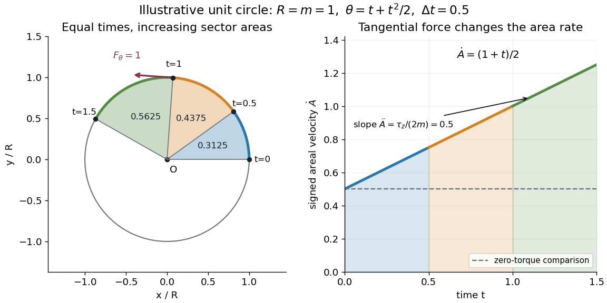

# Torque-driven circular swept area

↑ **Parent:** [Torque criterion for constant areal velocity](torque-criterion-for-constant-areal-velocity.md)

A path along a [circle](circle.md) can have variable [areal velocity](areal-velocity.md). As an illustrative controlled trajectory, keep a [point mass](point-mass.md) on a [circle](circle.md) of radius $R$ with [angle](angle.md)

$$
\theta(t)=\omega_0t+\frac12\alpha t^2.
$$

Its [acceleration in polar coordinates](acceleration-in-polar-coordinates.md) and the required net [force](force-split.md) are

$$
\mathbf a=-R(\omega_0+\alpha t)^2\mathbf e_r+R\alpha\mathbf e_\theta,
\qquad \mathbf F_{\mathrm{net}}=m\mathbf a,
$$

where $\mathbf e_r$ and $\mathbf e_\theta$ are the radial and transverse [unit vectors](unit-vector.md). A circular guide can supply the radial [force](force-split.md), while a tangential drive supplies $mR\alpha$. Hence

$$
\tau_n=mR^2\alpha,\qquad
\dot A=\frac{R^2}{2}(\omega_0+\alpha t),\qquad
\ddot A=\frac{R^2\alpha}{2}.
$$

For $R=m=\omega_0=\alpha=1$ in illustrative units, the three equal [time](time-in-physics.md) intervals $[0,0.5]$, $[0.5,1]$ and $[1,1.5]$ sweep [areas](surface-area.md) $0.3125$, $0.4375$ and $0.5625$. Their difference comes from the transverse [force](force-split.md)'s positive [torque](torque.md), even though the radius and path shape stay fixed. The [area](surface-area.md) under each [areal velocity](areal-velocity.md) graph segment equals the corresponding swept [area](surface-area.md).

**[Figure 8](#image-a-transverse-force-gives-increasing-areal-velocity-and-unequal-swept-areas-in-equal-times). A transverse force gives increasing areal velocity and unequal swept areas in equal times**.

## ↑ Ancestors (8)

1. [Torque criterion for constant areal velocity](torque-criterion-for-constant-areal-velocity.md)
2. [Areal velocity](areal-velocity.md)
3. [Angular momentum](angular-momentum.md)
4. [Momentum](momentum-split.md)
5. [Classical mechanics](classical-mechanics-split.md)
6. [Branches of physics](branches-of-physics.md)
7. [Physics](physics-split.md)
8. [Codex Wiki](split.md)
