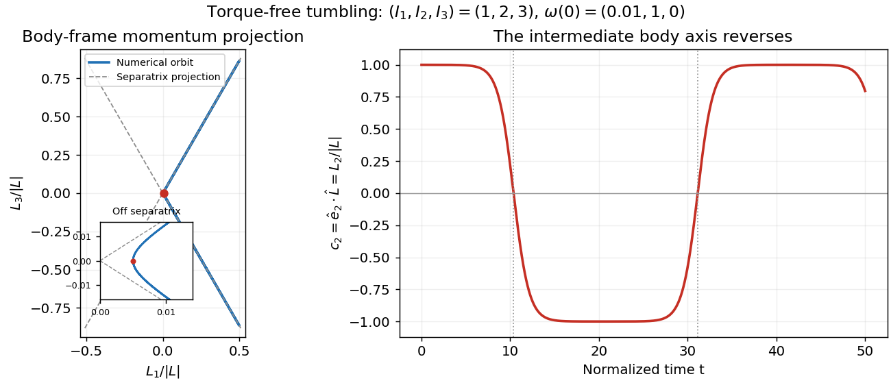

# Torque-free tumbling

↑ **Parent:** [Intermediate axis theorem](intermediate-axis-theorem.md)

A useful readout of a tumble is the alignment of the intermediate [principal axis](principal-axis.md) $\hat e_2$ with the conserved [angular momentum](angular-momentum.md) direction $\hat L$. In the [principal body frame](principal-body-frame.md), write $L_i=I_i\omega_i$ and $L=|\mathbf L|$. Then

$$
c_2(t)=\hat e_2(t)\cdot\hat L=\frac{L_2(t)}L.
$$

A change from $c_2\simeq+1$ to $c_2\simeq-1$ means that the directed body axis has turned nearly $180^\circ$ relative to $\mathbf L$. It does not mean that $\mathbf L$ reversed in the [fixed space frame](fixed-space-frame.md). The unsigned line through that [principal axis](principal-axis.md) hides this distinction, so a marked end matters in an actual demonstration.

For the [normalized intermediate-axis model](normalized-intermediate-axis-model.md) with $\boldsymbol\omega(0)=(0.01,1,0)$, the [rotational kinetic energy](rotational-kinetic-energy.md) and squared [angular momentum](angular-momentum.md) are $E=1.00005$ and $L^2=4.0001$. Hence $L^2-2EI_2=-0.0001$: this initial condition lies close to, but off, the [intermediate-axis separatrix](intermediate-axis-separatrix.md). An independent calculation evolves $\dot{\mathbf L}_{\mathrm{body}}=\mathbf L_{\mathrm{body}}\times I^{-1}\mathbf L_{\mathrm{body}}$ and a [rotation matrix](rotation-matrix.md) taking body components to space components. The intermediate [principal axis](principal-axis.md) crosses $c_2=0$ at normalized [times](time-in-physics.md) approximately $10.3773$ and $31.1319$, alternating long nearly aligned intervals with quicker reversals.

**[Figure 2](#image-torque-free-reversals-of-a-nearly-aligned-body-axis). Torque-free reversals of a nearly aligned body axis**. Original independent [Runge-Kutta method](runge-kutta-method-split.md) calculation in [angular momentum](angular-momentum.md) and [rotation matrix](rotation-matrix.md) variables, starting with $(L_1,L_2,L_3)=(0.01,2,0)$ in the [normalized intermediate-axis model](normalized-intermediate-axis-model.md). Left: body-frame orbit projected onto $(L_1/L,L_3/L)$; dashed lines are the [intermediate-axis separatrix](intermediate-axis-separatrix.md) projections $L_3=\pm\sqrt3L_1$. The red point is the initial condition; the inset resolves its separation from those lines. Right: $c_2=L_2/L$, with dotted lines at the first two zero crossings. The full [angular momentum](angular-momentum.md) vector remains fixed in space.

Both calculations use step size $0.005$ without rescaling either invariant. Over $0\le t\le50$, the tumbling calculation changes [rotational kinetic energy](rotational-kinetic-energy.md) and squared [angular momentum](angular-momentum.md) by less than $4\times10^{-13}$ relative to their initial values. Reconstructing $\mathbf L$ in the [fixed space frame](fixed-space-frame.md) gives relative error below $3\times10^{-12}$. Halving the step changes the body components and [rotation matrix](rotation-matrix.md) entries by less than $3\times10^{-10}$. These checks distinguish physical tumbling from numerical drift. On the exact [intermediate-axis separatrix](intermediate-axis-separatrix.md), approach to an intermediate-axis rotation takes infinite [time](time-in-physics.md); the recurrent off-separatrix example here is different.

## ↑ Ancestors (8)

1. [Intermediate axis theorem](intermediate-axis-theorem.md)
2. [Euler equations for a torque-free rigid body](euler-equations-for-a-torque-free-rigid-body.md)
3. [Euler's equations (rigid body dynamics)](euler-s-equations-rigid-body-dynamics.md)
4. [Rigid body dynamics](rigid-body-dynamics-split.md)
5. [Classical mechanics](classical-mechanics-split.md)
6. [Branches of physics](branches-of-physics.md)
7. [Physics](physics-split.md)
8. [Codex Wiki](split.md)
