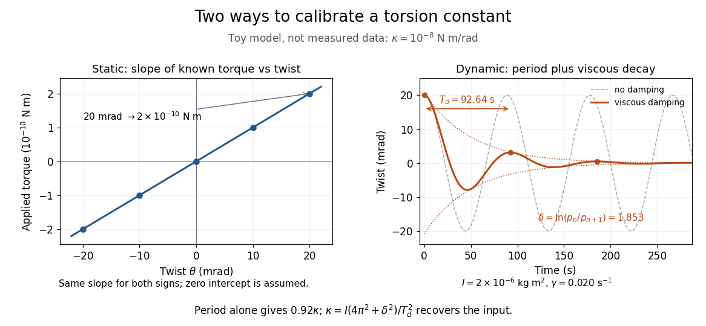

# Torsion constant

↑ **Parent:** [Torsion balance](torsion-balance.md)

The [torsion constant](torsion-constant.md), or [torsional spring constant](torsion-constant.md), is the positive restoring [torque](torque.md) per unit twist [angle](angle.md) of a complete suspension in its [linear elasticity](linear-elasticity.md) range:

$$
\tau_{\mathrm{fiber}}=-\kappa\theta,\qquad \kappa=-\frac{d\tau_{\mathrm{fiber}}}{d\theta}>0.
$$

Its [SI](international-system-of-units.md) unit is $\mathrm{N\,m/rad}$. The minus sign describes restoration toward the untwisted orientation. The derivative specifies a local stiffness if the response is not globally linear; using one constant over a finite range additionally requires a straight calibration curve. Return to the same zero after unloading tests recoverable [elastic deformation](elastic-deformation.md); repeat loading in both directions to check whether the response depends on its previous loading. Staying below permanent deformation is necessary, but does not alone prove proportionality between [torque](torque.md) and twist.

For an ideal uniform circular wire of [length](length.md) $\ell$, radius $r$, and [shear modulus](shear-modulus.md) $G_s$, the [filament torsional stiffness](filament-torsional-stiffness.md) is $C=G_sJ_p$, with polar [second moment of area](second-moment-of-area.md) $J_p=\pi r^4/2$. Uniform twist gives $\theta/\ell$ as the twist per unit [length](length.md), so

$$
\kappa=\frac C\ell=\frac{\pi G_s r^4}{2\ell},\qquad U=\frac12\kappa\theta^2.
$$

Here $U$ is stored [elastic energy](elastic-energy.md). Doubling the wire's radius multiplies the ideal [torsion constant](torsion-constant.md) by $16$; doubling its [length](length.md) halves it. This explains why a long thin fiber is useful for weak [torque](torque.md) measurement. The formula assumes [linear elasticity](linear-elasticity.md) with uniform material and circular section; it does not calibrate arbitrary ribbons, clamps, or a compound suspension. Within this ideal model, the [equipartition theorem](equipartition-theorem.md) predicts an equilibrium thermal mean-square angular displacement $\langle\theta^2\rangle=k_B\mathcal T/\kappa$, where $k_B$ is the [Boltzmann constant](boltzmann-constant.md) and $\mathcal T$ the uniform absolute [temperature](temperature.md). A softer suspension magnifies both the signal and its [thermal fluctuations](thermal-fluctuation.md).

Static calibration supplies known [torques](torque.md) without assuming the unknown interaction being measured. Apply a known perpendicular [force](force.md) $F$ at [lever arm](lever-arm.md) $a$, record the change from the unloaded twist, and use

$$
\tau_{\mathrm{cal}}=aF,\qquad \kappa=\frac{\tau_{\mathrm{cal}}}{\Delta\theta}.
$$

Several positive and negative settings test proportionality; fit the slope of applied [torque](torque.md) against twist and retain a possible intercept. A nonzero intercept must not be silently absorbed into the slope. Convert degrees to [radians](radian.md) before reporting $\mathrm{N\,m/rad}$. PASCO's procedure turns the Coulomb balance on its side and adds small known [masses](mass.md) to generate a [gravitational weight](weight-physics.md) at the sphere's [lever arm](lever-arm.md), returning the rod to its index mark by turning the dial. Its tabulated coefficient is [force](force.md) per degree: multiply by the [lever arm](lever-arm.md) and $180/\pi$ to obtain our [torsion constant](torsion-constant.md). [Bruce Lee, PASCO ES-9070 manual, pp. 9–10: mass calibration and force-per-degree convention](https://cdn.pasco.com/product_document/Coulombs-Law-Apparatus-Manual-ES-9070.pdf)

**[Figure 15](#image-toy-torsion-calibrations-static-slope-and-a-period-corrected-for-viscous-damping). Toy torsion calibrations: static slope and a period corrected for viscous damping**.

The figure's ideal static calibration uses $\kappa=1.0\times10^{-8}\,\mathrm{N\,m/rad}$: an applied [torque](torque.md) of $2.0\times10^{-10}\,\mathrm{N\,m}$ gives $0.020\,\mathrm{rad}$. Both signs lie on the same straight line. The plotted points are calculated examples, not experimental observations; they cannot demonstrate a real fiber's linearity.

Dynamic calibration instead measures the [oscillation period](period-of-an-oscillation.md) $T_0$ with known total suspended [moment of inertia](moment-of-inertia.md) $I$. For negligible [damping](damping.md), small free [oscillations](oscillation.md) about a fixed reference obey [simple harmonic motion](simple-harmonic-motion.md):

$$
I\ddot\theta+\kappa\theta=0,\qquad T_0=2\pi\sqrt{\frac I\kappa},\qquad \kappa=\frac{4\pi^2I}{T_0^2}.
$$

Include the rod, mirrors, and any attachments in $I$ unless their contributions are demonstrably negligible. Keep the applied [torque](torque.md) absent or independent of [angle](angle.md). If an external [torque](torque.md) has derivative $g_\tau=d\tau_{\mathrm{ext}}/d\theta$ at [equilibrium](equilibrium-point-of-a-dynamical-system.md), linearization gives effective stiffness $\kappa-g_\tau$: timing alone then measures that combination, and stability requires $\kappa-g_\tau>0$. A constant applied [torque](torque.md) merely shifts [equilibrium](equilibrium-point-of-a-dynamical-system.md). Non-negligible [damping](damping.md) changes the measured period; [damped torsional oscillation](damped-torsional-oscillation.md) gives a correction under a specified damping model. Agreement between static and dynamic calibrations is a useful check on the assumed [moment of inertia](moment-of-inertia.md), reference stability, and restoring law, rather than a reason to ignore their assumptions.

**Table of contents**

- [Damped torsional oscillation](damped-torsional-oscillation.md)

## ↑ Ancestors (5)

1. [Torsion balance](torsion-balance.md)
2. [Classical mechanics](classical-mechanics-split.md)
3. [Branches of physics](branches-of-physics.md)
4. [Physics](physics-split.md)
5. [Codex Wiki](split.md)

## ← Incoming links (7)

- [Cavendish experiment](cavendish-experiment.md)
- [Cavendish torsion balance](cavendish-torsion-balance.md)
- [Damped torsional oscillation](damped-torsional-oscillation.md)
- [Spinning-wheel precession experiment](spinning-wheel-precession-experiment.md)
- [Torsion balance](torsion-balance.md)
- [Torsion balance zero drift](torsion-balance-zero-drift.md)
- [Torsion constant](torsion-constant.md)
