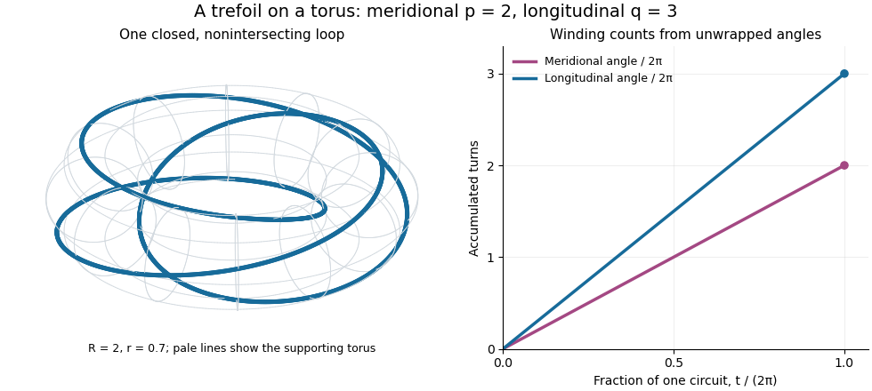

# Torus knot

↑ **Parent:** [Knot](knot.md)  
ⓦ [Wiki](https://en.wikipedia.org/wiki/Torus_knot)

For nonzero [coprime integers](coprime-integers.md) $p,q$, the torus knot $T_{p,q}$ lies on a standard unknotted [torus](torus.md) in the [three-sphere](three-sphere.md) and winds $p$ times meridionally and $q$ times longitudinally. Here a [meridian of a solid torus](meridian-of-a-solid-torus.md) goes around the small cross-section of the doughnut, while the longitudinal direction goes around its central hole. The integers count signed turns, so changing one sign gives the [mirror of a link](mirror-of-a-link.md) of the [torus knot](torus-knot.md). In this article $p$ is always the meridional count and $q$ the longitudinal count.

An explicit [parametric curve](parametric-curve.md) in three-dimensional [Euclidean space](euclidean-norm.md) is

$$
\gamma_{p,q}(t)=\bigl((R+r\cos(pt))\cos(qt),\ (R+r\cos(pt))\sin(qt),\ r\sin(pt)\bigr),\qquad 0\leq t<2\pi,
$$

where $R>r>0$. Its cylindrical radius $\rho=\sqrt{x^2+y^2}$ satisfies $(\rho-R)^2+z^2=r^2$, the equation of the supporting [torus](torus.md). Its meridional angle is $pt$ and its longitudinal angle is $qt$: this checks the convention directly rather than relying on the picture. Its squared [speed](speed.md) is

$$
\lVert\gamma'_{p,q}(t)\rVert^2=r^2p^2+q^2(R+r\cos(pt))^2>0.
$$

If two parameter values give the same point, their difference $\delta$ satisfies $p\delta,q\delta\in2\pi\mathbb Z$. [Bézout's identity](bezout-s-identity.md) for the [coprime integers](coprime-integers.md) $p,q$ then gives $\delta\in2\pi\mathbb Z$. Thus the loop closes and is an [injective function](injective-function.md) on the parameter [circle](circle.md), with nonzero [derivative](derivative.md); it is a [smooth embedding](smooth-embedding.md).

For example, $R=2$, $r=0.7$, $p=2$, $q=3$ produces a [trefoil knot](trefoil-knot.md). During one circuit the meridional angle changes by $4\pi$ and the longitudinal angle by $6\pi$. The supporting [torus](torus.md) is a guide for construction, not a constraint on later [ambient isotopies](ambient-isotopy.md): the [knot](knot.md) may move off it. This family makes arithmetic visible as geometry: the [coprime integers](coprime-integers.md) determine whether a single traversal visits the whole loop without repetition.

**[Figure 1](#image-the-trefoil-t-2-3-two-meridional-turns-and-three-longitudinal-turns). The trefoil T(2,3): two meridional turns and three longitudinal turns**.

The [coprime integers](coprime-integers.md) hypothesis matters. If the [greatest common divisor](greatest-common-divisor.md) is $d=\gcd(|p|,|q|)>1$, the same [parametric curve](parametric-curve.md) retraces a single component $d$ times; it does not automatically draw $d$ different components. The corresponding [torus link](torus-link.md) is instead the full set of points on the [torus](torus.md) whose angles satisfy $q\phi-p\theta\in2\pi\mathbb Z$, with meridional angle $\phi$ and longitudinal angle $\theta$. It has $d$ disjoint components, each with winding counts $(p/d,q/d)$. For instance, the [torus link](torus-link.md) $T_{2,2}$ consists of two parallel $(1,1)$ loops and is a [Hopf link](hopf-link.md), whereas substituting $(2,2)$ into $\gamma_{p,q}$ simply traces one of those loops twice.

**Table of contents**

- [Torus knots are prime](torus-knots-are-prime.md)
- [Trefoil knot](trefoil-knot.md)

## ↑ Ancestors (6)

1. [Knot](knot.md)
2. [Knot theory](knot-theory-split.md)
3. [Geometry and topology](geometry-and-topology-split.md)
4. [Area of mathematics](area-of-mathematics.md)
5. [Mathematics](mathematics-split.md)
6. [Codex Wiki](split.md)

## ← Incoming links (9)

- [Knot diagram](knot-diagram.md)
- [Solution](past-exam-of-the-mathematics-course-of-the-university-of-cambridge/2004/iii/paper-17/2/solution.md)
- [Solution](past-exam-of-the-mathematics-course-of-the-university-of-cambridge/2018/iii/paper-141/4/a/solution.md)
- [Solution](past-exam-of-the-mathematics-course-of-the-university-of-cambridge/2018/iii/paper-141/4/c/solution.md)
- [Solution](past-exam-of-the-mathematics-course-of-the-university-of-cambridge/2019/ii/paper-2/21f/b/solution.md)
- [Solution](past-exam-of-the-mathematics-course-of-the-university-of-cambridge/2019/iii/paper-141/4/d/solution.md)
- [Solution](past-exam-of-the-mathematics-course-of-the-university-of-cambridge/2026/iii/paper-112/1/c/solution.md)
- [Torus knot](torus-knot.md)
- [Trefoil knot](trefoil-knot.md)
