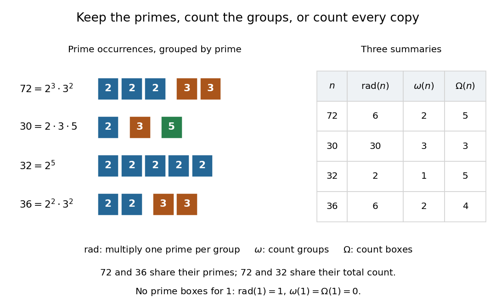

# Total number of prime factors

↑ **Parent:** [Arithmetic function](arithmetic-function.md)

The [total number of prime factors](total-number-of-prime-factors.md) $\Omega(n)$ counts every occurrence of a [prime factor](prime-factor.md) in the [prime factorization](fundamental-theorem-of-arithmetic.md) of a [positive integer](positive-integer.md) $n$. Equivalently, it adds the [prime valuations](prime-valuation.md):

$$
n=p_1^{a_1}\cdots p_r^{a_r}
\quad\Longrightarrow\quad
\Omega(n)=a_1+\cdots+a_r=\sum_{p\mid n}v_p(n).
$$

One may also write $\Omega(n)=\sum_p v_p(n)$ over all [prime numbers](prime-number.md), since only finitely many [prime valuations](prime-valuation.md) are nonzero. The [empty sum](empty-sum.md) gives $\Omega(1)=0$. By contrast, the [prime omega function](prime-omega-function.md) has $\omega(n)=r$ and counts distinct [prime factors](prime-factor.md). [Darij Grinberg, MIT 18.781, Floor and arithmetic functions, Definition 2.1.2: the two prime-factor counts](https://darijgrinberg.gitlab.io/floor.pdf)

Expanding $72=2^3\cdot3^2$ into $2\cdot2\cdot2\cdot3\cdot3$ shows $\Omega(72)=3+2=5$, whereas $\omega(72)=2$ and $\operatorname{rad}(72)=6$. The same calculation for the comparison examples gives

$$
\begin{array}{c|c|c|c|c}
n&\text{prime factorization}&\operatorname{rad}(n)&\omega(n)&\Omega(n)\\\hline
1&\text{empty product}&1&0&0\\
72&2^3\cdot3^2&6&2&5\\
30&2\cdot3\cdot5&30&3&3\\
32&2^5&2&1&5\\
36&2^2\cdot3^2&6&2&4
\end{array}
$$

The [total number of prime factors](total-number-of-prime-factors.md) agrees for $72$ and $32$, although their [prime supports of an integer](prime-support-of-an-integer.md) differ. Meanwhile $72$ and $36$ have the same [radical of an integer](radical-of-an-integer.md) and [prime omega function](prime-omega-function.md), but different values of the [total number of prime factors](total-number-of-prime-factors.md). These examples show exactly which information each [arithmetic function](arithmetic-function.md) forgets.

**[Figure 12](#image-one-box-per-prime-factor-occurrence-the-total-number-of-prime-factors-counts-boxes-the-prime-omega-function-counts-groups-and-the-radical-of-an-integer-multiplies-one-prime-number-from-each-group). One box per prime factor occurrence: the total number of prime factors counts boxes, the prime omega function counts groups, and the radical of an integer multiplies one prime number from each group**.

The [total number of prime factors](total-number-of-prime-factors.md) is a [completely additive arithmetic function](completely-additive-arithmetic-function.md):

$$
\Omega(ab)=\Omega(a)+\Omega(b)\qquad(a,b\ge1).
$$

The proof is that [multiplication](multiplication.md) adds each [prime valuation](prime-valuation.md), $v_p(ab)=v_p(a)+v_p(b)$, and summing preserves that equality. No [coprimality](coprime-integers.md) condition is needed. For example, $12=2^2\cdot3$ and $18=2\cdot3^2$ both have [total number of prime factors](total-number-of-prime-factors.md) three; their [product](product-of-numbers.md) $216=2^3\cdot3^3$ has six. By comparison, the [prime omega function](prime-omega-function.md) is only an [additive arithmetic function](additive-function-number-theory.md): here $\omega(216)=2\ne4=\omega(12)+\omega(18)$.

There is a useful way to see the [total number of prime factors](total-number-of-prime-factors.md) as a count of elementary building blocks: any expression of $n$ as a [product](product-of-numbers.md) of [prime numbers](prime-number.md) has exactly $\Omega(n)$ factors, by the [fundamental theorem of arithmetic](fundamental-theorem-of-arithmetic.md). Equivalently, every [factorization tree](factorization-tree.md) for $n>1$ has $\Omega(n)$ leaves. Repeated [prime factors](prime-factor.md) increase this count without introducing new kinds of [prime number](prime-number.md). The difference is the existing [excess prime-factor multiplicity](excess-prime-factor-multiplicity.md):

$$
\Omega(n)-\omega(n)=\sum_{p\mid n}\bigl(v_p(n)-1\bigr)\ge0.
$$

Every summand is nonnegative, so $\Omega(n)=\omega(n)$ if and only if $n$ is a [squarefree integer](squarefree-integer.md), including $n=1$. In particular, a [prime power](prime-power.md) $p^k$ with $k\ge1$ has $\Omega(p^k)=k$, $\omega(p^k)=1$ and $\operatorname{rad}(p^k)=p$.

Historically, Hardy and Ramanujan's 1917 paper explicitly separated the [prime omega function](prime-omega-function.md) from the [total number of prime factors](total-number-of-prime-factors.md), writing them as $f(n)$ and $F(n)$, respectively. Their example $2^3\cdot3^2\cdot5$ has counts three and six. That distinction let them compare two measures of how an [integer](integer.md) is built from [prime factors](prime-factor.md). [G. H. Hardy and S. Ramanujan, The normal number of prime factors of a number n, Quarterly Journal of Mathematics 48 (1917), 76–92, Section 1.2, transcribed original text](https://ramanujan.sirinudi.org/Volumes/published/ram35.html)

**Table of contents**

- [Excess prime-factor multiplicity](excess-prime-factor-multiplicity.md)

## ↑ Ancestors (5)

1. [Arithmetic function](arithmetic-function.md)
2. [Number theory](number-theory-split.md)
3. [Area of mathematics](area-of-mathematics.md)
4. [Mathematics](mathematics-split.md)
5. [Codex Wiki](split.md)

## ← Incoming links (5)

- [Completely additive arithmetic function](completely-additive-arithmetic-function.md)
- [Solution](past-exam-of-the-mathematics-course-of-the-university-of-cambridge/2016/iii/paper-124/1/a/solution.md)
- [Prime omega function](prime-omega-function.md)
- [Radical of an integer](radical-of-an-integer.md)
- [Total number of prime factors](total-number-of-prime-factors.md)
