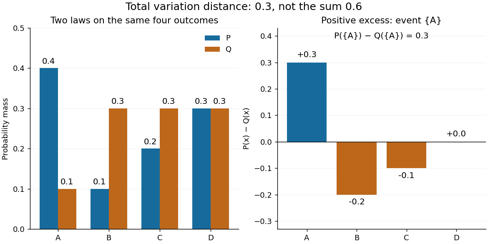

# Total variation distance on a finite set

↑ **Parent:** [Total variation distance](total-variation-distance.md)

Consider the [probability mass functions](probability-mass-function.md) $P=(0.4,0.1,0.2,0.3)$ and $Q=(0.1,0.3,0.3,0.3)$ on the [finite set](finite-set.md) $S=\{A,B,C,D\}$. Their difference is $(0.3,-0.2,-0.1,0)$. Thus

$$
\boxed{d_{\mathrm{TV}}(P,Q)=\frac12(0.3+0.2+0.1+0)=0.3.}
$$

The [event](event.md) $E=\{A\}$ attains this difference: $P(E)=0.4$ and $Q(E)=0.1$. Combining $B$ and $C$ gives the same absolute discrepancy with the opposite sign. Adding $D$ to either [event](event.md) changes nothing, because its [probability mass](probability-mass.md) agrees under both [probability distributions](probability-distribution.md).

**[Figure 9](#image-total-variation-probability-discrepancy). Total variation distance as the largest event discrepancy**. An illustrative four-outcome example. The positive and negative excesses each total $0.3$; summing both without the factor $1/2$ counts the same redistribution twice.

The factor $1/2$ is necessary because $\sum_x(P(x)-Q(x))=0$: every unit of excess [probability mass](probability-mass.md) must match a unit of deficit. For any [event](event.md), including a negative term cannot increase its signed discrepancy, while omitting a positive term cannot increase it either. Therefore $\{x:P(x)>Q(x)\}$ attains the positive maximum. This is a short way to compute an apparent optimization over $2^{|S|}$ [subsets](subset.md) using one pass through $S$.

For [probability density functions](probability-density-function.md) $p,q$ relative to the same [measure](measure.md) $\lambda$, the corresponding identity is $d_{\mathrm{TV}}(P,Q)=\tfrac12\int|p-q|\,d\lambda$. Such densities can always be taken as [Radon-Nikodym derivatives](radon-nikodym-derivative.md) relative to $\lambda=P+Q$. Beware the notation: the [total variation norm of a measure](total-variation-norm-of-a-measure.md) applied to the [signed measure](signed-measure.md) $P-Q$ equals $2d_{\mathrm{TV}}(P,Q)$. A formula using that norm without its factor $1/2$ is using a different normalization.

## ↑ Ancestors (5)

1. [Total variation distance](total-variation-distance.md)
2. [Probability and statistics](probability-and-statistics-split.md)
3. [Area of mathematics](area-of-mathematics.md)
4. [Mathematics](mathematics-split.md)
5. [Codex Wiki](split.md)
