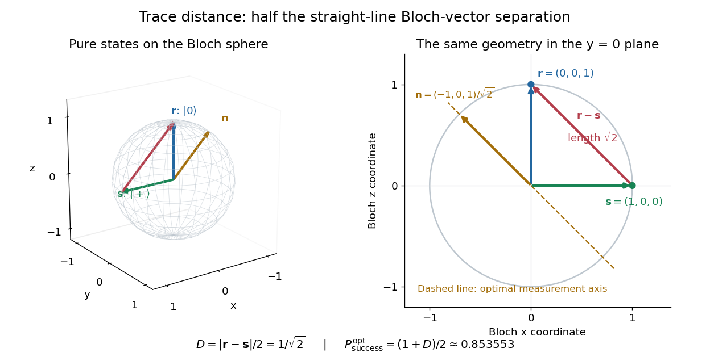

# Trace distance between qubit states

↑ **Parent:** [Trace distance](trace-distance.md)

For [qubit](qubit.md) [density operators](density-matrix.md), the [trace distance](trace-distance.md) has a particularly simple geometry. Write their [Bloch vectors](bloch-vector.md) as $\mathbf r,\mathbf s$ in the [Bloch ball](bloch-ball.md):

$$
\rho=\frac{I+\mathbf r\cdot\boldsymbol\sigma}{2},\qquad
\sigma=\frac{I+\mathbf s\cdot\boldsymbol\sigma}{2},\qquad
\Delta=\rho-\sigma=\frac{(\mathbf r-\mathbf s)\cdot\boldsymbol\sigma}{2},
$$

where $I$ is the [identity operator](identity-operator.md) and $\boldsymbol\sigma=(\sigma_x,\sigma_y,\sigma_z)$ denotes the [Pauli matrices](pauli-matrices.md). This [Bloch vector](bloch-vector.md) representation includes both [pure states](pure-state.md) on the [Bloch sphere](bloch-sphere.md) and [mixed states](mixed-state.md) in the interior of the [Bloch ball](bloch-ball.md). [Preskill, Physics 229 notes, §2.3.2, equations (2.62)–(2.69)](https://www.preskill.caltech.edu/ph229/notes/chap2.pdf)

The [Pauli matrix multiplication law](pauli-matrix-multiplication-law.md) gives $[(\mathbf r-\mathbf s)\cdot\boldsymbol\sigma]^2=|\mathbf r-\mathbf s|^2I$. Hence the two [eigenvalues](eigenvalue.md) of $\Delta$ are $\pm|\mathbf r-\mathbf s|/2$, and their absolute sum gives

$$
D(\rho,\sigma)=\frac{|\mathbf r-\mathbf s|}{2}.
$$

The [trace distance](trace-distance.md) is half the straight-line [Euclidean distance](euclidean-distance.md) between the [Bloch vectors](bloch-vector.md), not the angular or surface distance along the [Bloch sphere](bloch-sphere.md). Opposite [Bloch vectors](bloch-vector.md) have [trace distance](trace-distance.md) one; the centre $I/2$ is at [trace distance](trace-distance.md) $1/2$ from every [pure state](pure-state.md).

For the [pure states](pure-state.md) $|0\rangle$ and $|+\rangle=(|0\rangle+|1\rangle)/\sqrt2$, the [Bloch vectors](bloch-vector.md) are $\mathbf r=(0,0,1)$ and $\mathbf s=(1,0,0)$. Their straight-line separation is $\sqrt2$, so

$$
D(|0\rangle\langle0|,|+\rangle\langle+|)=\frac1{\sqrt2}.
$$

These [Bloch vectors](bloch-vector.md) are perpendicular, but the [pure states](pure-state.md) are not orthogonal: $|\langle0|+\rangle|=1/\sqrt2$. The [Helstrom measurement for the zero and plus states](helstrom-measurement-for-the-zero-and-plus-states.md) measures along the difference direction $\mathbf n=(\mathbf r-\mathbf s)/\sqrt2=(-1,0,1)/\sqrt2$, rather than along either input [Bloch vector](bloch-vector.md).

**[Figure 4](#image-trace-distance-is-half-a-bloch-vector-chord-and-the-optimal-zero-versus-plus-measurement-follows-the-difference-direction). Trace distance is half a Bloch-vector chord, and the optimal zero-versus-plus measurement follows the difference direction**.

## ↑ Ancestors (6)

1. [Trace distance](trace-distance.md)
2. [Density matrix](density-matrix.md)
3. [Quantum theory](quantum-theory-split.md)
4. [Branches of physics](branches-of-physics.md)
5. [Physics](physics-split.md)
6. [Codex Wiki](split.md)

## ← Incoming links (1)

- [Helstrom measurement for the zero and plus states](helstrom-measurement-for-the-zero-and-plus-states.md)
