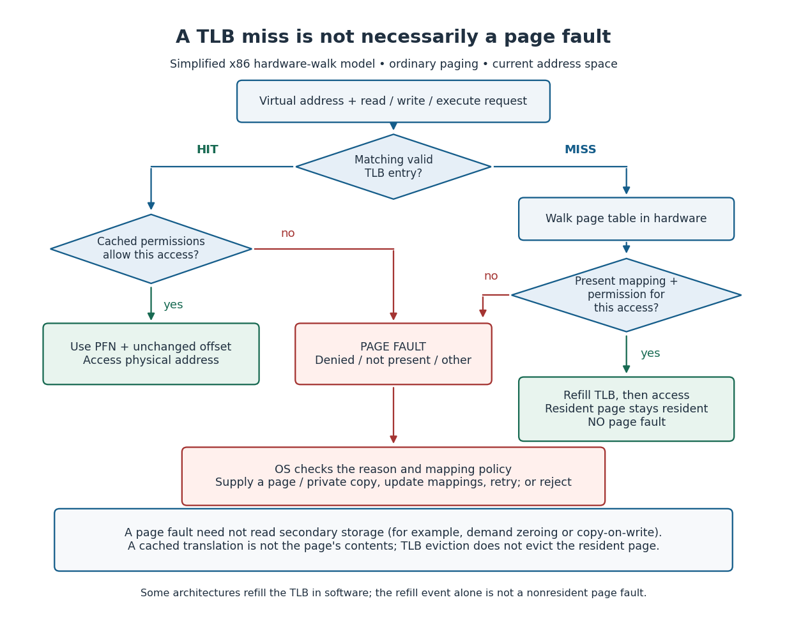

# Translation lookaside buffer

↑ **Parent:** [Paging](paging.md)  
ⓦ [Wiki](https://en.wikipedia.org/wiki/Translation_lookaside_buffer)

A [translation lookaside buffer](translation-lookaside-buffer.md) is a small hardware [memory cache](cache-computing.md) of [virtual address](virtual-address.md) to [physical address](physical-address.md) mappings and their access attributes. A [TLB hit](tlb-hit.md) finds a usable cached mapping for the current [address space](address-space.md); access permissions still apply. A [TLB miss](tlb-miss.md) means that mapping is absent from the [translation lookaside buffer](translation-lookaside-buffer.md). It says nothing by itself about whether the [memory page](memory-page.md) is resident. Evicting a [translation lookaside buffer](translation-lookaside-buffer.md) entry removes a cached translation, not the [memory page](memory-page.md)'s contents. [AMD64 Architecture Programmer's Manual, volume 2, revision 3.44, section 5.5: Translation-Lookaside Buffer](https://docs.amd.com/api/khub/documents/sD1_QL~h4Afq2_tvzxqqSQ/content)

For the 256-[byte](byte.md) example, a cached virtual page `0x12` to physical frame `0x07` mapping covers every offset from `0x00` to `0xff`. Reads at [virtual addresses](virtual-address.md) `0x1234` and `0x1235` can reuse it to reach [physical addresses](physical-address.md) `0x0734` and `0x0735`. If the [translation lookaside buffer](translation-lookaside-buffer.md) is initially empty, the first read instead requires a [page table walk](page-table-walk.md); with a resident, readable mapping, it completes without a [page fault](page-fault.md). A write can fault even on a [TLB hit](tlb-hit.md) because cached permissions deny it.

**[Figure 40](#image-a-tlb-miss-can-refill-a-resident-translation-without-a-page-fault-permission-failures-can-fault-on-a-tlb-hit). A TLB miss can refill a resident translation without a page fault; permission failures can fault on a TLB hit**.

The diagrams show an ordinary [x86](x86.md) model with hardware [page table walks](page-table-walk.md). Some architectures use an [operating system](operating-system.md) handler to refill the [translation lookaside buffer](translation-lookaside-buffer.md) after a [TLB miss](tlb-miss.md); that refill event alone is not a nonresident [page fault](page-fault.md). [Temporal locality](temporal-locality.md) helps a small [translation lookaside buffer](translation-lookaside-buffer.md) serve repeated accesses, and one entry can cover many [bytes](byte.md). [Arpaci-Dusseau and Arpaci-Dusseau, OSTEP chapter 19: Paging, Faster Translations, sections 19.1 and 19.3](https://pages.cs.wisc.edu/~remzi/OSTEP/vm-tlbs.pdf)

A [context switch](context-switch.md) does not universally flush the whole [translation lookaside buffer](translation-lookaside-buffer.md). An [address space identifier](address-space-identifier.md) can distinguish translations with the same virtual page number in different [address spaces](address-space.md); Intel's PCIDs support retaining translations across appropriate switches. The [operating system](operating-system.md) must still invalidate stale translations when mappings or permissions change, following the architecture's rules, including coordination with other processors that could use them. [Intel SDM, volume 3A, sections 4.10.1 and 4.10.4–4.10.5: PCIDs and translation invalidation](https://cdrdv2-public.intel.com/825743/325462-sdm-vol-1-2abcd-3abcd-4.pdf)

**Table of contents**

- [TLB hit](tlb-hit.md)
- [TLB miss](tlb-miss.md)
- [Address space identifier](address-space-identifier.md)

## ↑ Ancestors (5)

1. [Paging](paging.md)
2. [Virtual memory](virtual-memory.md)
3. [Operating system](operating-system.md)
4. [Computer science](computer-science-split.md)
5. [Codex Wiki](split.md)

## ← Incoming links (12)

- [Cache (computing)](cache-computing.md)
- [Context switch](context-switch.md)
- [Microkernel communication cost](microkernel-communication-cost.md)
- [Page fault](page-fault.md)
- [Page table](page-table.md)
- [Solution](past-exam-of-the-mathematics-course-of-the-university-of-cambridge/2006/ia/paper-5/7/a/ii/solution.md)
- [Solution](past-exam-of-the-mathematics-course-of-the-university-of-cambridge/2007/ia/paper-5/2/b/solution.md)
- [Solution](past-exam-of-the-mathematics-course-of-the-university-of-cambridge/2007/ia/paper-5/7/a/solution.md)
- [seL4 verification scope](sel4-verification-scope.md)
- [Sparse page table allocation](sparse-page-table-allocation.md)
- [Translation lookaside buffer](translation-lookaside-buffer.md)
- [Two-level address translation](two-level-address-translation.md)
