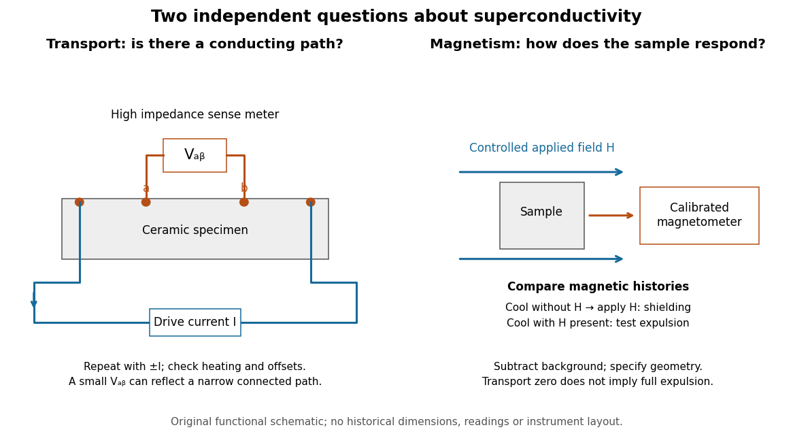

# Transport and magnetic tests of superconducting ceramics

↑ **Parent:** [High-temperature superconductivity](high-temperature-superconductivity.md)

[Four-terminal sensing](four-terminal-sensing.md) tests a conducting connection between the voltage contacts. A [magnetometer](magnetometer.md) instead tests the sample's magnetic response. These measurements provide complementary constraints: the first is sensitive to a continuous path, while the second also depends on screening geometry and preparation history.

**[Figure 10](#image-separate-transport-and-magnetic-questions-for-a-superconducting-ceramic). Separate transport and magnetic questions for a superconducting ceramic**. Original functional comparison, not a reconstruction of historical apparatus. Separate drive and sense contacts measure [electrical resistance](electrical-resistance.md); a calibrated magnetic readout tests [magnetization](magnetization.md). The two preparation histories distinguish shielding after applying a [magnetic field](magnetic-field-split.md) from expulsion during cooling in an existing [magnetic field](magnetic-field-split.md).

For transport, define $V_{ab}$ between the inner contacts and use the reversed-[electric current](electric-current.md) estimator from [four-terminal sensing](four-terminal-sensing.md). Contact separation excludes drive-contact drops, but does not eliminate a drifting [thermoelectric effect](thermoelectric-effect-split.md), [Joule heating](joule-heating.md) or an unrepresentative path through part of the specimen. Repeat at smaller [electric currents](electric-current.md) and compare results at the same sample [temperature](temperature-split.md). A finite-current result refers to that [electric current](electric-current.md) and its relation to the path's [superconducting critical current](superconducting-critical-current.md).

For [magnetism](magnetism.md), distinguish cooling in zero applied [magnetic field](magnetic-field-split.md) and then applying it from the [Field-cooled Meissner experiment](field-cooled-meissner-experiment.md). Record the applied [magnetic field](magnetic-field-split.md), background and sample geometry when interpreting [magnetization](magnetization.md) or [magnetic susceptibility](magnetic-susceptibility.md). A transport short does not establish full [Meissner effect](meissner-effect.md) screening throughout the specimen. Conversely, [flux pinning](flux-pinning.md) in a [type-II superconductor](type-ii-superconductor.md) can make the field-cooled magnetic response differ from ideal complete expulsion. Even a large shielding signal is not automatically a direct measure of the superconducting [phase fraction](phase-fraction.md): a connected outer screening region can surround nonsuperconducting material.

**Table of contents**

- [Parallel-path model of a superconducting ceramic](parallel-path-model-of-a-superconducting-ceramic.md)

## ↑ Ancestors (6)

1. [High-temperature superconductivity](high-temperature-superconductivity.md)
2. [Superconductivity](superconductivity-split.md)
3. [Statistical physics](statistical-physics-split.md)
4. [Branches of physics](branches-of-physics.md)
5. [Physics](physics-split.md)
6. [Codex Wiki](split.md)
