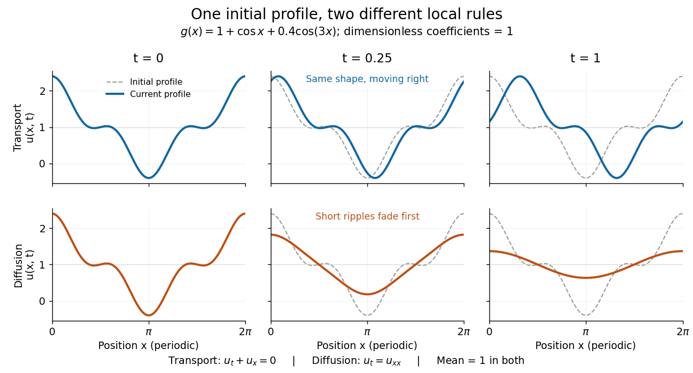
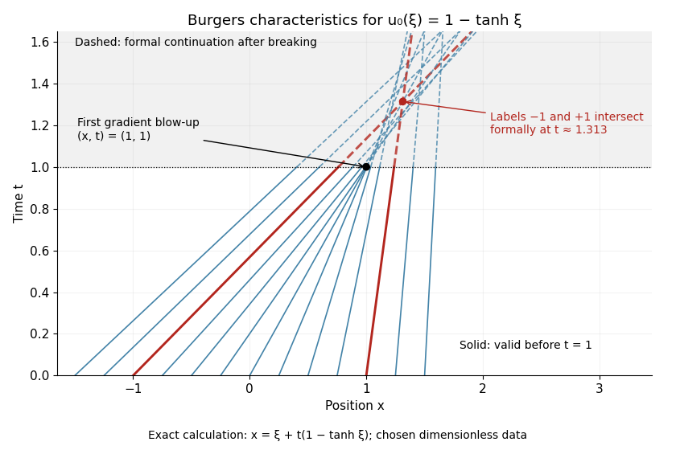

# Transport equation

↑ **Parent:** [Partial differential equation](partial-differential-equation.md)  
ⓦ [Wiki](https://en.wikipedia.org/wiki/Transport_equation)

A [transport equation](transport-equation.md) carries a quantity along the flow of a [velocity field](fluid-mechanics.md#velocity-field) $b$. For a smooth solution of $u_t+b\mathbin\cdot\nabla u=0$, the value of $u$ is constant along each [characteristic curve](#characteristic-curve). With constant speed $c$, the [chain rule](calculus.md#chain-rule) gives $\frac{d}{dt}u(x_0+ct,t)=u_t+c u_x=0$, hence $u(x,t)=g(x-ct)$. This is exact [translation](geometry-and-topology.md#translation-geometry): it preserves the shape rather than smoothing it, as the [periodic heat and transport comparison](#periodic-heat-and-transport-comparison) shows.

**Table of contents**

- [Periodic heat and transport comparison](#periodic-heat-and-transport-comparison)
- [Compact third-order advection stencil](#compact-third-order-advection-stencil)
- [Hamiltonian transport equation](#hamiltonian-transport-equation)
  - [Casimir invariant of a transport equation](#casimir-invariant-of-a-transport-equation)
- [Commuting velocity derivative for kinetic transport](#commuting-velocity-derivative-for-kinetic-transport)
- [Dispersion with a nonlinear velocity map](#dispersion-with-a-nonlinear-velocity-map)
- [Free transport equation](#free-transport-equation)
  - [Free transport dispersion](#free-transport-dispersion)
  - [Absolutely continuous representative along free characteristics](#absolutely-continuous-representative-along-free-characteristics)
  - [Free-transport semigroup](#free-transport-semigroup)
- [Characteristic curve](#characteristic-curve)
  - [Characteristic flow map](#characteristic-flow-map)
    - [Phase-space flow Jacobian](#phase-space-flow-jacobian)
    - [Global characteristic flow under linear growth](#global-characteristic-flow-under-linear-growth)
  - [Method of characteristics](#method-of-characteristics)
    - [Elliptic characteristics of a planar transport equation](#elliptic-characteristics-of-a-planar-transport-equation)
    - [Characteristic components of a hyperbolic first-order equation](#characteristic-components-of-a-hyperbolic-first-order-equation)
    - [Weighted Euler first-order equation](#weighted-euler-first-order-equation)
    - [Fold tangency obstruction for characteristic data](#fold-tangency-obstruction-for-characteristic-data)
    - [Characteristic equations for a transport equation](#characteristic-equations-for-a-transport-equation)
- [Linear transport equation](#linear-transport-equation)
  - [Transport of a Dirac point mass](#transport-of-a-dirac-point-mass)
  - [Coercive energy estimate for kinetic transport](#coercive-energy-estimate-for-kinetic-transport)
  - [Lp conservation for incompressible transport](#lp-conservation-for-incompressible-transport)
  - [Inflow transport boundary condition](#inflow-transport-boundary-condition)
    - [Corner compatibility for constant-speed transport](#corner-compatibility-for-constant-speed-transport)
  - [Weak transport solution under characteristic coordinates](#weak-transport-solution-under-characteristic-coordinates)
  - [Adjoint transport equation](#adjoint-transport-equation)
- [System of conservation laws](#system-of-conservation-laws)
  - [Riemann problem](#riemann-problem)
    - [Single-rarefaction matching conditions for an ideal-gas Riemann problem](#single-rarefaction-matching-conditions-for-an-ideal-gas-riemann-problem)
    - [Contact discontinuity](#contact-discontinuity)
  - [Conservation law flux](#conservation-law-flux)
  - [Quasilinear system](#quasilinear-system)
    - [Hyperbolic system](#hyperbolic-system)
  - [Flux Jacobian](#flux-jacobian)
    - [Characteristic speed](#characteristic-speed)
      - [Kinematic wave](#kinematic-wave)
- [Scalar conservation law](#scalar-conservation-law)
  - [Sonic point of a scalar flux](#sonic-point-of-a-scalar-flux)
  - [Uniformly convex scalar flux](#uniformly-convex-scalar-flux)
  - [Viscous scalar conservation law](#viscous-scalar-conservation-law)
    - [Vanishing viscosity approximation](#vanishing-viscosity-approximation)
  - [Maximum representation for a concave conservation law](#maximum-representation-for-a-concave-conservation-law)
    - [Square-root decay before characteristic crossing](#square-root-decay-before-characteristic-crossing)
  - [Characteristic solution of a scalar conservation law](#characteristic-solution-of-a-scalar-conservation-law)
  - [Concave-flux characteristic lifespan](#concave-flux-characteristic-lifespan)
  - [Bounded-derivative Burgers flux](#bounded-derivative-burgers-flux)
  - [Shock wave](#shock-wave)
    - [Shock speed in a symmetric cloud collision](#shock-speed-in-a-symmetric-cloud-collision)
    - [Radiative shock](#radiative-shock)
      - [Shock cooling length](#shock-cooling-length)
    - [Blast wave](#blast-wave)
      - [Atmospheric blast-wave range](#atmospheric-blast-wave-range)
    - [Rankine-Hugoniot conditions](#rankine-hugoniot-conditions)
    - [Entropy shock](#entropy-shock)
  - [Rarefaction wave](#rarefaction-wave)
    - [Self-similar ideal-gas rarefaction](#self-similar-ideal-gas-rarefaction)
  - [Inviscid Burgers equation](#inviscid-burgers-equation)
    - [Burgers characteristic breaking](#burgers-characteristic-breaking)
    - [Burgers Riemann problem with positive flux](#burgers-riemann-problem-with-positive-flux)
    - [Periodic backward-sawtooth Burgers solution](#periodic-backward-sawtooth-burgers-solution)
    - [Burgers Riemann problem with negative flux](#burgers-riemann-problem-with-negative-flux)
    - [Entropy solution](#entropy-solution)
      - [Kruzhkov entropy inequality](#kruzhkov-entropy-inequality)
      - [Discrete entropy inequality](#discrete-entropy-inequality)
      - [Averaged initial trace of an entropy solution](#averaged-initial-trace-of-an-entropy-solution)
      - [Entropy flux for a scalar conservation law](#entropy-flux-for-a-scalar-conservation-law)
        - [Kruzhkov entropy flux](#kruzhkov-entropy-flux)
          - [Doubling of variables for scalar conservation laws](#doubling-of-variables-for-scalar-conservation-laws)
            - [Kato inequality for scalar conservation laws](#kato-inequality-for-scalar-conservation-laws)
              - [Local L1 contraction for scalar conservation laws](#local-l1-contraction-for-scalar-conservation-laws)
                - [Order preservation for scalar entropy solutions](#order-preservation-for-scalar-entropy-solutions)
  - [Characteristic crossing](#characteristic-crossing)
    - [Gradient blow-up](#gradient-blow-up)

## Periodic heat and transport comparison

↑ **Parent:** [Transport equation](transport-equation.md)

Use dimensionless $x$ and $t$, the [periodic domain](partial-differential-equation.md#periodic-domain) $[0,2\pi]$, and the same [initial condition](differential-equation.md#initial-condition)

$$
g(x)=1+\cos x+0.4\cos(3x).
$$

With zero [PDE source term](partial-differential-equation.md#source-term-in-a-partial-differential-equation), compare the [heat equation](diffusion-equation.md#heat-equation) $u_t=u_{xx}$ and the [transport equation](transport-equation.md) $u_t+u_x=0$. Their exact solutions are

$$
u_H(x,t)=1+e^{-t}\cos x+0.4e^{-9t}\cos(3x),\qquad u_T(x,t)=1+\cos(x-t)+0.4\cos(3(x-t)).
$$

Each [cosine](geometry-and-topology.md#cosine) satisfies $\partial_x^2\cos(nx)=-n^2\cos(nx)$, so the [heat equation](diffusion-equation.md#heat-equation) reduces its amplitude according to $A_n'=-n^2A_n$. The [superposition principle](vector-space.md#superposition-principle) combines the constant and two [Fourier modes](fourier-analysis.md#fourier-mode). The [transport equation](transport-equation.md) shifts the argument of the entire profile. Both formulas meet the [initial condition](differential-equation.md#initial-condition) and matching [periodic boundary conditions](differential-equation.md#periodic-boundary-conditions) exactly.[Stanford Math 220B heat-equation notes, periodic boundary conditions](https://web.stanford.edu/class/math220b/handouts/heateqn.pdf)

At $t=1$, the heat amplitudes are approximately $0.368$ and $0.0000494$: the small ripples disappear much sooner than the broad variation. The [transport equation](transport-equation.md) retains amplitudes $1$ and $0.4$, shifting the profile right by one unit with wraparound. Both preserve spatial average $1$, but only the [heat equation](diffusion-equation.md#heat-equation) approaches the uniform profile. This gives [diffusion](thermodynamics.md#diffusion) its usefulness for smoothing uneven [temperatures](temperature.md), while the [transport equation](transport-equation.md) models a profile carried by a flow. The signed profile can represent a scaled [temperature](temperature.md) deviation.

**[Figure 1](#image-exact-evolution-of-one-periodic-profile-transport-translates-while-diffusion-preferentially-removes-short-wavelengths). Exact evolution of one periodic profile: transport translates while diffusion preferentially removes short wavelengths**.

To restore units, let physical position be $X=\ell x$ and time be $T=\tau t$. For $U_T=D U_{XX}$, the dimensionless coefficient is $D\tau/\ell^2$, with $D$ measured in length squared per time. For $U_T+cU_X=0$, it is $c\tau/\ell$, with $c$ measured in length per time. Both plotted coefficients equal one when $D=\ell^2/\tau$ and $c=\ell/\tau$. Thus the example compares specified models on the same scales, rather than identifying [diffusivity](brownian-motion.md#diffusion-coefficient) with [velocity](classical-mechanics.md#velocity).

## Compact third-order advection stencil

↑ **Parent:** [Transport equation](transport-equation.md)

Let $a=\mu(1+\mu)/2$, $b=(1+\mu)(2-\mu)$, $c=(1-\mu)(2-\mu)/2$, $d=2-\mu$, and $e=1+\mu$. The implicit stencil $aU_{j-1}^{n+1}+bU_j^{n+1}+cU_{j+1}^{n+1}=dU_j^n+eU_{j+1}^n$ for $u_t=u_x$ has centered characteristic moments zero through degree three and fourth moment $K(\mu)$. Its Fourier numerator and denominator satisfy $|L(\theta)|^2-|N(\theta)|^2=K(\mu)(1-\cos\theta)^2$. The marching operator is a contraction exactly for nonnegative [Courant numbers](finite-difference.md#courant-number) in $[0,1]\cup[2,\infty)$; with signed Courant numbers, also include $(-\infty,-1]$. At the four roots of $K$ the method becomes an exact integer grid translation rather than merely third order.

## Hamiltonian transport equation

↑ **Parent:** [Transport equation](transport-equation.md)

Transport along a [Hamiltonian flow](hamiltonian-mechanics.md#hamiltonian-flow). The solution is $f(\cdot,t)=f_I\circ\Phi_{-t}$ wherever the inverse characteristic exists. Equality of mixed derivatives makes the transport vector field divergence-free, so its flow preserves phase-space volume. Smoothness of the Hamiltonian alone gives local characteristics, not a complete flow on all of phase space.

### Casimir invariant of a transport equation

↑ **Parent:** [Hamiltonian transport equation](#hamiltonian-transport-equation)

For an incompressible transport flow, every integrable function of the transported scalar has constant integral: the scalar is unchanged along characteristics and the flow's Jacobian determinant equals one. For a finite integral on infinite phase space, require integrability; $F(0)=0$ and compactly supported data are one common choice. For a whole-space conservation statement also require no escape or boundary flux at infinity.

## Commuting velocity derivative for kinetic transport

↑ **Parent:** [Transport equation](transport-equation.md)

The differential operators $Z_j$ commute with $D=\partial_t+a(v)\cdot\nabla_x$. Indeed $[D,\partial_{v_j}]=-\sum_i(\partial_{v_j}a_i)\partial_{x_i}$, canceled by differentiating the explicit time factor in $Z_j$. Hence $Z_jf$ satisfies the same [transport equation](transport-equation.md) as $f$, and obeys the same [L2 norm](real-analysis.md#l2-norm) conservation when boundary fluxes vanish. For the standard [Jacobian matrix](multivariable-calculus.md#jacobian-matrix) $(Da)_{ij}=\partial_{v_j}a_i$, the vector of these derivatives is $\nabla_vf+t(Da)^T\nabla_xf$.

## Dispersion with a nonlinear velocity map

↑ **Parent:** [Transport equation](transport-equation.md)

For $f(t,x,v)=f_0(x-ta(v),v)$, apply the [area formula](multivariable-calculus.md#area-formula-geometric-measure-theory) to the velocity map and bound the initial data by their velocity [essential supremum](measure-theory.md#essential-supremum). This gives the displayed [mixed Lebesgue norm](measure-theory.md#mixed-lebesgue-norm) estimate whenever the [weighted inverse multiplicity](multivariable-calculus.md#weighted-inverse-multiplicity) is essentially bounded. If $a$ is injective and $|\det Da|\geq\alpha>0$, the constant is at most $1/\alpha$. In dimension one a derivative bounded away from zero gives a global [diffeomorphism](geometry-and-topology.md#diffeomorphism); in higher dimensions determinant bounds alone do not.

## Free transport equation

↑ **Parent:** [Transport equation](transport-equation.md)

Particles keep their velocity and move along straight trajectories. The [method of characteristics](#method-of-characteristics) gives $f(t,x,v)=f_0(x-tv,v)$. The shear preserves [Lebesgue measure](measure-theory.md#lebesgue-measure) and every [Lp norm](real-analysis.md#lp-norm). Compact initial [support](function.md#support) remains compact at each finite time, but need not remain in one compact set for all times.

### Free transport dispersion

↑ **Parent:** [Free transport equation](#free-transport-equation)

For the [free transport equation](#free-transport-equation), substitute $y=x-tv$ into $\int|f_0(x-tv,v)|\,dv$. The resulting factor $|t|^{-d}$ and the bound by $\sup_v|f_0(y,v)|$ prove this [mixed Lebesgue norm](measure-theory.md#mixed-lebesgue-norm) estimate. The right side contains initial data. The same-time mixed norm is not a conserved replacement: prescribing a product $\psi(x)\chi(v)$ at a later time and dilating $\chi$ disproves such a claim.

### Absolutely continuous representative along free characteristics

↑ **Parent:** [Free transport equation](#free-transport-equation)

A [distributional weak solution](partial-differential-equation.md#weak-solution) of $\partial_tf+v\cdot\nabla_xf=g$, with locally integrable $f,g$, becomes $\partial_tF=G$ after the shear $F(t,x,v)=f(t,x+tv,v)$. For almost every characteristic label, there is an [absolutely continuous function](sobolev-space.md#absolutely-continuous-function) representing $F$, and its increments are the [integrals](integral.md) of $G$ for every pair of times. Arbitrary modifications on time slices can destroy this every-time identity without changing the distributional solution.

### Free-transport semigroup

↑ **Parent:** [Free transport equation](#free-transport-equation)

For $1\leq p<\infty$, these operators are isometries on the phase-space [Lp space](measure-theory.md#lp-space), with $U_tU_s=U_{t+s}$. They form a [strongly continuous semigroup](functional-analysis.md#c0-semigroup) for $t\geq0$ and extend to a group for all real times. Strong continuity follows by smooth compactly supported approximation and measure preservation. They preserve the [essential supremum](measure-theory.md#essential-supremum) as well, but strong continuity is not claimed on the whole $L^\infty$ space.

## Characteristic curve

↑ **Parent:** [Transport equation](transport-equation.md)

For the transport field $b(t,x)$, a characteristic curve solves

$$
\dot X(t)=b(t,X(t)).
$$

The chain rule converts differentiation of $u(t,X(t))$ into the transport operator applied to $u$.

### Characteristic flow map

↑ **Parent:** [Characteristic curve](#characteristic-curve)

The characteristic flow map $Z_{s,t}(x)$ is the point reached at time $t$ by the [characteristic curve](#characteristic-curve) that passes through $x$ at time $s$. Whenever the flow is invertible, transport solutions pull their initial data back by $Z_{0,t}^{-1}$.

#### Phase-space flow Jacobian

↑ **Parent:** [Characteristic flow map](#characteristic-flow-map)

The [Jacobian determinant](multivariable-calculus.md#jacobian-determinant) of a differentiable [characteristic flow map](#characteristic-flow-map) measures its change of volume. The variational equation and the [Liouville formula for a fundamental matrix](differential-equation.md#liouville-formula-for-a-fundamental-matrix) give the displayed formula for a complete smooth field $b$. For kinetic advection with $b=(v,F)$, its [divergence](multivariable-calculus.md#divergence) is $\nabla_v\cdot F$. A zero [divergence](multivariable-calculus.md#divergence) preserves phase-space [Lebesgue measure](measure-theory.md#lebesgue-measure).

#### Global characteristic flow under linear growth

↑ **Parent:** [Characteristic flow map](#characteristic-flow-map)

If $F\in C^1(\mathbb R\times\mathbb R^d)$ and $|F(t,x)|\le K(1+|x|)$, every [characteristic curve](#characteristic-curve) is defined for all real time. The [Gronwall inequality](probability-and-statistics.md#gronwall-inequality) bounds $1+|X(t)|$ on each bounded time interval, so local [ordinary differential equation](differential-equation.md#ordinary-differential-equation) existence cannot terminate through escape to infinity. Uniqueness and the variational equation give a global $C^1$ spatial flow diffeomorphism, with Jacobian $J>0$ satisfying $J_t=(\operatorname{div}F)(t,X)J$.

### Method of characteristics

↑ **Parent:** [Characteristic curve](#characteristic-curve)  
ⓦ [Wiki](https://en.wikipedia.org/wiki/Method_of_characteristics)

The method of characteristics solves a first-order partial differential equation by reducing it to ordinary differential equations along [characteristic curves](#characteristic-curve).

#### Elliptic characteristics of a planar transport equation

↑ **Parent:** [Method of characteristics](#method-of-characteristics)

For the [linear partial differential equation](partial-differential-equation.md#linear-partial-differential-equation) $2y u_x-xu_y=0$, the [method of characteristics](#method-of-characteristics) gives $\dot x=2y$, $\dot y=-x$, $\dot u=0$. Thus $\phi=x^2+2y^2$ is constant on each [characteristic curve](#characteristic-curve), whose nonzero level sets are [ellipses](euclidean-geometry.md#ellipse). On a domain containing entire such [ellipses](euclidean-geometry.md#ellipse), the solutions have the form $u=F(\phi)$, subject to the desired regularity at the origin.

For the inhomogeneous equation $2yu_x-xu_y=xy(2y^2-x^2)$, a [particular solution](linear-ordinary-differential-equation.md#particular-solution) is $u_p=x^2y^2/2$, so the [general solution](linear-ordinary-differential-equation.md#general-solution) is $u=x^2y^2/2+F(x^2+2y^2)$. Prescribing $u(x,1)=x^2$ fixes $F(s)=(s-2)/2$ only for $s\geq2$. The inner [ellipses](euclidean-geometry.md#ellipse) $s<2$ never intersect that data line, so the boundary values leave their solution values undetermined. Smooth extensions must match the prescribed $F$ at $s=2$; choosing the same linear formula everywhere gives one polynomial extension.

#### Characteristic components of a hyperbolic first-order equation

↑ **Parent:** [Method of characteristics](#method-of-characteristics)

The characteristic [ordinary differential equations](differential-equation.md#ordinary-differential-equation) $\dot x=y$, $\dot y=x$ preserve $u=x^2-y^2$. Away from the origin, $u=x^2-y^2$, $v=2xy$ have nonzero [Jacobian determinant](multivariable-calculus.md#jacobian-determinant) $4(x^2+y^2)$, and the [chain rule](calculus.md#chain-rule) reduces the displayed equation to $2(x^2+y^2)f_v=0$. Hence locally $f=F(u)$.

Globally, a [level set](topology.md#level-set) of $u$ can have disconnected characteristic components, permitting different profiles on its different branches. A smooth counterexample on the whole plane is $f=\exp[-1/(x^2-y^2)^2]$ where $x>0$ and $x^2>y^2$, and $f=0$ elsewhere. The exponential is flat on the wedge boundary, so this extension is smooth and satisfies the equation. Nevertheless the points $(1,0)$ and $(-1,0)$ have equal $u$ and different function values. One global profile $F(u)$ therefore needs an additional branch-identification condition, rather than following from the local change of variables alone.

#### Weighted Euler first-order equation

↑ **Parent:** [Method of characteristics](#method-of-characteristics)

For $x f_x+\beta y f_y=\gamma f$, the curves in the [method of characteristics](#method-of-characteristics) are $x=x_0e^s$, $y=y_0e^{\beta s}$ and $f=f_0e^{\gamma s}$. On either component $x\ne0$, the invariant is $y|x|^{-\beta}$, giving $f=|x|^\gamma F(y|x|^{-\beta})$. A coordinate change that includes $y/x$ may be singular on an axis, so smooth continuation there must be checked against the original [partial differential equation](partial-differential-equation.md).

#### Fold tangency obstruction for characteristic data

↑ **Parent:** [Method of characteristics](#method-of-characteristics)

If initial data are parameterized by $s$ and their characteristic invariant is $D(s)$, a solution constant on [characteristics](algebra.md#characteristic-of-a-field) requires $f(s)=F(D(s))$. At a fold $D'(s_0)=0$, equal invariant values must have equal data, and $f'(s)/D'(s)$ must extend continuously if $F$ is [continuously differentiable](multivariable-calculus.md#continuously-differentiable-function). The condition $f'(s_0)=0$ alone is insufficient: for $D(s)=1/4-(s-1/2)^2$, the data $|s-1/2|^{3/2}$ would require a derivative of $F$ blowing up at $1/4$.

#### Characteristic equations for a transport equation

↑ **Parent:** [Method of characteristics](#method-of-characteristics)

For a [transport equation](transport-equation.md) $\partial_tf+b(t,z)\cdot\nabla_zf=h$, solve $\dot z=b(t,z)$. The [chain rule](calculus.md#chain-rule) then gives $d[f(t,z(t))]/dt=h(t,z(t))$. Initial data and the time [integral](integral.md) of this source determine the solution along each [characteristic curve](#characteristic-curve).

## Linear transport equation

↑ **Parent:** [Transport equation](transport-equation.md)

A linear transport equation has a prescribed velocity field and is linear in the transported unknown.

### Transport of a Dirac point mass

↑ **Parent:** [Linear transport equation](#linear-transport-equation)

For the constant-velocity [linear transport equation](#linear-transport-equation) $u_t+c\cdot\nabla_xu=0$, a [Dirac delta distribution](distribution-theory.md#dirac-delta-function) initially at zero moves along $x=ct$. Its spacetime [distribution](distribution-theory.md#distribution-mathematical-analysis) pairs by $\langle u,\varphi\rangle=\int\varphi(ct,t)\,dt$, and its initial trace is obtained by [weak convergence of distributions](distribution-theory.md#weak-convergence-of-distributions). The [Fourier representation of the Dirac delta function](distribution-theory.md#fourier-representation-of-the-dirac-delta-function) writes it as an [oscillatory integral](distribution-theory.md#oscillatory-integral) with [phase function](distribution-theory.md#phase-function) $(x-ct)\cdot\theta$. Its [singular support](distribution-theory.md#singular-support) is precisely the trajectory; it has [order-zero distribution](distribution-theory.md#order-zero-distribution) regularity as a measure, without becoming a [smooth function](analysis.md#smooth-function).

### Coercive energy estimate for kinetic transport

↑ **Parent:** [Linear transport equation](#linear-transport-equation)

If a velocity operator satisfies $\operatorname{Re}\langle Lh,h\rangle\geq\delta\|h\|_2^2$, then sufficiently regular solutions of $\partial_tf+v\cdot\nabla_xf+Lf=0$ obey the displayed estimate when spatial boundary fluxes vanish. The free-transport part contributes zero to the energy [derivative](calculus.md#derivative). Integrating the resulting differential inequality avoids dividing by a possibly zero [norm](normed-vector-space.md#norm).

### Lp conservation for incompressible transport

↑ **Parent:** [Linear transport equation](#linear-transport-equation)

Scalar advection preserves every finite [Lp norm](real-analysis.md#lp-norm) if its complete differentiable characteristic flow preserves volume and the initial datum belongs to the corresponding [Lp space](measure-theory.md#lp-space). In general the $p$th power of the [norm](normed-vector-space.md#norm) is the initial $|f_0|^p$ weighted by the [phase-space flow Jacobian](#phase-space-flow-jacobian). Completeness alone preserves the [essential supremum](measure-theory.md#essential-supremum), but does not preserve finite-$p$ [norms](normed-vector-space.md#norm) for compressible transport.

### Inflow transport boundary condition

↑ **Parent:** [Linear transport equation](#linear-transport-equation)

For a [transport equation](transport-equation.md) on a domain, prescribe boundary data only where the velocity points into the domain. On $x>0$ with speed $a>0$, a bounded [weak solution](partial-differential-equation.md#weak-solution) with initial data $u_0$ and inflow data $f$ satisfies

$$
\int u(\varphi_t+a\varphi_x)+\int u_0\varphi(0,x)+a\int f(t)\varphi(t,0)=0.
$$

The integrals are over the quadrant and its two boundary rays. Backtracking [characteristic curves](#characteristic-curve) gives $u_0(x-at)$ when $x\ge at$ and $f(t-x/a)$ otherwise. Corner values need not match for a bounded [weak solution](partial-differential-equation.md#weak-solution).

#### Corner compatibility for constant-speed transport

↑ **Parent:** [Inflow transport boundary condition](#inflow-transport-boundary-condition)

For the [transport equation](transport-equation.md) $u_t+a u_x=0$ on the quadrant with $a>0$, smooth initial and inflow data glue across $x=at$ to order $m$ precisely when $f^{(j)}(0)=(-a)^j u_0^{(j)}(0)$ for $0\le j\le m$. Matching all orders yields a smooth solution; matching orders zero and one yields a [classical solution](partial-differential-equation.md#classical-solution) up to the two boundaries.

### Weak transport solution under characteristic coordinates

↑ **Parent:** [Linear transport equation](#linear-transport-equation)

For a complete $C^1$ velocity flow, the bounded [weak solution](partial-differential-equation.md#weak-solution) of $u_t+F\cdot\nabla u=0$ is its initial value pulled back by the inverse flow. Its weak identity is $\int u(\varphi_t+\operatorname{div}(F\varphi))+\int u_0\varphi(0)=0$; the divergence term is essential. Changing to flow coordinates gives $\int w\partial_t(J\zeta)+\int u_0\zeta(0)=0$. Approximation in the spatial parameter permits $\zeta=\eta/J$, since $J$ and $J_t$ are continuous and $J>0$ on compact sets. Hence $\partial_tw=0$ distributionally, proving uniqueness without requiring second [derivatives](calculus.md#derivative) of $F$.

### Adjoint transport equation

↑ **Parent:** [Linear transport equation](#linear-transport-equation)

An adjoint transport equation transfers the transport operator from a weak solution to a test function. Solving the terminal-value adjoint equation allows arbitrary compactly supported source terms to be used in uniqueness proofs.

## System of conservation laws

↑ **Parent:** [Transport equation](transport-equation.md)

A system of conservation laws evolves a vector of conserved variables $U$ through a flux vector $F(U)$. For a smooth solution it has quasilinear form $U_t+A(U)U_x=0$, where $A(U)=DF(U)$ is the [flux Jacobian](#flux-jacobian).

### Riemann problem

↑ **Parent:** [System of conservation laws](#system-of-conservation-laws)

A Riemann problem for a one-dimensional [system of conservation laws](#system-of-conservation-laws) $\partial_tU+\partial_xf(U)=0$ has two constant initial states, $U_L$ for $x<0$ and $U_R$ for $x>0$. The data and equation are invariant under $(x,t)\mapsto(\lambda x,\lambda t)$. When the physically admissible [entropy solution](#entropy-solution) is unique, this invariance makes it a [self-similar solution](partial-differential-equation.md#similarity-solution) depending on $x/t$. For ideal-gas [compressible flow](compressible-flow.md), the characteristic speeds are $u-c,u,u+c$. The two acoustic families carry [shock waves](#shock-wave) or [rarefaction waves](#rarefaction-wave), while the middle family carries a [contact discontinuity](#contact-discontinuity). Sufficiently strong separating velocities can instead create a vacuum region.

#### Single-rarefaction matching conditions for an ideal-gas Riemann problem

↑ **Parent:** [Riemann problem](#riemann-problem)

Two positive uniform ideal-gas states can be joined by one nontrivial [rarefaction wave](#rarefaction-wave) precisely when their [specific entropy](entropy.md#specific-entropy) agrees, $p_L/\rho_L^\gamma=p_R/\rho_R^\gamma$, and for one $\sigma\in\{\pm1\}$ they satisfy $u_R-u_L=2\sigma(c_R-c_L)/(\gamma-1)$ with $\sigma(c_R-c_L)>0$. These equations are the constant-entropy and [Riemann invariant](compressible-flow.md#riemann-invariant) conditions of the [self-similar ideal-gas rarefaction](#self-similar-ideal-gas-rarefaction). They are sufficient because its affine $u,c$ profiles match the two states at $\xi_L=u_L+\sigma c_L$ and $\xi_R=u_R+\sigma c_R$, and $\xi_R>\xi_L$. The left family has $c_R<c_L$, while the right family has $c_R>c_L$. The inequality $u_R>u_L$ alone does not impose the two matching equalities.

#### Contact discontinuity

↑ **Parent:** [Riemann problem](#riemann-problem)

A contact discontinuity in one-dimensional gas dynamics moves with the common fluid [velocity](classical-mechanics.md#velocity) $s=u_L=u_R$ and has continuous [pressure](pressure.md), while [mass density](fluid-mechanics.md#density) and [specific entropy](entropy.md#specific-entropy) can jump. The mass jump condition $s[\rho]=[\rho u]$ is automatic with common $u=s$; momentum conservation $s[\rho u]=[\rho u^2+p]$ then requires $[p]=0$. The energy jump condition is also satisfied. Thus a contact is a material interface, not a compression shock. A smooth self-similar positive-density flow cannot spread this zero-speed-relative-to-the-fluid family into a fan: $u=x/t$ on an interval would require both $du/d(x/t)=1$ and, from continuity, $du/d(x/t)=0$.

### Conservation law flux

↑ **Parent:** [System of conservation laws](#system-of-conservation-laws)

A [conservation law flux](#conservation-law-flux) $F(U)$ transports the conserved density $U$ across a surface. In one dimension $U_t+\partial_xF(U)=0$; a moving discontinuity satisfies $s[U]=[F]$. For a stationary [shock wave](#shock-wave), each conserved flux has the same value on both sides.

### Quasilinear system

↑ **Parent:** [System of conservation laws](#system-of-conservation-laws)

A first-order quasilinear system has the form $U_t+A(U,x,t)U_x=S(U,x,t)$: derivatives of the unknown enter linearly, while their coefficient matrix may depend on the unknown itself.

#### Hyperbolic system

↑ **Parent:** [Quasilinear system](#quasilinear-system)

A quasilinear system is hyperbolic where its principal coefficient matrix has real eigenvalues and enough independent eigenvectors. The eigenvalues are its [characteristic speeds](#characteristic-speed).

### Flux Jacobian

↑ **Parent:** [System of conservation laws](#system-of-conservation-laws)

The flux Jacobian is the [Jacobian matrix](multivariable-calculus.md#jacobian-matrix) of the flux in a [system of conservation laws](#system-of-conservation-laws). Its [eigenvalues](linear-operator-theory.md#eigenvalue) are the local [characteristic speeds](#characteristic-speed), and its left and right [eigenvectors](linear-operator-theory.md#eigenvector) select the corresponding wave variables and directions in state space.

#### Characteristic speed

↑ **Parent:** [Flux Jacobian](#flux-jacobian)

A characteristic speed is an [eigenvalue](linear-operator-theory.md#eigenvalue) of the [flux Jacobian](#flux-jacobian). Along a corresponding [characteristic curve](#characteristic-curve), an associated wave variable obeys an [ordinary differential equation](differential-equation.md#ordinary-differential-equation) obtained by projecting the governing system onto the matching left [eigenvector](linear-operator-theory.md#eigenvector).

##### Kinematic wave

↑ **Parent:** [Characteristic speed](#characteristic-speed)  
ⓦ [Wiki](https://en.wikipedia.org/wiki/Kinematic_wave)

A kinematic wave is a disturbance whose propagation speed is determined by the local relation between a conserved density and its flux. In a [scalar conservation law](#scalar-conservation-law) $u_t+f(u)_x=0$, smooth values travel at speed $f'(u)$.

## Scalar conservation law

↑ **Parent:** [Transport equation](transport-equation.md)

A scalar conservation law in one space dimension has the form $u_t+\partial_xf(u)=0$. While a classical solution exists, it obeys the quasilinear transport equation $u_t+f'(u)u_x=0$.

### Sonic point of a scalar flux

↑ **Parent:** [Scalar conservation law](#scalar-conservation-law)

For a differentiable [scalar conservation law](#scalar-conservation-law) $u_t+f(u)_x=0$, a [sonic point of a scalar flux](#sonic-point-of-a-scalar-flux) is a state $s$ where its [characteristic speed](#characteristic-speed) $f'(s)$ vanishes. If $f$ is convex and this zero is unique, $f'<0$ on the left and $f'>0$ on the right, so $s$ is the unique minimum of the flux. The definition refers to a vanishing transport speed in a [scalar conservation law](#scalar-conservation-law). In compressible [fluid mechanics](fluid-mechanics.md), a [sonic point](compressible-flow.md#sonic-point) instead refers to flow at the local sound speed.

### Uniformly convex scalar flux

↑ **Parent:** [Scalar conservation law](#scalar-conservation-law)

In the common PDE convention, a uniformly convex scalar flux is a $C^2$ flux satisfying $F''(z)\geq\kappa>0$ throughout the specified state interval, with one constant $\kappa$. Equivalently, $F(z)-\kappa z^2/2$ is a [convex function](real-analysis.md#convex-function). This guarantees strict inequality below nontrivial chords and strict ordering of the two endpoint [derivatives](calculus.md#derivative) around the chord slope. On the whole real line it is incompatible with a globally bounded first [derivative](calculus.md#derivative).

### Viscous scalar conservation law

↑ **Parent:** [Scalar conservation law](#scalar-conservation-law)

Positive $\varepsilon$ adds diffusion to a one-dimensional [scalar conservation law](#scalar-conservation-law). For a sufficiently decaying smooth solution, the divergence structure gives $\frac12\frac d{dt}\|u\|_2^2+\varepsilon\|u_x\|_2^2=0$, so the $L^2$ [energy estimate](partial-differential-equation.md#energy-estimate) is uniform in $\varepsilon$. If $|F'|\leq M$, testing against $-u_{xx}$ also yields $\|u_x(t)\|_2^2\leq e^{M^2t/\varepsilon}\|u_x(0)\|_2^2$. Thin [travelling waves](analysis.md#travelling-wave) explain why a uniform [gradient](multivariable-calculus.md#gradient) bound generally fails.

#### Vanishing viscosity approximation

↑ **Parent:** [Viscous scalar conservation law](#viscous-scalar-conservation-law)

This approximation studies the limit of a [viscous scalar conservation law](#viscous-scalar-conservation-law) as its positive diffusion coefficient tends to zero. Under hypotheses giving compactness and appropriate convergence, the viscous entropy dissipation selects an [entropy solution](#entropy-solution) of the inviscid [scalar conservation law](#scalar-conservation-law). Fixed-phase decreasing [travelling waves](analysis.md#travelling-wave) for a strictly convex flux converge to an [entropy shock](#entropy-shock). Translating each profile differently can change or destroy the limit, so phase or initial data must specify the family.

### Maximum representation for a concave conservation law

↑ **Parent:** [Scalar conservation law](#scalar-conservation-law)

Let $f$ be smooth and strictly concave, with $f(0)=0$ and $f'$ bijective, and let $u_0$ be smooth with compact support. For $0<t<t_*$ in the smooth [concave-flux characteristic lifespan](#concave-flux-characteristic-lifespan), the primitive $U_x=u$ solves the [Hamilton-Jacobi equation](hamiltonian-mechanics.md#hamilton-jacobi-equation) $U_t+f(U_x)=0$ and obeys

$$
U(t,x)=\max_y\left\{U(0,y)+t g\left(\frac{x-y}{t}\right)\right\},
$$

where $g$ is the [concave Legendre dual](convex-optimization.md#concave-legendre-dual). The tangent inequality for a [concave function](real-analysis.md#concave-function) bounds every candidate by $U(t,x)$, and the backward [characteristic curve](#characteristic-curve) attains equality. Its foot $x_0$ is the unique maximizer, and $u(t,x)=h((x-x_0)/t)$ for $h=(f')^{-1}$. This statement concerns the smooth solution, without asserting a post-crossing continuation.

#### Square-root decay before characteristic crossing

↑ **Parent:** [Maximum representation for a concave conservation law](#maximum-representation-for-a-concave-conservation-law)

Under the [inverse-flux quadratic bounds](convex-optimization.md#inverse-flux-quadratic-bounds), smooth compactly supported data in a [scalar conservation law](#scalar-conservation-law) satisfy

$$
\|u(t,\cdot)\|_\infty\le-2k_-\sqrt{\frac{2\|u_0\|_1}{-k_+}}\,t^{-1/2}\qquad(0<t<t_*).
$$

At the maximizing foot $x_0$, the [maximum representation for a concave conservation law](#maximum-representation-for-a-concave-conservation-law) bounds $U$ below by $-\|u_0\|_1$ and above by $\|u_0\|_1+k_+(x-x_0-ct)^2/t$. This bounds the deviation of the [characteristic speed](#characteristic-speed) from $c$; the linear inverse-flux bound then controls $u$. The time interval ends at the first [characteristic crossing](#characteristic-crossing).

### Characteristic solution of a scalar conservation law

↑ **Parent:** [Scalar conservation law](#scalar-conservation-law)

Before [characteristic crossing](#characteristic-crossing), the [scalar conservation law](#scalar-conservation-law) $u_t+f(u)_x=0$ has solution $u(t,X_t(\xi))=u_0(\xi)$ with $X_t(\xi)=\xi+t f'(u_0(\xi))$. When this map is a [diffeomorphism](geometry-and-topology.md#diffeomorphism), the solution is $u_0\circ X_t^{-1}$. Its spatial derivative is $u_0'(\xi)/(1+t f''(u_0(\xi))u_0'(\xi))$.

### Concave-flux characteristic lifespan

↑ **Parent:** [Scalar conservation law](#scalar-conservation-law)

For smooth compactly supported data in the [scalar conservation law](#scalar-conservation-law) $u_t+f(u)_x=0$, put $m=\min_\xi f''(u_0(\xi))u_0'(\xi)$. Its smooth [characteristic solution of a scalar conservation law](#characteristic-solution-of-a-scalar-conservation-law) exists until $t_*=-1/m$ if $m<0$, and for all times if $m\ge0$. The [characteristic flow map](#characteristic-flow-map) $X_t(\xi)=\xi+t f'(u_0(\xi))$ has derivative $1+t f''(u_0)u_0'$; its first zero produces gradient blowup. The formula applies to smooth fluxes of either concavity, although it is particularly useful for a [concave function](real-analysis.md#concave-function) flux.

### Bounded-derivative Burgers flux

↑ **Parent:** [Scalar conservation law](#scalar-conservation-law)

This $C^1$ flux has $|f'|\le1$ globally and agrees with the [Inviscid Burgers equation](#inviscid-burgers-equation) flux on $[-1,1]$. It allows Burgers examples to satisfy a global bounded-speed hypothesis. For Riemann data $-1$ to the left and $1$ to the right, both the stationary expansion discontinuity and the fan $u=x/t$ on $|x|<t$, with exterior values $\pm1$, are bounded weak solutions. Only the fan is an [entropy solution](#entropy-solution).

### Shock wave

↑ **Parent:** [Scalar conservation law](#scalar-conservation-law)  
ⓦ [Wiki](https://en.wikipedia.org/wiki/Shock_wave)

A shock wave is a moving discontinuity of a [weak solution](partial-differential-equation.md#weak-solution) to a conservation law. Its speed is fixed by the [Rankine-Hugoniot condition](#rankine-hugoniot-conditions), while an entropy condition selects the physically admissible direction of compression.

#### Shock speed in a symmetric cloud collision

↑ **Parent:** [Shock wave](#shock-wave)

Two identical cold clouds approach at speeds $\pm V$ in their center-of-momentum frame. [Reflection symmetry](physics.md#reflection-symmetry) makes the uniformly compressed gas stationary. A shock moving outward at $S$ sees upstream speed $V+S$ and downstream speed $S$; their ratio equals the strong adiabatic compression $(\gamma+1)/(\gamma-1)$. Solving gives the displayed speed. For a [monatomic gas](ideal-gas.md#monatomic-gas) $S=V/3$. Finite-cloud breakout ends the steady upstream supply and requires a subsequent boundary-release calculation.

#### Radiative shock

↑ **Parent:** [Shock wave](#shock-wave)

A [shock wave](#shock-wave) with significant radiation losses in its downstream evolution. Often a narrow dissipative jump initially heats the gas according to adiabatic [Rankine-Hugoniot conditions](#rankine-hugoniot-conditions), followed by a much longer [radiative cooling](heat.md#radiative-cooling) layer. The gas's [specific entropy](entropy.md#specific-entropy) increases at the jump and may then fall as radiation carries [entropy](entropy.md) away. If both distant states have equal [temperature](temperature.md), the combined [mass](classical-mechanics.md#mass) and [momentum](momentum.md) balances give an [isothermal shock](compressible-flow.md#isothermal-shock); the gas's [energy](energy.md) flux is not conserved across the whole radiating region.

##### Shock cooling length

↑ **Parent:** [Radiative shock](#radiative-shock)

The distance a downstream fluid element travels while losing a substantial fraction of its thermal [energy](energy.md). Multiplying the immediate downstream [velocity](classical-mechanics.md#velocity) by a [radiative gas cooling time](heat.md#optically-thin-gas-cooling-time) gives an order-of-magnitude length. A resolved layer instead uses $\ell=\int u(t)\,dt$, because [mass density](fluid-mechanics.md#density), [temperature](temperature.md) and speed change during cooling. It is distinct from the microscopic dissipative thickness of the [shock wave](#shock-wave).

#### Blast wave

↑ **Parent:** [Shock wave](#shock-wave)  
ⓦ [Wiki](https://en.wikipedia.org/wiki/Blast_wave)

A [blast wave](#blast-wave) is the expanding disturbance produced by localized rapid release of [energy](energy.md), initially led by a strong [shock wave](#shock-wave). An energy-conserving [self-similar blast wave](compressible-flow.md#self-similar-blast-wave) ties front speed to the mass swept up. Once the front is only weakly supersonic, a strong-shock approximation ceases to apply; a subsequent [acoustic wave](fluid-mechanics.md#acoustic-wave) is not excluded by that transition.

##### Atmospheric blast-wave range

↑ **Parent:** [Blast wave](#blast-wave)

For an explosion confined approximately to a thin atmospheric layer with column [mass density](fluid-mechanics.md#density) $\Sigma=\int\rho\,dz$, an optimistic conserved-energy scaling is $E\sim\pi D^2\Sigma U^2$. The strong [blast wave](#blast-wave) approximation becomes invalid near front speed $U\sim c_a$, where $c_a$ is the ambient [speed of sound](compressible-flow.md#speed-of-sound), giving the displayed distance scale. Its numerical coefficient depends on the flow profiles, geometry and [heat capacity ratio](ideal-gas.md#heat-capacity-ratio). Vertical energy escape makes full confinement an optimistic approximation. The criterion estimates survival of a strong [shock wave](#shock-wave), rather than whether any later [acoustic wave](fluid-mechanics.md#acoustic-wave) is detectable.

#### Rankine-Hugoniot conditions

↑ **Parent:** [Shock wave](#shock-wave)  
ⓦ [Wiki](https://en.wikipedia.org/wiki/Rankine–Hugoniot_conditions)

The [Rankine-Hugoniot condition](#rankine-hugoniot-conditions) expresses [conservation laws](mathematical-physics.md#conservation-law) across a moving discontinuity of a [weak solution](partial-differential-equation.md#weak-solution). Across a discontinuity $x=\sigma t$ in $u_t+f(u)_x=0$, with left and right states $u_-$ and $u_+$, conservation requires

$$
\sigma(u_+-u_-)=f(u_+)-f(u_-).
$$

Writing $[u]=u_+-u_-$ and $[f(u)]=f(u_+)-f(u_-)$ gives $\sigma[u]=[f(u)]$. The same relation holds componentwise for a [system of conservation laws](#system-of-conservation-laws); in [compressible flow](compressible-flow.md), conservation of [mass](classical-mechanics.md#mass), [momentum](momentum.md) and [energy](energy.md) supplies the jump conditions for a [shock wave](#shock-wave). Integrating the [weak solution](partial-differential-equation.md#weak-solution) identity over a thin space-time region crossing the discontinuity yields this balance between the swept-up conserved quantity and the difference of fluxes.

#### Entropy shock

↑ **Parent:** [Shock wave](#shock-wave)

For a scalar equation with strictly convex flux and states $u_l>u_r$, the [Rankine-Hugoniot condition](#rankine-hugoniot-conditions) determines a discontinuity speed strictly between the right and left [characteristic speeds](#characteristic-speed). [Characteristic curves](#characteristic-curve) enter this compressive discontinuity from both sides. Its [entropy flux for a scalar conservation law](#entropy-flux-for-a-scalar-conservation-law) inequalities make it an [entropy solution](#entropy-solution). It is the limit of a phase-normalized decreasing [travelling wave](analysis.md#travelling-wave) in the [vanishing viscosity approximation](#vanishing-viscosity-approximation).

### Rarefaction wave

↑ **Parent:** [Scalar conservation law](#scalar-conservation-law)  
ⓦ [Wiki](https://en.wikipedia.org/wiki/Rarefaction_wave)

A rarefaction wave is a continuous expanding fan of characteristics that connects two constant states of a hyperbolic conservation law.

#### Self-similar ideal-gas rarefaction

↑ **Parent:** [Rarefaction wave](#rarefaction-wave)

For $\gamma>1$ and positive [mass density](fluid-mechanics.md#density) and [pressure](pressure.md), let $\xi=x/t$ in one-dimensional adiabatic [compressible flow](compressible-flow.md). The smooth equations are $(u-\xi)\rho'+\rho u'=0$, $(u-\xi)u'+p'/\rho=0$ and $(u-\xi)p'+\gamma p u'=0$. Away from a constant branch, their coefficient determinant forces $\xi=u+\sigma c$ with $\sigma=\pm1$ and [adiabatic sound speed](compressible-flow.md#adiabatic-sound-speed) $c=\sqrt{\gamma p/\rho}$. The entropy equation gives $p=K\rho^\gamma$, and combining continuity with $c'/c=(\gamma-1)\rho'/(2\rho)$ gives

$$
u'=\frac2{\gamma+1},\qquad c'=\sigma\frac{\gamma-1}{\gamma+1},\qquad u-\frac{2\sigma c}{\gamma-1}=J.
$$

Thus $u=[2\xi+(\gamma-1)J]/(\gamma+1)$, $c=\sigma(\gamma-1)(\xi-J)/(\gamma+1)$, $\rho=(c^2/(\gamma K))^{1/(\gamma-1)}$ and $p=K\rho^\gamma$, on intervals where $c>0$. The [specific entropy](entropy.md#specific-entropy) is constant. Together with uniform branches, these exhaust smooth positive-gas self-similar solutions; a [contact discontinuity](#contact-discontinuity) is not a smooth fan.

### Inviscid Burgers equation

↑ **Parent:** [Scalar conservation law](#scalar-conservation-law)  
ⓦ [Wiki](https://en.wikipedia.org/wiki/Inviscid_Burgers_equation)

The [Inviscid Burgers equation](#inviscid-burgers-equation) is the [scalar conservation law](#scalar-conservation-law)

$$
u_t+\left(\frac{u^2}{2}\right)_x=0.
$$

For a [classical solution](partial-differential-equation.md#classical-solution), the [chain rule](calculus.md#chain-rule) makes this equivalent to $u_t+uu_x=0$, a nonlinear [transport equation](transport-equation.md) with [characteristic speed](#characteristic-speed) $u$. The conservative form remains meaningful for a discontinuous [weak solution](partial-differential-equation.md#weak-solution), whereas the product $uu_x$ cannot simply be evaluated pointwise at a jump. Its discontinuities obey the [Rankine-Hugoniot condition](#rankine-hugoniot-conditions) $s=(u_L+u_R)/2$; this condition alone permits inadmissible expansion jumps. For bounded [initial conditions](differential-equation.md#initial-condition) on the infinite line, imposing the [Kruzhkov entropy inequalities](#kruzhkov-entropy-inequality) and the initial trace selects a unique [entropy solution](#entropy-solution). For step data, incoming [characteristic curves](#characteristic-curve) select $u_L>s>u_R$, while $u_L<u_R$ produces a [rarefaction wave](#rarefaction-wave).[Shock solution; Rarefaction wave; The entropy condition](mathematics-bibliography.md#riemann-problems-and-jupyter-solutions-by-david-i-ketcheson-randall-j-leveque-and-mauricio-j-del-razo/burgers-equation)

#### Burgers characteristic breaking

↑ **Parent:** [Inviscid Burgers equation](#inviscid-burgers-equation)

Before [characteristic crossing](#characteristic-crossing), the [method of characteristics](#method-of-characteristics) for the [Inviscid Burgers equation](#inviscid-burgers-equation) transports each initial value without changing it:

$$
\frac{dx}{dt}=u,\qquad \frac{du}{dt}=0,\qquad x=\xi+t u_0(\xi),\qquad u(x,t)=u_0(\xi).
$$

Here $\xi$ labels the starting position. Suppose $u_0$ is a bounded [continuously differentiable function](multivariable-calculus.md#continuously-differentiable-function) with bounded [derivative](calculus.md#derivative). As long as $1+t u_0'(\xi)>0$ for every label, the [characteristic flow map](#characteristic-flow-map) is invertible and differentiating it gives the displayed formula for $u_x$.[§2.1, Quasilinear equations, Example 7, (2.1.8)–(2.1.9)](mathematics-bibliography.md#partial-differential-equations-by-victor-ivrii/first-order-pdes)

If the negative minimum $m=\min_\xi u_0'(\xi)$ is attained, the first breaking time is $t_*=-1/m$. Two labels $\xi_1<\xi_2$ with $u_0(\xi_1)>u_0(\xi_2)$ have formal intersection time

$$
t=\frac{\xi_2-\xi_1}{u_0(\xi_1)-u_0(\xi_2)}>0.
$$

Their neighboring-label limit explains why the most negative initial slope breaks first. As $t\uparrow t_*$, the amplitude remains bounded but $u_x$ diverges: this is [gradient blow-up](#gradient-blow-up). Continuing intersecting lines would assign incompatible values at one position; the post-breaking [entropy solution](#entropy-solution) instead uses [shock waves](#shock-wave). Nondecreasing data have no forward [characteristic crossing](#characteristic-crossing) by this mechanism.

For a concrete calculation in [dimensionless quantities](physics.md#dimensionless-quantity) on the infinite line, choose $u_0(\xi)=1-\tanh\xi$, with limiting states $2$ and $0$. Then $u_0'(\xi)=-(1-\tanh^2\xi)$ has minimum $-1$ at $\xi=0$, so $t_*=1$ and the breaking point is $(x,t)=(1,1)$. Along the central [characteristic curve](#characteristic-curve) $x=t$, $u=1$ and $u_x=-1/(1-t)$ before breaking. The labels $\xi=\pm1$ give intersecting formal lines at $t=1/\tanh1\approx1.313$, after the [classical solution](partial-differential-equation.md#classical-solution) has already broken.

**[Figure 2](#image-decreasing-initial-data-steepen-the-first-gradient-blow-up-is-at-time-1-before-two-selected-characteristics-intersect). Decreasing initial data steepen: the first gradient blow-up is at time 1, before two selected characteristics intersect**.

#### Burgers Riemann problem with positive flux

↑ **Parent:** [Inviscid Burgers equation](#inviscid-burgers-equation)

Consider the [Riemann problem](#riemann-problem) on $\mathbb R$ with [initial condition](differential-equation.md#initial-condition) $u_0(x)=u_L$ for $x<0$ and $u_0(x)=u_R$ for $x>0$. No endpoint [boundary conditions](differential-equation.md#boundary-condition) are imposed. When $u_L>u_R$, its [entropy solution](#entropy-solution) is a [shock wave](#shock-wave) with constant speed $s=(u_L+u_R)/2$. In the original example $u_L=2$, $u_R=0$, the [Rankine-Hugoniot condition](#rankine-hugoniot-conditions) gives

$$
s=\frac{f(u_R)-f(u_L)}{u_R-u_L}=\frac{0-2}{0-2}=1,\qquad u(x,t)=\begin{cases}2,&x<t,\\0,&x>t.\end{cases}
$$

The left [characteristic speed](#characteristic-speed) is $2$ and the right [characteristic speed](#characteristic-speed) is $0$, so $2>1>0$: both sides enter the [entropy shock](#entropy-shock). The [Viscous Burgers travelling shock](partial-differential-equation.md#viscous-burgers-travelling-shock) gives an exact smooth family tending to this solution.

Reversing the states to $u_L=0$, $u_R=2$ still gives a [Rankine-Hugoniot condition](#rankine-hugoniot-conditions) speed of $1$, but now [characteristic curves](#characteristic-curve) move away from the discontinuity. That expansion jump is a [weak solution](partial-differential-equation.md#weak-solution) and fails entropy admissibility. For general $u_L<u_R$, the selected [entropy solution](#entropy-solution) is the continuous [self-similar solution](partial-differential-equation.md#similarity-solution)

$$
u(x,t)=\begin{cases}u_L,&x\leq u_Lt,\\x/t,&u_Lt<x<u_Rt,\\u_R,&x\geq u_Rt,\end{cases}\qquad t>0.
$$

This [rarefaction wave](#rarefaction-wave) fills the expanding gap between the two exterior [characteristic curves](#characteristic-curve). Inside its fan, $u_t=-x/t^2$ and $uu_x=x/t^2$, verifying the [Inviscid Burgers equation](#inviscid-burgers-equation); its values agree continuously with both exterior states. For $0$ to $2$, the fan occupies $0<x<2t$. If $u_L=u_R$, the solution is constant.[Rarefaction wave, full piecewise solution; expansion-shock example; The entropy condition](mathematics-bibliography.md#riemann-problems-and-jupyter-solutions-by-david-i-ketcheson-randall-j-leveque-and-mauricio-j-del-razo/burgers-equation)

#### Periodic backward-sawtooth Burgers solution

↑ **Parent:** [Inviscid Burgers equation](#inviscid-burgers-equation)

For the negative-flux equation $f_Z-ff_\theta=0$, a period-two increasing initial ramp develops rarefaction fans at odd points and steepens at even points. Before $Z=1$, its central ramp is $f=(\theta-2m)/(1-Z)$ on $|\theta-2m|<1-Z$, and its odd-point fans are $f=-(\theta-(2m+1))/Z$. After $Z=1$, stationary compressive shocks occupy the even points and $f=(2m+1-\theta)/Z$ between consecutive shocks. The amplitude decays as $1/Z$. The [Rankine-Hugoniot condition](#rankine-hugoniot-conditions) and incoming [characteristic speeds](#characteristic-speed) certify the post-breaking [entropy solution](#entropy-solution).

#### Burgers Riemann problem with negative flux

↑ **Parent:** [Inviscid Burgers equation](#inviscid-burgers-equation)

For left state zero and right state $U$, negative-flux [Inviscid Burgers equation](#inviscid-burgers-equation) gives a shock at $\theta=-UZ/2$ when $U>0$, and a [rarefaction wave](#rarefaction-wave) $f=-\theta/Z$ on $0<\theta<-UZ$ when $U<0$. This is the standard positive-flux equation after setting $u=-f$; [entropy solution](#entropy-solution) selection reverses which step direction is compressive.

#### Entropy solution

↑ **Parent:** [Inviscid Burgers equation](#inviscid-burgers-equation)  
ⓦ [Wiki](https://en.wikipedia.org/wiki/Entropy_solution)

An entropy solution is a [weak solution](partial-differential-equation.md#weak-solution) of a nonlinear [scalar conservation law](#scalar-conservation-law) that also satisfies entropy inequalities selecting physically admissible shocks. For convex fluxes, this excludes expansion shocks and restores uniqueness for bounded initial data.

##### Kruzhkov entropy inequality

↑ **Parent:** [Entropy solution](#entropy-solution)

For a scalar [conservation law](mathematical-physics.md#conservation-law) law $u_t+f(u)_x=0$, the Kruzhkov entropy inequalities require

$$
\partial_t|u-c|+\partial_x\bigl(\operatorname{sgn}(u-c)[f(u)-f(c)]\bigr)\le0
$$

in distributions for every real constant $c$, together with the initial trace. This means the integral against every nonnegative compactly supported test function is nonpositive after applying the distributional derivatives. For a smooth solution the entropy balance is an equality away from $u=c$. For a viscous approximation $u_t+f(u)_x=\varepsilon u_{xx}$, smooth convex approximations $\eta$ of $|u-c|$ give $\partial_t\eta(u)+\partial_xq(u)=\varepsilon\partial_{xx}\eta(u)-\varepsilon\eta''(u)u_x^2\le\varepsilon\partial_{xx}\eta(u)$, with $q'=\eta'f'$. Letting the entropy smoothing vanish and then taking a bounded, strongly locally convergent zero-viscosity limit proves the inequality. The discrete entropy inequality of a monotone conservative scheme is its numerical analogue.

##### Discrete entropy inequality

↑ **Parent:** [Entropy solution](#entropy-solution)

For a scalar conservative monotone update with flux $F$, define $Q(a,b;c)=F(a\vee c,b\vee c)-F(a\wedge c,b\wedge c)$. Monotonicity and preservation of constant states give $|U_j^{n+1}-c|\leq|U_j^n-c|-(k/d)(Q_{j+1/2}-Q_{j-1/2})$. At equal states $Q(u,u;c)=\operatorname{sgn}(u-c)(f(u)-f(c))$, the [Kruzhkov entropy flux](#kruzhkov-entropy-flux). Such discrete inequalities connect stability of a [monotone conservative scheme](finite-volume-method.md#monotone-conservative-scheme) with the admissibility of its limiting [entropy solution](#entropy-solution).

##### Averaged initial trace of an entropy solution

↑ **Parent:** [Entropy solution](#entropy-solution)

For a bounded [entropy solution](#entropy-solution) with its initial entropy inequalities, the displayed limit holds on every compact spatial set. Test a constant-level entropy with $(1-t/\delta)_+\rho(x)$. The flux remainder is $O(\delta)$, giving a bound by $\int\rho|u_0-k|$. A finite smooth partition and constant levels approximate the initial function in local $L^1$; the triangle inequality makes the limsup arbitrarily small. This averaged trace suffices for one-sided time mollifiers supported in $[\delta,2\delta]$.

##### Entropy flux for a scalar conservation law

↑ **Parent:** [Entropy solution](#entropy-solution)

A convex entropy $\eta$ is paired with any flux antiderivative satisfying $q'(z)=\eta'(z)f'(z)$ almost everywhere. Its admissibility inequality is $\partial_t\eta(u)+\partial_xq(u)\le0$ distributionally, with the matching initial entropy trace. Affine entropies $\eta(z)=\pm z$ recover the [weak formulation](partial-differential-equation.md#weak-formulation), while bounded classical solutions satisfy equality for smooth entropies and then by approximation for piecewise smooth convex entropies.

###### Kruzhkov entropy flux

↑ **Parent:** [Entropy flux for a scalar conservation law](#entropy-flux-for-a-scalar-conservation-law)

For $\eta_k(z)=|z-k|$, the displayed flux is continuous at $z=k$ and has [derivative](calculus.md#derivative) $\operatorname{sgn}(z-k)f'(z)$ almost everywhere. On a bounded state range with $|f'|\le M$, its symmetric two-state version $Q(a,b)$ obeys $|Q(a,b)|\le M|a-b|$ and is Lipschitz in both arguments. The vanishing factor at $a=b$ removes any sign-function jump contribution.

###### Doubling of variables for scalar conservation laws

↑ **Parent:** [Kruzhkov entropy flux](#kruzhkov-entropy-flux)

Apply the [entropy solution](#entropy-solution) inequality for $u(t,x)$ with level $v(s,y)$ and for $v(s,y)$ with level $u(t,x)$, integrate both in the other pair of variables, and add them. Symmetry of the [Kruzhkov entropy flux](#kruzhkov-entropy-flux) produces [derivatives](calculus.md#derivative) $\partial_t+\partial_s$ and $\partial_x+\partial_y$. A nonnegative mollifier concentrated near the diagonal then yields the [Kato inequality for scalar conservation laws](#kato-inequality-for-scalar-conservation-laws). Boundary-time terms require an initial trace argument, not merely interior translation continuity.

###### Kato inequality for scalar conservation laws

↑ **Parent:** [Doubling of variables for scalar conservation laws](#doubling-of-variables-for-scalar-conservation-laws)

For bounded [entropy solutions](#entropy-solution) of the same scalar law, $Q(u,v)=\operatorname{sgn}(u-v)(f(u)-f(v))$ satisfies the displayed distributional inequality, with initial value $|u_0-v_0|$ in its test-function form. The [doubling of variables for scalar conservation laws](#doubling-of-variables-for-scalar-conservation-laws), local translation continuity and the [averaged initial trace of an entropy solution](#averaged-initial-trace-of-an-entropy-solution) prove it. Its significance is comparison between two solutions rather than an inequality against a constant state.

###### Local L1 contraction for scalar conservation laws

↑ **Parent:** [Kato inequality for scalar conservation laws](#kato-inequality-for-scalar-conservation-laws)

If $|f'|\le M$ on the solutions' state range, the [Kato inequality for scalar conservation laws](#kato-inequality-for-scalar-conservation-laws) implies the displayed estimate for almost every $s\in[0,t]$. Approximate the shrinking interval by smooth cutoffs $W$ satisfying $W_s+M|W_x|\le0$ and multiply by a temporal cutoff ending at $s$. Since $|Q|\le M|u-v|$, the lateral flux cannot increase the integral. The estimate gives uniqueness and a [finite propagation speed](wave-equation.md#finite-propagation-speed) without global $L^1$ assumptions on the data.

###### Order preservation for scalar entropy solutions

↑ **Parent:** [Local L1 contraction for scalar conservation laws](#local-l1-contraction-for-scalar-conservation-laws)

Subtract the weak equation for $u-v$ from its [Kato inequality for scalar conservation laws](#kato-inequality-for-scalar-conservation-laws) and divide by two. The result is an inequality for $(v-u)_+$ with a flux bounded in magnitude by $M(v-u)_+$. The same shrinking-interval argument proves $u_0\ge v_0\Rightarrow u\ge v$ almost everywhere. Choosing the constant solution $v=0$ proves preservation of nonnegativity even when $f(0)\ne0$. Two-sided absolute-value contraction alone should not be mistaken for this one-sided comparison proof.

### Characteristic crossing

↑ **Parent:** [Scalar conservation law](#scalar-conservation-law)

Characteristic crossing occurs when the map from an initial point to its position at time $t$ loses injectivity. For $u_t+f(u)_x=0$, its Jacobian is $1+t f''(u_0)u_0'$ in the autonomous case, so a negative value of $f''(u_0)u_0'$ causes finite-time crossing.

#### Gradient blow-up

↑ **Parent:** [Characteristic crossing](#characteristic-crossing)

Gradient blow-up means that a solution stays bounded while the norm of a spatial derivative tends to infinity. In a scalar conservation law this happens as characteristics meet, because the derivative contains the reciprocal of the characteristic-map Jacobian.

## ↑ Ancestors (5)

1. [Partial differential equation](partial-differential-equation.md)
2. [Analysis](analysis.md)
3. [Area of mathematics](mathematics.md#area-of-mathematics)
4. [Mathematics](mathematics.md)
5. [Codex Wiki](README.md)

## ← Incoming links (28)

- [Attenuated Radon transform](integral-transform.md#attenuated-radon-transform)
- [Burgers' equation](partial-differential-equation.md#burgers-equation)
- [Characteristic equations for a transport equation](#characteristic-equations-for-a-transport-equation)
- [Commuting velocity derivative for kinetic transport](#commuting-velocity-derivative-for-kinetic-transport)
- [Complex transport Green function](green-s-function.md#complex-transport-green-function)
- [Corner compatibility for constant-speed transport](#corner-compatibility-for-constant-speed-transport)
- [Inflow transport boundary condition](#inflow-transport-boundary-condition)
- [Initial and boundary data for evolution equations](partial-differential-equation.md#initial-and-boundary-data-for-evolution-equations)
- [Inviscid Burgers equation](#inviscid-burgers-equation)
- [Partial differential equation](partial-differential-equation.md)
- [Solution](past-exam-of-the-mathematics-course-of-the-university-of-cambridge/2005/iii/paper-67.md#2/a/solution)
- [Solution](past-exam-of-the-mathematics-course-of-the-university-of-cambridge/2005/iii/paper-67.md#2/d/solution)
- [Solution](past-exam-of-the-mathematics-course-of-the-university-of-cambridge/2005/iii/paper-67.md#2/f/solution)
- [Solution](past-exam-of-the-mathematics-course-of-the-university-of-cambridge/2012/iii/paper-7.md#1/b/solution)
- [Solution](past-exam-of-the-mathematics-course-of-the-university-of-cambridge/2012/iii/paper-7.md#1/d/solution)
- [Solution](past-exam-of-the-mathematics-course-of-the-university-of-cambridge/2012/iii/paper-7.md#1/g/solution)
- [Solution](past-exam-of-the-mathematics-course-of-the-university-of-cambridge/2012/iii/paper-7.md#2/g/solution)
- [Solution](past-exam-of-the-mathematics-course-of-the-university-of-cambridge/2015/iii/paper-5.md#1/1/a/solution)
- [Solution](past-exam-of-the-mathematics-course-of-the-university-of-cambridge/2015/iii/paper-5.md#1/1/b/solution)
- [Solution](past-exam-of-the-mathematics-course-of-the-university-of-cambridge/2015/iii/paper-5.md#1/2/a/solution)
- [Solution](past-exam-of-the-mathematics-course-of-the-university-of-cambridge/2017/ia/paper-2.md#8c/a/solution)
- [Solution](past-exam-of-the-mathematics-course-of-the-year-1-of-the-natural-sciences-course-of-the-university-of-cambridge/2014/paper-2.md#6/solution)
- [Solution](past-exam-of-the-mathematics-course-of-the-year-1-of-the-natural-sciences-course-of-the-university-of-cambridge/2021/paper-2.md#9/solution)
- [Periodic heat and transport comparison](#periodic-heat-and-transport-comparison)
- [Source term in a partial differential equation](partial-differential-equation.md#source-term-in-a-partial-differential-equation)
- [Spectral reconstruction of an attenuated Radon transform](integral-transform.md#spectral-reconstruction-of-an-attenuated-radon-transform)
- [Transport equation](transport-equation.md)
- [Viscous Burgers equation](partial-differential-equation.md#viscous-burgers-equation)
