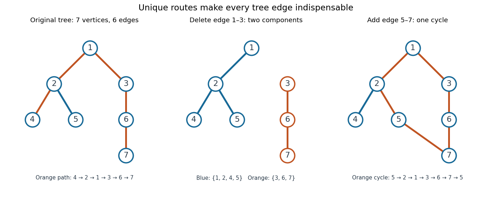

# Tree (graph theory)

↑ **Parent:** [Combinatorics](combinatorics-split.md)  
ⓦ [Wiki](https://en.wikipedia.org/wiki/Tree_(graph_theory))

A [tree](tree-graph-theory-split.md) is a nonempty [connected graph](connected-graph.md) containing no [graph cycle](cycle-in-a-graph.md). Think of seven locations joined so that everyone can reach everyone else, but no connection supplies an alternative route. For a finite [simple graph](simple-graph.md) with $n\geq1$ [vertices](vertex-graph-theory.md), three descriptions are equivalent: being a [tree](tree-graph-theory-split.md); having exactly one simple [graph path](path-in-a-graph.md) between every pair of distinct [vertices](vertex-graph-theory.md); and being a [connected graph](connected-graph.md) with exactly $n-1$ [edges](edge-of-a-graph.md). Here a simple [graph path](path-in-a-graph.md) repeats no [vertex](vertex-graph-theory.md). Connectedness in the last description is essential. [Trinity College Dublin, graph theory notes, Theorems 4.24–4.26 and Corollary 4.27](https://www.maths.tcd.ie/~dwilkins/Courses/MA2C03/MA2C03Courseware_2014to15/MA2C03_S4_Yr1415.pdf)

For a concrete [tree](tree-graph-theory-split.md), label the [vertices](vertex-graph-theory.md) $1,\ldots,7$ and take the [edges](edge-of-a-graph.md)

$$
E=\{12,13,24,25,36,67\},
$$

where $ij$ abbreviates the unordered pair $\{i,j\}$. There are seven [vertices](vertex-graph-theory.md) and six [edges](edge-of-a-graph.md). The unique [graph path](path-in-a-graph.md) from $4$ to $7$ is $4,2,1,3,6,7$, using five [edges](edge-of-a-graph.md). The [degree sequence](degree-sequence.md) in label order is $(2,3,2,1,1,2,1)$: its sum is $12=2\cdot6$, as the [degree-sum formula](degree-sum-formula.md) predicts. Each of $4,5,7$ is a [leaf of a graph](leaf-of-a-graph.md), having [vertex degree](degree-graph-theory.md) one.

**[Figure 1](#image-a-seven-vertex-tree-one-graph-path-two-connected-components-of-a-graph-after-deletion-and-one-graph-cycle-after-insertion). A seven-vertex tree: one graph path, two connected components of a graph after deletion, and one graph cycle after insertion**.

Deleting [edge](edge-of-a-graph.md) $13$ leaves precisely two [connected components of a graph](component-graph-theory.md), on $\{1,2,4,5\}$ and $\{3,6,7\}$. Every [edge](edge-of-a-graph.md) of a [tree](tree-graph-theory-split.md) is a [bridge in a graph](bridge-graph-theory.md). Instead add [edge](edge-of-a-graph.md) $57$ to the original [tree](tree-graph-theory-split.md): it closes the unique existing [graph path](path-in-a-graph.md) $5,2,1,3,6,7$ into exactly one [graph cycle](cycle-in-a-graph.md). Thus a [tree](tree-graph-theory-split.md) provides economical connections with no redundancy: a single failed link separates locations. Every finite [tree](tree-graph-theory-split.md) with at least two [vertices](vertex-graph-theory.md) has at least two instances of a [leaf of a graph](leaf-of-a-graph.md); the endpoints of a longest [graph path](path-in-a-graph.md) supply them. [Dalhousie University, Trees: leaves and indispensable edges](https://www.mathstat.dal.ca/~janssen/2113/notes/class14/)

The number $n-1$ alone proves nothing about connectedness: a [cycle graph](cycle-graph.md) on $1,\ldots,6$ together with an isolated [vertex](vertex-graph-theory.md) $7$ has seven [vertices](vertex-graph-theory.md) and six [edges](edge-of-a-graph.md), yet is disconnected. Briefly, two different simple [graph paths](path-in-a-graph.md) between the same [vertices](vertex-graph-theory.md) would contain a [graph cycle](cycle-in-a-graph.md). Repeatedly removing a [leaf of a graph](leaf-of-a-graph.md) and its incident [edge](edge-of-a-graph.md) proves the [tree](tree-graph-theory-split.md) count $n-1$ by [mathematical induction](mathematical-induction.md), starting with one [vertex](vertex-graph-theory.md) and no [edges](edge-of-a-graph.md).

**Table of contents**

- [Plane tree](plane-tree.md)
  - [Rooted plane tree](rooted-plane-tree.md)
- [Caterpillar tree](caterpillar-tree.md)
- [Lobster tree](lobster-tree.md)
- [Dissymmetry theorem for trees](dissymmetry-theorem-for-trees.md)
- [Leaf of a tree](leaf-of-a-tree.md)
- [Labelled tree](labelled-tree.md)
- [Unlabelled tree](unlabelled-tree.md)
- [Regular tree](regular-tree.md)
  - [Edge boundary of a finite forest in a regular tree](edge-boundary-of-a-finite-forest-in-a-regular-tree.md)
- [Oriented tree](oriented-tree.md)
  - [Three-times-order tournament bound for oriented trees](three-times-order-tournament-bound-for-oriented-trees.md)
  - [Arborescence (graph theory)](arborescence-graph-theory.md)
- [Depth-first traversal of a tree](depth-first-traversal-of-a-tree.md)
- [Rooted tree](rooted-tree.md)
  - [Fibonacci tree](fibonacci-tree.md)
  - [Root of a tree](root-of-a-tree.md)
  - [Parent in a rooted tree](parent-in-a-rooted-tree.md)
  - [Child in a rooted tree](child-in-a-rooted-tree.md)
  - [Rooted-tree generating function](rooted-tree-generating-function.md)
  - [Homeomorphic embedding of a rooted tree](homeomorphic-embedding-of-a-rooted-tree.md)
    - [Natural-sum ordinal rank of a finite rooted tree](natural-sum-ordinal-rank-of-a-finite-rooted-tree.md)
    - [Adjacency-preserving rooted-tree embedding](adjacency-preserving-rooted-tree-embedding.md)
      - [Branching-depth antichain of rooted trees](branching-depth-antichain-of-rooted-trees.md)
    - [Label-monotone tree embedding](label-monotone-tree-embedding.md)
  - [Lowest common ancestor](lowest-common-ancestor.md)
  - [Recursively repetition-free labelled tree](recursively-repetition-free-labelled-tree.md)
    - [Recursively repetition-free labelled trees preserve Dedekind-finiteness](recursively-repetition-free-labelled-trees-preserve-dedekind-finiteness.md)
  - [Section of a rooted-tree automorphism](section-of-a-rooted-tree-automorphism.md)
- [Forest](forest.md)
  - [Two-component spanning forest](two-component-spanning-forest.md)
  - [Minimum spanning forest](minimum-spanning-forest.md)
- [Spanning tree](spanning-tree.md)
  - [Fundamental cycle](fundamental-cycle.md)
  - [Minimum spanning tree](minimum-spanning-tree.md)
    - [Reverse-delete algorithm](reverse-delete-algorithm.md)
    - [Kruskal's algorithm](kruskal-s-algorithm.md)
      - [Kruskal's algorithm worked example](kruskal-s-algorithm-worked-example.md)
      - [Kruskal safe edge](kruskal-safe-edge.md)
      - [Kruskal component merging](kruskal-component-merging.md)
    - [Prim's algorithm](prim-s-algorithm.md)
    - [Minimum spanning tree cycle property](minimum-spanning-tree-cycle-property.md)
    - [Minimum spanning tree cut property](minimum-spanning-tree-cut-property.md)
  - [Uniform spanning tree](uniform-spanning-tree.md)
    - [Uniform spanning tree of a recurrent infinite graph](uniform-spanning-tree-of-a-recurrent-infinite-graph.md)
    - [Uniform spanning forest](uniform-spanning-forest.md)
    - [Free uniform spanning forest](free-uniform-spanning-forest.md)
      - [Negative association of uniform spanning-tree edges](negative-association-of-uniform-spanning-tree-edges.md)
    - [Transfer-current theorem](transfer-current-theorem.md)
      - [Mean spanning-tree path current](mean-spanning-tree-path-current.md)
      - [Edge-inclusion formula for a uniform spanning tree](edge-inclusion-formula-for-a-uniform-spanning-tree.md)
    - [Translation ergodicity of a uniform spanning forest](translation-ergodicity-of-a-uniform-spanning-forest.md)
    - [Aldous-Broder algorithm](aldous-broder-algorithm.md)
    - [Wilson's algorithm](wilson-s-algorithm.md)
    - [Wired uniform spanning forest](wired-uniform-spanning-forest.md)
      - [Wilson algorithm rooted at infinity](wilson-algorithm-rooted-at-infinity.md)
      - [Component-number zero-one law for the wired uniform spanning forest](component-number-zero-one-law-for-the-wired-uniform-spanning-forest.md)
  - [Directed spanning tree](directed-spanning-tree.md)
  - [Kirchhoff's theorem](kirchhoff-s-theorem.md)
- [Cayley's formula](cayley-s-formula.md)
  - [Labelled forest count with prescribed roots](labelled-forest-count-with-prescribed-roots.md)
  - [Prüfer sequence](prufer-sequence.md)
    - [Prüfer degree formula](prufer-degree-formula.md)
      - [Labelled tree count with prescribed degrees](labelled-tree-count-with-prescribed-degrees.md)
    - [Uniform labelled tree generation](uniform-labelled-tree-generation.md)
- [Kőnig's lemma](konig-s-lemma.md)
- [Breadth-first search](breadth-first-search.md)

## ↑ Ancestors (4)

1. [Combinatorics](combinatorics-split.md)
2. [Area of mathematics](area-of-mathematics.md)
3. [Mathematics](mathematics-split.md)
4. [Codex Wiki](split.md)
