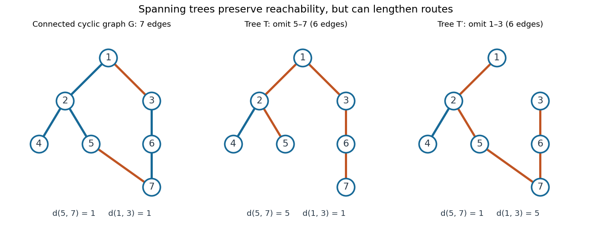
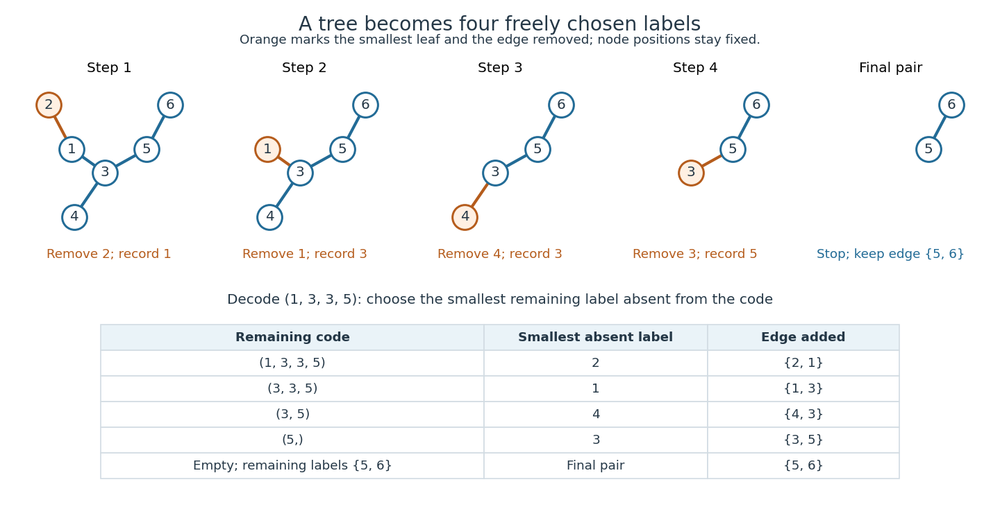

# Tree (graph theory)

↑ **Parent:** [Combinatorics](combinatorics.md)  
ⓦ [Wiki](https://en.wikipedia.org/wiki/Tree_(graph_theory))

A [tree](tree-graph-theory.md) is a nonempty [connected graph](graph.md#connected-graph) containing no [graph cycle](graph-theory.md#cycle-in-a-graph). Think of seven locations joined so that everyone can reach everyone else, but no connection supplies an alternative route. For a finite [simple graph](graph.md#simple-graph) with $n\geq1$ [vertices](graph.md#vertex-graph-theory), three descriptions are equivalent: being a [tree](tree-graph-theory.md); having exactly one simple [graph path](graph-theory.md#path-in-a-graph) between every pair of distinct [vertices](graph.md#vertex-graph-theory); and being a [connected graph](graph.md#connected-graph) with exactly $n-1$ [edges](graph-theory.md#edge-of-a-graph). Here a simple [graph path](graph-theory.md#path-in-a-graph) repeats no [vertex](graph.md#vertex-graph-theory). Connectedness in the last description is essential. [Trinity College Dublin, graph theory notes, Theorems 4.24–4.26 and Corollary 4.27](https://www.maths.tcd.ie/~dwilkins/Courses/MA2C03/MA2C03Courseware_2014to15/MA2C03_S4_Yr1415.pdf)

For a concrete [tree](tree-graph-theory.md), label the [vertices](graph.md#vertex-graph-theory) $1,\ldots,7$ and take the [edges](graph-theory.md#edge-of-a-graph)

$$
E=\{12,13,24,25,36,67\},
$$

where $ij$ abbreviates the unordered pair $\{i,j\}$. There are seven [vertices](graph.md#vertex-graph-theory) and six [edges](graph-theory.md#edge-of-a-graph). The unique [graph path](graph-theory.md#path-in-a-graph) from $4$ to $7$ is $4,2,1,3,6,7$, using five [edges](graph-theory.md#edge-of-a-graph). The [degree sequence](graph-theory.md#degree-sequence) in label order is $(2,3,2,1,1,2,1)$: its sum is $12=2\cdot6$, as the [degree-sum formula](combinatorics.md#degree-sum-formula) predicts. Each of $4,5,7$ is a [leaf of a graph](graph-theory.md#leaf-of-a-graph), having [vertex degree](graph-theory.md#degree-graph-theory) one.

**[Figure 1](#image-a-seven-vertex-tree-one-graph-path-two-connected-components-of-a-graph-after-deletion-and-one-graph-cycle-after-insertion). A seven-vertex tree: one graph path, two connected components of a graph after deletion, and one graph cycle after insertion**.

Deleting [edge](graph-theory.md#edge-of-a-graph) $13$ leaves precisely two [connected components of a graph](graph.md#component-graph-theory), on $\{1,2,4,5\}$ and $\{3,6,7\}$. Every [edge](graph-theory.md#edge-of-a-graph) of a [tree](tree-graph-theory.md) is a [bridge in a graph](graph.md#bridge-graph-theory). Instead add [edge](graph-theory.md#edge-of-a-graph) $57$ to the original [tree](tree-graph-theory.md): it closes the unique existing [graph path](graph-theory.md#path-in-a-graph) $5,2,1,3,6,7$ into exactly one [graph cycle](graph-theory.md#cycle-in-a-graph). Thus a [tree](tree-graph-theory.md) provides economical connections with no redundancy: a single failed link separates locations. Every finite [tree](tree-graph-theory.md) with at least two [vertices](graph.md#vertex-graph-theory) has at least two instances of a [leaf of a graph](graph-theory.md#leaf-of-a-graph); the endpoints of a longest [graph path](graph-theory.md#path-in-a-graph) supply them. [Dalhousie University, Trees: leaves and indispensable edges](https://www.mathstat.dal.ca/~janssen/2113/notes/class14/)

The number $n-1$ alone proves nothing about connectedness: a [cycle graph](graph-theory.md#cycle-graph) on $1,\ldots,6$ together with an isolated [vertex](graph.md#vertex-graph-theory) $7$ has seven [vertices](graph.md#vertex-graph-theory) and six [edges](graph-theory.md#edge-of-a-graph), yet is disconnected. Briefly, two different simple [graph paths](graph-theory.md#path-in-a-graph) between the same [vertices](graph.md#vertex-graph-theory) would contain a [graph cycle](graph-theory.md#cycle-in-a-graph). Repeatedly removing a [leaf of a graph](graph-theory.md#leaf-of-a-graph) and its incident [edge](graph-theory.md#edge-of-a-graph) proves the [tree](tree-graph-theory.md) count $n-1$ by [mathematical induction](foundations-of-mathematics.md#mathematical-induction), starting with one [vertex](graph.md#vertex-graph-theory) and no [edges](graph-theory.md#edge-of-a-graph).

**Table of contents**

- [Plane tree](#plane-tree)
  - [Rooted plane tree](#rooted-plane-tree)
- [Caterpillar tree](#caterpillar-tree)
- [Lobster tree](#lobster-tree)
- [Dissymmetry theorem for trees](#dissymmetry-theorem-for-trees)
- [Leaf of a tree](#leaf-of-a-tree)
- [Labelled tree](#labelled-tree)
- [Unlabelled tree](#unlabelled-tree)
- [Regular tree](#regular-tree)
  - [Edge boundary of a finite forest in a regular tree](#edge-boundary-of-a-finite-forest-in-a-regular-tree)
- [Oriented tree](#oriented-tree)
  - [Three-times-order tournament bound for oriented trees](#three-times-order-tournament-bound-for-oriented-trees)
  - [Arborescence (graph theory)](#arborescence-graph-theory)
- [Depth-first traversal of a tree](#depth-first-traversal-of-a-tree)
- [Rooted tree](#rooted-tree)
  - [Fibonacci tree](#fibonacci-tree)
  - [Root of a tree](#root-of-a-tree)
  - [Parent in a rooted tree](#parent-in-a-rooted-tree)
  - [Child in a rooted tree](#child-in-a-rooted-tree)
  - [Rooted-tree generating function](#rooted-tree-generating-function)
  - [Homeomorphic embedding of a rooted tree](#homeomorphic-embedding-of-a-rooted-tree)
    - [Natural-sum ordinal rank of a finite rooted tree](#natural-sum-ordinal-rank-of-a-finite-rooted-tree)
    - [Adjacency-preserving rooted-tree embedding](#adjacency-preserving-rooted-tree-embedding)
      - [Branching-depth antichain of rooted trees](#branching-depth-antichain-of-rooted-trees)
    - [Label-monotone tree embedding](#label-monotone-tree-embedding)
  - [Lowest common ancestor](#lowest-common-ancestor)
  - [Recursively repetition-free labelled tree](#recursively-repetition-free-labelled-tree)
    - [Recursively repetition-free labelled trees preserve Dedekind-finiteness](#recursively-repetition-free-labelled-trees-preserve-dedekind-finiteness)
  - [Section of a rooted-tree automorphism](#section-of-a-rooted-tree-automorphism)
- [Forest](#forest)
  - [Two-component spanning forest](#two-component-spanning-forest)
  - [Minimum spanning forest](#minimum-spanning-forest)
- [Spanning tree](#spanning-tree)
  - [Fundamental cycle](#fundamental-cycle)
  - [Minimum spanning tree](#minimum-spanning-tree)
    - [Reverse-delete algorithm](#reverse-delete-algorithm)
    - [Kruskal's algorithm](#kruskal-s-algorithm)
      - [Kruskal's algorithm worked example](#kruskal-s-algorithm-worked-example)
      - [Kruskal safe edge](#kruskal-safe-edge)
      - [Kruskal component merging](#kruskal-component-merging)
    - [Prim's algorithm](#prim-s-algorithm)
    - [Minimum spanning tree cycle property](#minimum-spanning-tree-cycle-property)
    - [Minimum spanning tree cut property](#minimum-spanning-tree-cut-property)
  - [Uniform spanning tree](#uniform-spanning-tree)
    - [Uniform spanning tree of a recurrent infinite graph](#uniform-spanning-tree-of-a-recurrent-infinite-graph)
    - [Uniform spanning forest](#uniform-spanning-forest)
    - [Free uniform spanning forest](#free-uniform-spanning-forest)
      - [Negative association of uniform spanning-tree edges](#negative-association-of-uniform-spanning-tree-edges)
    - [Transfer-current theorem](#transfer-current-theorem)
      - [Mean spanning-tree path current](#mean-spanning-tree-path-current)
      - [Edge-inclusion formula for a uniform spanning tree](#edge-inclusion-formula-for-a-uniform-spanning-tree)
    - [Translation ergodicity of a uniform spanning forest](#translation-ergodicity-of-a-uniform-spanning-forest)
    - [Aldous-Broder algorithm](#aldous-broder-algorithm)
    - [Wilson's algorithm](#wilson-s-algorithm)
    - [Wired uniform spanning forest](#wired-uniform-spanning-forest)
      - [Wilson algorithm rooted at infinity](#wilson-algorithm-rooted-at-infinity)
      - [Component-number zero-one law for the wired uniform spanning forest](#component-number-zero-one-law-for-the-wired-uniform-spanning-forest)
  - [Directed spanning tree](#directed-spanning-tree)
  - [Kirchhoff's theorem](#kirchhoff-s-theorem)
- [Cayley's formula](#cayley-s-formula)
  - [Labelled forest count with prescribed roots](#labelled-forest-count-with-prescribed-roots)
  - [Prüfer sequence](#prufer-sequence)
    - [Prüfer degree formula](#prufer-degree-formula)
      - [Labelled tree count with prescribed degrees](#labelled-tree-count-with-prescribed-degrees)
    - [Uniform labelled tree generation](#uniform-labelled-tree-generation)
- [Kőnig's lemma](#konig-s-lemma)
- [Breadth-first search](#breadth-first-search)

## Plane tree

↑ **Parent:** [Tree (graph theory)](tree-graph-theory.md)

A [tree](tree-graph-theory.md) together with an embedding in an oriented plane, considered up to deformation preserving the cyclic order of incident edges. For a rooted plane tree, the embedding orders the children of each vertex.

### Rooted plane tree

↑ **Parent:** [Plane tree](#plane-tree)

A [plane tree](#plane-tree) with a distinguished root and root corner, equivalently a [rooted tree](#rooted-tree) with a linear order on the children at each vertex. Trees with $n$ edges are counted by the [Catalan number](combinatorics.md#catalan-number) $C_n$.

## Caterpillar tree

↑ **Parent:** [Tree (graph theory)](tree-graph-theory.md)

## Lobster tree

↑ **Parent:** [Tree (graph theory)](tree-graph-theory.md)

A lobster tree is a [tree](tree-graph-theory.md) whose removal of all leaves leaves a [caterpillar tree](#caterpillar-tree).

## Dissymmetry theorem for trees

↑ **Parent:** [Tree (graph theory)](tree-graph-theory.md)

The dissymmetry theorem for trees relates unrooted trees to trees rooted at a vertex, at an edge, and at a directed edge. In the corresponding counting identity, unrooted equals vertex-rooted plus edge-rooted minus directed-edge-rooted.

## Leaf of a tree

↑ **Parent:** [Tree (graph theory)](tree-graph-theory.md)

## Labelled tree

↑ **Parent:** [Tree (graph theory)](tree-graph-theory.md)

A [tree](tree-graph-theory.md) whose [vertices](graph.md#vertex-graph-theory) carry distinct labels from a fixed [finite set](set.md#finite-set), as a [labelled combinatorial structure](combinatorics.md#labelled-combinatorial-structure). Two [labelled trees](#labelled-tree) on the same [vertex set](graph.md#vertex-set) are equal when their sets of [edges](graph-theory.md#edge-of-a-graph) are equal: any comparison must keep every label fixed. [Cayley's formula](#cayley-s-formula) counts these [trees](tree-graph-theory.md).

## Unlabelled tree

↑ **Parent:** [Tree (graph theory)](tree-graph-theory.md)

A [tree](tree-graph-theory.md) considered up to [graph isomorphism](graph.md#graph-isomorphism), with [vertex](graph.md#vertex-graph-theory) names ignored. For example, all four [labelled trees](#labelled-tree) that are [star graphs](bipartite-graph.md#star-graph-theory) on $\{1,2,3,4\}$ represent one [unlabelled tree](#unlabelled-tree). Dividing the total in [Cayley's formula](#cayley-s-formula) by $n!$ does not count [unlabelled trees](#unlabelled-tree): different shapes can have different numbers of distinct labellings.

## Regular tree

↑ **Parent:** [Tree (graph theory)](tree-graph-theory.md)

An infinite connected [tree](tree-graph-theory.md) is regular of degree $k$ if every [vertex](graph.md#vertex-graph-theory) has exactly $k$ neighbours. Necessarily $k\ge2$. For $k=2$ it is a two-sided infinite path. For $k\ge3$, rooting it gives $k$ children at the root and $k-1$ children at each other [vertex](graph.md#vertex-graph-theory); this constructs the unique such tree up to [graph isomorphism](graph.md#graph-isomorphism).

### Edge boundary of a finite forest in a regular tree

↑ **Parent:** [Regular tree](#regular-tree)

For a nonempty finite [vertex](graph.md#vertex-graph-theory) set $A$ in a degree-$k$ [regular tree](#regular-tree), its induced [forest](#forest) has $|A|-c(A)$ [edges](graph-theory.md#edge-of-a-graph), where $c(A)$ counts its components. Summing degrees and subtracting twice the internal [edge](graph-theory.md#edge-of-a-graph) count gives the displayed number of [edges](graph-theory.md#edge-of-a-graph) with exactly one endpoint in $A$. In particular it is at least $(k-2)|A|+2$.

## Oriented tree

↑ **Parent:** [Tree (graph theory)](tree-graph-theory.md)

An oriented tree is an orientation of every edge of an undirected [tree](tree-graph-theory.md). Its arrows need not all point towards, or away from, any one root. It is acyclic as a [directed graph](graph-theory.md#directed-graph), but different orientations can have different embedding behaviour in [tournaments](graph-theory.md#tournament-graph-theory).

### Three-times-order tournament bound for oriented trees

↑ **Parent:** [Oriented tree](#oriented-tree)

For a source-rooted [oriented tree](#oriented-tree), let $b$ count edges pointing towards the root and let $c$ count nonempty connected components formed by those edges. A [half-sparse median-order embedding](graph-theory.md#half-sparse-median-order-embedding) exists in $2n+2(b-c)$ vertices. Remove forward leaves, or remove a terminal backward component of order $m$ and replace it temporarily by $2m-2$ outward leaves. Their images contain an in-arborescence copy of the component. Choose the direction and root to minimize $(b-c,b)$ lexicographically; this makes the root a source and gives $b-c\le(n-3)/2$ unless the tree is already an arborescence. The stated bound follows.

### Arborescence (graph theory)

↑ **Parent:** [Oriented tree](#oriented-tree)  
ⓦ [Wiki](https://en.wikipedia.org/wiki/Arborescence_(graph_theory))

An arborescence is a rooted [oriented tree](#oriented-tree) whose edges all point away from its root. Reversing every edge gives an in-arborescence. An $n$-vertex arborescence embeds in every [tournament](graph-theory.md#tournament-graph-theory) on $2n-2$ vertices: repeatedly extend an outward leaf in a [half-sparse median-order embedding](graph-theory.md#half-sparse-median-order-embedding). Reversal gives the analogous existence statement for in-arborescences.

## Depth-first traversal of a tree

↑ **Parent:** [Tree (graph theory)](tree-graph-theory.md)

A depth-first traversal starts at a root, recursively visits each child subtree, and returns along the entering edge. On a finite [tree](tree-graph-theory.md), the resulting closed walk traverses each edge exactly once in each direction.

## Rooted tree

↑ **Parent:** [Tree (graph theory)](tree-graph-theory.md)  
ⓦ [Wiki](https://en.wikipedia.org/wiki/Rooted_tree)

A [rooted tree](#rooted-tree) is a [tree](tree-graph-theory.md) with a distinguished [vertex](graph.md#vertex-graph-theory), its [root of a tree](#root-of-a-tree) $r$. Choosing $r$ turns connections into a hierarchy: every other [vertex](graph.md#vertex-graph-theory) has a unique [parent in a rooted tree](#parent-in-a-rooted-tree), the preceding [vertex](graph.md#vertex-graph-theory) on its [graph path](graph-theory.md#path-in-a-graph) from $r$. Conversely, the [vertices](graph.md#vertex-graph-theory) whose [parent in a rooted tree](#parent-in-a-rooted-tree) is $v$ are the [children in a rooted tree](#child-in-a-rooted-tree) of $v$. Choosing the [root of a tree](#root-of-a-tree) changes this description, while the underlying [edges](graph-theory.md#edge-of-a-graph) remain the same. Arrows towards the [root of a tree](#root-of-a-tree) can encode the relationship, as in MIT's counting notes; the undirected [tree](tree-graph-theory.md) itself needs no arrows. [MIT, Peter Shor's counting notes, pp. 3–4](https://ocw.mit.edu/courses/18-200-principles-of-discrete-applied-mathematics-spring-2024/mit18_200_s24_lec05-06.pdf)

In the seven-[vertex](graph.md#vertex-graph-theory) [tree](tree-graph-theory.md) above, choose $r=1$. The levels, grouped by [graph distance](graph-theory.md#distance-graph-theory) from the [root of a tree](#root-of-a-tree), are $\{1\}$, $\{2,3\}$, $\{4,5,6\}$, $\{7\}$. The [children in a rooted tree](#child-in-a-rooted-tree) of $2$ are $4,5$, and the [parent in a rooted tree](#parent-in-a-rooted-tree) of $7$ is $6$. Choosing $r=7$ instead makes the levels $\{7\}$, $\{6\}$, $\{3\}$, $\{1\}$, $\{2\}$, $\{4,5\}$: now $6$ has [parent in a rooted tree](#parent-in-a-rooted-tree) $7$, reversing their relationship. All six [edges](graph-theory.md#edge-of-a-graph) survive.

This hierarchy supports [structural recursion](programming-language.md#structural-recursion): process the smaller [rooted trees](#rooted-tree) below each [vertex](graph.md#vertex-graph-theory), then combine their results. A [depth-first traversal of a tree](#depth-first-traversal-of-a-tree) explores one branch before returning; [breadth-first search](#breadth-first-search) processes successive levels. The [lowest common ancestor](#lowest-common-ancestor) identifies where two routes from the [root of a tree](#root-of-a-tree) last coincide. For $4,5$ it is $2$ when $r=1$. A [binary tree](data-structure.md#binary-tree) imposes an additional restriction on [children in a rooted tree](#child-in-a-rooted-tree); a general [rooted tree](#rooted-tree) has no such bound.

### Fibonacci tree

↑ **Parent:** [Rooted tree](#rooted-tree)

### Root of a tree

↑ **Parent:** [Rooted tree](#rooted-tree)

The distinguished [vertex](graph.md#vertex-graph-theory) that specifies a [rooted tree](#rooted-tree). Its choice determines the [parent in a rooted tree](#parent-in-a-rooted-tree) and [children in a rooted tree](#child-in-a-rooted-tree) relationships.

### Parent in a rooted tree

↑ **Parent:** [Rooted tree](#rooted-tree)

For a nonroot [vertex](graph.md#vertex-graph-theory), its adjacent predecessor on the unique [graph path](graph-theory.md#path-in-a-graph) from the [root of a tree](#root-of-a-tree). The [root of a tree](#root-of-a-tree) has no parent.

### Child in a rooted tree

↑ **Parent:** [Rooted tree](#rooted-tree)

A [vertex](graph.md#vertex-graph-theory) whose [parent in a rooted tree](#parent-in-a-rooted-tree) is the specified [vertex](graph.md#vertex-graph-theory).

### Rooted-tree generating function

↑ **Parent:** [Rooted tree](#rooted-tree)

The [exponential generating function](sequence-and-series.md#exponential-generating-function) for labelled [rooted trees](#rooted-tree) satisfies $T=z e^T$: remove the root and obtain an unordered set of smaller labelled [rooted trees](#rooted-tree). For $0\leq z<1/e$, the convergent series is the solution in $[0,1)$ of $T e^{-T}=z$, rather than the larger real solution. Alternatively, [tree-component expectation in the Erdős-Rényi model](random-graph.md#tree-component-expectation-in-the-erdos-renyi-model) and subcritical exploration give $T(\theta e^{-\theta})=\theta$ for $0<\theta<1$: their limiting probabilities for the order of the [tree component](graph.md#tree-component) of a uniform [vertex](graph.md#vertex-graph-theory) sum to one. The component tail bound makes this passage through the infinite sum valid.

### Homeomorphic embedding of a rooted tree

↑ **Parent:** [Rooted tree](#rooted-tree)

For finite [rooted trees](#rooted-tree) in the ancestor [partial order](set.md#partially-ordered-set), a [rooted-tree homeomorphic embedding](#homeomorphic-embedding-of-a-rooted-tree) is an injective vertex map preserving [lowest common ancestors](#lowest-common-ancestor): $h(u\wedge v)=h(u)\wedge h(v)$. The image of the source root need not be the host root. Edge paths and branching are preserved, while paths may be subdivided in the larger tree.

#### Natural-sum ordinal rank of a finite rooted tree

↑ **Parent:** [Homeomorphic embedding of a rooted tree](#homeomorphic-embedding-of-a-rooted-tree)

Give a leaf rank zero, and use [Hessenberg natural sum](ordinal.md#hessenberg-natural-sum) over the immediate rooted subtrees. Every rank is below [epsilon zero](ordinal.md#epsilon-zero); conversely repeated exponentiation and finite summation encode every [Cantor normal form](ordinal.md#cantor-normal-form) below it. A [rooted-tree homeomorphic embedding](#homeomorphic-embedding-of-a-rooted-tree) implies nondecrease of the rank. When roots match, child subtrees embed into distinct branches and exponentiation and natural sum preserve their inequalities. When the source root maps below the host root, its rank is bounded by that of a proper subtree, strictly below the host rank.

#### Adjacency-preserving rooted-tree embedding

↑ **Parent:** [Homeomorphic embedding of a rooted tree](#homeomorphic-embedding-of-a-rooted-tree)

An [adjacency-preserving rooted-tree embedding](#adjacency-preserving-rooted-tree-embedding) is an injective vertex map preserving the root and every adjacency. Because each root-to-vertex path maps to a simple path of the same length, vertex depths are preserved. This is more restrictive than a [homeomorphic embedding of a rooted tree](#homeomorphic-embedding-of-a-rooted-tree), which may stretch edges into paths. The [branching-depth antichain of rooted trees](#branching-depth-antichain-of-rooted-trees) shows that the adjacency relation is not a [well-quasi-ordering](set.md#well-quasi-ordering).

##### Branching-depth antichain of rooted trees

↑ **Parent:** [Adjacency-preserving rooted-tree embedding](#adjacency-preserving-rooted-tree-embedding)

Let $T_m$ consist of a rooted path of $m\geq1$ edges followed by two leaves at its far end. Its only vertex with two children has depth $m$. An [adjacency-preserving rooted-tree embedding](#adjacency-preserving-rooted-tree-embedding) must preserve this depth, so $T_m$ embeds into $T_n$ only when $m=n$. This gives an infinite [bad sequence](set.md#bad-sequence), while [rooted-tree homeomorphic embeddings](#homeomorphic-embedding-of-a-rooted-tree) can stretch the stems.

#### Label-monotone tree embedding

↑ **Parent:** [Homeomorphic embedding of a rooted tree](#homeomorphic-embedding-of-a-rooted-tree)

For [rooted trees](#rooted-tree) labelled in a [preorder](set.md#preorder) $Q$, a label-monotone tree embedding is a [homeomorphic embedding of a rooted tree](#homeomorphic-embedding-of-a-rooted-tree) whose vertex map satisfies $\ell_T(v)\le_Q\ell_S(h(v))$. The root need not map to the host root. For ordered child lists, require in addition that the map preserve the relative order of distinct branches.

### Lowest common ancestor

↑ **Parent:** [Rooted tree](#rooted-tree)  
ⓦ [Wiki](https://en.wikipedia.org/wiki/Lowest_common_ancestor)

The [lowest common ancestor](#lowest-common-ancestor) of two vertices is the common ancestor farthest from the root. In the ancestor [partial order](set.md#partially-ordered-set) with the root least, it is their infimum, also called their [greatest common ancestor](#lowest-common-ancestor).

### Recursively repetition-free labelled tree

↑ **Parent:** [Rooted tree](#rooted-tree)

For a label [set](set.md) $D$, define $\mathcal T(D)$ inductively: choose a root label $d\in D$ and a [finite repetition-free sequence](sequence-and-series.md#finite-repetition-free-sequence) of [rooted trees](#rooted-tree) in $\mathcal T(D\setminus\{d\})$ as its children. Each object is a finite ordered [rooted tree](#rooted-tree). Labels are distinct along each root-to-leaf path, and child [rooted trees](#rooted-tree) at a vertex are distinct as whole [rooted trees](#rooted-tree). Labels may repeat across different branches; children need not have distinct root labels. For a finite pool of size $m$, the exact number $t_m$ of [rooted trees](#rooted-tree) satisfies

$$
t_0=0,\qquad t_m=m\sum_{k=0}^{t_{m-1}}\frac{t_{m-1}!}{(t_{m-1}-k)!}.
$$

This follows by choosing the root and then an ordered repetition-free list from the finite pool of smaller [rooted trees](#rooted-tree).

#### Recursively repetition-free labelled trees preserve Dedekind-finiteness

↑ **Parent:** [Recursively repetition-free labelled tree](#recursively-repetition-free-labelled-tree)

If $D$ is an [infinite Dedekind-finite set](set.md#infinite-dedekind-finite-set), then $\mathcal T(D)$ is another such [set](set.md). Single-vertex [rooted trees](#rooted-tree) inject $D$ into it. A countable [sequence](sequence-and-series.md#sequence) of distinct [rooted trees](#rooted-tree) gives finite lists of labels by the [depth-first traversal of a tree](#depth-first-traversal-of-a-tree) in the prescribed child order. By [countable union of explicitly ordered finite lists without choice](cardinal-number.md#countable-union-of-explicitly-ordered-finite-lists-without-choice), an infinite union of labels contradicts Dedekind-finiteness. A finite union $F$ is equally impossible, since every [rooted tree](#rooted-tree) then lies in the [finite set](set.md#finite-set) $\mathcal T(F)$, by [mathematical induction](foundations-of-mathematics.md#mathematical-induction) on $|F|$ using the recursive child rule. Thus no countably infinite subset of [rooted trees](#rooted-tree) exists.

### Section of a rooted-tree automorphism

↑ **Parent:** [Rooted tree](#rooted-tree)

For an automorphism $g$ of a regular rooted tree and a first-level vertex $i$, the section $g_i$ is the induced automorphism of the rooted subtree at $i$, defined by

$$
g(iv)=g(i)g_i(v).
$$

An automorphism fixing the first level is determined by the tuple of all its sections.

## Forest

↑ **Parent:** [Tree (graph theory)](tree-graph-theory.md)

A [forest](#forest) is an [undirected graph](graph-theory.md#undirected-graph) with no [graph cycle](graph-theory.md#cycle-in-a-graph); each of its [connected components of a graph](graph.md#component-graph-theory) is a [tree](tree-graph-theory.md), including any isolated [vertex](graph.md#vertex-graph-theory). A finite [forest](#forest) with $n$ [vertices](graph.md#vertex-graph-theory) and $c$ [connected components of a graph](graph.md#component-graph-theory) has

$$
|E|=n-c.
$$

Indeed, a [connected component of a graph](graph.md#component-graph-theory) with $n_i$ [vertices](graph.md#vertex-graph-theory) contributes $n_i-1$ [edges](graph-theory.md#edge-of-a-graph); adding these counts gives $n-c$. Equivalently, start with $n$ isolated [vertices](graph.md#vertex-graph-theory): every added [edge](graph-theory.md#edge-of-a-graph) must join different [connected components of a graph](graph.md#component-graph-theory), reducing their number by one. Joining [vertices](graph.md#vertex-graph-theory) already connected would create a [graph cycle](graph-theory.md#cycle-in-a-graph). [MIT, counting notes, p. 4: building forests by merging components](https://ocw.mit.edu/courses/18-200-principles-of-discrete-applied-mathematics-spring-2024/mit18_200_s24_lec05-06.pdf)

Deleting $13$ in our example gives $n=7$, $c=2$, and five [edges](graph-theory.md#edge-of-a-graph): the two [trees](tree-graph-theory.md) contribute $3+2=5=7-2$. Deleting $67$ as well leaves $7$ isolated, so $c=3$ and four [edges](graph-theory.md#edge-of-a-graph). A [forest](#forest) therefore describes separate hierarchies or the intermediate stages of building a [spanning tree](#spanning-tree). The [acyclic graph](#forest) condition accounts for missing connections without assuming that all locations are mutually reachable.

### Two-component spanning forest

↑ **Parent:** [Forest](#forest)

A [two-component spanning forest](#two-component-spanning-forest) of a finite connected [graph](graph.md) is an acyclic spanning subgraph with exactly two [connected components of a graph](graph.md#component-graph-theory). It has $|V|-2$ [edges](graph-theory.md#edge-of-a-graph). For distinct terminals $a,z$, a separating two-component forest places them in different components. Deleting an [edge](graph-theory.md#edge-of-a-graph) of the $a$-to-$z$ [graph path](graph-theory.md#path-in-a-graph) of a [spanning tree](#spanning-tree) produces such a forest; adjoining any original [edge](graph-theory.md#edge-of-a-graph) across its cut reverses this operation. This is the counting correspondence behind the [mean spanning-tree path current](#mean-spanning-tree-path-current).

### Minimum spanning forest

↑ **Parent:** [Forest](#forest)

A [forest](#forest) containing one [minimum spanning tree](#minimum-spanning-tree) of each [connected component of a graph](graph.md#component-graph-theory) of a finite undirected [weighted graph](random-walk.md#weighted-graph), including isolated [vertices](graph.md#vertex-graph-theory). For disconnected input, [Kruskal's algorithm](#kruskal-s-algorithm) returns a [minimum spanning forest](#minimum-spanning-forest).

## Spanning tree

↑ **Parent:** [Tree (graph theory)](tree-graph-theory.md)  
ⓦ [Wiki](https://en.wikipedia.org/wiki/Spanning_tree)

A [spanning tree](#spanning-tree) of a [connected graph](graph.md#connected-graph) $G$ is a [subgraph](graph-theory.md#subgraph) that is a [tree](tree-graph-theory.md) and contains every [vertex](graph.md#vertex-graph-theory) of $G$. Its [edges](graph-theory.md#edge-of-a-graph) must come from $G$. For finite $G$ on $n$ [vertices](graph.md#vertex-graph-theory), every [spanning tree](#spanning-tree) has $n-1$ [edges](graph-theory.md#edge-of-a-graph), the minimum possible number preserving [reachability](graph.md#reachability-in-a-graph) between all locations. This makes a [spanning tree](#spanning-tree) a compact certificate that the original [graph](graph.md) is connected. A [minimum spanning tree](#minimum-spanning-tree) additionally minimizes a specified total [edge](graph-theory.md#edge-of-a-graph) weight; merely selecting a [spanning tree](#spanning-tree) supplies no such optimization. [MIT, Mathematics for Computer Science, sections 11.10.3–11.10.4](https://ocw.mit.edu/courses/6-042j-mathematics-for-computer-science-spring-2015/mit6_042js15_textbook.pdf)

Let $G$ be our seven-[vertex](graph.md#vertex-graph-theory) [tree](tree-graph-theory.md) with [edge](graph-theory.md#edge-of-a-graph) $57$ added. It has seven [edges](graph-theory.md#edge-of-a-graph) and a [graph cycle](graph-theory.md#cycle-in-a-graph). Removing $57$ gives the original [spanning tree](#spanning-tree) $T$; removing $13$ instead gives another [spanning tree](#spanning-tree) $T'$. Both retain all seven [vertices](graph.md#vertex-graph-theory) and six [edges](graph-theory.md#edge-of-a-graph), but their [graph distances](graph-theory.md#distance-graph-theory) differ: $d_G(5,7)=1$, whereas $d_T(5,7)=5$. In $T'$, $d_{T'}(5,7)=1$ but $d_{T'}(1,3)=5$, along $1,2,5,7,6,3$, compared with $d_G(1,3)=1$. Preserving [reachability](graph.md#reachability-in-a-graph) permits longer journeys; [breadth-first search](#breadth-first-search) can preserve [graph distances](graph-theory.md#distance-graph-theory) from one chosen starting [vertex](graph.md#vertex-graph-theory).

**[Figure 2](#image-two-spanning-trees-preserve-reachability-but-change-different-graph-distances). Two spanning trees preserve reachability but change different graph distances**.

To construct a [spanning tree](#spanning-tree), repeatedly delete any [edge](graph-theory.md#edge-of-a-graph) on a [graph cycle](graph-theory.md#cycle-in-a-graph). Its endpoints remain joined through the rest of that [graph cycle](graph-theory.md#cycle-in-a-graph), so the deletion preserves connectedness. Finiteness ensures that this stops at a connected [acyclic graph](#forest). Conversely, adding an omitted [edge](graph-theory.md#edge-of-a-graph) to a [spanning tree](#spanning-tree) creates its unique [fundamental cycle](#fundamental-cycle); deleting any other [edge](graph-theory.md#edge-of-a-graph) on that [graph cycle](graph-theory.md#cycle-in-a-graph) produces another [spanning tree](#spanning-tree). The displayed exchange replaces $13$ by $57$. [Trinity College Dublin, section 4.16: deleting cycle edges preserves connectivity](https://www.maths.tcd.ie/~dwilkins/Courses/MA2C03/MA2C03Courseware_2014to15/MA2C03_S4_Yr1415.pdf)

### Fundamental cycle

↑ **Parent:** [Spanning tree](#spanning-tree)

Adding a non-tree edge to a [spanning tree](#spanning-tree) creates exactly one [graph cycle](graph-theory.md#cycle-in-a-graph), its [fundamental cycle](#fundamental-cycle). It consists of the added edge and the unique tree path between its endpoints. In the [network simplex algorithm](graph-theory.md#network-simplex-algorithm), modifying flow around this cycle preserves [flow conservation](flow-network.md#flow-conservation).

// Target: foundations-of-mathematics.bigb

### Minimum spanning tree

↑ **Parent:** [Spanning tree](#spanning-tree)

A [minimum spanning tree](#minimum-spanning-tree) minimizes total edge weight among [spanning trees](#spanning-tree) of a connected weighted graph. It can be computed in polynomial time by repeatedly adding the least-weight edge joining two current components. The cut-exchange argument preserves the existence of an optimum containing every accepted edge. Removing an edge of a travelling-salesman tour gives a [spanning tree](#spanning-tree), so its optimum is a lower bound on optimal tour cost.

#### Reverse-delete algorithm

↑ **Parent:** [Minimum spanning tree](#minimum-spanning-tree)  
ⓦ [Wiki](https://en.wikipedia.org/wiki/Reverse-delete_algorithm)

Process [edges](graph-theory.md#edge-of-a-graph) in decreasing weight and delete an [edge](graph-theory.md#edge-of-a-graph) whenever the remaining [graph](graph.md) stays connected. Previously retained heavier [edges](graph-theory.md#edge-of-a-graph) are [bridges in a graph](graph.md#bridge-graph-theory) and remain so under deletion. Thus a deletable [edge](graph-theory.md#edge-of-a-graph) is heaviest on a current [graph cycle](graph-theory.md#cycle-in-a-graph), and the [minimum spanning tree cycle property](#minimum-spanning-tree-cycle-property) excludes it from every [minimum spanning tree](#minimum-spanning-tree). At termination the surviving connected [graph](graph.md) has no [graph cycle](graph-theory.md#cycle-in-a-graph), so it is a [minimum spanning tree](#minimum-spanning-tree).

<h4 id="kruskal-s-algorithm">Kruskal's algorithm</h4>

↑ **Parent:** [Minimum spanning tree](#minimum-spanning-tree)  
ⓦ [Wiki](https://en.wikipedia.org/wiki/Kruskal's_algorithm)

[Kruskal's algorithm](#kruskal-s-algorithm) constructs a [minimum spanning tree](#minimum-spanning-tree) of a finite [connected graph](graph.md#connected-graph) with undirected [edges](graph-theory.md#edge-of-a-graph) and real [edge](graph-theory.md#edge-of-a-graph) weights. Start with all [vertices](graph.md#vertex-graph-theory) and no [edges](graph-theory.md#edge-of-a-graph), a [forest](#forest) of isolated [vertices](graph.md#vertex-graph-theory). Sort the [edges](graph-theory.md#edge-of-a-graph) by nondecreasing weight, then accept an [edge](graph-theory.md#edge-of-a-graph) exactly when its endpoints belong to different current [connected components of a graph](graph.md#component-graph-theory). Otherwise reject it: the existing [graph path](graph-theory.md#path-in-a-graph) between its endpoints would close a [graph cycle](graph-theory.md#cycle-in-a-graph). Each acceptance merges two [connected components of a graph](graph.md#component-graph-theory). Stop after $|V|-1$ acceptances, when the [forest](#forest) has become one [spanning tree](#spanning-tree).

This is a [greedy algorithm](algorithm.md#greedy-algorithm) for economical network connection: only the next affordable connection and the current [connected components of a graph](graph.md#component-graph-theory) matter. Unlike [Prim's algorithm](#prim-s-algorithm), which grows one reached [tree](tree-graph-theory.md), [Kruskal's algorithm](#kruskal-s-algorithm) can grow several separate [trees](tree-graph-theory.md) before joining them. The essential safeguard is avoiding a [graph cycle](graph-theory.md#cycle-in-a-graph), rather than simply buying the cheapest fixed number of [edges](graph-theory.md#edge-of-a-graph).

[Joseph Bernard Kruskal](mathematics.md#joseph-bernard-kruskal) described this rule as Construction A on page 49 of his February 1956 paper, [On the shortest spanning subtree of a graph and the traveling salesman problem](https://www.ams.org/journals/proc/1956-007-01/S0002-9939-1956-0078686-7/S0002-9939-1956-0078686-7.pdf); page 50 gives an exchange argument for distinct weights.[Joseph B. Kruskal, Jr., Proceedings of the American Mathematical Society 7(1), February 1956, pp. 48–50; inspected scan, Construction A and final exchange argument](https://langevin.univ-tln.fr/cours/graphe/bonus/Krukskal.pdf)

<h5 id="kruskal-s-algorithm-worked-example">Kruskal's algorithm worked example</h5>

↑ **Parent:** [Kruskal's algorithm](#kruskal-s-algorithm)

Consider this original [connected graph](graph.md#connected-graph) on [vertices](graph.md#vertex-graph-theory) $A,B,C,D,E$. Its undirected [edges](graph-theory.md#edge-of-a-graph), already in increasing weight order, are

$$
\begin{array}{c|rrrrrrr}
\text{edge}&AB&BC&AC&CD&DE&CE&BE\\\hline
\text{weight}&1&2&3&4&5&6&7.
\end{array}
$$

Here $AB$ means the unordered pair $\{A,B\}$; the weights are dimensionless costs. Accept $AB$ and $BC$, with total $3$. Reject $AC$: its endpoints already have the [graph path](graph-theory.md#path-in-a-graph) $A,B,C$, so it would close the [graph cycle](graph-theory.md#cycle-in-a-graph) $A,B,C,A$. Accept $CD$ and $DE$, reaching all five [vertices](graph.md#vertex-graph-theory) with four [edges](graph-theory.md#edge-of-a-graph). The resulting [minimum spanning tree](#minimum-spanning-tree) is

$$
T=\{AB,BC,CD,DE\},\qquad w(T)=1+2+4+5=12.
$$

Stop here: $CE$ and $BE$ need not be examined. If processing continued, both would be rejected because their endpoints are already in the same [connected component of a graph](graph.md#component-graph-theory).

**[Figure 3](#image-five-sorted-edge-decisions-produce-a-minimum-spanning-tree-of-cost-12). Five sorted edge decisions produce a minimum spanning tree of cost 12**. Original five-[vertex](graph.md#vertex-graph-theory) example. Green [edges](graph-theory.md#edge-of-a-graph) are accepted, the red dashed [edge](graph-theory.md#edge-of-a-graph) is rejected, and grey [edges](graph-theory.md#edge-of-a-graph) are unexamined. The third decision rejects $AC$ without changing the accepted [forest](#forest).

Taking the three cheapest [edges](graph-theory.md#edge-of-a-graph) $AB,BC,AC$ instead gives a [graph cycle](graph-theory.md#cycle-in-a-graph) on $A,B,C$, leaving $D,E$ isolated: it is neither a [forest](#forest) nor a [spanning tree](#spanning-tree). Even taking the four cheapest [edges](graph-theory.md#edge-of-a-graph) adds only $CD$ and leaves $E$ isolated. A cheap infeasible selection cannot compete with a [minimum spanning tree](#minimum-spanning-tree). For this small [graph](graph.md), checking all $\binom{7}{4}=35$ four-[edge](graph-theory.md#edge-of-a-graph) subsets gives a direct certificate: among those that are [spanning trees](#spanning-tree), exactly one has minimum cost $12$, namely $T$. The general [algorithm](algorithm.md) avoids this exhaustive search.

##### Kruskal safe edge

↑ **Parent:** [Kruskal's algorithm](#kruskal-s-algorithm)

An [edge](graph-theory.md#edge-of-a-graph) is safe for the current accepted [forest](#forest) $F$ if some [minimum spanning tree](#minimum-spanning-tree) contains both $F$ and that [edge](graph-theory.md#edge-of-a-graph). The [loop invariant](algorithm.md#loop-invariant) is that some [minimum spanning tree](#minimum-spanning-tree) contains every accepted [edge](graph-theory.md#edge-of-a-graph). It holds initially for the empty [edge](graph-theory.md#edge-of-a-graph) set. Suppose the next accepted [edge](graph-theory.md#edge-of-a-graph) $e$ joins a current [connected component of a graph](graph.md#component-graph-theory) $S$ to its complement. No earlier rejected [edge](graph-theory.md#edge-of-a-graph) crosses this [cut of a graph](graph-theory.md#cut-graph-theory): once its endpoints are in one [connected component of a graph](graph.md#component-graph-theory), subsequent merges never separate them. Thus $e$ is a lightest [edge](graph-theory.md#edge-of-a-graph) across that [cut of a graph](graph-theory.md#cut-graph-theory).

For the short exchange argument, take a [minimum spanning tree](#minimum-spanning-tree) $T$ containing $F$. If $e$ is absent, adding it creates a [fundamental cycle](#fundamental-cycle). This [graph cycle](graph-theory.md#cycle-in-a-graph) contains another [edge](graph-theory.md#edge-of-a-graph) $f$ crossing the same [cut of a graph](graph-theory.md#cut-graph-theory). No [edge](graph-theory.md#edge-of-a-graph) of $F$ crosses the [cut of a graph](graph-theory.md#cut-graph-theory), so $f$ is not in $F$. Replace $f$ by $e$: the result is a [spanning tree](#spanning-tree) containing $F$ and $e$, with no greater total weight because $w(e)\leq w(f)$. It is therefore also a [minimum spanning tree](#minimum-spanning-tree). This is the [minimum spanning tree cut property](#minimum-spanning-tree-cut-property) in the form needed for tied weights.

In the example, $CD$ is safe after rejecting $AC$: the current [connected component of a graph](graph.md#component-graph-theory) $\{A,B,C\}$ has crossing [edges](graph-theory.md#edge-of-a-graph) $CD,CE,BE$ of weights $4,6,7$. Its cheapest connection is $CD$. The rejected $AC$ is also the unique heaviest [edge](graph-theory.md#edge-of-a-graph) of the [graph cycle](graph-theory.md#cycle-in-a-graph) $A,B,C,A$, so the [minimum spanning tree cycle property](#minimum-spanning-tree-cycle-property) excludes it from every optimum.

Negative and zero [edge](graph-theory.md#edge-of-a-graph) weights are allowed: the comparisons and exchange argument still apply. Ties can give several [minimum spanning trees](#minimum-spanning-tree), though they need not; any order among equal-weight [edges](graph-theory.md#edge-of-a-graph) remains valid. Distinct [edge](graph-theory.md#edge-of-a-graph) weights guarantee a unique [minimum spanning tree](#minimum-spanning-tree). To see why, take the lightest [edge](graph-theory.md#edge-of-a-graph) $e$ belonging to exactly one of two proposed optima, say $T$. Deleting $e$ from $T$ gives a [cut of a graph](graph-theory.md#cut-graph-theory); the other optimum has a [graph path](graph-theory.md#path-in-a-graph) across it, containing an [edge](graph-theory.md#edge-of-a-graph) $f$ absent from $T$. Hence $w(e)<w(f)$, and replacing $f$ by $e$ improves that other optimum, a contradiction. For disconnected input, process all [edges](graph-theory.md#edge-of-a-graph) to obtain a [minimum spanning forest](#minimum-spanning-forest), one [minimum spanning tree](#minimum-spanning-tree) per original [connected component of a graph](graph.md#component-graph-theory); no [spanning tree](#spanning-tree) of the whole [graph](graph.md) exists.[Robert Sedgewick and Kevin Wayne, Algorithms, 4th edition, companion KruskalMST.java, class documentation and constructor: arbitrary signed weights, ties, disconnected input and sorted processing](mathematics-bibliography.md#algorithms-4th-edition-by-robert-sedgewick-and-others/kruskalmst-java)

##### Kruskal component merging

↑ **Parent:** [Kruskal's algorithm](#kruskal-s-algorithm)

A [disjoint-set data structure](data-structure.md#disjoint-set-data-structure) stores the current [partition of a set](set.md#partition-of-a-set) of [vertices](graph.md#vertex-graph-theory) into [connected components of a graph](graph.md#component-graph-theory). The operation $\operatorname{find}(v)$ returns a representative of the block containing $v$. Two [vertices](graph.md#vertex-graph-theory) are in the same block exactly when their representatives agree. For each candidate [edge](graph-theory.md#edge-of-a-graph) $uv$, compare $\operatorname{find}(u)$ and $\operatorname{find}(v)$. Equal representatives mean reject; different representatives mean accept and perform $\operatorname{union}(u,v)$, merging the two blocks. The representatives are bookkeeping choices, not preferred [vertices](graph.md#vertex-graph-theory) of the [minimum spanning tree](#minimum-spanning-tree).

**[Figure 4](#image-connected-components-of-a-graph-merge-only-when-an-edge-is-accepted). Connected components of a graph merge only when an edge is accepted**. The same example as a [disjoint-set data structure](data-structure.md#disjoint-set-data-structure) ledger. Each coloured band is one block of the current [partition of a set](set.md#partition-of-a-set). The rejection of $AC$ leaves both the [partition of a set](set.md#partition-of-a-set) and the running cost unchanged. Bands show membership, not internal representative pointers.

Every acceptance reduces the [connected component of a graph](graph.md#component-graph-theory) count by one and increases the accepted [edge](graph-theory.md#edge-of-a-graph) count by one, preserving $|F|=|V|-c$. Thus the ledger reaches $c=1$ exactly when $|F|=4$. Only ten representative queries and four merges are needed for the five examined [edges](graph-theory.md#edge-of-a-graph), counting two queries per examination and using the already found representatives for each merge. Neither [breadth-first search](#breadth-first-search) nor reconstruction of a [graph path](graph-theory.md#path-in-a-graph) is needed for these connectivity queries.

For $n=|V|$ and $m=|E|$, comparison [sorting algorithm](algorithm.md#sorting-algorithm) takes $O(m\log m)$ time for $m\geq2$, using [Big O notation](real-analysis.md#big-o-notation). One simple [disjoint-set data structure](data-structure.md#disjoint-set-data-structure) implementation stores each block as a [rooted tree](#rooted-tree) and attaches the smaller block's root below the larger block's root. Whenever a [vertex](graph.md#vertex-graph-theory)'s depth increases, its block size at least doubles, so its depth is at most $\lfloor\log_2 n\rfloor$. Consequently each representative query or merge takes $O(\log n)$ time. Initialization plus the scan costs $O(n+m\log n)$; including [sorting algorithm](algorithm.md#sorting-algorithm) gives $O(n+m\log m+m\log n)$, hence $O(m\log m)$ for a connected input with $n\geq2$. These are operation bounds, not measured timings.[Robert Sedgewick and Kevin Wayne, Algorithms, 4th edition, companion WeightedQuickUnionUF.java: class documentation and union method; union by size without path compression, linear initialization and logarithmic operations](mathematics-bibliography.md#algorithms-4th-edition-by-robert-sedgewick-and-others/weightedquickunionuf-java)

<h4 id="prim-s-algorithm">Prim's algorithm</h4>

↑ **Parent:** [Minimum spanning tree](#minimum-spanning-tree)  
ⓦ [Wiki](https://en.wikipedia.org/wiki/Prim's_algorithm)

Start from one [graph vertex](graph.md#vertex-graph-theory). Repeatedly add the least-weight [edge](graph-theory.md#edge-of-a-graph) joining the reached [graph vertices](graph.md#vertex-graph-theory) to an unreached [graph vertex](graph.md#vertex-graph-theory). Each step grows a [tree](tree-graph-theory.md) and obeys the [minimum spanning tree cut property](#minimum-spanning-tree-cut-property). On a finite connected [graph](graph.md), the result is a [minimum spanning tree](#minimum-spanning-tree).

#### Minimum spanning tree cycle property

↑ **Parent:** [Minimum spanning tree](#minimum-spanning-tree)

The unique heaviest [edge](graph-theory.md#edge-of-a-graph) on a [graph cycle](graph-theory.md#cycle-in-a-graph) belongs to no [minimum spanning tree](#minimum-spanning-tree). If a [spanning tree](#spanning-tree) contains it, deleting it gives two components; the rest of the [graph cycle](graph-theory.md#cycle-in-a-graph) has a lighter [edge](graph-theory.md#edge-of-a-graph) across that [cut of a graph](graph-theory.md#cut-graph-theory). Insert that [edge](graph-theory.md#edge-of-a-graph) to reduce the weight. This is the deletion certificate used by the [reverse-delete algorithm](#reverse-delete-algorithm).

#### Minimum spanning tree cut property

↑ **Parent:** [Minimum spanning tree](#minimum-spanning-tree)

The unique lightest [edge](graph-theory.md#edge-of-a-graph) across a [cut of a graph](graph-theory.md#cut-graph-theory) belongs to every [minimum spanning tree](#minimum-spanning-tree). If a [spanning tree](#spanning-tree) omits it, inserting it creates a [graph cycle](graph-theory.md#cycle-in-a-graph) with another [edge](graph-theory.md#edge-of-a-graph) across that [cut of a graph](graph-theory.md#cut-graph-theory). Removing that heavier [edge](graph-theory.md#edge-of-a-graph) gives a lighter [spanning tree](#spanning-tree), a contradiction. This proves the correctness of [Prim algorithm](#prim-s-algorithm) and [Kruskal algorithm](#kruskal-s-algorithm) for distinct weights.

### Uniform spanning tree

↑ **Parent:** [Spanning tree](#spanning-tree)  
ⓦ [Wiki](https://en.wikipedia.org/wiki/Uniform_spanning_tree)

A uniform spanning tree is sampled uniformly from all spanning trees of a finite connected graph.

#### Uniform spanning tree of a recurrent infinite graph

↑ **Parent:** [Uniform spanning tree](#uniform-spanning-tree)

On a connected locally finite [recurrent graph](random-walk.md#recurrent-graph), root [Wilson's algorithm](#wilson-s-algorithm) at a fixed [graph vertex](graph.md#vertex-graph-theory) $r$ and process a countable enumeration of the [graph vertices](graph.md#vertex-graph-theory). Every walk hits the existing [tree](tree-graph-theory.md) [almost surely](convergence-of-random-variables.md#almost-sure-convergence), since it contains $r$. Each attached [graph path](graph-theory.md#path-in-a-graph) is finite, and the union is a connected acyclic spanning subgraph. Its law is the infinite [uniform spanning tree](#uniform-spanning-tree).

It is also the common free and wired finite-volume [limit of a sequence](sequence-and-series.md#limit-of-a-sequence) along every [graph exhaustion](graph-theory.md#graph-exhaustion). For a finite [edge](graph-theory.md#edge-of-a-graph) set, run a finite initial segment of the chosen enumeration containing all its endpoints. Its membership is then permanently decided, because later attachments have new internal [graph vertices](graph.md#vertex-graph-theory). Only finitely many finite random-walk trajectories were used, and their [graph vertices](graph.md#vertex-graph-theory) and [graph neighbours](graph-theory.md#neighbour-of-a-vertex) fit inside all sufficiently large exhaustion sets. Coupling then gives convergence of those finite-dimensional [edge](graph-theory.md#edge-of-a-graph) laws for both boundary conventions. Finite [Wilson's algorithm](#wilson-s-algorithm) is root/order independent, so the limiting law is too. There is no uniform counting measure on all infinite [spanning trees](#spanning-tree); the definition is this limiting [probability](probability-theory.md#probability) law.

#### Uniform spanning forest

↑ **Parent:** [Uniform spanning tree](#uniform-spanning-tree)

A uniform spanning forest is an infinite-volume limit of [uniform spanning trees](#uniform-spanning-tree) on finite graph approximations. Free and wired boundary identifications give the [free uniform spanning forest](#free-uniform-spanning-forest) and [wired uniform spanning forest](#wired-uniform-spanning-forest), respectively.

#### Free uniform spanning forest

↑ **Parent:** [Uniform spanning tree](#uniform-spanning-tree)

The free uniform spanning forest of an infinite locally finite graph is the weak limit of uniform spanning trees on finite induced connected exhaustions with free boundary. Every component is infinite almost surely.

##### Negative association of uniform spanning-tree edges

↑ **Parent:** [Free uniform spanning forest](#free-uniform-spanning-forest)

For a uniform spanning tree, increasing events supported on disjoint sets of edges have nonpositive covariance. This negative association and the spatial Markov property imply monotonicity of free-boundary spanning-tree measures under exhaustion.

#### Transfer-current theorem

↑ **Parent:** [Uniform spanning tree](#uniform-spanning-tree)  
ⓦ [Wiki](https://en.wikipedia.org/wiki/Transfer-current_theorem)

For oriented edges $e_1,\ldots,e_k$, the probability that their unoriented versions all belong to a uniform spanning tree is the determinant of the matrix of transfer currents between them. In particular, every finite forest that can be extended to a spanning tree has positive inclusion probability.

##### Mean spanning-tree path current

↑ **Parent:** [Transfer-current theorem](#transfer-current-theorem)

In a finite unweighted [connected graph](graph.md#connected-graph), take distinct [graph vertices](graph.md#vertex-graph-theory) $a\ne z$ and orient the unique [graph path](graph-theory.md#path-in-a-graph) from $a$ to $z$ in a [uniform spanning tree](#uniform-spanning-tree) and assign signed unit current to its [edges](graph-theory.md#edge-of-a-graph). Its mean over [trees](tree-graph-theory.md) is the electrical [unit flow](flow-network.md#unit-flow) from $a$ to $z$. The [Kirchhoff node law](random-walk.md#kirchhoff-node-law) follows by averaging [graph path](graph-theory.md#path-in-a-graph) divergences. For the [graph cycle](graph-theory.md#cycle-in-a-graph) law, let $\mathcal F_{az}$ be the [two-component spanning forests](#two-component-spanning-forest) separating the terminals and $A_F$ the component containing $a$. Deleting a tree-path [edge](graph-theory.md#edge-of-a-graph) and conversely adjoining an [edge](graph-theory.md#edge-of-a-graph) across a forest cut are inverse operations. Hence the mean signed current on an [edge](graph-theory.md#edge-of-a-graph) $u\to v$ is

$$
J(u,v)=\frac1{|\mathcal T(G)|}\sum_{F\in\mathcal F_{az}}\bigl(\mathbf1_{A_F}(u)-\mathbf1_{A_F}(v)\bigr).
$$

This is the gradient of $h(u)=|\mathcal T(G)|^{-1}\sum_F\mathbf1_{A_F}(u)$, proving the [graph cycle](graph-theory.md#cycle-in-a-graph) law. In particular $R_{\mathrm{eff}}(a,z)=|\mathcal F_{az}|/|\mathcal T(G)|$. For an oriented existing [edge](graph-theory.md#edge-of-a-graph) $e=(a,z)$, that [edge](graph-theory.md#edge-of-a-graph) is used by the [tree](tree-graph-theory.md) [graph path](graph-theory.md#path-in-a-graph) exactly when it belongs to the [tree](tree-graph-theory.md), and then has positive orientation. Thus its mean current is $\mathbb P(e\in T)$, giving the [edge-inclusion formula for a uniform spanning tree](#edge-inclusion-formula-for-a-uniform-spanning-tree) by [Ohm's law](electric-charge.md#ohm-s-law).

##### Edge-inclusion formula for a uniform spanning tree

↑ **Parent:** [Transfer-current theorem](#transfer-current-theorem)

For an edge $e=\{a,b\}$ of conductance $c_e$ in a finite [electrical network](random-walk.md#electrical-network), its inclusion probability in the conductance-weighted [uniform spanning tree](#uniform-spanning-tree) is $c_eR_{\mathrm{eff}}(a,b)$. The same formula holds for the wired limit using the limiting wired [effective resistance](random-walk.md#effective-resistance).

#### Translation ergodicity of a uniform spanning forest

↑ **Parent:** [Uniform spanning tree](#uniform-spanning-tree)

On a transitive graph, the free and wired uniform spanning-forest measures are invariant and ergodic under the transitive automorphism group. Consequently every translation-invariant event has probability zero or one.

#### Aldous-Broder algorithm

↑ **Parent:** [Uniform spanning tree](#uniform-spanning-tree)  
ⓦ [Wiki](https://en.wikipedia.org/wiki/Aldous-Broder_algorithm)

The Aldous-Broder algorithm runs a random walk and includes the edge by which each vertex other than the start is first entered. On a finite graph this yields a uniform spanning tree. The same first-entrance construction works on recurrent infinite graphs through the infinite-volume limit.

<h4 id="wilson-s-algorithm">Wilson's algorithm</h4>

↑ **Parent:** [Uniform spanning tree](#uniform-spanning-tree)  
ⓦ [Wiki](https://en.wikipedia.org/wiki/Wilson's_algorithm)

Wilson's algorithm samples a uniform spanning tree by starting from a root and successively attaching loop-erased random walks from vertices not yet in the tree.

#### Wired uniform spanning forest

↑ **Parent:** [Uniform spanning tree](#uniform-spanning-tree)  
ⓦ [Wiki](https://en.wikipedia.org/wiki/Wired_uniform_spanning_forest)

The wired uniform spanning forest of an infinite graph is the weak limit of uniform spanning trees on finite exhaustions whose exterior vertices are identified to one wired boundary vertex.

##### Wilson algorithm rooted at infinity

↑ **Parent:** [Wired uniform spanning forest](#wired-uniform-spanning-forest)

Wilson's algorithm rooted at infinity builds the wired uniform spanning forest on a [transient graph](random-walk.md#transient-graph) by successively adding [loop-erased](random-walk.md#loop-erasure) random walks, run forever when they never hit the forest already constructed.

##### Component-number zero-one law for the wired uniform spanning forest

↑ **Parent:** [Wired uniform spanning forest](#wired-uniform-spanning-forest)

The number of trees in a wired uniform spanning forest is almost surely constant. This follows from its tail triviality together with the fact that every component is infinite.

### Directed spanning tree

↑ **Parent:** [Spanning tree](#spanning-tree)

A directed spanning tree rooted towards a vertex $r$ is a spanning tree whose edges are oriented so that every other vertex has a unique directed path to $r$.

<h3 id="kirchhoff-s-theorem">Kirchhoff's theorem</h3>

↑ **Parent:** [Spanning tree](#spanning-tree)  
ⓦ [Wiki](https://en.wikipedia.org/wiki/Kirchhoff's_theorem)

The matrix-tree theorem expresses the weighted number of [spanning trees](#spanning-tree) of a finite [graph](graph.md) as a cofactor of its [Graph Laplacian](graph-theory.md#laplacian-matrix). For a directed graph with out-Laplacian $L$, deleting the row and column indexed by a root $r$ gives

$$
\det L^{(r)}=\sum_T\prod_{e\in T}w_e,
$$

where the sum runs over [directed spanning trees](#directed-spanning-tree) rooted towards $r$.

<h2 id="cayley-s-formula">Cayley's formula</h2>

↑ **Parent:** [Tree (graph theory)](tree-graph-theory.md)  
ⓦ [Wiki](https://en.wikipedia.org/wiki/Cayley's_formula)

For an integer $n\geq2$, let $\mathcal T_n$ be the set of [labelled trees](#labelled-tree) with fixed [vertex set](graph.md#vertex-set) $\{1,\ldots,n\}$. Each [tree](tree-graph-theory.md) is a finite [simple graph](graph.md#simple-graph), with no distinguished [root of a tree](#root-of-a-tree), and two [trees](tree-graph-theory.md) are different exactly when their sets of [edges](graph-theory.md#edge-of-a-graph) differ. Then

$$
|\mathcal T_n|=n^{n-2}.
$$

Equivalently, this is the number of [spanning trees](#spanning-tree) of the [complete graph](graph-theory.md#complete-graph) $K_n$. The [labelled combinatorial structure](combinatorics.md#labelled-combinatorial-structure) includes the fixed labels: drawings, positions, and the order in which [edges](graph-theory.md#edge-of-a-graph) are listed do not create extra [trees](tree-graph-theory.md). For $n=1$, the single [vertex](graph.md#vertex-graph-theory) with no [edges](graph-theory.md#edge-of-a-graph) is the unique [tree](tree-graph-theory.md); count it separately, since the [Prüfer sequence](#prufer-sequence) construction requires $n\geq2$. For $n=2$, the unique [tree](tree-graph-theory.md) has [edge](graph-theory.md#edge-of-a-graph) $\{1,2\}$ and corresponds to the empty [Prüfer sequence](#prufer-sequence). [Peter Magyar, Michigan State University, Math 481: Cayley's theorem and inverse Prüfer transformations](https://users.math.msu.edu/users/magyarp/math481/)

For four fixed labels, there are $4^2=16$ [labelled trees](#labelled-tree), but only two [unlabelled trees](#unlabelled-tree): the [star graph](bipartite-graph.md#star-graph-theory) and the [path graph](graph-theory.md#path-graph). There are four [star graphs](bipartite-graph.md#star-graph-theory), one for each choice of centre. There are $4!/2=12$ [path graphs](graph-theory.md#path-graph): arrange the labels along a [graph path](graph-theory.md#path-in-a-graph), then identify each ordering with its reversal, which describes the same set of [edges](graph-theory.md#edge-of-a-graph). Thus $4+12=16$. For instance, [star graphs](bipartite-graph.md#star-graph-theory) centred at $1$ and at $2$ have different sets of [edges](graph-theory.md#edge-of-a-graph) even though they have the same shape.

**[Figure 5](#image-all-sixteen-labelled-trees-on-four-fixed-vertices-four-star-graphs-and-twelve-path-graphs-each-with-its-prufer-sequence). All sixteen labelled trees on four fixed vertices: four star graphs and twelve path graphs, each with its Prüfer sequence**.

The striking point is that connectedness and the absence of a [graph cycle](graph-theory.md#cycle-in-a-graph) are global restrictions on [edges](graph-theory.md#edge-of-a-graph), yet the answer is a power with no correction factor. The [Prüfer sequence](#prufer-sequence) supplies a [bijection](function.md#bijection) that turns those restrictions into $n-2$ freely chosen labels. The [rule of product](combinatorics.md#rule-of-product) then gives $n^{n-2}$ immediately. The same representation makes [vertex degrees](graph-theory.md#degree-graph-theory) easy to count and supports [uniform labelled tree generation](#uniform-labelled-tree-generation) for simulations and algorithm experiments.

Arthur Cayley's 1889 paper "A theorem on trees", published in the Quarterly Journal of Pure and Applied Mathematics, volume 23, pages 376–378, treats the counting problem and its refinement by [vertex degrees](graph-theory.md#degree-graph-theory). It was reprinted as paper 895 in volume XIII of his Collected Mathematical Papers, pages 26–28. This publication is the historical context for the name [Cayley's formula](#cayley-s-formula); the name alone is not a claim of priority. [Cayley, A theorem on trees (1889), original journal volume, pages 376–378](https://gdz.sub.uni-goettingen.de/id/PPN600494829_0023) [Cayley, A theorem on trees, collected-paper reprint and publisher's first-page preview](https://doi.org/10.1017/CBO9780511703799.010)

### Labelled forest count with prescribed roots

↑ **Parent:** [Cayley's formula](#cayley-s-formula)

For a fixed set of $k<n$ roots among $n$ labelled [vertices](graph.md#vertex-graph-theory), the number of [forests](#forest) with exactly one root in each [graph component](graph.md#component-graph-theory) is $kn^{n-k-1}$. Orient edges toward their roots. Repeatedly remove the smallest nonroot leaf and record its parent. This gives a code of length $n-k$ whose last entry is a root. Conversely, for any such code choose the smallest remaining nonroot absent from the remaining code, join it to the first entry, and delete it. There is always a choice because the final entry is a root. These inverse operations give $n^{n-k-1}$ choices for the earlier entries and $k$ for the last. For $k=n$, the empty forest is unique.

<h3 id="prufer-sequence">Prüfer sequence</h3>

↑ **Parent:** [Cayley's formula](#cayley-s-formula)  
ⓦ [Wiki](https://en.wikipedia.org/wiki/Prüfer_sequence)

For $n\geq2$, a [Prüfer sequence](#prufer-sequence) is the encoding of a [labelled tree](#labelled-tree) on $\{1,\ldots,n\}$ by a [sequence](sequence-and-series.md#sequence)

$$
p=(p_1,\ldots,p_{n-2})\in\{1,\ldots,n\}^{n-2}.
$$

Repeated labels are allowed, and their order matters. To encode the [tree](tree-graph-theory.md), repeatedly remove its smallest-labelled [leaf of a graph](graph-theory.md#leaf-of-a-graph) together with its incident [edge](graph-theory.md#edge-of-a-graph), recording the label of its unique neighbour. Stop when two [vertices](graph.md#vertex-graph-theory) remain; do not record their final [edge](graph-theory.md#edge-of-a-graph). Removing a [leaf of a graph](graph-theory.md#leaf-of-a-graph) leaves a [tree](tree-graph-theory.md), so the procedure makes exactly $n-2$ deletions. The choice of the smallest label makes the encoding deterministic. [Peter Magyar, Math 481: Prüfer encoding with the smallest leaf](https://users.math.msu.edu/users/magyarp/math481/)

For a concrete example, take six [vertices](graph.md#vertex-graph-theory) and the set of [edges](graph-theory.md#edge-of-a-graph)

$$
E=\bigl\{\{1,2\},\{1,3\},\{3,4\},\{3,5\},\{5,6\}\bigr\}.
$$

Initially $2,4,6$ label the [vertices](graph.md#vertex-graph-theory) of [vertex degree](graph-theory.md#degree-graph-theory) one. Remove $2$ and record its neighbour $1$. Now $1$ has become a [leaf of a graph](graph-theory.md#leaf-of-a-graph), so remove $1$ and record $3$. Next remove $4$ and record $3$ again; then remove $3$ and record $5$. The final [edge](graph-theory.md#edge-of-a-graph) joins $5$ and $6$. Thus the [Prüfer sequence](#prufer-sequence) is

$$
p=(1,3,3,5).
$$

The deletion order is $2,1,4,3$: removing a [leaf of a graph](graph-theory.md#leaf-of-a-graph) can make its neighbour a [leaf of a graph](graph-theory.md#leaf-of-a-graph), so the eligible labels change as the [tree](tree-graph-theory.md) shrinks.

**[Figure 6](#image-encoding-a-six-vertex-tree-as-the-prufer-sequence-1-3-3-5-then-reconstructing-its-five-edges). Encoding a six-vertex tree as the Prüfer sequence $(1,3,3,5)$, then reconstructing its five edges**.

To decode, keep a set $L$ of remaining labels, initially $\{1,\ldots,n\}$, and the remaining [sequence](sequence-and-series.md#sequence), initially $p$. While the [sequence](sequence-and-series.md#sequence) is nonempty, let $v$ be the smallest label in $L$ absent from the entire remaining [sequence](sequence-and-series.md#sequence). Add an [edge](graph-theory.md#edge-of-a-graph) between $v$ and its first entry, then remove $v$ from $L$ and delete that first entry. Finally join the two labels left in $L$. For the example:

| Remaining [sequence](sequence-and-series.md#sequence) before the step | Smallest absent remaining label | [Edge](graph-theory.md#edge-of-a-graph) added |
| --- | --- | --- |
| $(1,3,3,5)$ | $2$ | $\{2,1\}$ |
| $(3,3,5)$ | $1$ | $\{1,3\}$ |
| $(3,5)$ | $4$ | $\{4,3\}$ |
| $(5)$ | $3$ | $\{3,5\}$ |
| Empty; $L=\{5,6\}$ | Final pair | $\{5,6\}$ |

The decoder always has a choice: if the remaining [sequence](sequence-and-series.md#sequence) has length $m$, then $L$ has $m+2$ labels, so at least two of them are absent. Its first entry is still in $L$, and differs from the chosen absent label. Every removed [vertex](graph.md#vertex-graph-theory) attaches to a [vertex](graph.md#vertex-graph-theory) that survives longer; following these attachments eventually reaches the final pair. Consequently the decoded [graph](graph.md) is connected, and its $n-1$ [edges](graph-theory.md#edge-of-a-graph) make it a [tree](tree-graph-theory.md). In this construction, each occurrence of $v$ contributes an incident [edge](graph-theory.md#edge-of-a-graph), and $v$ gets one more [edge](graph-theory.md#edge-of-a-graph) at its final attachment. Thus a remaining label is absent from the remaining [sequence](sequence-and-series.md#sequence) exactly when it labels a [leaf of a graph](graph-theory.md#leaf-of-a-graph). Encoding and decoding choose the same smallest label at each step and undo each other. This [bijection](function.md#bijection) proves [Cayley's formula](#cayley-s-formula) and explains why every freely chosen [sequence](sequence-and-series.md#sequence) is valid. [Columbia University, Graph Theory Lecture 4: Prüfer degree identity, decoding algorithm, and bijection](https://www.cs.columbia.edu/~cs4203/files/GT-Lec4.pdf)

For $n=2$ there is exactly one empty [sequence](sequence-and-series.md#sequence), and decoding adds the sole [edge](graph-theory.md#edge-of-a-graph). For $n=1$ there is one [tree](tree-graph-theory.md), with [vertex degree](graph-theory.md#degree-graph-theory) zero, but no length-$n-2$ [Prüfer sequence](#prufer-sequence). This is the exception both to the encoding convention and to the [Prüfer degree formula](#prufer-degree-formula).

Heinz Prüfer's 1918 paper "Neuer Beweis eines Satzes über Permutationen" appeared in Archiv der Mathematik und Physik, third series, volume 27, pages 142–144. It gives an encoding proof of the labelled [tree](tree-graph-theory.md) count. The historical title means "New proof of a theorem on permutations"; the modern [Prüfer sequence](#prufer-sequence) permits repeated labels, so it is not a [permutation](combinatorics.md#permutation). [Prüfer (1918), original opening-page scan, page 142](https://i.sstatic.net/WDvxyMwX.png)

<h4 id="prufer-degree-formula">Prüfer degree formula</h4>

↑ **Parent:** [Prüfer sequence](#prufer-sequence)

For a [labelled tree](#labelled-tree) with $n\geq2$ [vertices](graph.md#vertex-graph-theory), the [vertex degree](graph-theory.md#degree-graph-theory) of label $v$ is one plus the number of occurrences of $v$ in its [Prüfer sequence](#prufer-sequence):

$$
\deg_T(v)=1+\#\{i:p_i=v\}.
$$

Each recording of $v$ corresponds to an incident [edge](graph-theory.md#edge-of-a-graph) removed when a neighbouring [leaf of a graph](graph-theory.md#leaf-of-a-graph) is deleted. Exactly one incident [edge](graph-theory.md#edge-of-a-graph) remains when $v$ itself is deleted, or when it belongs to the final pair. In particular, $v$ is a [leaf of a graph](graph-theory.md#leaf-of-a-graph) exactly when it never occurs in the [Prüfer sequence](#prufer-sequence). The same reasoning applies to each remaining [tree](tree-graph-theory.md) and its remaining code. [Columbia University, Graph Theory Lecture 4, Proposition 7.1: degree equals occurrences plus one](https://www.cs.columbia.edu/~cs4203/files/GT-Lec4.pdf)

For $p=(1,3,3,5)$, the occurrence counts in label order are $(1,0,2,0,1,0)$, giving the [degree sequence](graph-theory.md#degree-sequence) $(2,1,3,1,2,1)$. Its sum is $10=2(6-1)$, as required by the [degree-sum formula](combinatorics.md#degree-sum-formula). More generally, summing the occurrence counts gives $n-2$, so summing the [vertex degrees](graph-theory.md#degree-graph-theory) gives $n+(n-2)=2(n-1)$.

##### Labelled tree count with prescribed degrees

↑ **Parent:** [Prüfer degree formula](#prufer-degree-formula)

For $n\geq2$ and positive integers $d_1,\ldots,d_n$ with $\sum_v d_v=2(n-1)$, the number of [labelled trees](#labelled-tree) having [vertex degree](graph-theory.md#degree-graph-theory) $d_v$ at label $v$ is

$$
\frac{(n-2)!}{\prod_{v=1}^n(d_v-1)!}.
$$

By the [Prüfer degree formula](#prufer-degree-formula), this is the [multinomial coefficient](binomial-coefficient.md#multinomial-coefficient) counting [sequences](sequence-and-series.md#sequence) with $d_v-1$ occurrences of each label. If a degree is zero or the sum is wrong, there are no such [trees](tree-graph-theory.md). For the example [degree sequence](graph-theory.md#degree-sequence) $(2,1,3,1,2,1)$, there are $4!/(1!0!2!0!1!0!)=12$ [labelled trees](#labelled-tree), one for each ordering of the labels $1,3,3,5$. Knowing the [vertex degrees](graph-theory.md#degree-graph-theory) thus constrains, but usually does not determine, the [tree](tree-graph-theory.md).

#### Uniform labelled tree generation

↑ **Parent:** [Prüfer sequence](#prufer-sequence)

For $n\geq2$, choose $n-2$ [independent random variables](random-variable.md#independent-random-variables), each with the [uniform distribution on a finite set](discrete-probability-distribution.md#discrete-uniform-distribution) $\{1,\ldots,n\}$, and decode their values as a [Prüfer sequence](#prufer-sequence). Every [sequence](sequence-and-series.md#sequence) has [probability](probability-theory.md#probability) $n^{-(n-2)}$, and the [bijection](function.md#bijection) gives each [labelled tree](#labelled-tree) the same [probability](probability-theory.md#probability). This produces a [uniform spanning tree](#uniform-spanning-tree) of the [complete graph](graph-theory.md#complete-graph) without repeatedly proposing sets of [edges](graph-theory.md#edge-of-a-graph) and rejecting those that fail to be [trees](tree-graph-theory.md). It supplies random inputs for testing implementations of [breadth-first search](#breadth-first-search) and a tractable model of random connections. [Doron Zeilberger, Rutgers Math 454 (2020), Lecture 23: generate random labelled trees by sampling and inverting Prüfer codes](https://sites.math.rutgers.edu/~zeilberg/Combo20/hw.html)

This distribution is uniform over fixed-label [trees](tree-graph-theory.md), rather than over [unlabelled trees](#unlabelled-tree). With four labels, the [star graph](bipartite-graph.md#star-graph-theory) shape has [probability](probability-theory.md#probability) $4/16=1/4$ and the [path graph](graph-theory.md#path-graph) shape has [probability](probability-theory.md#probability) $12/16=3/4$. Also, for a fixed label $v$, the [Prüfer degree formula](#prufer-degree-formula) gives

$$
\deg_T(v)-1\sim\operatorname{Binomial}(n-2,1/n),
\qquad
\mathbb E[\deg_T(v)]=1+\frac{n-2}{n}=2-\frac2n.
$$

Here the [binomial distribution](discrete-probability-distribution.md#binomial-distribution) counts the [independent](random-variable.md#independent-random-variables) code positions equal to $v$. The [expected value](expected-value.md) agrees with the average [vertex degree](graph-theory.md#degree-graph-theory) from the [degree-sum formula](combinatorics.md#degree-sum-formula). Individual labels have the same distribution by symmetry, though their [vertex degrees](graph-theory.md#degree-graph-theory) are constrained together by their fixed sum. When $n=1$, simply return the single isolated [vertex](graph.md#vertex-graph-theory).

<h2 id="konig-s-lemma">Kőnig's lemma</h2>

↑ **Parent:** [Tree (graph theory)](tree-graph-theory.md)  
ⓦ [Wiki](https://en.wikipedia.org/wiki/Kőnig's_lemma)

Every infinite finitely branching rooted tree has an infinite branch. Starting at the root, repeatedly choose a child above which infinitely many vertices remain.

## Breadth-first search

↑ **Parent:** [Tree (graph theory)](tree-graph-theory.md)  
ⓦ [Wiki](https://en.wikipedia.org/wiki/Breadth-first_search)

[Breadth-first search](#breadth-first-search) is a [graph search](graph.md#graph-search) that explores successive layers of [graph distance](graph-theory.md#distance-graph-theory) from a starting [vertex](graph.md#vertex-graph-theory) $s$. Here the [graph](graph.md) is an [undirected graph](graph-theory.md#undirected-graph) on a [finite set](set.md#finite-set) of [vertices](graph.md#vertex-graph-theory), and distance counts [edges](graph-theory.md#edge-of-a-graph), with no differing [edge](graph-theory.md#edge-of-a-graph) weights. Mark $s$ as discovered, assign $d(s)=0$, and place it in a [FIFO queue](data-structure.md#fifo-queue). Repeatedly remove the front [vertex](graph.md#vertex-graph-theory) $u$ and scan its [adjacency list](data-structure.md#adjacency-list). Whenever a [graph neighbour](graph-theory.md#neighbour-of-a-vertex) $v$ is still undiscovered, mark it immediately, record $u$ as its [parent in a rooted tree](#parent-in-a-rooted-tree) in the discovery [tree](tree-graph-theory.md), assign $d(v)=d(u)+1$, and enqueue $v$ at the rear. Marking on insertion ensures that another [edge](graph-theory.md#edge-of-a-graph) cannot enqueue the same [vertex](graph.md#vertex-graph-theory) again. [Sedgewick and Wayne, Algorithms: BreadthFirstPaths queue and discovery rule](https://raw.githubusercontent.com/kevin-wayne/algs4/master/src/main/java/edu/princeton/cs/algs4/BreadthFirstPaths.java)

Use the same [undirected graph](graph-theory.md#undirected-graph) as [depth-first search](algorithm.md#depth-first-search), with [vertex set](graph.md#vertex-set) $V=\{A,B,C,D,E,F,G\}$ and [edges](graph-theory.md#edge-of-a-graph)

$$
E=\{AB,AC,BD,BE,CE,CF,EG,FG\},
$$

where $XY$ denotes the unordered pair $\{X,Y\}$. Start at $A$ and scan [graph neighbours](graph-theory.md#neighbour-of-a-vertex) in [lexicographic order](extremal-set-theory.md#lexicographic-order) of their one-letter labels. The diagram's generator computes the following layers and the [parent in a rooted tree](#parent-in-a-rooted-tree) assigned to each discovered [vertex](graph.md#vertex-graph-theory); the source is the [root of a tree](#root-of-a-tree) and has no [parent in a rooted tree](#parent-in-a-rooted-tree).

| [Graph distance](graph-theory.md#distance-graph-theory) from $A$ | [Vertices](graph.md#vertex-graph-theory) in discovery order | [Parent in a rooted tree](#parent-in-a-rooted-tree) in the same order |
| --- | --- | --- |
| $0$ | $A$ | none |
| $1$ | $B,C$ | $A,A$ |
| $2$ | $D,E,F$ | $B,B,C$ |
| $3$ | $G$ | $E$ |

**[Figure 7](#image-breadth-first-search-graph-distance-layers-and-two-ordered-fifo-queue-snapshots). Breadth-first search: graph distance layers and two ordered FIFO queue snapshots**. Solid [edges](graph-theory.md#edge-of-a-graph) record first discovery; dashed [edges](graph-theory.md#edge-of-a-graph) are still present in the original [graph](graph.md). The [FIFO queue](data-structure.md#fifo-queue) contains $C,D,E$ after processing $B$ and $F,G$ after processing $E$, with its front on the left. Colors encode [graph distance](graph-theory.md#distance-graph-theory) in the [graph](graph.md) without [edge](graph-theory.md#edge-of-a-graph) weights.

The discovery and removal orders both happen to be $A,B,C,D,E,F,G$. After processing $B$, the [FIFO queue](data-structure.md#fifo-queue) is $C,D,E$: $C$ must be processed before the newer $D,E$. Processing $C$ then skips the already discovered $E$ and enqueues $F$, giving $D,E,F$. Processing $D$ adds nothing. Processing $E$ discovers $G$, giving $F,G$; later $F$ sees $G$ already marked and leaves its [parent in a rooted tree](#parent-in-a-rooted-tree) unchanged. The discovery [edges](graph-theory.md#edge-of-a-graph) are $AB,AC,BD,BE,CF,EG$, forming a [rooted tree](#rooted-tree) on all seven [vertices](graph.md#vertex-graph-theory) even though the original [graph](graph.md) contains [graph cycles](graph-theory.md#cycle-in-a-graph). The discovery [tree](tree-graph-theory.md) contains six [edges](graph-theory.md#edge-of-a-graph); it need not contain every examined [edge](graph-theory.md#edge-of-a-graph).

First arrival is shortest because the [FIFO queue](data-structure.md#fifo-queue) keeps assigned distances in nondecreasing order, with entries from at most two consecutive layers. While processing distance $k$, newly discovered [vertices](graph.md#vertex-graph-theory) receive distance $k+1$ and join the rear. If an undiscovered [vertex](graph.md#vertex-graph-theory) had a shorter [graph path](graph-theory.md#path-in-a-graph), its preceding [vertex](graph.md#vertex-graph-theory) on that [graph path](graph-theory.md#path-in-a-graph) would lie in an earlier layer and would already have discovered it. Thus $d(v)$ is the minimum number of [edges](graph-theory.md#edge-of-a-graph) from $s$ to $v$. This is a [mathematical induction](foundations-of-mathematics.md#mathematical-induction) over the layers, not an assumption about the drawing. Following the [parent in a rooted tree](#parent-in-a-rooted-tree) backwards at each step gives $G,E,B,A$; reverse that [sequence](sequence-and-series.md#sequence) to obtain the three-[edge](graph-theory.md#edge-of-a-graph) [graph path](graph-theory.md#path-in-a-graph) $A,B,E,G$. $A,C,F,G$ is another shortest [graph path](graph-theory.md#path-in-a-graph), but the specified [graph neighbour](graph-theory.md#neighbour-of-a-vertex) order makes $E$ discover $G$ first. Changing that order can change the [parent in a rooted tree](#parent-in-a-rooted-tree) without changing [graph distances](graph-theory.md#distance-graph-theory). [MIT 6.006, lecture 13: distance layers and shortest paths, pp. 4–6](https://ocw.mit.edu/courses/6-006-introduction-to-algorithms-fall-2011/1208e162775f6f5cedfbb9f2b694ede0_MIT6_006F11_lec13.pdf)

The shortest-route guarantee concerns the [shortest path problem](shortest-path-problem.md) measured by [edge](graph-theory.md#edge-of-a-graph) count. It also minimizes total cost when every [edge](graph-theory.md#edge-of-a-graph) has the same positive cost. With unequal [edge](graph-theory.md#edge-of-a-graph) weights, first discovery need not minimize total cost; nonnegative costs can instead be handled by the [Dijkstra algorithm](shortest-path-problem.md#dijkstra-algorithm). [Breadth-first search](#breadth-first-search) is useful for minimum-hop routes and for finding all [vertices](graph.md#vertex-graph-theory) within a specified [graph distance](graph-theory.md#distance-graph-theory). Its [FIFO queue](data-structure.md#fifo-queue) finishes an older layer before the next one, whereas [depth-first search](algorithm.md#depth-first-search) uses a [call stack](data-structure.md#call-stack) or explicit [LIFO stack](data-structure.md#stack-data-structure) to pursue one branch immediately.

With [adjacency lists](data-structure.md#adjacency-list) and constant-cost discovery checks, together with constant worst-case or [amortized analysis](theoretical-computer-science.md#amortized-analysis) cost for [FIFO queue](data-structure.md#fifo-queue) insertion and removal, the [time complexity](theoretical-computer-science.md#time-complexity) is $O(|V|+|E|)$ in [Big O notation](real-analysis.md#big-o-notation). Every reached [vertex](graph.md#vertex-graph-theory) is enqueued and removed once, each incident [edge](graph-theory.md#edge-of-a-graph) is scanned at most twice in an [undirected graph](graph-theory.md#undirected-graph), and initializing all marks and distances takes $O(|V|)$. The [FIFO queue](data-structure.md#fifo-queue) contains at most $|V|$ [vertices](graph.md#vertex-graph-theory); the example's maximum is three. Discovery marks, distances and the recorded [parent in a rooted tree](#parent-in-a-rooted-tree) for each nonroot [vertex](graph.md#vertex-graph-theory) also give $O(|V|)$ auxiliary [space complexity](theoretical-computer-science.md#space-complexity), excluding the [graph](graph.md). An [array](data-structure.md#array-data-structure) that shifts every entry on front removal can lose the linear [time complexity](theoretical-computer-science.md#time-complexity); the [FIFO queue](data-structure.md#fifo-queue) abstraction alone does not make removal constant-cost. Ordering the [adjacency lists](data-structure.md#adjacency-list) is a separate preprocessing cost.

A single start reaches only its [connected component of a graph](graph.md#component-graph-theory). Unreached [vertices](graph.md#vertex-graph-theory) retain distance $\infty$ and have no recorded [parent in a rooted tree](#parent-in-a-rooted-tree). Restarting at each still-undiscovered [vertex](graph.md#vertex-graph-theory), while preserving all discovery marks, produces a [forest](#forest) covering the [graph](graph.md); each new [root of a tree](#root-of-a-tree) gets distance zero, so these distances refer to that [root of a tree](#root-of-a-tree), not to the original $s$.

## ↑ Ancestors (4)

1. [Combinatorics](combinatorics.md)
2. [Area of mathematics](mathematics.md#area-of-mathematics)
3. [Mathematics](mathematics.md)
4. [Codex Wiki](README.md)
