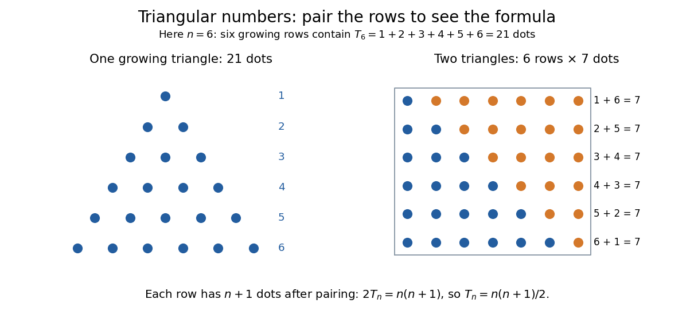
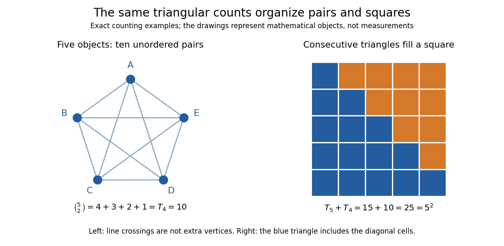

# Triangular number

↑ **Parent:** [Figurate number](figurate-number.md)  
ⓦ [Wiki](https://en.wikipedia.org/wiki/Triangular_number)

A [triangular number](triangular-number.md) counts rows of $1,2,\ldots,n$ objects, with $n$ a [nonnegative integer](natural-number.md):

$$
T_n=\sum_{k=1}^{n}k=\frac{n(n+1)}2,\qquad T_0=0.
$$

The first values are $0,1,3,6,10,15,21,28,36,45,\ldots$. The empty arrangement contributes zero, by the [empty sum](empty-sum.md) convention. Adding one more row gives the [triangular number recurrence](triangular-number-recurrence.md) $T_n-T_{n-1}=n$ for $n\geq1$. The row lengths form an [arithmetic progression](arithmetic-progression.md), while their running totals are [triangular numbers](triangular-number.md).

**[Figure 1](#image-two-copies-of-six-triangular-rows-form-a-rectangle-of-six-rows-and-seven-dots). Two copies of six triangular rows form a rectangle of six rows and seven dots**.

Pair the rows with a reversed copy: $1+n=2+(n-1)=\cdots=n+1$. There are $n$ such pairs, so two copies contain $n(n+1)$ dots. Dividing by two proves the formula. This [rectangle](rectangle.md) picture explains the factor one-half without requiring a formula for a long [summation](summation.md). For example, **one hundred rows contain $T_{100}=5050$ dots**.

The same count appears whenever every pair of different objects must be considered once. Five participants make ten possible handshakes; five sensors have ten different pairwise comparisons; a [complete graph](complete-graph.md) on five [vertices](vertex-graph-theory.md) has ten [edges](edge-of-a-graph.md). These are the [triangular number pair-counting identity](triangular-number-pair-counting-identity.md), with one fewer row than objects. The distinction prevents a common error: $T_5=15$ counts all pairs from six objects, whereas five objects give $T_4=10$.

**[Figure 2](#image-ten-unordered-pairs-of-five-objects-and-two-consecutive-triangular-counts-filling-a-square). Ten unordered pairs of five objects, and two consecutive triangular counts filling a square**.

The [triangular number square-complement identity](triangular-number-square-complement-identity.md) says that two neighboring [triangular numbers](triangular-number.md) fill a [square](square.md). Combining that identity with the one-row difference makes the [difference of squares](difference-of-two-squares.md) $T_n^2-T_{n-1}^2$ equal to $n^3$. It leads to [Nicomachus's theorem](nicomachus-s-theorem.md): the [sum](sum.md) of the first $n$ [cubes of numbers](cube-of-a-number.md) is the [square of a number](square-of-a-number.md) $T_n^2$. A change in the way one groups objects exposes a relation between [summation](summation.md), [multiplication](multiplication.md) and geometry.

This geometric view is already visible in [Nicomachus](nicomachus.md)'s [Introduction to Arithmetic by Nicomachus (Hahn teacher edition)](introduction-to-arithmetic-by-nicomachus-hahn-teacher-edition.md): Book II, Chapter 8 describes growing triangular rows, Chapter 12 combines successive triangular counts into squares, and Chapter 20 groups successive [odd integers](odd-integer.md) into [cubes of numbers](cube-of-a-number.md).[Book II, Chapters 8, 12 and 20, printed pp. 63–64, 70 and 75](introduction-to-arithmetic-by-nicomachus-hahn-teacher-edition.md) The linked edition uses [Martin Luther D'Ooge](martin-luther-d-ooge.md)'s translation, revised with modern teaching material by [Nathanael Hahn](nathanael-hahn.md). Our empty-row index $T_0=0$ is a modern convention; the historical passage starts from unity and calls three the first actual triangle.

**Table of contents**

- [Triangular number recurrence](triangular-number-recurrence.md)
- [Triangular number pair-counting identity](triangular-number-pair-counting-identity.md)
- [Triangular number square-complement identity](triangular-number-square-complement-identity.md)
- [Recognition criterion for triangular numbers](recognition-criterion-for-triangular-numbers.md)
- [Squared triangular number](squared-triangular-number.md)
  - [Nicomachus's theorem](nicomachus-s-theorem.md)
- [Square triangular number](square-triangular-number.md)

## ↑ Ancestors (5)

1. [Figurate number](figurate-number.md)
2. [Arithmetic](arithmetic-split.md)
3. [Area of mathematics](area-of-mathematics.md)
4. [Mathematics](mathematics-split.md)
5. [Codex Wiki](split.md)

## ← Incoming links (12)

- [Figurate number](figurate-number.md)
- [Integer power sum](integer-power-sum.md)
- [Mathematical induction](mathematical-induction.md)
- [Pairing function](pairing-function.md)
- [Solution](past-exam-of-the-mathematics-course-of-the-university-of-cambridge/2003/ia/paper-4/1c/i/solution.md)
- [Solution](past-exam-of-the-mathematics-course-of-the-university-of-cambridge/2003/ia/paper-4/1c/ii/solution.md)
- [Primitive recursive pairing function](primitive-recursive-pairing-function.md)
- [Recognition criterion for triangular numbers](recognition-criterion-for-triangular-numbers.md)
- [Square triangular number](square-triangular-number.md)
- [Squared triangular number](squared-triangular-number.md)
- [Triangular number](triangular-number.md)
- [Triangular number recurrence](triangular-number-recurrence.md)
