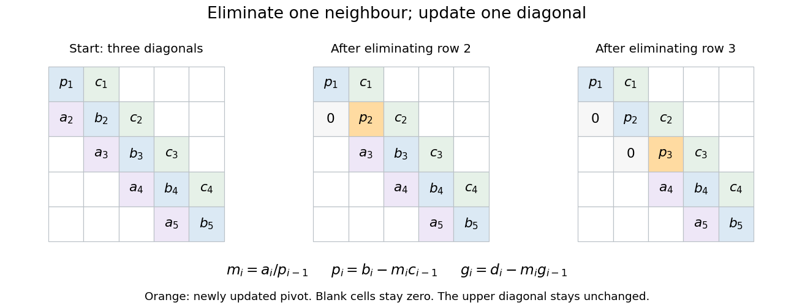

# Tridiagonal elimination recurrences

↑ **Parent:** [Tridiagonal matrix algorithm](tridiagonal-matrix-algorithm.md)

Let $n\geq1$. Store the [tridiagonal matrix](tridiagonal-matrix.md) $A$ by its diagonal $b_1,\ldots,b_n$, lower diagonal $a_2,\ldots,a_n$, and upper diagonal $c_1,\ldots,c_{n-1}$. The [linear system](system-of-linear-equations.md) $Ax=d$ is

$$
a_ix_{i-1}+b_ix_i+c_ix_{i+1}=d_i,\qquad 1\leq i\leq n,
$$

with the nonexistent endpoint terms omitted. Initialize $p_1=b_1$ and $g_1=d_1$. For $i=2,\ldots,n$, compute the [elimination multiplier](elimination-multiplier.md), modified [pivot element](pivot-element.md), and modified right-hand side:

$$
m_i=\frac{a_i}{p_{i-1}},\qquad p_i=b_i-m_ic_{i-1},\qquad g_i=d_i-m_ig_{i-1}.
$$

These [recurrence relations](recurrence-relation.md) apply the [elementary row operation](elementary-row-operation.md) $R_i\leftarrow R_i-m_iR_{i-1}$ after the preceding row has already been reduced. The transformed [linear system](system-of-linear-equations.md) is an upper [bidiagonal matrix](bidiagonal-matrix.md):

$$
p_ix_i+c_ix_{i+1}=g_i\quad(1\leq i<n),\qquad p_nx_n=g_n.
$$

Thus [back substitution](back-substitution.md) is especially short:

$$
x_n=\frac{g_n}{p_n},\qquad x_i=\frac{g_i-c_ix_{i+1}}{p_i}\quad(i=n-1,n-2,\ldots,1).
$$

For $n=1$, only $x_1=d_1/b_1$ remains. Check each [pivot element](pivot-element.md) before its first [division](division-mathematics.md), including $p_n$ before [back substitution](back-substitution.md).

**[Figure 15](#image-tridiagonal-elimination-preserves-the-narrow-band-only-one-row-and-one-diagonal-coefficient-change-per-step). Tridiagonal elimination preserves the narrow band: only one row and one diagonal coefficient change per step**.

Equivalently, this constructs an [LU decomposition](lu-decomposition.md) with unit lower [bidiagonal matrix](bidiagonal-matrix.md) $L$, whose lower diagonal is $m_2,\ldots,m_n$, and upper [bidiagonal matrix](bidiagonal-matrix.md) $U$, whose diagonal is $p_1,\ldots,p_n$ and upper diagonal is $c_1,\ldots,c_{n-1}$. The $g$ sweep is [forward substitution](forward-substitution.md) in $Lg=d$. There is no [fill-in](fill-in.md) outside these bands when no rows are interchanged. LAPACK's `DGTSV` source uses these same coefficient and right-hand-side updates in its branch without row interchange.[DGTSV, LAPACK 3.12.1, Fortran lines 175–180: multiplier and two updates without row interchange](dgtsv-lapack-3-12-1-by-lapack-project.md)

## ↑ Ancestors (6)

1. [Tridiagonal matrix algorithm](tridiagonal-matrix-algorithm.md)
2. [Numerical analysis](numerical-analysis-split.md)
3. [Analysis](analysis-split.md)
4. [Area of mathematics](area-of-mathematics.md)
5. [Mathematics](mathematics-split.md)
6. [Codex Wiki](split.md)
