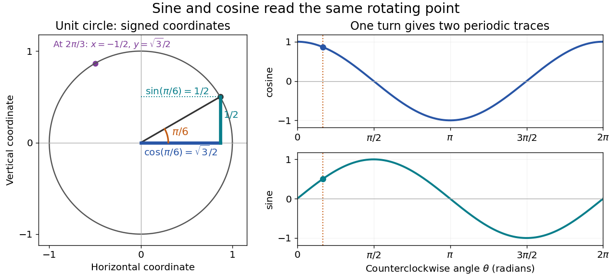

# Trigonometric function

↑ **Parent:** [Geometry and topology](geometry-and-topology-split.md)  
ⓦ [Wiki](https://en.wikipedia.org/wiki/Trigonometric_function)

Trigonometric functions turn an [angle](angle.md) into a coordinate or a [ratio](ratio.md) of lengths. Start at $(1,0)$ on the [unit circle](complex-unit-circle.md) and rotate counterclockwise through $\theta$ [radians](radian.md): the resulting point is

$$
(\cos\theta,\sin\theta).
$$

The [cosine](cosine.md) records horizontal position and the [sine](sine.md) records vertical position. This definition continues around the whole [circle](circle.md), including negative [angles](angle.md), so the signs encode direction rather than requiring a separate rule for each [right triangle](right-triangle.md).

**[Figure 12](#image-sine-and-cosine-as-signed-circle-coordinates-and-periodic-traces). Sine and cosine as signed circle coordinates and periodic traces**.

The [unit circle](complex-unit-circle.md) picture explains why these [functions](function-split.md) are useful beyond measuring [triangles](triangle.md). The two [coordinates](coordinate-linear-algebra.md) of a point rotating at constant angular speed are [periodic functions](periodic-function.md). Scaling the radius to $A$ and using $\theta=\omega t+\phi$ gives $x=A\cos(\omega t+\phi)$ and $y=A\sin(\omega t+\phi)$. A circular motion becomes two simple repeating traces, connecting [Euclidean geometry](euclidean-geometry.md), [simple harmonic motion](simple-harmonic-motion.md), and [Fourier series](fourier-series-split.md).

For an acute [angle](angle.md) in a [right triangle](right-triangle.md), rescaling its [hypotenuse](hypotenuse.md) to one recovers the familiar ratios: [sine](sine.md) is opposite side divided by [hypotenuse](hypotenuse.md), and [cosine](cosine.md) is adjacent side divided by [hypotenuse](hypotenuse.md). The [tangent function](tangent-function.md) is their ratio, $\tan\theta=\sin\theta/\cos\theta$, wherever the denominator is nonzero; the [secant function](secant-trigonometry.md), [cosecant](cosecant.md), and [cotangent](cotangent.md) give the other reciprocal ratios.

The same names extend to [complex numbers](complex-number.md) through the [complex exponential](complex-exponential-function.md):

$$
\cos z=\frac{e^{iz}+e^{-iz}}2,\qquad
\sin z=\frac{e^{iz}-e^{-iz}}{2i}.
$$

These definitions agree with the circle interpretation for real [angles](angle.md). For complex arguments, the values need not lie between $-1$ and $1$; the literal circle-coordinate picture is restricted to real arguments. [NIST Digital Library of Mathematical Functions, §4.14: exponential definitions and periodicity](https://dlmf.nist.gov/4.14)

**Table of contents**

- [Tangent function](tangent-function.md)
- [Sinusoid](sinusoid.md)
- [Product-to-sum formula](product-to-sum-formula.md)
- [Cosecant](cosecant.md)
- [Cotangent](cotangent.md)
  - [Cotangent partial-fraction expansion](cotangent-partial-fraction-expansion.md)
    - [Cotangent Fourier expansion](cotangent-fourier-expansion.md)
- [Sine](sine.md)
  - [Sine infinite product](sine-infinite-product.md)
- [Cosine](cosine.md)
  - [Complex cosine](complex-cosine.md)
- [Sine addition formula](sine-addition-formula.md)
- [Cosine addition formula](cosine-addition-formula.md)
- [Pythagorean trigonometric identity](pythagorean-trigonometric-identity.md)
- [Tangent](tangent.md)
- [Secant (trigonometry)](secant-trigonometry.md)
- [Half-angle identities](half-angle-identities.md)
- [Tangent addition formula](tangent-addition-formula.md)
- [Inverse trigonometric functions](inverse-trigonometric-functions.md)
  - [Inverse tangent](inverse-tangent.md)
  - [Inverse sine](inverse-sine.md)
- [Small-angle approximation](small-angle-approximation.md)
- [Tangent half-angle substitution](tangent-half-angle-substitution.md)

## ↑ Ancestors (4)

1. [Geometry and topology](geometry-and-topology-split.md)
2. [Area of mathematics](area-of-mathematics.md)
3. [Mathematics](mathematics-split.md)
4. [Codex Wiki](split.md)

## ← Incoming links (12)

- [Cotangent partial-fraction expansion](cotangent-partial-fraction-expansion.md)
- [Equatorial coordinate system](equatorial-coordinate-system.md)
- [Horizontal coordinate system](horizontal-coordinate-system.md)
- [Hyperbolic function](hyperbolic-function.md)
- [Solution](past-exam-of-the-mathematics-course-of-the-university-of-cambridge/2001/iii/paper-42/3/solution.md)
- [Solution](past-exam-of-the-mathematics-course-of-the-university-of-cambridge/2019/ib/paper-4/13g/c/solution.md)
- [Product-to-sum formula](product-to-sum-formula.md)
- [Pythagorean trigonometric identity](pythagorean-trigonometric-identity.md)
- [Seidel coma pupil mapping](seidel-coma-pupil-mapping.md)
- [Spherical trigonometry](spherical-trigonometry.md)
- [Tangent](tangent.md)
- [Tangent function](tangent-function.md)
