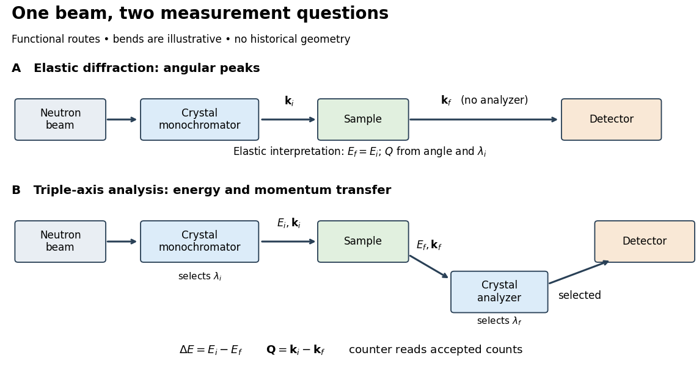

# Triple-axis spectrometer

↑ **Parent:** [Inelastic neutron scattering](inelastic-neutron-scattering.md)  
ⓦ [Wiki](https://en.wikipedia.org/wiki/Triple-axis_spectrometry)

A [triple-axis spectrometer](triple-axis-spectrometer.md) uses [Bragg's law](bragg-s-law.md) at an initial [crystal](crystal.md) [monochromator](monochromator.md) to select $\lambda_i$ and at a second analyzing [crystal](crystal.md) to select $\lambda_f$. The sample sits between these selectors. The three axes refer to the [monochromator](monochromator.md), sample and analyzer rotations. The final counter measures accepted counts; the analyzer's [wavelength](wavelength.md) selection makes those counts sensitive to outgoing [energy](energy-split.md) even when the counter does not measure each neutron's [energy](energy-split.md) directly.

**[Figure 1](#image-functional-routes-for-neutron-diffraction-and-triple-axis-energy-analysis). Functional routes for neutron diffraction and triple-axis energy analysis**. Original functional schematic, with illustrative bends rather than historical angles or distances. The upper route omits the analyzer; interpreting its peaks as elastic requires a physical assumption. The lower route selects both projectile energies. Neither route specifies a historical detector construction.

For a constant-$\mathbf Q$ scan, change incident or outgoing [energy](energy-split.md) while coordinating sample and analyzer settings so that $\mathbf k_i-\mathbf k_f$ stays fixed. Counts versus $E_i-E_f$ then probe excitations at one [momentum transfer](momentum-transfer.md). Changing only the analyzer angle generally changes both transferred quantities. Incident-beam monitoring, analyzer response and the instrumental resolution must enter quantitative interpretation; the diagram's arrows specify information flow, not an absolute [intensity](intensity-physics.md) calibration.

## ↑ Ancestors (9)

1. [Inelastic neutron scattering](inelastic-neutron-scattering.md)
2. [Neutron scattering](neutron-scattering.md)
3. [Neutron](neutron-split.md)
4. [Nucleon](nucleon.md)
5. [Baryon](baryon.md)
6. [Hadron](hadron.md)
7. [Subatomic particle](subatomic-particle.md)
8. [Physics](physics-split.md)
9. [Codex Wiki](split.md)

## ← Incoming links (2)

- [Solution](past-exam-of-the-physics-a-course-of-the-university-of-cambridge/2022/paper-2/section-d/d9/b/solution.md)
- [Triple-axis spectrometer](triple-axis-spectrometer.md)
