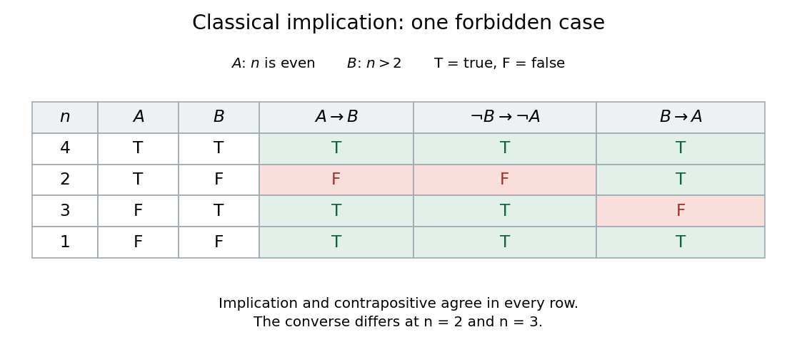

# Truth table

↑ **Parent:** [Boolean valuation](boolean-valuation.md)  
ⓦ [Wiki](https://en.wikipedia.org/wiki/Truth_table)

A truth table lists a [propositional formula](propositional-formula.md)'s value for every [Boolean valuation](boolean-valuation.md) of its distinct primitive [propositions](proposition.md). With $k$ primitive [propositions](proposition.md), there are $2^k$ rows: each independently receives T or F. Evaluate compound columns from their subexpressions using the classical rules for [logical connectives](logical-connective.md). This is exhaustive checking, so a formula true on every row is valid in [classical propositional logic](classical-propositional-logic.md).

For a computed example over the [natural numbers](natural-number.md), let $A(n)$ mean that $n$ is an [even number](even-number.md) and $B(n)$ mean $n>2$. The choices $n=4,2,3,1$ realize respectively $(A,B)=(\mathrm T,\mathrm T),(\mathrm T,\mathrm F),(\mathrm F,\mathrm T),(\mathrm F,\mathrm F)$: all four possible inputs.

**[Figure 4](#image-classical-logical-implication-its-contrapositive-and-its-converse-implication-on-all-four-inputs). Classical logical implication, its contrapositive, and its converse implication on all four inputs**.

The [logical implication](logical-implication.md) $A\to B$ and its [contrapositive](contrapositive.md) agree on every row; the [converse implication](converse-implication.md) $B\to A$ differs on two rows. A [truth table](truth-table.md) therefore checks equivalence or supplies a [counterexample](counterexample.md). Classical truth conditions are given in [forall x: Calgary, section 31.2](https://forallx.openlogicproject.org/html/Ch31.html). These two-valued [truth tables](truth-table.md) do not characterize validity in [Intuitionistic propositional logic](intuitionistic-propositional-logic.md).

## ↑ Ancestors (7)

1. [Boolean valuation](boolean-valuation.md)
2. [Propositional logic](propositional-logic.md)
3. [Mathematical logic](mathematical-logic-split.md)
4. [Foundations of mathematics](foundations-of-mathematics-split.md)
5. [Area of mathematics](area-of-mathematics.md)
6. [Mathematics](mathematics-split.md)
7. [Codex Wiki](split.md)

## ← Incoming links (16)

- [Boolean operation](boolean-operation.md)
- [Boolean satisfiability problem](boolean-satisfiability-problem.md)
- [Boolean valuation](boolean-valuation.md)
- [Complement of a set](complement-of-a-set.md)
- [De Morgan's laws](de-morgan-s-laws.md)
- [Decidability theorem for propositional logic](decidability-theorem-for-propositional-logic.md)
- [Exclusive or](exclusive-or.md)
- [Logical connective](logical-connective.md)
- [Logical equivalence](logical-equivalence.md)
- [Logical implication](logical-implication.md)
- [Solution](past-exam-of-the-mathematics-course-of-the-university-of-cambridge/2005/ii/paper-4/16f/solution.md)
- [Solution](past-exam-of-the-mathematics-course-of-the-university-of-cambridge/2006/iii/paper-59/1/solution.md)
- [Solution](past-exam-of-the-mathematics-course-of-the-university-of-cambridge/2019/ii/paper-1/16i/solution.md)
- [Propositional logic](propositional-logic.md)
- [Truth table](truth-table.md)
- [Unsatisfiable Boolean formula](unsatisfiable-boolean-formula.md)
