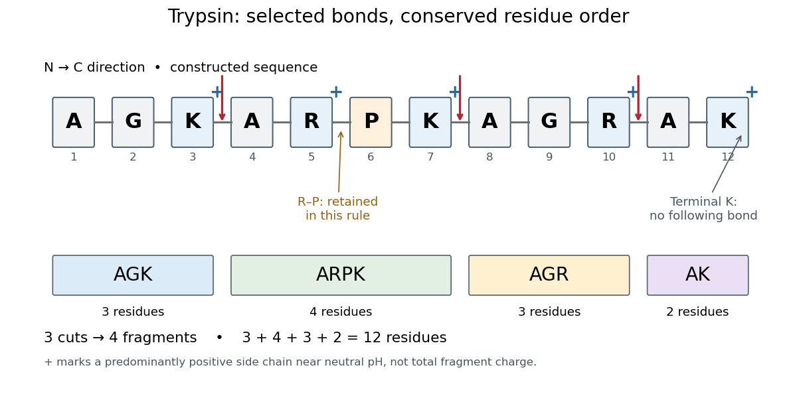

# Trypsin cleavage specificity

↑ **Parent:** [Trypsin](trypsin.md)

Write a [peptide](peptide.md)'s [protein primary structure](protein-primary-structure.md) from its [N-terminus](n-terminus.md) toward its [C-terminus](c-terminus.md). The usual simplified [trypsin cleavage specificity](trypsin-cleavage-specificity.md) rule places a cut immediately after K ([lysine](lysine.md)) or R ([arginine](arginine.md)), unless the next [amino acid residue](amino-acid-residue.md) is P ([proline](proline.md)). The following [amino acid residue](amino-acid-residue.md) is essential: a terminal K or R has no following [peptide bond](peptide-bond.md) to cut. The inspected institutional documentation describes [proline](proline.md) as usually blocking cleavage, and explicitly lists sequence contexts in which that blocking is negligible. It also warns that experimental results can differ from sequence-based predictions. Thus “never before [proline](proline.md)” is too strong.[PeptideCutter: Cleavage specificities of selected enzymes and chemicals, General model; Establishing a specificity model; Trypsin; Cleavage rules and exceptions](peptidecutter-cleavage-specificities-of-selected-enzymes-and-chemicals-expasy.md)

For an original worked example, stipulate complete cleavage at all sites allowed by that simplified rule in the twelve-[amino acid residue](amino-acid-residue.md) sequence

$$
\mathrm{AGKARPKAGRAK}\quad\longrightarrow\quad
\mathrm{AGK}\;|\;\mathrm{ARPK}\;|\;\mathrm{AGR}\;|\;\mathrm{AK}.
$$

A denotes [alanine](alanine.md), G denotes [glycine](glycine.md), and K, R and P have the meanings above. Cuts follow positions $3$, $7$ and $10$. Position $5$ is R, but its following P suppresses that cut in the stipulated rule; position $12$ is terminal K. Notice that the R in ARPK is retained inside the fragment, despite being a usually favoured [trypsin](trypsin.md) target.

**[Figure 9](#image-trypsin-cleavage-specificity-three-selected-cuts-make-four-peptide-fragments). Trypsin cleavage specificity: three selected cuts make four peptide fragments**. Original sequence and prediction under the simplified K/R rule with suppression before [proline](proline.md). Blue plus signs identify predominantly positive [lysine](lysine.md) and [arginine](arginine.md) [amino acid side chains](amino-acid-side-chain.md) near neutral [pH](ph.md), not the net [electric charge](electric-charge-split.md) of each fragment. The example is constructed, not an observed digest.

Near neutral [pH](ph.md), the [lysine](lysine.md) and [arginine](arginine.md) [amino acid side chains](amino-acid-side-chain.md) undergo predominant [protonation](protonation.md) and carry positive [electric charge](electric-charge-split.md). This helps distinguish those [amino acid residues](amino-acid-residue.md) from the uncharged letter symbols used to write the sequence; those symbols specify identities, not whole-fragment [electric charges](electric-charge-split.md).[Organic Chemistry by John McMurry; Table 26.1, lysine and arginine rows; concluding classification paragraph, side-chain protonation at pH 7.3](organic-chemistry-by-john-mcmurry/26-1-structures-of-amino-acids.md)

Fragment accounting checks the prediction: lengths $3+4+3+2=12$ conserve the twelve [amino acid residues](amino-acid-residue.md). The original linear chain has eleven [peptide bonds](peptide-bond.md); the four fragments retain $2+3+2+1=8$, so three were hydrolysed. Three [water](water.md) molecules are consumed per original chain in this formal [stoichiometry](stoichiometry.md). More generally, cutting $m$ distinct bonds of one linear [peptide](peptide.md) makes $m+1$ fragments: each cut splits one connected piece into two. This argument assumes an unbranched chain without additional links joining the pieces.

A [missed trypsin cleavage](missed-trypsin-cleavage.md) at position $7$ would instead give $\mathrm{AGK}\;|\;\mathrm{ARPKAGR}\;|\;\mathrm{AK}$, merging two neighbouring fragments without changing their order. Even a correct cleavage preference does not guarantee complete [proteolysis](proteolysis.md); predicted fragment boundaries describe a model, while actual boundaries require evidence from the digest.

**Table of contents**

- [Missed trypsin cleavage](missed-trypsin-cleavage.md)

## ↑ Ancestors (4)

1. [Trypsin](trypsin.md)
2. [Enzyme](enzyme-split.md)
3. [Biology](biology-split.md)
4. [Codex Wiki](split.md)

## ← Incoming links (2)

- [Missed trypsin cleavage](missed-trypsin-cleavage.md)
- [Trypsin cleavage specificity](trypsin-cleavage-specificity.md)
