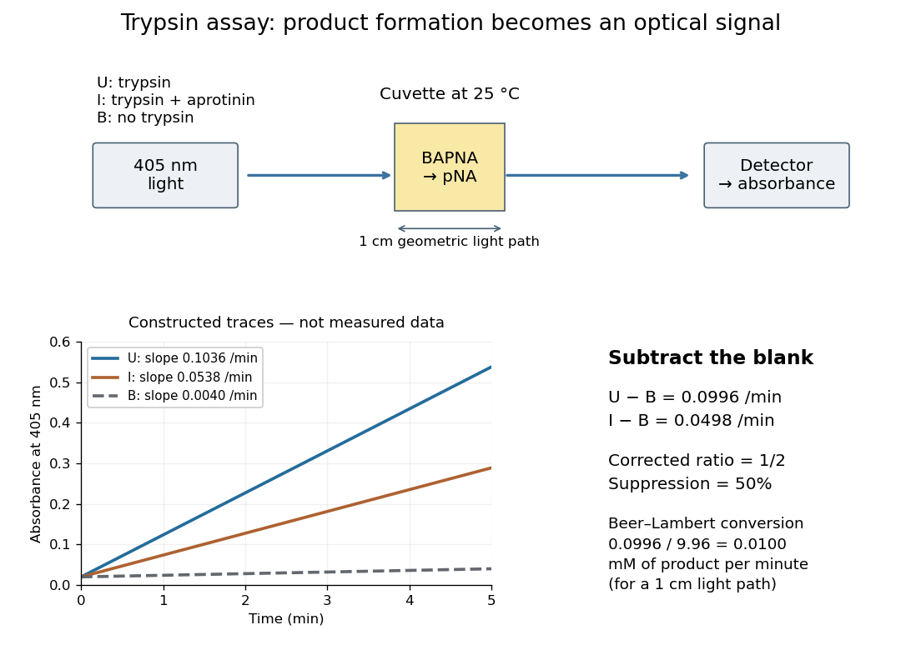

# Trypsin colorimetric assay

↑ **Parent:** [Trypsin](trypsin.md)

A [trypsin colorimetric assay](trypsin-colorimetric-assay.md) follows [enzyme](enzyme-split.md) activity through [absorbance](absorbance.md) at $405\,\mathrm{nm}$. [Trypsin](trypsin.md) cleaves an [amide](amide.md) bond in the synthetic [arginine](arginine.md) derivative [BAPNA](bapna.md), releasing [p-Nitroaniline](4-nitroaniline.md).[Enzymatic Assay of APROTININ, Sigma quality-control procedure, p. 1: Principle and Conditions](enzymatic-assay-of-aprotinin-sigma-quality-control-test-procedure.md)

The inspected Sigma procedure prepares fresh [trypsin](trypsin.md) in cold $1\,\mathrm{mM}$ [hydrochloric acid](hydrochloric-acid.md) and fully dissolves $1\,\mathrm{mg/ml}$ [BAPNA](bapna.md). Its [buffer solution](buffer-solution.md) stock contains $200\,\mathrm{mM}$ [triethanolamine](triethanolamine.md) and $20\,\mathrm{mM}$ [calcium chloride](calcium-chloride.md), at [pH](ph.md) $7.8$. Three $3.00\,\mathrm{ml}$ [cuvettes](cuvette.md) compare [trypsin](trypsin.md), [trypsin](trypsin.md) plus the [enzyme inhibitor](enzyme-inhibitor.md) [aprotinin](aprotinin.md), and a blank replacing [trypsin](trypsin.md) with its acid solvent. [Sodium chloride](sodium-chloride.md) solution replaces [aprotinin](aprotinin.md) in the uninhibited control. A thermostatted instrument for [spectrophotometry](spectrophotometry.md) holds $25\,{}^\circ\mathrm C$ and a $1\,\mathrm{cm}$ light path. After equilibration, adding [BAPNA](bapna.md) starts approximately five minutes of [absorbance](absorbance.md) recording. The uninhibited sample checks activity; the blank checks background; the inhibited sample tests suppression.[Enzymatic Assay of APROTININ, pp. 1–2: Reagents A–F, cuvette table and Procedure](enzymatic-assay-of-aprotinin-sigma-quality-control-test-procedure.md)

**[Figure 10](#image-trypsin-colorimetric-assay-controlled-absorbance-readout-and-an-original-numerical-model). Trypsin colorimetric assay: controlled absorbance readout and an original numerical model**. Original apparatus schematic and constructed straight-line traces. The traces illustrate blank subtraction and inhibition arithmetic; they are not measurements from Sigma's procedure. U is uninhibited, I inhibited, and B blank.

Let $s_U$, $s_I$ and $s_B$ denote the measured [absorbance](absorbance.md) [slopes](slope.md) per minute over the same linear time interval. Blank subtraction gives $s_U-s_B$ and $s_I-s_B$. If [p-Nitroaniline](4-nitroaniline.md) accounts for the changing [absorbance](absorbance.md), the [Beer-Lambert law](beer-lambert-law.md) gives

$$
A_{405}=\varepsilon l c,\qquad
\frac{dc}{dt}=\frac{s_U-s_B}{\varepsilon l}.
$$

Here $c$ is product [molar concentration](molar-concentration.md) and $l$ is the geometric light path through the [chemical solution](solution-chemistry.md). Sigma uses $\varepsilon=9.96\,\mathrm{mM^{-1}cm^{-1}}$.[Enzymatic Assay of APROTININ, p. 2: Calculations, millimolar extinction coefficient at 405 nm](enzymatic-assay-of-aprotinin-sigma-quality-control-test-procedure.md)

Choose original illustrative [slopes](slope.md) $s_U=0.1036$, $s_I=0.0538$ and $s_B=0.0040\,\mathrm{min^{-1}}$. The corrected uninhibited [slope](slope.md) is $0.0996\,\mathrm{min^{-1}}$, giving $dc/dt=0.0100\,\mathrm{mM\,min^{-1}}=10.0\,\mathrm{\mu M\,min^{-1}}$ at $l=1\,\mathrm{cm}$. In $3.00\,\mathrm{ml}$, the product [amount of substance](amount-of-substance.md) increases at $0.0300\,\mathrm{\mu mol\,min^{-1}}$. The corrected inhibited [slope](slope.md) is $0.0498\,\mathrm{min^{-1}}$, half as large. The relative suppression is therefore

$$
100\left(1-\frac{s_I-s_B}{s_U-s_B}\right)
=100\frac{s_U-s_I}{s_U-s_B}=50\%.
$$

The background cancels in the numerator, but remains essential in the denominator. Using uncorrected [slopes](slope.md) would instead give about $48.07\%$. Differentiating $A_{405}=\varepsilon lc$ with fixed $\varepsilon$ and $l$ explains the rate conversion; [dimensional analysis](dimensional-analysis.md) checks it independently, since $\mathrm{min^{-1}}/(\mathrm{mM^{-1}cm^{-1}}\,\mathrm{cm})=\mathrm{mM\,min^{-1}}$.

The inference is a [reaction rate](reaction-rate.md) on [BAPNA](bapna.md) under the stated conditions, rather than a direct count of [trypsin](trypsin.md) molecules or proof of every cut in a [protein](protein-split.md). Cloudiness, other absorbing [solutes](solute.md), or different product [protonation](protonation.md) can compromise the [Beer-Lambert law](beer-lambert-law.md) interpretation. A matched blank and a linear interval are therefore part of the measurement's meaning. A coloured [enzyme inhibitor](enzyme-inhibitor.md) may require its own matched blank; a changed [substrate](substrate-biochemistry.md) or [pH](ph.md) requires a fresh calibration. The constructed constant [slopes](slope.md) above describe only that interval, not indefinite product accumulation.

## ↑ Ancestors (4)

1. [Trypsin](trypsin.md)
2. [Enzyme](enzyme-split.md)
3. [Biology](biology-split.md)
4. [Codex Wiki](split.md)

## ← Incoming links (4)

- [BAPNA](bapna.md)
- [Cuvette](cuvette.md)
- [Enzyme inhibition initial-rate assay](enzyme-inhibition-initial-rate-assay.md)
- [Trypsin colorimetric assay](trypsin-colorimetric-assay.md)
