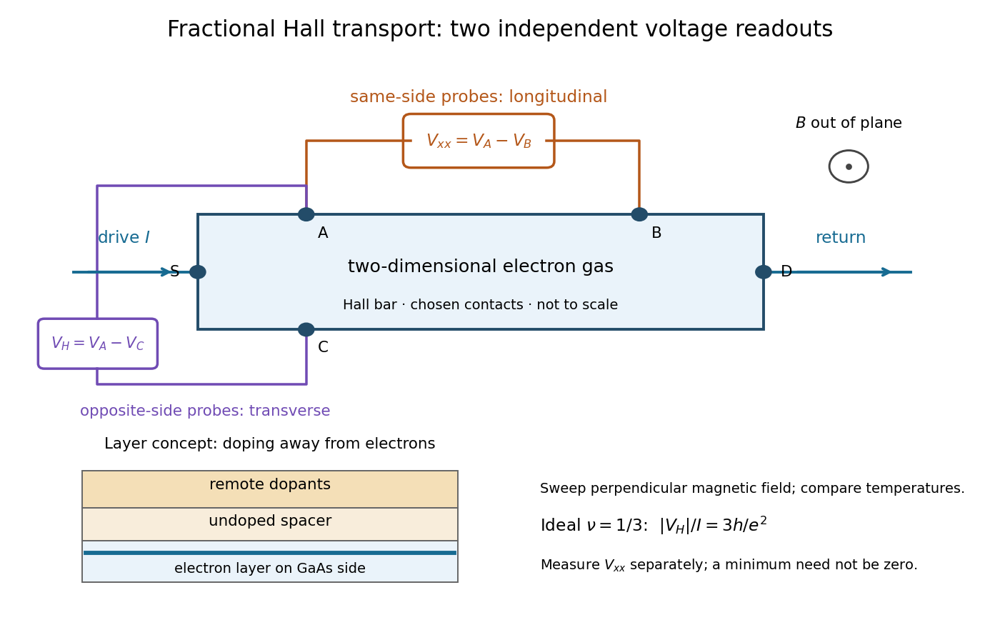

<h1 id="tsui-stormer-gossard-fractional-hall-experiment">Tsui-Störmer-Gossard fractional Hall experiment</h1>

↑ **Parent:** [Fractional quantum Hall effect](fractional-quantum-hall-effect.md)

[Daniel Tsui](daniel-chee-tsui.md), [Horst Störmer](horst-stormer.md) and [Arthur Gossard](arthur-gossard.md) reported the effect in 1982. They grew [gallium arsenide](gallium-arsenide.md)–[aluminium gallium arsenide](aluminium-gallium-arsenide.md) layers by [molecular beam epitaxy](molecular-beam-epitaxy.md), separating the [two-dimensional electron gas](two-dimensional-electron-gas.md) from its [semiconductor doping](semiconductor-doping.md). They cut [Hall bars](hall-bar.md) and made [indium](indium.md) contacts. Low-field measurements established [number density](number-density.md) and [charge carrier mobility](charge-carrier-mobility.md). A perpendicular [magnetic field](magnetic-field-split.md) sweep measured transverse and longitudinal [sheet resistivities](sheet-resistivity.md) at several [temperatures](temperature-split.md). Cooling sharpened the plateau near $3h/e^2$ and the longitudinal minimum at [filling factor](filling-factor-quantum-hall-effect.md) $1/3$; integer plateaus provided an internal comparison. The longitudinal minimum remained finite at the lowest [temperature](temperature-split.md): zero-temperature vanishing was unresolved. This established anomalous transport, without directly measuring excitation [electric charge](electric-charge-split.md).[pp. 1559–1561, sample preparation, Figs. 1–2 and finite longitudinal minimum](two-dimensional-magnetotransport-in-the-extreme-quantum-limit-by-daniel-chee-tsui-and-others.md)

**[Figure 10](#image-separate-transverse-and-longitudinal-readouts-of-a-fractional-quantum-hall-effect-experiment). Separate transverse and longitudinal readouts of a fractional quantum Hall effect experiment**. Original functional [Hall bar](hall-bar.md) schematic, with chosen contact labels and no historical dimensions. The inset separates the [two-dimensional electron gas](two-dimensional-electron-gas.md) from [semiconductor doping](semiconductor-doping.md); the two meters distinguish transverse [electrical resistance](electrical-resistance.md) from longitudinal dissipation. No trace or measured value is reconstructed.

The two readouts test different statements. A single intersection with $R_H=3R_K$ would also occur on the smooth classical relation $R_H=B/(n_se)$ at $n_sh/(eB)=1/3$. A [quantum Hall plateau](quantum-hall-plateau.md) instead persists over a [magnetic field](magnetic-field-split.md) interval. Comparing transverse and longitudinal signals helps distinguish that plateau from a contact-placement artefact; the [quantum Hall conductivity tensor inversion](quantum-hall-conductivity-tensor-inversion.md) quantifies the contamination when longitudinal [sheet resistivity](sheet-resistivity.md) is nonzero.

Later, 1997 [shot noise](shot-noise.md) measurements associated with [quantum tunnelling](quantum-tunnelling.md) at [filling factor](filling-factor-quantum-hall-effect.md) $1/3$ tested the excitation [electric charge](electric-charge-split.md) separately, finding $e/3$. That is a different observable from a Hall plateau.[Publisher abstract: tunnelling noise and inferred quasiparticle charge](observation-of-the-e%E2%81%843-fractionally-charged-laughlin-quasiparticle-by-l-saminadayar-and-others.md)

## ↑ Ancestors (11)

1. [Fractional quantum Hall effect](fractional-quantum-hall-effect.md)
2. [Quantum Hall effect](quantum-hall-effect.md)
3. [Hall effect](hall-effect.md)
4. [Lorentz force](lorentz-force.md)
5. [Electromagnetic field tensor](electromagnetic-field-tensor.md)
6. [Electromagnetic four-potential](electromagnetic-four-potential.md)
7. [Relativistic electromagnetism](relativistic-electromagnetism-split.md)
8. [Electromagnetism](electromagnetism-split.md)
9. [Branches of physics](branches-of-physics.md)
10. [Physics](physics-split.md)
11. [Codex Wiki](split.md)

## ← Incoming links (1)

- [Solution](past-exam-of-the-quantum-condensed-matter-course-of-the-university-of-cambridge/2006/section-b/b4/d/solution.md)
