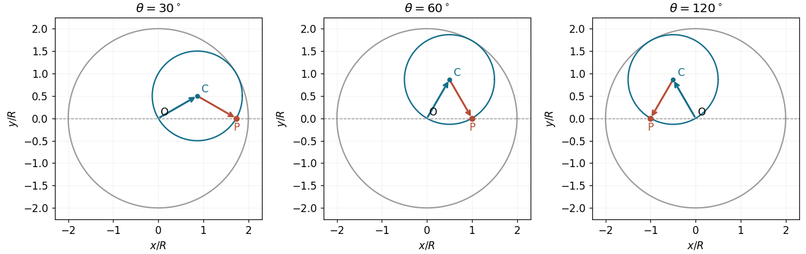

# Tusi couple

↑ **Parent:** [Celestial mechanics](celestial-mechanics-split.md)  
ⓦ [Wiki](https://en.wikipedia.org/wiki/Tusi_couple)

Two uniform [circular motions](circular-motion.md) of radius $R$ and opposite angular rates sum to rectilinear oscillation: $R(\cos\theta,\sin\theta)+R(\cos\theta,-\sin\theta)=(2R\cos\theta,0)$. Geometrically, a circle of radius $R$ rolls inside one of radius $2R$; a marked point traces a diameter. This plane construction must be distinguished from spherical variants, which need their own geometric argument.[research abstract: distinction between plane and spherical versions](the-spherical-case-of-the-tusi-couple-by-george-saliba-and-e-s-kennedy.md)

**[Figure 1](#image-three-positions-of-the-tusi-couple-the-sum-of-two-equal-circular-radius-vectors-stays-on-a-diameter). Three positions of the Tusi couple: the sum of two equal circular radius vectors stays on a diameter**.

## ↑ Ancestors (5)

1. [Celestial mechanics](celestial-mechanics-split.md)
2. [Classical mechanics](classical-mechanics-split.md)
3. [Branches of physics](branches-of-physics.md)
4. [Physics](physics-split.md)
5. [Codex Wiki](split.md)

## ← Incoming links (1)

- [Solution](past-exam-of-the-history-of-science-supplementary-subject-of-the-university-of-oxford/2021/1/solution.md)
