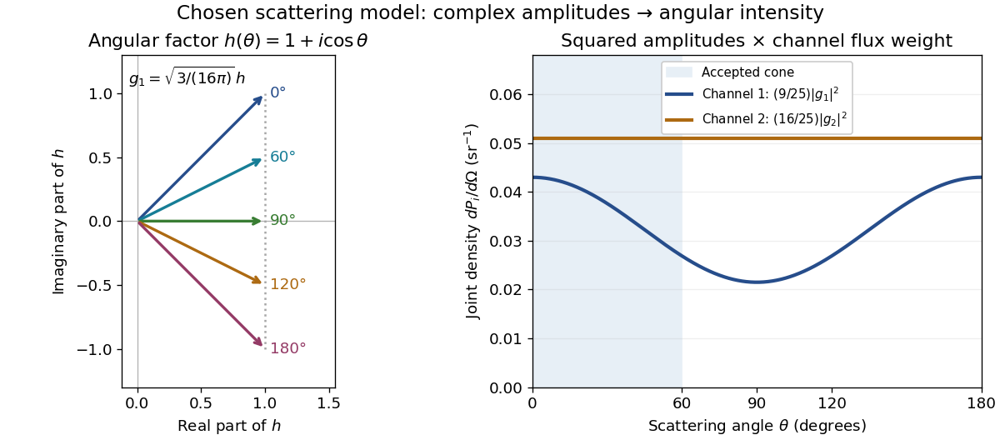
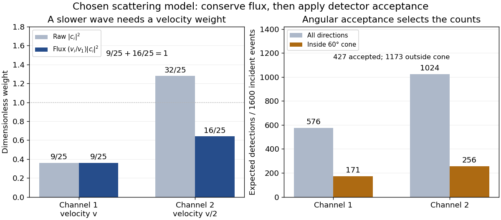

# Two-channel scattering with flux normalization

↑ **Parent:** [Born statistical scattering interpretation](born-statistical-scattering-interpretation.md)

Consider one chosen model at a fixed total [energy](energy-split.md), with two open [scattering channels](scattering-channel.md), no absorption and no omitted outgoing modes. Channel 1 leaves the target unchanged; channel 2 excites it. Let $v_1=v>0$ and $v_2=v/2$. For the same projectile [mass](mass.md), [conservation of energy](conservation-of-energy.md) then requires a target excitation $\Delta=3mv^2/8$. These are hypothetical parameters, not a fit to a particular atom. Each incoming or outgoing mode is normalized to unit [probability current](probability-current.md); the outgoing modes will have the angular profiles specified below.

Choose the [S-matrix](s-matrix.md)

$$
S=\frac15\begin{pmatrix}3&4i\\4i&3\end{pmatrix},\qquad
S^\dagger S=\frac1{25}\begin{pmatrix}25&12i-12i\\-12i+12i&25\end{pmatrix}=I.
$$

This phenomenological [unitary matrix](unitary-matrix.md) specifies the channel conversion; it is not derived here from an interaction [potential energy](potential-energy.md). For incidence in channel 1, its first column gives the outgoing flux amplitudes

$$
b=S\begin{pmatrix}1\\0\end{pmatrix}
=\begin{pmatrix}3/5\\4i/5\end{pmatrix},\qquad
P_1=\frac9{25},\quad P_2=\frac{16}{25}.
$$

To recover ordinary wave coefficients relative to an incident coefficient one, undo the [velocity](velocity.md) normalization:

$$
c_i=\sqrt{\frac{v_1}{v_i}}b_i,\qquad
c_1=\frac35,\quad c_2=\frac{4i\sqrt2}{5},\qquad
\sum_i\frac{v_i}{v_1}|c_i|^2=\frac9{25}+\frac12\frac{32}{25}=1.
$$

Thus $|c_2|^2=32/25>1$ is allowed: channel 2 travels more slowly. Its outgoing [probability current](probability-current.md) fraction is $16/25$, not $32/25$. Renormalizing the unweighted squares would give $9/41$ and $32/41$, the wrong [probabilities](probability.md). More generally the ordinary coefficient map is $A=V^{-1/2}SV^{1/2}$, with $V=\operatorname{diag}(v,v/2)$; it obeys $A^\dagger VA=V$. The conserved quantity is the squared coefficient [norm](norm.md) weighted by [velocity](velocity.md), which represents [probability current](probability-current.md).

Now specify an original angular realization of these two outgoing modes, with [scattering angle](scattering-angle.md) $\theta$ and no azimuth dependence:

$$
g_1(\theta)=\sqrt{\frac3{16\pi}}(1+i\cos\theta),\qquad
g_2(\theta)=\frac1{\sqrt{4\pi}},\qquad
\int|g_1|^2d\Omega=\int|g_2|^2d\Omega=1.
$$

The first normalization follows from $2\pi\int_{-1}^1(1+u^2)\,du=16\pi/3$, where $u=\cos\theta$. These angular profiles define the modes of this model; they are not asserted to follow from Born's approximation or an atomic [potential energy](potential-energy.md). The joint directional [probability densities](probability-density.md) are

$$
\frac{dP_1}{d\Omega}=\frac9{25}\frac3{16\pi}(1+\cos^2\theta),\qquad
\frac{dP_2}{d\Omega}=\frac{16}{25}\frac1{4\pi}.
$$

**[Figure 6](#image-complex-angular-amplitudes-become-channel-resolved-scattering-intensity). Complex angular amplitudes become channel-resolved scattering intensity**. [Source](born-scattering-complex-amplitude-angular-intensity.py). Original two-channel model. Left: arrows in the [complex plane](complex-plane.md) show $h(\theta)=1+i\cos\theta$, the angular factor of $g_1$. Right: the joint directional [probability densities](probability-density.md) $P_i|g_i|^2$, per [solid angle](solid-angle.md), retain the channel flux weights $9/25$ and $16/25$. The shaded interval is the cone $0\leq\theta\leq60^\circ$; its [probability](probability.md) requires the measure $2\pi\sin\theta\,d\theta$, not the area under a curve against degrees. These are chosen amplitudes, not historical measurements.

Suppose a detector accepts the cone $D:0\leq\theta\leq\pi/3$, with full azimuth and unit efficiency. Its angular fractions within the channels are

$$
F_1=\frac38\int_{1/2}^1(1+u^2)\,du=\frac{19}{64},\qquad
F_2=\frac12\int_{1/2}^1du=\frac14.
$$

Multiplying the angular fractions by the outgoing flux weights gives

$$
\Pr(1,D)=\frac9{25}\frac{19}{64}=\frac{171}{1600},\qquad
\Pr(2,D)=\frac{16}{25}\frac14=\frac{256}{1600}.
$$

For $1600$ independent incident events, the [expected values](expected-value-split.md) are therefore $171$ and $256$ accepted detections, compared with $576$ and $1024$ over all directions. The remaining expected $1173$ events fall outside the cone. The chosen incident number makes the expectations integers; actual counts fluctuate. Conditional on a detection inside the cone, the channel [probabilities](probability.md) are $171/427$ and $256/427$, rather than $9/25$ and $16/25$. Angular acceptance changes the observed channel proportions even with equal detector efficiencies.

**[Figure 7](#image-velocity-weighting-and-angular-acceptance-determine-expected-channel-counts). Velocity weighting and angular acceptance determine expected channel counts**. [Source](born-scattering-channel-counts-weighted-flux.py). Original model with $1600$ incident events. Left: raw squared wave coefficients $9/25$ and $32/25$ become conserved outgoing flux fractions $9/25$ and $16/25$ after multiplying by $v_i/v_1$. Right: all-direction expectations $576$ and $1024$ become $171$ and $256$ inside the $60^\circ$ cone. Bars show calculated [expected values](expected-value-split.md), not a generated sample or experimental counts.

The final atomic states are [orthogonal](orthogonal-vectors.md), so ignoring the atomic readout adds the two channel intensities; it does not produce $|b_1g_1+b_2g_2|^2$. Coherent paths that reach the same final state can instead interfere, as the existing [probability amplitude](probability-amplitude.md) and [quantum superposition](quantum-superposition.md) examples demonstrate. The distinction is physical distinguishability of final states, not whether the detector operator chooses to display their labels. Flux normalization and angular integration make the scattering interpretation useful: they turn complex outgoing waves into conserved event weights and then into the statistics of a specified detector.

## ↑ Ancestors (8)

1. [Born statistical scattering interpretation](born-statistical-scattering-interpretation.md)
2. [Born rule](born-rule.md)
3. [Probability amplitude](probability-amplitude.md)
4. [Wave function](wave-function-split.md)
5. [Quantum mechanics](quantum-mechanics-split.md)
6. [Branches of physics](branches-of-physics.md)
7. [Physics](physics-split.md)
8. [Codex Wiki](split.md)
