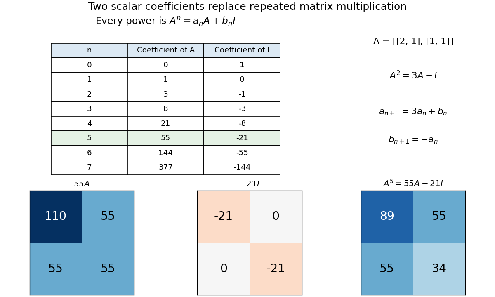

# Two-coefficient reduction of matrix powers

↑ **Parent:** [Cayley-Hamilton theorem](cayley-hamilton-theorem-split.md)

Consider the real [matrix](matrix.md)

$$
A=\begin{pmatrix}2&1\\1&1\end{pmatrix},\qquad
\chi_A(t)=(t-2)(t-1)-1=t^2-3t+1.
$$

The [Cayley-Hamilton theorem](cayley-hamilton-theorem-split.md) gives $A^2=3A-I$. Consequently

$$
A^3=3A^2-A=8A-3I,\qquad
A^4=21A-8I,\qquad A^5=55A-21I.
$$

Thus

$$
\boxed{A^5=\begin{pmatrix}89&55\\55&34\end{pmatrix}.}
$$

All four entries come from just two scalar coefficients. If $A^n=a_nA+b_nI$, multiplying once by $A$ and replacing $A^2$ gives the [linear recurrence relation](linear-recurrence-relation.md)

$$
a_{n+1}=3a_n+b_n,\qquad b_{n+1}=-a_n,
\qquad(a_0,b_0)=(0,1).
$$

Equivalently $a_{n+2}=3a_{n+1}-a_n$, with $a_0=0,a_1=1$. The appearance of [Fibonacci numbers](fibonacci-number.md) is explained by $A=Q^2$, where $Q=\begin{pmatrix}1&1\\1&0\end{pmatrix}$ advances the [Fibonacci recurrence](fibonacci-recurrence.md). No [eigenvectors](eigenvector.md) need to be computed.

**[Figure 1](#image-cayley-hamilton-reduces-powers-of-a-chosen-two-by-two-matrix-to-two-integer-coefficients-the-fifth-power-is-55a-minus-21i). Cayley–Hamilton reduces powers of a chosen two-by-two matrix to two integer coefficients; the fifth power is 55A − 21I**.

The same identity computes an inverse. Rearrange it as $A(3I-A)=I$, giving

$$
\boxed{A^{-1}=3I-A=\begin{pmatrix}1&-1\\-1&2\end{pmatrix}.}
$$

This works because the constant term of this [characteristic polynomial](characteristic-polynomial.md) is nonzero and the coefficients lie in a [field](field.md). Generally, when $c_0\ne0$ over a [field](field.md), rearranging the [Cayley-Hamilton theorem](cayley-hamilton-theorem-split.md) expresses $A^{-1}$ as a [polynomial evaluated at a matrix](polynomial-evaluated-at-a-matrix.md). Over a general [commutative ring](commutative-ring.md), a nonzero constant need not be a [unit](unit-in-a-ring.md); invertibility requires that extra condition.

## ↑ Ancestors (8)

1. [Cayley-Hamilton theorem](cayley-hamilton-theorem-split.md)
2. [Minimal polynomial](minimal-polynomial.md)
3. [Operator theory](linear-operator-theory-split.md)
4. [Linear algebra](linear-algebra-split.md)
5. [Algebra](algebra-split.md)
6. [Area of mathematics](area-of-mathematics.md)
7. [Mathematics](mathematics-split.md)
8. [Codex Wiki](split.md)

## ← Incoming links (1)

- [Polynomial reduction of matrix powers](polynomial-reduction-of-matrix-powers.md)
