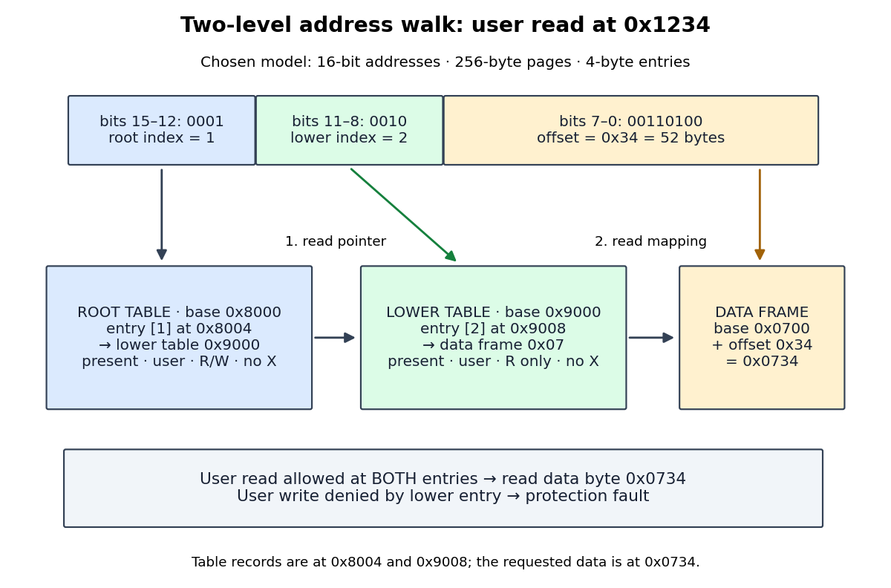

# Two-level address translation

↑ **Parent:** [Multi-level page table](multi-level-page-table.md)

Choose an original teaching model with 16-[bit](bit.md) [virtual addresses](virtual-address.md), 16-[bit](bit.md) [physical addresses](physical-address.md), and 256-[byte](byte.md) [memory pages](memory-page.md) and [page frames](page-frame.md). The eight high [bits](bit.md) identify a virtual [memory page](memory-page.md); divide these into two four-[bit](bit.md) indices. The eight low [bits](bit.md) are the offset within the [memory page](memory-page.md). Thus each [page table](page-table.md) has 16 entries: the root selects a lower-level [page table](page-table.md), and that table selects a data [page frame](page-frame.md). Every [page table entry](page-table-entry.md) is four [bytes](byte.md), including its reference and flags. These are chosen model parameters, not a hardware entry encoding.

For a [virtual address](virtual-address.md) $v$, extract the root index $i$, lower-level index $j$, and offset $d$ by [Euclidean division](euclidean-division.md):

$$
i=\left\lfloor\frac{v}{4096}\right\rfloor,\qquad
j=\left\lfloor\frac{v}{256}\right\rfloor\bmod16,\qquad
d=v\bmod256,\qquad
v=4096i+256j+d.
$$

Here $\lfloor\cdot\rfloor$ is the [floor function](floor-function.md) and $\bmod$ denotes the remainder in [Euclidean division](euclidean-division.md). Each index ranges from 0 to 15, and $d$ ranges from 0 to 255. In [hexadecimal](hexadecimal.md), [virtual address](virtual-address.md) `0x1234` splits into $i=1$, $j=2$, and $d=\mathtt{0x34}=52$; its [binary numeral system](binary-numeral-system.md) representation is `0001 | 0010 | 00110100`.

Fix the requested operation to be a one-[byte](byte.md) user read. Assume both table nodes and the data [page frame](page-frame.md) are resident, table reads are allowed, and no mapping changes during the [page table walk](page-table-walk.md). The model requires presence at both levels and takes the [set intersection](set-intersection.md) of the two entries' read, write, execute, and user-access permissions. This is an explicit [memory protection](memory-protection.md) rule for this model; [Sv39 page tables](sv39-page-table.md) use different rules. The root's [physical address](physical-address.md) is `0x8000`; the relevant entries are:

| Record | [Physical address](physical-address.md) of record | Reference held in the [page table entry](page-table-entry.md) | Presence and permissions |
| --- | --- | --- | --- |
| Root entry 1 | `0x8000 + 1*4 = 0x8004` | Lower-level table at `0x9000` | Present; user; read/write; no execute |
| Lower-level entry 2 | `0x9000 + 2*4 = 0x9008` | Data [page frame](page-frame.md) `0x07`, base `0x0700` | Present; user; read-only; no execute |

The first lookup obtains a table reference, not the final data [physical address](physical-address.md). The second lookup obtains [page frame](page-frame.md) number 7. Both entries permit a user read, so the original offset is added to the data [page frame](page-frame.md) base:

$$
a=7\cdot256+52=1844=\mathtt{0x0734}.
$$

The [page table walk](page-table-walk.md) therefore reads records at `0x8004` and `0x9008`, then the requested read accesses data at `0x0734`. All three are distinct [physical addresses](physical-address.md). These are two dependent table lookups followed by one data access, not a claim of three accesses to main [computer memory](computer-memory.md): a [memory cache](cache-computing.md) can satisfy table lookups, and cached intermediate translations can skip them.

**[Figure 41](#image-the-model-s-4-plus-4-plus-8-bit-address-split-and-complete-read-translation-from-0x1234-to-0x0734). The model's 4+4+8-bit address split and complete read translation from 0x1234 to 0x0734**.

Under the same [memory protection](memory-protection.md) rule, a user write at `0x1234` fails because lower-level entry 2 denies writes, even though root entry 1 allows them. Clearing either entry's presence flag also prevents the access. An absent root entry stops the [page table walk](page-table-walk.md) before any lower-level lookup. A [page fault](page-fault.md) then requires the [operating system](operating-system.md) to determine whether a permitted mapping needs storage or the access is invalid; absence alone does not establish [demand paging](demand-paging.md) eligibility.

With an empty [translation lookaside buffer](translation-lookaside-buffer.md), the permitted read causes a [TLB miss](tlb-miss.md) and this successful [page table walk](page-table-walk.md), with no [page fault](page-fault.md). If the resulting mapping and permissions are cached for the current [address space](address-space.md), a later read at `0x1235` can use a [TLB hit](tlb-hit.md) to reach `0x0735`. A later write can cause a protection [page fault](page-fault.md) on a [TLB hit](tlb-hit.md) because the cached mapping remains read-only. Assume cached permissions are current; changing them requires the architecture's prescribed invalidation. A [TLB miss](tlb-miss.md) describes a missing cached translation, while a [page fault](page-fault.md) describes an access that cannot proceed under the translation or protection rules. [MMU, TLB, and Page Faults: translation caches, page walks, and faults for missing or forbidden mappings](page-tables-by-the-kernel-development-community.md)

## ↑ Ancestors (7)

1. [Multi-level page table](multi-level-page-table.md)
2. [Page table](page-table.md)
3. [Paging](paging.md)
4. [Virtual memory](virtual-memory.md)
5. [Operating system](operating-system.md)
6. [Computer science](computer-science-split.md)
7. [Codex Wiki](split.md)

## ← Incoming links (2)

- [Sparse page table allocation](sparse-page-table-allocation.md)
- [Sv39 page table](sv39-page-table.md)
