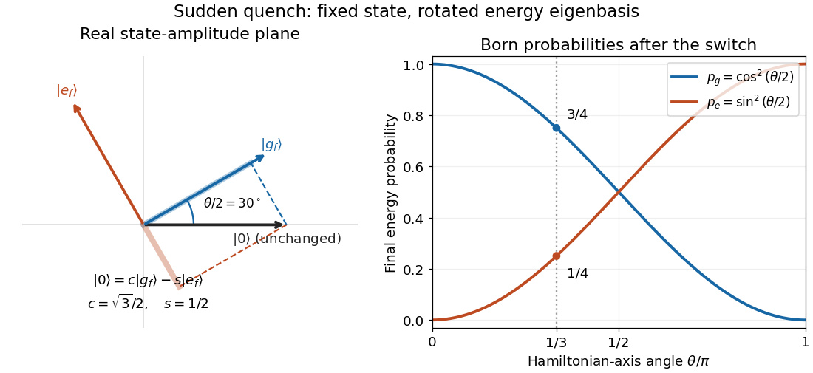

# Two-level sudden quench

↑ **Parent:** [Quantum quench](quantum-quench.md)

Take an isolated [two-level system](two-level-system.md), or a [spin one-half](spin-one-half.md) [qubit](qubit.md), with [Pauli matrices](pauli-matrices.md) $\sigma_x,\sigma_z$. Let $\sigma_z|0\rangle=|0\rangle$ and $\sigma_z|1\rangle=-|1\rangle$. The initial and final [Hamiltonian operators](hamiltonian-quantum-mechanics.md) are

$$
H_i=-\frac{\Delta_i}{2}\sigma_z,\qquad
H_f=-\frac{\Delta_f}{2}(\cos\theta\,\sigma_z+\sin\theta\,\sigma_x),\qquad \Delta_i,\Delta_f>0.
$$

The [energy](energy-split.md) gaps are $\Delta_i,\Delta_f$. Prepare the initial [ground state](ground-state.md) $|0\rangle$, with [energy eigenvalue](energy-eigenvalue-split.md) $-\Delta_i/2$. A final [orthonormal eigenbasis](orthonormal-eigenbasis.md) is

$$
|g_f\rangle=c|0\rangle+s|1\rangle,\qquad
|e_f\rangle=-s|0\rangle+c|1\rangle,\qquad
c=\cos(\theta/2),\quad s=\sin(\theta/2).
$$

Direct [matrix multiplication](matrix-multiplication.md) gives $H_f|g_f\rangle=-\Delta_f|g_f\rangle/2$ and $H_f|e_f\rangle=+\Delta_f|e_f\rangle/2$. The unchanged initial [quantum state](quantum-state.md) is $|0\rangle=c|g_f\rangle-s|e_f\rangle$. Its new [probability amplitudes](probability-amplitude.md) are the [inner products](inner-product-split.md) $c,-s$; the [Born rule](born-rule.md) gives $p_g=c^2,p_e=s^2$. The angle between the real amplitude vectors is $\theta/2$, whereas the Hamiltonian axis on the [Bloch sphere](bloch-sphere.md) rotates through $\theta$.

**[Figure 5](#image-fixed-quantum-state-rotated-eigenbasis-and-sudden-quench-born-rule-probabilities). Fixed quantum state, rotated eigenbasis, and sudden-quench Born rule probabilities**. [Source](sudden-quench-eigenbasis-overlaps.py). Original [two-level sudden quench](two-level-sudden-quench.md) calculation. The left panel shows real amplitude coordinates, not spatial directions or the [Bloch sphere](bloch-sphere.md). Dashed perpendicular projections give signed [probability amplitudes](probability-amplitude.md); the right panel squares them. At $\theta=\pi/3$, the final [ground state](ground-state.md) and excited-state [probabilities](probability.md) are $3/4$ and $1/4$.

At $\theta=\pi/3$, $c=\sqrt3/2$ and $s=1/2$, so the final [energy measurement](energy-measurement.md) gives $-\Delta_f/2$ with [probability](probability.md) $3/4$ and $+\Delta_f/2$ with [probability](probability.md) $1/4$. At $\theta=0$ the initial [ground state](ground-state.md) remains the final [ground state](ground-state.md); at $\theta=\pi$ it is the final excited [energy eigenstate](energy-eigenstate.md). These statements are about the new [energy](energy-split.md) labels, not an instantaneous physical rotation of the [quantum state](quantum-state.md).

**Table of contents**

- [Work in a two-level sudden quench](work-in-a-two-level-sudden-quench.md)
- [Post-quench oscillations in a two-level system](post-quench-oscillations-in-a-two-level-system.md)

## ↑ Ancestors (6)

1. [Quantum quench](quantum-quench.md)
2. [Sudden approximation](sudden-approximation.md)
3. [Quantum mechanics](quantum-mechanics-split.md)
4. [Branches of physics](branches-of-physics.md)
5. [Physics](physics-split.md)
6. [Codex Wiki](split.md)

## ← Incoming links (3)

- [Quantum state continuity at a finite Hamiltonian step](quantum-state-continuity-at-a-finite-hamiltonian-step.md)
- [Sudden approximation](sudden-approximation.md)
- [Two-level sudden quench](two-level-sudden-quench.md)
