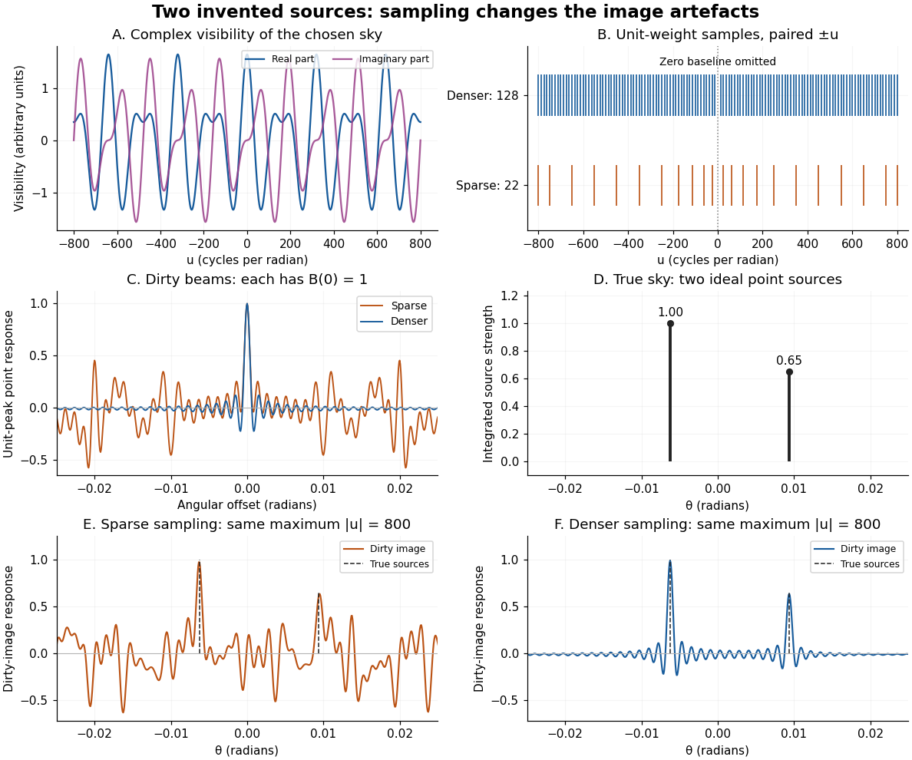

# Two-point-source aperture synthesis

↑ **Parent:** [Dirty image](dirty-image.md)

Choose two [point-like astronomical sources](point-like-astronomical-source.md) with $(\theta_1,I_1)=(-0.00625,1)$ and $(\theta_2,I_2)=(0.009375,0.65)$, where the angles are in [radians](radian.md) and strengths use arbitrary common units. Their separation is $\Delta\theta=0.015625$ [radians](radian.md). These are invented model parameters, not historical measurements. Their [complex visibility](complex-visibility.md) follows immediately from the preceding derivation, and its squared magnitude is

$$
|V(u)|^2=1+0.65^2+1.30\cos(2\pi u\Delta\theta).
$$

At $u=0$, $V=1.65$; at $u=400$, $V=-1+0.65i$; at $u=800$, $V=0.35$. The unequal strengths prevent the [complex visibility](complex-visibility.md) magnitude from reaching zero. Its modulation contains the source separation, while a common displacement of both sources changes [wave phase](phase-waves.md) without changing this magnitude. Amplitude alone loses that location information.

**[Figure 18](#image-an-original-two-source-model-complex-visibility-sampling-gaps-unit-peak-dirty-beams-and-dirty-images). An original two-source model: complex visibility, sampling gaps, unit-peak dirty beams, and dirty images**.

The sparse case samples $u=\pm12.5k$ for $k\in\{2,5,9,14,20,28,36,44,52,60,64\}$; the denser case samples every $k=1,\ldots,64$, also with both signs. All weights are one. Both reach $|u|=800$, so their shortest fringe period is the same $0.00125$ [radians](radian.md). Their [dirty beams](dirty-beam.md) and false subsidiary features differ because the intermediate [spatial frequencies](spatial-frequency.md) differ. Neither case includes $u=0$ or frequencies above that maximum. The figure uses a periodic angular interval of length $0.08$ [radians](radian.md); this artificial boundary makes a discrete [Fourier transform](fourier-transform-split.md) calculation exact for the chosen grid, rather than modelling an all-sky observation.

The plotted [dirty image](dirty-image.md) is the sum of two shifted [dirty beams](dirty-beam.md), not a fitted or deconvolved estimate of the source. Adding samples in this example reduces prominent spurious peaks; it does not establish a universal monotonic improvement for every weighting or sky. A missing zero baseline leaves the periodic [dirty image](dirty-image.md) with zero mean, so it cannot by itself recover the total positive brightness. Missing short spacings also weaken constraints on extended smooth emission.

Reconstruction is an [inverse problem](inverse-problem-split.md). A perturbation whose [Fourier transform](fourier-transform-split.md) vanishes at every sampled coordinate can be added without changing the measurements: incomplete coverage leaves a [null space](kernel-of-a-linear-map-split.md). Nonnegative brightness, a restricted source region, or a model with a small number of components can reduce ambiguity, but each is additional information. Removing [dirty beam](dirty-beam.md) artefacts means estimating a sky consistent with both data and such assumptions; a narrow central peak alone does not certify a unique image. [Measurement error](measurement-error.md), uncertain calibration and source variability add further limitations.

## ↑ Ancestors (9)

1. [Dirty image](dirty-image.md)
2. [Dirty beam](dirty-beam.md)
3. [Aperture synthesis](aperture-synthesis.md)
4. [Radio astronomy](radio-astronomy.md)
5. [Observational astronomy](observational-astronomy.md)
6. [Astrophysics](astrophysics-split.md)
7. [Branches of physics](branches-of-physics.md)
8. [Physics](physics-split.md)
9. [Codex Wiki](split.md)
