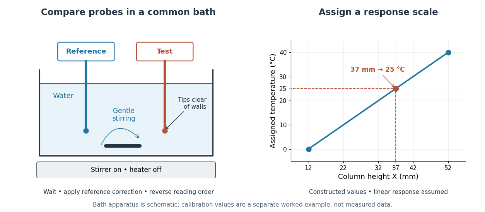

# Two-point thermometer calibration example

↑ **Parent:** [Zeroth-law thermometer comparison](zeroth-law-thermometer-comparison.md)

Consider an original worked [thermometer calibration](thermometer-calibration.md), using the height $X$ of a [liquid](liquid.md) column responding through [thermal expansion](thermal-expansion.md). Stipulate two equilibrated reference baths whose corrected [thermometer](thermometer.md) readings are $0\,{}^\circ\mathrm C$ and $40\,{}^\circ\mathrm C$, in [degree Celsius](degree-celsius.md) units. Suppose the corresponding column heights are $12\,\mathrm{mm}$ and $52\,\mathrm{mm}$. These are constructed inputs, not observed measurements. Assume the response is linear over this interval, with the same immersion and reading procedure throughout. Applying [thermometer calibration](thermometer-calibration.md) gives

$$
\frac{t_C(X)}{{}^\circ\mathrm C}
=40\frac{X-12\,\mathrm{mm}}{52\,\mathrm{mm}-12\,\mathrm{mm}}.
$$

For $X=37\,\mathrm{mm}$, first subtract the zero-reference height, then divide by the full reference span: $(37-12)/(52-12)=25/40$. Multiplying by the $40\,{}^\circ\mathrm C$ span gives $t_C=25\,{}^\circ\mathrm C$, or $T=298.15\,\mathrm K$ in [kelvin](kelvin.md). Thus equal $37\,\mathrm{mm}$ readings in separately equilibrated samples test equal [temperatures](temperature-split.md), regardless of how much [internal energy](internal-energy-split.md) those samples contain. The Celsius offset and modern absolute-scale definition are described in [degree Celsius](degree-celsius.md) and [kelvin](kelvin.md).

**[Figure 12](#zeroth-law-thermometer-bath-calibration). A reference-bath thermometer comparison and a worked two-point thermometer calibration**. Left: two probes sample gently stirred [water](water.md), with sensing tips immersed away from the walls and bottom; the heater is off for the ambient comparison. Right: an assumed linear column response maps $12\,\mathrm{mm}$ to $0\,{}^\circ\mathrm C$, $52\,\mathrm{mm}$ to $40\,{}^\circ\mathrm C$, and $37\,\mathrm{mm}$ to $25\,{}^\circ\mathrm C$. The schematic and all plotted values are illustrative, not experimental data.

The two endpoints determine the assumed line, but do not establish linearity. An independent middle reference and a return to the initial bath can test curvature and drift. If the height has an error of $0.2\,\mathrm{mm}$ while reference values and endpoints are held exact in this calculation, the inferred [temperature](temperature-split.md) error is $0.2\,{}^\circ\mathrm C$; that is only the height contribution, not a full measurement error budget. A boiling-water reference needs a measured [atmospheric pressure](atmospheric-pressure.md) correction, rather than an automatic $100\,{}^\circ\mathrm C$ assignment. The modern [kelvin](kelvin.md) is not defined by either bath.

## ↑ Ancestors (8)

1. [Zeroth-law thermometer comparison](zeroth-law-thermometer-comparison.md)
2. [Zeroth law of thermodynamics](zeroth-law-of-thermodynamics.md)
3. [Laws of thermodynamics](laws-of-thermodynamics.md)
4. [Thermodynamics](thermodynamics-split.md)
5. [Statistical physics](statistical-physics-split.md)
6. [Branches of physics](branches-of-physics.md)
7. [Physics](physics-split.md)
8. [Codex Wiki](split.md)

## ← Incoming links (1)

- [Reference-bath thermometer comparison](reference-bath-thermometer-comparison.md)
