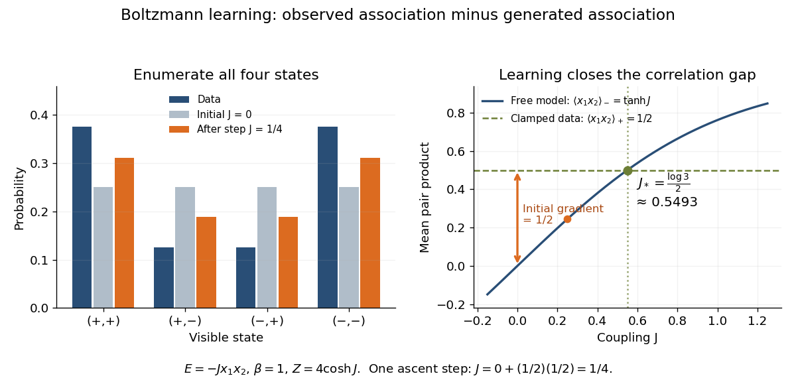

# Two-spin Boltzmann learning

↑ **Parent:** [Boltzmann machine](boltzmann-machine.md)

Take two visible bipolar units, no [hidden units](hidden-unit.md), zero thresholds, $\beta=1$, and $E_J(x)=-Jx_1x_2$. As original [training data](training-data.md), assign probabilities $3/8$ each to $(+,+)$ and $(-,-)$ and $1/8$ each to $(+,-)$ and $(-,+)$. The data pair product averages to $1/2$. Enumeration of all four states gives two weights $e^J$ and two $e^{-J}$, hence the [partition function](canonical-partition-function.md) $Z(J)=4\cosh J$ and

$$
\langle x_1x_2\rangle_-=\tanh J,\qquad
\ell(J)=\frac J2-\log(4\cosh J).
$$

Starting at $J=0$, the positive-minus-negative difference is $1/2-0$. A [gradient ascent](gradient-ascent.md) step of size $1/2$ gives $J=1/4$. Each aligned state now has [probability](probability.md) $0.311230$ and each opposed state $0.188770$, bringing the model toward the data. The [log-likelihood](log-likelihood.md) increases from $-1.386294$ to $-1.292224$. Solving $\ell'(J)=0$ gives $J_*=(\log3)/2$, which reproduces the data exactly. Since $\ell''(J)=-1/\cosh^2J<0$, this is the unique maximum. These are exact enumerations and their decimal evaluations, with no sampling or laboratory measurements.

**[Figure 2](#image-exact-probabilities-and-positive-minus-negative-learning-for-two-visible-units). Exact probabilities and positive-minus-negative learning for two visible units**. Left: data and model [probabilities](probability.md) before and after one [gradient ascent](gradient-ascent.md) step. Right: the data pair-product average and the model average determine the [log-likelihood](log-likelihood.md) [derivative](derivative.md); their intersection gives the optimal coupling.

## ↑ Ancestors (9)

1. [Boltzmann machine](boltzmann-machine.md)
2. [Neural network](neural-network.md)
3. [Statistical learning](statistical-learning-split.md)
4. [Statistical modelling](statistical-modelling-split.md)
5. [Statistical model](statistical-model-split.md)
6. [Probability and statistics](probability-and-statistics-split.md)
7. [Area of mathematics](area-of-mathematics.md)
8. [Mathematics](mathematics-split.md)
9. [Codex Wiki](split.md)
