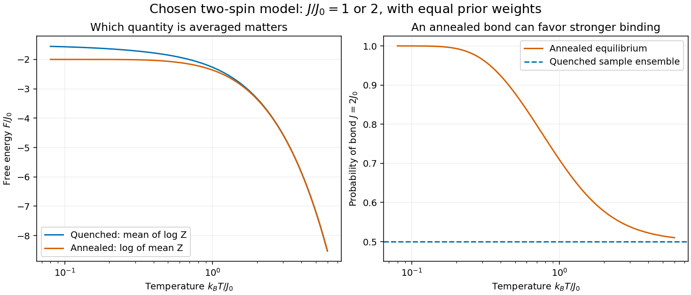

# Two-spin quenched and annealed free energies

↑ **Parent:** [Quenched disorder](quenched-disorder.md)

Choose two [Ising spins](ising-spin-variable.md) with [Hamiltonian](hamiltonian.md) $H=-Js_1s_2$, where $J$ independently takes $J_0$ or $2J_0$ with equal prior [probabilities](probability.md) and $J_0>0$. This original finite example has no [geometrical frustration](geometrical-frustration.md) and no [phase transition](phase-transition.md). Its four spin assignments give $Z_J=4\cosh(\beta J)$. Therefore

$$
F_{\rm q}=-\frac{k_BT}{2}\left\{\log[4\cosh(\beta J_0)]+\log[4\cosh(2\beta J_0)]\right\},\qquad
F_{\rm a}=-k_BT\log\left\{2[\cosh(\beta J_0)+\cosh(2\beta J_0)]\right\}.
$$

The [concave function](concave-function.md) $\log$ puts $F_{\rm a}\leq F_{\rm q}$. For this two-value case the claim is just $(Z_1+Z_2)/2\geq\sqrt{Z_1Z_2}$, obtained by squaring $\sqrt{Z_1}-\sqrt{Z_2}$. Thus no formal continuation of replicas is needed to see the distinction.

**[Figure 2](#image-exact-quenched-and-annealed-averages-for-a-stipulated-two-spin-system). Exact quenched and annealed averages for a stipulated two-spin system**. [Source](quenched-annealed-two-spin-free-energy.py). The same two bond strengths and equal prior weights are used in both ensembles. The right panel shows that annealed equilibrium reweights the bond strengths, whereas a quenched collection keeps half its samples at each strength. All curves are exact finite-model calculations, not alloy measurements.

In the [annealed disorder](annealed-disorder.md) ensemble, the stronger bond has probability $Z_{2J_0}/(Z_{J_0}+Z_{2J_0})$, approaching one at low [temperature](temperature-split.md). A [quenched disorder](quenched-disorder.md) collection instead retains one half at each coupling. As $T\to0$, **$F_{\rm q}\to-3J_0/2$ and $F_{\rm a}\to-2J_0$**: averaging samples and allowing the material variables to equilibrate describe different physics.

## ↑ Ancestors (6)

1. [Quenched disorder](quenched-disorder.md)
2. [Spin model](spin-model-split.md)
3. [Statistical physics](statistical-physics-split.md)
4. [Branches of physics](branches-of-physics.md)
5. [Physics](physics-split.md)
6. [Codex Wiki](split.md)
