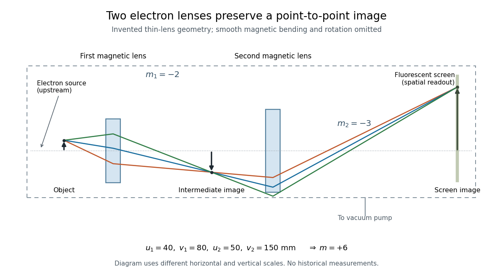

# Two-stage electron imaging

↑ **Parent:** [Electron microscope](electron-microscope.md)

Consider two ideal thin [electron lenses](electron-lens.md) in successive imaging stages. In each stage choose positive object and image distances $u_i,v_i$ for a [real image](real-image.md), measured from its effective lens plane, and neglect the image rotation of a [magnetic electron lens](magnetic-electron-lens.md). The [paraxial approximation](paraxial-approximation.md) gives

$$
\frac{1}{f_i}=\frac{1}{u_i}+\frac{1}{v_i},\qquad m_i=-\frac{v_i}{u_i},\qquad m=m_1m_2.
$$

The product follows directly by writing $y_1=m_1y_0$ and $y_2=m_2y_1$. Here $m_i$ is [transverse magnification](transverse-magnification.md), rather than the enlargement applied later to a photograph. Both inversions cancel in this planar model; actual [magnetic electron lenses](magnetic-electron-lens.md) can additionally rotate the image.

For an original worked example, take $u_1=40\,\mathrm{mm}$, $v_1=80\,\mathrm{mm}$, $u_2=50\,\mathrm{mm}$ and $v_2=150\,\mathrm{mm}$. Then

$$
f_1=\frac{80}{3}\,\mathrm{mm},\qquad f_2=37.5\,\mathrm{mm},\qquad m_1=-2,\qquad m_2=-3,\qquad m=6.
$$

A $100\,\mathrm{\mu m}$ object interval becomes $600\,\mathrm{\mu m}$ at the screen. The second lens sits $v_1+u_2=130\,\mathrm{mm}$ after the first. These are calculated distances, not measurements of the 1931 instrument.

**[Figure 3](#image-two-electron-lenses-relay-an-object-into-an-enlarged-screen-image). Two electron lenses relay an object into an enlarged screen image**. [Source](electron-lens-two-stage-imaging.py). Original [paraxial approximation](paraxial-approximation.md) construction for the worked example, in a frame neglecting magnetic image rotation. Three illustrative trajectories from one off-axis point meet at the intermediate image and again at the screen. The shaded bands represent effective magnetic lens regions; real trajectories bend smoothly. The dashed enclosure represents a [vacuum](vacuum.md) column, with an upstream [electron gun](electron-gun.md) and a pump connection indicated schematically. Horizontal and vertical scales differ; neither the geometry nor the rays reproduce historical apparatus measurements.

To measure [magnification](magnification.md), divide a screen interval between corresponding grid features by the independently known object interval. Repeat over several periods to reduce endpoint uncertainty. For a proposed check, record accelerating [voltage](voltage.md), lens [electric currents](electric-current.md), screen position and specimen orientation; compare one-stage and two-stage images, refocusing as necessary. Changing a lens [electric current](electric-current.md) should change focus and scale, while a blank exposure checks detector background. Keep irradiation and recording enlargement controlled, and repeat the original setting to test drift or specimen damage. These are suggested checks, not a claim that every check was performed in 1931. A grid-scale measurement establishes [magnification](magnification.md); resolving much finer features requires a separate target and contrast criterion.

## ↑ Ancestors (6)

1. [Electron microscope](electron-microscope.md)
2. [Electron optics](electron-optics.md)
3. [Optics](optics-split.md)
4. [Branches of physics](branches-of-physics.md)
5. [Physics](physics-split.md)
6. [Codex Wiki](split.md)
