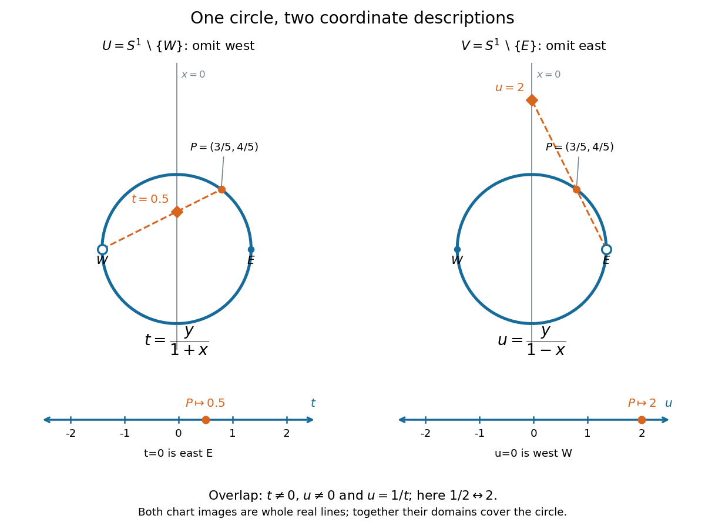

# Two stereographic charts on the circle

↑ **Parent:** [Topological manifold](topological-manifold-split.md)

Take the [circle](circle.md) $S^1=\{(x,y)\in\mathbb R^2:x^2+y^2=1\}$ with its [subspace topology](subspace-topology.md). Write $W=(-1,0)$ for its west point and $E=(1,0)$ for its east point. Two [coordinate charts](manifold-chart.md) obtained by [stereographic projection](stereographic-projection.md) are

$$
U=S^1\setminus\{W\},\qquad \varphi(x,y)=t=\frac{y}{1+x},\qquad V=S^1\setminus\{E\},\qquad \psi(x,y)=u=\frac{y}{1-x}.
$$

Both take values in the entire [real line](real-line.md). Geometrically, join $W$ to $(x,y)$ and intersect the resulting line with $x=0$: the height is $t$. Projecting from $E$ instead gives height $u$. Each projection omits its own starting point, but the other [coordinate chart](manifold-chart.md) includes that point. Hence $U\cup V=S^1$.[Topology I: smooth manifolds, Week 1, Example 1.6, equations (4)–(5), page 2; specialize the sphere charts to dimension one](topology-i-smooth-manifolds-university-of-toronto-mat1300hf-2012/week-1-course-notes.md)

**[Figure 1](#image-two-stereographic-charts-cover-the-circle-and-unfold-it-onto-two-real-lines). Two stereographic charts cover the circle and unfold it onto two real lines**.

To verify the [homeomorphisms](homeomorphism.md), solve the displayed equations for $(x,y)$. The [inverse functions](inverse-function.md) are

$$
\varphi^{-1}(t)=\left(\frac{1-t^2}{1+t^2},\frac{2t}{1+t^2}\right),\qquad \psi^{-1}(u)=\left(\frac{u^2-1}{1+u^2},\frac{2u}{1+u^2}\right).
$$

Each formula lies on the [circle](circle.md), avoids its excluded point, and is [continuous](continuous-function.md) for every real argument. Substitution into the projection formulas returns $t$ or $u$; substitution in the other direction returns $(x,y)$. Thus these are [continuous](continuous-function.md) [bijections](bijection.md) with [continuous](continuous-function.md) [inverse functions](inverse-function.md), as required for [coordinate charts](manifold-chart.md). Since the [Euclidean plane](euclidean-plane.md) is [Hausdorff](hausdorff-space.md) and [second countable](second-countable-space.md), the [subset](subset.md) $S^1$ with its [subspace topology](subspace-topology.md) is too. This checks all three conditions for a [topological manifold](topological-manifold-split.md), rather than just drawing a smooth-looking curve.

On the overlap $U\cap V$, both $x=\pm1$ are excluded, so $y\neq0$. Using $y^2=1-x^2$, the [topological transition map](topological-transition-map.md) is

$$
u=\frac{y}{1-x}=\frac{1+x}{y}=\frac1t,\qquad t\in\mathbb R\setminus\{0\}.
$$

For example, $(x,y)=(3/5,4/5)$ has $t=1/2$ and $u=2$. The two [connected components](connected-component.md) of the overlap, the upper and lower arcs, correspond to the positive and negative parts of the punctured [real line](real-line.md). The values $t=0$ and $u=0$ represent $E$ and $W$, respectively, and belong to only one chart each. The reciprocal coordinate change and its [inverse function](inverse-function.md) are [smooth functions](smooth-function.md) away from zero, so this [topological atlas](topological-atlas.md) also supplies a [smooth atlas](smooth-atlas.md).

Why can neither chart be enlarged to a single [coordinate chart](manifold-chart.md) on the whole [circle](circle.md)? The [circle](circle.md) is a [closed set](closed-set.md) and a [bounded set](bounded-set.md) in the [Euclidean plane](euclidean-plane.md), hence [compact](compact-space.md) by the [Heine-Borel theorem](heine-borel-theorem.md). A global [coordinate chart](manifold-chart.md) would give a [homeomorphism](homeomorphism.md) to a nonempty [open set](open-set.md) $O\subseteq\mathbb R$. Its image would be [compact](compact-space.md) and therefore [closed](closed-set.md) in the [real line](real-line.md). By [connectedness](connected-space.md) of the [real line](real-line.md), this forces $O=\mathbb R$, which is not [compact](compact-space.md). This is the one-dimensional instance of [no compact manifold has a single Euclidean chart](no-compact-manifold-has-a-single-euclidean-chart.md). Locally the [circle](circle.md) is indistinguishable from the [real line](real-line.md); globally [compactness](compact-space.md) obstructs a single chart.

## ↑ Ancestors (6)

1. [Topological manifold](topological-manifold-split.md)
2. [Topology](topology-split.md)
3. [Geometry and topology](geometry-and-topology-split.md)
4. [Area of mathematics](area-of-mathematics.md)
5. [Mathematics](mathematics-split.md)
6. [Codex Wiki](split.md)
