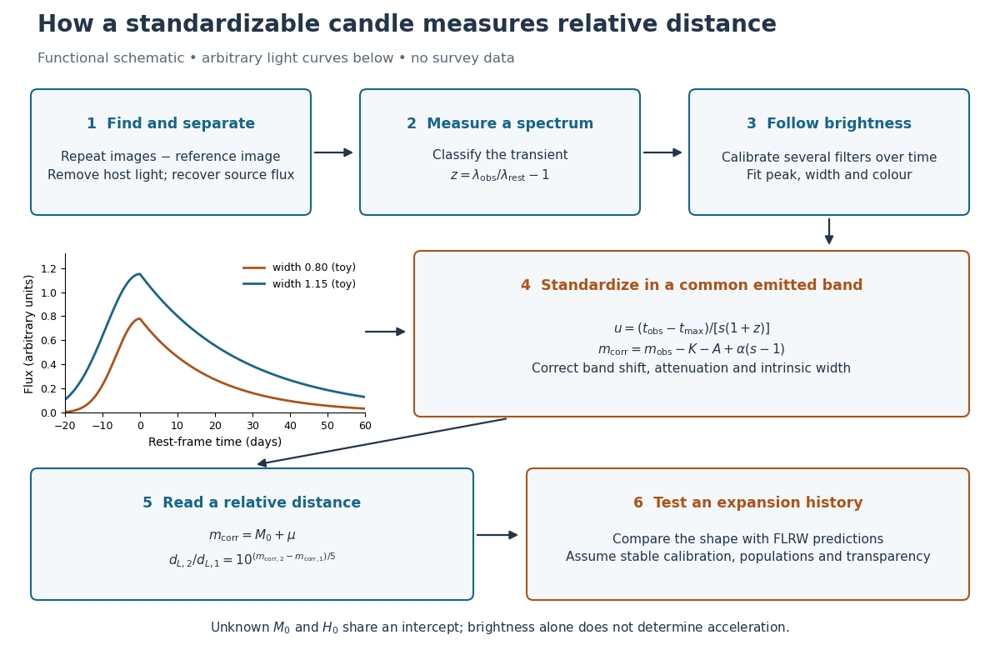

# Type Ia supernova cosmology

↑ **Parent:** [Luminosity distance](luminosity-distance.md)

Type Ia supernova cosmology uses standardized supernova luminosities to measure the shape of the luminosity-distance--redshift relation. In a spatially flat universe,

$$
d_L(z)=(1+z)c\int_0^z\frac{dz'}{H(z')}.
$$

An unknown common absolute luminosity is degenerate with the overall distance scale but does not erase the redshift dependence.

The useful observable is a relative [luminosity distance](luminosity-distance.md) at measured [redshift](redshift.md), rather than an object's brightness alone. [Spectroscopy](spectroscopy.md) supplies $z=\lambda_{\rm obs}/\lambda_{\rm rest}-1$; repeated [photometry](photometry-optics.md) supplies a [light curve](light-curve.md). A [Type Ia supernova](type-ia-supernova.md) is a [standardizable candle](standardizable-candle.md): a fitted relation between [light curve](light-curve.md) shape and [luminosity](luminosity.md) replaces the incorrect assumption that every explosion has identical peak [absolute magnitude](absolute-magnitude.md). Nearby objects establish the relation and its common intercept; distant objects test its continuation and the shape of the [Hubble diagram](hubble-diagram.md).

**[Figure 5](#image-from-repeated-images-and-spectra-to-standardized-brightness-relative-luminosity-distance-and-a-conditional-acceleration-inference). From repeated images and spectra to standardized brightness, relative luminosity distance and a conditional acceleration inference**. Functional schematic with arbitrary illustrative light curves. The redshift and distance readouts are separate measurements; inference of acceleration requires a specified cosmological model.

**Table of contents**

- [Standardization of Type Ia supernova light curves](standardization-of-type-ia-supernova-light-curves.md)
- [Supernova calibration and population tests](supernova-calibration-and-population-tests.md)
- [Hubble diagram](hubble-diagram.md)
- [Absolute magnitude–Hubble constant degeneracy](absolute-magnitude-hubble-constant-degeneracy.md)

## ↑ Ancestors (5)

1. [Luminosity distance](luminosity-distance.md)
2. [Cosmology](cosmology-split.md)
3. [Branches of physics](branches-of-physics.md)
4. [Physics](physics-split.md)
5. [Codex Wiki](split.md)

## ← Incoming links (5)

- [Absolute magnitude–Hubble constant degeneracy](absolute-magnitude-hubble-constant-degeneracy.md)
- [Solution](past-exam-of-the-mathematics-course-of-the-university-of-cambridge/2001/iii/paper-41/1/iii/solution.md)
- [Solution](past-exam-of-the-mathematics-course-of-the-university-of-cambridge/2024/iii/paper-310/1/c/solution.md)
- [Standard candle](standard-candle.md)
- [Standardizable candle](standardizable-candle.md)
