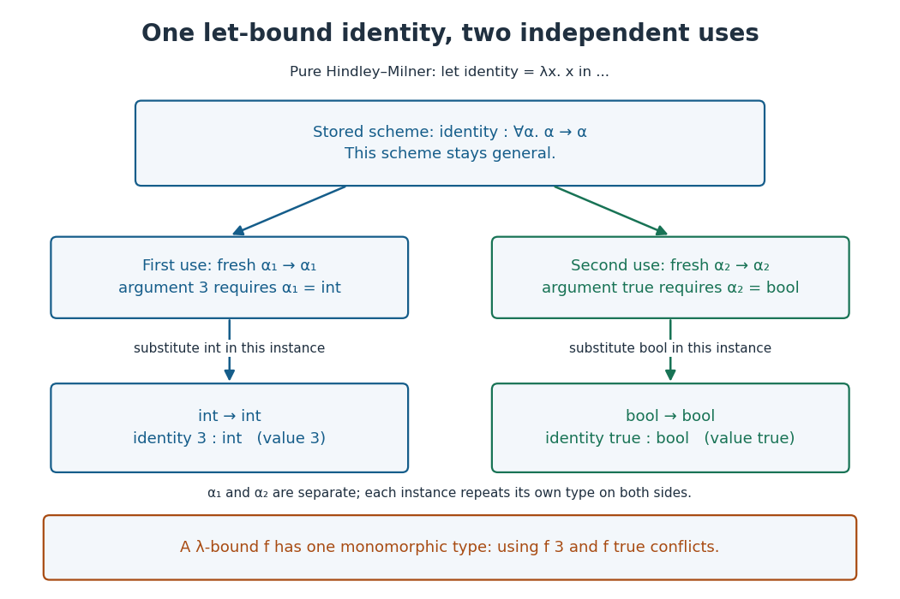

# Type variable

↑ **Parent:** [Type system](type-system.md)  
ⓦ [Wiki](https://en.wikipedia.org/wiki/Type_variable)

A [type variable](type-variable.md) is a placeholder for a type. In a [function type](function-type.md) $\alpha\to\alpha$, the repeated [type variable](type-variable.md) requires the argument and result types to agree; $\alpha\to\beta$ does not impose that agreement. A [type substitution](type-substitution.md) replacing $\alpha$ by `int` changes $\alpha\to\alpha$ to $\mathrm{int}\to\mathrm{int}$ everywhere within that instance.

For the [identity function](identity-function.md) written as the [lambda abstraction](lambda-abstraction.md) $\lambda x.x$, assume $x:\alpha$ in the body. Looking up $x$ gives result type $\alpha$, so the abstraction rule gives $\lambda x.x:\alpha\to\alpha$. In the pure [Hindley-Milner type system](hindley-milner-type-system.md), `let identity = λx.x in ...` gives `identity` the [type scheme](type-scheme.md) $\forall\alpha.\alpha\to\alpha$ by [let polymorphism](let-polymorphism.md). Each use receives fresh [type variables](type-variable.md): `identity 3` chooses `int` for its instance, and `identity true` chooses `bool` for a separate instance. These choices do not change the original [type scheme](type-scheme.md).

**[Figure 5](#image-independent-type-instantiations-of-a-let-bound-identity-function). Independent type instantiations of a let-bound identity function**. The [type scheme](type-scheme.md) stays general while two uses receive different [type substitutions](type-substitution.md). Each use preserves the equality of its own argument and result types.

For example, `let identity = λx.x in let a = identity 3 in identity true` is valid and has type `bool`. By contrast, `(λf. let a = f 3 in f true) (λx.x)` is rejected by the [Hindley-Milner type system](hindley-milner-type-system.md): the [lambda abstraction](lambda-abstraction.md) binds `f` to one monomorphic [function type](function-type.md). The first call requires its argument type to be `int`, and the second requires that same type to be `bool`. Naming the first result with `let a` does not generalize `f`. The distinction makes reusable code possible while keeping the assumptions about a supplied argument consistent.

// Target: computer-science.bigb

**Table of contents**

- [Type substitution](type-substitution.md)
- [Type scheme](type-scheme.md)
- [Occurs check](occurs-check.md)

## ↑ Ancestors (4)

1. [Type system](type-system.md)
2. [Programming language](programming-language-split.md)
3. [Computer science](computer-science-split.md)
4. [Codex Wiki](split.md)

## ← Incoming links (14)

- [Algorithm W](algorithm-w.md)
- [Hindley-Milner type system](hindley-milner-type-system.md)
- [Let polymorphism](let-polymorphism.md)
- [Occurs check](occurs-check.md)
- [Solution](past-exam-of-the-mathematics-course-of-the-university-of-cambridge/2007/ia/paper-5/10/a/solution.md)
- [Solution](past-exam-of-the-mathematics-course-of-the-university-of-cambridge/2007/ia/paper-5/10/b/solution.md)
- [Solution](past-exam-of-the-mathematics-course-of-the-university-of-cambridge/2007/ia/paper-5/10/c/solution.md)
- [Simple type](simple-type.md)
- [Type inference](type-inference.md)
- [Type scheme](type-scheme.md)
- [Type substitution](type-substitution.md)
- [Type system](type-system.md)
- [Type unification](type-unification.md)
- [Type variable](type-variable.md)
