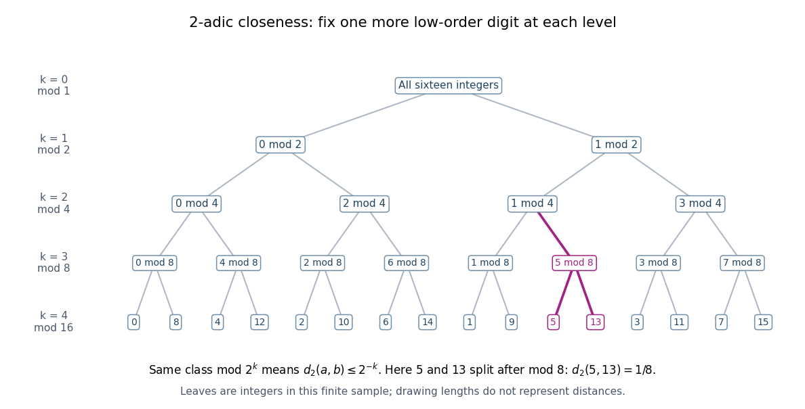

# Ultrametric space

↑ **Parent:** [Ultrametric inequality](ultrametric-inequality.md)  
ⓦ [Wiki](https://en.wikipedia.org/wiki/Ultrametric_space)

An ultrametric space is a [metric space](metric-space.md) whose [metric](metric.md) satisfies the [ultrametric inequality](ultrametric-inequality.md). The [rational numbers](rational-number.md) with $d_p(x,y)=|x-y|_p$, and their [P-adic number](p-adic-number.md) completion, are examples. Their geometry organizes points into nested clusters rather than measuring separation along a [number line](number-line.md).

For [integers](integer.md) $a,b$ and $k\geq0$, the definition of the [P-adic valuation](p-adic-valuation.md) gives

$$
d_p(a,b)\leq p^{-k}\quad\Longleftrightarrow\quad a\equiv b\pmod{p^k}.
$$

Thus a [closed ball](closed-ball.md) of radius $p^{-k}$ in the [integers](integer.md) is a [congruence class](congruence-class.md) modulo $p^k$. In the [p-adic integers](p-adic-integer.md) the same [closed ball](closed-ball.md) is $a+p^k\mathbb Z_p$. More shared low-order digits mean a smaller [p-adic absolute value](p-adic-absolute-value.md) of the difference.

**[Figure 11](#image-the-integers-from-zero-to-fifteen-form-nested-congruence-classes-modulo-powers-of-two-in-the-2-adic-absolute-value). The integers from zero to fifteen form nested congruence classes modulo powers of two in the 2-adic absolute value**.

The [binary tree](binary-tree.md) first splits the sixteen [integers](integer.md) into even and odd [congruence classes](congruence-class.md), then refines modulo $4$, $8$, and $16$. Each node fixes one more low-order digit. The leaves $5$ and $13$ share the class $5$ modulo $8$, then separate modulo $16$, so their distance is exactly $1/8$. The leaves are deliberately ordered by their low-order digits; horizontal spacing and edge lengths are layout choices, not the [metric](metric.md). The singleton leaves describe this finite sample; a [congruence class](congruence-class.md) modulo $16$ in all [p-adic integers](p-adic-integer.md) remains infinite.

The [ultrametric inequality](ultrametric-inequality.md) also explains the unusual behavior of [balls](ball-mathematics.md). Every point of an [open ball](open-ball.md) can serve as its center: if $d(a,b)<r$, then $d(a,x)<r$ if and only if $d(b,x)<r$. Two [open balls](open-ball.md) that intersect are nested, since a point of their [intersection](set-intersection.md) serves as a common center and their radii can be compared. The same nesting rule holds for [closed balls](closed-ball.md) and for a pair consisting of one [open ball](open-ball.md) and one [closed ball](closed-ball.md).

Every [open ball](open-ball.md) is a [clopen set](clopen-set.md). For a point $y$ outside $B(a,r)$, the [open ball](open-ball.md) $B(y,d(a,y))$ stays outside $B(a,r)$: if $d(y,z)<d(a,y)$, the [ultrametric inequality](ultrametric-inequality.md) forces $d(a,z)=d(a,y)\geq r$. Hence the complement is an [open set](open-set.md). Also every [closed ball](closed-ball.md) of positive radius is an [open set](open-set.md), because $B(b,r)$ lies in the [closed ball](closed-ball.md) of radius $r$ around $a$ whenever $d(a,b)\leq r$. A radius-zero [closed ball](closed-ball.md) is a singleton and need not be an [open set](open-set.md). Distinct points can therefore be separated by a [clopen set](clopen-set.md), proving that an [ultrametric space](ultrametric-space.md) is [totally disconnected](totally-disconnected-space.md). These ball properties turn distance thresholds into a hierarchy of compatible clusters. [Andrew V. Sutherland, Number Theory I, Lecture 8, section 8.1.1](https://math.mit.edu/classes/18.785/2021fa/LectureNotes8.pdf)

**Table of contents**

- [Totally disconnected space](totally-disconnected-space.md)

## ↑ Ancestors (8)

1. [Ultrametric inequality](ultrametric-inequality.md)
2. [Non-Archimedean absolute value](non-archimedean-absolute-value.md)
3. [Absolute value (algebra)](absolute-value-algebra.md)
4. [Non-Archimedean analysis](non-archimedean-analysis.md)
5. [Arithmetic](arithmetic-split.md)
6. [Area of mathematics](area-of-mathematics.md)
7. [Mathematics](mathematics-split.md)
8. [Codex Wiki](split.md)

## ← Incoming links (4)

- [2-adic absolute value](2-adic-absolute-value.md)
- [Solution](past-exam-of-the-mathematics-course-of-the-university-of-cambridge/2026/iii/paper-136/1/b/iv/solution.md)
- [Ultrametric inequality](ultrametric-inequality.md)
- [Ultrametric space](ultrametric-space.md)
