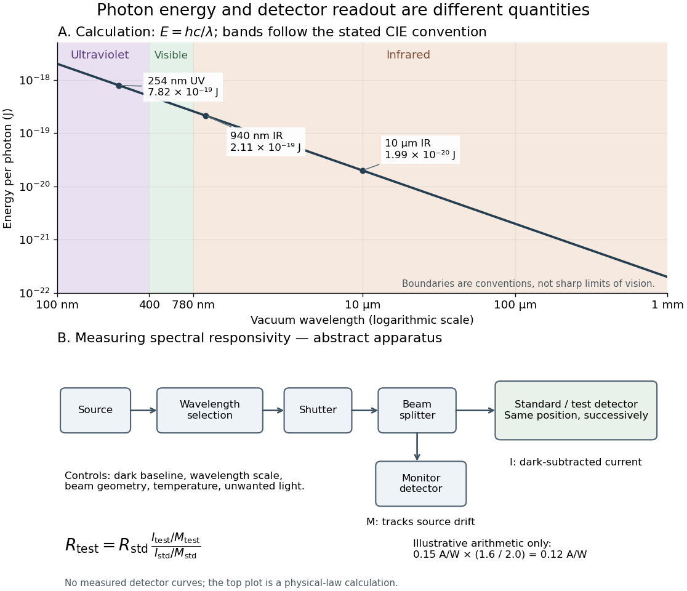

# Ultraviolet

↑ **Parent:** [Optics](optics-split.md)  
ⓦ [Wiki](https://en.wikipedia.org/wiki/Ultraviolet)

[Ultraviolet](ultraviolet.md) is [electromagnetic radiation](electromagnetic-radiation-split.md) with [wavelengths](wavelength.md) shorter than the violet end of ordinarily visible [light](light.md). The CIE convention uses $100$–$400\,\mathrm{nm}$, subdivided into UV-A at $315$–$400\,\mathrm{nm}$, UV-B at $280$–$315\,\mathrm{nm}$ and UV-C at $100$–$280\,\mathrm{nm}$. These divisions name intervals; they do not mark universal changes in every material's response. The boundary with visible [light](light.md) is not sharp, and other fields use near-, far-, vacuum- and extreme-[ultraviolet](ultraviolet.md) divisions. [CIE, International Lighting Vocabulary (2020), ultraviolet radiation: ranges and boundary caveats](https://cie.co.at/eilvterm/17-21-008). For example, NASA's Solar Dynamics Observatory observes extreme-[ultraviolet](ultraviolet.md) bands below $100\,\mathrm{nm}$; the CIE interval is therefore not the full extent of astronomical [ultraviolet](ultraviolet.md) usage. [NASA, Solar Dynamics Observatory HMI and AIA channels: the Atmospheric Imaging Assembly's ultraviolet and extreme-ultraviolet bands](https://sdo.gsfc.nasa.gov/data/channels.php).

The CIE [ultraviolet](ultraviolet.md) interval corresponds to [frequencies](frequency.md) about $7.49\times10^{14}$–$3.00\times10^{15}\,\mathrm{Hz}$ and [photon](photon.md) [energies](energy-split.md) $4.97\times10^{-19}$–$1.99\times10^{-18}\,\mathrm J$, using [vacuum](vacuum.md) [wavelength](wavelength.md) and $E=hc/\lambda$ with [Planck constant](planck-constant.md) $h$ and [speed of light](speed-of-light.md) $c$. Shorter [wavelength](wavelength.md) means larger [energy](energy-split.md) per [photon](photon.md); larger [irradiance](irradiance.md) means more incident [power](power.md) per [area](surface-area.md). These are different comparisons. At the same incident [power](power.md), a $254\,\mathrm{nm}$ [ultraviolet](ultraviolet.md) beam has fewer [photons](photon.md) per second than a $940\,\mathrm{nm}$ [infrared](infrared.md) beam, even though each [ultraviolet](ultraviolet.md) [photon](photon.md) has more [energy](energy-split.md).

A common [ultraviolet](ultraviolet.md) mechanism is [photon absorption](photon-absorption.md) promoting an [electron](electron.md) from a [ground state](ground-state.md) to an [excited state](excited-state.md) of a [chemical atom](atom-physics.md) or [molecule](molecule-split.md). By contrast, many [infrared](infrared.md) absorption bands involve stretching or bending [chemical bonds](chemical-bond-split.md). For either mechanism, both the [energy](energy-split.md) difference and the coupling to the incident [electromagnetic field](electromagnetic-field.md) matter. One concrete example is the $217\,\mathrm{nm}$ absorption discussed for [butadiene](butadiene.md): an [electron](electron.md) moves between [molecular orbitals](molecular-orbital.md), and the position of the absorption reveals their [energy](energy-split.md) separation. [Ultraviolet](ultraviolet.md) absorption can therefore probe [molecular orbitals](molecular-orbital.md), while [infrared spectroscopy](infrared-spectroscopy.md) probes many molecular motions. [John McMurry, Organic Chemistry, §14.7: ultraviolet excitation and the 217 nm butadiene example](https://openstax.org/books/organic-chemistry/pages/14-7-ultraviolet-spectroscopy).

Subsequent [chemical reactions](chemical-reaction-split.md) depend on the absorbing [chemical substance](chemical-substance-split.md) and its environment; the label [ultraviolet](ultraviolet.md) alone does not predict a [reaction rate](reaction-rate.md). At sufficiently short [wavelength](wavelength.md), a [photon](photon.md) can cause [photoionization](photoionization.md) if its [energy](energy-split.md) exceeds the relevant [ionization energy](ionization-energy.md). There is no single [wavelength](wavelength.md) that separates all ionizing from all nonionizing behavior for every [chemical substance](chemical-substance-split.md). Likewise, eventual heating after [photon absorption](photon-absorption.md) is possible in both [ultraviolet](ultraviolet.md) and [infrared](infrared.md). The distinction is useful because different [optical spectra](optical-spectrum.md) expose different processes, not because the two ranges obey different laws of [electromagnetism](electromagnetism-split.md).

Ritter's 1801 observation used a chemical readout rather than a [thermometer](thermometer.md). In Caltech/IPAC's account, sunlight passed through a glass [optical prism](prism-optics.md) and [silver chloride](silver-chloride.md) was placed in different parts of the [optical spectrum](optical-spectrum.md). Darkening was weak toward red, stronger toward violet, and pronounced beyond the visible violet edge. The measured evidence was a change in the [chemical substance](chemical-substance-split.md)'s appearance at a spatial location with no visible color, establishing radiation beyond the eye's ordinary range. It was not a calibrated measurement of a universal [ultraviolet](ultraviolet.md) [optical spectrum](optical-spectrum.md). [Caltech/IPAC Cool Cosmos, The Ritter Experiment (2022): the historical silver-chloride observation](https://coolcosmos.ipac.caltech.edu/page/lesson_ritter_experiment).

A controlled modern interpretation of such a chemical test would compare equal exposure durations and matched fresh samples, keep an unexposed sample in darkness, monitor [temperature](temperature-split.md), and distinguish scattered visible [light](light.md) from the intended short-[wavelength](wavelength.md) beam with characterized filtering. These are proposed controls, not an assertion that Ritter performed them. Unequal sample preparation or heating can change a [reaction rate](reaction-rate.md). The [optical prism](prism-optics.md), [terrestrial atmosphere](terrestrial-atmosphere.md) and sample response restrict which [wavelengths](wavelength.md) the test detects. Darkening is a detector-weighted response, so its spatial maximum is not automatically the maximum of incoming [radiant flux](radiant-flux.md) or of [photon](photon.md) [energy](energy-split.md).

Thomas Larason and Jeanne Houston's NIST report documents a quantitative [ultraviolet](ultraviolet.md) detector comparison. An argon source feeds a double-[diffraction grating](diffraction-grating.md) [spectrometer](spectrometer.md); a shutter and mirrors deliver the selected band to a working-standard or test [photodiode](photodiode.md), successively at the same position. A [beam splitter](beam-splitter.md) supplies a monitor [photodiode](photodiode.md). Amplifiers and voltmeters record detector and monitor simultaneously; shutter-closed readings provide dark baselines. The $200$–$500\,\mathrm{nm}$ scan, typically with $4\,\mathrm{nm}$ bandpass, measures [spectral responsivity](spectral-responsivity.md). Monitor normalization suppresses source drift; known [spectral lines](spectral-line.md) calibrate [wavelength](wavelength.md). The report assesses [temperature](temperature-split.md) effects and unwanted [light](light.md) outside the band, weighted by detector response. The latter need not cancel between different [spectral responsivities](spectral-responsivity.md). [Thomas C. Larason and Jeanne M. Houston, NIST SP 250-41 (2008), §§3.2, 4.2 and 7.2: apparatus, readouts and controls](spectroradiometric-detector-measurements-ultraviolet-visible-and-near-infrared-detectors-for-spectral-power-by-thomas-c-larason-and-others.md).

This determines electrical response without visual perception. Bandpass and spatial nonuniformity limit the calibration; aging and changed [temperature](temperature-split.md) can affect later use. The scan includes visible [light](light.md) and [ultraviolet](ultraviolet.md); no response below $200\,\mathrm{nm}$ follows from it.

For a narrow beam, the idealized substitution calculation is

$$
R_{\mathrm{test}}(\lambda)=R_{\mathrm{std}}(\lambda)
\frac{I_{\mathrm{test}}/M_{\mathrm{test}}}{I_{\mathrm{std}}/M_{\mathrm{std}}}.
$$

Here $R$ is [spectral responsivity](spectral-responsivity.md); $I$ and $M$ are dark-subtracted detector and monitor [electric currents](electric-current.md). This follows by writing $I=RP$ for each detector and using the monitor to track changes in [radiant flux](radiant-flux.md). It assumes linear response, unchanged beam splitting and collection geometry, and a sufficiently narrow band. For an illustrative standard with $R_{\mathrm{std}}=0.15\,\mathrm{A\,W^{-1}}$, ratios $I_{\mathrm{std}}/M_{\mathrm{std}}=2.0$ and $I_{\mathrm{test}}/M_{\mathrm{test}}=1.6$ give $R_{\mathrm{test}}=0.12\,\mathrm{A\,W^{-1}}$. These invented arithmetic inputs illustrate the method; they are not NIST measurements.

An independent [photon](photon.md)-counting model connects [spectral responsivity](spectral-responsivity.md) to [quantum efficiency](quantum-efficiency.md). If $\eta(\lambda)$ is the number of collected [electrons](electron.md) per incident [photon](photon.md), there is no internal multiplication, and $q$ is the [elementary charge](elementary-charge.md), then

$$
\dot N=\frac{P\lambda}{hc},\qquad I=q\eta\dot N,\qquad
R(\lambda)=\frac{I}{P}=\eta(\lambda)\frac{q\lambda}{hc}.
$$

At illustrative constant $\eta=0.60$ and $P=1\,\mathrm{\mu W}$, this gives about $0.123\,\mathrm{\mu A}$ at $254\,\mathrm{nm}$ and $0.455\,\mathrm{\mu A}$ at $940\,\mathrm{nm}$. The [ultraviolet](ultraviolet.md) readout is smaller in this model because there are fewer incident [photons](photon.md), not because their individual [energies](energy-split.md) are smaller. Real [quantum efficiency](quantum-efficiency.md) depends on [wavelength](wavelength.md), windows, absorption and carrier collection; a detector's [band gap](band-gap.md) and construction determine its usable range. Constant $\eta$ across these two [wavelengths](wavelength.md) is an analytical comparison, not a claimed specification of a real [photodiode](photodiode.md).

**[Figure 20](#image-photon-energy-across-conventional-ultraviolet-and-infrared-ranges-with-a-schematic-detector-substitution-experiment). Photon energy across conventional ultraviolet and infrared ranges, with a schematic detector-substitution experiment**.

The curve is the calculated relation $E=hc/\lambda$, and the shaded ranges use the stated CIE conventions. The lower diagram abstracts the detector comparison rather than reproducing an instrument drawing. Together with the [infrared](infrared.md) heat-balance illustration, it shows why a calibrated detector response, rather than what looks bright to an observer, is the bridge between invisible radiation and a quantitative measurement.

**Table of contents**

- [Extreme ultraviolet](extreme-ultraviolet.md)

## ↑ Ancestors (4)

1. [Optics](optics-split.md)
2. [Branches of physics](branches-of-physics.md)
3. [Physics](physics-split.md)
4. [Codex Wiki](split.md)

## ← Incoming links (20)

- [1962 rocket discovery of cosmic X-ray sources](1962-rocket-discovery-of-cosmic-x-ray-sources.md)
- [Blue light-emitting diode](blue-light-emitting-diode.md)
- [Butadiene](butadiene.md)
- [ClOOCl dimer](cloocl-dimer.md)
- [Franck-Hertz experiment](franck-hertz-experiment.md)
- [Infrared](infrared.md)
- [Intestinal nucleus transfer experiment](intestinal-nucleus-transfer-experiment.md)
- [Light](light.md)
- [Lyman-alpha forest](lyman-alpha-forest.md)
- [Solution](past-exam-of-the-chemistry-course-of-the-year-4-of-the-natural-sciences-course-of-the-university-of-cambridge/2022/paper-id/2/c/solution.md)
- [Solution](past-exam-of-the-chemistry-course-of-the-year-4-of-the-natural-sciences-course-of-the-university-of-cambridge/2022/paper-id/2/e/solution.md)
- [Solution](past-exam-of-the-mathematics-course-of-the-university-of-cambridge/2002/iii/paper-66/4/b/solution.md)
- [Solution](past-exam-of-the-mphil-in-micro-and-nanotechnology-enterprise-course-of-the-university-of-cambridge/2021/paper-1/3/iii/a/solution.md)
- [Solution](past-exam-of-the-physics-b-course-of-the-university-of-cambridge/2021/paper-2/section-b/b7/solution.md)
- [Solution](past-exam-of-the-physics-course-of-the-year-1-of-the-natural-sciences-course-of-the-university-of-cambridge/2011/paper-1/section-b/b9/solution.md)
- [Production of chlorine oxide (Cl2O2) from the self-reaction of the chlorine oxide (ClO) radical by L. T. Molina and M. J. Molina](production-of-chlorine-oxide-cl2o2-from-the-self-reaction-of-the-chlorine-oxide-clo-radical-by-l-t-molina-and-m-j-molina.md)
- [SEC detector response](sec-detector-response.md)
- [Silver chloride](silver-chloride.md)
- [Ultraviolet](ultraviolet.md)
- [UV transilluminator](uv-transilluminator.md)
