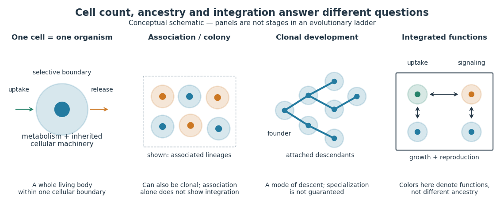

# Unicellular organism

↑ **Parent:** [Organism](organism.md)  
ⓦ [Wiki](https://en.wikipedia.org/wiki/Unicellular_organism)

A [unicellular organism](unicellular-organism.md) is an [organism](organism.md) whose living body consists of one [biological cell](biological-cell.md). That [biological cell](biological-cell.md) maintains itself, grows and participates in [reproduction](reproduction.md); it is not merely one specialized component of a larger body. [Escherichia coli](escherichia-coli.md) and ordinary free-living [Saccharomyces cerevisiae](saccharomyces-cerevisiae.md) illustrate [prokaryotic](prokaryote.md) and [eukaryotic](eukaryote.md) examples respectively. Cellular organization and the number of [biological cells](biological-cell.md) are separate questions. See [Clark, Douglas and Choi, Biology 2e, 4.1: cells as units of organisms](https://openstax.org/books/biology-2e/pages/4-1-studying-cells).

How can one [biological cell](biological-cell.md) do enough to sustain an [organism](organism.md)? Its [cell membrane](cell-membrane.md) retains useful material while [membrane transport](membrane-transport.md) allows exchange; [metabolism](metabolism.md) transforms nutrients and supplies usable [energy](energy.md); [gene expression](gene-expression.md) makes [proteins](protein.md) needed to maintain and rebuild the machinery. These functions operate together inside the same boundary. In [Saccharomyces cerevisiae](saccharomyces-cerevisiae.md), for example, [glucose](glucose.md) can support [alcoholic fermentation](ethanol-fermentation.md) and production of [ATP](adenosine-triphosphate.md), while the [cell cycle](cell-cycle.md) and [budding](budding.md) produce descendants. A single [biological cell](biological-cell.md) therefore combines chemical processing, regulated exchange and inherited organization. See [Alberts et al., Molecular Biology of the Cell (2002): universal cellular machinery](https://www.ncbi.nlm.nih.gov/books/NBK26864/) and the experimental accounts under [Saccharomyces cerevisiae](saccharomyces-cerevisiae.md) and [yeast](yeast.md).

**[Figure 14](#image-one-biological-cell-a-biological-colony-clonal-development-and-developmental-integration). One biological cell, a biological colony, clonal development and developmental integration**. Original conceptual schematic, not micrographs or an evolutionary ladder. Colors mark illustrative lineages in the middle panels and illustrative functions in the right panel; they are not measured traits. A [biological colony](colony-biology.md) can also be clonal, and [clonal development](clonal-development.md) need not produce specialized [biological cells](biological-cell.md). The integrated panel illustrates a division of functions, not a particular [species](species.md).

Being a [unicellular organism](unicellular-organism.md) does not mean isolated or independent of all other life. [Unicellular organisms](unicellular-organism.md) can interact and cooperate in groups. A [biological colony](colony-biology.md) describes association; [clonal development](clonal-development.md) describes descent; [developmental integration](developmental-integration.md) describes coordination of the developing whole. Neither shared ancestry nor a visible clump alone establishes the latter. This distinction makes single-cell experiments easier to interpret: measuring the growth of one [biological cell](biological-cell.md), the expansion of a group and the [reproductive success](reproductive-success.md) of a reproducing cluster can answer different questions. See [Queller and Strassmann, Beyond society: the evolution of organismality (2009): cooperation and the limits of simple organism criteria](https://pmc.ncbi.nlm.nih.gov/articles/PMC2781869/).

## ↑ Ancestors (3)

1. [Organism](organism.md)
2. [Biology](biology-split.md)
3. [Codex Wiki](split.md)

## ← Incoming links (4)

- [Colony (biology)](colony-biology.md)
- [Multicellular organism](multicellular-organism.md)
- [Organism](organism.md)
- [Unicellular organism](unicellular-organism.md)
