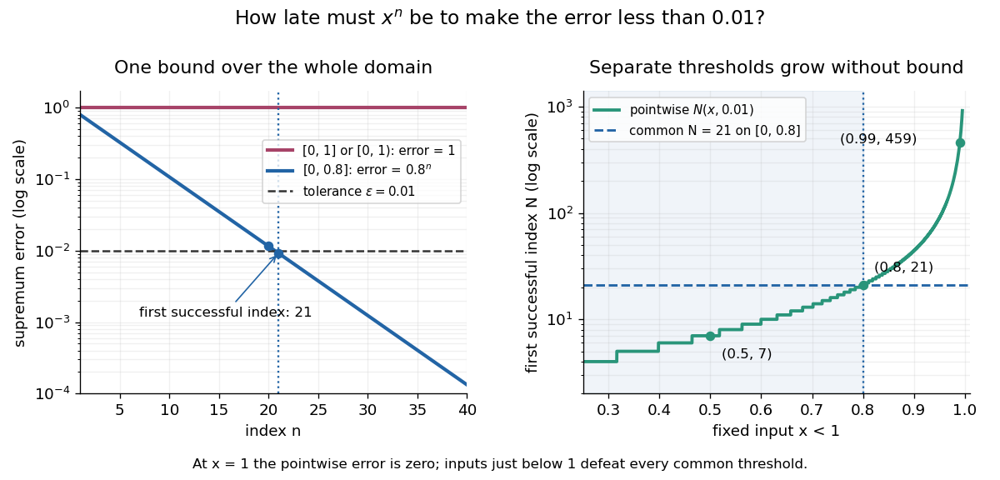

# Uniform convergence

↑ **Parent:** [Sequence and series](sequence-and-series-split.md)  
ⓦ [Wiki](https://en.wikipedia.org/wiki/Uniform_convergence)

A [sequence](sequence.md) of [functions](function-split.md) $f_n:X\to Y$ [converges uniformly](uniform-convergence.md) to $f:X\to Y$, where $Y$ is a [metric space](metric-space.md) with [metric](metric.md) $d$, precisely when

$$
\forall\varepsilon>0\;\exists N\in\mathbb N_{>0}\;\forall x\in X\;\forall n\geq N:\quad d(f_n(x),f(x))<\varepsilon.
$$

For [real numbers](real-number.md), use the [absolute value](absolute-value.md) $d(u,v)=|u-v|$. Compare the [universal quantification](universal-quantification.md) and [existential quantification](existential-quantification.md):

$$
\begin{aligned}
\text{pointwise:}&\quad \forall x\;\forall\varepsilon>0\;\exists N\;\forall n\geq N,\\
\text{uniform:}&\quad \forall\varepsilon>0\;\exists N\;\forall x\;\forall n\geq N.
\end{aligned}
$$

The decisive change is whether $N$ can depend on $x$. [Uniform convergence](uniform-convergence.md) implies [pointwise convergence](pointwise-convergence.md).[Basic Analysis: Introduction to Real Analysis, Volume I by Jiří Lebl, §6.1.2, Definition 6.1.6 and Proposition 6.1.7](basic-analysis-introduction-to-real-analysis-volume-i-by-jiri-lebl/6-1-pointwise-and-uniform-convergence.md)

For [functions](function-split.md) taking values in [real numbers](real-number.md) on a nonempty [domain of a function](domain-of-a-function.md), the [supremum error](supremum-error.md) is $E_n=\sup_{x\in X}|f_n(x)-f(x)|$, allowing $+\infty$. Then [uniform convergence](uniform-convergence.md) is equivalent to $E_n\to0$. The [supremum](supremum.md) need not be a [maximum](maximum-of-a-subset-of-a-total-order.md): pointwise strict bounds below $\varepsilon$ only give $E_n\leq\varepsilon$, so use tolerance $\varepsilon/2$ when proving this equivalence. This single error bound controls every possible input, including one chosen after seeing the index.

For $f_n(x)=x^n$ and its [pointwise limit](pointwise-limit.md) on $[0,1]$, the error is zero at one but approaches one as $x\to1$ from below. Consequently

$$
E_n=\sup_{x\in[0,1]}|f_n(x)-f(x)|=1
$$

for every positive [integer](integer-split.md) $n$. This [supremum](supremum.md) is never attained: below one the error is $x^n<1$, and at one it is zero. Deleting the endpoint leaves the same [supremum error](supremum-error.md) on $[0,1)$. To disprove [uniform convergence](uniform-convergence.md) directly, choose $\varepsilon=1/2$: for any proposed $N$, take $n=N$ and $x=2^{-1/N}<1$. The error equals $1/2$, violating the strict tolerance. Thus a moving input defeats every proposed common threshold.

On the smaller [interval](interval-mathematics.md) $[0,a]$, for a fixed $0\leq a<1$, the [pointwise limit](pointwise-limit.md) is zero and

$$
E_n=\max_{x\in[0,a]}x^n=a^n\longrightarrow0.
$$

For $0<a<1$ and $0<\varepsilon<1$, the exact first successful common threshold is

$$
N(a,\varepsilon)=\left\lfloor\frac{\log\varepsilon}{\log a}\right\rfloor+1.
$$

The [logarithm](logarithm.md) and [floor function](floor-function.md) turn an infinite approximation statement into a finite stopping rule. At $a=0.8$, $0.8^{20}=0.01152921504606846976$ fails tolerance $0.01$, while $0.8^{21}=0.009223372036854775808$ succeeds. At $a=1/2$ and $\varepsilon=1/8$, the ratio is exactly three: $N=4$ is necessary because equality is insufficient. For $a=0$, every error is zero. The [domain of a function](domain-of-a-function.md) determines whether one threshold can certify every input.

**[Figure 16](#image-supremum-error-and-common-thresholds-distinguish-uniform-convergence-from-pointwise-convergence). Supremum error and common thresholds distinguish uniform convergence from pointwise convergence**. Left: the error of $x^n$ remains one on $[0,1]$ and $[0,1)$, but falls below $0.01$ from $n=21$ onward on $[0,0.8]$. Right: the first successful threshold at a fixed input grows without bound near one. A common threshold $21$ covers all inputs at most $0.8$. Both vertical axes use a [logarithmic scale](logarithmic-scale.md).

For another explicit stopping rule, let $h_n(x)=x/(n+1)$ on $[0,1]$. Its [uniform limit](uniform-limit.md) is zero and its [supremum error](supremum-error.md) is $1/(n+1)$. For every $\varepsilon>0$, $N=\max\{1,\lceil1/\varepsilon\rceil\}$ works, using the [ceiling function](ceiling-function.md). Unlike $x^n$ on $[0,1]$, it controls even the endpoint.

The practical beauty of [uniform convergence](uniform-convergence.md) is that one quantitative bound can survive further operations: the [uniform limit theorem](uniform-limit-theorem.md) preserves [continuity](continuous-function.md), and [uniform convergence preserves integrals on a compact interval](uniform-convergence-preserves-integrals-on-a-compact-interval.md) controls accumulated error. [Differentiation](differentiation.md) needs additional hypotheses, such as [uniform derivative convergence with an anchored value](uniform-derivative-convergence-with-an-anchored-value.md). These results distinguish an approximation that looks accurate at selected inputs from one that justifies replacing a whole [function](function-split.md) in a calculation.

**Table of contents**

- [Supremum error](supremum-error.md)
- [Uniformly vanishing functions can retain a nonzero integral](uniformly-vanishing-functions-can-retain-a-nonzero-integral.md)
- [Uniform convergence preserves integrals on a compact interval](uniform-convergence-preserves-integrals-on-a-compact-interval.md)
- [Uniform convergence at moving evaluation points](uniform-convergence-at-moving-evaluation-points.md)
- [Uniform derivative convergence with an anchored value](uniform-derivative-convergence-with-an-anchored-value.md)
- [Egorov's theorem](egorov-s-theorem.md)
- [Uniform limit theorem](uniform-limit-theorem.md)
- [Dini's theorem](dini-s-theorem.md)
- [Uniformly Cauchy sequence](uniformly-cauchy-sequence.md)
- [Locally uniform convergence](locally-uniform-convergence.md)
  - [Compact-open topology](compact-open-topology.md)
    - [Weighted metric for local uniform convergence](weighted-metric-for-local-uniform-convergence.md)
  - [Local uniform convergence on compact subsets](local-uniform-convergence-on-compact-subsets.md)

## ↑ Ancestors (6)

1. [Sequence and series](sequence-and-series-split.md)
2. [Real analysis](real-analysis-split.md)
3. [Analysis](analysis-split.md)
4. [Area of mathematics](area-of-mathematics.md)
5. [Mathematics](mathematics-split.md)
6. [Codex Wiki](split.md)

## ← Incoming links (173)

- [Area theorem (conformal mapping)](area-theorem-conformal-mapping.md)
- [Bernstein monomial recurrence](bernstein-monomial-recurrence.md)
- [Bernstein polynomial](bernstein-polynomial.md)
- [Compact Korovkin test space](compact-korovkin-test-space.md)
- [Compactness of normalized weak elliptic solutions](compactness-of-normalized-weak-elliptic-solutions.md)
- [Continuous functions on the p-adic integers](continuous-functions-on-the-p-adic-integers.md)
- [Derivative seminorms on a compact interval](derivative-seminorms-on-a-compact-interval.md)
- [Dirichlet test](dirichlet-test.md)
- [Egorov's theorem](egorov-s-theorem.md)
- [Empirical distribution function](empirical-distribution-function.md)
- [Exponential series divided by a shifted index](exponential-series-divided-by-a-shifted-index.md)
- [Fejér first-moment approximation bound](fejer-first-moment-approximation-bound.md)
- [Fourier cosine series of a triangular wave](fourier-cosine-series-of-a-triangular-wave.md)
- [Fourier sine series of a symmetric tent](fourier-sine-series-of-a-symmetric-tent.md)
- [Geometric power-series remainder](geometric-power-series-remainder.md)
- [Gibbs phenomenon](gibbs-phenomenon.md)
- [Heat flow from a triangular initial temperature](heat-flow-from-a-triangular-initial-temperature.md)
- [Kolmogorov-Arnold representation theorem](kolmogorov-arnold-representation-theorem.md)
- [Local-support error bound for a Schoenberg spline operator](local-support-error-bound-for-a-schoenberg-spline-operator.md)
- [Local uniform Cauchy control for pointwise convergent continuous functions](local-uniform-cauchy-control-for-pointwise-convergent-continuous-functions.md)
- [Moving an exterior pole to obtain pointwise polynomial approximation](moving-an-exterior-pole-to-obtain-pointwise-polynomial-approximation.md)
- [Multiplication semigroup](multiplication-semigroup.md)
- [Neumann image lattice for a point source in a strip](neumann-image-lattice-for-a-point-source-in-a-strip.md)
- [Outer expansion](outer-expansion.md)
- [Solution](past-exam-of-the-mathematics-course-of-the-university-of-cambridge/2001/ib/paper-1/10a/solution.md)
- [Solution](past-exam-of-the-mathematics-course-of-the-university-of-cambridge/2001/ib/paper-4/10a/solution.md)
- [Solution](past-exam-of-the-mathematics-course-of-the-university-of-cambridge/2002/ib/paper-1/1e/b/solution.md)
- [Solution](past-exam-of-the-mathematics-course-of-the-university-of-cambridge/2002/iii/paper-25/2/solution.md)
- [Solution](past-exam-of-the-mathematics-course-of-the-university-of-cambridge/2002/iii/paper-61/1/a/solution.md)
- [Solution](past-exam-of-the-mathematics-course-of-the-university-of-cambridge/2003/ib/paper-4/1f/solution.md)
- [Solution](past-exam-of-the-mathematics-course-of-the-university-of-cambridge/2003/ib/paper-4/4e/b/solution.md)
- [Solution](past-exam-of-the-mathematics-course-of-the-university-of-cambridge/2003/iii/paper-11/3/solution.md)
- [Solution](past-exam-of-the-mathematics-course-of-the-university-of-cambridge/2003/iii/paper-11/4/solution.md)
- [Solution](past-exam-of-the-mathematics-course-of-the-university-of-cambridge/2003/iii/paper-69/1/c/solution.md)
- [Solution](past-exam-of-the-mathematics-course-of-the-university-of-cambridge/2004/ib/paper-1/4g/solution.md)
- [Solution](past-exam-of-the-mathematics-course-of-the-university-of-cambridge/2004/ib/paper-2/3g/solution.md)
- [Solution](past-exam-of-the-mathematics-course-of-the-university-of-cambridge/2004/iii/paper-71/1/c/solution.md)
- [Solution](past-exam-of-the-mathematics-course-of-the-university-of-cambridge/2004/iii/paper-71/3/b/solution.md)
- [Solution](past-exam-of-the-mathematics-course-of-the-university-of-cambridge/2004/iii/paper-9/2/solution.md)
- [Solution](past-exam-of-the-mathematics-course-of-the-university-of-cambridge/2005/ib/paper-1/11b/solution.md)
- [Solution](past-exam-of-the-mathematics-course-of-the-university-of-cambridge/2005/iii/paper-30/3/solution.md)
- [Solution](past-exam-of-the-mathematics-course-of-the-university-of-cambridge/2005/iii/paper-86/1/solution.md)
- [Solution](past-exam-of-the-mathematics-course-of-the-university-of-cambridge/2006/ib/paper-1/11f/solution.md)
- [Solution](past-exam-of-the-mathematics-course-of-the-university-of-cambridge/2006/ib/paper-2/3f/i/solution.md)
- [Solution](past-exam-of-the-mathematics-course-of-the-university-of-cambridge/2006/ib/paper-2/3f/ii/solution.md)
- [Solution](past-exam-of-the-mathematics-course-of-the-university-of-cambridge/2006/ib/paper-2/3f/solution.md)
- [Solution](past-exam-of-the-mathematics-course-of-the-university-of-cambridge/2006/ii/paper-2/11g/b/solution.md)
- [Solution](past-exam-of-the-mathematics-course-of-the-university-of-cambridge/2006/iii/paper-28/3/solution.md)
- [Solution](past-exam-of-the-mathematics-course-of-the-university-of-cambridge/2006/iii/paper-28/5/solution.md)
- [Solution](past-exam-of-the-mathematics-course-of-the-university-of-cambridge/2006/iii/paper-6/1/solution.md)
- [Solution](past-exam-of-the-mathematics-course-of-the-university-of-cambridge/2006/iii/paper-67/1/solution.md)
- [Solution](past-exam-of-the-mathematics-course-of-the-university-of-cambridge/2006/iii/paper-67/4/b/solution.md)
- [Solution](past-exam-of-the-mathematics-course-of-the-university-of-cambridge/2006/iii/paper-7/2/solution.md)
- [Solution](past-exam-of-the-mathematics-course-of-the-university-of-cambridge/2006/iii/paper-7/4/i/solution.md)
- [Solution](past-exam-of-the-mathematics-course-of-the-university-of-cambridge/2006/iii/paper-9/1/solution.md)
- [Solution](past-exam-of-the-mathematics-course-of-the-university-of-cambridge/2006/iii/paper-9/2/solution.md)
- [Solution](past-exam-of-the-mathematics-course-of-the-university-of-cambridge/2007/ib/paper-2/13h/solution.md)
- [Solution](past-exam-of-the-mathematics-course-of-the-university-of-cambridge/2007/ib/paper-4/13h/solution.md)
- [Solution](past-exam-of-the-mathematics-course-of-the-university-of-cambridge/2007/ib/paper-4/3h/ii/solution.md)
- [Solution](past-exam-of-the-mathematics-course-of-the-university-of-cambridge/2007/ib/paper-4/3h/solution.md)
- [Solution](past-exam-of-the-mathematics-course-of-the-university-of-cambridge/2007/ii/paper-2/23f/solution.md)
- [Solution](past-exam-of-the-mathematics-course-of-the-university-of-cambridge/2007/ii/paper-3/2f/solution.md)
- [Solution](past-exam-of-the-mathematics-course-of-the-university-of-cambridge/2007/iii/paper-10/6/solution.md)
- [Solution](past-exam-of-the-mathematics-course-of-the-university-of-cambridge/2007/iii/paper-19/3/solution.md)
- [Solution](past-exam-of-the-mathematics-course-of-the-university-of-cambridge/2007/iii/paper-29/3/a/solution.md)
- [Solution](past-exam-of-the-mathematics-course-of-the-university-of-cambridge/2007/iii/paper-30/1/solution.md)
- [Solution](past-exam-of-the-mathematics-course-of-the-university-of-cambridge/2007/iii/paper-32/3/solution.md)
- [Solution](past-exam-of-the-mathematics-course-of-the-university-of-cambridge/2008/ib/paper-1/11f/solution.md)
- [Solution](past-exam-of-the-mathematics-course-of-the-university-of-cambridge/2008/ib/paper-2/13f/solution.md)
- [Solution](past-exam-of-the-mathematics-course-of-the-university-of-cambridge/2008/ib/paper-2/3f/solution.md)
- [Solution](past-exam-of-the-mathematics-course-of-the-university-of-cambridge/2008/ib/paper-4/16a/solution.md)
- [Solution](past-exam-of-the-mathematics-course-of-the-university-of-cambridge/2008/ib/paper-4/3f/solution.md)
- [Solution](past-exam-of-the-mathematics-course-of-the-university-of-cambridge/2008/ib/paper-4/5a/solution.md)
- [Solution](past-exam-of-the-mathematics-course-of-the-university-of-cambridge/2008/iii/paper-9/4/solution.md)
- [Solution](past-exam-of-the-mathematics-course-of-the-university-of-cambridge/2009/ib/paper-4/3e/solution.md)
- [Solution](past-exam-of-the-mathematics-course-of-the-university-of-cambridge/2009/ii/paper-3/2f/b/solution.md)
- [Solution](past-exam-of-the-mathematics-course-of-the-university-of-cambridge/2009/iii/paper-10/4/a/solution.md)
- [Solution](past-exam-of-the-mathematics-course-of-the-university-of-cambridge/2009/iii/paper-28/1/iii/solution.md)
- [Solution](past-exam-of-the-mathematics-course-of-the-university-of-cambridge/2009/iii/paper-69/2/solution.md)
- [Solution](past-exam-of-the-mathematics-course-of-the-university-of-cambridge/2009/iii/paper-7/4/ii/solution.md)
- [Solution](past-exam-of-the-mathematics-course-of-the-university-of-cambridge/2010/ii/paper-3/2f/i/solution.md)
- [Solution](past-exam-of-the-mathematics-course-of-the-university-of-cambridge/2010/ii/paper-3/2f/iii/solution.md)
- [Solution](past-exam-of-the-mathematics-course-of-the-university-of-cambridge/2010/iii/paper-5/5/d/solution.md)
- [Solution](past-exam-of-the-mathematics-course-of-the-university-of-cambridge/2011/ia/paper-1/11e/solution.md)
- [Solution](past-exam-of-the-mathematics-course-of-the-university-of-cambridge/2011/ii/paper-3/2f/ii/solution.md)
- [Solution](past-exam-of-the-mathematics-course-of-the-university-of-cambridge/2012/ia/paper-1/11d/ii/solution.md)
- [Solution](past-exam-of-the-mathematics-course-of-the-university-of-cambridge/2012/iii/paper-70/2/c/solution.md)
- [Solution](past-exam-of-the-mathematics-course-of-the-university-of-cambridge/2012/iii/paper-70/3/b/solution.md)
- [Solution](past-exam-of-the-mathematics-course-of-the-university-of-cambridge/2013/ib/paper-1/11f/solution.md)
- [Solution](past-exam-of-the-mathematics-course-of-the-university-of-cambridge/2013/ib/paper-4/12f/solution.md)
- [Solution](past-exam-of-the-mathematics-course-of-the-university-of-cambridge/2013/iii/paper-60/1/solution.md)
- [Solution](past-exam-of-the-mathematics-course-of-the-university-of-cambridge/2013/iii/paper-61/6/b/solution.md)
- [Solution](past-exam-of-the-mathematics-course-of-the-university-of-cambridge/2013/iii/paper-8/1/iii/solution.md)
- [Solution](past-exam-of-the-mathematics-course-of-the-university-of-cambridge/2015/ii/paper-2/19g/b/iii/solution.md)
- [Solution](past-exam-of-the-mathematics-course-of-the-university-of-cambridge/2015/ii/paper-2/30e/solution.md)
- [Solution](past-exam-of-the-mathematics-course-of-the-university-of-cambridge/2015/iii/paper-69/1/i/solution.md)
- [Solution](past-exam-of-the-mathematics-course-of-the-university-of-cambridge/2015/iii/paper-7/1/solution.md)
- [Solution](past-exam-of-the-mathematics-course-of-the-university-of-cambridge/2015/iii/paper-70/1/b/solution.md)
- [Solution](past-exam-of-the-mathematics-course-of-the-university-of-cambridge/2016/ib/paper-3/2g/a/solution.md)
- [Solution](past-exam-of-the-mathematics-course-of-the-university-of-cambridge/2016/ib/paper-3/2g/b/i/solution.md)
- [Solution](past-exam-of-the-mathematics-course-of-the-university-of-cambridge/2016/ib/paper-4/5a/solution.md)
- [Solution](past-exam-of-the-mathematics-course-of-the-university-of-cambridge/2016/iii/paper-107/5/c/solution.md)
- [Solution](past-exam-of-the-mathematics-course-of-the-university-of-cambridge/2016/iii/paper-321/3/c/solution.md)
- [Solution](past-exam-of-the-mathematics-course-of-the-university-of-cambridge/2017/ia/paper-4/7d/b/solution.md)
- [Solution](past-exam-of-the-mathematics-course-of-the-university-of-cambridge/2017/ib/paper-1/11g/iii/solution.md)
- [Solution](past-exam-of-the-mathematics-course-of-the-university-of-cambridge/2017/ib/paper-2/3g/a/solution.md)
- [Solution](past-exam-of-the-mathematics-course-of-the-university-of-cambridge/2017/ib/paper-2/3g/b/solution.md)
- [Solution](past-exam-of-the-mathematics-course-of-the-university-of-cambridge/2017/ii/paper-1/22f/b/solution.md)
- [Solution](past-exam-of-the-mathematics-course-of-the-university-of-cambridge/2017/ii/paper-2/2f/i/solution.md)
- [Solution](past-exam-of-the-mathematics-course-of-the-university-of-cambridge/2017/ii/paper-2/2f/ii/solution.md)
- [Solution](past-exam-of-the-mathematics-course-of-the-university-of-cambridge/2017/iii/paper-107/5/c/solution.md)
- [Solution](past-exam-of-the-mathematics-course-of-the-university-of-cambridge/2017/iii/paper-136/2/solution.md)
- [Solution](past-exam-of-the-mathematics-course-of-the-university-of-cambridge/2017/iii/paper-137/1/solution.md)
- [Solution](past-exam-of-the-mathematics-course-of-the-university-of-cambridge/2017/iii/paper-201/1/d/solution.md)
- [Solution](past-exam-of-the-mathematics-course-of-the-university-of-cambridge/2018/ib/paper-3/12f/b/i/solution.md)
- [Solution](past-exam-of-the-mathematics-course-of-the-university-of-cambridge/2018/iii/paper-105/1/b/solution.md)
- [Solution](past-exam-of-the-mathematics-course-of-the-university-of-cambridge/2018/iii/paper-105/1/c/solution.md)
- [Solution](past-exam-of-the-mathematics-course-of-the-university-of-cambridge/2019/ib/paper-4/3e/i/solution.md)
- [Solution](past-exam-of-the-mathematics-course-of-the-university-of-cambridge/2020/ii/paper-3/2h/solution.md)
- [Solution](past-exam-of-the-mathematics-course-of-the-university-of-cambridge/2021/ii/paper-3/21h/b/solution.md)
- [Solution](past-exam-of-the-mathematics-course-of-the-university-of-cambridge/2022/ib/paper-1/10g/a/solution.md)
- [Solution](past-exam-of-the-mathematics-course-of-the-university-of-cambridge/2023/ib/paper-2/10g/solution.md)
- [Solution](past-exam-of-the-mathematics-course-of-the-university-of-cambridge/2023/ib/paper-4/2g/solution.md)
- [Solution](past-exam-of-the-mathematics-course-of-the-university-of-cambridge/2023/ii/paper-3/2f/i/solution.md)
- [Solution](past-exam-of-the-mathematics-course-of-the-university-of-cambridge/2023/ii/paper-3/2f/iv/solution.md)
- [Solution](past-exam-of-the-mathematics-course-of-the-university-of-cambridge/2024/ib/paper-3/11f/b/solution.md)
- [Solution](past-exam-of-the-mathematics-course-of-the-university-of-cambridge/2025/ib/paper-2/12/12-1g/solution.md)
- [Solution](past-exam-of-the-mathematics-course-of-the-university-of-cambridge/2026/ib/paper-1/10g/a/solution.md)
- [Solution](past-exam-of-the-mathematics-course-of-the-university-of-cambridge/2026/ib/paper-1/10g/b/solution.md)
- [Solution](past-exam-of-the-mathematics-course-of-the-university-of-cambridge/2026/ib/paper-1/10g/c/solution.md)
- [Solution](past-exam-of-the-mathematics-course-of-the-university-of-cambridge/2026/ii/paper-2/2i/solution.md)
- [Solution](past-exam-of-the-mathematics-course-of-the-university-of-cambridge/2026/ii/paper-3/28l/c/solution.md)
- [Solution](past-exam-of-the-mathematics-course-of-the-year-1-of-the-natural-sciences-course-of-the-university-of-cambridge/2001/paper-1/2/solution.md)
- [Solution](past-exam-of-the-mathematics-course-of-the-year-1-of-the-natural-sciences-course-of-the-university-of-cambridge/2002/paper-1/2/solution.md)
- [Solution](past-exam-of-the-mathematics-course-of-the-year-1-of-the-natural-sciences-course-of-the-university-of-cambridge/2005/paper-1/12/b/solution.md)
- [Solution](past-exam-of-the-mathematics-course-of-the-year-1-of-the-natural-sciences-course-of-the-university-of-cambridge/2010/paper-2/15/solution.md)
- [Solution](past-exam-of-the-mathematics-course-of-the-year-1-of-the-natural-sciences-course-of-the-university-of-cambridge/2019/paper-2/2/b/solution.md)
- [Solution](past-exam-of-the-mathematics-course-of-the-year-2-of-the-natural-sciences-course-of-the-university-of-cambridge/2002/paper-1/2/solution.md)
- [Solution](past-exam-of-the-mathematics-course-of-the-year-2-of-the-natural-sciences-course-of-the-university-of-cambridge/2003/paper-1/7/solution.md)
- [Solution](past-exam-of-the-mathematics-course-of-the-year-2-of-the-natural-sciences-course-of-the-university-of-cambridge/2005/paper-1/2/solution.md)
- [Solution](past-exam-of-the-mathematics-course-of-the-year-2-of-the-natural-sciences-course-of-the-university-of-cambridge/2011/paper-2/3/solution.md)
- [Peano existence theorem](peano-existence-theorem.md)
- [Periodic Korovkin test set](periodic-korovkin-test-set.md)
- [Periodization of a Schwartz function](periodization-of-a-schwartz-function.md)
- [Picard iteration](picard-iteration.md)
- [Pointwise convergence](pointwise-convergence.md)
- [Polynomial recurrence for the absolute value](polynomial-recurrence-for-the-absolute-value.md)
- [Real analysis](real-analysis-split.md)
- [Residue](residue.md)
- [Sequence of functions](sequence-of-functions.md)
- [Shrinking continuous spikes with vanishing integral](shrinking-continuous-spikes-with-vanishing-integral.md)
- [Singular perturbation](singular-perturbation-split.md)
- [Smooth convergence on a compact interval](smooth-convergence-on-a-compact-interval.md)
- [Space of continuous functions on a compact space](space-of-continuous-functions-on-a-compact-space.md)
- [Spectral-radius maximum principle](spectral-radius-maximum-principle.md)
- [Square-root binomial series at its endpoints](square-root-binomial-series-at-its-endpoints.md)
- [Stability of a supremum under uniform perturbations](stability-of-a-supremum-under-uniform-perturbations.md)
- [Summable absolute-value cusp series](summable-absolute-value-cusp-series.md)
- [Supremum error](supremum-error.md)
- [Termwise differentiation of a power series](termwise-differentiation-of-a-power-series.md)
- [Test-function inductive limit topology](test-function-inductive-limit-topology.md)
- [Uniform approximation](uniform-approximation-split.md)
- [Uniform convergence](uniform-convergence.md)
- [Uniform convergence at moving evaluation points](uniform-convergence-at-moving-evaluation-points.md)
- [Uniform convergence preserves integrals on a compact interval](uniform-convergence-preserves-integrals-on-a-compact-interval.md)
- [Uniform derivative convergence with an anchored value](uniform-derivative-convergence-with-an-anchored-value.md)
- [Uniform half-line Schrodinger representation by boundary lifting](uniform-half-line-schrodinger-representation-by-boundary-lifting.md)
- [Uniform limit theorem](uniform-limit-theorem.md)
- [Uniform metric](uniform-metric.md)
- [Uniform Poisson summability of continuous circle functions](uniform-poisson-summability-of-continuous-circle-functions.md)
- [Uniformly small functions with nonvanishing total variation](uniformly-small-functions-with-nonvanishing-total-variation.md)
- [Uniformly vanishing functions can retain a nonzero integral](uniformly-vanishing-functions-can-retain-a-nonzero-integral.md)
- [Weierstrass approximation does not preserve derivatives](weierstrass-approximation-does-not-preserve-derivatives.md)
