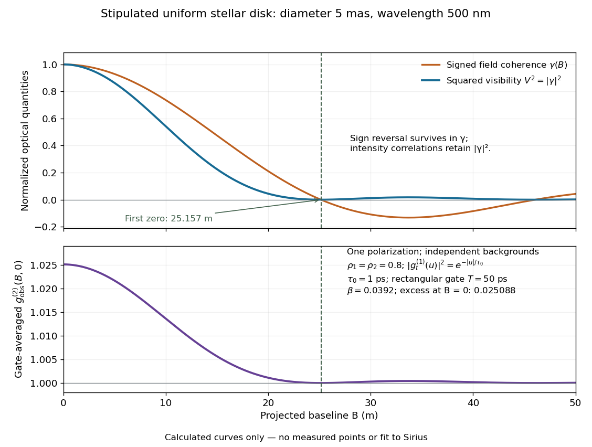

# Uniform-disk stellar visibility

↑ **Parent:** [Stellar intensity interferometry](stellar-intensity-interferometry.md)

Stipulate a distant circular source of uniform angular brightness, full [angular diameter](angular-diameter.md) $\theta\ll1$ in [radians](radian.md), and narrow optical [bandwidth](bandwidth-signal-processing.md) around [wavelength](wavelength.md) $\lambda$. Distinct source patches emit independently. Assume each collector is small enough not to resolve the disk individually. For a sky offset $\boldsymbol\alpha$ from the disk centre, the baseline-dependent [phase difference](phase-difference.md) is $2\pi\mathbf b_\perp\cdot\boldsymbol\alpha/\lambda$, up to channel-sign convention. Summing independent patch contributions makes the equal-delay [first-order optical coherence](first-order-optical-coherence.md) the normalized [Fourier transform](fourier-transform-split.md) of angular brightness:

$$
\gamma(B)=\frac{1}{\pi a^2}\int_{|\boldsymbol\alpha|\leq a}
 e^{i2\pi\mathbf b_\perp\cdot\boldsymbol\alpha/\lambda}\,d^2\boldsymbol\alpha,
\qquad a=\frac\theta2.
$$

Choose the horizontal coordinate along $\mathbf b_\perp$, put $k=2\pi B/\lambda$, and integrate along vertical chords of the disk:

$$
\gamma(B)=\frac{2}{\pi a^2}\int_{-a}^{a}\sqrt{a^2-u^2}\,e^{iku}\,du
=\frac{2J_1(ka)}{ka}=\frac{2J_1(x)}x,
\qquad x=\frac{\pi B\theta}{\lambda}.
$$

The imaginary part cancels between opposite chords. Here $J_1$ is the order-one [Bessel function of the first kind](bessel-function-of-the-first-kind.md). One way to obtain the last equality is to integrate the exponential's [power series](power-series.md) term by term on the finite disk. Equivalently the result is specified by the convergent series

$$
J_1(x)=\sum_{m=0}^{\infty}\frac{(-1)^m(x/2)^{2m+1}}{m!(m+1)!},
\qquad \gamma(B)=1-\frac{x^2}{8}+\frac{x^4}{192}+O(x^6).
$$

At $B=0$ take the continuous limit $\gamma=1$; $V^2=|\gamma|^2$ starts as $1-x^2/4+O(x^4)$. This is why very short [interferometric baselines](interferometric-baseline.md) give little leverage on [angular diameter](angular-diameter.md). Larger disks lose [spatial optical coherence](spatial-optical-coherence.md) at shorter baselines.

The first positive zero of $J_1$ is $x_1\approx3.831705970$, so

$$
B_0=\frac{x_1\lambda}{\pi\theta}\approx\frac{1.21967\lambda}{\theta},
\qquad \theta\approx\frac{1.21967\lambda}{B_0}.
$$

This is a full diameter convention. The [angle](angle.md) must be converted before substitution: one [arcsecond](arcsecond.md) is $\pi/648000$ [radians](radian.md), and one [milliarcsecond](milliarcsecond.md), abbreviated mas, is $10^{-3}$ [arcseconds](arcsecond.md). For the stipulated $\theta=5\,\mathrm{mas}$ and $\lambda=500\,\mathrm{nm}$, $\theta=2.4240684\times10^{-8}\,\mathrm{rad}$ and $B_0\approx25.1575\,\mathrm m$. At $B=10\,\mathrm m$, the model gives $x\approx1.52309$ and $V^2\approx0.542783$.

**[Figure 4](#image-stipulated-uniform-disk-model-signed-field-coherence-squared-visibility-and-finite-gate-intensity-correlation-versus-interferometric-baseline). Stipulated uniform-disk model: signed field coherence, squared visibility and finite-gate intensity correlation versus interferometric baseline**. Original calculated curves for a 5-mas disk at 500 nm, with no measured points. The lower panel uses one polarization, independent signal fractions 0.8 in each channel, and the explicitly specified exponential temporal correlation and 50-ps gate below. It is not a fit to Sirius.

Beyond $B_0$, $\gamma$ changes sign but $V^2$ stays nonnegative and develops weak further lobes. A single measured squared visibility can therefore match several [angular diameters](angular-diameter.md); sampling several [interferometric baselines](interferometric-baseline.md) constrains the fit. [Limb darkening](limb-darkening.md), spectral averaging, or resolved collector apertures change the uniform-disk prediction. A uniform-disk diameter is a parameter of that brightness model; converting it to a physical [stellar radius](stellar-radius.md) also requires distance and an appropriate brightness profile.

**Table of contents**

- [Stellar angular diameter from a visibility envelope](stellar-angular-diameter-from-a-visibility-envelope.md)

## ↑ Ancestors (7)

1. [Stellar intensity interferometry](stellar-intensity-interferometry.md)
2. [Hanbury Brown and Twiss effect](hanbury-brown-and-twiss-effect.md)
3. [Quantum optics](quantum-optics-split.md)
4. [Quantum theory](quantum-theory-split.md)
5. [Branches of physics](branches-of-physics.md)
6. [Physics](physics-split.md)
7. [Codex Wiki](split.md)

## ← Incoming links (3)

- [Transverse coherence estimate](past-exam-of-the-optics-and-electrodynamics-course-of-the-university-of-cambridge/2019/section-a/a3/transverse-coherence-estimate.md)
- [Solution](past-exam-of-the-optics-and-electrodynamics-course-of-the-university-of-cambridge/2022/section-a/3/solution.md)
- [Transverse optical coherence length](transverse-optical-coherence-length.md)
