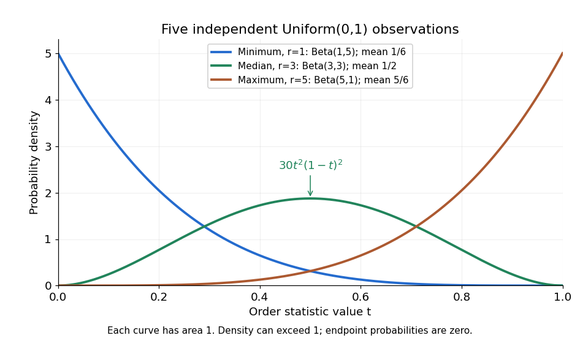

# Uniform order statistic

↑ **Parent:** [Order statistic](order-statistic.md)

For [independent and identically distributed random variables](independent-and-identically-distributed-random-variables.md) $U_1,\ldots,U_n$ with the continuous [uniform distribution](continuous-uniform-distribution.md) on $(0,1)$, the $r$th [order statistic](order-statistic.md) has [Beta distribution](beta-distribution.md)

$$
U_{(r)}\sim\operatorname{Beta}(r,n+1-r),\qquad 1\leq r\leq n.
$$

Its [probability density function](probability-density-function.md), [mean](expected-value-split.md), and [variance](variance-split.md) are

$$
f_r(t)=\frac{n!}{(r-1)!(n-r)!}\,t^{r-1}(1-t)^{n-r},\qquad 0<t<1,
$$

$$
\mathbb E[U_{(r)}]=\frac{r}{n+1},\qquad
\operatorname{Var}(U_{(r)})=\frac{r(n+1-r)}{(n+1)^2(n+2)}.
$$

The [probability density function](probability-density-function.md) is zero outside $[0,1]$; values assigned to its endpoints do not change any [probability](probability.md). Peter Kempthorne's MIT lecture notes derive the [uniform order statistic](uniform-order-statistic.md) law and these [moments](moment.md). [Peter Kempthorne, MIT 18.443, Lecture 11, slides 12–14](https://ocw.mit.edu/courses/18-443-statistics-for-applications-spring-2015/06daf6d78e7eb0465d6bb53e8f96b2ff_MIT18_443S15_LEC11.pdf).

For $n=5$, the [minimum](minimum-of-a-subset-of-a-total-order.md), [sample median](sample-median.md), and [sample maximum](sample-maximum.md) correspond to $r=1,3,5$. Their [probability density functions](probability-density-function.md) are $5(1-t)^4$, $30t^2(1-t)^2$, and $5t^4$, respectively. The [sample median](sample-median.md) therefore has [Beta distribution](beta-distribution.md) $\operatorname{Beta}(3,3)$, [mean](expected-value-split.md) $1/2$, and [variance](variance-split.md) $1/28\approx0.0357143$. Its [cumulative distribution function](cumulative-distribution-function.md) is

$$
\mathbb P(U_{(3)}\leq t)=10t^3(1-t)^2+5t^4(1-t)+t^5=10t^3-15t^4+6t^5,\qquad 0\leq t\leq1.
$$

For instance, $\mathbb P(U_{(3)}\leq1/4)=53/512\approx0.103516$. The [mean](expected-value-split.md) of the [minimum](minimum-of-a-subset-of-a-total-order.md) is $1/6$, and the [mean](expected-value-split.md) of the [sample maximum](sample-maximum.md) is $5/6$. The fixed observed [sample median](sample-median.md) $0.4$ in the [order statistic](order-statistic.md) example is one possible outcome; $1/2$ is the average over repeated [statistical samples](statistical-sample.md) from this [uniform distribution](continuous-uniform-distribution.md).

**[Figure 14](#image-minimum-median-and-maximum-densities-for-five-independent-uniform-observations). Minimum, median, and maximum densities for five independent uniform observations**.

Each curve has area one. The extreme [order statistics](order-statistic.md) favor the ends, while the [sample median](sample-median.md) favors the center. The endpoint density height $5$ is legitimate: the [probability density function](probability-density-function.md) gives area per unit length, rather than point [probability](probability.md). In particular, a continuous [uniform distribution](continuous-uniform-distribution.md) has zero [probability](probability.md) of producing an endpoint.

For a short proof, the [binomial distribution](binomial-distribution.md) counting identity under [order statistic](order-statistic.md) gives $\mathbb P(U_{(r)}\leq t)=\sum_{k=r}^{n}\binom{n}{k}t^k(1-t)^{n-k}$. Taking its [derivative](derivative.md) cancels consecutive terms, leaving the displayed [probability density function](probability-density-function.md). Recognize its normalizing [factorial](factorial.md) coefficient as that of the [Beta distribution](beta-distribution.md), then substitute $\alpha=r$, $\beta=n+1-r$ into the [Beta distribution](beta-distribution.md) [mean](expected-value-split.md) and [variance](variance-split.md) formulas. Although the original observations are [independent](independent-random-variables.md), their [order statistics](order-statistic.md) generally are dependent; see the positive [covariance of two uniform order statistics](covariance-of-two-uniform-order-statistics.md).

## ↑ Ancestors (6)

1. [Order statistic](order-statistic.md)
2. [Probability theory](probability-theory-split.md)
3. [Probability and statistics](probability-and-statistics-split.md)
4. [Area of mathematics](area-of-mathematics.md)
5. [Mathematics](mathematics-split.md)
6. [Codex Wiki](split.md)

## ← Incoming links (13)

- [Kolmogorov-Smirnov statistic](kolmogorov-smirnov-statistic.md)
- [Nearest neighbour density estimation](nearest-neighbour-density-estimation.md)
- [Order statistic](order-statistic.md)
- [Solution](past-exam-of-the-mathematics-course-of-the-university-of-cambridge/2005/iii/paper-12/6/c/solution.md)
- [Solution](past-exam-of-the-mathematics-course-of-the-university-of-cambridge/2009/ib/paper-4/19h/solution.md)
- [Solution](past-exam-of-the-mathematics-course-of-the-university-of-cambridge/2014/iii/paper-34/1/solution.md)
- [Solution](past-exam-of-the-mathematics-course-of-the-university-of-cambridge/2017/ii/paper-2/25k/b/solution.md)
- [Solution](past-exam-of-the-mathematics-course-of-the-university-of-cambridge/2017/iii/paper-216/1/c/solution.md)
- [Solution](past-exam-of-the-mathematics-course-of-the-university-of-cambridge/2018/iii/paper-210/1/solution.md)
- [Solution](past-exam-of-the-mathematics-course-of-the-university-of-cambridge/2023/iii/paper-210/1/solution.md)
- [Probability content of a nearest neighbour ball](probability-content-of-a-nearest-neighbour-ball.md)
- [Uniform linearized chord diagram](uniform-linearized-chord-diagram.md)
- [Uniform order statistic](uniform-order-statistic.md)
